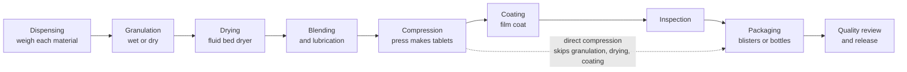
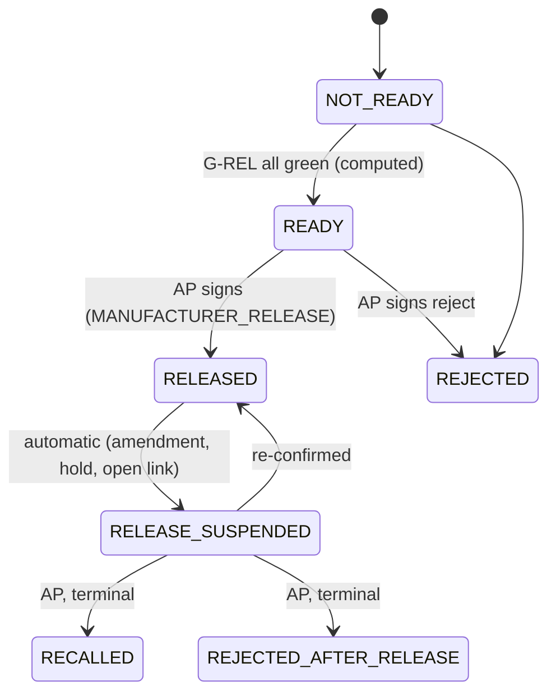
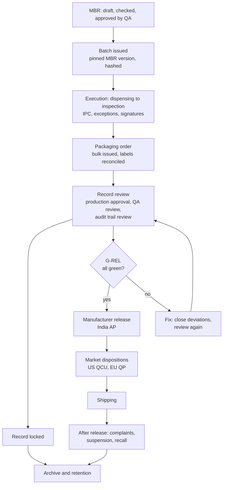

# Pharma for developers

**Draft**

This page explains the pharma world behind the eBMR code. It is for developers who have never worked in a drug
factory. It tells you what a batch of medicine is, how tablets are made, why the rules are so strict, who signs what,
and what happens after a batch is released. Each section ends with an "In the code" line that points to the module
guide and, where it is easy to confirm, to the control that the code carries. Terms in *italics* the first time they
appear are also in the [glossary](02-glossary.md). Writing rules for this handbook are in [STYLE.md](STYLE.md).

All regulations here are paraphrased in plain words. They are not legal advice and not a substitute for the
originals. The authoritative source for what this project must do is the control register in
[compliance/controls/](../../compliance/controls/), not this page.

## Where the code is

| What | Where |
|---|---|
| Controls (the rules this software must prove) | [compliance/controls/](../../compliance/controls/) |
| Demo batch GB-T-01 (wet granulation, blisters, India) | [gb-t-01 README](../../apps/tablets-server/test/golden/gb-t-01/README.md) |
| Demo batch GB-T-02 (direct compression, bottles, US refused) | [gb-t-02 README](../../apps/tablets-server/test/golden/gb-t-02/README.md) |
| Module guides | [kernel](modules/kernel.md), [site-services](modules/site-services.md), [expr](modules/expr.md), [recipe-core](modules/recipe-core.md), [api-contract](modules/api-contract.md), [tablets-server](modules/tablets-server.md), [tablets-web](modules/tablets-web.md), [integrations](modules/integrations.md), [shared-kits](modules/shared-kits.md), [injectables](modules/injectables.md), [tools](modules/tools.md) |

## 1. What a batch is

A *batch* is one defined quantity of a medicine, made in one run, from one set of starting materials, so that it can
be treated as uniform. If something goes wrong with a patient years later, the batch number is how the company finds
out what went into that medicine, who made it, on which machine, and where the rest of it went.

The batch number is the key to everything. The software issues it, never reuses it, and ties every record to it.

In the demo data:

- **GB-T-01** is a batch of 2,00,000 tablets of an invented product (an active ingredient called "Exemplazine").
  (Indian notation: 2,00,000 means two hundred thousand.) It is made by *wet granulation*, coated, and packed into
  blister packs. It is made for India.
- **GB-T-02** is a batch of 1,00,000 uncoated tablets of another invented product ("Exemplafen"). It is made by
  *direct compression* and packed into plastic bottles of 30 tablets. It is made for India, and then a test tries to
  add the US as a market. The software refuses, because one ingredient lot was released on a lighter route that
  the US does not accept. You will see why in section 12.

Both products are invented on purpose. No real or patented product is in the repository.

In the code: batch numbers and lots are in [site-services](modules/site-services.md); the batch itself and its
execution are in [recipe-core](modules/recipe-core.md). Control [IN-18](../../compliance/controls/IN-18.yaml) covers
batch numbering.

## 2. How tablets are made

A tablet factory works in *stages*. Each stage takes material in, changes it, and passes material out. Between stages
the material sits in labelled containers. The eBMR follows each container.

1. **Dispensing.** Staff weigh each ingredient from its stock container into a labelled container. A second person
   checks each weighing. The active ingredient is often weighed with a correction. In GB-T-01 the active comes as a
   salt, and the batch is specified as the free base. So the software multiplies by a *salt factor* (322.33 / 300.35 =
   1.073181...) and also adjusts for the lot's measured purity (assay 99.20 % on a dry basis, 0.80 % water). The result
   is 54.529 kg of the active lot, rounded up to the scale's readability. A filler (microcrystalline cellulose) is
   reduced by the same amount so the total stays the same.
2. **Granulation.** Fine powders do not flow well. Granulation sticks them into small grains. In *wet granulation* a
   liquid binder (here povidone dissolved in water and isopropyl alcohol) is mixed in. GB-T-01 uses a split granulation:
   two sub-lots made by the same steps.
3. **Drying.** The wet grains are dried in a fluid bed dryer until their moisture, the *loss on drying* (LOD), is
   below a limit. GB-T-01 shows a loop: on one sub-lot the first check reads 4.1 %, the operator dries longer, and the
   second check reads 2.9 %. Loops and their maximum number of rounds are part of the master record.
4. **Blending and lubrication.** The dried granules are mixed with the outer ingredients: a disintegrant (helps the
   tablet fall apart in the body), a glidant (helps powder flow) and a lubricant (stops sticking in the press).
   Mixing time matters: too little is not uniform, too much over-lubricates.
5. **Compression.** The press squeezes the blend into tablets. Every so often staff take a sample and check weight,
   hardness, thickness. These are *in-process controls* (section 8). GB-T-01 has a failing weight check on the right
   side of the press (8480.0 mg for 20 tablets), which holds the container made since the last good check.
6. **Coating.** A thin film coat is sprayed on. The target is a weight gain (3.0 % in GB-T-01; the result was 2.93 %).
7. **Inspection.** Tablets are inspected and bad ones are rejected. Rejects are destroyed in front of a witness.
8. **Packaging.** In GB-T-01 tablets go into blister packs. In GB-T-02 they go into HDPE bottles, with labels, cartons
   and shipper boxes. Packaging is a separate batch record (a *packaging order*) that takes a counted amount of the
   bulk tablets. Labels carry the batch number, so label counts must balance exactly (section 8).

The unpackaged tablets are called *bulk*. A bottle that is filled but not yet labelled is called *bright stock*. It is
set aside and tagged, and it can be labelled later only for the same batch and product.

In the code: stage blocks for tablets are in [tablets-server](modules/tablets-server.md) (files `tb-01` to `tb-24`
under `apps/tablets-server/src/blocks`). The generic blocks (weighing G-07, IPC G-13, yield G-20, printed materials
G-21 and so on) are explained in [recipe-core](modules/recipe-core.md). Bright stock is control
[PR-38](../../compliance/controls/PR-38.yaml). Expressions such as the salt factor are in [expr](modules/expr.md),
which uses exact decimals, never floating point.

## 3. The master batch record and the executed batch record

Two kinds of record exist, and developers mix them up.

- The **master batch record (MBR)** is the approved recipe: ingredients, quantities, steps, limits, equipment, checks,
  who must sign. It is written once per product, strength and batch size, checked by an independent person and approved
  by the quality unit. It has versions.
- The **executed batch record** (also called the BMR, the *batch manufacturing record*, or just the batch record) is
  the filled-in copy for one batch: what was really done, with real weights, times, names and signatures.

An *eBMR* is the electronic version of both. When a batch is *issued*, the software takes the approved MBR version,
resolves it (quantities scaled, market rules applied), and freezes it with a hash. From then on the batch never
changes its recipe, even if a newer MBR version is approved. This is invariant INV-02 and also INV-01 (a batch has
exactly one pinned MBR version). A master can be valid in one market and not another; the software tracks this per
market.

In the code: MBR life cycle and issue are in [recipe-core](modules/recipe-core.md). Related controls:
[PR-01](../../compliance/controls/PR-01.yaml) (master scope), [PR-02](../../compliance/controls/PR-02.yaml)
(independent check and quality approval), [PR-04](../../compliance/controls/PR-04.yaml) (market validity).

## 4. Why GMP exists

*GMP* (Good Manufacturing Practice, or *cGMP*, the "c" meaning current) is the set of rules that stops a medicine
from harming a patient because of how it was made. A medicine cannot be fully checked by testing the final tablet:
you test a few tablets, and cannot test the rest. So the rules require the process to be controlled and the whole
history to be written down. If it is not written down, in the eyes of an inspector it did not happen.

Two ideas drive almost every rule in this code.

**Patient safety.** The right ingredient, the right amount, no mix-up with another product, no contamination, the
right label on the right pack, a stable product until its expiry date.

**Data integrity.** The record must be trustworthy. Regulators describe this with *ALCOA+*. In plain words, a record is:

| Letter | Meaning | Example in the code |
|---|---|---|
| Attributable | You can tell who did it and when | Every entry is bound to a person and a role |
| Legible | It can be read for as long as it is kept | True copies and archive packs |
| Contemporaneous | It is written when it happens | The database clock stamps every event |
| Original | The first capture is kept; copies are marked as copies | Raw data is kept; PDFs are copies |
| Accurate | It is correct and checked | Calculations are computed, not typed |
| + Complete, Consistent, Enduring, Available | Nothing missing; same order of events; lasts the retention period; can be shown to an inspector | Insert-only tables, retention engine |

The big consequence for developers: **you almost never update or delete a GMP row.** A correction adds a new row that
links to the old one with a reason. This is invariant INV-06. Every change writes an audit event in the same
transaction (INV-07). Time comes from the database server clock, never the browser (INV-16).

In the code: [kernel](modules/kernel.md) holds the audit trail, signatures and time. See controls
[DI-22](../../compliance/controls/DI-22.yaml) (what the audit trail captures) and
[DI-23](../../compliance/controls/DI-23.yaml) (always on, cannot be changed, tamper-evident).

## 5. The regulators, and "the stricter rule wins"

This project serves Indian manufacturers who export, so several rule sets apply at once.

| Rule set | What it is, in plain words | Why it matters here |
|---|---|---|
| **India Revised Schedule M** | The GMP rules inside India's Drugs Rules, 1945. The revised version aligns India with international norms. | Always applies. Every batch here is made under an Indian licence. |
| **CDSCO and state licensing** | India's central and state drug regulators. A factory needs a manufacturing licence for the kind of product (Form 25 for the usual tablets and similar; Form 28 for the sterile product classes). A company can also make under another firm's licence: a *loan licence* (Forms 25A and 28A). | Licence checks happen before a batch is issued and again at release. |
| **US FDA, 21 CFR Parts 210 and 211** | The US cGMP rules for finished drugs. Part 211 includes batch records, their review, and laboratory controls. | Applies when the US is a market. |
| **US FDA, 21 CFR Part 11** | Rules for electronic records and electronic signatures: audit trails, unique signatures, what a signature shows, how it links to the record. | Shapes the whole e-signature and audit design. |
| **EU GMP (EudraLex Volume 4)** | The EU's GMP guide. Chapter 4 is documentation. | Applies when the EU is a market. |
| **EU GMP Annex 11** | Computerised systems: validation, audit trail review, data checks, electronic signatures. | Shapes the audit-trail review and system controls. |
| **EU GMP Annex 16 and the QP** | A *Qualified Person* certifies each batch before it may be sold in the EU. | Shapes the EU market disposition (section 11). |

**The stricter rule wins.** A batch can be made once and sold in several markets. For each rule (a hold time, a
retention period, how many signatures), the software resolves one value that satisfies India and every market in
scope, and it must be at least as strict as India's (invariant INV-28). The result, and the market that decided it, is
stored with the batch (INV-29). This is the *market profile* mechanism. It is why you will see "governing market" in
the data.

In the code: market rule resolution is in [kernel](modules/kernel.md); the control is
[IN-52](../../compliance/controls/IN-52.yaml). India-specific rules are in
[site-services](modules/site-services.md) (licences, export permissions) and the control family `IN`.

## 6. Roles, signatures, and the four-eyes principle

### Roles

People hold *roles*. The names below are in the code or the controls. A site may use other names, but the duties
exist everywhere.

| Role | What they do | In plain words |
|---|---|---|
| **Operator** | Does the work: weighs, runs the press, fills the record | Performs steps. |
| **Supervisor** | Oversees production, verifies, signs stage completion, can hold a batch | Production management. |
| **QA** (quality assurance) | Reviews records, approves masters, handles deviations, signs the "quality" gates | The independent watchdog inside the company. |
| **QC** (quality control) | The laboratory: tests materials, in-process samples, finished product | Produces test results. The head of QC approves them. |
| **QCU** (quality control unit; the "quality unit") | The US term for the function that approves or rejects batches and has authority over quality | In the code, "QCU" is the US disposition authority. |
| **AP** (authorised person) | India's named person who certifies each finished lot before it is released from the factory | Signs the *manufacturer release*. |
| **QP** (qualified person) | The EU's equivalent, personally responsible for certifying each batch for the EU market | Signs the *EU certification*. |
| **Investigator** | A person who investigates a deviation or an out-of-specification (OOS) result | Not a fixed job title; a role on a record. |
| **Administrator** | Manages accounts, devices, settings | Must hold no GMP role (INV-11). |

A person who acts as administrator and also holds a GMP role could change the system and the records. So the software
refuses that combination anywhere in the installation (INV-11, control
[DI-18](../../compliance/controls/DI-18.yaml)). Role and training gates are in
[IN-04](../../compliance/controls/IN-04.yaml).

### E-signatures and what they mean

An *electronic signature* is the legal equivalent of a handwritten one. A signature in this software is not a picture
or a checkbox. It is a record that holds: the signer's name, user ID, role, the *meaning* of the signature, the date and
time with zone, and a hash of exactly the content that was signed. Each signature uses a fresh authentication
(password, or badge plus PIN), bound to that one signature (INV-10). If the signed content changes, the signature
becomes invalid in the same transaction (INV-09, control [DI-37](../../compliance/controls/DI-37.yaml)).

The *meaning* tells why the person signed: "performed by", "verified by", "witnessed by", "checked", "approved",
"reviewed", "released", and so on. The same person at the same step cannot have two conflicting meanings. A *signable
action* is the code's name for one kind of signing event, such as `MANUFACTURER_RELEASE`, `REVIEW_ACT` or
`DEVIATION_CLOSE`. Each signable action fixes which role may sign it and which content is signed. The list is in
`packages/api-contract/src/signable.ts`. The catalogue of every signing point is control
[DI-35](../../compliance/controls/DI-35.yaml); what a signature shows is
[DI-36](../../compliance/controls/DI-36.yaml).

### Four-eyes, verification, witnessing

The *four-eyes principle* says an important action needs a second, independent person. In the code:

- **Verification.** A second person confirms a critical step (for example each weighing). That person must not be
  someone who performed, entered data in or corrected that step (INV-03, control
  [PR-20](../../compliance/controls/PR-20.yaml)).
- **Witness.** A person watches and signs for a one-off act, such as destroying rejected tablets.
- **MBR approval.** The author, the checker and the approver are three different people, and nobody who edited the
  content since it last became a draft may check or approve it (INV-04).
- **Batch review and release.** The person who signs the audit-trail review, the manufacturer release or a market
  disposition must be outside the batch's *involvement set*: not a person who worked on the batch (INV-35).
- **No verification by zero humans.** Automatic checking by a single system is allowed only for the narrow case the
  FDA rule on automated equipment allows (INV-31).

In the code: [kernel](modules/kernel.md) holds the signing function and the role checks; the kernel also keeps the
"who counts as involved" logic with [recipe-core](modules/recipe-core.md). Controls: DI-21 (signature policy),
DI-35, DI-36, DI-37 above.

## 7. The audit trail

The *audit trail* is a secure, computer-written log of who did what, when, and why, for every change to a GMP record.
A user cannot switch it off, edit it or delete it. It records old and new values and the reason for a change. A
hash chain links the events, so if anyone alters the database directly, the chain fails its check (INV-08). Chains have
checkpoints, and anchors are stored outside the main data.

Regulators also expect people to **review** the audit trail as part of batch review. The software tracks a "high-water
mark": the point to which events were reviewed. At release, the mark must cover every in-scope audit event, or a signed
*delta review* must cover the rest (INV-48).

In the code: [kernel](modules/kernel.md) for the chain; [recipe-core](modules/recipe-core.md) for the review acts.
Controls: [DI-22](../../compliance/controls/DI-22.yaml), [DI-23](../../compliance/controls/DI-23.yaml),
[DI-25](../../compliance/controls/DI-25.yaml) (review of the audit trail within batch review).

## 8. In-process controls, limits, yields and reconciliation

**In-process controls (IPC)** are checks made during production, not after: tablet weight, hardness, thickness,
moisture, blend time, coating gain. Each has *limits*. This project uses limit *tiers*, from the widest to the
narrowest: the registered limit (filed with the regulator), the validated limit (proven during validation), the
internal action limit, and the alert limit. Outside a tier, the software raises an *exception* with a severity (ALERT,
ACTION, or CRITICAL). An ACTION or CRITICAL exception can block the batch until QA dispositions it. In GB-T-02 the
press weight check is 20 tablets (4,000 mg expected).

**Yield** is how much good output you got compared with the theoretical amount. In GB-T-02 compression, theoretical
input was 20.000 kg and good tablets were 19.500 kg, so 97.50 %. The software shows two numbers beside each other
because they answer different questions: good output on its own (A/T = 97.50 %), and good output plus reusable
residue ((A + B)/T = 98.25 %). Yield has limits; outside them, an investigation is required.

**Reconciliation** is bookkeeping: everything issued must equal everything used plus everything returned plus
everything destroyed plus specimens, with nothing unexplained. It is strict for **printed packaging materials**,
because a stray label with a batch number could end up on the wrong product. In GB-T-02, 3,250 roll labels were
issued: 3,200 used, 20 destroyed after coding, 26 returned uncoded, 4 specimens, unexplained 0. Labelling
reconciliation always runs, even for Indian-made product (INV-32).

*Derived values* such as expiry date, theoretical yield and scaled quantities are always computed, never typed
(INV-25). A step cannot finish before its minimum duration and a maximum breach always raises an exception (INV-20).

In the code: limits, yields and exceptions are in [recipe-core](modules/recipe-core.md); exact decimal arithmetic is in
[expr](modules/expr.md). Controls: [PR-31](../../compliance/controls/PR-31.yaml) (yield),
[PR-39](../../compliance/controls/PR-39.yaml) and [IN-17](../../compliance/controls/IN-17.yaml) (reconciliation),
[ST-01](../../compliance/controls/ST-01.yaml) (every limit has a regulatory floor).

## 9. Deviations, OOS, CAPA, change control

- A **deviation** is any departure from the approved instructions or specifications. Examples: a step done out of
  order, an expired material used, a machine alarm ignored. It is recorded, classified (minor, major, critical),
  investigated for root cause, assessed for impact on each batch and market, and closed with a conclusion. Nobody
  approves their own deviation. The deviation-to-batch links are insert-only (INV-46). Controls:
  [PR-49](../../compliance/controls/PR-49.yaml), [IN-20](../../compliance/controls/IN-20.yaml).
- An **OOS** (out of specification) is a lab result outside its limit. It starts a lab investigation: first for lab
  error, then a wider one. A failing result never becomes passing by correction, void or retest without an approved
  invalidation record (INV-41). An *OOT* (out of trend) is a result that is inside the limit but off the normal pattern.
- **CAPA** (corrective and preventive action) is what the company does to fix the cause and stop recurrence. In this
  project CAPA is shown as recorded on the deviation's closure basis; there is no separate CAPA register yet
  (see the `pqr` notes in `packages/api-contract/src/ns/pqr.ts`).
- **Change control** governs changes to anything that affects quality: a master record, an ingredient supplier, a
  machine. A change is risk-classified, approved, and the first batch after the change is evaluated. Controls:
  [PR-06](../../compliance/controls/PR-06.yaml), [IN-03](../../compliance/controls/IN-03.yaml),
  [IN-02](../../compliance/controls/IN-02.yaml) (risk classification).

Real example in GB-T-01: the exception-rich variant has a failing weight IPC. The right-side container is held, QA
raises a deviation, a supervisor links it, QA dispositions it as "deviation raised", and after the investigation QA
releases the container. Nothing is deleted or overwritten at any step.

*Reprocessing* means putting non-conforming or leftover material back through a step. It is tightly controlled: QCU
authorisation citing an investigation, a pre-approved reprocessing MBR, a new batch number linked to the parent
(INV-33). A smaller form, a *recovery addition*, adds milled cores from an earlier batch into a new blend within a cap.
GB-T-01 does this (2.000 kg of a 41-day-old batch of the same product; cap 3 % of 81.660 kg). The QC unit must
authorise it and decide whether extra testing is needed ([PR-47](../../compliance/controls/PR-47.yaml)).

In the code: deviations, OOS and LIMS-lite are in [site-services](modules/site-services.md); the exception register and
the hold behaviour are in [recipe-core](modules/recipe-core.md).

## 10. Batch record review and review by exception

Before release, the company reviews the full record. A person in QA reads the filled-in record against the master,
checks signatures, checks that every limit was met or every exception was handled, and signs. In the US this duty is
written into the batch production record review rule; in India and the EU the same duty exists in Schedule M and
Chapter 4.

*Review by exception* means that because the software already enforced the rules, the reviewer concentrates on what
did not go to plan: the exception register, deviations, corrections, late entries. The software shows the reviewer
a "since review" list for anything that changed after the review. Production approves first, then QA (INV-30). The
reviewer signs the evidence *epoch* the reviewer saw (section 11).

In the code: [recipe-core](modules/recipe-core.md) (`review` and `release` namespaces,
`packages/recipe-core/sql/0710_review_register.sql` and `0712_review_acts.sql`). Control:
[DI-25](../../compliance/controls/DI-25.yaml).

## 11. Release: manufacturer release, market dispositions and the gate G-REL

*Release* is the formal decision that a finished lot may leave quarantine and be sold. Nothing ships without it
(INV-42). This project splits it in two.

1. **Manufacturer release (India).** The authorised person (AP) certifies the lot. It always happens, for every
   batch, whatever the export markets. It is the gate for everything after it (INV-39).
2. **Market dispositions** (one per export market and finished lot). In the US, the quality control unit releases or
   rejects. In the EU, the QP certifies; until then the lot may only go to the named importer as quarantined stock.
   One market's decision never changes another's. The only link: every market disposition needs the manufacturer
   release to be RELEASED at that instant.

**G-REL** is the *release gate*. It is a computed checklist for a finished lot and a market. It must be entirely green
before the AP (or the market's authority) can sign. Its groups include: the evidence set and review done; deviations
closed or assessed; tests passed and samples taken; reconciliation within limits; materials still usable; licence,
change and validation checks; no unassessed incident; the market-add evaluation; the finished-pack examination;
and the edition's own items. G-REL is calculated outside the signing transaction, then re-confirmed inside it at
an unchanged **evidence epoch** (INV-05). The epoch is a counter that goes up whenever any write could affect release
(a new deviation link, a changed lot status, a late lab result). If the epoch moved between the AP's look and the AP's
signature, the signature is refused, and the AP must look again. The signature stores the checklist it signed.

The manufacturer release has these states: `NOT_READY` then `READY` (computed by G-REL, never set by anyone) then
`RELEASED` or `REJECTED`. After release it can go to `RELEASE_SUSPENDED` and then back to `RELEASED`, or to the
terminal `RECALLED` or `REJECTED_AFTER_RELEASE`. An EU disposition also has `AWAITING_QP_CERTIFICATION`, `CERTIFIED`
and `REJECTED_BY_QP`. A market can be `INELIGIBLE`, which is the result for GB-T-02's US attempt.

### The life cycle at a glance

A worked example, GB-T-02: the lot is released for India (G-REL green from signed records, the AP's
MANUFACTURER_RELEASE). QA then adds the US to the released lot. The "market-add evaluation" has an item that is
UNMET_FINAL: the microcrystalline cellulose lot was released on the vendor-history route, so no identity test
result exists for it. The US disposition becomes `INELIGIBLE` and the US QC unit's release is refused. The lot
stays valid for India. This follows INV-43 (a disposition cannot become READY while an item is unmet) and shows the
"stricter rule wins" principle at work.

In the code: [recipe-core](modules/recipe-core.md) holds G-REL and the release states
(`packages/recipe-core/sql/0781_manufacturer_release.sql`); shipping and the EU QP package are in
[site-services](modules/site-services.md) and [kernel](modules/kernel.md). Controls:
[IN-05](../../compliance/controls/IN-05.yaml) (disposition by the AP),
[PR-54](../../compliance/controls/PR-54.yaml) (US disposition),
[PR-56](../../compliance/controls/PR-56.yaml) (market-specific dispositions),
[DI-39](../../compliance/controls/DI-39.yaml) (quality-unit disposition, QP certification, quarantine interlock),
[PR-53](../../compliance/controls/PR-53.yaml) (open deviations block release).

## 12. After release: suspension, recall, rejection, disposal

Release is not the end. Things found later can reopen the question.

- **Suspension.** A released lot goes to `RELEASE_SUSPENDED` automatically when something undermines it. Examples:
  QA opens an amendment on the batch record, or a linked investigation opens. The suspension cascades to every market
  decision for the lot (INV-39). To come back, someone re-confirms the release with the evidence.
- **Recall.** If a lot is already in the market and found defective, the AP decides a recall. The state is `RECALLED`
  (terminal). Complaints and genealogy queries (which lots used this ingredient lot?) support this. Control:
  [IN-29](../../compliance/controls/IN-29.yaml).
- **Rejection after release.** `REJECTED_AFTER_RELEASE` is the other terminal state.
- **Disposal.** Rejected, returned or recalled goods must be destroyed, reprocessed or returned to the supplier, with
  records and often a witness. Returned goods leave quarantine only after QC's signed assessment, and with any
  doubt, only by destruction. The software lists the routes `WITNESSED_DESTRUCTION`, `REPROCESSING` and `RETURN`.
  Control: [PR-48](../../compliance/controls/PR-48.yaml) (returned products).

Shipping is blocked from the ERP side when a lot has no current manufacturer release or has an open post-release
link (INV-42).

In the code: after-release acts are in [recipe-core](modules/recipe-core.md) (tests in the `after-release` area of the
tablets server); the ERP shipping interlock is in [site-services](modules/site-services.md)
(`packages/site-services/sql/0870_erp_shipping_interlock.sql`).

## 13. Record locking, amendments, true copies, archive and retention

- **Locking.** A processing record locks when its bulk reconciliation closes. A packaging record locks at its lot's
  first manufacturer disposition. After that the database refuses every write (INV-21).
- **Amendments.** A locked record changes only through an amendment: QA opens it with a signature, citing a deviation
  or change record. The amendment appends entries. It never edits the record. Opening it suspends the release of lots
  made from the record, and the AP gets a market-impact task. QA signs again to close it.
- **True copies.** A *true copy* is a complete, exact copy of a record, certified as such, for example a PDF/A of the
  batch record given to an inspector or to the EU QP. A copy must be marked as a copy and must show enough to
  prove it matches the original. The software hashes the content and can verify a file offline: one changed byte fails.
  Control: [DI-41](../../compliance/controls/DI-41.yaml). Copies for inspection: DI-40.
- **Contingency forms.** If the system is down, the factory uses numbered paper forms. Each is issued, returned,
  transcribed by one person and verified by a second, or voided. A missing one needs a deviation. QA signs the
  reconciliation. Control: [DI-43](../../compliance/controls/DI-43.yaml).
- **Retention.** Batch records are kept for the longest period of all the rules that apply: for India, at least a
  period past the batch's expiry; for other markets, other periods. The retention engine computes the earliest date a
  record may go and which rule decided it. Nothing is purged before that date or while on hold (INV-22); a purge
  leaves a tombstone. Controls: [DI-47](../../compliance/controls/DI-47.yaml),
  [IN-08](../../compliance/controls/IN-08.yaml), [PR-59](../../compliance/controls/PR-59.yaml).
- **Reserve and retention samples.** Samples of each finished lot and starting material are kept for a period after
  expiry ([IN-32](../../compliance/controls/IN-32.yaml)).

In the code: locks and amendments are in [recipe-core](modules/recipe-core.md) (see
`packages/api-contract/src/ns/records-lock.ts`); the archive and retention are in [kernel](modules/kernel.md) and
[tablets-server](modules/tablets-server.md) (see `packages/api-contract/src/ns/archive.ts`).

## 14. The product quality review (PQR)

The *product quality review* (also called the annual product review, APR) looks back over a period at all batches of a
product: yields, deviations, changes, complaints, trends. It tells the company whether the process is still in
control. In this project the extract is a versioned database query whose result is hashed and reconciled to the
batch number register, the deviation register and the change records. A mismatch fails the run. The authorised person
signs it off. Controls: [IN-01](../../compliance/controls/IN-01.yaml), [PR-58](../../compliance/controls/PR-58.yaml).

In the code: `packages/api-contract/src/ns/pqr.ts` and [tablets-server](modules/tablets-server.md).

## 15. Validation, briefly

Software and processes used in GMP must be proved fit for use. This is *validation*.

- **IQ** (installation qualification): installed correctly.
- **OQ** (operational qualification): works across its operating ranges.
- **PQ** (performance qualification): performs in real use.
- **PPQ** (process performance qualification): for a process, commercial-scale batches proving it is repeatable.
  G-REL checks the PPQ outcome, or the rule for concurrent release where allowed.
- **Computerised system validation (CSV):** the software's own proof. The repository's tests carry control IDs in
  their names (for example `[DI-22]`), and a trace gate fails CI when a due control has no passing test. Deep validation
  (IQ/OQ/PQ at the customer site) belongs to deployment, by owner decision 0008.

In the code: [shared-kits](modules/shared-kits.md) (`validation-kit`) and [tools](modules/tools.md) (register and trace
gate. Control: [DI-03](../../compliance/controls/DI-03.yaml) (computerised-system validation). Training and
simulation data are kept in a separate *sandbox* database ([DI-05](../../compliance/controls/DI-05.yaml), INV-18).

## How this connects to the repository

- The **controls** (`compliance/controls/*.yaml`) have four families: DI (data integrity and electronic records),
  PR (production record), IN (India), ST (sterile products). See the [glossary](02-glossary.md).
- The **invariants** (INV-01 to INV-48) are rules that must always hold. Each is enforced in PostgreSQL where
  possible. See the glossary.
- The **demo batches** GB-T-01 and GB-T-02 run the whole life cycle in tests with hand-computed expected numbers.
  Read their READMEs next to this page.
- Next: [Glossary](02-glossary.md), then the architecture page.
