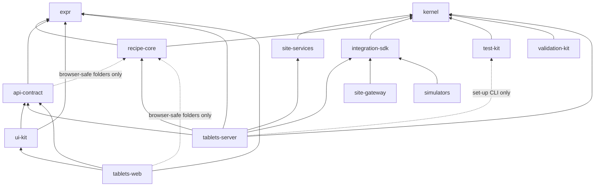

# Architecture

**Draft**

This page explains how the eBMR code is put together: the packages and apps, the rules about who may import whom,
why most rules live in PostgreSQL, and how one request travels from a screen to the database and back. It then
walks through the cross-cutting mechanisms every feature uses: sessions, e-signatures, the audit trail, time,
decimals, state machines, market profiles, the sandbox, editions, notifications and error codes. Read it after the
[primer](01-pharma-primer.md) and the [glossary](02-glossary.md), before the module guides. Every name on this page
links to the file that defines it, so you can check it.

## Where the code is

| Area | Start here |
|---|---|
| Boundaries | [.dependency-cruiser.cjs](../../.dependency-cruiser.cjs), proven by [boundaries.test.ts](../../tools/boundaries/test/boundaries.test.ts) |
| Migrations | [migrate.ts](../../packages/kernel/src/db/migrate.ts), [db.ts in test-kit](../../packages/test-kit/src/db.ts#sym=editionMigrationSources) |
| Database roles and conventions | [0001_bootstrap.sql](../../packages/kernel/sql/0001_bootstrap.sql), [ADR 0012](../adr/0012-privilege-separation-security-definer-transitions.md), [ADR 0016](../adr/0016-validated-actor-context-and-definer-hardening.md) |
| Audit trail | [0010_audit_trail.sql](../../packages/kernel/sql/0010_audit_trail.sql), [ADR 0007](../adr/0007-hash-chained-audit-trail-checkpoints-anchors-restore-events.md) |
| Route table | [routes.ts](../../packages/api-contract/src/routes.ts), [route.ts](../../packages/api-contract/src/route.ts), [client.ts](../../packages/api-contract/src/client.ts) |
| Server | [app.ts](../../apps/tablets-server/src/app.ts), [platform/](../../apps/tablets-server/src/platform/), [features/](../../apps/tablets-server/src/features/) |
| Web | [apps/tablets-web/src/app/](../../apps/tablets-web/src/app/), [features/](../../apps/tablets-web/src/features/) |
| E-signatures | [kernel esig README](../../packages/kernel/src/esig/README.md), [0230_esig_sign.sql](../../packages/kernel/sql/0230_esig_sign.sql) |
| State machines | [kernel state README](../../packages/kernel/src/state/README.md), [0550_platform_state_engine.sql](../../packages/kernel/sql/0550_platform_state_engine.sql) |
| Time | [kernel time README](../../packages/kernel/src/time/README.md) |
| Market rules | [kernel market README](../../packages/kernel/src/market/README.md) |
| Sandbox | [kernel sandbox README](../../packages/kernel/src/sandbox/README.md) |
| Decimals | [expr README](../../packages/expr/src/README.md) |

## 1. The big picture in five sentences

1. The product is a web application: a React single-page app in the browser
   ([apps/tablets-web](../../apps/tablets-web/)) talks JSON over HTTPS to a Node.js server
   ([apps/tablets-server](../../apps/tablets-server/), Fastify), which talks to one PostgreSQL 16 database.
2. The browser decides nothing that matters for GMP. It shows, previews and collects input
   ([ADR 0006](../adr/0006-server-authoritative-execution-no-device-signing.md): "the server decides").
3. The server checks the session, builds the *actor context* (who is acting, in which role, from which terminal),
   and calls database functions inside one transaction.
4. The database functions and triggers are the final judges: they refuse anything the rules forbid, write the audit
   trail, and check signatures. Even a bug in the server, or a person with the application's database password,
   cannot skip them.
5. Everything shared between the two products (Tablets now, Injectables later) is in `packages/`; everything that
   belongs to one product is in `apps/`.

## 2. Packages and apps

The repository is a pnpm monorepo. Each folder under `packages/` and `apps/` is one npm package named `@ebmr/<name>`.

| Package or app | What it holds | Imports (inside the repo) |
|---|---|---|
| [packages/kernel](../../packages/kernel/) | The compliance kernel: identity and access (`iam`), e-signatures (`esig`), audit trail (`kernel`), time, idempotency, outbox and state machines (`platform`), market rules (`market`), records, retention and true copies (`records`), backups and protected counters (`continuity`), sandbox (`sandbox`). | nothing |
| [packages/expr](../../packages/expr/) | The calculation language: exact decimals, units, rounding. | nothing |
| [packages/site-services](../../packages/site-services/) | Data one site shares between editions: batch-number register, material lots, deviations, specifications, LIMS-lite, ERP masters, India licences (schema `site`). | kernel |
| [packages/recipe-core](../../packages/recipe-core/) | The recipe engine: flows, validator, simulator, execution engine, limits, MBR life cycle, generic blocks G-01 to G-25, plant (equipment, rooms, containers), review, release, dispositions, record locking (schemas `recipe`, `plant`, `formulary`). | kernel, expr |
| [packages/api-contract](../../packages/api-contract/) | The route table and every request and response shape (zod). Shared by server and browser. | expr, the browser-safe part of recipe-core |
| [packages/ui-kit](../../packages/ui-kit/) | Shared React components and screen state machines (the signing ceremony, the kiosk lock). | api-contract, expr |
| [packages/integration-sdk](../../packages/integration-sdk/) | Contracts for adapters (ERP, LIMS, scales, printers, OPC UA). | kernel |
| [packages/test-kit](../../packages/test-kit/), [packages/validation-kit](../../packages/validation-kit/) | Test harness (databases, personas); validation-pack generators. | kernel |
| [apps/tablets-server](../../apps/tablets-server/) | The Tablets server: platform, features, and the edition's own migrations (schema `tab`). | every shared package |
| [apps/tablets-web](../../apps/tablets-web/) | The Tablets screens. | api-contract, expr, recipe-core (browser-safe part), ui-kit |
| [apps/site-gateway](../../apps/site-gateway/), [apps/simulators](../../apps/simulators/) | Equipment gateway and device simulators. | integration-sdk only |
| [apps/injectables-server](../../apps/injectables-server/), [apps/injectables-web](../../apps/injectables-web/) | Placeholders for the Injectables edition (built after Tablets v1.0, decision 0010). | |

**Why this split.**

- **Two products, one core** ([ADR 0001](../adr/0001-two-editions-separate-databases-shared-site-services.md),
  [ADR 0011](../adr/0011-recipe-core-shared-between-editions.md)). Tablets and Injectables are separate products with
  their own server, screens and database. What both need (signatures, audit trail, the recipe engine) is written once.
- **The kernel holds no process logic.** It knows about people, signatures, audit and time, never about granulation.
  That keeps the part that carries most data-integrity controls small and stable.
- **`expr` stands alone** so calculations can be validated on their own and run the same in the browser (preview) and
  on the server.
- **Exact version pins** ([ADR 0015](../adr/0015-exactly-pinned-shared-packages.md)). An app depends on
  `"@ebmr/kernel": "workspace:0.1.0"`, never a range. A change to a shared package reaches an edition only when that
  edition raises its pin, under its own change control.



## 3. The dependency boundaries

[.dependency-cruiser.cjs](../../.dependency-cruiser.cjs) turns the split into rules. CI fails on any violation, and
[boundaries.test.ts](../../tools/boundaries/test/boundaries.test.ts) proves each rule fires on a fixture.

| Rule | What it forbids | Why |
|---|---|---|
| `no-app-to-app` | an app importing another app | The two editions stay separate products. |
| `no-package-to-app` | a package importing an app | Shared code must not depend on one edition. |
| `kernel-is-self-contained`, `expr-is-self-contained` | kernel or expr importing anything else in the repo | The compliance core and the calculation language are validated on their own. |
| `recipe-core-allowed-deps` | recipe-core importing anything but kernel and expr | Keeps the engine edition-neutral. |
| `no-runtime-import-of-tools` | product code importing `tools/` | Tooling is never part of the shipped product. |
| `no-circular` | import cycles | |
| `browser-safe`, `browser-safe-no-node-core` | web code, ui-kit or api-contract importing the kernel, site-services, a database driver, a node core module, or the server-only folders of recipe-core | The browser bundle must never carry database code or secrets. |
| `api-contract-allowed-deps`, `ui-kit-allowed-deps` | the contract depending on more than zod, expr and the pure recipe-core folders | The contract runs in both server and browser. |
| `recipe-core-pure-no-kernel`, `pure-code-no-node-core` | the pure recipe-core folders (`flow`, `validator`, `limits`, `simulator`, `engine`, `blocks`, `pure.ts`) importing the kernel, a driver or node core | These run in the browser for previews. |
| `test-kit-never-imports-apps`, `product-never-imports-test-kit` | the harness depending on apps; product code using the harness (except the tablets set-up CLI) | Test helpers never ship. |
| `gateway-and-simulators-no-db` | the gateway or simulators reaching a database or the kernel | Devices talk to the server through the integration contracts only. |
| `e2e-imports` | browser tests importing app internals | E2E tests drive the product from outside. |

Two other CI rules shape the code (see [REPO-GUIDE.md](../../REPO-GUIDE.md)): the **clock ban** (section 10) and the
**decimal rule** (section 11).

## 4. Rules live in PostgreSQL

This is the most important design choice to understand. A GMP rule ("a verifier is not the performer", "a signed
record cannot change silently", "a batch cannot start before the room is clear") is enforced **in the database**, by
functions and triggers, not only in TypeScript. The TypeScript code may check the same rule earlier to give a nicer
message, but the database has the last word.

**Why.** Regulators expect controls that cannot be bypassed ([ADR 0012](../adr/0012-privilege-separation-security-definer-transitions.md),
decision 8: every invariant has a database enforcement and a bypass test that attacks it with raw SQL). If the rules
lived only in the server, anyone with the application's database login (a leaked password, a careless script, a
future second server) could write records that break them. In the database, the same rule applies to every writer.

### 4.1 Roles

Created in [0001_bootstrap.sql](../../packages/kernel/sql/0001_bootstrap.sql) and later kernel migrations:

| Role | Login? | What it may do |
|---|---|---|
| `ebmr_owner` | no | Owns every table and every SECURITY DEFINER function. Nobody logs in as it; migrations create objects owned by it. |
| `ebmr_app` | yes | The server's role on a GMP database. Reads what it is granted; writes **only** by calling granted functions. No UPDATE or DELETE on audit, signature or status data; no INSERT on most GMP tables. |
| `ebmr_authn` | yes | The authentication service: the only role that records authentication events (logins and signing authentications). |
| `ebmr_sandbox` | yes | The only role of a sandbox database; no way into a GMP database (DI-05). |
| `ebmr_listener`, `ebmr_sandbox_listener` | yes | The device evidence listener (kernel 0980). |

The server opens two pools: the application pool and the authentication pool
([pools.ts](../../apps/tablets-server/src/platform/db/pools.ts#sym=createPools)). The roles come from configuration
([config.ts](../../apps/tablets-server/src/config.ts)).

### 4.2 SECURITY DEFINER functions

A SECURITY DEFINER function runs with the rights of its owner (`ebmr_owner`), not of the caller. That is how
`ebmr_app` can insert a deviation without having INSERT on `site.deviation`: it calls
[site.raise_deviation](../../packages/site-services/sql/0730_deviation_lite.sql#sym=site.raise_deviation), which
checks the rules and then inserts.

Conventions (ADR 0012 decision 4 and [ADR 0016](../adr/0016-validated-actor-context-and-definer-hardening.md)):

- Owned by `ebmr_owner`. EXECUTE is revoked from PUBLIC by default (0001) and granted to named roles only
  (`grant execute on function ... to ebmr_app`).
- Fixed `search_path`, with `pg_temp` last: `set search_path = pg_catalog, <its schemas>, pg_temp`. Otherwise a caller
  could create a temporary table named like a real one and trick the function. TEMPORARY is also revoked on the
  database. A repository-wide test,
  [definer-hardening.test.ts](../../packages/kernel/test/security/definer-hardening.test.ts), fails the build for any
  definer that breaks this.
- The first lines check who is acting: the validated actor context (section 6), "not an administrator"
  ([iam.assert_not_administrator](../../packages/kernel/sql/0130_iam_qualifications_authority.sql#sym=iam.assert_not_administrator),
  DI-18), and the permission at this moment
  ([iam.require_permission](../../packages/kernel/sql/0130_iam_qualifications_authority.sql#sym=iam.require_permission),
  DI-17).
- Refusals are raised as `raise exception using errcode = 'P0001', message = 'EBMR-AREA-nnn ...'` (section 17).

### 4.3 Insert-only and audited tables

Most GMP tables are **insert-only**: a fact, once written, is never updated or deleted. A change is a new row (a
correction, an event, a new version). A module registers each GMP table with
[kernel.register_audited_table](../../packages/kernel/sql/0010_audit_trail.sql#sym=kernel.register_audited_table)
`(table, aggregate_type, aggregate_column, insert_only)`. That adds, by one naming rule
([kernel.required_triggers](../../packages/kernel/sql/0010_audit_trail.sql#sym=kernel.required_triggers)):

- `zz_audit_<schema>_<table>`: AFTER INSERT/UPDATE/DELETE, runs
  [kernel.audit_row_change](../../packages/kernel/sql/0010_audit_trail.sql#sym=kernel.audit_row_change) (writes the
  audit entry);
- on insert-only tables also `aa_insert_only_<schema>_<table>` (BEFORE UPDATE OR DELETE) and
  `aa_no_truncate_<schema>_<table>` (BEFORE TRUNCATE), both running
  [kernel.reject_mutation](../../packages/kernel/sql/0010_audit_trail.sql#sym=kernel.reject_mutation).

Trigger names start with `aa_` (runs first: guards), `a1_`, ... or `zz` (runs last: audit, epochs). PostgreSQL fires
triggers of the same kind in name order, so the prefix sets the order.

A table whose rows must change (a state row, a status) is changed only by an owner function that checks the
transition (section 12). Where a "current status" is needed on an insert-only design, it is usually *derived* by a
function from the event rows (for example `site.deviation_state` reads `site.deviation_event`).

> **Why this exists**
> - **Pharma reason:** the original entry must always be kept; a change must not hide what was there before.
> - **Control:** [DI-23](../../compliance/controls/DI-23.yaml), [DI-24](../../compliance/controls/DI-24.yaml), invariant INV-06.
> - **Code:** [kernel.reject_mutation](../../packages/kernel/sql/0010_audit_trail.sql#sym=kernel.reject_mutation), [kernel.audit_triggers_ok](../../packages/kernel/sql/0010_audit_trail.sql#sym=kernel.audit_triggers_ok) (GMP writes are refused while any required trigger is missing or disabled, `EBMR-AUDIT-005`).
> - **Tests:** [audit-trail.test.ts](../../packages/kernel/test/audit/audit-trail.test.ts).

### 4.4 Schemas

| Schema | Created by | Holds |
|---|---|---|
| `kernel` | kernel 0001 | audit trail, actor context, installation marker |
| `iam` | kernel 0100 | persons, accounts, roles, qualifications, devices, authentication, sessions |
| `esig` | kernel 0200 | signature catalogue, challenges, signatures, seals |
| `market` | kernel 0300 | rule tables, resolutions |
| `records` | kernel 0400 | record register, retention, incidents, true copies, contingency forms |
| `platform` | kernel 0500 | time, outbox, idempotency, state engine |
| `continuity` | kernel 0600 | backups, protected counters, anchors |
| `sandbox` | kernel 0800 | sandbox rules and identifier guards |
| `site` | site-services 0600 | batch numbers, lots, deviations, QC, ERP masters, licences |
| `recipe` | recipe-core 0100 | MBRs, batches, execution, review, release |
| `plant` | recipe-core 0400 | equipment, rooms, logbooks, output containers |
| `formulary` | recipe-core 0640 | product formulas |
| `tab` | tablets 0001 | the Tablets edition: sessions binding, devices and readings, edition blocks |

All of them live in **one database per installation** (for example `ebmr_tablets_demo` and
`ebmr_sandbox_tablets_demo` in [setup.ts](../../apps/tablets-server/src/cli/setup.ts)). Note: ADR 0001 describes a
separate site-services database per site; today the `site` schema is migrated into the edition database (see
[editionMigrationSources](../../packages/test-kit/src/db.ts#sym=editionMigrationSources)).

## 5. Migrations

The database is built only by SQL migration files. The runner is
[migrate](../../packages/kernel/src/db/migrate.ts#sym=migrate) in `packages/kernel/src/db/migrate.ts`.

- **Namespaces.** Each package with SQL is one namespace with its own folder, applied in this order:
  `kernel` ([packages/kernel/sql](../../packages/kernel/sql/)), `site-services`
  ([packages/site-services/sql](../../packages/site-services/sql/)), `recipe-core`
  ([packages/recipe-core/sql](../../packages/recipe-core/sql/)), then the edition, `tablets`
  ([apps/tablets-server/sql](../../apps/tablets-server/sql/)). The order is set by
  [editionMigrationSources](../../packages/test-kit/src/db.ts#sym=editionMigrationSources) (used by the server set-up,
  the demo and the tests). Inside a folder, files run in name order (`0010_...` before `0100_...`).
- **One transaction per file.** A file that fails rolls back completely.
- **Checksums.** The table `public.schema_migration` stores `(namespace, name, checksum)` for each applied file, with
  a SHA-256 of its text. If an applied file has changed, the runner stops with "changed after it was applied".
- **Never edit an applied migration.** To change a function, write a new migration with
  `create or replace function`. That is why many functions have several definitions: the **last** one in the
  namespace order is the one in force. The [database catalogue](reference/db-catalogue.md) lists where each function
  is defined and replaced; this handbook always links the version in force.
- **Cluster lock.** Each file first locks `pg_catalog.pg_authid`, so two databases on one cluster never create the
  same role at once.

## 6. How a request travels

We follow one real request: a QA person raises a deviation on the deviations screen.

### 6.1 The web screen

[DeviationsPage.tsx](../../apps/tablets-web/src/features/quality/DeviationsPage.tsx) renders a
[DefineForm](../../apps/tablets-web/src/app/define-form.tsx#sym=DefineForm) with `route={routes.quality.raiseDeviation}`.
The form builds the body from its fields and calls the typed client
[api](../../apps/tablets-web/src/api/client.ts#sym=api). Each web feature registers its screens in
[WEB_FEATURES](../../apps/tablets-web/src/app/features.ts#sym=WEB_FEATURES).

### 6.2 The contract

The route is defined once, in [ns/quality.ts](../../packages/api-contract/src/ns/quality.ts#sym=quality):

- `id: 'quality.raiseDeviation'`, `method: 'POST'`, `path: '/api/quality/deviations'`;
- `installation: 'GMP'` (a sandbox server does not register it at all, so it answers 404 there);
- `auth: 'SESSION'`, `mutating: true`;
- `body` and `response` as zod schemas.

[defineRoute](../../packages/api-contract/src/route.ts#sym=defineRoute) fills the defaults: an idempotency key is
REQUIRED for mutating SESSION routes, and every text field refuses characters no record can store. Every namespace
file is collected in the route table [routes](../../packages/api-contract/src/routes.ts#sym=routes).

[createApiClient](../../packages/api-contract/src/client.ts#sym=createApiClient) turns a route into a call: it fills
the path, adds the CSRF header, a fresh `Idempotency-Key` UUID for REQUIRED routes, sends the JSON, and **parses the
answer with the route's response schema**. A non-2xx answer is parsed as a
[RefusalEnvelope](../../packages/api-contract/src/common.ts#sym=RefusalEnvelope). So the browser and the server cannot
silently disagree on a shape: a drift fails a test.

GMP numbers travel as strings ([DecimalString](../../packages/api-contract/src/common.ts#sym=DecimalString)) and
instants as epoch microseconds in a string, never as JavaScript numbers.

### 6.3 The server

[buildApp](../../apps/tablets-server/src/app.ts#sym=buildApp) assembles the server:

1. checks that the database is the expected kind (GMP or sandbox) and reads the site time zone from the site policy;
2. builds the [AppContext](../../apps/tablets-server/src/platform/context.ts#sym=AppContext) (config, pools, read
   database, guidance catalogue, signable-action registry, ports);
3. installs the error mapper ([installErrorHandling](../../apps/tablets-server/src/platform/http/errors.ts#sym=installErrorHandling))
   and the security hooks ([installSecurity](../../apps/tablets-server/src/platform/http/security.ts#sym=installSecurity):
   strict CSP, exact Origin, cookies, CSRF);
4. registers every feature of [FEATURES](../../apps/tablets-server/src/features/index.ts#sym=FEATURES) whose
   installation matches.

Each feature calls [bindRoutes](../../apps/tablets-server/src/platform/http/bind.ts#sym=bindRoutes) with its namespace
and one handler per route (a missing handler is a compile error). Every request passes the same gates, in order:

1. correlation id, `X-Ebmr-Installation` header, exact Origin and `Sec-Fetch-Site` on non-GET requests;
2. session: 401 without a live session, 423 when locked, 409 until a role is chosen
   ([sessionOf](../../apps/tablets-server/src/platform/http/bind.ts#sym=sessionOf),
   [admitSession](../../apps/tablets-server/src/platform/http/bind.ts#sym=admitSession));
3. CSRF token bound to the session;
4. `Idempotency-Key` present (428 otherwise);
5. on shared shop-floor terminals, a fresh badge tap of the person acting (INV-40);
6. the handler, with the request already validated by zod.

The handler for our example is in [features/quality/index.ts](../../apps/tablets-server/src/features/quality/index.ts#sym=plugin):

```ts
raiseDeviation: async ({ body, actor, idempotencyKey, requestHash }) => {
  const out = await withIdempotentActorCommand(pool, actor(), idempotencyKey ?? '', requestHash, async (c) => {
    const { rows } = await c.query('select site.raise_deviation($1::jsonb) as r', [JSON.stringify(body)]);
    return rows[0]?.r.deviationId ?? '';
  });
  return deviationView(pool, out.result);
},
```

- `actor()` builds the [ActorContext](../../packages/kernel/src/db/command.ts#sym=ActorContext) **from the resolved
  session only** ([actorFrom](../../apps/tablets-server/src/platform/auth/actor.ts#sym=actorFrom)): person, account,
  role, session, device, site zone, correlation id. Nothing the browser says about who it is counts.
- [withIdempotentActorCommand](../../apps/tablets-server/src/platform/db/commands.ts#sym=withIdempotentActorCommand)
  opens one transaction, calls `kernel.begin_command` with the actor, claims the idempotency key
  ([platform.claim_idempotency_key](../../packages/kernel/sql/0540_platform_idempotency.sql#sym=platform.claim_idempotency_key)),
  runs the work, stores the answer and commits. A retry with the same key and the same request gets the stored answer;
  the same key with a different request is refused. The plain version is
  [withActorCommand](../../apps/tablets-server/src/platform/db/commands.ts#sym=withActorCommand), built on the kernel's
  [withCommand](../../packages/kernel/src/db/command.ts#sym=withCommand).
- Reads that need no command use the application pool directly or the typed Kysely read database
  ([createReadDb](../../apps/tablets-server/src/platform/db/read.ts#sym=createReadDb)). Writes never go through Kysely.

### 6.4 In the database

1. [kernel.begin_command](../../packages/kernel/sql/0010_audit_trail.sql#sym=kernel.begin_command) checks the shape of
   the context, then the identity module's
   [kernel.validate_actor_context](../../packages/kernel/sql/0190_iam_actor_context.sql#sym=kernel.validate_actor_context)
   (account, session, device and authentication event are real and active, the site zone is the site's), and installs
   it with [kernel.set_actor_context](../../packages/kernel/sql/0010_audit_trail.sql#sym=kernel.set_actor_context).
   That keeps one marker per connection in `kernel.command_marker`, so a context written by hand with `set_config` is
   never trusted ([kernel.current_actor](../../packages/kernel/sql/0010_audit_trail.sql#sym=kernel.current_actor)
   returns NULL for it).
2. [site.raise_deviation](../../packages/site-services/sql/0730_deviation_lite.sql#sym=site.raise_deviation) reads the
   actor, refuses an administrator, checks permission `DEVIATION.RAISE` at the actor's site, checks the body
   (`EBMR-SITE-301`), takes an advisory lock, computes the next reference (`DEV-<site>-<year>-<serial>`, with a `TEST-`
   prefix in a sandbox) and inserts the row.
3. The insert fires the audit trigger on `site.deviation`
   ([registered](../../packages/site-services/sql/0730_deviation_lite.sql) as insert-only on aggregate `deviation`),
   which appends a hash-chained entry on the chain `deviation:<id>` (section 8).
4. The transaction commits: row, audit entry and idempotency answer together, or nothing.

### 6.5 The answer

The handler reads the new deviation back and returns it; Fastify validates it against the response schema. If any
step raised an error, [mapError](../../apps/tablets-server/src/platform/http/errors.ts#sym=mapError) turns it into a
`RefusalEnvelope`: the code (for example `EBMR-SITE-301`), the database's own message as `why`, plus "what happened,
what you can do, who can help" from the guidance catalogue
([GuidanceCatalogue](../../apps/tablets-server/src/platform/http/guidance.ts#sym=GuidanceCatalogue)). Unknown errors
are logged with the correlation id and answered as INTERNAL ("nothing was saved").

```mermaid
sequenceDiagram
  participant W as Web screen (DeviationsPage)
  participant C as api client (createApiClient)
  participant S as Server (bindRoutes gates)
  participant H as Handler (quality plugin)
  participant DB as PostgreSQL
  W->>C: submit form (routes.quality.raiseDeviation)
  C->>S: POST /api/quality/deviations + cookie, CSRF, Idempotency-Key
  S->>S: Origin, session, role, CSRF, key, zod body
  S->>H: handler({ body, actor, idempotencyKey })
  H->>DB: begin; kernel.begin_command(actor)
  H->>DB: platform.claim_idempotency_key
  H->>DB: select site.raise_deviation(body)
  DB->>DB: checks: not admin, DEVIATION.RAISE, body
  DB->>DB: insert site.deviation
  DB->>DB: trigger zz_audit_site_deviation -> kernel.audit_row_change
  H->>DB: store answer; commit
  H-->>S: DeviationView
  S-->>C: 200 JSON (validated by response schema)
  C-->>W: { ok: true, value }
  Note over S,C: on a refusal: RefusalEnvelope (code EBMR-..., why, guidance)
```

## 7. Sessions and authentication

- **Devices first.** Each terminal is a registered device with a key held by the browser (WebCrypto). Before login
  the browser proves it holds the key ([device-proof.ts](../../apps/tablets-server/src/platform/auth/device-proof.ts)).
  Device id, class (office, shared kiosk, ...) and room come from the device registry, never from what the browser
  says (ADR 0006 decision 8).
- **Login** ([features/session/index.ts](../../apps/tablets-server/src/features/session/index.ts)): user ID and
  password in the office, badge and PIN on a kiosk. It runs on the **authentication pool**: the kernel's
  [authenticate](../../packages/kernel/src/identity/authentication.ts#sym=authenticate) calls
  [iam.authn_prepare](../../packages/kernel/sql/0160_iam_authentication_sessions.sql#sym=iam.authn_prepare) and
  [iam.authn_finish](../../packages/kernel/sql/0160_iam_authentication_sessions.sql#sym=iam.authn_finish), which
  record an authentication event in `iam.auth_event`. Failures commit too and count toward lockout (DI-19).
- **Session.** [openSession](../../packages/kernel/src/identity/sessions.ts#sym=openSession) opens a kernel session
  (`iam.session`) from that event. The server then makes a random 256-bit token, puts it in an HttpOnly, SameSite=Strict
  cookie (one cookie name per installation) and stores only its SHA-256 with
  [tab.bind_session](../../apps/tablets-server/sql/0480_bind_session_needs_live_role.sql#sym=tab.bind_session)
  ([session.ts](../../apps/tablets-server/src/platform/auth/session.ts)). The kernel session id itself never leaves
  the server.
- **Every request** resolves the cookie with
  [tab.resolve_session](../../apps/tablets-server/sql/0550_session_terminal_key.sql#sym=tab.resolve_session)
  ([resolveSession](../../apps/tablets-server/src/platform/auth/session.ts#sym=resolveSession)): states ACTIVE, LOCKED,
  IDLE_LOCKED, ENDED, EXPIRED, ROLE_WITHDRAWN. A person works in one role at a time, chosen after login.
- **Shared terminals.** On SHARED and GRADE_A_B devices every GMP command carries a fresh badge tap of the person it is
  attributed to (route attribution `FRESH_ON_SHARED`, INV-40), so a command is never attributed to whoever logged in
  last.
- **Logout** unbinds the token
  ([tab.unbind_session](../../apps/tablets-server/sql/0001_tab_foundation.sql#sym=tab.unbind_session)) and ends the
  kernel session.

## 8. The audit trail

The audit trail ([0010_audit_trail.sql](../../packages/kernel/sql/0010_audit_trail.sql),
[ADR 0007](../adr/0007-hash-chained-audit-trail-checkpoints-anchors-restore-events.md)) is written **by the database,
in the same transaction** as the change. Nothing in TypeScript writes audit rows.

- **Who.** The validated actor context (section 6.4). A GMP write without it fails. The entry stores person, legal
  name at the time, account, role, session, device, source, correlation id, the server's UTC time and the site zone.
- **What.** [kernel.audit_row_change](../../packages/kernel/sql/0010_audit_trail.sql#sym=kernel.audit_row_change)
  records old and new values in canonical JSON
  ([kernel.row_json](../../packages/kernel/sql/0010_audit_trail.sql#sym=kernel.row_json)).
- **Why.** A change after first entry needs a reason code and text (`EBMR-AUDIT-002`, DI-22). Blank-looking text
  (zero-width spaces and the like) counts as blank (`kernel.is_blank`).
- **Chains.** Entries form one hash chain per aggregate (`deviation:<id>`, `batch:<id>`, ...): each entry's hash is
  SHA-256 over the previous hash and the entry. Only
  [kernel.append_audit_event](../../packages/kernel/sql/0010_audit_trail.sql#sym=kernel.append_audit_event) writes
  `kernel.audit_event`; the application role cannot insert, update or delete it, and since tablets 0420 cannot even
  select it (it reads through session-checked functions).
- **Business entries.** [kernel.audit_business_event](../../packages/kernel/sql/0010_audit_trail.sql#sym=kernel.audit_business_event)
  adds a plain-language line ("Batch issued") with the same correlation id as the row entries.
- **Tamper evidence.** [kernel.verify_chain](../../packages/kernel/sql/0010_audit_trail.sql#sym=kernel.verify_chain)
  recomputes a chain; [kernel.run_chain_verification](../../packages/kernel/sql/0010_audit_trail.sql#sym=kernel.run_chain_verification)
  checks every chain, keeps the run, and raises a critical alarm on channel `ebmr_integrity_alarm`.
  [kernel.create_anchor](../../packages/kernel/sql/0010_audit_trail.sql#sym=kernel.create_anchor) builds a Merkle root
  over all chain heads, to be copied to write-once storage outside the database. A superuser who rewrites rows
  inside the database cannot match the outside copy. DDL is logged in `kernel.ddl_log`.

> **Why this exists**
> - **Pharma reason:** every GMP record must show who did what, when and why, and that nothing was changed unseen
>   (21 CFR 11.10(e), EU GMP Annex 11 section 9, Schedule M data-integrity rules).
> - **Control:** [DI-22](../../compliance/controls/DI-22.yaml), [DI-23](../../compliance/controls/DI-23.yaml), invariants INV-06, INV-07, INV-08.
> - **Code:** [kernel.audit_row_change](../../packages/kernel/sql/0010_audit_trail.sql#sym=kernel.audit_row_change), [kernel.verify_chain](../../packages/kernel/sql/0010_audit_trail.sql#sym=kernel.verify_chain).
> - **Tests:** [audit-trail.test.ts](../../packages/kernel/test/audit/audit-trail.test.ts), [verification.test.ts](../../packages/kernel/test/audit/verification.test.ts), [actor-context.test.ts](../../packages/kernel/test/audit/actor-context.test.ts).

## 9. E-signatures

An electronic signature binds a person, a meaning ("approved", "verified", "released") and the exact content signed.
The kernel module is described in the [esig README](../../packages/kernel/src/esig/README.md); here is how it fits
the app.

**Signing meanings.** The catalogue `esig.meaning_type`
([0210_esig_catalogue.sql](../../packages/kernel/sql/0210_esig_catalogue.sql#sym=esig.meaning_type)) lists every
signature type: its permissions, the text shown, independence rules (who must not sign it, for example the performer),
whether it may be witnessed or delegated. Edition migrations add meanings (for example tablets
[1140_review_signing_meanings.sql](../../apps/tablets-server/sql/1140_review_signing_meanings.sql)). DI-35.

**Signable actions.** The server has one set of signing endpoints ([ns/esig.ts](../../packages/api-contract/src/ns/esig.ts#sym=esig):
`content`, `createChallenge`, `sign`, `signatures`). What a signature *does* (approve an MBR, issue a batch, release a
lot) is a **signable action**: a handler registered by a feature in the
[SignableActionRegistry](../../apps/tablets-server/src/platform/ports.ts#sym=SignableActionRegistry), looked up by
`kind` (`MBR_TRANSITION`, `GMP_BATCH_ISSUE`, `QUALITY_ACT`, `RELEASE_ACT`, ...; the list is in
[signable.ts](../../packages/api-contract/src/signable.ts)). A handler supplies the preview, `prepareForChallenge`,
`dryRun` and `apply`.

**The ceremony** (server side in [features/esig/index.ts](../../apps/tablets-server/src/features/esig/index.ts), web
side in [ceremony.tsx](../../apps/tablets-web/src/features/access/ceremony.tsx#sym=CeremonyHost) running the ui-kit
[ceremonyMachine](../../packages/ui-kit/src/machines/ceremony.ts#sym=ceremonyMachine)):

1. **Content.** `GET /api/esig/content` returns the canonical text, its content version and SHA-256
   ([esig.content_for_signing](../../packages/kernel/sql/0200_esig_foundation.sql#sym=esig.content_for_signing), or the
   handler's preview). The browser shows exactly this text and checks the hash.
2. **Challenge.** `POST /api/esig/challenges` with the browser's hash.
   [esig.create_challenge](../../packages/kernel/sql/0230_esig_sign.sql#sym=esig.create_challenge) rebuilds the
   content and refuses a different hash (`EBMR-ESIG-013`: the record changed while you were reviewing it). The
   challenge is single use, valid 120 seconds, bound to the signer, the session and the terminal.
3. **Authenticate.** The signer enters password or PIN. The server authenticates on the authentication pool with
   purpose SIGNATURE for that challenge, which records one authentication event.
4. **Sign.** One idempotent command whose actor carries that event: the handler's `dryRun`; then the kernel's
   [sign](../../packages/kernel/src/esig/signing.ts#sym=sign), which calls
   [esig.sign](../../packages/kernel/sql/0230_esig_sign.sql#sym=esig.sign) (the only writer of `esig.signature`) and
   seals the row ([esig.seal_signature](../../packages/kernel/sql/0230_esig_sign.sql#sym=esig.seal_signature), HMAC or
   Ed25519 key); then the handler's `apply` with the real signature id (for example the state transition). All in one
   transaction: a failure anywhere rolls back the signature, the seal and the use of the authentication event.
5. **Failures** are logged after the rollback
   ([logSigningFailure](../../packages/kernel/src/esig/signing.ts#sym=logSigningFailure),
   [tab.record_signing_failure](../../apps/tablets-server/sql/0620_signing_failure_log_session.sql#sym=tab.record_signing_failure)).

What `esig.sign` checks, in order: challenge unused, unexpired, same session and terminal; a per-record lock
([esig.aggregate_lock](../../packages/kernel/sql/1020_esig_lock_read_committed.sql#sym=esig.aggregate_lock)); the
authentication event is the same person's, for this challenge, fresh and unused (no proxy signing); the components
(ID + password or badge + PIN, DI-38); the person may sign
([iam.assert_can_sign](../../packages/kernel/sql/0170_iam_signing_readiness.sql#sym=iam.assert_can_sign)); the record
still has the same version, hash and expected state; authority at this instant; delegation; independence (a verifier
is never a performer, INV-03, via
[iam.evaluate_segregation](../../packages/kernel/sql/0170_iam_signing_readiness.sql#sym=iam.evaluate_segregation)).
A guard trigger ([esig.signature_guard](../../packages/kernel/sql/1112_signature_row_backed_by_its_challenge.sql#sym=esig.signature_guard))
refuses any signature row not backed by its challenge and authentication event (INV-10), and a deferred constraint
trigger ([esig.signature_sealed_check](../../packages/kernel/sql/0220_esig_signatures.sql#sym=esig.signature_sealed_check))
refuses to commit an unsealed signature.

**A later change invalidates a signature (INV-09).** Every signed table is registered with
[esig.register_signed_table](../../packages/kernel/sql/0220_esig_signatures.sql#sym=esig.register_signed_table). Its
AFTER trigger ([esig.on_signed_content_change](../../packages/kernel/sql/0220_esig_signatures.sql#sym=esig.on_signed_content_change))
compares each signature's hash with the record's new hash and writes `SUPERSEDED_BY_CHANGE` rows in
`esig.signature_invalidation`. Before acting on a signature, module code calls
[esig.assert_signature](../../packages/kernel/sql/0230_esig_sign.sql#sym=esig.assert_signature) (`EBMR-ESIG-070` unless
it exists, has the meaning, belongs to the record and is still valid). DI-37.

**Epochs: a later change refuses the act (INV-05).** Some acts sign a judgement about *other* records' evidence: the
QA review of a batch record, the release gate G-REL, a market disposition. For these, recipe-core keeps an **evidence
epoch** per subject (`BATCH`, `LOT`, `CONTAINER`, `DEVIATION`) in
[recipe.evidence_epoch](../../packages/recipe-core/sql/0718_review_gates_and_epoch_rows.sql#sym=recipe.evidence_epoch).
Triggers ([0714_evidence_epoch_triggers.sql](../../packages/recipe-core/sql/0714_evidence_epoch_triggers.sql)) call
[recipe.bump_epoch](../../packages/recipe-core/sql/0718_review_gates_and_epoch_rows.sql#sym=recipe.bump_epoch) whenever
evidence moves: an exception raised, a deviation linked, a lot state changed, a QC result approved. An act that
evaluated evidence names the epoch it saw
([recipe.epoch_of](../../packages/recipe-core/sql/0718_review_gates_and_epoch_rows.sql#sym=recipe.epoch_of)); if the
epoch moved before the signature commits, the act is refused. So nobody can release a lot on a gate computed before a
new OOS result arrived. See [the life of a batch](04-life-of-a-batch.md) for where each epoch is checked.

```mermaid
sequenceDiagram
  participant U as Signer (browser, ceremonyMachine)
  participant S as Server (features/esig)
  participant A as Auth pool (ebmr_authn)
  participant DB as PostgreSQL (app pool)
  U->>S: GET /api/esig/content (aggregate, intent)
  S->>DB: esig.content_for_signing or handler preview
  S-->>U: canonical text, content version, hash
  U->>U: show text, check SHA-256
  U->>S: POST /api/esig/challenges (client hash)
  S->>DB: handler.prepareForChallenge; esig.create_challenge
  DB-->>S: challenge (120 s, this signer, session, terminal)
  S-->>U: manifestation preview, components to ask
  U->>S: POST /api/esig/sign (challenge, password or PIN)
  S->>A: authenticate (purpose SIGNATURE, challenge)
  A-->>S: authentication event
  S->>DB: begin; begin_command(actor + auth event)
  S->>DB: handler.dryRun
  S->>DB: esig.sign (checks, insert signature, audit)
  S->>DB: esig.seal_signature
  S->>DB: handler.apply (e.g. platform.transition with signature_id)
  S->>DB: commit
  S-->>U: SIGNED (manifestation)
  Note over S,DB: any refusal: rollback, then esig failure logged outside the transaction
```

## 10. Time

**Rule:** domain code never reads the computer's clock. Every GMP time comes from the **database clock**
(`clock_timestamp()`).

- **Why.** A record's time is evidence. A browser or server clock can be wrong or changed by a user; the database
  server's clock is one controlled, monitored source (DI-27, 21 CFR 11.10(e) "time-stamped audit trails").
- **The ban.** ESLint ([eslint.config.js](../../eslint.config.js)) forbids `Date.now`, `new Date()` without arguments
  and any other way to reach the clock through `Date`, in all domain code. Exempt: the kernel's time module, the
  server's [platform/clock.ts](../../apps/tablets-server/src/platform/clock.ts) (lifetimes of in-memory tickets only,
  never a record), the web's display [clock.ts](../../apps/tablets-web/src/app/clock.ts) (countdowns from the server's
  time), simulators, tools and tests. [clock-ban.test.ts](../../tools/boundaries/test/clock-ban.test.ts) proves each
  form is caught.
- **Database time is enforced.** Event-time columns default to `clock_timestamp()` and are registered with
  [platform.enforce_db_time](../../packages/kernel/sql/0500_platform_base.sql#sym=platform.enforce_db_time): a trigger
  overwrites any supplied value. When the server needs "now" it asks the database
  ([dbNowUs](../../apps/tablets-server/src/platform/db/commands.ts#sym=dbNowUs), via `tab.now_micros()`).
- **Two times per event (INV-16).** `recorded_at` (database, always) and an optional claimed `occurred_at` with a
  trust level (`DEVICE_SYNCED`, `DEVICE_UNSYNCED`, `USER_CLAIMED`, `PAPER`). Only a machine identity may claim device
  trust. A person-claimed time makes the entry late; late entries need a reason, and beyond a window a supervisor
  co-signature ([platform.check_late_entry](../../packages/kernel/sql/0530_platform_time_model.sql#sym=platform.check_late_entry)).
- **Trusted time sources.** NTP references are registered by one person and confirmed by another
  (`platform.time_source`, [0520_platform_time_sources.sql](../../packages/kernel/sql/0520_platform_time_sources.sql#sym=platform.time_source));
  a drift monitor ([platform.record_drift_check](../../packages/kernel/sql/0520_platform_time_sources.sql#sym=platform.record_drift_check))
  raises alarms when the database clock drifts or loses its references.
- **Site zone.** Every entry stores the site's IANA time zone from the site policy `site.zone`
  ([kernel.site_zone](../../packages/kernel/sql/0010_audit_trail.sql#sym=kernel.site_zone)), never the browser's. The
  server re-reads the policy before each request and refuses everything after a change ([site-zone.ts](../../apps/tablets-server/src/platform/site-zone.ts)).
  Instants are bigint microseconds in UTC; the API carries them as text.

## 11. Decimals

**Rule:** a GMP value (a weight, a limit, a yield, an assay) is never a JavaScript `number`. JavaScript numbers are
binary floating point: `0.1 + 0.2` is not `0.3`, and a limit check on such a value can pass a batch that should fail.

- **In TypeScript**: the expression language's [Dec](../../packages/expr/src/decimal/dec.ts#sym=Dec) (34 significant
  digits, parsed from strings only) and exact BigInt rationals for conversions. Rounding happens only when a value is
  compared with a limit or displayed, by an explicit rule ([expr README](../../packages/expr/src/README.md),
  [ADR 0005](../adr/0005-in-house-decimal-ucum-expression-language.md), DI-33).
- **On the wire**: strings ([DecimalString](../../packages/api-contract/src/common.ts#sym=DecimalString)).
- **In SQL**: `numeric`. Rule-table values are canonical decimal strings (`"7.5"`, never `7.5`).
- **In the browser**: the lint rule in [eslint.config.js](../../eslint.config.js) forbids react-aria's number fields
  (they produce numbers); GMP inputs use ui-kit's `DecimalField`.
- Counts that are not GMP quantities (a page size, a run version) may be numbers.

## 12. State machines

A controlled record (an MBR version, a material lot, an output container, a piece of equipment, a room) moves through
states only by **published transitions**. See the [state README](../../packages/kernel/src/state/README.md).

1. A machine is written in XState 5 in TypeScript, flat, with each transition naming its permission, guards and
   signature meaning: [mbrVersionMachine](../../packages/recipe-core/src/lifecycle/machine.ts#sym=mbrVersionMachine),
   [outputContainerMachine](../../packages/recipe-core/src/containers/machine.ts#sym=outputContainerMachine), the lot
   machine in [site-services lots/machine.ts](../../packages/site-services/src/lots/machine.ts#sym=MATERIAL_LOT_MACHINE),
   equipment and room machines in [plant/machine.ts](../../packages/recipe-core/src/plant/machine.ts#sym=EQUIPMENT_MACHINE).
2. A generator writes a **seed migration** calling
   [platform.publish_machine_version](../../packages/kernel/sql/0550_platform_state_engine.sql#sym=platform.publish_machine_version)
   (for example recipe-core [0140_machine_mbr_version_v1.sql](../../packages/recipe-core/sql/0140_machine_mbr_version_v1.sql)).
   The database recomputes the definition's hash. A published version never changes; a changed machine is a new
   version (existing records keep theirs, ADR 0010).
3. [platform.transition](../../packages/kernel/sql/0550_platform_state_engine.sql#sym=platform.transition) is the
   only way to move: it refuses an administrator, locks the state row, checks the expected version, that the
   transition exists, the permission (AUTHORITY hook), the signature (SIGNATURE hook,
   [platform.transition_signature_check](../../packages/kernel/sql/0910_integration_esig.sql#sym=platform.transition_signature_check):
   one signature authorises one transition, applied in the state being left), runs every guard, then writes the state,
   `platform.state_history`, an audit entry and an outbox message.
4. The trigger [platform.guard_state_row](../../packages/kernel/sql/1110_state_rows_follow_published_machine.sql#sym=platform.guard_state_row)
   refuses any state or history row that does not follow a published transition, whoever writes it.
5. Consistency tests ([machine-consistency.test.ts](../../packages/kernel/test/platform/machine-consistency.test.ts))
   prove the database table and the XState definition agree.

Not every status is a published machine. The batch's execution status (ISSUED, IN_PROGRESS, ON_HOLD,
EXECUTION_COMPLETE, ...) is decided by the recipe-core execution engine and stored in `recipe.execution_state`; a
deviation's state is derived from its events. The [life of a batch](04-life-of-a-batch.md) shows each.

## 13. Market profiles

Every batch is made under an Indian licence, so India's Revised Schedule M always applies. A batch may add the US
and/or the EU. The rule is **the stricter rule wins**: for each rule the system uses the value that satisfies India
and every added market ([market README](../../packages/kernel/src/market/README.md),
[ADR 0008](../adr/0008-market-profile-engine-atomic-keys-stored-resolutions.md), IN-52).

- Rules are rows in versioned **rule tables** (`kernel`, `tablets`, `sterile`) loaded from
  `compliance/rule-tables/`. Each key is atomic (one dimension, one unit) with a comparison method:
  `SMALLER_STRICTER`, `LARGER_STRICTER`, `ORDERED`, `REQUIRED_IF_ANY`, `SET_UNION`, `ALL_APPLY`, `NOT_COMPARABLE`.
- [resolve](../../packages/kernel/src/market/resolve.ts#sym=resolve) (TypeScript) and
  [market.resolve](../../packages/kernel/sql/0300_market_rule_model.sql#sym=market.resolve) (SQL) return the value,
  the governing market(s), the predicate branch and the table version. Every resolution is stored
  ([market.evaluation](../../packages/kernel/sql/0330_market_evaluations.sql#sym=market.evaluation), INV-29).
- India is in every market set and no value is looser than India's (INV-28). A site value may only tighten.
- Market-specific acts (US release, EU QP certification) are separate dispositions after the manufacturer release
  ([ADR 0013](../adr/0013-manufacturer-release-plus-market-dispositions.md)); an MBR is made effective per market
  ([ADR 0014](../adr/0014-per-market-mbr-effectivity.md)).

## 14. The sandbox

A **sandbox** is a separate database where people test MBRs and train, without any risk of the data being taken for
real GMP records (DI-05, INV-18; [sandbox README](../../packages/kernel/src/sandbox/README.md)).

- Each database is marked once, at provisioning, as `GMP` or `SANDBOX`
  ([kernel.installation_kind](../../packages/kernel/sql/0800_sandbox_installation.sql#sym=kernel.installation_kind));
  the mark can never change. The server checks the kind at start-up and refuses a mismatch
  ([assertInstallationKind](../../packages/kernel/src/sandbox/installation.ts#sym=assertInstallationKind)).
- The sandbox database is named `ebmr_sandbox_<edition>` and only the role `ebmr_sandbox` connects to it.
- Sandbox identifiers start with `TEST-`; a GMP database refuses any `TEST-` identifier and a sandbox refuses real
  ones, also inside free text (many look-alike and Unicode cases are handled; see the README).
- Every sandbox output carries the watermark `TEST, NOT GMP`
  ([sandbox.watermark](../../packages/kernel/sql/0800_sandbox_installation.sql#sym=sandbox.watermark)).
- Routes declare `installation: 'GMP' | 'SANDBOX' | 'ANY'`; the server registers only the routes of its kind, and
  every response carries `X-Ebmr-Installation`.

### Training mode and the reporting path (Phase 6 slice 6g)

- **Training mode** is the sandbox installation with a training seed (D-P6g-2): the same server and screens, the
  sandbox role, the watermark, the `TEST-` personas; the `training` feature runs on the sandbox only and keeps the
  person's attempts in `sandbox.training_attempt` (kernel 1211), which a GMP database refuses.
- **The reporting path**: dashboards and the later analytics module read only the versioned views of the schema
  `report` (recipe-core 1070), as the application role or as `ebmr_report` (SELECT only; kernel 1210); every row says
  when its data was current. Nothing on this path writes to a GMP table (decision 0015 item 2).

## 15. Editions and the Injectables extension points

Tablets is built to v1.0 first; Injectables follows (decision
[0010](../decisions/0010-tablets-to-v1-then-injectables.md)). The shared packages are written edition-neutral so
Injectables needs no redesign. A review of a shared-package change asks whether these extension points stay open:

- equipment states such as DRIED and STERILISED, clean-area grades, sterile hold timers (plant machines are
  versioned, so a new state is a new machine version);
- the `sterile` rule table and `sterile.*` keys in the market engine;
- the block registry: editions add their own blocks (TB-01 to TB-24 for Tablets, IB-01 to IB-30 later) and validator
  rules ([ADR 0011](../adr/0011-recipe-core-shared-between-editions.md));
- generic block guards belong in recipe-core, not in an edition
  ([ADR 0019](../adr/0019-generic-block-guards-in-recipe-core.md));
- the SCOPE hook lets a module add scope (for example the product) to permission checks
  ([ADR 0018](../adr/0018-platform-scope-hook.md),
  [platform.scope_of](../../packages/kernel/sql/1150_platform_scope_hook.sql#sym=platform.scope_of)).

## 16. Notifications and the outbox

**The outbox** ([0510_platform_outbox.sql](../../packages/kernel/sql/0510_platform_outbox.sql),
[kernel commands README](../../packages/kernel/src/commands/README.md)): a business change and the message announcing
it commit together. [platform.enqueue](../../packages/kernel/sql/0510_platform_outbox.sql#sym=platform.enqueue)
writes a row in insert-only `platform.outbox` in the caller's transaction, so a rolled-back change leaves no message.
A relay ([relayOutboxBatch](../../packages/kernel/src/commands/outbox.ts#sym=relayOutboxBatch)) claims pending messages
with `FOR UPDATE SKIP LOCKED`, records each attempt and marks them delivered. Delivery is at least once; consumers
deduplicate on the message id ([platform.consume_once](../../packages/kernel/sql/0510_platform_outbox.sql#sym=platform.consume_once)).
Messages of one aggregate go out in order. The state engine writes `state.transitioned` messages this way. As of
Phase 4 no app runs the relay yet; integrations (Phase 6) will.

**The notification centre** ([0810_notification_centre.sql](../../packages/recipe-core/sql/0810_notification_centre.sql))
is what people see. A manufacturer release or rejection inserts, in the signing transaction, one notification for
PRODUCTION and one for QA ([recipe.notify_departments_of_release](../../packages/recipe-core/sql/0810_notification_centre.sql#sym=recipe.notify_departments_of_release));
if it cannot, the decision itself is refused (`EBMR-NTF-001`), so no decision is recorded unnotified. People in a
department's roles acknowledge them
([recipe.acknowledge_notification](../../packages/recipe-core/sql/0812_notification_ack_permission.sql#sym=recipe.acknowledge_notification)).

**Alarms** that must reach monitoring at once use PostgreSQL `pg_notify` channels: `ebmr_integrity_alarm` (audit
chain broken), `ebmr_security_alert` (credential misuse), `ebmr_device_alarm` (devices).

## 17. Error codes

Every refusal raised by the database or the kernel starts with a stable code `EBMR-<AREA>-<nnn>`, for example
`EBMR-ESIG-013`. Code branches on the code, never on the wording
([errorCode](../../packages/kernel/src/commands/errors.ts#sym=errorCode),
[KernelError](../../packages/kernel/src/commands/errors.ts#sym=KernelError)).

Main areas (counted from the SQL and source): `EXE` execution engine, `SITE` site services (batch numbers, lots,
deviations), `DEV` devices and readings, `IAM` identity and access, `REC` records, `MKT` market rules, `ESIG`
signatures, `TAB` Tablets edition, `RCP` recipe/MBR, `PLAT` platform (time, state engine), `REV` review, `SBX` sandbox,
`PLANT` plant, `DSP` market dispositions, `CONT` continuity, `CNT` output containers, `IND` India, `REL` release, `AUDIT`
audit trail, `LCK` record locking, `SEC` security, `RPR` reprocessing, `FRM` formulas, `ARL` after release, `TOOL`
tooling, `PQR`, `PKG` packaging, `NTF` notifications, `PLN` planning, `SHP` shipping, `DET` detectors, `LOT` lots.
Migrations often list their range in the header ("Messages: EBMR-SHP-001 to EBMR-SHP-019").

The server turns a code into a [Refusal](../../packages/api-contract/src/common.ts#sym=Refusal): `code`, `kind`,
`whatHappened`, `why` (the database's own message), `controls`, `whatYouCanDo`, `whoCanHelp`. The guidance text per
code is registered by each feature (`features/<name>/guidance.ts`). Some refusals made by the server itself use plain
codes (`CONTENT_CHANGED`, `MUST_CHANGE_SECRET`) or engine codes (`ENG-...`). The full list is generated:
[error codes](reference/error-codes.md).

## Related pages

- [The life of a batch](04-life-of-a-batch.md): all of the above, step by step, for one batch.
- Module guides: [kernel](modules/kernel.md), [recipe-core](modules/recipe-core.md),
  [tablets-server](modules/tablets-server.md), [api-contract](modules/api-contract.md).
- [Database reference](05-database.md) and the generated [database catalogue](reference/db-catalogue.md).
