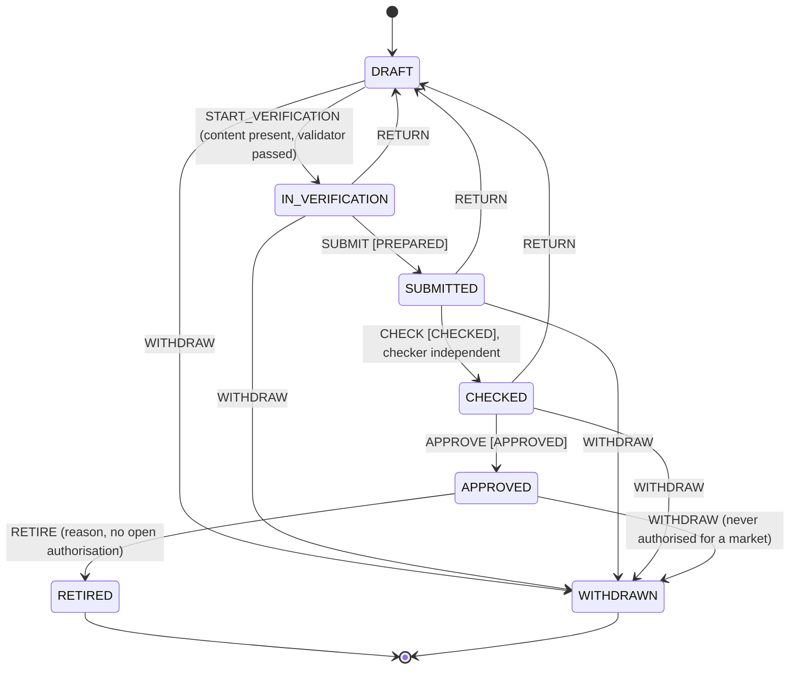
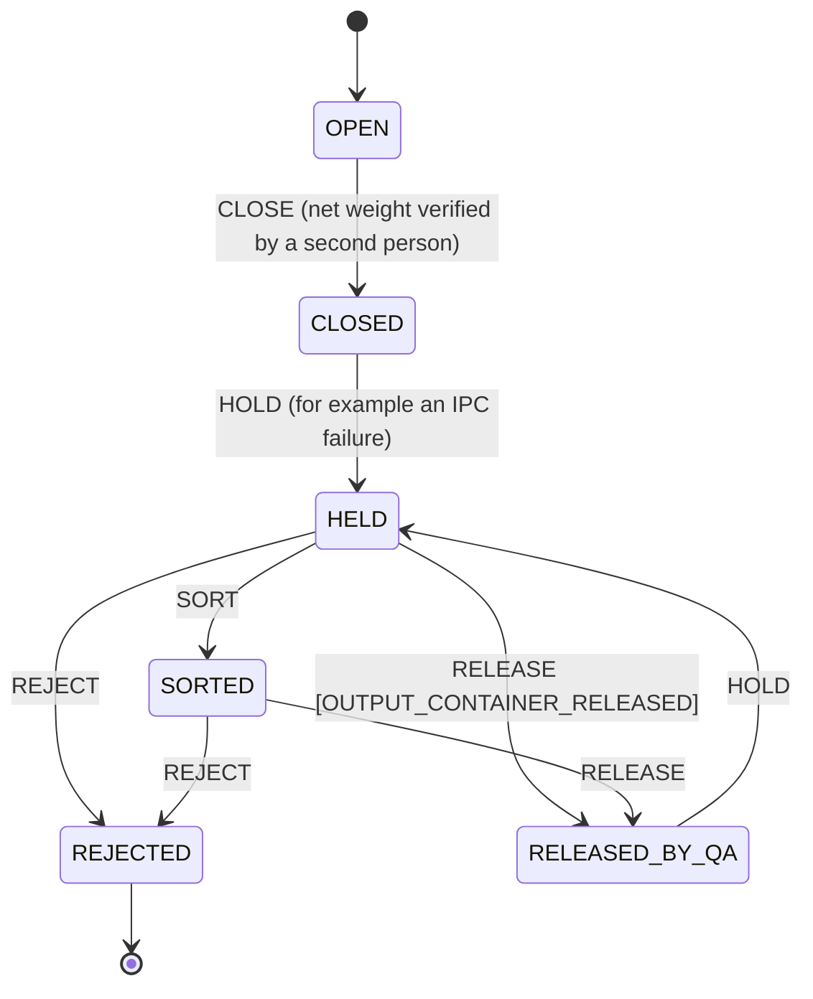
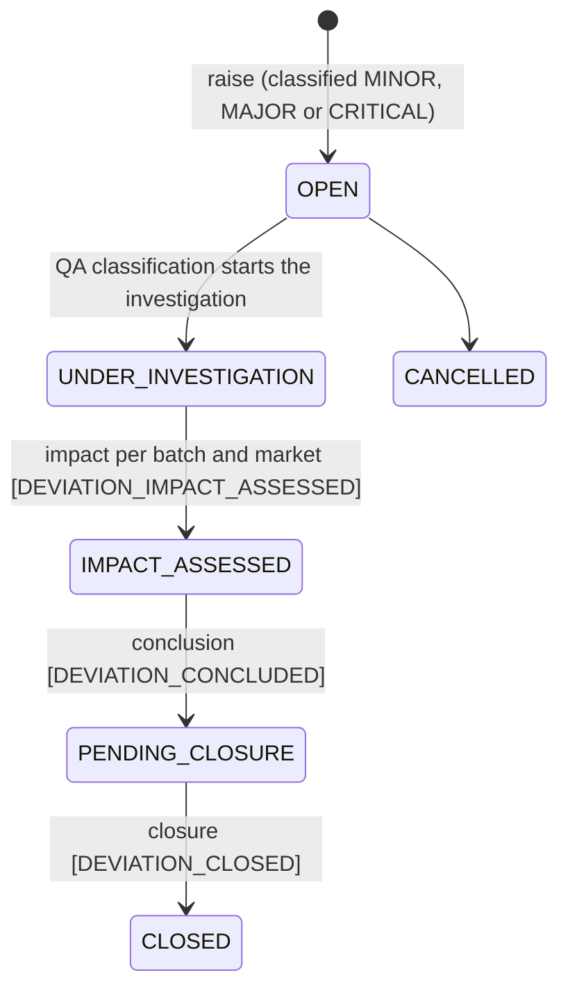
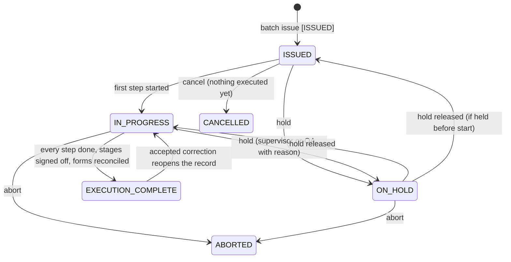
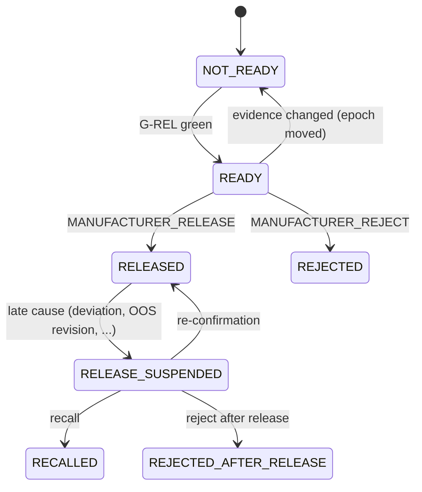
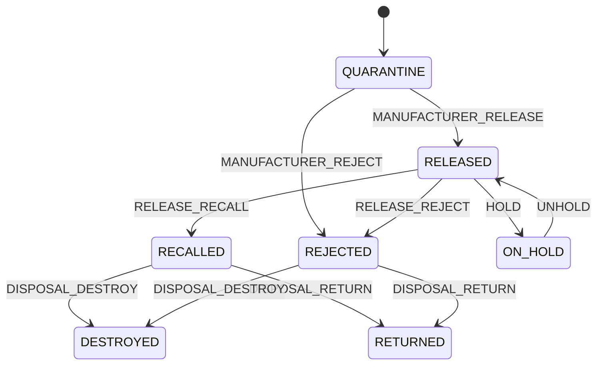
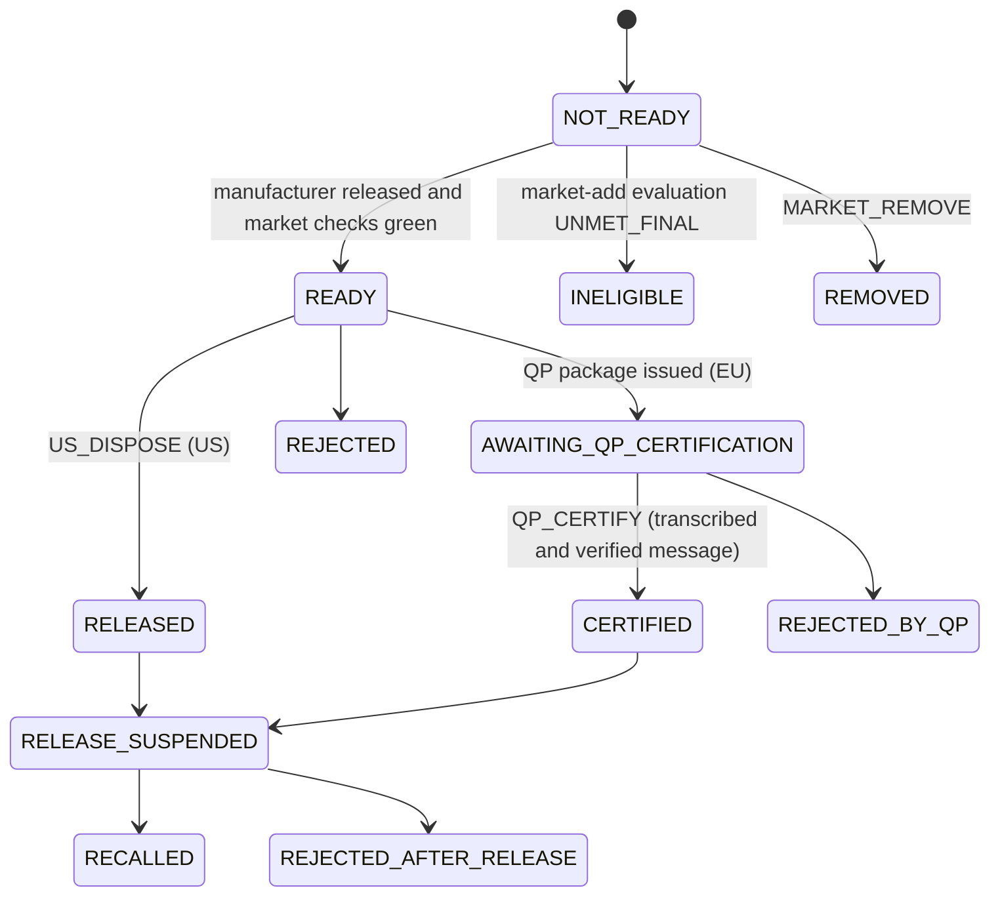
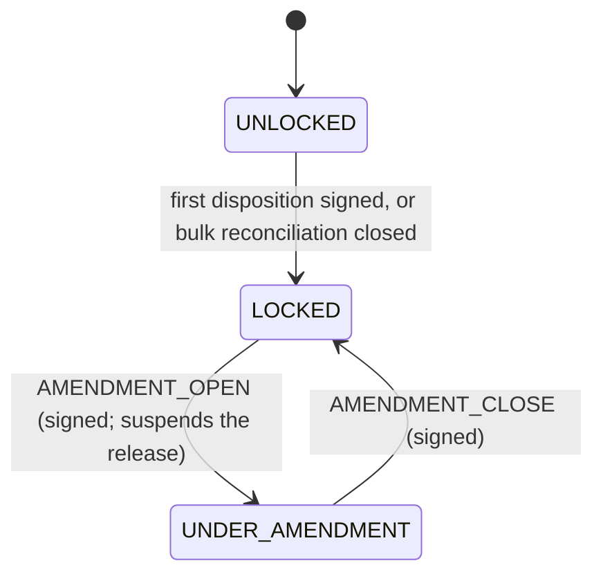

# The life of a batch

**Draft**

This page follows one batch of tablets from its master record to release, recall and archive. For each step it says
what happens in pharma terms, which screen the person uses, which route the screen calls, which server handler runs,
which database functions and triggers decide, which controls apply, and which states change. It uses the golden batch
GB-T-01 as the example. Read the [architecture page](03-architecture.md) first: it explains the request path,
signatures and epochs that every step here relies on. Pharma terms are explained in the [primer](01-pharma-primer.md)
and the [glossary](02-glossary.md).

## Where the code is

| What | Where |
|---|---|
| The golden batch GB-T-01 | [apps/tablets-server/test/golden/gb-t-01/](../../apps/tablets-server/test/golden/gb-t-01/) ([README](../../apps/tablets-server/test/golden/gb-t-01/README.md)) |
| Screens | [apps/tablets-web/src/features/](../../apps/tablets-web/src/features/) |
| Routes | [packages/api-contract/src/ns/](../../packages/api-contract/src/ns/) |
| Server handlers | [apps/tablets-server/src/features/](../../apps/tablets-server/src/features/) |
| Signable acts (what each signature does) | [signable.ts](../../packages/api-contract/src/signable.ts) |
| Browser tests | [tools/e2e/specs/](../../tools/e2e/specs/) |

Every signature on this page goes through the same three e-signature routes (`esig.content`, `esig.createChallenge`,
`esig.sign` in [ns/esig.ts](../../packages/api-contract/src/ns/esig.ts#sym=esig)); the signable action named in each
step decides what the signature does. See [architecture section 9](03-architecture.md#9-e-signatures).

## The example: GB-T-01

GB-T-01 is an invented product (no real or patented medicine): **Exemplazine tablets 250 mg**, product `GBT01-250`,
batch size 2,00,000 tablets (`BS-200K`), made at site `SITE-1` on line `L1` for **India only**. The process is wet
granulation in two sub-lots with fluid-bed drying and a loss-on-drying (LOD) loop, blending and lubrication,
compression with left and right in-process checks, film coating, inspection, then blister packing. Every quantity
was computed by hand before the first run ([worksheet](../../apps/tablets-server/test/golden/gb-t-01/README.md)) and
stored in [expected.json](../../apps/tablets-server/test/golden/gb-t-01/expected.json) (manufacture) and
[expected-release.json](../../apps/tablets-server/test/golden/gb-t-01/expected-release.json) (packing and release).

The test runs three production orders: a source batch `PO-GBT01-0003` (whose leftover cores are later recovered), a
"happy" batch `PO-GBT01-0001`, and an "exception-rich" batch `PO-GBT01-0002` with an IPC failure, an LOD retry and
manual fallbacks. The code that drives it:

| File | Drives |
|---|---|
| [world.ts](../../apps/tablets-server/test/golden/gb-t-01/world.ts#sym=startGoldenWorld) | master data, formula, MBR life cycle |
| [driver.ts](../../apps/tablets-server/test/golden/gb-t-01/driver.ts#sym=GoldenBatch) | plan, issue, lots, dispensing, granulation and drying, stage sign-offs |
| [stages.ts](../../apps/tablets-server/test/golden/gb-t-01/stages.ts) | blending, compression, coating, inspection, containers |
| [scenario.ts](../../apps/tablets-server/test/golden/gb-t-01/scenario.ts) | the three orders and the exceptions |
| [packing.ts](../../apps/tablets-server/test/golden/gb-t-01/packing.ts), [release.ts](../../apps/tablets-server/test/golden/gb-t-01/release.ts) | packaging, QC, review and the manufacturer release |

GB-T-01 stops at the **manufacturer release for India**. US and EU dispositions, shipping and the after-release steps
are proven by GB-T-02, by the browser tests in `tools/e2e/specs/release/` and by the server tests; this page names
them where GB-T-01 has no driver.

## The journey at a glance

Note on order: in the code, QC of the finished lot and packaging happen before QA's final review of the batch record
(GB-T-01's `runRelease` calls `productSpecification`, then `finishedLot`, then `reviewRecord`, then
`manufacturerRelease`). This page follows that order.

---

## 1. Master data and the formula

**In pharma terms.** Before anything is made, the site needs its *master data*: the product, the materials (with
codes), and the *formula* (which materials, how much per tablet). In this system products, materials and production
orders arrive from the ERP and QA confirms changes to controlled values; the formula is kept in the product formulation
library and approved by a person other than its author.

| | |
|---|---|
| Screens | [FormulasPage.tsx](../../apps/tablets-web/src/features/master-data/FormulasPage.tsx), [FormulaPage.tsx](../../apps/tablets-web/src/features/master-data/FormulaPage.tsx), [ErpPage.tsx](../../apps/tablets-web/src/features/master-data/ErpPage.tsx), [ErpStatusPage.tsx](../../apps/tablets-web/src/features/quality/ErpStatusPage.tsx) |
| Routes | `masterData.createFormula`, `masterData.addFormulaVersion` ([ns/master-data.ts](../../packages/api-contract/src/ns/master-data.ts#sym=masterData)); `quality.erpImport`, `quality.erpProducts`, `quality.erpMaterials`, `quality.erpOrders`, `quality.erpPending` ([ns/quality.ts](../../packages/api-contract/src/ns/quality.ts#sym=quality)) |
| Server | [master-data/index.ts](../../apps/tablets-server/src/features/master-data/index.ts#sym=formulaApproveHandler) (signable `MASTER_DATA_APPROVE`); [quality/index.ts](../../apps/tablets-server/src/features/quality/index.ts#sym=importCatalogue) (ERP import) |
| Database | [recipe.formula_create](../../packages/recipe-core/sql/0640_formulation_library.sql#sym=recipe.formula_create), [recipe.formula_add_version](../../packages/recipe-core/sql/0640_formulation_library.sql#sym=recipe.formula_add_version), [recipe.formula_approve](../../packages/recipe-core/sql/0640_formulation_library.sql#sym=recipe.formula_approve), [recipe.formula_pin_mbr](../../packages/recipe-core/sql/0640_formulation_library.sql#sym=recipe.formula_pin_mbr); [site.erp_receive_product](../../packages/site-services/sql/0802_erp_master_confirmation.sql#sym=site.erp_receive_product), [site.erp_receive_material](../../packages/site-services/sql/0802_erp_master_confirmation.sql#sym=site.erp_receive_material), [site.erp_receive_order](../../packages/site-services/sql/0802_erp_master_confirmation.sql#sym=site.erp_receive_order), [site.confirm_erp_master](../../packages/site-services/sql/0802_erp_master_confirmation.sql#sym=site.confirm_erp_master) |
| Signatures | `FORMULA_APPROVED` (never by the author); `ERP_MASTER_CONFIRMED` (QA, never the ERP interface's own account) |
| Controls | [IN-13](../../compliance/controls/IN-13.yaml); tests tagged `[PR-08][PR-19][PR-47]` cover the master negatives |
| GB-T-01 | `startGoldenWorld` creates and approves the formula; the ERP masters come from the seed; `postSourceOrder` posts the source order through the ERP import |
| Browser tests | [formula-flow.spec.ts](../../tools/e2e/specs/master-data/formula-flow.spec.ts), [composition.spec.ts](../../tools/e2e/specs/master-data/composition.spec.ts) |

The formula tables are insert-only (their guard triggers are created by `execute format(...)` in 0640, so they do not
show in a text search for `create trigger`).

## 2. The MBR: designed, validated, approved, made effective

**In pharma terms.** The *master batch record* (MBR) is the approved recipe: every step, parameter, limit and
signature the floor must follow. An author designs it, the system validates it, it is test-run in the sandbox, then
signed by the preparer, a checker, and an approver (and a regulatory confirmation). Approval alone does not let it be
used: it must also be made *effective* for each market, site, line and batch size.

| | |
|---|---|
| Screens | [ChooseProduct.tsx](../../apps/tablets-web/src/features/designer/ChooseProduct.tsx), [NewFromTemplate.tsx](../../apps/tablets-web/src/features/designer/NewFromTemplate.tsx), [DesignerPage.tsx](../../apps/tablets-web/src/features/designer/DesignerPage.tsx); in-browser validation [validation.ts](../../apps/tablets-web/src/features/designer/model/validation.ts) |
| Routes | `designer.createFamily`, `designer.validate`, `designer.startVerification`, `designer.formulaChoice` ([ns/designer.ts](../../packages/api-contract/src/ns/designer.ts#sym=designer)) |
| Server | [designer/index.ts](../../apps/tablets-server/src/features/designer/index.ts); signatures through [mbrTransitionHandler](../../apps/tablets-server/src/features/designer/signables.ts#sym=mbrTransitionHandler) (signable `MBR_TRANSITION`) |
| Database | [recipe.define_family](../../packages/recipe-core/sql/0760_packaging_family_pack_type.sql#sym=recipe.define_family), [recipe.create_version](../../packages/recipe-core/sql/0150_mbr_commands.sql#sym=recipe.create_version), [recipe.save_content](../../packages/recipe-core/sql/0150_mbr_commands.sql#sym=recipe.save_content), [recipe.record_evidence](../../packages/recipe-core/sql/0150_mbr_commands.sql#sym=recipe.record_evidence); the life cycle runs through [platform.transition](../../packages/kernel/sql/0550_platform_state_engine.sql#sym=platform.transition) with the guards of [0130_mbr_guards.sql](../../packages/recipe-core/sql/0130_mbr_guards.sql) and the machine seed [0140_machine_mbr_version_v1.sql](../../packages/recipe-core/sql/0140_machine_mbr_version_v1.sql) |
| Effectivity | [recipe.propose_market_authorisation](../../packages/recipe-core/sql/0160_market_authorisation.sql#sym=recipe.propose_market_authorisation), [recipe.activate_market_authorisation](../../packages/recipe-core/sql/0290_market_activation_reason.sql#sym=recipe.activate_market_authorisation), table [recipe.market_authorisation](../../packages/recipe-core/sql/0160_market_authorisation.sql#sym=recipe.market_authorisation) |
| Signatures | `PREPARED` (SUBMIT), `CHECKED` (CHECK, by someone independent of the author), `APPROVED` (APPROVE), the regulatory confirmation; on the market authorisation `MBR_MARKET_AUTHORISED` and `REGULATORY_CONFIRMED` |
| Controls | [DI-04](../../compliance/controls/DI-04.yaml), [PR-02](../../compliance/controls/PR-02.yaml), [PR-03](../../compliance/controls/PR-03.yaml), [PR-04](../../compliance/controls/PR-04.yaml), [PR-06](../../compliance/controls/PR-06.yaml); invariant INV-04 (checker and approver independent) |
| GB-T-01 | `startGoldenWorld` signs SUBMIT, CHECK, the regulatory confirmation and APPROVE; its negatives prove an approval before the check (`EBMR-ESIG-039`), an approval by the author, and an approval of stale content are refused |
| Browser tests | [designer.spec.ts](../../tools/e2e/specs/designer/designer.spec.ts) (up to sending the draft to the sandbox) |

The MBR version machine is [mbrVersionMachine](../../packages/recipe-core/src/lifecycle/machine.ts#sym=mbrVersionMachine)
(states in `MBR_VERSION_STATES`). The regulatory confirmation is a signature, not an event of the machine.

**Effectivity is separate from the version state** ([ADR 0014](../adr/0014-per-market-mbr-effectivity.md)). Each
row of `recipe.market_authorisation` (per market and per cell: site, line, batch size) has its own status: `CURRENT`,
`BRIDGING`, `SUPERSEDED`, `WITHDRAWN`. A GMP batch may be issued only from a CURRENT or BRIDGING authorisation
(INV-18, `EBMR-SBX-012`).

Gap today: no web screen yet sends the `MBR_TRANSITION` signatures or manages market authorisations; GB-T-01 and the
server tests do these through the API and the database (see the GB-T-01 README "residuals").

## 3. Production order and batch issue

**In pharma terms.** The ERP sends a *production order* ("make one batch of GBT01-250"). Production planning turns it
into a planned batch; an authorised person then *issues* the batch: the system picks the effective MBR version,
allocates a batch number that is never reused, checks the Indian manufacturing licence covers this product, and
creates the executable batch record. The issuer signs.

| | |
|---|---|
| Screens | [PlanningPage.tsx](../../apps/tablets-web/src/features/planning/PlanningPage.tsx); India checks on [LicencesPage.tsx](../../apps/tablets-web/src/features/india/LicencesPage.tsx) |
| Routes | `planning.orders` ([ns/planning.ts](../../packages/api-contract/src/ns/planning.ts#sym=planning)); `execution.planBatch` ([ns/execution.ts](../../packages/api-contract/src/ns/execution.ts#sym=execution)); `india.check` ([ns/india.ts](../../packages/api-contract/src/ns/india.ts#sym=india)) |
| Server | [planGmpBatch](../../apps/tablets-server/src/features/execution/gmp-issue.ts#sym=planGmpBatch); the issue signature through [gmpIssueHandler](../../apps/tablets-server/src/features/execution/gmp-issue.ts#sym=gmpIssueHandler) (signable `GMP_BATCH_ISSUE`, meaning `ISSUED`) |
| Database | [recipe.prepare_gmp_issue](../../packages/recipe-core/sql/0761_packaging_order_planning.sql#sym=recipe.prepare_gmp_issue) calls [recipe.select_version_for_issue](../../packages/recipe-core/sql/0170_batch_issue.sql#sym=recipe.select_version_for_issue) and [site.allocate_batch_number](../../packages/site-services/sql/0600_batch_number_register.sql#sym=site.allocate_batch_number) (rules from [site.define_batch_number_rule](../../packages/site-services/sql/0600_batch_number_register.sql#sym=site.define_batch_number_rule)); then [recipe.begin_gmp_issue](../../packages/recipe-core/sql/0501_gmp_batch_issue.sql#sym=recipe.begin_gmp_issue) and [recipe.issue_gmp_execution](../../packages/recipe-core/sql/0501_gmp_batch_issue.sql#sym=recipe.issue_gmp_execution); the ERP order is opened by [recipe.open_erp_order_for](../../packages/recipe-core/sql/0602_gmp_issue_erp_order.sql#sym=recipe.open_erp_order_for) |
| India gate | [recipe.gmp_issue_problem](../../packages/recipe-core/sql/0891_india_issue_gate.sql#sym=recipe.gmp_issue_problem) and [recipe.india_issue_problem](../../packages/recipe-core/sql/0891_india_issue_gate.sql#sym=recipe.india_issue_problem) use [site.licence_problem](../../packages/site-services/sql/0885_india_licences.sql#sym=site.licence_problem); after the insert, trigger [zz_india_licence_basis](../../packages/recipe-core/sql/0891_india_issue_gate.sql#sym=zz_india_licence_basis) stores the licence basis ([recipe.record_batch_licence_basis](../../packages/recipe-core/sql/0891_india_issue_gate.sql#sym=recipe.record_batch_licence_basis)). Refusals `EBMR-IND-040` to `EBMR-IND-044` |
| Controls | [IN-18](../../compliance/controls/IN-18.yaml) (batch numbers), [IN-27](../../compliance/controls/IN-27.yaml), [IN-30](../../compliance/controls/IN-30.yaml), [PR-04](../../compliance/controls/PR-04.yaml), [PR-10](../../compliance/controls/PR-10.yaml); invariant INV-27 (identifiers never reused) |
| GB-T-01 | `planAll` in [scenario.ts](../../apps/tablets-server/test/golden/gb-t-01/scenario.ts#sym=planAll) plans and issues each order through `GoldenBatch` |
| Browser tests | [order-to-issue.spec.ts](../../tools/e2e/specs/planning/order-to-issue.spec.ts) (listing), [india-flow.spec.ts](../../tools/e2e/specs/india/india-flow.spec.ts) (the issue gate) |

> **Why this exists**
> - **Pharma reason:** each batch must have a unique number for life, so that its record, samples and any recall
>   point to exactly one batch; and in India a batch may only be made under a licence that covers the product.
> - **Control:** [IN-18](../../compliance/controls/IN-18.yaml), invariant INV-27.
> - **Code:** [site.allocate_batch_number](../../packages/site-services/sql/0600_batch_number_register.sql#sym=site.allocate_batch_number) (a protected, write-ahead counter; voided numbers stay in the register), [recipe.india_issue_problem](../../packages/recipe-core/sql/0891_india_issue_gate.sql#sym=recipe.india_issue_problem).

## 4. Dispensing

**In pharma terms.** Each ingredient is weighed out from a released lot, on a checked balance, in a clean room. For
the active ingredient the amount is adjusted for its measured strength (*potency*), and an excipient compensates so
the total weight stays the same. A second person verifies the weighings.

GB-T-01's numbers: the API lot `GBT-API-001` assays 98.4064 % as-is, so the target is **54.529 kg** of API instead of
53.659 kg, and the compensating microcrystalline cellulose drops to **7.131 kg**.

| | |
|---|---|
| Screens | [StepScreen.tsx](../../apps/tablets-web/src/features/floor/pages/StepScreen.tsx) with the weighing renderer [G-07@1.tsx](../../apps/tablets-web/src/features/floor/renderers/G-07@1.tsx) and the Tablets entries in [tablets.tsx](../../apps/tablets-web/src/features/floor/renderers/tablets.tsx); balances on [ScalesPage.tsx](../../apps/tablets-web/src/features/devices/ScalesPage.tsx) |
| Routes | `batches.command`, `batches.step`, `batches.batch` ([ns/batches.ts](../../packages/api-contract/src/ns/batches.ts#sym=batches)) |
| Server | [runCommand](../../apps/tablets-server/src/features/execution/index.ts#sym=runCommand) in [gmpBatchHandlers](../../apps/tablets-server/src/features/execution/index.ts#sym=gmpBatchHandlers); the potency calculation in [tb01.ts](../../apps/tablets-server/src/features/execution/tb01.ts) |
| Database | lot reservation [site.reserve_lot](../../packages/site-services/sql/0752_lot_retest.sql#sym=site.reserve_lot); balance checks [plant.record_instrument_check](../../packages/recipe-core/sql/0403_plant_equipment_commands.sql#sym=plant.record_instrument_check), [plant.record_instrument_use](../../packages/recipe-core/sql/0403_plant_equipment_commands.sql#sym=plant.record_instrument_use); room [plant.start_area_occupancy](../../packages/recipe-core/sql/0404_plant_area_commands.sql#sym=plant.start_area_occupancy); every engine result is written by [recipe.append_execution](../../packages/recipe-core/sql/0295_signed_decisions.sql#sym=recipe.append_execution), with the attribution check [zz_execution_attribution](../../packages/recipe-core/sql/0210_execution_writers.sql#sym=zz_execution_attribution) |
| Controls | [PR-18](../../compliance/controls/PR-18.yaml), [PR-19](../../compliance/controls/PR-19.yaml), [PR-20](../../compliance/controls/PR-20.yaml), [IN-23](../../compliance/controls/IN-23.yaml), [DI-32](../../compliance/controls/DI-32.yaml), [DI-33](../../compliance/controls/DI-33.yaml) (calculations) |
| GB-T-01 | `GoldenBatch` methods `reserveLots`, `clearAndOccupy`, `balanceUse`, then [dispensing](../../apps/tablets-server/test/golden/gb-t-01/driver.ts#sym=dispensing) |
| Browser tests | [devices.spec.ts](../../tools/e2e/specs/devices/devices.spec.ts), [cleaning.spec.ts](../../tools/e2e/specs/plant/cleaning.spec.ts) (room clearance) |

**How a floor entry travels.** Every floor action (start a step, enter a value, sign a step) is one call of
`batches.command` with an *intent*. The server runs the recipe-core execution engine (pure TypeScript in
`packages/recipe-core/src/engine/`) to compute the new batch state from the stored state, then writes the result with
`recipe.append_execution` in one command. Database triggers re-check the rules that must hold whoever writes (block
guards in the recipe-core and tablets migrations). The browser only previews.

## 5. The process steps on the floor

**In pharma terms.** The operators follow the MBR step by step: granulate (mix powders with a binder solution),
dry in a fluid-bed dryer until the *loss on drying* (LOD) is within limits, blend with the lubricant, compress into
tablets, coat, inspect. During compression they take *in-process checks* (IPC: weight, hardness) at fixed intervals.
Product is put into *output containers* (drums), each weighed and closed; a second person verifies critical entries
and container closes. Equipment and rooms must be clean and cleared for this batch.

| | |
|---|---|
| Screens | [StepScreen.tsx](../../apps/tablets-web/src/features/floor/pages/StepScreen.tsx), [RunOverview.tsx](../../apps/tablets-web/src/features/floor/pages/RunOverview.tsx), [Cockpit.tsx](../../apps/tablets-web/src/features/floor/pages/Cockpit.tsx); renderers [G-04@1.tsx](../../apps/tablets-web/src/features/floor/renderers/G-04@1.tsx) (process parameters), [G-22@1.tsx](../../apps/tablets-web/src/features/floor/renderers/G-22@1.tsx) (output containers), [G-20@1.tsx](../../apps/tablets-web/src/features/floor/renderers/G-20@1.tsx) (yield), [tablets.tsx](../../apps/tablets-web/src/features/floor/renderers/tablets.tsx) (binder, LOD sample, blend, weight check); [ContainersPage.tsx](../../apps/tablets-web/src/features/review/ContainersPage.tsx); [PlantPage.tsx](../../apps/tablets-web/src/features/plant/PlantPage.tsx) |
| Routes | `batches.command`; `containers.open`, `containers.close` ([ns/containers.ts](../../packages/api-contract/src/ns/containers.ts#sym=containers)); `plant.recordClearance` ([ns/plant.ts](../../packages/api-contract/src/ns/plant.ts#sym=plant)) |
| Server | [runCommand](../../apps/tablets-server/src/features/execution/index.ts#sym=runCommand); [containerActHandler](../../apps/tablets-server/src/features/containers/index.ts#sym=containerActHandler); [plantVerifyHandler](../../apps/tablets-server/src/features/plant/index.ts#sym=plantVerifyHandler) (signable `PLANT_VERIFY`) |
| Database | containers: [plant.open_container](../../packages/recipe-core/sql/0540_press_codes_and_hold_race.sql#sym=plant.open_container), [plant.close_container](../../packages/recipe-core/sql/0740_container_close_net_check.sql#sym=plant.close_container), [plant.verify_container_close](../../packages/recipe-core/sql/0740_container_close_net_check.sql#sym=plant.verify_container_close) with trigger [aa_container_close_verification_guard](../../packages/recipe-core/sql/0740_container_close_net_check.sql#sym=aa_container_close_verification_guard), [plant.release_container](../../packages/recipe-core/sql/0422_output_container_commands.sql#sym=plant.release_container); IPC: [plant.record_ipc_check](../../packages/recipe-core/sql/0541_ipc_missed_by_sweeper.sql#sym=plant.record_ipc_check); equipment and rooms: [plant.start_equipment_use](../../packages/recipe-core/sql/0403_plant_equipment_commands.sql#sym=plant.start_equipment_use), [plant.record_clearance](../../packages/recipe-core/sql/0404_plant_area_commands.sql#sym=plant.record_clearance), [plant.verify_clearance](../../packages/recipe-core/sql/0404_plant_area_commands.sql#sym=plant.verify_clearance); edition block guards for granulation, compression, IPC and coating in tablets migrations 0850 to 0913 (for example [0851_granulation_guards.sql](../../apps/tablets-server/sql/0851_granulation_guards.sql), [0874_compression_guards.sql](../../apps/tablets-server/sql/0874_compression_guards.sql), [0893_ipc_guards.sql](../../apps/tablets-server/sql/0893_ipc_guards.sql), [0912_coating_guards.sql](../../apps/tablets-server/sql/0912_coating_guards.sql)) |
| Controls | [IN-17](../../compliance/controls/IN-17.yaml), [IN-19](../../compliance/controls/IN-19.yaml), [IN-34](../../compliance/controls/IN-34.yaml), [PR-31](../../compliance/controls/PR-31.yaml), [PR-47](../../compliance/controls/PR-47.yaml), [PR-57](../../compliance/controls/PR-57.yaml), [ST-56](../../compliance/controls/ST-56.yaml), [DI-30](../../compliance/controls/DI-30.yaml) (second-person verification); invariant INV-03 (a verifier is never the performer) |
| GB-T-01 | [granulation](../../apps/tablets-server/test/golden/gb-t-01/driver.ts#sym=granulation) (binder, the extra-IPA branch, fluid-bed drying and the LOD loop: on the exception-rich batch the first LOD reads 4.1 %, the retry 2.9 %), [blending](../../apps/tablets-server/test/golden/gb-t-01/stages.ts#sym=blending), [compression](../../apps/tablets-server/test/golden/gb-t-01/stages.ts#sym=compression) (weight checks and station sweeps), [coating](../../apps/tablets-server/test/golden/gb-t-01/stages.ts#sym=coating), [inspection](../../apps/tablets-server/test/golden/gb-t-01/stages.ts#sym=inspection); `closeContainer` verifies the typed net weight through `plant.verify_container_close`; each stage ends with a signed stage sign-off (`GoldenBatch.closeStage`) |
| Browser tests | [floor.spec.ts](../../tools/e2e/specs/floor/floor.spec.ts), [void.spec.ts](../../tools/e2e/specs/floor-tablets/void.spec.ts), [fcv.spec.ts](../../tools/e2e/specs/journey/fcv.spec.ts) (these run sandbox test runs, not GMP batches) |

Expected yields in GB-T-01: granulation 98.83 %, blending 99.47 %, compression 96.72 % good cores, coating weight gain
2.93 %.

**Output containers** follow [outputContainerMachine](../../packages/recipe-core/src/containers/machine.ts#sym=outputContainerMachine)
(seed [0421_machine_output_container_v1.sql](../../packages/recipe-core/sql/0421_machine_output_container_v1.sql)):

> **Why this exists**
> - **Pharma reason:** a weight or count that decides product quality is checked by a second, independent person.
> - **Control:** [DI-30](../../compliance/controls/DI-30.yaml), invariant INV-03.
> - **Code:** [plant.verify_container_close](../../packages/recipe-core/sql/0740_container_close_net_check.sql#sym=plant.verify_container_close), trigger [aa_container_close_verification_guard](../../packages/recipe-core/sql/0740_container_close_net_check.sql#sym=aa_container_close_verification_guard).

## 6. Exceptions and deviations

**In pharma terms.** When something does not go as the MBR says (a value out of limits, a manual entry because a
device failed, a missed IPC), the system raises an *exception* in the batch record. Minor ones (ALERT) are reviewed
and dispositioned by QA; serious ones (ACTION) need a *deviation*: a formal quality record that is classified,
investigated, assessed for impact on each batch and market, and closed. An *OOS* (out-of-specification lab result)
is a deviation of kind OOS.

| | |
|---|---|
| Screens | [Exceptions.tsx](../../apps/tablets-web/src/features/floor/components/Exceptions.tsx), [CommandDialogs.tsx](../../apps/tablets-web/src/features/floor/dialogs/CommandDialogs.tsx); [DeviationsPage.tsx](../../apps/tablets-web/src/features/quality/DeviationsPage.tsx), [DeviationPage.tsx](../../apps/tablets-web/src/features/quality/DeviationPage.tsx), [DeviationDetail.tsx](../../apps/tablets-web/src/features/quality/DeviationDetail.tsx) |
| Routes | `quality.raiseDeviation`, `quality.linkDeviation`, `quality.startInvestigation`, `quality.recordFinding` ([ns/quality.ts](../../packages/api-contract/src/ns/quality.ts#sym=quality)); `deviationDetail`, `recordDeviationImpact`, `recordDeviationClosureBasis` ([ns/deviation.ts](../../packages/api-contract/src/ns/deviation.ts#sym=deviationRoutes)); engine intents `ATTACH_DEVIATION` and `DISPOSITION_EXCEPTION` (signed) through `batches.command` |
| Server | [quality/index.ts](../../apps/tablets-server/src/features/quality/index.ts#sym=plugin), [quality/deviation.ts](../../apps/tablets-server/src/features/quality/deviation.ts); signed acts through [qualityActHandler](../../apps/tablets-server/src/features/quality/signables.ts#sym=qualityActHandler) (`DEVIATION_IMPACT_ASSESS`, `DEVIATION_CONCLUDE`, `DEVIATION_CLOSE`) |
| Database | [site.raise_deviation](../../packages/site-services/sql/0730_deviation_lite.sql#sym=site.raise_deviation), [site.link_deviation](../../packages/site-services/sql/0730_deviation_lite.sql#sym=site.link_deviation), [site.start_deviation_investigation](../../packages/site-services/sql/0821_deviation_full_commands.sql#sym=site.start_deviation_investigation), [site.record_deviation_finding](../../packages/site-services/sql/0821_deviation_full_commands.sql#sym=site.record_deviation_finding), [site.conclude_deviation](../../packages/site-services/sql/0821_deviation_full_commands.sql#sym=site.conclude_deviation), state [site.deviation_state](../../packages/site-services/sql/0820_deviation_full_records.sql#sym=site.deviation_state); the batch's exception register is kept by trigger [zzr_exception_register](../../packages/recipe-core/sql/0440_exception_register.sql#sym=zzr_exception_register) ([recipe.exception_register_sync](../../packages/recipe-core/sql/0441_exception_register_qa_roles.sql#sym=recipe.exception_register_sync)); QA's disposition [recipe.review_exception](../../packages/recipe-core/sql/0721_review_acts_after_quick_review.sql#sym=recipe.review_exception) |
| Controls | [PR-08](../../compliance/controls/PR-08.yaml), [PR-13](../../compliance/controls/PR-13.yaml), [PR-49](../../compliance/controls/PR-49.yaml), [IN-20](../../compliance/controls/IN-20.yaml) |
| GB-T-01 | [ipcFailure](../../apps/tablets-server/test/golden/gb-t-01/scenario.ts#sym=ipcFailure) on the exception-rich batch: an IPC failure (ACTION) raises a deviation; the held container `COMPRESSION/R/02` ends `RELEASED_BY_QA`; the ALERTs (manual entry fallback, process manual fallback, IPC manual entry, QC extra-testing decision) are dispositioned NO_IMPACT |
| Browser tests | [deviation-flow.spec.ts](../../tools/e2e/specs/quality/deviation-flow.spec.ts), [floor.spec.ts](../../tools/e2e/specs/floor/floor.spec.ts) |

Each deviation event and link also bumps the evidence epoch of the deviation and of every batch it is linked to
(triggers `zzze_epoch_deviation_*`, [0714_evidence_epoch_triggers.sql](../../packages/recipe-core/sql/0714_evidence_epoch_triggers.sql)
and site-services [0820_deviation_full_records.sql](../../packages/site-services/sql/0820_deviation_full_records.sql)),
so a review or a release signed before the change is refused (section 10).

The deviation state is not a published machine: it is derived from the event rows by `site.deviation_state`.

## 7. Execution complete, contingency forms reconciled

**In pharma terms.** When every step is done and every stage is signed off, the batch record is *execution complete*.
If the system was down at some point, operators wrote on numbered paper *contingency forms*; every form issued must be
accounted for (returned, transcribed and verified, voided, or reported missing) and the reconciliation signed before
the batch can be completed.

| | |
|---|---|
| Screens | [ArchiveBatchPage.tsx](../../apps/tablets-web/src/features/archive/ArchiveBatchPage.tsx) |
| Routes | `archive.issuePack`, `archive.formEvent`, `archive.batch` ([ns/archive.ts](../../packages/api-contract/src/ns/archive.ts#sym=archive)) |
| Server | [archive/index.ts](../../apps/tablets-server/src/features/archive/index.ts#sym=archiveActHandler) (signable `ARCHIVE_ACT`, meaning `FORMS_RECONCILED`) |
| Database | [records.issue_contingency_pack](../../packages/kernel/sql/1174_evidence_export_review_fixes.sql#sym=records.issue_contingency_pack), [records.record_contingency_form_event](../../packages/kernel/sql/1170_contingency_forms.sql#sym=records.record_contingency_form_event), [records.form_reconciliation_problem](../../packages/kernel/sql/1170_contingency_forms.sql#sym=records.form_reconciliation_problem), [records.sign_form_reconciliation](../../packages/kernel/sql/1170_contingency_forms.sql#sym=records.sign_form_reconciliation); the completion gate is trigger [a1_form_reconciliation](../../packages/recipe-core/sql/0911_execution_complete_form_gate.sql#sym=a1_form_reconciliation) running [recipe.refuse_unreconciled_completion](../../packages/recipe-core/sql/0911_execution_complete_form_gate.sql#sym=recipe.refuse_unreconciled_completion) on `recipe.execution_state` |
| Controls | [DI-43](../../compliance/controls/DI-43.yaml), [PR-16](../../compliance/controls/PR-16.yaml) |
| GB-T-01 | both variants end `EXECUTION_COMPLETE` with every stage `SIGNED_OFF` ([expected.json](../../apps/tablets-server/test/golden/gb-t-01/expected.json)). GB-T-01 issues no contingency forms, so the gate passes without forms |
| Browser tests | [archive-flow.spec.ts](../../tools/e2e/specs/release/archive-flow.spec.ts) (contingency packs are proven over HTTP and in the database) |

Completion is decided by the engine (`checkCompletion` in
[advance.ts](../../packages/recipe-core/src/engine/advance.ts#sym=checkCompletion)) and stored in
[recipe.execution_state](../../packages/recipe-core/sql/0200_execution_store.sql#sym=recipe.execution_state). The batch
status values are `BatchStatus` in [engine/types.ts](../../packages/recipe-core/src/engine/types.ts#sym=BatchStatus):

The review screens add two further states on top of these, derived from the review register (section 10):
`PRODUCTION_APPROVED` and `QA_REVIEWED` (`ReviewState` in [ns/review.ts](../../packages/api-contract/src/ns/review.ts#sym=ReviewState)).

## 8. QC: specifications, samples, results, OOS

**In pharma terms.** Quality Control (QC) tests a sample of the finished lot against the product's *specification*
(the approved list of tests and limits). Each result is recorded, then approved by a second QC person. A result
outside the limits is an OOS: it opens an investigation, and a result may only be revised by citing that OOS record.
Retained samples are pulled and kept.

| | |
|---|---|
| Screens | [SpecificationsPage.tsx](../../apps/tablets-web/src/features/quality/SpecificationsPage.tsx), [LotPage.tsx](../../apps/tablets-web/src/features/quality/LotPage.tsx), [LotExtras.tsx](../../apps/tablets-web/src/features/quality/LotExtras.tsx), [LotsPage.tsx](../../apps/tablets-web/src/features/quality/LotsPage.tsx) |
| Routes | `specifications.list`, `specifications.draft`, `specifications.postFinishedLot`, `specifications.lotReleaseCheck` ([ns/specifications.ts](../../packages/api-contract/src/ns/specifications.ts#sym=specifications)); `quality.recordLotResult`, `quality.lotResults`; `samples.pull`, `samples.list`, `samples.dispose` ([ns/samples.ts](../../packages/api-contract/src/ns/samples.ts#sym=samples)) |
| Server | [limsActHandler](../../apps/tablets-server/src/features/quality/lims.ts#sym=limsActHandler) (`SPECIFICATION_APPROVE`); [qualityActHandler](../../apps/tablets-server/src/features/quality/signables.ts#sym=qualityActHandler) (`LOT_RESULT_APPROVE`) |
| Database | [site.draft_specification](../../packages/site-services/sql/0840_specifications.sql#sym=site.draft_specification), [site.approve_specification](../../packages/site-services/sql/0840_specifications.sql#sym=site.approve_specification); [site.record_lot_test_result](../../packages/site-services/sql/0844_revision_oos_same_test.sql#sym=site.record_lot_test_result) (a revision must cite an OOS of the same test, `EBMR-SITE-413`), trigger [a2_spec_check](../../packages/site-services/sql/0841_lims_from_specification.sql#sym=a2_spec_check), [site.approve_lot_test_result](../../packages/site-services/sql/0740_lims_lite.sql#sym=site.approve_lot_test_result), [site.lot_test_state](../../packages/site-services/sql/0740_lims_lite.sql#sym=site.lot_test_state), [site.lot_lims_release_problem](../../packages/site-services/sql/0841_lims_from_specification.sql#sym=site.lot_lims_release_problem); samples [site.pull_lot_sample](../../packages/site-services/sql/0843_lot_samples.sql#sym=site.pull_lot_sample) |
| Signatures | `SPECIFICATION_APPROVED` (never by the drafter), `QC_RESULT_APPROVED` |
| Controls | [IN-20](../../compliance/controls/IN-20.yaml), [IN-32](../../compliance/controls/IN-32.yaml), [IN-33](../../compliance/controls/IN-33.yaml), [PR-44](../../compliance/controls/PR-44.yaml), [DI-37](../../compliance/controls/DI-37.yaml) |
| GB-T-01 | [productSpecification](../../apps/tablets-server/test/golden/gb-t-01/release.ts#sym=productSpecification), [finishedLot](../../apps/tablets-server/test/golden/gb-t-01/release.ts#sym=finishedLot) |
| Browser tests | none drive specifications, results or samples yet |

States: a result is RECORDED, APPROVED or REVISED with a PASS or FAIL verdict; a specification is DRAFT, APPROVED or
SUPERSEDED. A result or its approval bumps the lot's evidence epoch (`zzze_epoch_lot_result`,
`zzze_epoch_lot_approval`).

## 9. Packaging

**In pharma terms.** The coated tablets (*bulk*) are issued to a packaging order, packed into blisters and cartons
with printed materials (foil, cartons, leaflets) that carry the batch number and expiry. Every printed item issued
must be reconciled: used, destroyed, returned or kept as a specimen, with no unexplained difference. The packed
goods become a *finished lot* that waits in quarantine for release.

GB-T-01's reconciliation: 990 cartons issued, 980 used, 6 coded and destroyed, 2 returned, 2 specimens; 10,000 foil
issued, 9,840 used; pack yield 99.59 % ([expected-release.json](../../apps/tablets-server/test/golden/gb-t-01/expected-release.json)).

| | |
|---|---|
| Screens | the floor step screens with the packaging renderers ([registry.ts](../../apps/tablets-web/src/features/floor/renderers/registry.ts), [tablets.tsx](../../apps/tablets-web/src/features/floor/renderers/tablets.tsx)); [BulkIssuePage.tsx](../../apps/tablets-web/src/features/planning/BulkIssuePage.tsx) |
| Routes | `batches.issueBulk`, `batches.issueSscc`, `batches.sscc` ([ns/batches.ts](../../packages/api-contract/src/ns/batches.ts#sym=batches)); `specifications.postFinishedLot` |
| Server | [execution/index.ts](../../apps/tablets-server/src/features/execution/index.ts#sym=gmpBatchHandlers) (`issueBulk`, `issueSscc`) |
| Database | [recipe.issue_packaging_bulk](../../packages/recipe-core/sql/0871_bulk_reconciliation_and_bright_stock.sql#sym=recipe.issue_packaging_bulk); printed materials [tab.printed_lot_facts](../../apps/tablets-server/sql/0950_printed_material_lots.sql#sym=tab.printed_lot_facts), [tab.g21_printed](../../apps/tablets-server/sql/0951_print_jobs.sql#sym=tab.g21_printed), [tab.g21_printed_count_problem](../../apps/tablets-server/sql/0951_print_jobs.sql#sym=tab.g21_printed_count_problem); blisters [tab.blister_run_entry](../../apps/tablets-server/sql/0971_blister_rules.sql#sym=tab.blister_run_entry), [tab.blister_close_problem](../../apps/tablets-server/sql/0972_blister_guards.sql#sym=tab.blister_close_problem), trigger [zzh_tab_blister](../../apps/tablets-server/sql/0972_blister_guards.sql#sym=zzh_tab_blister); shipper codes [tab.issue_sscc](../../apps/tablets-server/sql/0985_bottle_registers.sql#sym=tab.issue_sscc); the finished lot [tab.post_finished_lot](../../apps/tablets-server/sql/1201_one_expiry_rule.sql#sym=tab.post_finished_lot) (one expiry rule), origin check trigger [zz_origin_check](../../packages/site-services/sql/0842_finished_and_returned_lots.sql#sym=zz_origin_check) |
| Controls | [IN-16](../../compliance/controls/IN-16.yaml), [IN-17](../../compliance/controls/IN-17.yaml), [IN-22](../../compliance/controls/IN-22.yaml), [IN-38](../../compliance/controls/IN-38.yaml), [PR-34](../../compliance/controls/PR-34.yaml), [PR-36](../../compliance/controls/PR-36.yaml), [PR-37](../../compliance/controls/PR-37.yaml), [PR-39](../../compliance/controls/PR-39.yaml), [PR-40](../../compliance/controls/PR-40.yaml); refusals `EBMR-PKG-001` to `EBMR-PKG-006` |
| GB-T-01 | [runPackaging](../../apps/tablets-server/test/golden/gb-t-01/release.ts#sym=runPackaging), [blisterOrder](../../apps/tablets-server/test/golden/gb-t-01/packing.ts#sym=blisterOrder), [containerise](../../apps/tablets-server/test/golden/gb-t-01/packing.ts#sym=containerise), [cleanLine](../../apps/tablets-server/test/golden/gb-t-01/packing.ts#sym=cleanLine) |
| Browser tests | [packaging-order.spec.ts](../../tools/e2e/specs/planning/packaging-order.spec.ts) (the packaging order) |

## 10. Record review (review by exception) and evidence epochs

**In pharma terms.** Before release, Production approves the batch record, then QA reviews it. QA does not re-read
every value: the system lists the *exceptions* (review by exception), and QA dispositions each one, reviews the audit
trail of the record, and signs the QA review. Someone who worked on the batch may not review it.

| | |
|---|---|
| Screens | [BatchReviewPage.tsx](../../apps/tablets-web/src/features/review/BatchReviewPage.tsx), [RegisterPage.tsx](../../apps/tablets-web/src/features/review/RegisterPage.tsx), [AuditTrailPanel.tsx](../../apps/tablets-web/src/features/review/AuditTrailPanel.tsx), [ReviewQueuePage.tsx](../../apps/tablets-web/src/features/review/ReviewQueuePage.tsx) |
| Routes | `review.queue`, `review.batch`, `review.register`, `review.openItem`, `review.respond`, `review.auditTrail` ([ns/review.ts](../../packages/api-contract/src/ns/review.ts#sym=review)) |
| Server | [reviewActHandler](../../apps/tablets-server/src/features/review/signables.ts#sym=reviewActHandler) (signable `REVIEW_ACT`: `PRODUCTION_APPROVE`, `DISPOSE_ITEM`, `AUDIT_TRAIL_REVIEW`, `DELTA_REVIEW`, `QA_REVIEW`, `REOPEN`); reads [batchReview](../../apps/tablets-server/src/features/review/reads.ts#sym=batchReview) |
| Database | [recipe.record_production_approval](../../packages/recipe-core/sql/0718_review_gates_and_epoch_rows.sql#sym=recipe.record_production_approval), [recipe.show_review_register](../../packages/recipe-core/sql/0718_review_gates_and_epoch_rows.sql#sym=recipe.show_review_register), [recipe.dispose_review_items](../../packages/recipe-core/sql/0721_review_acts_after_quick_review.sql#sym=recipe.dispose_review_items), [recipe.record_audit_trail_review](../../packages/recipe-core/sql/0721_review_acts_after_quick_review.sql#sym=recipe.record_audit_trail_review), [recipe.review_gate_problems](../../packages/recipe-core/sql/0721_review_acts_after_quick_review.sql#sym=recipe.review_gate_problems), [recipe.record_qa_review](../../packages/recipe-core/sql/0718_review_gates_and_epoch_rows.sql#sym=recipe.record_qa_review), [recipe.reopen_review](../../packages/recipe-core/sql/0721_review_acts_after_quick_review.sql#sym=recipe.reopen_review), [recipe.batch_review_state](../../packages/recipe-core/sql/0710_review_register.sql#sym=recipe.batch_review_state); freeze trigger [zzzr_execution_review_freeze](../../packages/recipe-core/sql/0713_review_freeze.sql#sym=zzzr_execution_review_freeze) |
| Epochs | [recipe.evidence_epoch](../../packages/recipe-core/sql/0718_review_gates_and_epoch_rows.sql#sym=recipe.evidence_epoch), [recipe.bump_epoch](../../packages/recipe-core/sql/0718_review_gates_and_epoch_rows.sql#sym=recipe.bump_epoch), [recipe.epoch_of](../../packages/recipe-core/sql/0718_review_gates_and_epoch_rows.sql#sym=recipe.epoch_of); triggers in [0714_evidence_epoch_triggers.sql](../../packages/recipe-core/sql/0714_evidence_epoch_triggers.sql) (`zzze_epoch_exception`, `zzze_epoch_exception_act`, `zzze_epoch_command`, `zzze_epoch_deviation_link`, `zzze_epoch_lot_state`, `zzze_epoch_lot_result`, `zzze_epoch_lot_approval`, `zzze_epoch_audit_event`, ...) and [zzze_epoch_container_state](../../packages/recipe-core/sql/0720_review_epochs_follow_evidence.sql#sym=zzze_epoch_container_state) |
| Controls | [PR-52](../../compliance/controls/PR-52.yaml), [DI-25](../../compliance/controls/DI-25.yaml), [DI-26](../../compliance/controls/DI-26.yaml); invariants INV-05, INV-30, INV-35 (no involved person reviews), INV-48 |
| GB-T-01 | [reviewRecord](../../apps/tablets-server/test/golden/gb-t-01/release.ts#sym=reviewRecord) |
| Browser tests | [review-flow.spec.ts](../../tools/e2e/specs/review/review-flow.spec.ts) |

**The epoch check, concretely.** The review screen reads the batch's current epoch with the register. The
`QA_REVIEW` act sends that `expectedEpoch` back. In the signing transaction, `recipe.record_qa_review` compares it with
`recipe.epoch_of('BATCH', id)`; if anything moved in between (a late exception, a new deviation link, a correction),
the review is refused with `EBMR-REV-021` ("the evidence of the record changed after it was evaluated"), nothing is
signed, and QA reviews again. Other refusals: `EBMR-ESIG-045` (the kernel refuses a reviewer who was involved in the batch; the audit-trail review keeps its own copy of the rule, `EBMR-REV-012`).

## 11. G-REL and the manufacturer release

**In pharma terms.** Release is the decision that a finished lot may be sold. The *manufacturer release* is signed by
the authorised person after the gate *G-REL* is green: every check (batch record reviewed, deviations closed, QC
results approved and passing, reconciliations within limits, licence valid, samples retained, ...) passes. The
releaser signs the exact checklist they saw; if the evidence changes before the signature commits, the release is
refused (INV-05). Production and QA are notified.

| | |
|---|---|
| Screens | [LotReleasePage.tsx](../../apps/tablets-web/src/features/release/LotReleasePage.tsx), [ReleaseQueuePage.tsx](../../apps/tablets-web/src/features/release/ReleaseQueuePage.tsx), [parts.tsx](../../apps/tablets-web/src/features/release/parts.tsx) |
| Routes | `release.queue`, `release.lot`, `release.grel`, `release.acknowledge` ([ns/release.ts](../../packages/api-contract/src/ns/release.ts#sym=release)) |
| Server | [releaseActHandler](../../apps/tablets-server/src/features/release/signables.ts#sym=releaseActHandler) (signable `RELEASE_ACT`: `MANUFACTURER_RELEASE`, `MANUFACTURER_REJECT`, with `expectedEpoch`); reads [grelView](../../apps/tablets-server/src/features/release/reads.ts#sym=grelView) |
| Database | gate [recipe.grel_evaluate](../../packages/recipe-core/sql/0892_grel_licence_item.sql#sym=recipe.grel_evaluate) with Tablets items such as [tab.grel_recon_yield](../../apps/tablets-server/sql/1162_grel_edition_items.sql#sym=tab.grel_recon_yield) and [tab.grel_recon_printed](../../apps/tablets-server/sql/1163_grel_edition_items_fail_closed.sql#sym=tab.grel_recon_printed); decision [recipe.record_manufacturer_release](../../packages/recipe-core/sql/0823_manufacturer_release_cascade.sql#sym=recipe.record_manufacturer_release) into [recipe.manufacturer_release_decision](../../packages/recipe-core/sql/0781_manufacturer_release.sql#sym=recipe.manufacturer_release_decision); state [recipe.manufacturer_release_state](../../packages/recipe-core/sql/0840_after_release.sql#sym=recipe.manufacturer_release_state); [recipe.acknowledge_release_item](../../packages/recipe-core/sql/0826_qp_review_fixes.sql#sym=recipe.acknowledge_release_item); epoch trigger [zzze_epoch_release](../../packages/recipe-core/sql/0781_manufacturer_release.sql#sym=zzze_epoch_release); notifications [recipe.notify_departments_of_release](../../packages/recipe-core/sql/0810_notification_centre.sql#sym=recipe.notify_departments_of_release); the record locks at the first disposition (trigger [zzzl_lock_at_first_disposition](../../packages/recipe-core/sql/0870_record_lock.sql#sym=zzzl_lock_at_first_disposition)) |
| Refusals | `EBMR-REL-018` signed checklist no longer current (INV-05), `EBMR-REL-020` not READY, `EBMR-REL-016` involved person (INV-35), `EBMR-REL-019` lot not in quarantine |
| Controls | [IN-05](../../compliance/controls/IN-05.yaml), [IN-03](../../compliance/controls/IN-03.yaml), [PR-44](../../compliance/controls/PR-44.yaml), [PR-45](../../compliance/controls/PR-45.yaml), [PR-53](../../compliance/controls/PR-53.yaml), [DI-35](../../compliance/controls/DI-35.yaml), [DI-37](../../compliance/controls/DI-37.yaml); invariant INV-05 |
| GB-T-01 | [manufacturerRelease](../../apps/tablets-server/test/golden/gb-t-01/release.ts#sym=manufacturerRelease); the finished lot ends `RELEASED` |
| Browser tests | [release-green.spec.ts](../../tools/e2e/specs/release/release-green.spec.ts), [release-flow.spec.ts](../../tools/e2e/specs/release/release-flow.spec.ts) |

> **Why this exists**
> - **Pharma reason:** a release must rest on the evidence as it is at the moment of signing, not as it was when the
>   screen was opened.
> - **Control:** [IN-05](../../compliance/controls/IN-05.yaml), invariant INV-05.
> - **Code:** [recipe.grel_evaluate](../../packages/recipe-core/sql/0892_grel_licence_item.sql#sym=recipe.grel_evaluate) computes the gate and its epoch; [recipe.record_manufacturer_release](../../packages/recipe-core/sql/0823_manufacturer_release_cascade.sql#sym=recipe.record_manufacturer_release) re-checks it at signing.
> - **Error:** `EBMR-REL-018`.

The finished lot itself is a material lot on the lot machine
([MATERIAL_LOT_V3](../../packages/site-services/src/lots/machine.ts#sym=MATERIAL_LOT_V3), seed
[0881_machine_material_lot_v3.sql](../../packages/site-services/sql/0881_machine_material_lot_v3.sql)). A finished lot
leaves quarantine only through the manufacturer release or rejection.

(`ManufacturerReleaseState` in [ns/release.ts](../../packages/api-contract/src/ns/release.ts#sym=ManufacturerReleaseState);
the stored decision is only RELEASED or REJECTED, the other states are derived by `recipe.manufacturer_release_state`.)

The material lot, in parallel:

(Main transitions for a finished lot; the seed lists every one, including those for raw-material lots.)

## 12. Market dispositions (India, US, EU)

**In pharma terms.** After the manufacturer release, each export market needs its own decision
([ADR 0013](../adr/0013-manufacturer-release-plus-market-dispositions.md)). For the **US**, the quality unit's
disposition. For the **EU**, a *Qualified Person* (QP) in the EU certifies the batch, based on a QP package of
evidence sent to them; their certification message is transcribed and verified here. India's disposition is the
manufacturer release itself. A market can be added after issue only with an evaluation of the recorded data
(MET, UNMET_RECOVERABLE or UNMET_FINAL; an UNMET_FINAL makes the market INELIGIBLE).

| | |
|---|---|
| Screens | [MarketTabs.tsx](../../apps/tablets-web/src/features/release/MarketTabs.tsx), [EuTab.tsx](../../apps/tablets-web/src/features/release/EuTab.tsx), [QpPackage.tsx](../../apps/tablets-web/src/features/release/QpPackage.tsx), [QpReaderPage.tsx](../../apps/tablets-web/src/features/release/QpReaderPage.tsx), [BatchMarketsPage.tsx](../../apps/tablets-web/src/features/release/BatchMarketsPage.tsx) |
| Routes | `release.markets`, `release.marketAdd`, `release.batchMarketAdd`, `release.qpMessage`, `release.importers`; `qpPackage.lot`, `qpPackage.assemble`, `qpPackage.grantAccess`, `qpPackage.revokeAccess`, `qpPackage.readerPackages`, `qpPackage.readerFile` ([ns/qp-shipping.ts](../../packages/api-contract/src/ns/qp-shipping.ts#sym=qpPackage)) |
| Server | [releaseActHandler](../../apps/tablets-server/src/features/release/signables.ts#sym=releaseActHandler) (`US_DISPOSE`, `QP_INTAKE`, `QP_INTAKE_VERIFY`, `QP_CERTIFY`, `MARKET_ADD`, `MARKET_REMOVE`), [batchMarketActHandler](../../apps/tablets-server/src/features/release/signables.ts#sym=batchMarketActHandler), [qpPackageActHandler](../../apps/tablets-server/src/features/qp-package/index.ts#sym=qpPackageActHandler) |
| Database | US: [recipe.record_us_disposition](../../packages/recipe-core/sql/0822_market_dispositions.sql#sym=recipe.record_us_disposition), [recipe.record_release_with_us_disposition](../../packages/recipe-core/sql/0822_market_dispositions.sql#sym=recipe.record_release_with_us_disposition) (manufacturer and US release in one ceremony); EU: [recipe.record_qp_transcription](../../packages/recipe-core/sql/0824_qp_certification.sql#sym=recipe.record_qp_transcription), [recipe.verify_qp_transcription](../../packages/recipe-core/sql/0824_qp_certification.sql#sym=recipe.verify_qp_transcription), [recipe.record_qp_certification](../../packages/recipe-core/sql/0826_qp_review_fixes.sql#sym=recipe.record_qp_certification), message intake [tab.take_qp_certification_message](../../apps/tablets-server/sql/1180_qp_message_intake.sql#sym=tab.take_qp_certification_message), package access [records.grant_qp_access](../../packages/kernel/sql/1162_qp_package_review_fixes.sql#sym=records.grant_qp_access); market set: [recipe.record_market_change](../../packages/recipe-core/sql/0821_market_changes.sql#sym=recipe.record_market_change), [recipe.market_add_evaluate](../../packages/recipe-core/sql/0821_market_changes.sql#sym=recipe.market_add_evaluate), [recipe.market_set](../../packages/recipe-core/sql/0821_market_changes.sql#sym=recipe.market_set); state [recipe.disposition_state](../../packages/recipe-core/sql/0840_after_release.sql#sym=recipe.disposition_state); epoch trigger [zzze_epoch_market](../../packages/recipe-core/sql/0824_qp_certification.sql#sym=zzze_epoch_market) |
| Refusals | `EBMR-DSP-036` US checklist no longer current, `EBMR-DSP-037` not READY for the US, `EBMR-DSP-075` EU evidence or checklist changed (INV-05), `EBMR-DSP-076` lot cannot be certified, `EBMR-DSP-016` market not in the master |
| Controls | [PR-54](../../compliance/controls/PR-54.yaml), [PR-55](../../compliance/controls/PR-55.yaml), [PR-56](../../compliance/controls/PR-56.yaml), [DI-39](../../compliance/controls/DI-39.yaml), [DI-41](../../compliance/controls/DI-41.yaml); invariants INV-39, INV-43 |
| GB-T-01 | none (India only). GB-T-02 adds the US after the vendor history is found INELIGIBLE |
| Browser tests | [release-green.spec.ts](../../tools/e2e/specs/release/release-green.spec.ts) (US release, EU QP package and transcription), [release-flow.spec.ts](../../tools/e2e/specs/release/release-flow.spec.ts) (market tabs) |

`MarketDispositionState` ([ns/release.ts](../../packages/api-contract/src/ns/release.ts#sym=MarketDispositionState)):
NOT_READY, READY, RELEASED, REJECTED, AWAITING_QP_CERTIFICATION, CERTIFIED, REJECTED_BY_QP, INELIGIBLE,
RELEASE_SUSPENDED, REMOVED, RECALLED, REJECTED_AFTER_RELEASE.

(Simplified: the states are derived by `recipe.disposition_state`; read it for the exact conditions.)

## 13. The shipping interlock

**In pharma terms.** Goods may leave the site only for a market where the lot is released (or certified). The ERP
asks before it ships; the database refuses a shipment record that breaks the rule, whoever writes it.

| | |
|---|---|
| Screens | none: the ERP is the only caller |
| Routes | `erpShipping.check`, `erpShipping.record`, `erpShipping.lot` ([ns/qp-shipping.ts](../../packages/api-contract/src/ns/qp-shipping.ts#sym=erpShipping)) |
| Server | [erp-shipping/index.ts](../../apps/tablets-server/src/features/erp-shipping/index.ts) |
| Database | [site.shipment_problems](../../packages/site-services/sql/0870_erp_shipping_interlock.sql#sym=site.shipment_problems), [site.erp_record_shipment](../../packages/site-services/sql/0870_erp_shipping_interlock.sql#sym=site.erp_record_shipment); trigger [a1_interlock](../../packages/site-services/sql/0870_erp_shipping_interlock.sql#sym=a1_interlock) on `site.erp_shipment` running [site.erp_shipment_interlock](../../packages/site-services/sql/0871_qp_subject_and_shipping_locks.sql#sym=site.erp_shipment_interlock); refusals `EBMR-SHP-001` to `EBMR-SHP-019` |
| Controls | [IN-05](../../compliance/controls/IN-05.yaml), [PR-56](../../compliance/controls/PR-56.yaml), [DI-39](../../compliance/controls/DI-39.yaml); invariant INV-42 |
| GB-T-01 | none; proven by server tests |

## 14. After release: suspension, re-confirmation, recall, disposal

**In pharma terms.** A problem found after release (a late deviation, a revised QC result, a failed calibration of
an instrument used, an amendment of the record) *suspends* the release automatically. QA then either re-confirms the
release (the evidence still supports it), recalls the lot from the market, or rejects it. Recalled or rejected goods
are disposed of: destroyed under witness, reprocessed or returned.

| | |
|---|---|
| Screens | [AfterRelease.tsx](../../apps/tablets-web/src/features/release/AfterRelease.tsx), [SuspendedPage.tsx](../../apps/tablets-web/src/features/release/SuspendedPage.tsx), [Disposal.tsx](../../apps/tablets-web/src/features/release/Disposal.tsx) |
| Routes | `release.suspended`, `release.afterRelease` ([ns/release.ts](../../packages/api-contract/src/ns/release.ts#sym=release)) |
| Server | [releaseActHandler](../../apps/tablets-server/src/features/release/signables.ts#sym=releaseActHandler) (`RECONFIRM`, `RECALL`, `REJECT_AFTER_RELEASE`, `DISPOSAL`); reads [suspendedLots](../../apps/tablets-server/src/features/release/after-release.ts#sym=suspendedLots), [lotAfterRelease](../../apps/tablets-server/src/features/release/after-release.ts#sym=lotAfterRelease) |
| Database | automatic suspension: trigger [zzzs_suspend_after_release](../../packages/recipe-core/sql/0840_after_release.sql#sym=zzzs_suspend_after_release) (on deviation links, incident and data-integrity investigation links, revising lot results, failed calibrations) calling [recipe.suspend_release](../../packages/recipe-core/sql/0840_after_release.sql#sym=recipe.suspend_release) into [recipe.release_suspension](../../packages/recipe-core/sql/0840_after_release.sql#sym=recipe.release_suspension); decisions [recipe.record_after_release_decision](../../packages/recipe-core/sql/0840_after_release.sql#sym=recipe.record_after_release_decision) into [recipe.after_release_decision](../../packages/recipe-core/sql/0840_after_release.sql#sym=recipe.after_release_decision), checks [recipe.after_release_problems](../../packages/recipe-core/sql/0840_after_release.sql#sym=recipe.after_release_problems), [recipe.open_suspensions](../../packages/recipe-core/sql/0840_after_release.sql#sym=recipe.open_suspensions); disposal [recipe.record_disposal](../../packages/recipe-core/sql/0840_after_release.sql#sym=recipe.record_disposal), [recipe.witness_disposal](../../packages/recipe-core/sql/0840_after_release.sql#sym=recipe.witness_disposal); market removal after release, trigger [a_market_removal_after_release](../../packages/recipe-core/sql/0841_after_release_market_removal.sql#sym=a_market_removal_after_release) |
| Refusals | `EBMR-ARL-017` signed decision no longer current (INV-05), `EBMR-ARL-018` not ready (for example a re-confirmation with a RED item of G-REL), `EBMR-ARL-016` involved person (INV-35), `EBMR-ARL-030` to `EBMR-ARL-041` disposal |
| Controls | [IN-29](../../compliance/controls/IN-29.yaml) (genealogy for recall), [PR-46](../../compliance/controls/PR-46.yaml), [PR-57](../../compliance/controls/PR-57.yaml), [DI-37](../../compliance/controls/DI-37.yaml); invariants INV-05, INV-35, INV-39 |
| GB-T-01 | none |
| Browser tests | [release-green.spec.ts](../../tools/e2e/specs/release/release-green.spec.ts) (a late deviation suspends; recall from India), [release-flow.spec.ts](../../tools/e2e/specs/release/release-flow.spec.ts) (witnessed destruction after a rejection) |

Suspension causes (`SuspensionCauseKind`): DEVIATION, INCIDENT, DI_INVESTIGATION, LIMS_REVISION, CALIBRATION_FAILURE,
RECORD_AMENDMENT. Disposal routes: WITNESSED_DESTRUCTION, REPROCESSING, RETURN.

**Mock recall and genealogy (Phase 6 slice 6d).** Before a real recall, and as an exercise, QA runs a *mock recall* from
a lot or a deviation (the `recall` routes; [MockRecallPages.tsx](../../apps/tablets-web/src/features/genealogy/MockRecallPages.tsx)):
the database lists, as of an instant, every affected batch and lot through the genealogy (including lots made with
chemically recovered material), every consignee with what it was delivered, and reconciles delivered against returned.
The run is stored with its result hash and signed off by the authorised person; it never changes a lot (D-P6d-2). The
genealogy explorer and the complaint lookup answer "where did it come from, where did it go" at any depth
([recipe.genealogy](../../packages/recipe-core/sql/1010_genealogy.sql); [PR-57](../../compliance/controls/PR-57.yaml),
[IN-29](../../compliance/controls/IN-29.yaml)).

## 15. Record locking, amendment, true copy, archive, retention, PQR

**In pharma terms.** Once the first disposition is signed (or the bulk reconciliation is closed), the batch record is
*locked*: nothing more may be written. A later correction needs a formal *amendment*: opened with a signature (and it
suspends the release), entries appended, closed with a signature. For inspections and archive the system produces a
*true copy* (a certified complete copy: PDF plus JSON, signatures and audit trail). Records are kept for their
*retention* period and disposed of only through an approved request. Once a year, the *product quality review* (PQR)
extracts the data of all batches of a product for trend review, signed off by QA.

| | |
|---|---|
| Screens | [RecordLockPage.tsx](../../apps/tablets-web/src/features/records/RecordLockPage.tsx), [RecordLocksPage.tsx](../../apps/tablets-web/src/features/records/RecordLocksPage.tsx); [ArchivePage.tsx](../../apps/tablets-web/src/features/archive/ArchivePage.tsx), [ArchiveBatchPage.tsx](../../apps/tablets-web/src/features/archive/ArchiveBatchPage.tsx), [InspectionPage.tsx](../../apps/tablets-web/src/features/archive/InspectionPage.tsx); [PqrExtractsPage.tsx](../../apps/tablets-web/src/features/pqr/PqrExtractsPage.tsx), [PqrExtractPage.tsx](../../apps/tablets-web/src/features/pqr/PqrExtractPage.tsx) |
| Routes | `records.locks`, `records.lock`, `records.bulk`, `records.closeBulk`, `records.appendAmendmentEntry` ([ns/records-lock.ts](../../packages/api-contract/src/ns/records-lock.ts#sym=records)); `archive.batches`, `archive.batch`, `archive.syncRetention`, `archive.requestDisposal`, `archive.pdf`, `archive.assembleExport`, `archive.exportFile`, `archive.inspection`, `archive.verify` ([ns/archive.ts](../../packages/api-contract/src/ns/archive.ts#sym=archive)); `pqr.extracts`, `pqr.extract`, `pqr.run` ([ns/pqr.ts](../../packages/api-contract/src/ns/pqr.ts#sym=pqr)) |
| Server | [recordLockActHandler](../../apps/tablets-server/src/features/records/signables.ts#sym=recordLockActHandler) (`AMENDMENT_OPEN`, `AMENDMENT_CLOSE`); [archiveActHandler](../../apps/tablets-server/src/features/archive/index.ts#sym=archiveActHandler) (`CERTIFY_EXPORT`, `SIGN_FORMS`); [pqrSignOffHandler](../../apps/tablets-server/src/features/pqr/signables.ts#sym=pqrSignOffHandler) |
| Database: lock | [recipe.record_lock_state](../../packages/recipe-core/sql/0870_record_lock.sql#sym=recipe.record_lock_state), [recipe.lock_at_first_disposition](../../packages/recipe-core/sql/0870_record_lock.sql#sym=recipe.lock_at_first_disposition), [recipe.refuse_locked_write](../../packages/recipe-core/sql/0870_record_lock.sql#sym=recipe.refuse_locked_write) run by `a0_record_lock` triggers on the recipe-core tables ([0870_record_lock.sql](../../packages/recipe-core/sql/0870_record_lock.sql#sym=a0_record_lock)) and on the Tablets tables ([1190_record_lock_and_bright_stock.sql](../../apps/tablets-server/sql/1190_record_lock_and_bright_stock.sql#sym=a0_record_lock)); bulk reconciliation [recipe.close_bulk_reconciliation](../../packages/recipe-core/sql/0871_bulk_reconciliation_and_bright_stock.sql#sym=recipe.close_bulk_reconciliation) |
| Database: amendment | [recipe.open_record_amendment](../../packages/recipe-core/sql/0874_amendment_with_suspension.sql#sym=recipe.open_record_amendment), [recipe.append_amendment_entry](../../packages/recipe-core/sql/0873_record_lock_roles_and_entries.sql#sym=recipe.append_amendment_entry), [recipe.close_record_amendment](../../packages/recipe-core/sql/0872_record_amendment.sql#sym=recipe.close_record_amendment) |
| Database: archive and retention | [records.certify_evidence_export](../../packages/kernel/sql/1171_evidence_export.sql#sym=records.certify_evidence_export), [records.evaluate_retention](../../packages/kernel/sql/0420_records_retention.sql#sym=records.evaluate_retention), [records.retention_of](../../packages/kernel/sql/0440_records_blockers_and_purge.sql#sym=records.retention_of), [records.request_disposal](../../packages/kernel/sql/1172_disposal_requests.sql#sym=records.request_disposal); true copies in TypeScript, [true-copy.ts](../../packages/kernel/src/records/true-copy.ts) and [pdf-true-copy.ts](../../packages/kernel/src/records/pdf-true-copy.ts) |
| Database: PQR | [recipe.run_pqr_extract](../../packages/recipe-core/sql/0910_pqr_extract.sql#sym=recipe.run_pqr_extract), [recipe.pqr_reproduces](../../packages/recipe-core/sql/0910_pqr_extract.sql#sym=recipe.pqr_reproduces), [recipe.sign_off_pqr](../../packages/recipe-core/sql/0910_pqr_extract.sql#sym=recipe.sign_off_pqr) |
| Refusals | `EBMR-LCK-001` write to a LOCKED or UNDER_AMENDMENT record, `EBMR-LCK-011` to `015` bulk reconciliation, `EBMR-LCK-032` to `044` amendment; `EBMR-REC-020` to `024` retention; `EBMR-PQR-012` records changed since the extract, `EBMR-PQR-014` involved person, `EBMR-PQR-015` signed extract not current |
| Controls | [PR-16](../../compliance/controls/PR-16.yaml), [PR-38](../../compliance/controls/PR-38.yaml), [PR-58](../../compliance/controls/PR-58.yaml), [PR-59](../../compliance/controls/PR-59.yaml), [IN-01](../../compliance/controls/IN-01.yaml), [IN-08](../../compliance/controls/IN-08.yaml), [IN-11](../../compliance/controls/IN-11.yaml), [DI-40](../../compliance/controls/DI-40.yaml), [DI-41](../../compliance/controls/DI-41.yaml), [DI-43](../../compliance/controls/DI-43.yaml), [DI-46](../../compliance/controls/DI-46.yaml), [DI-47](../../compliance/controls/DI-47.yaml); invariant INV-21 |
| GB-T-01 | the first-disposition lock fires inside `manufacturerRelease`, but GB-T-01 does not assert it |
| Browser tests | [release-flow.spec.ts](../../tools/e2e/specs/release/release-flow.spec.ts) (amendment of a locked packaging record), [archive-flow.spec.ts](../../tools/e2e/specs/release/archive-flow.spec.ts), [pqr-flow.spec.ts](../../tools/e2e/specs/pqr/pqr-flow.spec.ts) |

`RecordLockState` ([ns/records-lock.ts](../../packages/api-contract/src/ns/records-lock.ts#sym=RecordLockState)) is
derived from the event rows of `recipe.record_lock_event`:

## Known gaps and differences (Phase 4)

- No web screen yet sends the MBR life-cycle signatures or manages market authorisations (step 2); GB-T-01 does them
  through the API and the database.
- Two batch status sets exist: the old stub table `recipe.stub_batch` (PLANNED, ISSUED, IN_PROGRESS, COMPLETED,
  CANCELLED) and the engine's `BatchStatus` used by GMP batches. The build outline's ABORTED, PRODUCTION_APPROVED,
  QA_REVIEWED sequence is in neither; the last two are review states.
- GB-T-01 issues no contingency forms, so the completion gate of step 7 is not exercised by the golden batch.
- The browser tests for floor execution (steps 4 to 6) run sandbox test runs, not GMP batches.
- GB-T-01's README leaves open findings: the master's market set is India only; uncoated cores stay usable as bulk;
  the start, middle and end print specimens of IN-16 are not built.

## Related pages

- [Architecture](03-architecture.md): request path, signatures, epochs, state machines.
- [Pharma for developers](01-pharma-primer.md), sections 10 to 14.
- [Defects and lessons](08-defect-log.md).
