# How to add a feature safely

**Draft.**

This page walks you through adding a feature, step by step, using a real feature of Phase 4 as the example: the
**export permission** of slice 6a, and the small fix that came after it (site services 0903). Read it before your first
change to anything that touches GMP data. It links to the pages that explain each rule in depth instead of repeating
them. If a word is new to you, the [glossary](02-glossary.md) explains it.

## Where the code is

The example feature, from database to screen:

| Layer | Files |
|---|---|
| Control | [IN-30](../../compliance/controls/IN-30.yaml) (loan licence and contract manufacture) |
| Plan and defaults | [phase-4-plan.md](../build-plan/phase-4/phase-4-plan.md) (D-6-2, D-6a-1 to D-6a-9) |
| Migration (tables, guards, grants) | [0885_india_licences.sql](../../packages/site-services/sql/0885_india_licences.sql) |
| Gate that uses it | [0891_india_issue_gate.sql](../../packages/recipe-core/sql/0891_india_issue_gate.sql) (`recipe.india_issue_problem`) |
| Later fix | [0903_export_permission_problem_reason.sql](../../packages/site-services/sql/0903_export_permission_problem_reason.sql) |
| Contract | [ns/india.ts](../../packages/api-contract/src/ns/india.ts), registered in [routes.ts](../../packages/api-contract/src/routes.ts) |
| Server handler | [features/india/index.ts](../../apps/tablets-server/src/features/india/index.ts), registered in [features/index.ts](../../apps/tablets-server/src/features/index.ts) |
| Screen | [LicencesPage.tsx](../../apps/tablets-web/src/features/india/LicencesPage.tsx), registered in [app/features.ts](../../apps/tablets-web/src/app/features.ts) |
| Tests | [licences.test.ts](../../packages/site-services/test/india/licences.test.ts), [india-licences.test.ts](../../packages/site-services/test/mutation/india-licences.test.ts), [india.test.ts](../../packages/recipe-core/test/release/india.test.ts), [india-routes.test.ts](../../apps/tablets-server/test/india/india-routes.test.ts), [india.test.ts (contract)](../../packages/api-contract/test/india.test.ts), [india.test.tsx (screen)](../../apps/tablets-web/test/office/india.test.tsx), [india-flow.spec.ts (browser)](../../tools/e2e/specs/india/india-flow.spec.ts) |

## The example in one paragraph

An Indian manufacturer may make a product for export only, under an **export permission** (a "no objection
certificate", NOC) from the licensing authority. The permission is for one product, one strength and one destination,
and it is valid for a time window (default D-6-2). The rule for the software: a GMP batch for an export market is issued
only when a current export permission covers it; "current" means recorded by regulatory affairs, approved by a
different person in QA with an electronic signature, inside its validity window and not suspended. India itself (`IN`)
never needs one.

The feature was built in three commits on branch `phase-4/slice-6a`, then merged into `phase-4/slice-6` and reached
`main` through pull request 25:

```text
$ git show --stat b33188d0   # India gates in the database (12 October 2026)
 packages/recipe-core/sql/0890_hazard_dedication.sql ... 0895_allocation_register.sql
 packages/recipe-core/test/release/india.test.ts     | 385 ++++
 packages/site-services/sql/0885_india_licences.sql  | 654 ++++
 packages/site-services/src/india/index.ts           | 118 ++
 packages/site-services/test/india/licences.test.ts  | 185 ++
 13 files changed, 2236 insertions(+), 1 deletion(-)

$ git show --stat c8f46c28   # India fields over HTTP and on screen
 apps/tablets-server/src/features/india/index.ts     | 398 ++++
 apps/tablets-server/test/india/india-routes.test.ts | 156 ++
 apps/tablets-web/src/features/india/LicencesPage.tsx| 264 ++
 apps/tablets-web/test/office/india.test.tsx         |  80 +
 packages/api-contract/fixtures/india.json           | 280 ++++
 packages/api-contract/src/ns/india.ts               | 361 ++++
 packages/api-contract/test/india.test.ts            |  39 +
 tools/e2e/specs/india/india-flow.spec.ts            | 101 ++
 26 files changed, 1992 insertions(+), 10 deletions(-)

$ git show --stat 98b58a6a   # Register lists, plan defaults D-6a-1 to D-6a-9
 compliance/controls/IN-30.yaml                      |  19 +-
 docs/build-plan/phase-4/phase-4-plan.md             |  32 ++
 7 files changed, 72 insertions(+), 3 deletions(-)
```

Notice the order: **database first**, then HTTP and screen, then the register. That is the order this page follows.
A day later the Phase 4 mutation run found a wrong reason text in `site.export_permission_problem`; it was fixed with a
new migration, 0903 (commit 5befebb7). Step 12 shows that fix.

```mermaid
flowchart LR
  A[1. Control and plan] --> B[2. Defaults recorded]
  B --> C[3. Migration: tables, guards, audit, grants]
  C --> D[4. Database tests]
  D --> E[5. Contract]
  E --> F[6. Server handler]
  F --> G[7. Screen]
  G --> H[8. Route, screen and browser tests]
  H --> I[9. Register tests list]
  I --> J[10. Code map, handbook, defect log]
  J --> K[11. CI, PR, quick review]
  K --> L[12. Findings: fix-finding]
  L --> M[13. PROGRESS.md]
```



## Step 1. Read the control and the plan

Every GMP feature starts from one or more **controls**: the YAML files in
[compliance/controls/](../../compliance/controls/). A control says what the software must do (`behaviour`), where the
rule comes from (`sources`), the test the catalogue expects (`catalog_test`), and the phase it is due in. For the
export permission it is [IN-30](../../compliance/controls/IN-30.yaml); its source is Schedule M Part I section 9
(loan licence and contract production). Read the whole YAML: the `clauses` say which part of the catalogue test each
listed test proves.

Then read the phase plan for the slice. Search it; do not read it whole:

```bash
grep -n "D-6-2\|D-6a-" docs/build-plan/phase-4/phase-4-plan.md
```

The plan said what slice 6a delivers and fixed D-6-2: "an export permission is per product, strength and destination,
with a validity window; issue and G-REL check it".

Two hard rules from [CLAUDE.md](../../CLAUDE.md) apply from here on:

- **Never weaken a control** to make the code or a test easier. If a control looks wrong, write it up for the owner.
  Never change `expert_decision` yourself.
- **Decide whether the rule is core.** Decision [0008](../decisions/0008-faster-delivery-testing-cadence-and-depth.md)
  section 2 lists the regulation-required core: audit trail, e-signatures, role-based access and segregation of duties,
  records that cannot change unnoticed, trusted time, status changes, review and release interlocks, limits and
  calculations, market resolution. A core rule **must** be enforced in PostgreSQL. A rule outside it (designer
  guidance, message wording, convenience checks) may live in application code with its tests. The export permission is
  core: it is a release interlock (issue gate and G-REL item 6) with a QA signature.

## Step 2. Take the default for open questions, and record it

You will meet questions the plan does not answer. Decision
[0004](../decisions/0004-defaults-for-open-questions.md) says: take the stated default, or the most sensible default,
and **record it** with its reason for the owner to review later. Ask the owner only when the decision is truly theirs.

Slice 6a recorded nine defaults, D-6a-1 to D-6a-9, in the plan's "Slice 6a build record" (commit 98b58a6a). The one for
this feature is **D-6a-1**: the destination of an export permission is a market code of the release model (US, EU) or a
two-letter country code, and `IN` never needs one. The default then appears everywhere it applies: the migration header,
the error message (`EBMR-IND-013 ... other than IN (D-6a-1)`), the contract (`Destination` refuses `IN`) and the test
names. That is how a reader finds the reason for a rule from any layer. The glossary explains the
[D-xx naming](02-glossary.md#d).

## Step 3. Write the migration

A **migration** is a numbered SQL file that changes the database. Read
[Database reference, Migrations](05-database.md#migrations) once; the short version:

1. **Pick the folder** by what the rule belongs to (decision [0014](../decisions/0014-codebase-map-linked-to-handbook.md)
   item 1: code stays together by module). Licences and export permissions are site data shared by both editions, so
   they went to `packages/site-services/sql` (namespace `site-services`, schema `site`). The gate that uses them is
   process logic, so it went to `packages/recipe-core/sql`.
2. **Take the next free number** in that folder: `ls packages/site-services/sql | tail -3`. Two branches can pick the
   same number; one is renumbered before merging ([Two branches, one migration number](06-testing-and-debugging.md#two-branches-one-migration-number)).
3. **Never edit a migration that has run anywhere** (on `main`, a pushed branch, the demo). Add a new one that replaces
   the function ([why](05-database.md#never-edit-a-released-migration-add-a-new-one)).
4. **Write the header comment**: what the file does, why, the controls and defaults it serves, the error codes it uses.
   Paraphrase regulations; never paste them. 0885's header lists every table, every reader and "Messages: EBMR-IND-001
   to EBMR-IND-029".
5. **Add a `-- Handbook: <page>` line** within the first 10 lines, naming the handbook page that explains the
   migration, for example `-- Handbook: modules/site-services.md`. `pnpm handbook:check` fails a migration numbered above
   `migration_header_from` in [modules.yaml](modules.yaml) without it (0885 and 0903 predate the rule).

Inside the file, follow the [shape of a migration file](05-database.md#shape-of-a-migration-file). What 0885 does, in
that order:

- **`set local role ebmr_owner;`** so every object belongs to the owner role, and `reset role;` at the end.
- **Tables, insert-only.** `site.export_permission`, `site.export_permission_approval`,
  `site.export_permission_suspension`; each followed by `revoke all ... from public`. An approval and a suspension are
  new rows, never an update; a `zz_immutable` trigger (`site.india_record_immutable`) refuses update and delete
  ([insert-only tables](05-database.md#insert-only-tables-and-triggers-that-refuse-changes)).
- **Audit.** `kernel.register_audited_table('site.export_permission', 'export_permission', 'id', true)` and the same for
  the two side tables under the same aggregate, so a reviewer reads one trail per permission
  ([adding a GMP table](05-database.md#adding-a-gmp-table)). Forgetting this has happened before
  ([defect log](08-defect-log.md#p2-f01-round-2-and-p4-slice-1-tables-that-were-not-audited)).
- **Permissions and roles.** New permission codes `LICENCE.RECORD` (granted to `REGULATORY_SIGNER`) and
  `LICENCE.APPROVE` (granted to `QA_MBR_APPROVER` and `QA_REVIEWER`), inserted as a software release with its reason.
- **Signing meaning.** `EXPORT_PERMISSION_APPROVED` in `esig.meaning_type`, with `excludes_performers` set, so the
  recorder can never sign the approval (four-eyes). See [Architecture, E-signatures](03-architecture.md#9-e-signatures).
- **Commands.** Writes go only through `SECURITY DEFINER` functions with a fixed `search_path`
  ([why](05-database.md#security-definer-functions-with-a-fixed-search_path)). Each one checks, in order: an actor
  context exists ([site.require_actor](../../packages/site-services/sql/0600_batch_number_register.sql#sym=site.require_actor)),
  the actor is not an administrator, the actor holds the permission, the input is well formed. For example
  `site.record_export_permission` refuses `IN` with `EBMR-IND-013`, a repeated number with `EBMR-IND-014`;
  `site.approve_export_permission` refuses a second approval with `EBMR-IND-016`.
- **Readers.** `site.export_permission_current` (the permission in force at an instant, or NULL) and
  `site.export_permission_problem` (NULL, or why not in plain words). The gate in recipe-core 0891 calls the second one
  for every export market of the batch.
- **Error codes.** Every refusal raises `P0001` with a message that starts with an `EBMR-<AREA>-<NNN>` code and says
  why in plain words ([how errors are raised](05-database.md#how-errors-are-raised)). Pick the next free number of the
  area; the [error-code reference](reference/error-codes.md) lists those in use.
- **Grants, at the end.** `revoke all ... from public` on every function, `select` on the tables the application may
  read, `execute` on the functions it may call, and no `insert`, `update` or `delete` on any table to `ebmr_app`
  ([grants](05-database.md#grants-what-the-application-may-do)). ADR 0012: every rule must hold even when someone uses
  the application's own database credentials directly.

> **Why this exists**
> - **Pharma reason:** a batch for export may be made only for a product, strength and destination the authority has
>   permitted, and only while that permission is in force. QA confirms what regulatory affairs recorded; the person who
>   recorded it may not approve it.
> - **Control:** [IN-30](../../compliance/controls/IN-30.yaml), default D-6-2, D-6a-1; [DI-35](../../compliance/controls/DI-35.yaml) for the four-eyes rule.
> - **Code:** [site.export_permission_problem](../../packages/site-services/sql/0903_export_permission_problem_reason.sql#sym=site.export_permission_problem)
>   (version in force), [site.record_export_permission](../../packages/site-services/sql/0885_india_licences.sql#sym=site.record_export_permission),
>   [site.approve_export_permission](../../packages/site-services/sql/0885_india_licences.sql#sym=site.approve_export_permission),
>   [recipe.india_issue_problem](../../packages/recipe-core/sql/0891_india_issue_gate.sql#sym=recipe.india_issue_problem).
> - **Tests:** [licences.test.ts](../../packages/site-services/test/india/licences.test.ts),
>   [india-licences.test.ts](../../packages/site-services/test/mutation/india-licences.test.ts), tests named `[IN-30]`.
> - **Error:** `EBMR-IND-013`, `EBMR-IND-014`, `EBMR-IND-016`, `EBMR-IND-019`.

## Step 4. Test the guard in the database first

Write the database tests in the same commit as the migration, and run them before you write any server code. A rule
about what may be stored, signed or changed is tested **against the database directly**, as a writer that bypasses the
server would. Commit b33188d0 shipped [licences.test.ts](../../packages/site-services/test/india/licences.test.ts) with
the migration. One of its tests:

```text
export permissions (site services 0885; D-6-2) >
  [IN-30] an export permission counts for its product, strength and destination within its validity once approved by
  another person than its recorder; IN needs none; suspension ends it
```

Rules for test names (CI checks them; see
[Register and trace](06-testing-and-debugging.md#register-and-trace-control-ids-in-test-names)):

- Put each control the test proves in square brackets in the title: `[IN-30]`, `[DI-35]`. Add `[INV-xx]` when the test
  proves an invariant. A test that cites an unknown ID fails CI.
- Write `[meta]` instead for a test about the tooling.
- Test the refusal **and** the success, and that the application role cannot write the tables at all (the 0885 test
  "the application role cannot write, change or remove a licence ... directly").
- Test exact instants only where the rule depends on the instant (decision 0008 section 2 item 5). Validity windows do,
  so the mutation tests check "counts from the first instant of its validity and stops at the instant it lapses".

The page [How to write a test that proves a control](06-testing-and-debugging.md#how-to-write-a-test-that-proves-a-control)
has the details and the set-up helpers. Run only the files you touched:

```bash
pnpm vitest run packages/site-services/test/india packages/recipe-core/test/release/india.test.ts --reporter=dot
```

## Step 5. Add to the contract (additively)

The contract package [`@ebmr/api-contract`](../../packages/api-contract/src/routes.ts) defines every route: method,
path, installation, authentication, whether it changes data, and the request and response schemas (zod). The server
and the browser both use it. ADR [0017](../adr/0017-web-runtime.md) item 2: the contract changes **only additively**.
Add routes and optional fields; never remove or rename one, never make an optional field required.

For the example, commit c8f46c28 added a new namespace file [ns/india.ts](../../packages/api-contract/src/ns/india.ts)
(one file per feature, decision 0014) with `india.exportPermissions` (GET `/api/india/export-permissions`) and
`india.recordExportPermission` (POST, `mutating: true`, installation `GMP`), and registered the namespace in
[routes.ts](../../packages/api-contract/src/routes.ts). Things to notice:

- The schemas are strict (`z.strictObject`): the browser cannot send fields the server does not expect.
- The contract repeats cheap checks for a clear message (`Destination` refuses `IN`), but the database stays the guard.
- Every route has an example in `packages/api-contract/fixtures/` that must parse; the contract test
  ([india.test.ts](../../packages/api-contract/test/india.test.ts)) proves it.
- A signed act gets a signable type (here `INDIA_ACT` in `packages/api-contract/src/signable.ts`), so the approval runs
  through the signing ceremony.

## Step 6. Write the server handler

The server feature folder is `apps/tablets-server/src/features/<feature>/`; register it in
[features/index.ts](../../apps/tablets-server/src/features/index.ts) with the installations it serves (`india` is
`['GMP']` only). The handler is thin: it opens the person's own command and calls the database function. It never
re-implements the rule. From [features/india/index.ts](../../apps/tablets-server/src/features/india/index.ts):

```ts
recordExportPermission: async ({ body, actor, idempotencyKey, requestHash }) => {
  const out = await withIdempotentActorCommand(pool, actor(), idempotencyKey ?? '', requestHash, async (c) => {
    const { rows } = await c.query<{ id: string }>('select site.record_export_permission($1::jsonb) as id', [JSON.stringify(body)]);
    return rows[0]?.id ?? '';
  });
  return one(permissions(app, pool, out.result), 'export permission');
},
```

[withIdempotentActorCommand](../../apps/tablets-server/src/platform/db/commands.ts#sym=withIdempotentActorCommand)
sets the actor context (who, from which terminal, with which correlation id) that the audit trigger and the database
checks read, and makes a retried request return the first answer instead of acting twice. The QA approval does not get
its own route: it is a signable act (`EXPORT_PERMISSION_APPROVE` in `indiaActHandler`) that the signing ceremony runs.
[Architecture, How a request travels](03-architecture.md#6-how-a-request-travels) follows a request from screen to
database. Keep to the boundaries in `.dependency-cruiser.cjs` (apps never import each other) and never use
`Date.now()` or a JavaScript `number` for a GMP value ([Architecture, Time](03-architecture.md#10-time),
[Decimals](03-architecture.md#11-decimals)).

## Step 7. Build the screen

Screens live in `apps/tablets-web/src/features/<feature>/`, registered in
[app/features.ts](../../apps/tablets-web/src/app/features.ts). The screen calls the typed client with the contract's
routes and shows the server's answers. It may hide a button a person cannot use (QA is never offered the record form),
but it decides nothing: the database refuses anyway. The example is
[LicencesPage.tsx](../../apps/tablets-web/src/features/india/LicencesPage.tsx). Read the
[tablets-web guide](modules/tablets-web.md) for the shell, forms and the signing ceremony component.

## Step 8. Test the route, the screen and the flow

Three more layers, each proving something the database tests cannot:

| Layer | Example | What it proves |
|---|---|---|
| Server (`server` project) | [india-routes.test.ts](../../apps/tablets-server/test/india/india-routes.test.ts): "[IN-30] INDIA_ACT: QA approves a licence and an export permission through the signing ceremony, never the recorder" | The route runs the person's own command in their own session; the refusal arrives as the database's error code |
| Screen (`dom` project) | [india.test.tsx](../../apps/tablets-web/test/office/india.test.tsx): "[IN-30] QA is offered the approval of a draft licence and the suspension of an approved one, never the record forms" | The screen shows and sends the right things |
| Browser (Playwright) | [india-flow.spec.ts](../../tools/e2e/specs/india/india-flow.spec.ts) | The whole flow in a real browser against a real server |

The contract coverage test
([coverage.test.ts](../../apps/tablets-server/test/contract/coverage.test.ts)) fails if a route has no handler or is
registered in the wrong installation. If the feature changes what a golden batch records, its expected outputs change
too; see [Golden batches](06-testing-and-debugging.md#golden-batches).

## Step 9. List the tests in the register

Each control's YAML has a `tests:` list: every passing test tagged with the control, written as
`<file> > <describe> > <title>`. The trace (part of `pnpm run ci`) fails when a tagged test is missing from the list,
or a listed test did not run. Do not type the list by hand:

```bash
pnpm test:json                 # writes .reports/vitest.json (run the files you need, or the suite in CI)
pnpm register:sync-tests       # adds every passing tagged test to its control's tests: list
pnpm register:validate
```

`register:sync-tests` also reads `.reports/playwright.json` after an E2E run. A control that is due in the current phase
also maps its catalogue test to `clauses`; a clause not proved yet is `deferred` to a later phase with a reason
(decision [0011](../decisions/0011-phase-4-trace-deferrals.md)). Commit 98b58a6a is this step for slice 6a.

## Step 10. Update the code map, the handbook and the defect log

Decisions [0013](../decisions/0013-developer-handbook-alongside.md) item 3 and
[0014](../decisions/0014-codebase-map-linked-to-handbook.md) item 4: a change is not done until the handbook says what
it changed.

1. **Code map.** If you added a migration, a feature folder, a contract file or a screen folder, make sure a module in
   [modules.yaml](modules.yaml) claims it (an existing pattern, or a new line). Put new test files under the module of
   their feature, not the catch-all. Then regenerate and check:

   ```bash
   pnpm handbook          # rewrites code-map.md and reference/*.md
   pnpm handbook:check    # fails on an unclaimed file, a broken link, a missing "-- Handbook:" line or a stale page
   ```

   Commit the regenerated pages with your change. Never edit them by hand.
2. **Module guide.** Add or update the section of the module page (here [site-services](modules/site-services.md) and
   [tablets-server](modules/tablets-server.md)): what it does, the routes, a "Why this exists" box for each guard
   ([STYLE.md](STYLE.md)). Link functions with `#sym=<name>` to the migration that holds the version in force.
3. **Defect log.** If you fixed a defect, add an entry to [Defects and lessons](08-defect-log.md): cause, fix, the test
   that guards it.
4. **Removed and replaced.** If you dropped or replaced something, add it to
   [Removed and replaced](09-removed-and-replaced.md).
5. **Back-links.** A new feature README carries a `Handbook: <link>` line; a new migration its `-- Handbook:` line.

## Step 11. CI, branch, pull request, one quick review

- **Branch.** Work on a branch (`phase-4/slice-6a`), never on `main`. Commit in steps that each pass their tests, and
  push often.
- **CI.** Run `pnpm run ci` before you push. It runs typecheck, lint, boundaries, pins, the register, the web build, the
  tests and the trace. The [local-ci skill](../../.claude/skills/local-ci/SKILL.md) runs it the way GitHub does,
  including the E2E suite, and explains failures; the [operations runbooks](10-runbooks.md) cover the common ones.
- **Pull request.** Open it against `main` (or the slice branch), say which controls and defaults it serves, and merge
  when CI is green.
- **One quick review** per feature or slice (decision [0008](../decisions/0008-faster-delivery-testing-cadence-and-depth.md)
  section 1): design and serious defects. Critical and high findings are fixed at once; medium and low go to the
  review backlog ([review-backlog.md](../build-plan/phase-4/review-backlog.md)). For example, the slice 4 quick review
  (commit 3f75c0cc) led to fixes fce48fce and a799e5f2, each a new migration with its tests.
- **Mutation testing** is not part of every feature. Decision 0008 runs the harness only where a change touches a
  high-risk guard and the run is cheap; the [mutation-check skill](../../.claude/skills/mutation-check/SKILL.md) says
  how.

## Step 12. Fix findings with the fix-finding skill

A finding from the review, a mutation run or a demo is fixed with the
[fix-finding skill](../../.claude/skills/fix-finding/SKILL.md). In short: check it against the current code; write a
test that fails for the reason the finding gives; fix it where the rule belongs (the database for a core rule) in a
**new** migration; prove it; one commit per finding. At most two fix rounds per finding; what is left becomes a
residual for the owner (decision 0008).

The export permission had one such finding. The Phase 4 mutation run (decision
[0012](../decisions/0012-phase-4-focused-mutation.md)) changed a branch of `site.export_permission_problem` and no test
noticed. Reading the branch showed a real defect: for an instant inside the validity window but before QA's approval,
the reason said "it lapsed at ...", which was false. Only the text was wrong; the gate's answer was right. The fix
(commit 5befebb7):

- a new migration [0903_export_permission_problem_reason.sql](../../packages/site-services/sql/0903_export_permission_problem_reason.sql)
  with `create or replace function site.export_permission_problem`, copied from its latest definition (0885) with one
  branch added ("it is not current", as `site.licence_problem` already said). Its header explains the defect, says
  that no batch was issued or refused wrongly, and that the file is new because applied migrations are never edited.
  `create or replace` keeps the owner and the grants;
- a test that failed before and passes after, in
  [india-licences.test.ts](../../packages/site-services/test/mutation/india-licences.test.ts): "[IN-30] within its
  validity but before its approval a permission "is not current", not "lapsed"; before its validity it is "valid only
  from"; at its end it lapsed";
- the entry [Export permission reason text](08-defect-log.md#export-permission-reason-text-phase-4-mutation-run-site-services-0903)
  in the defect log.

## Step 13. Update PROGRESS.md

At each milestone (a slice done, a fix round done), update [PROGRESS.md](../../PROGRESS.md): what now works, what is
still open and why, the next step. Keep it short; the history goes to `docs/progress/history.md`.

## Checklist

Copy this into your pull request description.

- [ ] I read the control YAML(s) and the plan section; the rule is classed as core (database) or other (decision 0008).
- [ ] Open questions took their default; each default is recorded with its reason (decision 0004).
- [ ] No control, limit, required signature or test assertion was weakened; `expert_decision` untouched.
- [ ] New migration with the next free number in the right folder; no existing migration edited.
- [ ] Migration header: what, why, controls, defaults, error codes; a `-- Handbook: <page>` line in the first 10 lines.
- [ ] Tables: `revoke all from public`, `platform.enforce_db_time` on event times, `kernel.register_audited_table`,
      insert-only where the record must not change.
- [ ] Writes only through `SECURITY DEFINER` functions with a fixed `search_path`; actor, administrator and permission
      checks; four-eyes where a signature approves.
- [ ] Grants: no table writes to `ebmr_app`; `execute` only on what the server calls.
- [ ] Each refusal raises an `EBMR-<AREA>-<NNN>` code with a plain reason.
- [ ] Database tests prove the guard directly (refusal, success, no direct write), named `[XX-nn]` and `[INV-xx]`.
- [ ] Contract changed only additively; examples parse; contract test passes.
- [ ] Server handler is thin: the person's own command, the database decides; feature registered.
- [ ] Screen registered; screen test; browser spec for a new flow.
- [ ] No `Date.now()`, no JavaScript `number` for GMP values; dependency boundaries and exact pins kept.
- [ ] `pnpm register:sync-tests` run; `clauses` mapped or deferred with a reason.
- [ ] `modules.yaml` claims the new files; `pnpm handbook` run and the generated pages committed; `pnpm handbook:check`
      clean.
- [ ] Module guide updated with "Why this exists" boxes; defect log and "removed and replaced" updated where they apply.
- [ ] `pnpm run ci` green; work on a branch; pull request opened.
- [ ] One quick review done; critical and high findings fixed with the fix-finding skill; the rest in the backlog.
- [ ] `PROGRESS.md` updated.

## Related pages

- [Database reference](05-database.md): migrations, security conventions, audit, errors.
- [Testing and debugging](06-testing-and-debugging.md): test layers, register and trace, debugging a failing guard.
- [Defects and lessons](08-defect-log.md): what went wrong before, so you do not repeat it.
- [Operations runbooks](10-runbooks.md): machines, the demo, local CI, recovering from failures.
- [Repository guide](../../REPO-GUIDE.md): commands and the rules CI enforces.
