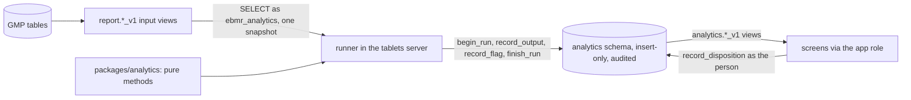
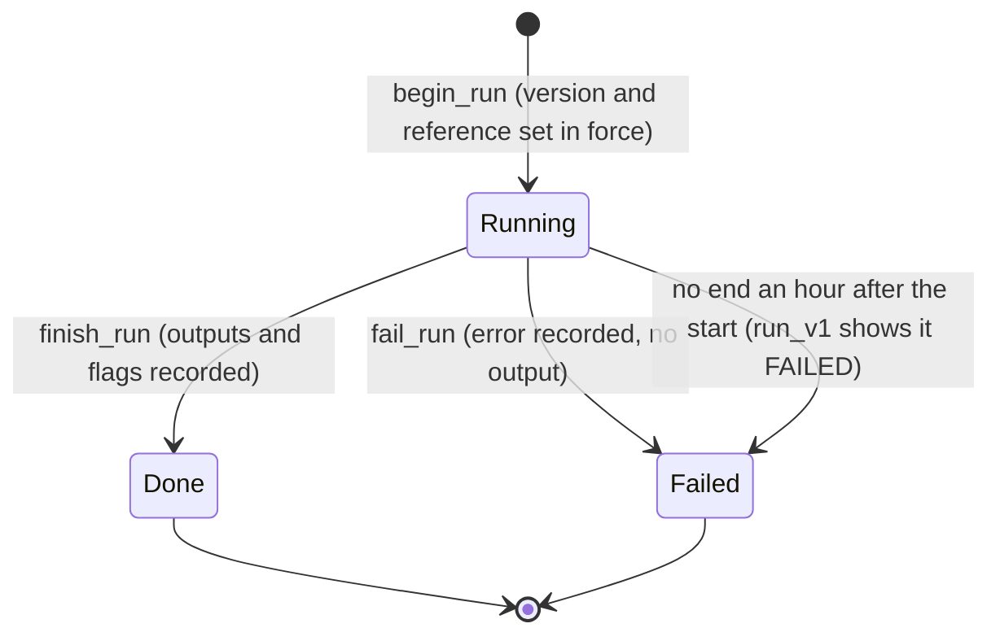

# analytics: advisory analytics (Phase 6A)

Facts on this page were checked against the code on 17 October 2026, at the Phase 6A exit (slices 6A-0 to 6A-7).

This page explains the advisory analytics of the Tablets edition: the pure package `packages/analytics`, the runner in
the tablets server, the analytics role and schema in the database, the input views it reads, the method versions under
change control, QA's dispositions of flags, the monitoring, and the screens. Read it before you add a method or change
anything the runner reads or writes. The architecture is [ADR 0020](../../adr/0020-analytics-module-read-only-advisory.md);
the plan is [phase-6a-plan.md](../../build-plan/phase-6a/phase-6a-plan.md) and the fixed interfaces are
[slice-6A-0-interfaces.md](../../build-plan/phase-6a/slice-6A-0-interfaces.md). Terms in bold are in the
[glossary](../02-glossary.md).

## Where the code is

| What | Where |
|---|---|
| Pure statistics, method registry, canonical hashing, quantiles, linear algebra | [packages/analytics/src/](../../../packages/analytics/src/) |
| The runner (schedule, poll, one snapshot, recording) | [runner.ts](../../../apps/tablets-server/src/analytics/runner.ts#sym=AnalyticsRunner) |
| The runner in its own worker thread (slice 7d, P6A7-4: no event-loop block in the server) | [threaded.ts](../../../apps/tablets-server/src/analytics/threaded.ts#sym=ThreadedAnalyticsRunner), [worker-entry.ts](../../../apps/tablets-server/src/analytics/worker-entry.ts) |
| The runner's reads and its row hash | [inputs.ts](../../../apps/tablets-server/src/analytics/inputs.ts#sym=readSnapshot) |
| The runner's own connection (ebmr_analytics) | [pool.ts](../../../apps/tablets-server/src/analytics/pool.ts#sym=createAnalyticsPool) |
| What a method slice adds to the runner | [implementation.ts](../../../apps/tablets-server/src/analytics/implementation.ts#sym=IMPLEMENTATIONS) |
| Catalogue and code identity for the screens | [catalog.ts](../../../apps/tablets-server/src/analytics/catalog.ts#sym=catalogMethods) |
| The routes (catalogue, methods, monitor, flags, dispositions, method versions) | [features/analytics/](../../../apps/tablets-server/src/features/analytics/) |
| Contract | [ns/analytics.ts](../../../packages/api-contract/src/ns/analytics.ts), [ns/analytics-config.ts](../../../packages/api-contract/src/ns/analytics-config.ts) |
| Screens `/analytics`, `/analytics/methods`, `/analytics/flags` | [tablets-web features/analytics/](../../../apps/tablets-web/src/features/analytics/) |
| Schema, role, tables, record functions, read views (6A-0) | kernel [1240](../../../packages/kernel/sql/1240_analytics_schema_role.sql) to [1244](../../../packages/kernel/sql/1244_analytics_permissions.sql) |
| Method change control, the screens' views (6A-1) | kernel [1245](../../../packages/kernel/sql/1245_analytics_method_change.sql) |
| Input views v1 | recipe-core [1115](../../../packages/recipe-core/sql/1115_analytics_input_views.sql) |
| Audit-trail methods ATA.RULES, ATA.BASELINE (6A-4) | [methods/audit/](../../../packages/analytics/src/methods/audit/), runner [audit.ts](../../../apps/tablets-server/src/analytics/audit.ts#sym=auditInput) |
| Audit-trail inputs and flag readers (6A-4) | kernel [1260](../../../packages/kernel/sql/1260_analytics_auth_facts.sql), [1261](../../../packages/kernel/sql/1261_analytics_audit_flag_groups.sql); recipe-core [1150](../../../packages/recipe-core/sql/1150_analytics_audit_inputs.sql), [1151](../../../packages/recipe-core/sql/1151_analytics_audit_flag_entries.sql) |
| Audit-trail flag routes and screens `/analytics/audit-flags` (6A-4) | [features/analytics/audit/](../../../apps/tablets-server/src/features/analytics/audit/), [ns/analytics-audit.ts](../../../packages/api-contract/src/ns/analytics-audit.ts), [tablets-web features/analytics-audit/](../../../apps/tablets-web/src/features/analytics-audit/) |
| SPC, capability, drift and rate methods (6A-2) | [methods/spc](../../../packages/analytics/src/methods/spc/index.ts#sym=runImr), [capability](../../../packages/analytics/src/methods/capability/index.ts#sym=runCapability), [drift](../../../packages/analytics/src/methods/drift/index.ts#sym=runDrift), [rates](../../../packages/analytics/src/methods/rates/index.ts#sym=runRates) |
| Their runner wiring and version 1 definitions | [spc.ts](../../../apps/tablets-server/src/analytics/spc.ts#sym=SPC_IMPLEMENTATIONS) |
| Their routes and screens `/analytics/spc`, `/analytics/rates` | [features/analytics/spc/](../../../apps/tablets-server/src/features/analytics/spc/), [ns/analytics-spc.ts](../../../packages/api-contract/src/ns/analytics-spc.ts), [tablets-web features/analytics/spc/](../../../apps/tablets-web/src/features/analytics/spc/) |
| Rate inputs and the site shifts | recipe-core [1130](../../../packages/recipe-core/sql/1130_analytics_rate_inputs.sql) |
| Review priority REVIEW.PRIORITY (6A-5) | [methods/review/](../../../packages/analytics/src/methods/review/priority.ts#sym=runReviewPriority), runner [review.ts](../../../apps/tablets-server/src/analytics/review.ts#sym=reviewInput) |
| Review facts (6A-5) | recipe-core [1160](../../../packages/recipe-core/sql/1160_analytics_review_facts.sql) |
| Review priority route, the queue's order and screens (6A-5) | [features/analytics/review/](../../../apps/tablets-server/src/features/analytics/review/), the queue in [features/review/reads.ts](../../../apps/tablets-server/src/features/review/reads.ts#sym=prioritisedQueue), [ns/analytics-review.ts](../../../packages/api-contract/src/ns/analytics-review.ts), [tablets-web features/analytics-review/](../../../apps/tablets-web/src/features/analytics-review/) |
| Golden batch profile: method GBP.DTW_BAND and its curve arithmetic (6A-6) | [methods/profile/](../../../packages/analytics/src/methods/profile/) |
| Its runner implementation, routes and screens (6A-6) | [profile.ts](../../../apps/tablets-server/src/analytics/profile.ts#sym=GOLDEN_PROFILE), [features/analytics/profile/](../../../apps/tablets-server/src/features/analytics/profile/), [ns/analytics-profile.ts](../../../packages/api-contract/src/ns/analytics-profile.ts), [tablets-web features/analytics/profile/](../../../apps/tablets-web/src/features/analytics/profile/) |
| Series inputs and the reference sets in force (6A-6) | recipe-core [1170](../../../packages/recipe-core/sql/1170_analytics_series_inputs.sql) |
| Multivariate monitoring: method MSPC.PCA and its PCA arithmetic (6A-3) | [methods/mspc/](../../../packages/analytics/src/methods/mspc/index.ts#sym=runMspc), [pca.ts](../../../packages/analytics/src/methods/mspc/pca.ts#sym=fitPca) |
| Its runner implementation, routes and screens (6A-3) | [mspc.ts](../../../apps/tablets-server/src/analytics/mspc.ts#sym=MSPC_IMPLEMENTATION), [features/analytics/mspc/](../../../apps/tablets-server/src/features/analytics/mspc/), [ns/analytics-mspc.ts](../../../packages/api-contract/src/ns/analytics-mspc.ts), [tablets-web features/analytics/mspc/](../../../apps/tablets-web/src/features/analytics/mspc/) |
| A reference set carries its candidate's model; repeated flags shown once (6A-3) | kernel [1270](../../../packages/kernel/sql/1270_analytics_reference_candidate.sql), [1271](../../../packages/kernel/sql/1271_analytics_flag_repeats.sql) |
| Tests | [package test/](../../../packages/analytics/test/), [kernel test/analytics](../../../packages/kernel/test/analytics/), [recipe-core test/analytics](../../../packages/recipe-core/test/analytics/), [server test/analytics](../../../apps/tablets-server/test/analytics/), [web test/analytics](../../../apps/tablets-web/test/analytics/) |
| Browser flows (6A-7) | [specs/phase6a/](../../../tools/e2e/specs/phase6a/analytics.spec.ts) and their [support.ts](../../../tools/e2e/specs/phase6a/support.ts#sym=analyticsCopy) |

## What it does

Analytics points QA at records worth a look: a trend drifting towards a limit, a batch unlike the others, an unusual
pattern in the audit trail. It is **advisory**: it never changes a batch record, a review or a release, and every screen
says so ("Advisory analytics, not for GMP decisions"). A real problem goes into the deviation path as usual.

1. **The runner** starts with the server on the GMP installation only (`EBMR_ANALYTICS`, default on; a sandbox never
   starts it). It runs nightly at 02:00 site time, after it sees newly completed batches (a poll every 5 minutes of
   `report.batch_outcome_v1`), and on demand. Each run reads its inputs in one REPEATABLE READ READ ONLY transaction,
   checks the method version against the running code, runs the pure method and records the outputs and flags in one
   transaction. A failure records the run as FAILED with its error and leaves no output.
2. **The input views** give GMP data as exact decimal text. `statOf` in the package is the only place a value becomes
   a JavaScript number, and a lint rule bans `Number()`, `parseFloat`, `parseInt` and unary `+` in the runner.
3. **Method versions and reference sets** are configuration: a person holding `ANALYTICS.METHOD` makes one effective,
   or retires it, under a change record QA approved for the area. A version never changes; retuning is a new version.
4. **Flags** carry their reasons. QA marks each one real issue, false alarm or not assessable, with a cause; a later
   disposition supersedes the current one with a reason. Flags about a person are for data-integrity review only.
5. **Monitoring** gives, per method version and month, the runs, failures, flags, the share dispositioned and the
   false-alarm rate (`analytics.method_monitor_v1`), on the methods page.
6. **The contract** (slice 6A-0) puts every route in an `analytics*` namespace under `/api/analytics/`, GMP only and
   read-only but for the disposition and the configuration writes. Each response carries the advisory envelope
   (`advisory`, `notForGmpDecisions`, the method and version, the run and its data age). A statistic is a `StatNumber`;
   a GMP value a response repeats (a recorded value, a limit) is the source's decimal text, unchanged.

The slices: 6A-0 fixed the interfaces, the schema, the role and the record functions; 6A-1 built the runner, the input
views, the method change control and the methods, flags and monitoring screens; 6A-2 to 6A-6 each added methods with
their inputs, routes and screens (below); 6A-7 is the exit (trace, browser flows, this handbook, the review).

## Pharma context

- **Why analytics at all.** Continued process verification (EU GMP Annex 15 and the FDA's process validation guidance,
  paraphrased: keep checking that a validated process stays in control) and the annual product quality review (PQR)
  ask a site to look at trends across batches. A control chart, a capability index or a drift alert helps QA see
  them earlier than a yearly report does.
- **Why advisory.** A statistic is not a GMP record. If a score could release, block or change a batch, the scoring
  code would itself become a GMP system to validate like the record (decision 0015). Here it only points QA at records;
  the decision is taken on the record, through the usual review, deviation and release paths.
- **Models under control.** The draft Annex 22 on artificial intelligence and the FDA's draft guidance on AI in
  regulatory decisions (both drafts, status U, paraphrased) expect a model with a stated intended use, a locked version,
  change control, monitoring of how it performs, and people who check its outputs. Here a method version is
  configuration under change control (DI-09), never changes once in force, and QA's verdict on each flag feeds the
  false-alarm rate of the monitor.
- **People in the data.** Audit-trail patterns describe how a person works. Data-integrity guidance (MHRA, PIC/S,
  paraphrased) wants the audit trail reviewed, but a pattern is a reason to look, never a finding: those flags are
  restricted to data-integrity review and close only with a person's disposition.
- **The controls.** Four draft controls describe the module, each with `expert_decision` PENDING and target phase 7
  (D-6A-3): [DI-51](../../../compliance/controls/DI-51.yaml) (advisory, never changes a GMP record),
  [DI-52](../../../compliance/controls/DI-52.yaml) (versioned, change-controlled, reproducible, with QA feedback and
  monitoring), [DI-53](../../../compliance/controls/DI-53.yaml) (audit-trail flags) and
  [PR-61](../../../compliance/controls/PR-61.yaml) (review priority never skips a review). The module also adds tests
  to [PR-60](../../../compliance/controls/PR-60.yaml) (AI inventory), [DI-09](../../../compliance/controls/DI-09.yaml),
  [DI-25](../../../compliance/controls/DI-25.yaml), [DI-26](../../../compliance/controls/DI-26.yaml),
  [PR-52](../../../compliance/controls/PR-52.yaml) and [PR-58](../../../compliance/controls/PR-58.yaml).

## Main tables (kernel 1241)

Every table of the schema `analytics` is owned by `ebmr_owner`, insert-only and registered with the hash-chained audit
trail (UPDATE, DELETE and TRUNCATE are refused, `EBMR-AUDIT-004`). No role but the owner reads or writes them: the
runner writes through the record functions of kernel 1242, the screens read the `analytics.*_v1` views. No GMP table,
view, function or trigger refers to them (DI-51).

| Table | One row per | Written by |
|---|---|---|
| `analytics.input_registry` | input the analytics role may read: a report view or a parameterised row function, with its version and grain | migrations only, `analytics.register_input` |
| `analytics.method_version` | method version (configuration area `ANALYTICS_METHOD`): intended use, acceptance criteria, parameters and their SHA-256, code identity, validation reference | `analytics.set_method_version`, under an approved change record |
| `analytics.reference_set` | QA-approved reference set (area `ANALYTICS_REFERENCE`): scope, batches, the model candidate, the model and its SHA-256 | `analytics.set_reference_set`, under an approved change record |
| `analytics.run`, `analytics.run_end` | run of a method version over recorded inputs; its end, DONE or FAILED, once | the runner: `begin_run`, `finish_run`, `fail_run` |
| `analytics.output`, `analytics.flag` | advisory output of a run, and a flag about a subject, each with its reasons | the runner: `record_output`, `record_flag` |
| `analytics.flag_disposition` | QA's verdict on a flag (true signal, false alarm, not assessable), with the cause; a later one supersedes the current one with a reason | the person: `analytics.record_disposition` |

The read views (SELECT to the application role): `input_catalog_v1`, `method_version_v1`, `reference_set_v1`,
`run_v1`, `output_v1`, `flag_v1`, `open_flag_v1`, `flag_disposition_v1`, `review_priority_v1` and
`method_monitor_v1`. None of them shows a flag about a person or an account.

## The runner

`AnalyticsRunner` holds the method implementations of the running code (`IMPLEMENTATIONS`: the audit-trail methods of
6A-4, the five SPC, capability, drift and rate methods of 6A-2, `MSPC.PCA` of 6A-3, `REVIEW.PRIORITY` of 6A-5 and
`GBP.DTW_BAND` of 6A-6). It runs nothing until QA makes a version effective. For each version in force
(`analytics.effective_methods()`):

- a version no implementation covers is skipped and logged;
- the inputs are read by `readSnapshot`: each row without its `read_at` and `data_as_of`, the rows sorted by their
  canonical text and hashed, so the same data gives the same input hash on every read;
- the version must match the code: its parameters hash to the recorded SHA-256, fit the method's schema, and its code
  identity names the running package version;
- the run is recorded with the inputs (view, version, filter, `data_as_of`, rows, SHA-256), the runtime (package,
  commit `EBMR_COMMIT`, Node, library versions) and the SHA-256 of the canonical outputs and flags.

Its time is the database's: the site-zone day and hour of the nightly run come from `statement_timestamp()`, and
every recorded instant from the analytics tables' defaults.

It starts only on its own role (Phase 7 slice 7b-1, P6A7-8): `start()` first asks the database what the connection is
(`analyticsRoleProblem`, [pool.ts](../../../apps/tablets-server/src/analytics/pool.ts#sym=analyticsRoleProblem)):
ebmr_analytics as the current and the session user, no superuser, create-role, create-database, replication or
bypass-RLS attribute, member of no role. Otherwise it logs an operations alert naming the problem ("check
EBMR_DB_ANALYTICS_URL") and never starts its timer; the server serves on (analytics is advisory).

> **Why this exists**
> - **Pharma reason:** a statistic must never become a GMP record by the back door; analytics that can write GMP data
>   would need the validation of a GMP system for every output (decision 0015).
> - **Control:** draft [DI-51](../../../compliance/controls/DI-51.yaml).
> - **Code:** the role's allow-list [`analytics.register_input`](../../../packages/kernel/sql/1242_analytics_record_functions.sql#sym=analytics.register_input)
>   and its check [`analytics.role_problems`](../../../packages/kernel/sql/1242_analytics_record_functions.sql#sym=analytics.role_problems);
>   the runner's connection [pool.ts](../../../apps/tablets-server/src/analytics/pool.ts).
> - **Tests:** [runner.test.ts](../../../apps/tablets-server/test/analytics/runner.test.ts) and
>   [analytics.test.ts](../../../packages/kernel/test/analytics/analytics.test.ts), named `[DI-51]`; the golden
>   batches run with the runner on ([analytics-check.ts](../../../apps/tablets-server/test/golden/analytics-check.ts)).

## The input views (recipe-core 1115)

| View | One row per | Columns of note |
|---|---|---|
| `report.batch_fact_v1` | GMP batch record | product and strength, MBR version and family, record kind, review status, issue and completion, released |
| `report.cpp_value_v1` | critical value (one per reading of a series) | kind, item, step, attempt, role, `value_text`, unit, the master's outermost limits and the tier they come from, target, failed, recorded at |
| `report.step_use_v1` | executed step and unit | step key and phase, unit and class, room, start and end, persons, consumed lots |

`cpp_value_v1` is built on [`recipe.pqr_cpp_of`](../../../packages/recipe-core/sql/1062_pqr_cpp_extract.sql#sym=recipe.pqr_cpp_of),
so it holds the same values the PQR extract exports. The limits are the outermost tier the master gives
(REGISTERED, then VALIDATED, INTERNAL_ACTION, ALERT; [`report.outer_limits`](../../../packages/recipe-core/sql/1115_analytics_input_views.sql#sym=report.outer_limits)).
Only DECIMAL, COUNT and SERIES values appear. Each view is registered on the role's allow-list with
`report.batch_outcome_v1` (the poll).

## Method change control (kernel 1245)

> **Why this exists**
> - **Pharma reason:** a model's intended use, parameters and code must be fixed and changed only under change control
>   (Annex 11 section 10 and the drafts on AI in GMP, paraphrased: a computerised system changes in a controlled way).
> - **Control:** draft [DI-52](../../../compliance/controls/DI-52.yaml), [DI-09](../../../compliance/controls/DI-09.yaml).
> - **Code:** [`analytics.set_method_version`](../../../packages/kernel/sql/1245_analytics_method_change.sql#sym=analytics.set_method_version),
>   [`analytics.method_version_rules`](../../../packages/kernel/sql/1245_analytics_method_change.sql#sym=analytics.method_version_rules),
>   [`analytics.set_reference_set`](../../../packages/kernel/sql/1245_analytics_method_change.sql#sym=analytics.set_reference_set);
>   the guard of kernel 1195 on the configuration table.
> - **Tests:** [method-change.test.ts](../../../packages/kernel/test/analytics/method-change.test.ts) and
>   [routes.test.ts](../../../apps/tablets-server/test/analytics/routes.test.ts), named `[DI-52]` and `[DI-09]`.
> - **Error:** `EBMR-ANA-013` (a version changed), `EBMR-ANA-014` (a reference set changed), `EBMR-ANA-015` (malformed),
>   `EBMR-CFG-001` to `-004` (no approved change record for the area).

The route `analyticsConfig.setMethodVersion` takes the parameters and acceptance criteria as JSON text; the server
hashes the parameters and names the code identity. `analyticsConfig.setReferenceSet` takes the model from the model
candidate it is approved from. The methods page reads `analytics.method_version_v1`, each row with its validity and the
change record it was written under; `platform.config_as_of` gives the methods in force at any past instant.

## Flags and dispositions

The screens read `analytics.open_flag_v1` (open), `analytics.flag_v1` (all, with the current disposition) and
`analytics.flag_disposition_v1`; none of them shows a flag about a person or an account. Those are read only through
[`analytics.person_flags`](../../../packages/kernel/sql/1242_analytics_record_functions.sql#sym=analytics.person_flags) and
[`analytics.person_flag_dispositions`](../../../packages/kernel/sql/1245_analytics_method_change.sql#sym=analytics.person_flag_dispositions),
which need `ANALYTICS.DI_REVIEW` (draft [DI-53](../../../compliance/controls/DI-53.yaml)). The flags list shows them only
when asked for by kind (PERSON, ACCOUNT). A disposition is
[`analytics.record_disposition`](../../../packages/kernel/sql/1242_analytics_record_functions.sql#sym=analytics.record_disposition),
run as the person inside a command, insert-only and audited.

Each run assesses its whole input again, so a nightly run raises an open hit again. The runs keep every raise
(`analytics.flag_v1`, the audit trail); kernel 1271 groups them in the views (D-6A-3-9). A flag's signal is its method,
version, subject, rule, severity and reasons. `analytics.open_flag_v1` lists each open signal once, as its latest raise
with `raised_count` and `first_raised_at`, and the flags screen says how often it was raised. A disposition on any raise
closes the signal, including the same hit raised later; a hit that differs in anything is listed on its own. The
monitor counts each raise with its signal's disposition.

## Permissions (Tablets)

| Permission | Roles | Used by |
|---|---|---|
| `ANALYTICS.VIEW` | QA reviewer, head of production, AP, EU QP, CSV/DI lead | every analytics read; the review queue's priority order |
| `ANALYTICS.DISPOSITION` | QA reviewer, CSV/DI lead | dispositions |
| `ANALYTICS.DI_REVIEW` | CSV/DI lead | flags about a person |
| `ANALYTICS.METHOD` | QA reviewer, process owner | method versions, reference sets |

## SPC, capability, drift and deviation rates (slice 6A-2)

Five methods, each a version 1 that QA puts in force on `/analytics/methods` under an approved change record (the
definitions are `SPC_METHOD_DEFINITIONS`: the plan's parameters, intended use, acceptance criteria and validation
reference). Charts, capability and drift are per product, MBR family and critical item (`report.cpp_value_v1`, the
batch's last attempt, completed batches in completion order); the master's limits are echoed as its decimal text.

| Method | What it gives | Flags |
|---|---|---|
| `SPC.IMR` | I-MR chart of one value per batch: centre and sigma (mean moving range / d2) of the first 20 batches (Phase I), or of an approved reference set when one is passed; limits centre +- 3 sigma | `NELSON_1`, `_2`, `_3`, `_5`, one flag per rule naming the batches of each hit |
| `SPC.XBAR_S` | Mean and S chart of the readings of a SERIES item (two or more per batch); sigma the mean of s / c4(n) | as above |
| `CAP.INDEX` | Cpk (within sigma) and Ppk (overall) with Bissell 95 % intervals and an Anderson-Darling note; NOT_SHOWN below 25 batches or without a limit | none |
| `DRIFT.TREND` | Slope of the last 10 batches (t test) projected 5 batches ahead, and an EWMA (0.2, 2.7) from the master's target | `DRIFT_SLOPE`, `DRIFT_EWMA` (about the newest batch) |
| `RATE.DEVIATION` | Per product and grouping (step, unit, room, lot, supplier, shift): share of batches with a deviation (Wilson), deviations per 100 batches (Garwood), one-sided Fisher against the rest, Benjamini-Hochberg q, funnel limits | `RATE_ABOVE` when q <= 10 % and the share is higher |

The deviation inputs are `report.deviation_fact_v1` (a deviation linked to a GMP batch, attributed to the step of the
exception it was linked or escalated to, with that step's unit, room and lots, and the shift it falls in; linked to the
batch only it is unattributed but for its shift) and `report.step_shift_v1`. The shifts are the platform setting
`site.shift_boundaries` (default `A=06:00,B=14:00,C=22:00` in site time), changed under a change record; a malformed
value is refused (EBMR-ANA-020). The routes read the newest recorded output; nothing recorded answers 404
(EBMR-ANA-021). The PQR extract screen links to the charts and rates as an advisory annex; the extract and its signed
content do not change (D-6A-18). Known answers: `packages/analytics/test/reference/spc_reference.py` (SciPy) and the
published examples in `spc-methods.test.ts`.

## Multivariate monitoring (slice 6A-3)

Method `MSPC.PCA` v1 shows a batch whose combination of critical values departs from QA's reference batches, even when
each value is within its own limits, and names the variables that contribute most (decision 0016 item 2; plan defaults
D-6A-11 and D-6A-3-1 to D-6A-3-11). It is advisory.

- **Batch vector.** Per product and MBR family, the critical items of the newest completed batch: one value per batch
  (the last attempt) or the mean of a subgroup item's readings, autoscaled. A batch missing a variable is skipped with
  the reason.
- **Candidate** (MODEL_CANDIDATE, subject `<product>|<family>`). It is fitted on the newest 100 batches that may be
  reference batches: released, no critical deviation, every variable recorded; at least 15. PCA by SVD keeps the fewest
  components reaching 90 % of the variance, at most 5. A first fit's Phase I limits leave out the batches beyond them,
  named, and the model is fitted again. The candidate holds the model and its SHA-256.
- **Reference set.** QA makes a candidate the reference set on `/analytics/mspc` under a change record approved for
  `ANALYTICS_REFERENCE`. The database checks the hash (EBMR-ANA-010) and, since kernel 1270, the model and batches
  themselves (EBMR-ANA-030).
- **Scoring.** For each set in force a run scores the reference batches and the newest 50 others. T-squared has a beta
  limit for a reference batch and an F limit for a new one, Q a Jackson-Mudholkar limit (Box's when that fails), all at
  99 %. A batch outside the set beyond a limit is flagged `T2_ABOVE` or `Q_ABOVE`, with its top contributors.
- **Screens.** `/analytics/mspc` shows the T-squared and Q charts, the scores plot, the batches and the candidates.
  `/analytics/mspc/batches/:batchId` shows the contribution bars and the recorded values, and drills to the batch record.
  The routes answer EBMR-ANA-031 before a scoring run and EBMR-ANA-032 for a batch without a score.
- **Reference sets for SPC** (D-6A-3-7). An I-MR or Xbar-S chart with complete Phase I limits gives a candidate of those
  limits; QA makes it the chart's reference set from the SPC screen. The run without a set then leaves that chart to the
  set's own run, which charts `REFERENCE_SET` limits. Both methods read the sets in force as 6A-6 does
  (`report.analytics_reference_v1`, a run per set).
- **Known answers:** `packages/analytics/test/reference/mspc_reference.py` (NumPy, SciPy).

## Audit-trail anomaly detection (slice 6A-4)

Decision 0016 item 8, rules first, then per-person baselines; no machine learning (decision 0023). A flag is a pointer
for data-integrity review, never an accusation or a finding (draft [DI-53](../../../compliance/controls/DI-53.yaml)).

- **Inputs** (on the analytics role's allow-list only; not in the report catalogue, unreadable by the application and
  reporting roles, because they describe persons; D-6A-4-2). All cover the last 26 weeks.
  - `report.audit_fact_v1` (recipe-core 1150): one row per audit event of a person: who, role, terminal, action, table,
    whether it is a correction and its reason code; for a batch record's entry its command type, item, step instance,
    attempt, whether it failed and the time it claims; the batch, a linked deviation, the configuration area; the
    site's wall-clock time. No old or new value, only the changed field names.
  - `report.manual_digit_v1` (recipe-core 1150): the last digit of each value keyed by hand, nothing more.
  - `report.auth_fact_v1` (kernel 1260): logins, failed logins and lockouts of human accounts with terminal and time.
- **ATA.RULES v1** ([rules.ts](../../../packages/analytics/src/methods/audit/rules.ts#sym=runAuditRules)): LATE_ENTRY,
  BACK_DATED, CORRECTIONS_HIGH, TWO_TERMINALS, TOO_REGULAR, REPEAT_UNTIL_PASS, OFF_HOURS_CONFIG, thresholds in the
  version's parameters (D-6A-12). One flag per hit, each about a PERSON with its reason and evidence (the audit entries
  as `<chain>#<id>`, logins, the week or the test).
- **ATA.BASELINE v1** ([baseline.ts](../../../packages/analytics/src/methods/audit/baseline.ts#sym=runAuditBaseline)):
  weekly entries, corrections, late entries and failed logins per person against the person's own trailing 13 weeks as
  a robust z (median, MAD); a completed week is assessed only with 6 weeks of history; flags at |z| above 3.5.
- **Keys** (kernel 1261): every run assesses the whole window again, so the same hit is raised again. A flag's key is
  its method, rule, subject and the first evidence of its first reason. `analytics.audit_flags` gives one row per key
  (the latest flag, how often and since when, and the key's current disposition); a disposition on any flag of the key
  closes it, also for the hits raised again later (D-6A-4-5).
- **Restricted reads**: `analytics.audit_flags`, `analytics.audit_flag_entries` (the entries behind a flag) and
  `analytics.audit_flagged_entries` (the flagged entries of a batch's review scope) refuse administrators and need
  `ANALYTICS.DI_REVIEW`. A flag sends no notification. QA closes it with `analytics.dispose`; a confirmed problem is raised
  as a deviation.
- **Review panel** (DI-25): for the CSV/DI lead the batch audit-trail review panel lists the flagged entries first and
  highlights them; every entry is still listed and the review (scope, mark, hash, signature) is unchanged. Nothing in the
  review reads a flag (D-6A-4-9).

## Review priority (slice 6A-5)

Decision 0016 item 9. A transparent weighted score per GMP batch record in the review queue that orders the QA review
queue and shows its top three reasons. It never skips, narrows or completes a review (draft
[PR-61](../../../compliance/controls/PR-61.yaml)): every record is still reviewed in full.

- **Input** `report.review_fact_v1` (recipe-core 1160; in the report catalogue and on the analytics role's allow-list):
  one row per record at EXECUTION_COMPLETE or ABORTED that awaits QA review or was QA reviewed in the last 30 days, with
  its exceptions by severity (register CRITICAL, ACTION, ALERT as critical, major, minor), accepted post-entry
  corrections, linked deviations (not cancelled), how many persons were new to the product, the units new to the GMP
  records or maintained in the 7 days before their use, and the review outcome so far (findings, reopenings). It names
  no person. The method also reads `report.cpp_value_v1`, `report.step_use_v1`, `report.batch_fact_v1` and
  `report.audit_fact_v1` (D-6A-5-1 to -5).
- **REVIEW.PRIORITY v1** ([priority.ts](../../../packages/analytics/src/methods/review/priority.ts#sym=runReviewPriority)):
  the D-6A-13 weights (critical 5, major 3, minor 1, near a limit 1 up to 5, correction 1 up to 5, audit-trail rule hit 3,
  new operator 2 once, new or maintained unit 2 once, unusual step duration 1 up to 3, linked deviation 4). Near a limit
  is compared exactly on the decimal text; a step duration is a robust z against the same product, family and step of
  at least 5 records; an audit-trail hit is an ATA.RULES v1 hit over the same snapshot whose evidence names an entry of
  the record, counted, never named (D-6A-5-4). One REVIEW_PRIORITY output per record, with every term's count and
  points and the outcome so far; no flag.
- **The queue** (`review.queue`, feature review): for a holder of `ANALYTICS.VIEW` (checked by the database) the same
  records, ordered: records awaiting QA review first, the unscored ones first, then by score (ties by completion time),
  then the QA-reviewed records by batch number (D-6A-14, D-6A-5-7). Each record carries its optional `priority` and the
  response its `ordering` with the advisory band. Without the permission, or when the priority cannot be read, the
  queue is exactly as before. The review feature reads `analytics.review_priority_v1` by SQL only; no review, register,
  audit-trail review or release function reads it (the test `[PR-61] no review, register or release function depends
  on the review priority`).
- **Screens**: the queue shows each record's score and reasons (or "not scored yet") under the advisory band;
  `/analytics/review-priority/$batchId` shows one record's priority with every reason and the link into its review.
- QA puts version 1 in force (`REVIEW_METHOD_DEFINITIONS`) under a change record; no migration writes it.
- **Restricted reasons and counts (Phase 7 slice 7b-1, P6A7-6, P6A7-7; DI-53).** The top reasons are chosen among the
  terms every reader sees; the audit-trail reason (OPEN_AUDIT_FLAG) follows them when it scores (`scoreOf`), so a reader
  without `ANALYTICS.DI_REVIEW`, from whom the database leaves that reason out (kernel 1281), still sees the same number
  of top reasons. Kernel [1322](../../../packages/kernel/sql/1322_analytics_audit_method_counts.sql) re-creates
  `analytics.method_monitor_v1` and `analytics.run_v1`: for the audit-trail methods (ATA.*) the monitor's flags,
  dispositioned share and false-alarm rate, and a run's output and flag counts, are shown only to `ANALYTICS.DI_REVIEW`
  holders; others see the runs and failures, with "restricted" on the methods screen.

## The golden batch profile (slice 6A-6)

Method `GBP.DTW_BAND` v1 compares a batch's equipment curve with the band of QA's reference batches (decision 0016
item 10; plan defaults D-6A-16 and D-6A-6-1 to D-6A-6-11). It covers connected equipment only: the native OPC UA series
of slice 6b (`plant.series`). It is advisory, and no profile is ever a GMP record.

- **Inputs** (recipe-core 1170, on the analytics role's allow-list):
  - `report.series_ref_v1` has one row per GMP batch, step bound to a unit, and tag the unit sent during the step's
    binding window (the window `plant.series_in_context` uses). Each row carries the chunk ids, whether the window has
    ended, the release, the deviations linked to the batch and the alarms on the step.
  - `report.series_samples_v1(batch, step, tag)` gives the window's samples exactly as received: source time, raw text,
    shown decimal, status code and quality.
  - `report.analytics_reference_v1` gives the reference sets in force, read from the configuration store. The analytics
    role may not run the kernel's owner-only reader, and 6A-6 has no kernel range (D-6A-6-7).
- **The runner** calls the samples function once per distinct batch, step and tag (an `InputSpec` with `call`). It gives
  each sample to the unit whose chunk holds it.
  - Each run reads only the latest 50 ended curves of each scope (column `recency`, bound `atMost`; D-6A-6-12).
  - A method with `references` runs once without a reference set, to fit the model candidates, and then once per
    reference set in force. Each set is read again in the run's snapshot.
  - Before scoring, the runner checks that the set's model hashes to its SHA-256 and that its batches and scope are the
    model's.
- **The method.**
  - **Samples.** BAD samples are dropped and counted; UNCERTAIN ones are used and counted. A curve is not assessed, with
    the reason, when its step has not ended, when it has fewer than 20 usable samples, or when a gap between samples is
    longer than 5 % of its time.
  - **Resampling.** A curve is resampled to 200 points from its first to its last usable sample.
  - **Fit.** The medoid is found by DTW with a Sakoe-Chiba band of 10 %. Every reference curve is aligned to it.
    - The band is the pointwise 5th to 95th percentile, with a timing tolerance of one point (D-6A-6-3).
    - The distance limit is a log-normal 99 % prediction limit of the references' distances (D-6A-6-4).
  - **Flags.** A batch is flagged `OUT_OF_BAND` when more than 10 % of its aligned points lie outside the band, and
    `DTW_DISTANCE` when its distance is above the limit.
- **Reference batches** (D-6A-6-2) are released, with no deviation linked to the batch and no alarm on the step.
  - The candidate (`MODEL_CANDIDATE`) is fitted on all of them, at least 10, and lists the batches it leaves out and why.
  - QA makes it a reference set on `/analytics/profiles` under a change record approved for `ANALYTICS_REFERENCE`. The
    database checks the model hash (EBMR-ANA-010).
- **Screens.**
  - `/analytics/profiles` lists the candidates and shows a batch against its band.
  - The 6b trend viewer shows the same overlay under its chart: the band, the reference curve, the aligned batch curve,
    the flags and every sample as recorded (DI-32).
  - The routes answer EBMR-ANA-060 for a step without a series and EBMR-ANA-061 before a profile exists.

## Adding a method (slices 6A-2 to 6A-6)

1. Write the pure method in `packages/analytics/src/methods/<family>/` with its tests and reference values.
2. Add its implementation (inputs, `assemble`, the method) to the runner in `apps/tablets-server/src/analytics/`, and
   list it in `IMPLEMENTATIONS`. Import the shapes from `method-types.ts`, not `implementation.ts`, or the list makes an
   import cycle. A parameterised input is an `InputSpec` with `call`; a method with reference sets declares
   `references` (as `profile.ts` does).
3. Add any input view in your migration range and register it with `analytics.register_input`.
4. QA makes version 1 effective under a change record on `/analytics/methods`.

## State machines

A run, a method version and a flag each have a short life. None of them is a GMP state; each step is a new row.

- **Method version:** EFFECTIVE, then at most once RETIRED by a later row with the same parameters, intended use and code
  (EBMR-ANA-013). A retired version stays retired; a change is a new version.
- **Reference set:** EFFECTIVE, then at most once RETIRED with the same method, scope, batches, candidate and model
  (EBMR-ANA-014).
- **Flag:** open until a person dispositions it; a later disposition supersedes the current one with a reason
  (EBMR-ANA-008). A disposition on any raise of the same signal (6A-3) or key (6A-4) closes the hits raised again later.

## How to test it

- **The package:** known answers in `packages/analytics/test/`, against published examples and the offline reference
  values in `test/reference/` (each with the script that wrote it).
- **The database:** kernel and recipe-core tests in `test/analytics/` prove the core controls on a real database: the
  analytics role cannot write GMP data, no GMP object depends on the schema, no floating-point column outside it, the
  insert-only tables, the change control, the restricted reads and the input views over GMP records. Run them on a
  spare cluster (the [local CI skill](../10-runbooks.md#3-run-ci-locally)).
- **The server:** `apps/tablets-server/test/analytics/` runs each method end to end through the runner on the
  synthetic history (test-kit `analyticsHistory`), with the input row functions replaced by the history's tables in the
  test's own database.
- **The screens:** `apps/tablets-web/test/analytics/`, `analytics-audit/` and `analytics-review/`.
- **The browser flows** (6A-7, `tools/e2e/specs/phase6a/`): the SPC chart and its drill to the record, QA's
  disposition of an audit-trail flag, the review queue in priority order with the lowest record still asking for its
  full review, and the golden profile overlay in the trend viewer. They run on a copy of the E2E GMP database with its
  own server, so their fixtures never reach the database the other specs share (D-6A-7-b-1), and they record their
  runs through the analytics role's own record functions (D-6A-7-b-2).
- **The golden batches** GB-T-01 to GB-T-03 run with the runner on and keep their exact outputs (`[DI-51]`).
- **Mutation groups** (90 %): `analytics-method-change`, `analytics-inputs`, `analytics-rate-inputs`,
  `analytics-mspc-reference`, `analytics-audit`, `analytics-review-inputs` and `analytics-profile-inputs`.
- **The trace:** the four drafts have target phase 7, so `pnpm trace` at phase 6 does not gate them; their catalog tests
  are mapped to `clauses`, and the Phase 6A exit dry-runs the trace at phase 7 over their tests (D-6A-7-b-3).

## Pitfalls

- **A JavaScript number only through `statOf`.** In the runner, `Number()`, `parseFloat`, `parseInt` and unary `+` are
  banned by lint. Read a GMP value as decimal text and convert it in the package.
- **Never read the analytics schema from a GMP object.** A report view, trigger or function that names `analytics.`
  breaks the DI-51 dependency proof. A GMP-side setting the runner needs lives outside the schema (as
  `site.shift_boundaries`, D-6A-2-7), and the review queue reads the priority through its view in its own SQL, never
  through code.
- **The runner's role has 4 connections on the whole cluster.** Server tests run with `EBMR_ANALYTICS=off` unless they
  test the runner; a test that connects as `ebmr_analytics` waits while the limit is reached.
- **A version records the build.** A version's code identity names the package version and commit; after an upgrade,
  the runner refuses a version whose identity is not the running code's (a FAILED run with the reason). QA puts in force
  a new version, validated on the new build.
- **Re-runs raise hits again.** Each run assesses its whole input; the views group the repeats (kernel 1261, 1271), the
  tables keep every raise. Count raises, not signals, only where the monitor says so.
- **Flags about persons stay restricted.** Anything derived from them is restricted too: the review priority's
  audit-trail term is hidden from viewers without `ANALYTICS.DI_REVIEW` (defect P6A5-1).

## Related pages

- [Architecture](../03-architecture.md#the-analytics-path-phase-6a): the analytics path beside the reporting path.
- [Database reference](../05-database.md#database-roles): the role `ebmr_analytics` and the schema `analytics`.
- [Runbooks](../10-runbooks.md#analytics-method-versions-and-reference-sets-phase-6a): putting a method version or a
  reference set in force under change control.
- [Defects and lessons](../08-defect-log.md#phase-6a-advisory-analytics): the Phase 6A entries.
- [kernel](kernel.md), [recipe-core](recipe-core.md), [tablets-server](tablets-server.md),
  [tablets-web](tablets-web.md).
