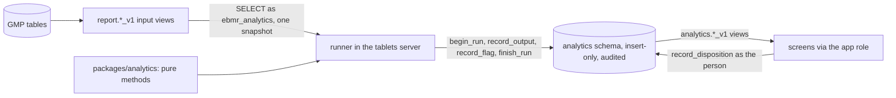

# analytics: advisory analytics (Phase 6A)

**Draft.** This page is still being written; facts on it were checked against the code on 17 October 2026 (slices
6A-0, 6A-1, 6A-2, 6A-4 and 6A-6). Slices 6A-3 and 6A-5 add their methods here.

This page explains the advisory analytics of the Tablets edition: the pure package `packages/analytics`, the runner in
the tablets server, the analytics role and schema in the database, the input views it reads, the method versions under
change control, QA's dispositions of flags, the monitoring, and the screens. Read it before you add a method or change
anything the runner reads or writes. The architecture is [ADR 0020](../../adr/0020-analytics-module-read-only-advisory.md);
the plan is [phase-6a-plan.md](../../build-plan/phase-6a/phase-6a-plan.md) and the fixed interfaces are
[slice-6A-0-interfaces.md](../../build-plan/phase-6a/slice-6A-0-interfaces.md). Terms in bold are in the
[glossary](../02-glossary.md).

## Where the code is

| What | Where |
|---|---|
| Pure statistics, method registry, canonical hashing, quantiles, linear algebra | [packages/analytics/src/](../../../packages/analytics/src/) |
| The runner (schedule, poll, one snapshot, recording) | [runner.ts](../../../apps/tablets-server/src/analytics/runner.ts#sym=AnalyticsRunner) |
| The runner's reads and its row hash | [inputs.ts](../../../apps/tablets-server/src/analytics/inputs.ts#sym=readSnapshot) |
| The runner's own connection (ebmr_analytics) | [pool.ts](../../../apps/tablets-server/src/analytics/pool.ts#sym=createAnalyticsPool) |
| What a method slice adds to the runner | [implementation.ts](../../../apps/tablets-server/src/analytics/implementation.ts#sym=IMPLEMENTATIONS) |
| Catalogue and code identity for the screens | [catalog.ts](../../../apps/tablets-server/src/analytics/catalog.ts#sym=catalogMethods) |
| The routes (catalogue, methods, monitor, flags, dispositions, method versions) | [features/analytics/](../../../apps/tablets-server/src/features/analytics/) |
| Contract | [ns/analytics.ts](../../../packages/api-contract/src/ns/analytics.ts), [ns/analytics-config.ts](../../../packages/api-contract/src/ns/analytics-config.ts) |
| Screens `/analytics`, `/analytics/methods`, `/analytics/flags` | [tablets-web features/analytics/](../../../apps/tablets-web/src/features/analytics/) |
| Schema, role, tables, record functions, read views (6A-0) | kernel [1240](../../../packages/kernel/sql/1240_analytics_schema_role.sql) to [1244](../../../packages/kernel/sql/1244_analytics_permissions.sql) |
| Method change control, the screens' views (6A-1) | kernel [1245](../../../packages/kernel/sql/1245_analytics_method_change.sql) |
| Input views v1 | recipe-core [1115](../../../packages/recipe-core/sql/1115_analytics_input_views.sql) |
| Audit-trail methods ATA.RULES, ATA.BASELINE (6A-4) | [methods/audit/](../../../packages/analytics/src/methods/audit/), runner [audit.ts](../../../apps/tablets-server/src/analytics/audit.ts#sym=auditInput) |
| Audit-trail inputs and flag readers (6A-4) | kernel [1260](../../../packages/kernel/sql/1260_analytics_auth_facts.sql), [1261](../../../packages/kernel/sql/1261_analytics_audit_flag_groups.sql); recipe-core [1150](../../../packages/recipe-core/sql/1150_analytics_audit_inputs.sql), [1151](../../../packages/recipe-core/sql/1151_analytics_audit_flag_entries.sql) |
| Audit-trail flag routes and screens `/analytics/audit-flags` (6A-4) | [features/analytics/audit/](../../../apps/tablets-server/src/features/analytics/audit/), [ns/analytics-audit.ts](../../../packages/api-contract/src/ns/analytics-audit.ts), [tablets-web features/analytics-audit/](../../../apps/tablets-web/src/features/analytics-audit/) |
| SPC, capability, drift and rate methods (6A-2) | [methods/spc](../../../packages/analytics/src/methods/spc/index.ts#sym=runImr), [capability](../../../packages/analytics/src/methods/capability/index.ts#sym=runCapability), [drift](../../../packages/analytics/src/methods/drift/index.ts#sym=runDrift), [rates](../../../packages/analytics/src/methods/rates/index.ts#sym=runRates) |
| Their runner wiring and version 1 definitions | [spc.ts](../../../apps/tablets-server/src/analytics/spc.ts#sym=SPC_IMPLEMENTATIONS) |
| Their routes and screens `/analytics/spc`, `/analytics/rates` | [features/analytics/spc/](../../../apps/tablets-server/src/features/analytics/spc/), [ns/analytics-spc.ts](../../../packages/api-contract/src/ns/analytics-spc.ts), [tablets-web features/analytics/spc/](../../../apps/tablets-web/src/features/analytics/spc/) |
| Rate inputs and the site shifts | recipe-core [1130](../../../packages/recipe-core/sql/1130_analytics_rate_inputs.sql) |
| Golden batch profile: method GBP.DTW_BAND and its curve arithmetic (6A-6) | [methods/profile/](../../../packages/analytics/src/methods/profile/) |
| Its runner implementation, routes and screens (6A-6) | [profile.ts](../../../apps/tablets-server/src/analytics/profile.ts#sym=GOLDEN_PROFILE), [features/analytics/profile/](../../../apps/tablets-server/src/features/analytics/profile/), [ns/analytics-profile.ts](../../../packages/api-contract/src/ns/analytics-profile.ts), [tablets-web features/analytics/profile/](../../../apps/tablets-web/src/features/analytics/profile/) |
| Series inputs and the reference sets in force (6A-6) | recipe-core [1170](../../../packages/recipe-core/sql/1170_analytics_series_inputs.sql) |
| Tests | [kernel test/analytics](../../../packages/kernel/test/analytics/), [recipe-core test/analytics](../../../packages/recipe-core/test/analytics/), [server test/analytics](../../../apps/tablets-server/test/analytics/), [web test/analytics](../../../apps/tablets-web/test/analytics/) |

## What it does

Analytics points QA at records worth a look: a trend drifting towards a limit, a batch unlike the others, an unusual
pattern in the audit trail. It is **advisory**: it never changes a batch record, a review or a release, and every screen
says so ("Advisory analytics, not for GMP decisions"). A real problem goes into the deviation path as usual.

1. **The runner** starts with the server on the GMP installation only (`EBMR_ANALYTICS`, default on; a sandbox never
   starts it). It runs nightly at 02:00 site time, after it sees newly completed batches (a poll every 5 minutes of
   `report.batch_outcome_v1`), and on demand. Each run reads its inputs in one REPEATABLE READ READ ONLY transaction,
   checks the method version against the running code, runs the pure method and records the outputs and flags in one
   transaction. A failure records the run as FAILED with its error and leaves no output.
2. **The input views** give GMP data as exact decimal text. `statOf` in the package is the only place a value becomes
   a JavaScript number, and a lint rule bans `Number()`, `parseFloat`, `parseInt` and unary `+` in the runner.
3. **Method versions and reference sets** are configuration: a person holding `ANALYTICS.METHOD` makes one effective,
   or retires it, under a change record QA approved for the area. A version never changes; retuning is a new version.
4. **Flags** carry their reasons. QA marks each one real issue, false alarm or not assessable, with a cause; a later
   disposition supersedes the current one with a reason. Flags about a person are for data-integrity review only.
5. **Monitoring** gives, per method version and month, the runs, failures, flags, the share dispositioned and the
   false-alarm rate (`analytics.method_monitor_v1`), on the methods page.

## The runner

`AnalyticsRunner` holds the method implementations of the running code (`IMPLEMENTATIONS`; slice 6A-1 has none, so it
runs nothing until a method slice adds one and QA makes a version effective). For each version in force
(`analytics.effective_methods()`):

- a version no implementation covers is skipped and logged;
- the inputs are read by `readSnapshot`: each row without its `read_at` and `data_as_of`, the rows sorted by their
  canonical text and hashed, so the same data gives the same input hash on every read;
- the version must match the code: its parameters hash to the recorded SHA-256, fit the method's schema, and its code
  identity names the running package version;
- the run is recorded with the inputs (view, version, filter, `data_as_of`, rows, SHA-256), the runtime (package,
  commit `EBMR_COMMIT`, Node, library versions) and the SHA-256 of the canonical outputs and flags.

Its time is the database's: the site-zone day and hour of the nightly run come from `statement_timestamp()`, and
every recorded instant from the analytics tables' defaults.

> **Why this exists**
> - **Pharma reason:** a statistic must never become a GMP record by the back door; analytics that can write GMP data
>   would need the validation of a GMP system for every output (decision 0015).
> - **Control:** draft [DI-51](../../../compliance/controls/DI-51.yaml).
> - **Code:** the role's allow-list [`analytics.register_input`](../../../packages/kernel/sql/1242_analytics_record_functions.sql#sym=analytics.register_input)
>   and its check [`analytics.role_problems`](../../../packages/kernel/sql/1242_analytics_record_functions.sql#sym=analytics.role_problems);
>   the runner's connection [pool.ts](../../../apps/tablets-server/src/analytics/pool.ts).
> - **Tests:** [runner.test.ts](../../../apps/tablets-server/test/analytics/runner.test.ts) and
>   [analytics.test.ts](../../../packages/kernel/test/analytics/analytics.test.ts), named `[DI-51]`; the golden
>   batches run with the runner on ([analytics-check.ts](../../../apps/tablets-server/test/golden/analytics-check.ts)).

## The input views (recipe-core 1115)

| View | One row per | Columns of note |
|---|---|---|
| `report.batch_fact_v1` | GMP batch record | product and strength, MBR version and family, record kind, review status, issue and completion, released |
| `report.cpp_value_v1` | critical value (one per reading of a series) | kind, item, step, attempt, role, `value_text`, unit, the master's outermost limits and the tier they come from, target, failed, recorded at |
| `report.step_use_v1` | executed step and unit | step key and phase, unit and class, room, start and end, persons, consumed lots |

`cpp_value_v1` is built on [`recipe.pqr_cpp_of`](../../../packages/recipe-core/sql/1062_pqr_cpp_extract.sql#sym=recipe.pqr_cpp_of),
so it holds the same values the PQR extract exports. The limits are the outermost tier the master gives
(REGISTERED, then VALIDATED, INTERNAL_ACTION, ALERT; [`report.outer_limits`](../../../packages/recipe-core/sql/1115_analytics_input_views.sql#sym=report.outer_limits)).
Only DECIMAL, COUNT and SERIES values appear. Each view is registered on the role's allow-list with
`report.batch_outcome_v1` (the poll).

## Method change control (kernel 1245)

> **Why this exists**
> - **Pharma reason:** a model's intended use, parameters and code must be fixed and changed only under change control
>   (Annex 11 section 10 and the drafts on AI in GMP, paraphrased: a computerised system changes in a controlled way).
> - **Control:** draft [DI-52](../../../compliance/controls/DI-52.yaml), [DI-09](../../../compliance/controls/DI-09.yaml).
> - **Code:** [`analytics.set_method_version`](../../../packages/kernel/sql/1245_analytics_method_change.sql#sym=analytics.set_method_version),
>   [`analytics.method_version_rules`](../../../packages/kernel/sql/1245_analytics_method_change.sql#sym=analytics.method_version_rules),
>   [`analytics.set_reference_set`](../../../packages/kernel/sql/1245_analytics_method_change.sql#sym=analytics.set_reference_set);
>   the guard of kernel 1195 on the configuration table.
> - **Tests:** [method-change.test.ts](../../../packages/kernel/test/analytics/method-change.test.ts) and
>   [routes.test.ts](../../../apps/tablets-server/test/analytics/routes.test.ts), named `[DI-52]` and `[DI-09]`.
> - **Error:** `EBMR-ANA-013` (a version changed), `EBMR-ANA-014` (a reference set changed), `EBMR-ANA-015` (malformed),
>   `EBMR-CFG-001` to `-004` (no approved change record for the area).

The route `analyticsConfig.setMethodVersion` takes the parameters and acceptance criteria as JSON text; the server
hashes the parameters and names the code identity. `analyticsConfig.setReferenceSet` takes the model from the model
candidate it is approved from. The methods page reads `analytics.method_version_v1`, each row with its validity and the
change record it was written under; `platform.config_as_of` gives the methods in force at any past instant.

## Flags and dispositions

The screens read `analytics.open_flag_v1` (open), `analytics.flag_v1` (all, with the current disposition) and
`analytics.flag_disposition_v1`; none of them shows a flag about a person or an account. Those are read only through
[`analytics.person_flags`](../../../packages/kernel/sql/1242_analytics_record_functions.sql#sym=analytics.person_flags) and
[`analytics.person_flag_dispositions`](../../../packages/kernel/sql/1245_analytics_method_change.sql#sym=analytics.person_flag_dispositions),
which need `ANALYTICS.DI_REVIEW` (draft [DI-53](../../../compliance/controls/DI-53.yaml)). The flags list shows them only
when asked for by kind (PERSON, ACCOUNT). A disposition is
[`analytics.record_disposition`](../../../packages/kernel/sql/1242_analytics_record_functions.sql#sym=analytics.record_disposition),
run as the person inside a command, insert-only and audited.

## Audit-trail anomaly detection (slice 6A-4)

Decision 0016 item 8, rules first, then per-person baselines; no machine learning (decision 0023). A flag is a pointer
for data-integrity review, never an accusation or a finding (draft [DI-53](../../../compliance/controls/DI-53.yaml)).

- **Inputs** (on the analytics role's allow-list only; not in the report catalogue, unreadable by the application and
  reporting roles, because they describe persons; D-6A-4-2). All cover the last 26 weeks.
  - `report.audit_fact_v1` (recipe-core 1150): one row per audit event of a person: who, role, terminal, action, table,
    whether it is a correction and its reason code; for a batch record's entry its command type, item, step instance,
    attempt, whether it failed and the time it claims; the batch, a linked deviation, the configuration area; the
    site's wall-clock time. No old or new value, only the changed field names.
  - `report.manual_digit_v1` (recipe-core 1150): the last digit of each value keyed by hand, nothing more.
  - `report.auth_fact_v1` (kernel 1260): logins, failed logins and lockouts of human accounts with terminal and time.
- **ATA.RULES v1** ([rules.ts](../../../packages/analytics/src/methods/audit/rules.ts#sym=runAuditRules)): LATE_ENTRY,
  BACK_DATED, CORRECTIONS_HIGH, TWO_TERMINALS, TOO_REGULAR, REPEAT_UNTIL_PASS, OFF_HOURS_CONFIG, thresholds in the
  version's parameters (D-6A-12). One flag per hit, each about a PERSON with its reason and evidence (the audit entries
  as `<chain>#<id>`, logins, the week or the test).
- **ATA.BASELINE v1** ([baseline.ts](../../../packages/analytics/src/methods/audit/baseline.ts#sym=runAuditBaseline)):
  weekly entries, corrections, late entries and failed logins per person against the person's own trailing 13 weeks as
  a robust z (median, MAD); a completed week is assessed only with 6 weeks of history; flags at |z| above 3.5.
- **Keys** (kernel 1261): every run assesses the whole window again, so the same hit is raised again. A flag's key is
  its method, rule, subject and the first evidence of its first reason. `analytics.audit_flags` gives one row per key
  (the latest flag, how often and since when, and the key's current disposition); a disposition on any flag of the key
  closes it, also for the hits raised again later (D-6A-4-5).
- **Restricted reads**: `analytics.audit_flags`, `analytics.audit_flag_entries` (the entries behind a flag) and
  `analytics.audit_flagged_entries` (the flagged entries of a batch's review scope) refuse administrators and need
  `ANALYTICS.DI_REVIEW`. A flag sends no notification. QA closes it with `analytics.dispose`; a confirmed problem is raised
  as a deviation.
- **Review panel** (DI-25): for the CSV/DI lead the batch audit-trail review panel lists the flagged entries first and
  highlights them; every entry is still listed and the review (scope, mark, hash, signature) is unchanged. Nothing in the
  review reads a flag (D-6A-4-9).

## Permissions (Tablets)

| Permission | Roles | Used by |
|---|---|---|
| `ANALYTICS.VIEW` | QA reviewer, head of production, AP, EU QP, CSV/DI lead | every analytics read |
| `ANALYTICS.DISPOSITION` | QA reviewer, CSV/DI lead | dispositions |
| `ANALYTICS.DI_REVIEW` | CSV/DI lead | flags about a person |
| `ANALYTICS.METHOD` | QA reviewer, process owner | method versions, reference sets |

## SPC, capability, drift and deviation rates (slice 6A-2)

Five methods, each a version 1 that QA puts in force on `/analytics/methods` under an approved change record (the
definitions are `SPC_METHOD_DEFINITIONS`: the plan's parameters, intended use, acceptance criteria and validation
reference). Charts, capability and drift are per product, MBR family and critical item (`report.cpp_value_v1`, the
batch's last attempt, completed batches in completion order); the master's limits are echoed as its decimal text.

| Method | What it gives | Flags |
|---|---|---|
| `SPC.IMR` | I-MR chart of one value per batch: centre and sigma (mean moving range / d2) of the first 20 batches (Phase I), or of an approved reference set when one is passed; limits centre +- 3 sigma | `NELSON_1`, `_2`, `_3`, `_5`, one flag per rule naming the batches of each hit |
| `SPC.XBAR_S` | Mean and S chart of the readings of a SERIES item (two or more per batch); sigma the mean of s / c4(n) | as above |
| `CAP.INDEX` | Cpk (within sigma) and Ppk (overall) with Bissell 95 % intervals and an Anderson-Darling note; NOT_SHOWN below 25 batches or without a limit | none |
| `DRIFT.TREND` | Slope of the last 10 batches (t test) projected 5 batches ahead, and an EWMA (0.2, 2.7) from the master's target | `DRIFT_SLOPE`, `DRIFT_EWMA` (about the newest batch) |
| `RATE.DEVIATION` | Per product and grouping (step, unit, room, lot, supplier, shift): share of batches with a deviation (Wilson), deviations per 100 batches (Garwood), one-sided Fisher against the rest, Benjamini-Hochberg q, funnel limits | `RATE_ABOVE` when q <= 10 % and the share is higher |

The deviation inputs are `report.deviation_fact_v1` (a deviation linked to a GMP batch, attributed to the step of the
exception it was linked or escalated to, with that step's unit, room and lots, and the shift it falls in; linked to the
batch only it is unattributed but for its shift) and `report.step_shift_v1`. The shifts are the platform setting
`site.shift_boundaries` (default `A=06:00,B=14:00,C=22:00` in site time), changed under a change record; a malformed
value is refused (EBMR-ANA-020). The routes read the newest recorded output; nothing recorded answers 404
(EBMR-ANA-021). The PQR extract screen links to the charts and rates as an advisory annex; the extract and its signed
content do not change (D-6A-18). Known answers: `packages/analytics/test/reference/spc_reference.py` (SciPy) and the
published examples in `spc-methods.test.ts`.

## The golden batch profile (slice 6A-6)

Method `GBP.DTW_BAND` v1 compares a batch's equipment curve with the band of QA's reference batches (decision 0016
item 10; plan defaults D-6A-16 and D-6A-6-1 to D-6A-6-11). It covers connected equipment only: the native OPC UA series
of slice 6b (`plant.series`). It is advisory, and no profile is ever a GMP record.

- **Inputs** (recipe-core 1170, on the analytics role's allow-list):
  - `report.series_ref_v1` has one row per GMP batch, step bound to a unit, and tag the unit sent during the step's
    binding window (the window `plant.series_in_context` uses). Each row carries the chunk ids, whether the window has
    ended, the release, the deviations linked to the batch and the alarms on the step.
  - `report.series_samples_v1(batch, step, tag)` gives the window's samples exactly as received: source time, raw text,
    shown decimal, status code and quality.
  - `report.analytics_reference_v1` gives the reference sets in force, read from the configuration store. The analytics
    role may not run the kernel's owner-only reader, and 6A-6 has no kernel range (D-6A-6-7).
- **The runner** calls the samples function once per distinct batch, step and tag (an `InputSpec` with `call`). It gives
  each sample to the unit whose chunk holds it.
  - Each run reads only the latest 50 ended curves of each scope (column `recency`, bound `atMost`; D-6A-6-12).
  - A method with `references` runs once without a reference set, to fit the model candidates, and then once per
    reference set in force. Each set is read again in the run's snapshot.
  - Before scoring, the runner checks that the set's model hashes to its SHA-256 and that its batches and scope are the
    model's.
- **The method.**
  - **Samples.** BAD samples are dropped and counted; UNCERTAIN ones are used and counted. A curve is not assessed, with
    the reason, when its step has not ended, when it has fewer than 20 usable samples, or when a gap between samples is
    longer than 5 % of its time.
  - **Resampling.** A curve is resampled to 200 points from its first to its last usable sample.
  - **Fit.** The medoid is found by DTW with a Sakoe-Chiba band of 10 %. Every reference curve is aligned to it.
    - The band is the pointwise 5th to 95th percentile, with a timing tolerance of one point (D-6A-6-3).
    - The distance limit is a log-normal 99 % prediction limit of the references' distances (D-6A-6-4).
  - **Flags.** A batch is flagged `OUT_OF_BAND` when more than 10 % of its aligned points lie outside the band, and
    `DTW_DISTANCE` when its distance is above the limit.
- **Reference batches** (D-6A-6-2) are released, with no deviation linked to the batch and no alarm on the step.
  - The candidate (`MODEL_CANDIDATE`) is fitted on all of them, at least 10, and lists the batches it leaves out and why.
  - QA makes it a reference set on `/analytics/profiles` under a change record approved for `ANALYTICS_REFERENCE`. The
    database checks the model hash (EBMR-ANA-010).
- **Screens.**
  - `/analytics/profiles` lists the candidates and shows a batch against its band.
  - The 6b trend viewer shows the same overlay under its chart: the band, the reference curve, the aligned batch curve,
    the flags and every sample as recorded (DI-32).
  - The routes answer EBMR-ANA-060 for a step without a series and EBMR-ANA-061 before a profile exists.

## Adding a method (slices 6A-2 to 6A-6)

1. Write the pure method in `packages/analytics/src/methods/<family>/` with its tests and reference values.
2. Add its implementation (inputs, `assemble`, the method) to the runner in `apps/tablets-server/src/analytics/`, and
   list it in `IMPLEMENTATIONS`. Import the shapes from `method-types.ts`, not `implementation.ts`, or the list makes an
   import cycle. A parameterised input is an `InputSpec` with `call`; a method with reference sets declares
   `references` (as `profile.ts` does).
3. Add any input view in your migration range and register it with `analytics.register_input`.
4. QA makes version 1 effective under a change record on `/analytics/methods`.
