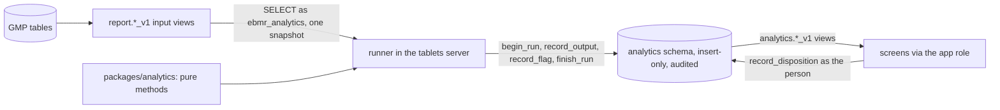

# analytics: advisory analytics (Phase 6A)

**Draft.** This page is still being written; facts on it were checked against the code on 17 October 2026 (slices
6A-0 and 6A-1). Slices 6A-2 to 6A-6 add their methods here.

This page explains the advisory analytics of the Tablets edition: the pure package `packages/analytics`, the runner in
the tablets server, the analytics role and schema in the database, the input views it reads, the method versions under
change control, QA's dispositions of flags, the monitoring, and the screens. Read it before you add a method or change
anything the runner reads or writes. The architecture is [ADR 0020](../../adr/0020-analytics-module-read-only-advisory.md);
the plan is [phase-6a-plan.md](../../build-plan/phase-6a/phase-6a-plan.md) and the fixed interfaces are
[slice-6A-0-interfaces.md](../../build-plan/phase-6a/slice-6A-0-interfaces.md). Terms in bold are in the
[glossary](../02-glossary.md).

## Where the code is

| What | Where |
|---|---|
| Pure statistics, method registry, canonical hashing, quantiles, linear algebra | [packages/analytics/src/](../../../packages/analytics/src/) |
| The runner (schedule, poll, one snapshot, recording) | [runner.ts](../../../apps/tablets-server/src/analytics/runner.ts#sym=AnalyticsRunner) |
| The runner's reads and its row hash | [inputs.ts](../../../apps/tablets-server/src/analytics/inputs.ts#sym=readSnapshot) |
| The runner's own connection (ebmr_analytics) | [pool.ts](../../../apps/tablets-server/src/analytics/pool.ts#sym=createAnalyticsPool) |
| What a method slice adds to the runner | [implementation.ts](../../../apps/tablets-server/src/analytics/implementation.ts#sym=IMPLEMENTATIONS) |
| Catalogue and code identity for the screens | [catalog.ts](../../../apps/tablets-server/src/analytics/catalog.ts#sym=catalogMethods) |
| The routes (catalogue, methods, monitor, flags, dispositions, method versions) | [features/analytics/](../../../apps/tablets-server/src/features/analytics/) |
| Contract | [ns/analytics.ts](../../../packages/api-contract/src/ns/analytics.ts), [ns/analytics-config.ts](../../../packages/api-contract/src/ns/analytics-config.ts) |
| Screens `/analytics`, `/analytics/methods`, `/analytics/flags` | [tablets-web features/analytics/](../../../apps/tablets-web/src/features/analytics/) |
| Schema, role, tables, record functions, read views (6A-0) | kernel [1240](../../../packages/kernel/sql/1240_analytics_schema_role.sql) to [1244](../../../packages/kernel/sql/1244_analytics_permissions.sql) |
| Method change control, the screens' views (6A-1) | kernel [1245](../../../packages/kernel/sql/1245_analytics_method_change.sql) |
| Input views v1 | recipe-core [1115](../../../packages/recipe-core/sql/1115_analytics_input_views.sql) |
| Tests | [kernel test/analytics](../../../packages/kernel/test/analytics/), [recipe-core test/analytics](../../../packages/recipe-core/test/analytics/), [server test/analytics](../../../apps/tablets-server/test/analytics/), [web test/analytics](../../../apps/tablets-web/test/analytics/) |

## What it does

Analytics points QA at records worth a look: a trend drifting towards a limit, a batch unlike the others, an unusual
pattern in the audit trail. It is **advisory**: it never changes a batch record, a review or a release, and every screen
says so ("Advisory analytics, not for GMP decisions"). A real problem goes into the deviation path as usual.

1. **The runner** starts with the server on the GMP installation only (`EBMR_ANALYTICS`, default on; a sandbox never
   starts it). It runs nightly at 02:00 site time, after it sees newly completed batches (a poll every 5 minutes of
   `report.batch_outcome_v1`), and on demand. Each run reads its inputs in one REPEATABLE READ READ ONLY transaction,
   checks the method version against the running code, runs the pure method and records the outputs and flags in one
   transaction. A failure records the run as FAILED with its error and leaves no output.
2. **The input views** give GMP data as exact decimal text. `statOf` in the package is the only place a value becomes
   a JavaScript number, and a lint rule bans `Number()`, `parseFloat`, `parseInt` and unary `+` in the runner.
3. **Method versions and reference sets** are configuration: a person holding `ANALYTICS.METHOD` makes one effective,
   or retires it, under a change record QA approved for the area. A version never changes; retuning is a new version.
4. **Flags** carry their reasons. QA marks each one real issue, false alarm or not assessable, with a cause; a later
   disposition supersedes the current one with a reason. Flags about a person are for data-integrity review only.
5. **Monitoring** gives, per method version and month, the runs, failures, flags, the share dispositioned and the
   false-alarm rate (`analytics.method_monitor_v1`), on the methods page.

## The runner

`AnalyticsRunner` holds the method implementations of the running code (`IMPLEMENTATIONS`; slice 6A-1 has none, so it
runs nothing until a method slice adds one and QA makes a version effective). For each version in force
(`analytics.effective_methods()`):

- a version no implementation covers is skipped and logged;
- the inputs are read by `readSnapshot`: each row without its `read_at` and `data_as_of`, the rows sorted by their
  canonical text and hashed, so the same data gives the same input hash on every read;
- the version must match the code: its parameters hash to the recorded SHA-256, fit the method's schema, and its code
  identity names the running package version;
- the run is recorded with the inputs (view, version, filter, `data_as_of`, rows, SHA-256), the runtime (package,
  commit `EBMR_COMMIT`, Node, library versions) and the SHA-256 of the canonical outputs and flags.

Its time is the database's: the site-zone day and hour of the nightly run come from `statement_timestamp()`, and
every recorded instant from the analytics tables' defaults.

> **Why this exists**
> - **Pharma reason:** a statistic must never become a GMP record by the back door; analytics that can write GMP data
>   would need the validation of a GMP system for every output (decision 0015).
> - **Control:** draft [DI-51](../../../compliance/controls/DI-51.yaml).
> - **Code:** the role's allow-list [`analytics.register_input`](../../../packages/kernel/sql/1242_analytics_record_functions.sql#sym=analytics.register_input)
>   and its check [`analytics.role_problems`](../../../packages/kernel/sql/1242_analytics_record_functions.sql#sym=analytics.role_problems);
>   the runner's connection [pool.ts](../../../apps/tablets-server/src/analytics/pool.ts).
> - **Tests:** [runner.test.ts](../../../apps/tablets-server/test/analytics/runner.test.ts) and
>   [analytics.test.ts](../../../packages/kernel/test/analytics/analytics.test.ts), named `[DI-51]`; the golden
>   batches run with the runner on ([analytics-check.ts](../../../apps/tablets-server/test/golden/analytics-check.ts)).

## The input views (recipe-core 1115)

| View | One row per | Columns of note |
|---|---|---|
| `report.batch_fact_v1` | GMP batch record | product and strength, MBR version and family, record kind, review status, issue and completion, released |
| `report.cpp_value_v1` | critical value (one per reading of a series) | kind, item, step, attempt, role, `value_text`, unit, the master's outermost limits and the tier they come from, target, failed, recorded at |
| `report.step_use_v1` | executed step and unit | step key and phase, unit and class, room, start and end, persons, consumed lots |

`cpp_value_v1` is built on [`recipe.pqr_cpp_of`](../../../packages/recipe-core/sql/1062_pqr_cpp_extract.sql#sym=recipe.pqr_cpp_of),
so it holds the same values the PQR extract exports. The limits are the outermost tier the master gives
(REGISTERED, then VALIDATED, INTERNAL_ACTION, ALERT; [`report.outer_limits`](../../../packages/recipe-core/sql/1115_analytics_input_views.sql#sym=report.outer_limits)).
Only DECIMAL, COUNT and SERIES values appear. Each view is registered on the role's allow-list with
`report.batch_outcome_v1` (the poll).

## Method change control (kernel 1245)

> **Why this exists**
> - **Pharma reason:** a model's intended use, parameters and code must be fixed and changed only under change control
>   (Annex 11 section 10 and the drafts on AI in GMP, paraphrased: a computerised system changes in a controlled way).
> - **Control:** draft [DI-52](../../../compliance/controls/DI-52.yaml), [DI-09](../../../compliance/controls/DI-09.yaml).
> - **Code:** [`analytics.set_method_version`](../../../packages/kernel/sql/1245_analytics_method_change.sql#sym=analytics.set_method_version),
>   [`analytics.method_version_rules`](../../../packages/kernel/sql/1245_analytics_method_change.sql#sym=analytics.method_version_rules),
>   [`analytics.set_reference_set`](../../../packages/kernel/sql/1245_analytics_method_change.sql#sym=analytics.set_reference_set);
>   the guard of kernel 1195 on the configuration table.
> - **Tests:** [method-change.test.ts](../../../packages/kernel/test/analytics/method-change.test.ts) and
>   [routes.test.ts](../../../apps/tablets-server/test/analytics/routes.test.ts), named `[DI-52]` and `[DI-09]`.
> - **Error:** `EBMR-ANA-013` (a version changed), `EBMR-ANA-014` (a reference set changed), `EBMR-ANA-015` (malformed),
>   `EBMR-CFG-001` to `-004` (no approved change record for the area).

The route `analyticsConfig.setMethodVersion` takes the parameters and acceptance criteria as JSON text; the server
hashes the parameters and names the code identity. `analyticsConfig.setReferenceSet` takes the model from the model
candidate it is approved from. The methods page reads `analytics.method_version_v1`, each row with its validity and the
change record it was written under; `platform.config_as_of` gives the methods in force at any past instant.

## Flags and dispositions

The screens read `analytics.open_flag_v1` (open), `analytics.flag_v1` (all, with the current disposition) and
`analytics.flag_disposition_v1`; none of them shows a flag about a person or an account. Those are read only through
[`analytics.person_flags`](../../../packages/kernel/sql/1242_analytics_record_functions.sql#sym=analytics.person_flags) and
[`analytics.person_flag_dispositions`](../../../packages/kernel/sql/1245_analytics_method_change.sql#sym=analytics.person_flag_dispositions),
which need `ANALYTICS.DI_REVIEW` (draft [DI-53](../../../compliance/controls/DI-53.yaml)). The flags list shows them only
when asked for by kind (PERSON, ACCOUNT). A disposition is
[`analytics.record_disposition`](../../../packages/kernel/sql/1242_analytics_record_functions.sql#sym=analytics.record_disposition),
run as the person inside a command, insert-only and audited.

## Permissions (Tablets)

| Permission | Roles | Used by |
|---|---|---|
| `ANALYTICS.VIEW` | QA reviewer, head of production, AP, EU QP, CSV/DI lead | every analytics read |
| `ANALYTICS.DISPOSITION` | QA reviewer, CSV/DI lead | dispositions |
| `ANALYTICS.DI_REVIEW` | CSV/DI lead | flags about a person |
| `ANALYTICS.METHOD` | QA reviewer, process owner | method versions, reference sets |

## Adding a method (slices 6A-2 to 6A-6)

1. Write the pure method in `packages/analytics/src/methods/<family>/` with its tests and reference values.
2. Add its implementation (inputs, `assemble`, the method) to the runner in `apps/tablets-server/src/analytics/`, and
   list it in `IMPLEMENTATIONS`.
3. Add any input view in your migration range and register it with `analytics.register_input`.
4. QA makes version 1 effective under a change record on `/analytics/methods`.
