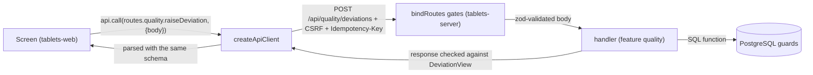

# API contract (`packages/api-contract`)

**Draft** (14 October 2026).

`@ebmr/api-contract` is the typed HTTP contract between the Tablets screens and the Tablets server. Every route (201 of
them in 25 namespaces) is defined once here with its method, path, installation, authentication, idempotency,
attribution rule and zod schemas for the path parameters, query, body and response. The server binds handlers to these
definitions and validates requests and responses with them; the browser calls them through a client that parses every
answer with the same schemas. So the two sides cannot silently disagree. The package also holds the wire rules
(decimals as text, instants as microseconds), the refusal envelope that every error answer uses, the client intents
(what the browser may say a person did), the signable actions (what a person may sign over HTTP), and example fixtures.
Read this page before you add or change a route, a screen call or a signed act.

## Where the code is

| What | Where |
|---|---|
| Package entry (also `CONTRACT_VERSION`, now 1.0.0) | [src/index.ts](../../../packages/api-contract/src/index.ts#sym=CONTRACT_VERSION) |
| `defineRoute`, route types, `allRoutes`, `buildPath` | [src/route.ts](../../../packages/api-contract/src/route.ts#sym=defineRoute) |
| The route table and the namespace owners | [src/routes.ts](../../../packages/api-contract/src/routes.ts#sym=routes) |
| One file per namespace | [src/ns/](../../../packages/api-contract/src/ns/) |
| Wire rules, refusal envelope, attribution, storable text | [src/common.ts](../../../packages/api-contract/src/common.ts) |
| Client intents and the engine command classes | [src/intents.ts](../../../packages/api-contract/src/intents.ts#sym=ClientIntent) |
| Signable actions and their acts | [src/signable.ts](../../../packages/api-contract/src/signable.ts#sym=SignableAction) |
| The browser client | [src/client.ts](../../../packages/api-contract/src/client.ts#sym=createApiClient) |
| Tablet block entry kinds | [src/tablet-entries.ts](../../../packages/api-contract/src/tablet-entries.ts#sym=TABLET_ENTRY_KINDS_BY_BLOCK) |
| Role vocabularies (engine roles, kernel roles, the map mirror) | [src/vocab/roles.ts](../../../packages/api-contract/src/vocab/roles.ts#sym=ENGINE_ROLE_MAP) |
| zod without `eval` in the browser | [src/strict-csp.ts](../../../packages/api-contract/src/strict-csp.ts) |
| Example fixtures for every view (subpath `@ebmr/api-contract/examples`) | [src/examples.ts](../../../packages/api-contract/src/examples.ts#sym=EXAMPLES), JSON in [fixtures/](../../../packages/api-contract/fixtures/) |
| Tests | [test/contract.test.ts](../../../packages/api-contract/test/contract.test.ts), [test/client.test.ts](../../../packages/api-contract/test/client.test.ts), [test/india.test.ts](../../../packages/api-contract/test/india.test.ts) |
| Server side: binding, refusals, signable registry | [bind.ts](../../../apps/tablets-server/src/platform/http/bind.ts#sym=bindRoutes), [refusal.ts](../../../apps/tablets-server/src/platform/http/refusal.ts#sym=refusal), [ports.ts](../../../apps/tablets-server/src/platform/ports.ts#sym=SignableActionRegistry) |
| Route coverage test (server) | [coverage.test.ts](../../../apps/tablets-server/test/contract/coverage.test.ts) |
| OpenAPI generator | [cli/openapi.ts](../../../apps/tablets-server/src/cli/openapi.ts#sym=openApiDocument) |
| Original design | Phase 2 apps plan, section 4, [00-plan.md](../../build-plan/phase-2/apps/00-plan.md); [ADR 0017](../../adr/0017-web-runtime.md) (web runtime) |
| Generated list of files, tests and controls | [code map, `api-contract`](../code-map.md#api-contract) |

The package is **browser-safe**: [.dependency-cruiser.cjs](../../../.dependency-cruiser.cjs) (rules `browser-safe` and
`api-contract-allowed-deps`) lets it import only zod, `@ebmr/expr` and the pure folders of recipe-core (for the engine
command types). No Node module, no database driver, no kernel.

## What it does

A request travels like this (the full walk is in [Architecture, section 6](../03-architecture.md#6-how-a-request-travels)):



1. The route is defined once in a namespace file, for example `quality.raiseDeviation` in
   [ns/quality.ts](../../../packages/api-contract/src/ns/quality.ts#sym=quality).
2. The server's feature binds a handler to it with [`bindRoutes`](../../../apps/tablets-server/src/platform/http/bind.ts#sym=bindRoutes).
   A missing handler is a compile error. The zod type provider validates the request and the response.
3. The screen calls it through [`createApiClient`](../../../packages/api-contract/src/client.ts#sym=createApiClient)
   ([apps/tablets-web/src/api/client.ts](../../../apps/tablets-web/src/api/client.ts)). The client fills the path, adds
   the headers, and parses the answer with the route's response schema, or with the refusal envelope for a non-2xx
   answer.

## Pharma context

The contract is the first place where several data-integrity rules are enforced, before any handler runs:

- **Attributable data.** A record must show who did what. The browser may say what the person did, but never who
  they are, which role they hold, what time it is, what a balance read or what a lot's status is: the server and the
  database decide those facts. So the client intents have no member for them, and every object is strict (an extra
  member is refused, not ignored). Controls [DI-32](../../../compliance/controls/DI-32.yaml) (device data),
  [DI-20](../../../compliance/controls/DI-20.yaml) (device and source checks), invariant INV-26 (roles come from the
  stored authority evaluation).
- **A fresh identity on shared terminals.** On a shop-floor terminal that several people use, each GMP entry carries a
  fresh badge tap by the person it is attributed to (21 CFR 11.200(a): a signer is identified at each signing when
  sessions are not continuous; invariant INV-40). Routes marked `FRESH_ON_SHARED` carry it.
- **Test data never mixes with GMP data.** A route of the sandbox installation does not exist on the GMP one, and the
  reverse ([DI-05](../../../compliance/controls/DI-05.yaml), INV-18).
- **Nothing is deleted, the audit trail is read-only.** No route deletes anything; the audit namespace has no edit,
  disable or purge route ([DI-24](../../../compliance/controls/DI-24.yaml), [DI-22](../../../compliance/controls/DI-22.yaml)).
- **Exact numbers.** GMP decimals travel as text, so no floating-point error enters a weight or a limit
  ([DI-33](../../../compliance/controls/DI-33.yaml); see [expr](expr.md#why-no-javascript-number-for-gmp-values)).
- **What is signed is what is stored.** Text a database record cannot hold (U+0000, a lone UTF-16 surrogate) is
  refused at the edge, so a signer never sees a hash of content that cannot be stored
  ([DI-37](../../../compliance/controls/DI-37.yaml)).

## Defining a route

[`defineRoute`](../../../packages/api-contract/src/route.ts#sym=defineRoute) takes a spec and returns a
[`RouteDef`](../../../packages/api-contract/src/route.ts#sym=RouteDef):

| Member | Values | Meaning |
|---|---|---|
| `id` | `<namespace>.<name>` | unique across the contract, prefixed with its namespace (a test checks) |
| `method` | `GET`, `POST`, `PUT`, `DELETE` | `DELETE` exists in the type, but no route uses it (DI-24) |
| `path` | `/api/...` with `:param` segments | must start with `/api/`; each `:param` needs a `params` member and the reverse |
| `installation` | `GMP`, `SANDBOX`, `ANY` | which server serves it; on the other one the route is not registered (404) |
| `auth` | `NONE`, `SESSION` | `NONE` only for meta, device nonce, login and the ERP's service calls |
| `mutating` | true or false | changes GMP data or the session |
| `attribution` | `NONE` (default), `FRESH_ON_SHARED` | the body must be built with [`withAttribution`](../../../packages/api-contract/src/common.ts#sym=withAttribution) |
| `idempotency` | `REQUIRED`, `NONE` | default `REQUIRED` for a mutating `SESSION` route; the request then carries an `Idempotency-Key` UUID (428 without) |
| `stream` | `SSE` | server-sent events; `response` then describes one event |
| `summary` | text | shown in the OpenAPI document |
| `params`, `query`, `body`, `response` | zod schemas | `body` is undefined for a GET |

`defineRoute` checks the shape at definition time (a wrong path, a GET with a body, a `FRESH_ON_SHARED` body without
the attribution member all throw when the module loads) and wraps `params`, `query` and `body` in
[`storableText`](../../../packages/api-contract/src/common.ts#sym=storableText), which refuses at any depth a string or a
member name holding text no record can hold.

Use `z.strictObject` for every object, so an unknown member is refused. Use the shared types of
[common.ts](../../../packages/api-contract/src/common.ts) rather than plain strings and numbers.

## Wire rules

From [common.ts](../../../packages/api-contract/src/common.ts):

| Type | Shape | Why |
|---|---|---|
| [`DecimalString`](../../../packages/api-contract/src/common.ts#sym=DecimalString) | `"12.503"`, `"-0.5"`; no JSON number, no exponent | GMP values are exact |
| [`IntegerString`](../../../packages/api-contract/src/common.ts#sym=IntegerString) | `"42"` | sequence numbers above 2^53 |
| [`EpochMicros`](../../../packages/api-contract/src/common.ts#sym=EpochMicros) | UTC microseconds as text | time is exact and never formatted by the browser |
| [`Instant`](../../../packages/api-contract/src/common.ts#sym=Instant) | `{ us, text }`, text like `28-SEP-2026 14:05:03 +05:30 (Asia/Kolkata)` | the server formats site time with the kernel clock |
| [`PersonRef`](../../../packages/api-contract/src/common.ts#sym=PersonRef) | `{ personId, legalName, loginName, role }` | every screen shows the person and the role acted in |
| [`Watermark`](../../../packages/api-contract/src/common.ts#sym=Watermark) | the TEST, NOT GMP mark, null on GMP output | sandbox output can never pass for GMP output |
| [`DataValueWire`](../../../packages/api-contract/src/common.ts#sym=DataValueWire) | a value by kind, decimals as text | |
| [`RunVersion`](../../../packages/api-contract/src/common.ts#sym=RunVersion) | integer up to 2,147,483,647 | the version a screen showed, sent back for optimistic locking (409 when stale) |
| [`DeviceProof`](../../../packages/api-contract/src/common.ts#sym=DeviceProof), [`Attribution`](../../../packages/api-contract/src/common.ts#sym=Attribution) | an ECDSA P-256 signature with the browser's device key; a badge tap with that proof | device-bound sessions and INV-40 |

JSON numbers are used only for counts, indices and versions (safe integers).

> **Why this exists** (storable text at the edge)
> - **Pharma reason:** a signer must see a hash of exactly the content that will be stored. PostgreSQL refuses U+0000,
>   and a lone surrogate is silently replaced by U+FFFD on the way, so a record would hold a character its author
>   never sent (review P2-F30 to F33, [defect log](../08-defect-log.md#p2-f30-to-f33-nul-characters-and-lone-surrogates-in-free-text)).
> - **Control:** [DI-37](../../../compliance/controls/DI-37.yaml), [DI-34](../../../compliance/controls/DI-34.yaml).
> - **Code:** [`storableText`](../../../packages/api-contract/src/common.ts#sym=storableText),
>   [`unstorableTextIssues`](../../../packages/api-contract/src/common.ts#sym=unstorableTextIssues), applied by
>   [`defineRoute`](../../../packages/api-contract/src/route.ts#sym=defineRoute) to every route.
> - **Tests:** [contract.test.ts](../../../packages/api-contract/test/contract.test.ts), describe "text a record can
>   hold (review F30-F33)", tests named `[DI-37]`.
> - **Error:** 400 `INVALID_INPUT`, naming the field and never echoing the text.

## The route table and the namespaces

[`routes`](../../../packages/api-contract/src/routes.ts#sym=routes) is one nested `const` object: `routes.<namespace>.<name>`.
Screens and handlers refer to routes by that object, never by a path string.
[`NAMESPACE_OWNERS`](../../../packages/api-contract/src/routes.ts#sym=NAMESPACE_OWNERS) names the build stream that
owns each namespace's handlers: `C0` the lead's spine, `C1` access, e-signatures and audit, `C2` the designer, `C3`
execution, `C5` devices (Phase 2 streams, see the [Phase 2 apps plan](../../build-plan/phase-2/apps/00-plan.md)), `S6`
Phase 3 slice 6, `P4` Phase 4.

Every namespace, with its contract file, its server feature (under `apps/tablets-server/src/features/`) and the screens
that call it (under `apps/tablets-web/src/`):

| Namespace | File | Owner | Routes | Installation | Server feature | Screens |
|---|---|---|---|---|---|---|
| `meta` | [ns/meta.ts](../../../packages/api-contract/src/ns/meta.ts#sym=meta) | C0 | 1 | ANY | [meta](../../../apps/tablets-server/src/features/meta/) | [app/boot.tsx](../../../apps/tablets-web/src/app/boot.tsx) |
| `session` | [ns/session.ts](../../../packages/api-contract/src/ns/session.ts#sym=session) | C0 | 8 | ANY | [session](../../../apps/tablets-server/src/features/session/) | [features/session](../../../apps/tablets-web/src/features/session/) |
| `access` | [ns/access.ts](../../../packages/api-contract/src/ns/access.ts#sym=access) | C1 | 4 | ANY | [access](../../../apps/tablets-server/src/features/access/) | [features/access](../../../apps/tablets-web/src/features/access/) |
| `esig` | [ns/esig.ts](../../../packages/api-contract/src/ns/esig.ts#sym=esig) | C1 | 5 | ANY | [esig](../../../apps/tablets-server/src/features/esig/) | [access/ceremony.tsx](../../../apps/tablets-web/src/features/access/ceremony.tsx), [api/signables.ts](../../../apps/tablets-web/src/api/signables.ts) |
| `audit` | [ns/audit.ts](../../../packages/api-contract/src/ns/audit.ts#sym=audit) | C1 | 3 | ANY | [audit](../../../apps/tablets-server/src/features/audit/) | [features/audit](../../../apps/tablets-web/src/features/audit/) |
| `designer` | [ns/designer.ts](../../../packages/api-contract/src/ns/designer.ts#sym=designer) | C2 | 13 | GMP | [designer](../../../apps/tablets-server/src/features/designer/) | [features/designer](../../../apps/tablets-web/src/features/designer/) |
| `execution` | [ns/execution.ts](../../../packages/api-contract/src/ns/execution.ts#sym=execution) | C3 | 13 | SANDBOX, GMP, ANY | [execution](../../../apps/tablets-server/src/features/execution/) | [features/floor](../../../apps/tablets-web/src/features/floor/) |
| `devices` | [ns/devices.ts](../../../packages/api-contract/src/ns/devices.ts#sym=devices) and [ns/device-readings.ts](../../../packages/api-contract/src/ns/device-readings.ts#sym=deviceReadings) (merged) | C5 | 4 | ANY | [devices](../../../apps/tablets-server/src/features/devices/) | [features/devices](../../../apps/tablets-web/src/features/devices/), floor renderers |
| `quality` | [ns/quality.ts](../../../packages/api-contract/src/ns/quality.ts#sym=quality), shapes in [ns/deviation.ts](../../../packages/api-contract/src/ns/deviation.ts) | C3 | 26 | GMP | [quality](../../../apps/tablets-server/src/features/quality/) | [features/quality](../../../apps/tablets-web/src/features/quality/) |
| `batches` | [ns/batches.ts](../../../packages/api-contract/src/ns/batches.ts#sym=batches) | C3 | 12 | GMP | [execution](../../../apps/tablets-server/src/features/execution/) | [features/floor](../../../apps/tablets-web/src/features/floor/) |
| `planning` | [ns/planning.ts](../../../packages/api-contract/src/ns/planning.ts#sym=planning) | S6 | 4 | GMP | [planning](../../../apps/tablets-server/src/features/planning/) | [features/planning](../../../apps/tablets-web/src/features/planning/) |
| `masterData` | [ns/master-data.ts](../../../packages/api-contract/src/ns/master-data.ts#sym=masterData) | S6 | 4 | GMP | [master-data](../../../apps/tablets-server/src/features/master-data/) | [features/master-data](../../../apps/tablets-web/src/features/master-data/) |
| `plant` | [ns/plant.ts](../../../packages/api-contract/src/ns/plant.ts#sym=plant) | S6 | 19 | GMP | [plant](../../../apps/tablets-server/src/features/plant/) | [features/plant](../../../apps/tablets-web/src/features/plant/) |
| `review` | [ns/review.ts](../../../packages/api-contract/src/ns/review.ts#sym=review) | P4 | 9 | GMP | [review](../../../apps/tablets-server/src/features/review/) | [features/review](../../../apps/tablets-web/src/features/review/) |
| `containers` | [ns/containers.ts](../../../packages/api-contract/src/ns/containers.ts#sym=containers) | P4 | 5 | GMP | [containers](../../../apps/tablets-server/src/features/containers/) | [review/ContainersPage.tsx](../../../apps/tablets-web/src/features/review/ContainersPage.tsx) |
| `specifications` | [ns/specifications.ts](../../../packages/api-contract/src/ns/specifications.ts#sym=specifications) | P4 | 7 | GMP | [quality/lims.ts](../../../apps/tablets-server/src/features/quality/lims.ts) | [quality/SpecificationsPage.tsx](../../../apps/tablets-web/src/features/quality/SpecificationsPage.tsx), [quality/LotExtras.tsx](../../../apps/tablets-web/src/features/quality/LotExtras.tsx) |
| `samples` | [ns/samples.ts](../../../packages/api-contract/src/ns/samples.ts#sym=samples) | P4 | 6 | GMP | [quality/lims.ts](../../../apps/tablets-server/src/features/quality/lims.ts) | [quality/ReturnsPage.tsx](../../../apps/tablets-web/src/features/quality/ReturnsPage.tsx), [quality/LotExtras.tsx](../../../apps/tablets-web/src/features/quality/LotExtras.tsx) |
| `release` | [ns/release.ts](../../../packages/api-contract/src/ns/release.ts#sym=release) | P4 | 11 | GMP | [release](../../../apps/tablets-server/src/features/release/) | [features/release](../../../apps/tablets-web/src/features/release/) |
| `notifications` | [ns/notifications.ts](../../../packages/api-contract/src/ns/notifications.ts#sym=notifications) | P4 | 2 | GMP | [notifications](../../../apps/tablets-server/src/features/notifications/) | [features/notifications](../../../apps/tablets-web/src/features/notifications/) |
| `qpPackage` | [ns/qp-shipping.ts](../../../packages/api-contract/src/ns/qp-shipping.ts#sym=qpPackage) | P4 | 6 | GMP | [qp-package](../../../apps/tablets-server/src/features/qp-package/) | [release/QpPackage.tsx](../../../apps/tablets-web/src/features/release/QpPackage.tsx), [release/QpReaderPage.tsx](../../../apps/tablets-web/src/features/release/QpReaderPage.tsx) |
| `erpShipping` | [ns/qp-shipping.ts](../../../packages/api-contract/src/ns/qp-shipping.ts#sym=erpShipping) | P4 | 3 | GMP | [erp-shipping](../../../apps/tablets-server/src/features/erp-shipping/) | none: the ERP calls `check` and `record` with its service identity (`auth: NONE`, credentials in the body) |
| `records` | [ns/records-lock.ts](../../../packages/api-contract/src/ns/records-lock.ts#sym=records) | P4 | 7 | GMP | [records](../../../apps/tablets-server/src/features/records/) | [features/records](../../../apps/tablets-web/src/features/records/) |
| `pqr` | [ns/pqr.ts](../../../packages/api-contract/src/ns/pqr.ts#sym=pqr) | P4 | 3 | GMP | [pqr](../../../apps/tablets-server/src/features/pqr/) | [features/pqr](../../../apps/tablets-web/src/features/pqr/) |
| `archive` | [ns/archive.ts](../../../packages/api-contract/src/ns/archive.ts#sym=archive) | P4 | 11 | GMP | [archive](../../../apps/tablets-server/src/features/archive/) | [features/archive](../../../apps/tablets-web/src/features/archive/) |
| `india` | [ns/india.ts](../../../packages/api-contract/src/ns/india.ts#sym=india) | P4 | 15 | GMP | [india](../../../apps/tablets-server/src/features/india/) | [features/india](../../../apps/tablets-web/src/features/india/) |

Route counts are from the table on 14 October 2026; `routes.<ns>` in a TypeScript console gives the current list. The
module guides of the server features are in [tablets-server](tablets-server.md) and of the screens in
[tablets-web](tablets-web.md).

> **Why this exists** (one installation per route)
> - **Pharma reason:** test, simulation and training data must never mix with GMP data (EU GMP Annex 11 and Schedule M
>   ask for validated, segregated systems; invariant INV-18). A sandbox route that is not registered on the GMP server
>   cannot be called there by mistake.
> - **Control:** [DI-05](../../../compliance/controls/DI-05.yaml); INV-18.
> - **Code:** `installation` in [`defineRoute`](../../../packages/api-contract/src/route.ts#sym=defineRoute);
>   [`bindRoutes`](../../../apps/tablets-server/src/platform/http/bind.ts#sym=bindRoutes) skips routes of the other
>   installation; [`createApiClient`](../../../packages/api-contract/src/client.ts#sym=createApiClient) refuses an
>   answer whose `X-Ebmr-Installation` header names the other installation.
> - **Tests:** [contract.test.ts](../../../packages/api-contract/test/contract.test.ts) (`[DI-05][INV-18]`),
>   [client.test.ts](../../../packages/api-contract/test/client.test.ts) ("[DI-05] refuses an answer from the other
>   installation"), [coverage.test.ts](../../../apps/tablets-server/test/contract/coverage.test.ts) (`[DI-05]` every
>   route registered exactly once, on the installations it names).
> - **Error:** 404 on the other installation; `INSTALLATION_MISMATCH` in the client.

> **Why this exists** (no delete route, read-only audit)
> - **Pharma reason:** a GMP record is never deleted: a correction or a void keeps the original and says why
>   (21 CFR 11.10(e); Annex 11 section 9). The audit trail cannot be edited or switched off.
> - **Control:** [DI-24](../../../compliance/controls/DI-24.yaml), [DI-22](../../../compliance/controls/DI-22.yaml).
> - **Code:** the route table itself; the database refuses deletes in any case (see [kernel](kernel.md#audit-trail)).
> - **Tests:** [contract.test.ts](../../../packages/api-contract/test/contract.test.ts) ("[DI-24] no route of the
>   contract deletes anything", "[DI-22] the audit namespace is read-only").

## The frozen contract: additive only

The contract was frozen by the lead at the start of Phase 2 (step A0) so that five build streams could work in parallel
against it ([routes.ts](../../../packages/api-contract/src/routes.ts#sym=routes) header; Phase 2 apps plan, risk 5
"contract churn"). The rule since then:

- **Add, never change or remove.** A new namespace, a new route or a new optional member is fine. Renaming a route,
  changing a path, making an optional member required, narrowing a type, or removing a member breaks a screen that was
  built against the old shape.
- A breaking change needs a new route (or a new version of a shape) beside the old one, and the old one is retired
  only when nothing uses it.
- Contract changes are made by the lead (today: the session that owns the slice) and reviewed with the slice.

No test compares the contract with an earlier version; the rule is held by review. The OpenAPI document (below) is
kept as a CI artifact of every run, so a diff between two runs shows what changed.

## The client

[`createApiClient`](../../../packages/api-contract/src/client.ts#sym=createApiClient)`({ fetch, baseUrl?, csrfToken?,
installation?, headers?, newIdempotencyKey?, onInstallationMismatch? })` returns `{ call, url }`.
`call(route, { params, query, body, idempotencyKey?, attribution?, signal? })` returns a `Result`:

- builds the path with [`buildPath`](../../../packages/api-contract/src/route.ts#sym=buildPath) (URI-encoded) and the
  query string;
- on a non-GET: sends JSON, the `x-csrf-token` header, a fresh `idempotency-key` UUID for a `REQUIRED` route (or the
  caller's, for a retry), and the attribution member for a `FRESH_ON_SHARED` route;
- checks the `x-ebmr-installation` header against the expected installation;
- parses a 2xx answer with the route's `response` schema; a mismatch is a `PROTOCOL` error, never data;
- parses a non-2xx answer as a [`RefusalEnvelope`](../../../packages/api-contract/src/common.ts#sym=RefusalEnvelope)
  (`REFUSAL`); anything else is `PROTOCOL`; a fetch failure is `NETWORK`.

The web app's one client is [apps/tablets-web/src/api/client.ts](../../../apps/tablets-web/src/api/client.ts); the
server tests use the same client over `app.inject`, so they test the real contract.

[strict-csp.ts](../../../packages/api-contract/src/strict-csp.ts) must be imported first in the browser entry: it puts
zod in "jitless" mode, so zod never compiles parsers with `new Function`, which the strict Content Security Policy
(`script-src 'self'`) would block.

## The error envelope

Every non-2xx answer is a [`RefusalEnvelope`](../../../packages/api-contract/src/common.ts#sym=RefusalEnvelope):

```json
{
  "refusal": {
    "code": "EBMR-IAM-140",
    "kind": "NOT_ALLOWED",
    "whatHappened": "plain words: what was refused",
    "why": "the engine's or the database's own message",
    "controls": ["DI-14"],
    "whatYouCanDo": ["..."],
    "whoCanHelp": ["..."],
    "details": { "roles": "QA,QC" }
  },
  "correlationId": "...",
  "retryable": false
}
```

`kind` is one of [`REFUSAL_KINDS`](../../../packages/api-contract/src/common.ts#sym=REFUSAL_KINDS): `NOT_ENABLED`,
`NOT_ALLOWED`, `INDEPENDENCE` (four-eyes), `STALE`, `BLOCKED_BY_EXCEPTION`, `AUTH_FAILED`, `LOCKED`, `INVALID_INPUT`,
`NOT_SAVED`, `CONTENT_CHANGED`, `SWITCH_USER`. The HTTP status follows
[`REFUSAL_STATUS`](../../../packages/api-contract/src/common.ts#sym=REFUSAL_STATUS):

| Status | When |
|---|---|
| 400 | schema (`INVALID_INPUT`), including unstorable text |
| 401 | no session |
| 403 | permission, CSRF, origin or device proof |
| 404 | not found, or a route of the other installation |
| 409 | stale version, conflict, role not chosen yet, `MUST_CHANGE_SECRET`, `SWITCH_USER` |
| 422 | a rule refused it (engine, e-signature, life cycle, a database guard) |
| 423 | session locked |
| 428 | idempotency key or badge tap missing |
| 429 | too many requests |
| 501 | not implemented yet (a reserved act) |
| 503 | installation mismatch or a time fault |

The server builds refusals with [`refusal`](../../../apps/tablets-server/src/platform/http/refusal.ts#sym=refusal) and
turns a database error (`EBMR-...` code) into one through the features' guidance catalogues (a `guidance` map per
feature, keyed by code). The full code list is [error-codes.md](../reference/error-codes.md); how SQL raises them is in
the [database reference](../05-database.md#how-errors-are-raised).

## Client intents: what the browser may say

[intents.ts](../../../packages/api-contract/src/intents.ts#sym=ClientIntent) holds the commands a floor screen sends
during a batch. The rule (header of the file): **client intents are not engine commands**. The browser says what the
person did; the server resolves every fact the browser must not supply:

- a value's source is `MANUAL` or `SCAN` only (`DEVICE`, `AUTOMATION`, `LIMS` and `BLOCK` are set by the server);
- lots travel as codes (status, expiry, retest and identity testing come from the lot store);
- device values travel as reading ids (value, unit, device and time come from the claimed reading);
- no actor, roles, signature reference, command id or "occurred at" time.

[`ClientIntent`](../../../packages/api-contract/src/intents.ts#sym=ClientIntent) holds the plain intents (START_STEP,
RECORD_DATA, RECORD_ENTRY, RAISE_EXCEPTION, ATTACH_DEVIATION, HOLD_BATCH, RELEASE_HOLD, CHOOSE_ALTERNATIVE,
COMPLETE_LOOP_ITERATION, VOID_ATTEMPT). [`SignedIntent`](../../../packages/api-contract/src/intents.ts#sym=SignedIntent)
holds the ones that need a signature (SIGN_PERFORMED, VERIFY, DISPOSITION_HOLD_POINT, SIGN_OFF_STAGE,
DISPOSITION_EXCEPTION, CORRECT_ENTRY); they travel only inside an e-signature action.
[`ENGINE_COMMAND_CLASSES`](../../../packages/api-contract/src/intents.ts#sym=ENGINE_COMMAND_CLASSES) classifies every
engine command as `CLIENT_PLAIN`, `CLIENT_SIGNED`, `SERVER_ONLY` or `LATER`, and the type
[`ContractProofs`](../../../packages/api-contract/src/intents.ts#sym=ContractProofs) makes a new, unclassified engine
command a compile error.

A `RECORD_ENTRY` of a tablet block carries a `BLOCK_ENTRY` whose kind must be in the closed list
[`TABLET_ENTRY_KINDS_BY_BLOCK`](../../../packages/api-contract/src/tablet-entries.ts#sym=TABLET_ENTRY_KINDS_BY_BLOCK)
(TB-01 to TB-24 and some generic blocks); a server test proves the list equals the block registry's.
`CONTAINER_WEIGHING` and `POTENCY_CALCULATION` have their own typed variants because the server resolves their facts.

> **Why this exists** (no browser-supplied facts)
> - **Pharma reason:** a record must be attributable and accurate (ALCOA+). If the browser could send "the balance
>   read 50.300 kg" or "this lot is released", a modified browser could write a false record. The facts come from the
>   device claim, the lot store and the session.
> - **Control:** [DI-32](../../../compliance/controls/DI-32.yaml), [DI-20](../../../compliance/controls/DI-20.yaml),
>   [DI-30](../../../compliance/controls/DI-30.yaml), [PR-19](../../../compliance/controls/PR-19.yaml),
>   [PR-20](../../../compliance/controls/PR-20.yaml); INV-26.
> - **Code:** [`ClientIntent`](../../../packages/api-contract/src/intents.ts#sym=ClientIntent),
>   [`SignedIntent`](../../../packages/api-contract/src/intents.ts#sym=SignedIntent) (strict objects with no such members).
> - **Tests:** [contract.test.ts](../../../packages/api-contract/test/contract.test.ts), describe "client intents refuse
>   browser-supplied facts (J1-3, J2-8)", tests named `[DI-32]`, `[DI-32][INV-26]`, `[DI-32][PR-19]`,
>   `[DI-20][DI-30][PR-20]`.
> - **Error:** 400 `INVALID_INPUT`.

> **Why this exists** (fresh attribution on shared terminals)
> - **Pharma reason:** on a terminal several operators share, a session left open must not let the next person write
>   under the first person's name (21 CFR 11.200(a); invariant INV-40).
> - **Control:** INV-40 (see the [glossary](../02-glossary.md#invariants-inv-01-to-inv-48)).
> - **Code:** `attribution: 'FRESH_ON_SHARED'` with [`withAttribution`](../../../packages/api-contract/src/common.ts#sym=withAttribution);
>   the server's attribution gate in [bind.ts](../../../apps/tablets-server/src/platform/http/bind.ts#sym=bindRoutes).
> - **Tests:** [contract.test.ts](../../../packages/api-contract/test/contract.test.ts) ("[INV-40] every
>   FRESH_ON_SHARED route is a mutating SESSION route whose body carries the attribution member").
> - **Error:** 428 when the tap is missing.

## Signable actions and their acts

An electronic signature is not a route of its own per act. The `esig` namespace has five routes (`esig.content`,
`esig.createChallenge`, `esig.sign`, `esig.describe`, `esig.signatures`), and the body names **what** is signed as a
[`SignableAction`](../../../packages/api-contract/src/signable.ts#sym=SignableAction), a zod union by `kind`. The server
looks the kind up in its [`SignableActionRegistry`](../../../apps/tablets-server/src/platform/ports.ts#sym=SignableActionRegistry);
the handler gives the aggregate, the meaning, the expected state, the content preview, and applies the act by calling
the database command, which stays the decider. How the ceremony works (challenge, re-authentication, seal) is in
[kernel, Electronic signatures](kernel.md#electronic-signatures) and [Architecture, section 9](../03-architecture.md#9-e-signatures).

| Kind | Acts | Server handler | Meaning signed (examples) |
|---|---|---|---|
| `ENGINE_COMMAND` | a `SignedIntent` on a sandbox test run | [execution/signable.ts](../../../apps/tablets-server/src/features/execution/signable.ts) | PERFORMED, VERIFIED |
| `MBR_TRANSITION` | prepare, check, approve, regulatory signatures on an MBR version | [designer/signables.ts](../../../apps/tablets-server/src/features/designer/signables.ts) | the MBR life-cycle meanings |
| `GMP_BATCH_ISSUE` | issue a planned GMP batch | [execution/gmp-issue.ts](../../../apps/tablets-server/src/features/execution/gmp-issue.ts) | ISSUED |
| `ESIG_STUB` | test only | [esig/stub.ts](../../../apps/tablets-server/src/features/esig/stub.ts) | |
| `QUALITY_ACT` | DEVIATION_IMPACT_ASSESS, DEVIATION_CONCLUDE, DEVIATION_CLOSE, LOT_RESULT_APPROVE, QC_EXTRA_TESTING_DECISION, LOT_RETEST | [quality/signables.ts](../../../apps/tablets-server/src/features/quality/signables.ts) | DEVIATION_CONCLUDED, QC_RESULT_APPROVED, ... |
| `LOT_DECISION` | RELEASE, REJECT, HOLD, UNHOLD, RETURN, RECALL of a material lot (a RELEASE names its route) | [quality/signables.ts](../../../apps/tablets-server/src/features/quality/signables.ts) | MATERIAL_LOT_RELEASED, MATERIAL_LOT_STATUS_DECIDED |
| `LIMS_ACT` | SPECIFICATION_APPROVE, RETURN_ASSESSMENT_SIGN | [quality/lims.ts](../../../apps/tablets-server/src/features/quality/lims.ts) | SPECIFICATION_APPROVED, RETURNED_GOODS_ASSESSED |
| `REPROCESSING_ACT` | RESERVE_RESIDUE, AUTHORISE_ADDITION, AUTHORISE_REQUEST | [quality/signables.ts](../../../apps/tablets-server/src/features/quality/signables.ts) | RESIDUE_RESERVED, REPROCESSING_AUTHORISED |
| `MASTER_DATA_APPROVE` | a formula version; an ERP master version that changes a controlled value | [master-data/index.ts](../../../apps/tablets-server/src/features/master-data/index.ts) | FORMULA_APPROVED, ERP_MASTER_CONFIRMED |
| `ACT_APPROVAL` | approval of an act proposed on a batch (a void) | [execution/act-approval.ts](../../../apps/tablets-server/src/features/execution/act-approval.ts) | VOID_AUTHORISED |
| `PLANT_VERIFY` | CLEANING, CLEARANCE, REPAIR | [plant/index.ts](../../../apps/tablets-server/src/features/plant/index.ts) | LOGBOOK_DOUBLE_CHECKED |
| `REVIEW_ACT` | PRODUCTION_APPROVE, QA_REVIEW, AUDIT_TRAIL_REVIEW, DELTA_REVIEW, REOPEN, DISPOSE_ITEM | [review/signables.ts](../../../apps/tablets-server/src/features/review/signables.ts) | review meanings |
| `CORRECTION_APPROVAL` | approval of an entry correction | [review/signables.ts](../../../apps/tablets-server/src/features/review/signables.ts) | CORRECTION_APPROVED |
| `CONTAINER_ACT` | VERIFY_CLOSE, RELEASE of an output container | [containers/index.ts](../../../apps/tablets-server/src/features/containers/index.ts) | VERIFIED, OUTPUT_CONTAINER_RELEASED |
| `RELEASE_ACT` | the 15 acts of [`RELEASE_ACTS`](../../../packages/api-contract/src/signable.ts#sym=RELEASE_ACTS): MANUFACTURER_RELEASE, MANUFACTURER_REJECT, POST_CHANGE_EVALUATE, PPQ_OUTCOME, INVESTIGATION_JUSTIFY, US_DISPOSE, QP_INTAKE, QP_INTAKE_VERIFY, QP_CERTIFY, MARKET_ADD, MARKET_REMOVE, RECONFIRM, RECALL, REJECT_AFTER_RELEASE, DISPOSAL | [release/signables.ts](../../../apps/tablets-server/src/features/release/signables.ts) | MANUFACTURER_RELEASE, US_DISPOSITION, QP_CERTIFIED, RECALLED, ... |
| `BATCH_MARKET_ACT` | MARKET_ADD, MARKET_REMOVE for a batch | [release/signables.ts](../../../apps/tablets-server/src/features/release/signables.ts) | MARKET_ADDED, MARKET_REMOVED |
| `QP_PACKAGE_ACT` | ISSUE of an EU QP batch package | [qp-package/index.ts](../../../apps/tablets-server/src/features/qp-package/index.ts) | TRUE_COPY_VERIFIED |
| `RECORD_LOCK_ACT` | AMENDMENT_OPEN, AMENDMENT_CLOSE of a locked batch record | [records/signables.ts](../../../apps/tablets-server/src/features/records/signables.ts) | AMENDMENT_OPENED, AMENDMENT_CLOSED |
| `PQR_SIGN_OFF` | sign-off of a product quality review extract | [pqr/signables.ts](../../../apps/tablets-server/src/features/pqr/signables.ts) | PQR_SIGNED_OFF |
| `ARCHIVE_ACT` | CERTIFY_EXPORT, SIGN_FORMS | [archive/index.ts](../../../apps/tablets-server/src/features/archive/index.ts) | EVIDENCE_EXPORT_CERTIFIED, FORMS_RECONCILED |
| `INDIA_ACT` | LICENCE_APPROVE, EXPORT_PERMISSION_APPROVE, HAZARD_APPROVE, DEDICATION_APPROVE | [india/index.ts](../../../apps/tablets-server/src/features/india/index.ts) | LICENCE_APPROVED, EXPORT_PERMISSION_APPROVED, ... |

The header of [signable.ts](../../../packages/api-contract/src/signable.ts) lists, for each act, the aggregate it signs
(for example `us_disposition <lot>/RELEASE`), the meaning and who may sign. Act inputs are strict objects
(`QualityActInput`, `ReviewActInput`, `ReleaseActInput`, `BatchMarketActInput`, `RecordLockActInput`); a member an act
does not use is refused by the handler (422). An act that carries `expectedEpoch` (the G-REL evidence epoch the signer
evaluated) is refused if the evidence changed since (INV-05; see [The life of a batch, step 11](../04-life-of-a-batch.md#11-g-rel-and-the-manufacturer-release)).

## The OpenAPI document

`pnpm openapi` runs [cli/openapi.ts](../../../apps/tablets-server/src/cli/openapi.ts#sym=openApiDocument): it registers
every route's schemas on a bare Fastify instance (no database, no handler runs) with `@fastify/swagger` and writes
`.reports/openapi.json`. Each operation's description carries the route id, installation, auth, attribution and
idempotency; every 4xx and 5xx answer is a `RefusalEnvelope`. CI runs it and keeps the file as an artifact
([ci.yml](../../../.github/workflows/ci.yml)). It is documentation only: the contract in TypeScript is the source.

## How to add a route

1. **Pick the namespace** (or add a new file in `src/ns/` and add it to [`routes`](../../../packages/api-contract/src/routes.ts#sym=routes)
   and [`NAMESPACE_OWNERS`](../../../packages/api-contract/src/routes.ts#sym=NAMESPACE_OWNERS)). Add a new namespace's
   contract file to its module in [modules.yaml](../modules.yaml), or `pnpm handbook:check` fails.
2. **Define it** with `defineRoute`: `id` `<ns>.<name>`, `installation` (`GMP` for anything that writes GMP data),
   `auth: 'SESSION'`, `mutating`, `attribution: 'FRESH_ON_SHARED'` if a shop-floor person enters GMP data with it, a
   `summary`, and strict schemas built from the shared types (`DecimalString`, `Instant`, `PersonRef`, `Uuid`). Never
   put the actor, a role, a time, a lot status or a device value in a body.
3. **Add an example** for each new view to [examples.ts](../../../packages/api-contract/src/examples.ts#sym=EXAMPLES)
   (the contract test parses every example, and several namespaces require one per route).
4. **Bind a handler** in the server feature with `bindRoutes`; the compiler tells you if one is missing. The handler
   calls the database function that decides; it does not re-implement the rule.
5. **Call it** from the screen with `api.call(routes.<ns>.<name>, ...)`.
6. **If a person signs it**, do not add a route: add an act to an existing `SignableAction` kind (or a new kind) in
   [signable.ts](../../../packages/api-contract/src/signable.ts#sym=SignableAction) and register its handler with
   `registerSignableActions`.
7. **Test**: the contract test (installation, examples), the server coverage test, the handler's own tests with the
   refusal codes, and a browser test if a screen changed.
8. **Keep it additive** (see [The frozen contract](#the-frozen-contract-additive-only)).

The worked example of a whole feature is in [How to add a feature safely](../07-adding-a-feature.md).

## How to test it

| What | Command |
|---|---|
| The contract and client tests | `pnpm vitest run --project db packages/api-contract/test` |
| One control | `pnpm vitest run --project db packages/api-contract/test -t "DI-05"` |
| Server coverage of the route table | `pnpm vitest run --project server apps/tablets-server/test/contract` |
| The screens' use of the examples | `pnpm vitest run --project dom apps/tablets-web/test/api` |
| The OpenAPI document | `pnpm openapi` |

[contract.test.ts](../../../packages/api-contract/test/contract.test.ts) proves: every example parses; client intents
refuse browser-supplied facts; decimals are text; engine commands are classified exhaustively; route ids, methods and
paths are unique; installations per namespace; no delete route; the audit namespace is read-only; the refusal envelope
has its plain-language parts; storable text at any depth. [client.test.ts](../../../packages/api-contract/test/client.test.ts)
proves the headers, the parsing, the refusal envelope and the installation check.
[india.test.ts](../../../packages/api-contract/test/india.test.ts) belongs to the India feature (module `ts-india` in the
[code map](../code-map.md#ts-india)).

## Pitfalls

- **A JSON number for a GMP value.** Use `DecimalString`; zod would happily accept `z.number()`, and the value would be
  a float from then on.
- **A non-strict object.** `z.object` silently drops unknown members; use `z.strictObject` so an extra `actor` is
  refused, not ignored.
- **A route on `ANY` that writes GMP data.** It would exist on the sandbox server too. Use `GMP` (or `SANDBOX` for test
  runs).
- **Text the database cannot hold** reached a `jsonb` bind and gave a 500 before `storableText` existed (P2-F30 to F33).
  Do not build route schemas outside `defineRoute`.
- **zod's JIT in the browser** trips the CSP. Keep `import '@ebmr/api-contract/strict-csp'` first in the web entry.
- **The run version is a PostgreSQL integer.** A larger number was once accepted by the contract and refused later
  (F58.1); `RunVersion` stops it at the edge.
- **Changing a shape breaks screens built on the old one.** Add, do not change.
- **The original plan's status table** (in the Phase 2 plan) lacks 404, 429 and 501; `REFUSAL_STATUS` in common.ts is
  the current list.

## Related pages

- [Architecture, section 6 "How a request travels"](../03-architecture.md#6-how-a-request-travels) and
  [section 17 "Error codes"](../03-architecture.md#17-error-codes).
- [tablets-server](tablets-server.md) (features, `bindRoutes`, the signable handlers) and [tablets-web](tablets-web.md)
  (screens).
- [kernel](kernel.md) (sessions, e-signatures, the audit trail), [expr](expr.md) (exact decimals).
- [Error codes](../reference/error-codes.md), [code map](../code-map.md#api-contract).
- [Glossary](../02-glossary.md), [Defects and lessons](../08-defect-log.md).
