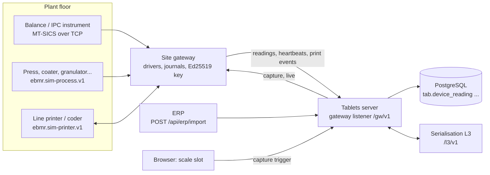

# integrations: device contracts, the site gateway and the simulators

**Draft.** This page is still being written; facts on it were checked against the code on 14 October 2026.

This page explains how data from machines and outside systems reaches the batch record: the contracts in
`packages/integration-sdk`, the equipment gateway `apps/site-gateway` that runs next to the machines, and the
simulators in `apps/simulators` that stand in for real scales, presses, printers, the serialisation system and the ERP
in the demo and the tests. Read it when you work on a device, a reading, a print job, serialisation or the ERP import.
The server side (how a reading is stored, claimed by an entry and checked by the database) is in
[tablets-server, ts-devices](tablets-server.md#ts-devices-devices-and-scale-or-process-readings).

## Where the code is

| What | Where |
|---|---|
| Scale contract: reading, signature, MT-SICS codec, gateway wire | [packages/integration-sdk/src/scale/](../../../packages/integration-sdk/src/scale/) |
| Process equipment contract: tags, readings, setpoints | [packages/integration-sdk/src/process/](../../../packages/integration-sdk/src/process/) |
| Printer contract: jobs, echo, print events | [packages/integration-sdk/src/printer/](../../../packages/integration-sdk/src/printer/) |
| Serialisation contract: L3 pools, serial events, reports, market code content | [packages/integration-sdk/src/serialisation/](../../../packages/integration-sdk/src/serialisation/) |
| Gateway core: capture, readiness, live display | [apps/site-gateway/src/gateway.ts](../../../apps/site-gateway/src/gateway.ts#sym=SiteGateway) |
| Gateway journals (scale, process, print) | [journal.ts](../../../apps/site-gateway/src/journal.ts#sym=Journal), [process-journal.ts](../../../apps/site-gateway/src/process-journal.ts#sym=ProcessJournal), [print-journal.ts](../../../apps/site-gateway/src/print-journal.ts#sym=PrintJournal) |
| Gateway uplink to the server | [uplink.ts](../../../apps/site-gateway/src/uplink.ts#sym=Uplink), [process-uplink.ts](../../../apps/site-gateway/src/process-uplink.ts#sym=ProcessGateway), [printer-uplink.ts](../../../apps/site-gateway/src/printer-uplink.ts#sym=PrinterGateway) |
| Gateway API the server calls (capture, live, health) | [api.ts](../../../apps/site-gateway/src/api.ts#sym=startGatewayApi) |
| Device drivers | [drivers/](../../../apps/site-gateway/src/drivers/) |
| Gateway configuration (`EBMR_GW_CONFIG`) | [config.ts](../../../apps/site-gateway/src/config.ts#sym=parseGatewayConfig) |
| Simulators: scale, process, printer, serialisation L3, ERP | [apps/simulators/src/](../../../apps/simulators/src/) |
| Server side: gateway listener, enrolment, reading storage | [apps/tablets-server/src/features/devices/](../../../apps/tablets-server/src/features/devices/) |
| Tests | [integration-sdk/test](../../../packages/integration-sdk/test/), [site-gateway/test](../../../apps/site-gateway/test/), [simulators/test](../../../apps/simulators/test/) |

## What it does

- The **site gateway** is a small Node program on the plant network. It talks to each instrument in its own protocol,
  writes every value to a journal on disk before anything else, signs scale readings with its own key, and sends
  everything to the Tablets server's **gateway listener** (a separate port, `EBMR_GATEWAY_LISTEN`, paths `/gw/v1/...`).
  The server calls the gateway back for a capture or the live display (paths `/v1/...`).
- The **integration SDK** holds the shapes both sides agree on (zod schemas and pure functions), so the gateway, the
  simulators and the server check the same rules.
- The **simulators** behave like the real devices, including their faults, so the demo and the tests can show every
  exception path without hardware.
- The **ERP** (enterprise resource planning: the company's system for products, materials and orders) sends its
  masters and production orders to the server; in the demo a stub does it once. The **serialisation L3 system** (the
  site system that issues serial numbers for packs) is called by the server; in the demo a stub plays it.

### Pharma context

- **Data from a device is evidence.** A weight in a batch record must be the weight the balance showed, from that
  balance, at that time. If an operator could type it, or a program could change it on the way, the record would prove
  nothing. Regulators call this data integrity of interfaces (EU GMP Annex 11 on data exchanged between systems;
  21 CFR 211.68 on automatic equipment). Controls: [DI-31](../../../compliance/controls/DI-31.yaml) interface data
  integrity, [DI-32](../../../compliance/controls/DI-32.yaml) instrument data and original records,
  [DI-20](../../../compliance/controls/DI-20.yaml) device checks.
- **Attributable to a device, not only to a person.** The record names the instrument (device code and the serial
  number the gateway read from it) and the gateway that took the value. A balance swapped for another one is refused.
- **Nothing lost, nothing added, nothing twice.** If the network fails, values wait in the gateway's journal and are
  delivered later, in order, once each ([DI-28](../../../compliance/controls/DI-28.yaml) contemporaneous capture and
  buffering). Sequence numbers and hash links let the server see a gap, a repeat or a change.
- **The record's time is the server's.** The gateway stamps its own clock as the source time, with a trust flag; the
  time of record is the database clock ([Architecture, time](../03-architecture.md#10-time)).
- **No keying at the device.** Print data (batch, dates, MRP, GTIN or NDC) always comes from the record; the gateway
  loads it on the printer as given and checks the printer's echo ([PR-36](../../../compliance/controls/PR-36.yaml)).
  Serial codes must carry the record's lot and expiry ([PR-42](../../../compliance/controls/PR-42.yaml)).
- **When devices fail, a second person.** If no scale works, a manual weighing is allowed only with a second person's
  check ([DI-30](../../../compliance/controls/DI-30.yaml), [PR-20](../../../compliance/controls/PR-20.yaml)); the
  gateway must report honestly whether a capture could succeed, so the manual path is offered only when it should be.

## integration-sdk: the contracts

`@ebmr/integration-sdk` has four subpath exports. Each is zod and Node built-ins only: never the kernel or a database
driver, so the gateway and the simulators stay free of the database (boundary rule `gateway-and-simulators-no-db` in
[.dependency-cruiser.cjs](../../../.dependency-cruiser.cjs)). Every value is **decimal text**, never a JavaScript
`number`; weights are handled as `bigint` counts of the resolution ([scale/decimal.ts](../../../packages/integration-sdk/src/scale/decimal.ts#sym=toCounts)).
A value with more decimals than allowed is **refused, never rounded**.

### Scale: the reading and its signature

[reading.ts](../../../packages/integration-sdk/src/scale/reading.ts) defines a scale reading
([ReadingBody](../../../packages/integration-sdk/src/scale/reading.ts#sym=ReadingBody)): reading id, chain id (the
gateway's enrolment on one server), gateway code, device code, the instrument serial the gateway verified, sequence
number, value and unit (or null), stable flag, status (OK, UNSTABLE, OVERLOAD, UNDERLOAD, OFFLINE, ERROR), the **raw
line** exactly as the instrument sent it, the gateway's source time and its trust (DEVICE_SYNCED or DEVICE_UNSYNCED),
the installation (GMP or SANDBOX), the purpose (TARE, GROSS, CHECK) and the hash of the previous reading.

- The hash is SHA-256 of a canonical text of the fields ([readingHash](../../../packages/integration-sdk/src/scale/reading.ts#sym=readingHash));
  the first reading links to [genesisHash](../../../packages/integration-sdk/src/scale/reading.ts#sym=genesisHash)`(chainId)`.
- The gateway signs `ebmr.scale-reading.v1|<hash>` with its Ed25519 key ([sealReading](../../../packages/integration-sdk/src/scale/reading.ts#sym=sealReading)).
- The server checks with [readingProblem](../../../packages/integration-sdk/src/scale/reading.ts#sym=readingProblem):
  schema, hash, signature against the enrolled key; the database recomputes the hash in SQL and checks the sequence.

[mt-sics.ts](../../../packages/integration-sdk/src/scale/mt-sics.ts#sym=parseResponse) is the codec for MT-SICS
(Mettler Toledo's standard balance command set, a subset): `S` stable weight, `SI` immediate weight, `T` tare, `Z`
zero, `I4` serial number, `@` reset. A garbled line is a protocol error and is never read as a weight. The server uses
the same codec to check that the stored raw line states the stored value (DI-32).
[instruments.ts](../../../packages/integration-sdk/src/scale/instruments.ts#sym=INSTRUMENT_PROFILES) adds the IPC and
packaging instruments that report one value the way a balance does (moisture analyser, hardness tester, friabilator,
disintegration tester, leak tester, checkweigher). [wire.ts](../../../packages/integration-sdk/src/scale/wire.ts)
holds the capture request and answer, the live sample, device states (CONNECTING, ONLINE, OFFLINE, SERIAL_MISMATCH)
and the health answer.

### Process equipment

[process/tags.ts](../../../packages/integration-sdk/src/process/tags.ts#sym=PRESS_TAGS) names the tags of each kind of
equipment (press, coater, granulator, dryer, blender, roller compactor, blister machine, bottle line, cartoner): unit,
fraction digits, whether it is a counter, whether it takes a setpoint. Tag names never change once released.
[process/wire.ts](../../../packages/integration-sdk/src/process/wire.ts) defines the readings (ACTUAL,
SETPOINT_READBACK, ALARM, ALARM_CLEARED, with quality GOOD, UNCERTAIN, BAD or STALE), the setpoint downloads and their
acknowledgement (APPLIED, MISMATCH, FAILED), and [processReadingsProblems](../../../packages/integration-sdk/src/process/wire.ts#sym=processReadingsProblems),
the rules a schema cannot say (known tag, its unit and decimals, whole non-negative counters).
[process/sim-protocol.ts](../../../packages/integration-sdk/src/process/sim-protocol.ts#sym=SIM_PROCESS_PROTOCOL) is
`ebmr.sim-process.v1`, JSON lines over TCP, a stand-in for a PLC or OPC UA server.

### Printers and coders

[printer/wire.ts](../../../packages/integration-sdk/src/printer/wire.ts) defines a print job's variable data
([PrintFields](../../../packages/integration-sdk/src/printer/wire.ts#sym=PrintFields): batch, manufacturing and expiry
date, MRP, GTIN or NDC, serial pool), with GS1 check digits ([gs1CheckDigit](../../../packages/integration-sdk/src/printer/wire.ts#sym=gs1CheckDigit)),
the job acknowledgement (LOADED, MISMATCH, FAILED), the print events (printed counts, reader, vision and challenge
results, faults) and [echoMismatches](../../../packages/integration-sdk/src/printer/wire.ts#sym=echoMismatches).
Dates are the record's calendar dates; the layout renders them for the market (plain for India-domestic packs).
[printer/sim-protocol.ts](../../../packages/integration-sdk/src/printer/sim-protocol.ts#sym=SIM_PRINTER_PROTOCOL) is
`ebmr.sim-printer.v1`.

### Serialisation

[serialisation/wire.ts](../../../packages/integration-sdk/src/serialisation/wire.ts) is the contract with the site's
L3 serialisation system: a pool of serials per packaging order, serial state events (every serial must end
COMMISSIONED, DECOMMISSIONED, DESTROYED, SAMPLE or UNUSED_RETURNED), and a pool report whose hash is the SHA-256 of a
canonical text ([canonicalReportText](../../../packages/integration-sdk/src/serialisation/wire.ts#sym=canonicalReportText)).
[serialisation/market.ts](../../../packages/integration-sdk/src/serialisation/market.ts#sym=MARKET_PROFILES) holds the
market code content as data: EU FMD and US DSCSA (a unit identifier in a GS1 DataMatrix) and India Schedule H2 (a
batch-level QR, no serials; its layout is a stub until its elements are confirmed).
[codeContentProblems](../../../packages/integration-sdk/src/serialisation/market.ts#sym=codeContentProblems) refuses a
code whose lot or expiry differs from the record's.

> **Why this exists** (signed, chained readings)
> - **Pharma reason:** the server must be able to prove that a stored weight is exactly what the balance sent, from the
>   balance it names, and that no reading was dropped, inserted or changed between the plant floor and the database.
> - **Control:** [DI-31](../../../compliance/controls/DI-31.yaml), [DI-32](../../../compliance/controls/DI-32.yaml).
> - **Code:** [sealReading](../../../packages/integration-sdk/src/scale/reading.ts#sym=sealReading),
>   [readingProblem](../../../packages/integration-sdk/src/scale/reading.ts#sym=readingProblem); in the database
>   [tab.ingest_reading](../../../apps/tablets-server/sql/0330_reading_freshness_challenge.sql#sym=tab.ingest_reading)
>   and [tab.device_reading_proof](../../../apps/tablets-server/sql/0270_devices_readings_guards.sql#sym=tab.device_reading_proof).
> - **Tests:** [scale/reading.test.ts](../../../packages/integration-sdk/test/scale/reading.test.ts),
>   [scale/mt-sics.test.ts](../../../packages/integration-sdk/test/scale/mt-sics.test.ts); server
>   [devices/reading-proof.test.ts](../../../apps/tablets-server/test/devices/reading-proof.test.ts).
> - **Error:** server `EBMR-DEV-...` codes ([error codes](../reference/error-codes.md)).

## The adapter framework (Phase 6, slice 6a-0)

Systems of record (ERP/WMS, QMS, LIMS, LMS, CMMS; later EMS, OPC UA and L3) hand data to the eBMR through one framework
(D-P6a-1). The adapter wraps every message in the envelope of
[envelope.ts](../../../packages/integration-sdk/src/adapter/envelope.ts) and calls
`platform.accept_inbound_detail` in the database under its own integration identity: an INTEGRATION account on its
SERVER device, registered in `iam.integration_adapter` like a device (DI-20), which can never sign (DI-14). The
database validates the envelope, de-duplicates by idempotency key, raises an integration alarm on a sequence gap or a
late message, and commits the message together with the domain command that applies it, or neither (DI-31). A refusal
is recorded with its alarm in its own command; reconciliation reports compare the source's counts and checksum with
what arrived. Data classes a GMP guard reads from another system run as STAND_IN (the built-in register) or MIRROR;
`platform.mirror_fresh_or_raise` fails closed on a stale blocking mirror (EBMR-INT-010). Code:
[1180_inbound_adapter_framework.sql](../../../packages/kernel/sql/1180_inbound_adapter_framework.sql); signatures,
decisions and the builders' split: [slice-6a-0-interfaces.md](../../build-plan/phase-6/slice-6a-0-interfaces.md).

## The ERP/WMS adapter and the worker base (Phase 6, slice 6a, builder A)

**The worker base** ([framework.ts](../../../apps/tablets-server/src/features/integrations/adapters/framework.ts#sym=AdapterWorker)):
one worker per feed, application code only (every rule it relies on is the database's). A cycle asks the source's
heartbeat, reads a page of the feed after its cursor (the highest sequence number handled; at start the database's),
and per message checks the envelope (`InboundEnvelope`), the hash against the payload as received and the payload
against the contract's schema, then runs the system's receiving command in one database command. A refusal of a known
class is recorded with `platform.record_inbound_refusal` (its alarm) and the cursor moves on; TRANSPORT (the source or
the database unreachable, a cut or late answer) ends the cycle without moving the cursor and is retried with
`retryDelayMs` (1 s doubling to 5 min, never given up); an unclassified failure blocks the worker on that message
(health BLOCKED). The mirror synchronisation (`platform.record_mirror_sync`) is recorded only when the heartbeat answers
**and** the worker is caught up with the source's head, so a stopped heartbeat, a feed gap or a backlog all let the
mirror go stale and fail closed (defect P6a-A1 in the [defect log](../08-defect-log.md#integrations-phase-6)).
`reconcile(from, to)` submits the source's count and checksum of a closed period. Back-off uses the monotonic clock
(`performance.now`), never GMP time.

**The ERP/WMS adapter** ([adapters/erp-wms](../../../apps/tablets-server/src/features/integrations/adapters/erp-wms/index.ts)):
two feeds of the ERP_WMS system, each its own registered adapter (D-P6a-0-7), started by the integrations feature
when the service-keys file has an entry for terminal `SRV-ERP-ADAPTER-01` or `SRV-WMS-ADAPTER-01` with an `endpoint`
and the account is an ACTIVE ERP_WMS adapter. The account holds role ERP_WMS_INTERFACE (site services 0914:
INTERFACE.WRITE, ERP.MASTER_WRITE, MATERIAL.HANDLE; no SIGN or ACKNOWLEDGE). Both receive through
`site.erp_wms_receive` ([site services 0913](../../../packages/site-services/sql/0913_erp_wms_inbound_and_issue_gate.sql)):

| Message type | Applied by | What it changes |
|---|---|---|
| `erp.production_order` | `site.erp_receive_order` | the order at the adapter's site (strength required); the ERP BOM is matched against the MBR BOM at GMP issue (EBMR-EXE-605) |
| `erp.material_master`, `erp.product_master` | `site.erp_receive_material`, `site.erp_receive_product` | a master version; a new or changed controlled value waits for QA (0802) |
| `wms.goods_receipt` | `site.receive_supplier_batches` (0910) | one lot in QUARANTINE per supplier batch, each with its receipt record and the message id (PR-17) |
| `wms.stock_move` | `site.apply_wms_stock_move` (0911) | the move; one that broke the location rule raises an alarm and an exception linked to the lot (PR-46, D-P6a-7) |
| `wms.lot_status` | `site.apply_wms_lot_status` (0912) | the lot-status mirror; a report older than the one held is STALE (EBMR-ERP-004) |
| `erp.shipment` | kept as the accepted message | distribution records come with slice 6d |

After each cycle the ERP feed delivers the outbound queue ([outbound.ts](../../../apps/tablets-server/src/features/integrations/adapters/erp-wms/outbound.ts):
`erp.stock_block`, `erp.lot_status`, `erp.goods_issue`, `erp.yield`, written by triggers in the transaction of their
fact; a failed delivery is recorded, raises one TRANSPORT alarm, waits its back-off and is sent again until the ERP
acknowledges it; the messages of one lot keep their order). The WMS feed answers the WMS's questions before a move
([moves.ts](../../../apps/tablets-server/src/features/integrations/adapters/erp-wms/moves.ts), `site.wms_location_question`,
0915). The Phase 4 stub consumer of stock blocks (0880) stays for a demo without an ERP.

**Defaults taken by builder A (decision 0004; recorded, the owner may change):**
D-P6a-A-1 a manual override of an interface-captured value is a row of `platform.inbound_override` (kernel 1181),
audited on the adapter's chain and shown with the original value on the lot's receipt page; a list of overrides on the
integration health page needs a route in the lead's `integrations` contract, and linking an override into a batch's
engine-driven exception register is left to 6f or 6j; D-P6a-A-2 in STAND_IN the LMS rows keep the 0130 heartbeat, in MIRROR the LMS
freshness is the generic `platform.mirror_sync` with the data class's bound; D-P6a-A-3 receipt completeness (receipt
record and an ACCEPTABLE examination of every container) is required for purchased kinds (API, excipients, packaging);
lots made here (intermediates, finished, returned) have none; D-P6a-A-4 an unapproved manufacturer does not refuse the
receipt (the goods are in the warehouse and must be recorded): the lot is created and blocked, its release and issue
refused until QA approves the manufacturer, and the approval is checked again at every reservation and consumption;
D-P6a-A-5 lot codes of received supplier batches are numbered `GR<yymmdd>-<n>` per site and day when stores give none;
D-P6a-A-6 the examiner is a person (HUMAN account) and the examination is recorded once per lot; D-P6a-A-7 the location
rule by status (released within dates: any kind; quarantine, on hold or past dates: quarantine, rejected, returns;
rejected or recalled: rejected, returns; no stock: none), and an open location exception blocks release and issue
until QA closes it with a deviation linked to the lot; D-P6a-A-8 in MIRROR the WMS must hold the lot RELEASED for issue
(a missing report refuses), the stricter wins; D-P6a-A-9 the ERP outbound queue is its own table (platform.outbox is
claimed by any relay and carries no topic filter); D-P6a-A-10 a WMS expiry or retest date becomes the start of that day
in the site's zone; D-P6a-A-11 `erp.shipment` is kept, not applied, until 6d; D-P6a-A-12 the ERP/WMS adapter role
carries MATERIAL.HANDLE to create lots, so issue is made a person's act in the database (EBMR-SITE-924); D-P6a-A-13 the
receipt signing meaning is tablets 1259 (6a has no tablets range and it must run after 1229); D-P6a-A-14 the optional
payload fields the receiving command needs (order strength, material kind, product shelf life and beta-lactam flag,
retest date, delivery-note name) were added to the version-1 contract as optional members (additive), and the database
refuses a message without them as MALFORMED.

## QMS, LIMS, LMS and CMMS adapters (Phase 6, slice 6a, builder B)

Each of these four systems is a thin mapping on the framework above: a receiving command in the database per message
type, a spec in [adapters/](../../../apps/tablets-server/src/features/integrations/adapters/) and a feed simulator.
Every receiving command refuses administrators, checks INTERFACE.WRITE, calls `platform.accept_inbound_detail` and,
when the outcome is ACCEPTED, applies the payload in the same transaction; a refusal names its EBMR code, which the
system contract maps to an error class (`refusalCodes` in
[systems/](../../../packages/integration-sdk/src/adapter/systems/)).

| System | Message type | Receiving command | What it changes | Mirror data class |
|---|---|---|---|---|
| LMS | `lms.qualification` | `iam.receive_lms_qualification` ([kernel 1186](../../../packages/kernel/sql/1186_lms_qualification_inbound.sql)) | a qualification row with source LMS (QUALIFIED), or withdraws the live LMS rows (REVOKED, EXPIRED) | LMS_QUALIFICATION (read at signing) |
| QMS | `qms.deviation_status`, `qms.capa`, `qms.change_control` | `site.receive_qms_*` ([site services 0925](../../../packages/site-services/sql/0925_capa_and_qms_mirror.sql)) | insert-only histories with the QMS's version tokens; a CAPA mirror row (origin QMS) | QMS_STATUS (release) |
| LIMS | `lims.sample_result` | `site.receive_lims_sample_result` ([site services 0926](../../../packages/site-services/sql/0926_lims_results_inbound.sql)) | the result as the LIMS sent it (decimal text and unit, never converted) | none (LIMS-lite stays the stand-in, D-P6a-4) |
| CMMS | `cmms.calibration`, `cmms.maintenance` | `plant.receive_cmms_*` ([recipe-core 0950](../../../packages/recipe-core/sql/0950_cmms_mirror_at_equipment_use.sql)) | a `plant.calibration` row; a work-order history | CMMS_CALIBRATION, CMMS_MAINTENANCE (equipment use) |

Rules every one of them keeps:

- **The modes never mix (D-P6a-5).** A message for a data class the site runs as STAND_IN is refused (WRONG_IDENTITY);
  in MIRROR the built-in commands are refused (`site.raise_capa` and the other CAPA writes, EBMR-CAPA-002;
  `plant.record_calibration`, EBMR-PLANT-025).
- **A late state never overwrites a newer one.** A message whose source timestamp is not newer than the one already
  applied for the same record is refused STALE (EBMR-LMS-004, EBMR-QMS-004, EBMR-LIMS-104, EBMR-CMMS-004; for a
  calibration, by its performedAt).
- **Wrong identity is refused.** An unknown person number, qualification, lot or equipment code: WRONG_IDENTITY.
- **The source's reason (D-P6a-B-7).** A command that changes an audited row (an LMS withdrawal) carries the reason
  code INBOUND_MESSAGE and a text naming the message type, record id and system: the audit trail refuses an update
  without a reason (EBMR-AUDIT-002).

**The pull worker** ([feed-pull/worker.ts](../../../apps/tablets-server/src/features/integrations/adapters/feed-pull/worker.ts#sym=FeedPullWorker),
D-P6a-B-1): one cycle reads the feed after the highest sequence number handled, sends each envelope to its receiving
command, records a classified refusal with `platform.record_inbound_refusal` and moves on, and stops without moving its
pointer on a TRANSPORT or unclassified failure (the next cycle fetches the same messages again; accepted ones come back
DUPLICATE). It synchronises the system's mirror data classes only when it is **caught up** (pointer = the source's head)
and the source's heartbeat answers, so a feed gap and a stopped heartbeat both let the mirror go stale. Builder A's
[framework.ts](../../../apps/tablets-server/src/features/integrations/adapters/framework.ts) is the ERP/WMS worker; it
now also syncs only when caught up (defect P6a-A1); its receiving commands only insert, so they carry no source reason.
The four systems stay on the pull worker until the two are merged (owner of the merge: the lead).

**The QMS status at release (D-P6a-3, D-P6a-0-11).** The release does not trust the QMS mirror alone. In MIRROR, the
release acts (manufacturer release, US release disposition, in-system QP certification, re-confirmation) call
[qmsReleaseFetch](../../../apps/tablets-server/src/features/integrations/adapters/qms/index.ts#sym=qmsReleaseFetch)
inside the signing transaction: it asks the QMS (`GET /qms/v1/lots/:lot/deviations`) and records the answer with
`site.record_qms_release_fetch`, which refuses an answer that differs from the mirror the signer evaluated (a changed
or stale version token, EBMR-QMS-011). An unreachable, slow or cut QMS refuses the release (EBMR-QMS-020, naming the QMS
and its owner). A BEFORE INSERT trigger on the four release decision tables
([recipe-core 0951](../../../packages/recipe-core/sql/0951_qms_status_at_release.sql)) refuses a release without a live
fetch in the same transaction (EBMR-QMS-013), with one older than the 60 s QMS_STATUS bound (EBMR-QMS-014, a backstop)
or with an open QMS deviation naming the lot (EBMR-QMS-015), whoever inserts it. G-REL shows the mirror as item
G2.QMS_STATUS (MIRROR only; a stand-in site's checklist is unchanged), with the version tokens in its evidence, so the
G-REL epoch moves whenever a token moves.

**Stale mirrors fail closed.** Equipment use (`plant.fitness_problems`) calls `platform.mirror_fresh_or_raise` for
CMMS_MAINTENANCE and, for a unit that needs calibration, CMMS_CALIBRATION; a stale MIRROR refuses the use with
EBMR-INT-010. The qualification check at signing reads LMS_QUALIFICATION (kernel 1181, builder A). The screens show the
mirror, its age and whom to call ([StaleMirror.tsx](../../../packages/ui-kit/src/floor/StaleMirror.tsx)).

**Defaults taken by builder B (decision 0004; recorded, the owner may change):**
D-P6a-B-1 the four systems run on the pull worker above (mirror synced only when caught up) until it is merged with
framework.ts; D-P6a-B-2 a CMMS ADJUSTED_PASS is recorded as found FAIL, as left PASS (the batches since the last good
calibration are listed and released lots are suspended for assessment); D-P6a-B-3 a CMMS due date becomes the start of
that day in the site's zone (the unit is not used on its due date); D-P6a-B-4 in MIRROR a unit is not used while a CMMS
work order is IN_PROGRESS or a PREVENTIVE one is past its due date; D-P6a-B-5 G2.QMS_STATUS appears only in MIRROR (a
stand-in checklist and the golden outputs stay exact); D-P6a-B-6 LIMS results are kept and shown, not used by G3.LIMS
(no LIMS mirror class in 6a-0); D-P6a-B-7 a receiving command carries the source's reason (INBOUND_MESSAGE, naming the
message); D-P6a-B-8 the CAPA signing meaning is tablets 1229 (6a has no tablets range); D-P6a-B-9 a CAPA closes only
with every effectiveness check recorded effective, and a QMS mirror CAPA is never closed here; D-P6a-B-10 the four
adapters hold SERVICE_ACCOUNT only (INTERFACE.WRITE; the receiving definers do the rest), no per-system role.

## site-gateway: the equipment gateway

### Start, identity and gateway keys

The gateway is started with `EBMR_GW_CONFIG=<file> node --import tsx apps/site-gateway/src/main.ts` (the demo and the
browser suite write the file). [config.ts](../../../apps/site-gateway/src/config.ts#sym=GatewayConfigFile) names: the
gateway code (its registered SERVER device on the server), the installation, the listen address of its API, the
uplink address, its Ed25519 key file, its service key (the login of its INTEGRATION identity), the journal directory,
and every instrument with driver, address, expected serial, resolution, unit and room; optionally process equipment
and printers.

**Gateway keys.** The gateway owns an Ed25519 key pair. The system administrator enrols the public key on the server
([enrolGateway](../../../apps/tablets-server/src/features/devices/enrol.ts#sym=enrolGateway), database
[tab.enrol_gateway_key](../../../apps/tablets-server/sql/0702_gateway_key_large_order.sql#sym=tab.enrol_gateway_key)):
its SHA-256 fingerprint becomes the fingerprint of the gateway's SERVER device, and the instruments it may serve are
bound with the serial, unit and resolution each must have. The database takes only a 44-byte Ed25519 public key of a
curve point of large order (a key of small order would let anyone build a signature that verifies). In the demo the key
is a DEMO-ONLY file made by [tools/demo](tools.md#tools-demo-the-demo-stack).

**Login.** [Uplink](../../../apps/site-gateway/src/uplink.ts#sym=Uplink) asks the server for a nonce, signs it with the
gateway key, and sends it with the service key and a fresh random API token
([newApiToken](../../../apps/site-gateway/src/uplink.ts#sym=newApiToken)). The answer names the chain (the enrolment)
and the server's head, which the journal adopts. From then on the gateway uses an opaque bearer token; the server uses
the API token to call the gateway, so the server never holds the gateway's credential. An INTEGRATION identity can
never sign a GMP signature ([DI-14](../../../compliance/controls/DI-14.yaml)).

### Capture: how one weight is taken

[SiteGateway](../../../apps/site-gateway/src/gateway.ts#sym=SiteGateway) does a capture like this:

1. The operator presses "Capture gross" on the kiosk; the server calls `POST /v1/devices/:code/capture` on the gateway
   with its API token.
2. The gateway checks: the instrument is configured here **and** bound to this gateway on the server with the same
   serial, unit and resolution; the connection's `I4` serial was verified.
3. It sends `S` until a stable weight or a timeout. Whatever the balance answered is sealed (hash, signature) and
   **journalled with fsync before anything else**: a stable weight as OK, the last dynamic weight after a timeout as
   UNSTABLE, overload and underload as such. A unit other than the configured one, or a value finer than the
   resolution, is refused and alarmed, never converted or rounded.
4. The journal is uploaded; the capture answers with the reading and whether the server acknowledged it (waiting up
   to [CAPTURE_ACK_WAIT_MS](../../../apps/site-gateway/src/gateway.ts#sym=CAPTURE_ACK_WAIT_MS), 5 s).
5. The browser gets the reading's id; the step entry claims it ([tablets-server, ts-devices](tablets-server.md#ts-devices-devices-and-scale-or-process-readings)).

The live display (`GET /v1/devices/:code/live`, server-sent events at about 4 Hz) is display only: never journalled,
never recorded.

### The journal: store and forward

[Journal](../../../apps/site-gateway/src/journal.ts#sym=Journal) is an append-only JSONL file per chain:
`journal-<chain>.jsonl` (sealed readings in sequence), `ack-<chain>.json` (the last reading the server confirmed),
`chain.json`. At start the whole chain is verified (schema, sequence, hash links, each signature); **any break refuses
the start** (fail closed). Only an unterminated last line (a crash mid-write, never synced or sent) is set aside as
evidence (`.partial-<n>`). Nothing is ever deleted or rewritten. If a write or sync fails, the partial bytes are cut
off, the failure is alarmed, and the journal takes nothing more until a restart re-verifies the file (review P52).

The process and print journals ([ProcessJournal](../../../apps/site-gateway/src/process-journal.ts#sym=ProcessJournal),
[PrintJournal](../../../apps/site-gateway/src/print-journal.ts#sym=PrintJournal)) follow the same rules with a
sequence per device or printer, rebuilt from the file at start, so there is no gap and no repeat across restarts.

**Upload.** Readings the server does not hold yet go in sequence and in batches, idempotent by reading id. Each batch
first takes a challenge the server's database issues; each reading's waiting time is signed with the challenge, so the
database knows how old a reading is when it arrives (DI-28, review P53). The watermark moves only on the server's
acknowledgement. While the server cannot be reached, nothing is lost.

**Readiness.** An instrument is reported ONLINE (in the heartbeat and in `GET /v1/health`) only while a capture on it
could be journalled **and delivered**: verified serial, logged in, a usable journal, the installation matches, the
server's binding matches, and the uplink can deliver. Otherwise it is OFFLINE with the reason, so the server offers the
manual two-person path instead of a capture that would fail. The heartbeat runs every few seconds (at most half of the
server's 10 s freshness window) and at once when readiness changes, coalesced to one per 500 ms.

> **Why this exists** (journal before answer, fail closed at start)
> - **Pharma reason:** a weight must be recorded when it is taken and must never be lost or altered on its way, even
>   when the network or the disk fails. A journal that was tampered with must never be uploaded or extended.
> - **Control:** [DI-28](../../../compliance/controls/DI-28.yaml), [DI-31](../../../compliance/controls/DI-31.yaml),
>   [DI-30](../../../compliance/controls/DI-30.yaml), [PR-20](../../../compliance/controls/PR-20.yaml) (readiness).
> - **Code:** [Journal](../../../apps/site-gateway/src/journal.ts#sym=Journal),
>   [JournalIntegrityError](../../../apps/site-gateway/src/journal.ts#sym=JournalIntegrityError),
>   [Uplink](../../../apps/site-gateway/src/uplink.ts#sym=Uplink).
> - **Tests:** [journal.test.ts](../../../apps/site-gateway/test/journal.test.ts) (`[DI-31] a journal that was altered
>   refuses the start`), [journal-write-failure.test.ts](../../../apps/site-gateway/test/journal-write-failure.test.ts),
>   [upload-wait.test.ts](../../../apps/site-gateway/test/upload-wait.test.ts),
>   [delivery-readiness.test.ts](../../../apps/site-gateway/test/delivery-readiness.test.ts),
>   [capture-readiness.test.ts](../../../apps/site-gateway/test/capture-readiness.test.ts).

### Drivers

Each driver keeps one TCP connection per device, one request at a time, a timeout per request and reconnection with
exponential back-off. At **every** connect it asks the device for its serial number; another serial than the
configured one is refused (state SERIAL_MISMATCH, alarm, connection closed). A timed-out request or a garbled line
closes the connection, so a late or corrupt answer can never be taken as the answer to a later request.

| Driver | Device | Protocol |
|---|---|---|
| [MtSicsDriver](../../../apps/site-gateway/src/drivers/mt-sics.ts#sym=MtSicsDriver) | balances and IPC instruments | MT-SICS (`I4` for the serial) |
| [ProcessSimDriver](../../../apps/site-gateway/src/drivers/process-sim.ts#sym=ProcessSimDriver) | press, coater and other process equipment | `ebmr.sim-process.v1` (`hello` gives serial and kind) |
| [PrinterSimDriver](../../../apps/site-gateway/src/drivers/printer-sim.ts#sym=PrinterSimDriver) | line printers with reader and vision | `ebmr.sim-printer.v1` (`hello` gives serial and boot) |

> **Why this exists** (the serial is checked at every connect)
> - **Pharma reason:** a reading must come from the calibrated instrument the record names. A balance moved from
>   another room, or replaced without re-qualification, must not feed the record.
> - **Control:** [DI-20](../../../compliance/controls/DI-20.yaml).
> - **Code:** [MtSicsDriver](../../../apps/site-gateway/src/drivers/mt-sics.ts#sym=MtSicsDriver) and the other drivers;
>   the server binding checked by [SiteGateway](../../../apps/site-gateway/src/gateway.ts#sym=SiteGateway).
> - **Tests:** [gateway.test.ts](../../../apps/site-gateway/test/gateway.test.ts) (`[DI-20] a serial mismatch is refused
>   at connect and alarmed`), [device-config.test.ts](../../../apps/site-gateway/test/device-config.test.ts).

### Process equipment and printers

[ProcessGateway](../../../apps/site-gateway/src/process-uplink.ts#sym=ProcessGateway) polls each device and journals,
in one synced append, an ACTUAL reading per tag, a SETPOINT_READBACK when a read-back changed, and ALARM and
ALARM_CLEARED. A device whose scan counter stops moving is STALE (its values froze). Readings go to
`POST /gw/v1/process-readings`. Setpoint downloads (`GET /gw/v1/setpoint-downloads`) are written, read back and
compared: APPLIED, MISMATCH or FAILED; the read-back is journalled before the acknowledgement.

[PrinterGateway](../../../apps/site-gateway/src/printer-uplink.ts#sym=PrinterGateway) takes the print jobs the server
released (`GET /gw/v1/print-jobs`), loads each exactly as given, and compares the printer's echo: LOADED when equal,
MISMATCH when anything differs (the printer is cleared at once, so it never prints a wrong job), FAILED. A job the
server voids (batch data changed after set-up) is cleared from the printer and a FAULT JOB_VOIDED is journalled. Print
events (counts, reader, vision and challenge results, faults, OFFLINE and STALE) are journalled and forwarded to
`POST /gw/v1/print-events`. Control [PR-36](../../../compliance/controls/PR-36.yaml).

Tests: [process.test.ts](../../../apps/site-gateway/test/process.test.ts),
[printer.test.ts](../../../apps/site-gateway/test/printer.test.ts).

### The clock

[clock.ts](../../../apps/site-gateway/src/clock.ts#sym=systemClock) is the gateway's only clock read (ESLint allows
`Date.now()` there and nowhere else in the gateway): the wall clock stamps the source time (trust DEVICE_UNSYNCED
unless the configuration reports a synchronised clock), and a monotonic clock measures waits and timeouts.

## simulators

Each simulator is a separate process with a TCP port (the device protocol) and an HTTP port (a plain-HTML console,
forms only, no script, marked "SIMULATOR"). Values are `bigint` counts, randomness comes from a seeded generator and
time from an injectable clock, so the same seed and actions give the same output (each simulator has a determinism
test). They bind loopback addresses only unless told otherwise.

| Simulator | Entry | Speaks | Faults you can inject |
|---|---|---|---|
| Balance and IPC instruments | [scale/main.ts](../../../apps/simulators/src/scale/main.ts) (`EBMR_SIM_TCP`, default 4001) | MT-SICS | [FAULTS](../../../apps/simulators/src/scale/model.ts#sym=FAULTS): OFFLINE, UNSTABLE, OVERLOAD, SLOW, GARBLED, SERIAL_MISMATCH, DRIFT |
| Press, coater and other process equipment | [process/main.ts](../../../apps/simulators/src/process/main.ts) (`EBMR_SIM_EQUIPMENT`, press 4011) | `ebmr.sim-process.v1` | OFFLINE, STALE, DRIFT, alarms, ... ([model.ts](../../../apps/simulators/src/process/model.ts)) |
| Line printer with reader and vision | [printer/main.ts](../../../apps/simulators/src/printer/main.ts) (4031) | `ebmr.sim-printer.v1` | OFFLINE, MISPRINT, READER_FAIL, JOB_MISMATCH, STALE ([model.ts](../../../apps/simulators/src/printer/model.ts)) |
| Serialisation L3 stub | [serialisation/main.ts](../../../apps/simulators/src/serialisation/main.ts) (`EBMR_L3_HTTP`) | HTTP `/l3/v1/pools...` | in-memory pools; the same pool request answers the pool already issued |
| ERP stub (DEMO-ONLY) | [erp/main.ts](../../../apps/simulators/src/erp/main.ts) | `POST /api/erp/import` once, then exits | catalogue of the demo product ([catalogue.ts](../../../apps/simulators/src/erp/catalogue.ts)) |
| ERP and WMS feeds (DEMO-ONLY) | [erp/serve.ts](../../../apps/simulators/src/erp/serve.ts) (`EBMR_SIM_HTTP`, 4310), [wms/main.ts](../../../apps/simulators/src/wms/main.ts) 4320 | HTTP `/erp/v1` and `/wms/v1`: `feed`, `heartbeat`, `reconciliation`; POST `production-orders`, `materials`, `products`, `shipments` (ERP), `goods-receipts`, `stock-moves`, `lot-statuses`, `move-requests` (WMS); the ERP takes `POST /erp/v1/outbound` | [FEED_FAULTS](../../../apps/simulators/src/erp/feed.ts#sym=FEED_FAULTS): the same nine (`POST /api/fault`); the console has a button per fault |
| QMS, LIMS, LMS, CMMS feeds (DEMO-ONLY) | [qms/main.ts](../../../apps/simulators/src/qms/main.ts) (`EBMR_QMS_HTTP`, 4051), [lims](../../../apps/simulators/src/lims/main.ts) 4052, [lms](../../../apps/simulators/src/lms/main.ts) 4053, [cmms](../../../apps/simulators/src/cmms/main.ts) 4054 | HTTP `/<system>/v1/feed`, `/heartbeat`, `/reconciliation`; POST routes per message type; QMS `GET /qms/v1/lots/:lot/deviations` | [FEED_FAULTS](../../../apps/simulators/src/system-feed/feed.ts#sym=FEED_FAULTS): FEED_GAP, STALE_VALUE, MALFORMED, DUPLICATE, OUT_OF_ORDER, WRONG_BATCH, LINK_CUT, SLOW, STALE_MIRROR (`POST /api/fault`) |

The ERP stub posts the product and material masters and the production orders of the demo MBR (dc-mini: paracetamol
500 mg, batch sizes BS-100K and BS-50K), with BOMs scaled exactly as decimal text. The server's route
`quality.erpImport` authenticates it by its service identity; a new master version that changes something GMP-relevant
waits for QA's confirmation ([tablets-web, quality](tablets-web.md#quality-deviations-lots-specifications-samples-returns)).

## How to test it

- The SDK, gateway and simulator tests run in the Vitest `db` project (no database is needed by most of them):
  `pnpm vitest run --project db packages/integration-sdk apps/site-gateway apps/simulators`.
- Gateway tests start the real scale simulator as a child process and a **fake server listener** that checks readings
  exactly as the real one does (signature, hash, sequence, links) but keeps them in memory
  ([support.ts](../../../apps/site-gateway/test/support.ts#sym=FakeServer)). The gateway never imports another app,
  so the simulator runs as a process.
- The real ingestion, claims and the manual weighing gate are tested on the server
  ([test/devices/](../../../apps/tablets-server/test/devices/)).
- Browser: [devices.spec.ts](../../../tools/e2e/specs/devices/devices.spec.ts) runs the gateway and the simulator in
  the real stack (`[DI-32][DI-20]`, and with the simulator OFFLINE only the manual two-person path is offered).
- In the demo, open the simulator console (the `EBMR_SIM_HTTP` port) to put a load on the pan or switch a fault on.
- ERP/WMS: the database rules in [packages/site-services/test/erp-wms/](../../../packages/site-services/test/erp-wms/)
  (receipt, approved manufacturers, locations, the lot-status mirror, faults, the outbound queue) and
  [kernel test/inbound](../../../packages/kernel/test/inbound/) (overrides, LMS freshness); the ERP BOM at GMP issue in
  [erp-adapter-order.test.ts](../../../packages/recipe-core/test/lifecycle/erp-adapter-order.test.ts); the contract and
  soak tests run both workers against the simulator **processes**
  ([erp-wms/](../../../apps/tablets-server/test/integrations/erp-wms/): every fault in turn, then the period reconciles);
  the routes with data in [alarm-routes.test.ts](../../../apps/tablets-server/test/integrations/alarm-routes.test.ts).
- QMS, LIMS, LMS, CMMS: the database rules in `packages/{kernel,site-services,recipe-core}/test/integrations/`; the
  contract and soak tests run each adapter's worker against its simulator **process**
  ([feed-adapters.test.ts](../../../apps/tablets-server/test/integrations/feed-adapters.test.ts): every fault in turn,
  then the period reconciles and every received key is accepted or refused with an alarm).

## Pitfalls

- **Never round or convert a device value.** Refuse and alarm; the person or the engineer fixes the configuration.
- **Journal first, answer second.** Any new device path must sync to disk before the value "exists" for anyone.
- **The gateway and the simulators may not import the kernel, a database driver or the SDK's root `index.ts`**
  (the root imports the kernel); use the subpaths `@ebmr/integration-sdk/scale`, `/process`, `/printer`,
  `/serialisation`.
- **Tag names are released interfaces.** Add a tag; never rename one.
- **A late answer is not an answer.** Drivers close the connection on a timeout; keep that rule in a new driver.
- **Readiness must be honest.** Report OFFLINE whenever a capture could not be delivered, otherwise the manual path is
  wrongly refused.
- **Determinism in simulators.** No `Math.random()` or wall clock; use the seeded generator and the injected clock.

## Differences between the code and the docs (14 October 2026)

- Closed in slice 6a: the adapter contracts for ERP/WMS, QMS, LIMS, LMS and CMMS are in
  `@ebmr/integration-sdk/adapter` (EMS and OPC UA follow in 6b, L3 in 6c). Still open: the root `index.ts` says
  "Phase 0 skeleton: exposes the package identity only", although the subpaths are real; the Phase 3 ERP import
  (`quality.erpImport`) stays beside the ERP/WMS adapter as the demo seed.
- The site gateway's description says "OPC UA client"; there is no OPC UA client yet, only the JSON-lines stand-in
  protocol.
- The outline lists more simulators (autoclave, lyophiliser, particle counter, EMS/BMS, LIMS, QMS, LMS, CMMS stubs);
  they arrive with the phases that need them (Injectables, Phase 6).

## Related pages

- [tablets-server, ts-devices](tablets-server.md#ts-devices-devices-and-scale-or-process-readings): storage, claims,
  the manual weighing gate.
- [tablets-web, devices](tablets-web.md#devices-the-scale-slot-and-the-scales-page): the scale slot on the kiosk.
- [The life of a batch, dispensing](../04-life-of-a-batch.md#4-dispensing).
- [tools](tools.md): the demo stack that starts the gateway and the simulators.
- Generated: [code map](../code-map.md#integration-sdk), [control map](../reference/control-map.md).
