# Module guide: recipe-core

**Draft**

`packages/recipe-core` is the heart of the product. It holds the master batch record (MBR) and everything that happens
to a batch made from it: how a master is designed, checked, approved and authorised per market; how a batch is
issued from it; how each step is executed, verified, corrected and handed over; how exceptions, equipment, rooms,
containers and material use are controlled; how the finished record is reviewed, released for each market,
suspended, recalled, locked and amended; and the India-specific fields and the product quality review extract. Most
of its rules live in PostgreSQL (195 migrations in [packages/recipe-core/sql](../../../packages/recipe-core/sql/));
the TypeScript part is the pure flow model, validator, limit model, simulator and execution engine, plus thin
callers. Read this page when you change anything in the package, debug a refusal whose code starts with
`EBMR-RCP`, `EXE`, `PLANT`, `CNT`, `REV`, `REL`, `DSP`, `ARL`, `LCK`, `IND`, `PQR`, `FRM`, `RPR`, `PKG`, `PLN` or
`NTF`, or need to know which pharma rule a guard carries. Pharma words are explained in the
[primer](../01-pharma-primer.md) and the [glossary](../02-glossary.md); the request path, signatures and roles in
[architecture](../03-architecture.md); one batch end to end in [the life of a batch](../04-life-of-a-batch.md).

How to read the guard tables. Each area ends with a table of **every function in force that refuses something with
an `EBMR-` code**, built from the migrations: the function (linked to the migration that holds the version in
force), each code with its message shortened (`…` stands for a value filled in at run time), the controls the
message or the migration header names, and test files that assert one of the codes. A function that is called by a
trigger says so under its name. Codes of the kernel (`EBMR-AUDIT`, `EBMR-IAM`, `EBMR-ESIG`, `EBMR-PLAT`, `EBMR-SBX`)
raised inside recipe functions are listed too; their meaning is in the [kernel guide](kernel.md). The full list of
codes and files is the generated [error-code reference](../reference/error-codes.md); every function and trigger, with
the migrations that replaced it, is in the [database catalogue](../reference/db-catalogue.md).

## Where the code is

| What | Where |
|---|---|
| Migrations (schemas `recipe`, `plant`, `formulary`) | [packages/recipe-core/sql/](../../../packages/recipe-core/sql/), 0100 to 0932 |
| Flow model, compiler, token game | [src/flow/](../../../packages/recipe-core/src/flow/) ([README](../../../packages/recipe-core/src/flow/README.md)) |
| Static MBR validator | [src/validator/](../../../packages/recipe-core/src/validator/) ([README](../../../packages/recipe-core/src/validator/README.md)) |
| Limit model (CPP, IPC, yield tiers) | [src/limits/](../../../packages/recipe-core/src/limits/) ([README](../../../packages/recipe-core/src/limits/README.md)) |
| Simulator (verification evidence) | [src/simulator/](../../../packages/recipe-core/src/simulator/) ([README](../../../packages/recipe-core/src/simulator/README.md)) |
| Generic blocks G-01 to G-24 | [src/blocks/](../../../packages/recipe-core/src/blocks/) ([README](../../../packages/recipe-core/src/blocks/README.md)) |
| Execution engine (pure) | [src/engine/](../../../packages/recipe-core/src/engine/) ([README](../../../packages/recipe-core/src/engine/README.md)) |
| Execution store (database side of the engine) | [src/execution/](../../../packages/recipe-core/src/execution/) ([README](../../../packages/recipe-core/src/execution/README.md)) |
| MBR life cycle (machine, commands, selection) | [src/lifecycle/](../../../packages/recipe-core/src/lifecycle/) ([README](../../../packages/recipe-core/src/lifecycle/README.md)) |
| Plant machines and commands | [src/plant/](../../../packages/recipe-core/src/plant/) |
| Output-container machine | [src/containers/](../../../packages/recipe-core/src/containers/) |
| Formulation library callers | [src/formula/index.ts](../../../packages/recipe-core/src/formula/index.ts) |
| Package entry (Node) and pure entry (browser) | [src/index.ts](../../../packages/recipe-core/src/index.ts), [src/pure.ts](../../../packages/recipe-core/src/pure.ts) |
| Tests | [packages/recipe-core/test/](../../../packages/recipe-core/test/) (one folder per area, `mutation/` for SQL mutation kill tests) and, through the Tablets server, [apps/tablets-server/test/](../../../apps/tablets-server/test/) (`execution/db-guards-*.test.ts`, `release/`, `review/`, `india/`, `pqr/`) |
| Code map of this package (generated) | [code map](../code-map.md#rc-lifecycle) and the `rc-*` modules after it |

The migrations, grouped by area (the same grouping as the [code map](../code-map.md) and
[modules.yaml](../modules.yaml)):

| Area | Migrations | Section |
|---|---|---|
| MBR life cycle, market authorisation, stub batch issue | 0100 to 0180, 0290, 0324, 0341, 0371, 0380, 0383, 0760, 0800 | [MBR life cycle](#mbr-life-cycle) |
| Execution store: rows, guards, state binding, signatures | 0200 to 0350, 0370 to 0384 | [Execution store and engine](#execution-store-and-engine) |
| Exception register | 0440, 0441, 0490 | [Exceptions and limits](#exceptions-and-limits) |
| Change paths, approvals, hand-over | 0450 to 0453, 0461 to 0463, 0470 to 0472, 0480 | [Change paths, approvals and hand-over](#change-paths-approvals-and-hand-over) |
| Execution complete with contingency forms | 0911 | [Execution store and engine](#execution-store-and-engine) |
| Plant: equipment, rooms, logbook, hazard dedication | 0400 to 0405, 0460, 0521 to 0523, 0691, 0890, 0912 | [Plant](#plant) |
| Output containers | 0420 to 0422, 0540, 0740, 0741 | [Output containers](#output-containers) |
| Material consumption (batch side) | 0430, 0700, 0701 | [Material consumption](#material-consumption) |
| GMP batch store and issue, packaging orders, allocation register, expiry | 0500 to 0504, 0582, 0600 to 0602, 0761, 0762, 0893, 0895, 0913 | [GMP batches, issue and packaging orders](#gmp-batches-issue-and-packaging-orders) |
| Block versions in the database (G-06, G-09@2, G-10@2, G-21) | 0520, 0541, 0580, 0581 | [Blocks](#blocks) |
| Reprocessing and recovery | 0603, 0620 to 0625, 0930 | [Reprocessing and recovery](#reprocessing-and-recovery) |
| Formulation library | 0640 to 0643, 0690 | [Formulation library](#formulation-library) |
| Record review, evidence epochs | 0710 to 0721, 0770, 0931 | [Batch record review](#batch-record-review) |
| G-REL and the manufacturer release | 0780 to 0783, 0892, 0932 | [The release gate G-REL and the manufacturer release](#the-release-gate-g-rel-and-the-manufacturer-release) |
| Notification centre | 0810 to 0812 | [Notification centre](#notification-centre) |
| Market dispositions, QP certification | 0820 to 0826 | [Market dispositions and QP certification](#market-dispositions-and-qp-certification) |
| After release | 0840, 0841, 0875 | [After release](#after-release) |
| Record lock, bulk reconciliation, amendment | 0870 to 0874 | [Record lock and amendment](#record-lock-and-amendment) |
| India gates, label particulars, Schedule H2 | 0891, 0894 | [India issue gates, labels and Schedule H2](#india-issue-gates-labels-and-schedule-h2) |
| Product quality review extract | 0910 | [Product quality review extract](#product-quality-review-extract) |

## How the package is built

Three ideas run through every area. Learn them once.

1. **The engine decides, the database re-checks.** The execution engine
   ([createEngine](../../../packages/recipe-core/src/engine/engine.ts#sym=createEngine)) is pure TypeScript: it takes the state of a batch
   and a command and returns the new state and events, or a refusal. The server stores what the engine decided. The
   database does not trust that: triggers on the stored rows re-check the facts that matter for GMP (step order,
   who may act, minimum times, signatures, exceptions). ADR 0012 asks that every rule holds even when someone uses
   the application's own database credentials directly. That is why most areas below have both a TypeScript rule
   and a SQL guard with the same meaning, and tests that compare them.
2. **Every write is a SECURITY DEFINER function.** The application role (`ebmr_app`) can read the recipe tables but
   writes none. Every write goes through a function that refuses administrators first (DI-18), checks the
   permission (DI-17), checks the person's own reason where one is needed (DI-22), and checks any e-signature
   against its meaning, record and state. See [architecture section 4](../03-architecture.md#4-rules-live-in-postgresql)
   and [database security conventions](../05-database.md#security-conventions).
3. **Evaluate, then sign the same thing.** A decision that relies on evidence (a QA review, a release, a market
   disposition, an after-release decision) names the version of the evidence it saw, the *evidence epoch*. When the
   signature is recorded, the database evaluates again under locks and refuses the act if the epoch moved. See
   [Evidence epochs and signing (INV-05)](#evidence-epochs-and-signing-inv-05).

Refusals use the shape described in [database: how errors are raised](../05-database.md#how-errors-are-raised): the
message starts (or, in older execution guards, ends in brackets) with the code, then says in plain words what was
refused and names the control. A guard of a kernel state machine (the MBR version, plant and container machines)
refuses as `EBMR-PLAT-068` with the guard's own text.

## Flows, validator, limits and simulator

**What it does.** These four folders define what an MBR *is* and prove a master sound before anyone can approve
it. All are pure TypeScript with no database and no clock; the designer screen and the server run the same code.

- **Flow** ([flow/README.md](../../../packages/recipe-core/src/flow/README.md)): the MBR content is JSON
  (`ebmr.mbr-content` v1) shaped like the ISA-88 hierarchy: procedure, stage, operation, phase. Each phase is one
  configured *block* (see [Blocks](#blocks)). Constructs are block-structured: sequence, parallel, alternative, loop,
  hold point, library call, replicate (sub-lots). [parseMbr](../../../packages/recipe-core/src/flow/parse.ts#sym=parseMbr) reads it
  strictly (GMP values are decimal strings, unknown fields refused); [compileMbr](../../../packages/recipe-core/src/flow/compile.ts#sym=compileMbr)
  makes an execution graph; [TokenGame](../../../packages/recipe-core/src/flow/tokens.ts#sym=TokenGame) is the execution semantics: only
  a node holding a token is enabled.
- **Validator** ([validator/README.md](../../../packages/recipe-core/src/validator/README.md)):
  [validateMbr](../../../packages/recipe-core/src/validator/validate.ts#sym=validateMbr) runs structure, graph, data, time and GMP-content
  rules (FLOW-*, GRAPH-*, DATA-*, TIME-*, GMP-*). [gate](../../../packages/recipe-core/src/validator/validate.ts#sym=gate) passes only
  with zero errors and every warning justified. A rule that throws is a failed check, never a pass.
- **Limits** ([limits/README.md](../../../packages/recipe-core/src/limits/README.md)): four nested tiers per
  parameter: REGISTERED and VALIDATED (outer), INTERNAL_ACTION, ALERT.
  [evaluateLimits](../../../packages/recipe-core/src/limits/evaluate.ts#sym=evaluateLimits) says what a breach requires: ALERT a register item,
  INTERNAL_ACTION a stop until a deviation, REGISTERED or VALIDATED a registration-relevant deviation that only QA
  dispositions. Rounding happens only at the comparison, through the expression language ([expr guide](expr.md)).
- **Simulator** ([simulator/README.md](../../../packages/recipe-core/src/simulator/README.md)):
  [simulate](../../../packages/recipe-core/src/simulator/simulate.ts#sym=simulate) enumerates the paths, tests every limit bound on, just
  inside and just outside, every time constraint and every golden calculation. Its report is the verification
  evidence stored for a master version.

**Pharma context.** A master instruction must be prepared, independently checked and approved by the quality unit
before use (Schedule M, the master formula section; 21 CFR 211.186; EU GMP chapter 4). EU GMP Annex 11 section 4 asks
that a computerised system is validated for its intended use; for a configurable recipe system that means each master
version is verified before it becomes effective. The validator and the simulator produce that evidence
([DI-04](../../../compliance/controls/DI-04.yaml), [PR-03](../../../compliance/controls/PR-03.yaml)). The limit tiers
carry [PR-08](../../../compliance/controls/PR-08.yaml): a registered limit is part of the marketing authorisation, so
breaching it is a matter for QA and the regulator, not for the floor.

**Controls.** DI-04, PR-03, PR-08, DI-34, INV-19 (loops and sub-lots keep every iteration apart), INV-20 (time limits).

**How to test it.** `pnpm vitest run --project db packages/recipe-core/test/flow packages/recipe-core/test/validator
packages/recipe-core/test/limits packages/recipe-core/test/simulator` (no database needed for these, but they run in
the `db` project). The `readme.test.ts` files keep the READMEs' names true. Property tests:
[property.test.ts](../../../packages/recipe-core/test/validator/property.test.ts).

**Pitfalls.** Catch impossible masters in the validator, where the author can fix them, and keep the database refusal
as the last line: two defects (a minimum time ending at the start of a node; two nested loops on one endpoint) let
honest runs break the engine's own invariant until the rules TIME-MIN-AT-ARRIVAL and FLOW-LOOPS were added
([defect log](../08-defect-log.md#p2-d6-d12-the-designer-let-impossible-mbrs-through)).

## Blocks

**What it does.** A *block* is a reusable kind of phase: weighing, charge-in, IPC check, hold point, printing. Each
block version declares its configuration schema, the data it records, its signatures and the controls it carries
([blocks/README.md](../../../packages/recipe-core/src/blocks/README.md); registry
[genericBlockRegistry](../../../packages/recipe-core/src/blocks/generic/index.ts#sym=genericBlockRegistry)). The generic blocks G-01 to G-24 live
here; the Tablets edition adds its TB-xx blocks. Some block versions also have database registers and guards:

- G-06@1 (automated equipment phase), G-09@2 and G-10@2 (equipment and area status read from the plant schema, never
  from a person's word) in 0520 and 0521.
- G-21@1 (printed materials, coding, challenges, serialisation) in 0580 and 0581.
- The sweeper records a missed in-process check and its hold at the moment the alarm finds it overdue (0541).

**Pharma context.** G-09@2 and G-10@2 carry the rule that equipment and rooms are checked clean and fit before use
(Schedule M; 21 CFR 211.67 and 211.130; [PR-23](../../../compliance/controls/PR-23.yaml),
[PR-34](../../../compliance/controls/PR-34.yaml)). G-21 carries label and print control: printed packaging is the
most common cause of recalls, so counts must reconcile and codes must be challenged
([PR-36](../../../compliance/controls/PR-36.yaml), [PR-39](../../../compliance/controls/PR-39.yaml),
[PR-42](../../../compliance/controls/PR-42.yaml)).

> **Why this exists**
> - **Pharma reason:** packaging lines must prove the printer and reader work (challenge tests) and every printed item
>   is accounted for; a skipped challenge or a count that does not reconcile can put a wrong batch code on the market.
> - **Control:** [PR-36](../../../compliance/controls/PR-36.yaml), [PR-37](../../../compliance/controls/PR-37.yaml), [PR-39](../../../compliance/controls/PR-39.yaml).
> - **Code:** [recipe.g21_state_check](../../../packages/recipe-core/sql/0581_g21_guards.sql#sym=recipe.g21_state_check) (row trigger on the execution state).
> - **Tests:** [g21-sql.test.ts](../../../packages/recipe-core/test/execution/g21-sql.test.ts), [g21-edges.test.ts](../../../packages/recipe-core/test/blocks/g21-edges.test.ts), [packaging-g21-rules.test.ts](../../../packages/recipe-core/test/mutation/packaging-g21-rules.test.ts).
> - **Error:** `EBMR-EXE-290` to `EBMR-EXE-294`.

**How to test it.** `packages/recipe-core/test/blocks/` (golden fixtures of every phase block through the engine,
edge files per block).

**Pitfalls.** Slice 4a of Phase 3 found two high and four medium G-21 defects (a FAIL challenge could be dropped and a
stale PASS reused, counts not compared with the printer's, and others); see
[the defect log](../08-defect-log.md#p3-slice-4a-two-high-four-medium).

**Every refusal in this area** (generated from the migrations, see the note at the top):

| Function | Refuses (code and message, shortened) | Controls | Tests that assert a code |
|---|---|---|---|
| [plant.ipc_check_record](../../../packages/recipe-core/sql/0541_ipc_missed_by_sweeper.sql#sym=plant.ipc_check_record) | `EBMR-CNT-023` An in-process check is recorded for a press of the plant: … (PR-22 | [PR-22](../../../compliance/controls/PR-22.yaml) | [containers.test.ts](../../../packages/recipe-core/test/containers/containers.test.ts) |
| [plant.record_missed_ipc_check](../../../packages/recipe-core/sql/0541_ipc_missed_by_sweeper.sql#sym=plant.record_missed_ipc_check) | `EBMR-CNT-020` Unknown batch … | [IN-35](../../../compliance/controls/IN-35.yaml), [PR-29](../../../compliance/controls/PR-29.yaml), [DI-17](../../../compliance/controls/DI-17.yaml), [DI-18](../../../compliance/controls/DI-18.yaml) | [gmp-issue.test.ts](../../../packages/recipe-core/test/lifecycle/gmp-issue.test.ts), [output-containers.test.ts](../../../packages/recipe-core/test/mutation/output-containers.test.ts) (+1) |
| [recipe.g21_state_check](../../../packages/recipe-core/sql/0581_g21_guards.sql#sym=recipe.g21_state_check)<br>trigger `zr_g21` on `recipe.execution_state` | `EBMR-EXE-290` (see the function)<br>`EBMR-EXE-291` (see the function)<br>`EBMR-EXE-292` (see the function)<br>`EBMR-EXE-293` This … … row …: printed materials are reconciled always and within limits, challenges hold the output, …<br>`EBMR-EXE-294` This … … row …: printed materials are reconciled always and within limits, challenges hold the output, … | [IN-17](../../../compliance/controls/IN-17.yaml), [IN-22](../../../compliance/controls/IN-22.yaml), [PR-37](../../../compliance/controls/PR-37.yaml), [PR-39](../../../compliance/controls/PR-39.yaml), [PR-40](../../../compliance/controls/PR-40.yaml), INV-32 | [completion.test.ts](../../../apps/tablets-server/test/blocks/packaging/completion.test.ts), [db-guards.test.ts](../../../apps/tablets-server/test/blocks/packaging/db-guards.test.ts) |

## MBR life cycle

**What it does.** Decides which approved master a batch may use, in which market, and how a master gets there
([lifecycle/README.md](../../../packages/recipe-core/src/lifecycle/README.md) is the detailed reference).

- An **MBR family** ([recipe.mbr_family](../../../packages/recipe-core/sql/0110_mbr_family_version.sql#sym=recipe.mbr_family)) is one product, strength, batch-size set, dosage form, edition and
  record kind (processing or packaging; a packaging family is keyed by pack size and pack type too, 0760). A
  **version** ([recipe.mbr_version](../../../packages/recipe-core/sql/0110_mbr_family_version.sql#sym=recipe.mbr_version)) holds content revisions ([recipe.mbr_content](../../../packages/recipe-core/sql/0110_mbr_family_version.sql#sym=recipe.mbr_content), hashed by the database),
  draft cycles, a version log of every edit ([recipe.mbr_version_log](../../../packages/recipe-core/sql/0110_mbr_family_version.sql#sym=recipe.mbr_version_log)), verification evidence
  ([recipe.mbr_evidence](../../../packages/recipe-core/sql/0120_mbr_evidence.sql#sym=recipe.mbr_evidence)), the change record and risk assessment it was made under.
- The version moves through the kernel state machine `mbr_version` (seed generated from
  [MBR_VERSION_V1](../../../packages/recipe-core/src/lifecycle/machine.ts#sym=MBR_VERSION_V1) into 0140). Its guards are SQL functions.
- **Market authorisation** (ADR 0014): an APPROVED version becomes usable for a market and a scope (site, line, batch
  size) only through a record signed by QA and by a regulatory signer, two persons, then activated
  ([recipe.market_authorisation](../../../packages/recipe-core/sql/0160_market_authorisation.sql#sym=recipe.market_authorisation), [recipe.authorisation_cell](../../../packages/recipe-core/sql/0160_market_authorisation.sql#sym=recipe.authorisation_cell)). Cells are CURRENT, BRIDGING (time-limited),
  SUPERSEDED or WITHDRAWN.
- **Selection at issue** ([recipe.select_version_for_issue](../../../packages/recipe-core/sql/0170_batch_issue.sql#sym=recipe.select_version_for_issue)): the newest version CURRENT for every market of the
  batch, else a bridging one, else a refusal naming each market. The pin ([recipe.batch_mbr_pin](../../../packages/recipe-core/sql/0170_batch_issue.sql#sym=recipe.batch_mbr_pin)) and the
  control-recipe snapshot ([recipe.control_recipe](../../../packages/recipe-core/sql/0170_batch_issue.sql#sym=recipe.control_recipe)) are written at issue and never change.
- Periodic review, the controlled-document inventory and the invariant queries (`recipe.inv01_violations` and
  siblings) are in 0180.

**Pharma context.** Masters are prepared, independently checked and approved by the quality unit (21 CFR 211.186,
EU GMP 4.3, Schedule M master formula), are reviewed periodically and are superseded in a controlled way (EU GMP
4.5). A master must match what the marketing authorisation of each market says (PR-04): an India-only master cannot be
used for a US batch. Change control (PR-06, ICH Q10) records why a new version exists and whether it impacts the
process. The person who wrote or edited a version may not check or approve it (INV-04, four-eyes).

**Main tables.** [recipe.mbr_family](../../../packages/recipe-core/sql/0110_mbr_family_version.sql#sym=recipe.mbr_family), [recipe.mbr_version](../../../packages/recipe-core/sql/0110_mbr_family_version.sql#sym=recipe.mbr_version), [recipe.mbr_content](../../../packages/recipe-core/sql/0110_mbr_family_version.sql#sym=recipe.mbr_content),
[recipe.mbr_draft_entry](../../../packages/recipe-core/sql/0110_mbr_family_version.sql#sym=recipe.mbr_draft_entry), [recipe.mbr_version_log](../../../packages/recipe-core/sql/0110_mbr_family_version.sql#sym=recipe.mbr_version_log), [recipe.mbr_evidence](../../../packages/recipe-core/sql/0120_mbr_evidence.sql#sym=recipe.mbr_evidence), [recipe.change_record](../../../packages/recipe-core/sql/0110_mbr_family_version.sql#sym=recipe.change_record),
[recipe.risk_assessment](../../../packages/recipe-core/sql/0110_mbr_family_version.sql#sym=recipe.risk_assessment), [recipe.mbr_risk_link](../../../packages/recipe-core/sql/0110_mbr_family_version.sql#sym=recipe.mbr_risk_link), [recipe.market_authorisation](../../../packages/recipe-core/sql/0160_market_authorisation.sql#sym=recipe.market_authorisation),
[recipe.authorisation_cell](../../../packages/recipe-core/sql/0160_market_authorisation.sql#sym=recipe.authorisation_cell), [recipe.stub_batch](../../../packages/recipe-core/sql/0170_batch_issue.sql#sym=recipe.stub_batch), [recipe.batch_mbr_pin](../../../packages/recipe-core/sql/0170_batch_issue.sql#sym=recipe.batch_mbr_pin), [recipe.control_recipe](../../../packages/recipe-core/sql/0170_batch_issue.sql#sym=recipe.control_recipe),
[recipe.in_flight_disposition](../../../packages/recipe-core/sql/0170_batch_issue.sql#sym=recipe.in_flight_disposition), [recipe.periodic_review](../../../packages/recipe-core/sql/0180_review_inventory_invariants.sql#sym=recipe.periodic_review), [recipe.mbr_family_pack](../../../packages/recipe-core/sql/0760_packaging_family_pack_type.sql#sym=recipe.mbr_family_pack).

**Main functions.** Commands: [recipe.define_family](../../../packages/recipe-core/sql/0760_packaging_family_pack_type.sql#sym=recipe.define_family), [recipe.create_version](../../../packages/recipe-core/sql/0150_mbr_commands.sql#sym=recipe.create_version), [recipe.derive_version](../../../packages/recipe-core/sql/0150_mbr_commands.sql#sym=recipe.derive_version),
[recipe.save_content](../../../packages/recipe-core/sql/0150_mbr_commands.sql#sym=recipe.save_content), [recipe.record_evidence](../../../packages/recipe-core/sql/0150_mbr_commands.sql#sym=recipe.record_evidence), [recipe.propose_market_authorisation](../../../packages/recipe-core/sql/0160_market_authorisation.sql#sym=recipe.propose_market_authorisation),
[recipe.activate_market_authorisation](../../../packages/recipe-core/sql/0290_market_activation_reason.sql#sym=recipe.activate_market_authorisation), [recipe.withdraw_market_authorisation](../../../packages/recipe-core/sql/0290_market_activation_reason.sql#sym=recipe.withdraw_market_authorisation), [recipe.issue_stub_batch](../../../packages/recipe-core/sql/0250_user_edit_own_reason.sql#sym=recipe.issue_stub_batch),
[recipe.record_periodic_review](../../../packages/recipe-core/sql/0180_review_inventory_invariants.sql#sym=recipe.record_periodic_review). Signing content: [recipe.mbr_version_content](../../../packages/recipe-core/sql/0130_mbr_guards.sql#sym=recipe.mbr_version_content). Guards of the machine:
[recipe.guard_draft_entry_recorded](../../../packages/recipe-core/sql/0301_visible_reason_text.sql#sym=recipe.guard_draft_entry_recorded), [recipe.guard_never_authorised](../../../packages/recipe-core/sql/0301_visible_reason_text.sql#sym=recipe.guard_never_authorised), [recipe.guard_no_open_authorisation](../../../packages/recipe-core/sql/0290_market_activation_reason.sql#sym=recipe.guard_no_open_authorisation),
[recipe.guard_registered_ranges_kept](../../../packages/recipe-core/sql/0640_formulation_library.sql#sym=recipe.guard_registered_ranges_kept). Reason rule: [recipe.require_own_reason](../../../packages/recipe-core/sql/0290_market_activation_reason.sql#sym=recipe.require_own_reason).

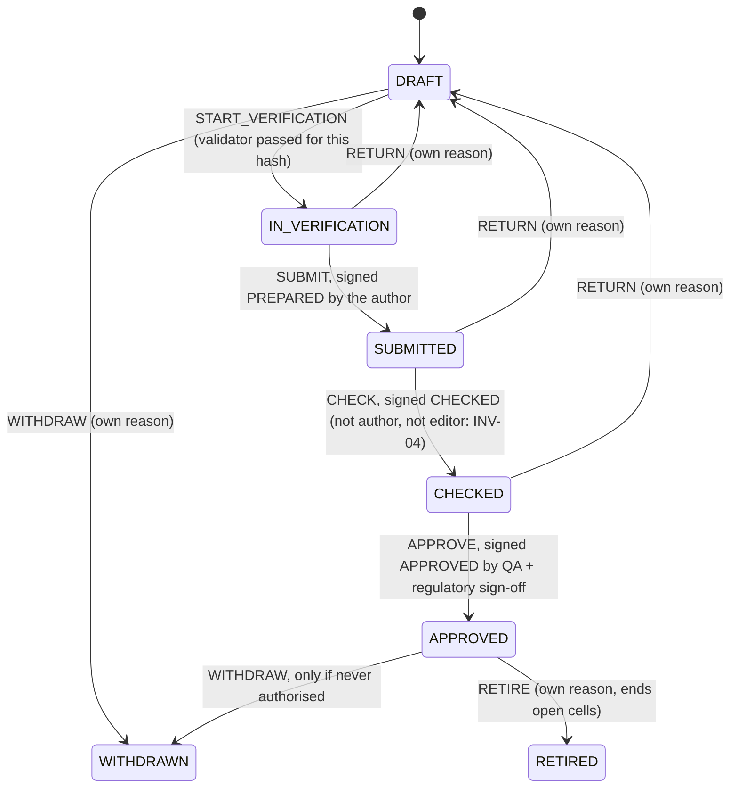

A market-authorisation cell, per market and scope:

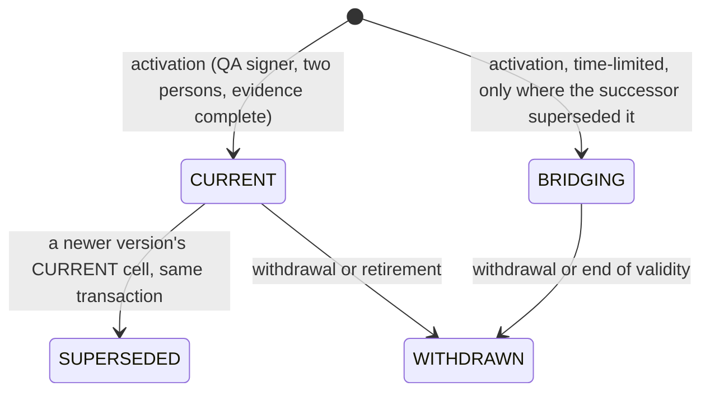

> **Why this exists**
> - **Pharma reason:** a batch must be made only to a master that is approved and valid for every market it is made
>   for; picking a version by hand invites using a superseded or unregistered recipe.
> - **Control:** [PR-04](../../../compliance/controls/PR-04.yaml), [PR-05](../../../compliance/controls/PR-05.yaml), invariants INV-01 and INV-17.
> - **Code:** [recipe.batch_mbr_pin_guard](../../../packages/recipe-core/sql/0170_batch_issue.sql#sym=recipe.batch_mbr_pin_guard) recomputes the selection at the issue instant whoever inserts the pin;
>   [recipe.authorisation_cell_insert_guard](../../../packages/recipe-core/sql/0160_market_authorisation.sql#sym=recipe.authorisation_cell_insert_guard) and [recipe.authorisation_cell_supersession_guard](../../../packages/recipe-core/sql/0383_market_activation_rows.sql#sym=recipe.authorisation_cell_supersession_guard) keep the cells
>   honest; exclusion constraints forbid overlapping CURRENT validities.
> - **Tests:** [market.test.ts](../../../packages/recipe-core/test/lifecycle/market.test.ts), [issue.test.ts](../../../packages/recipe-core/test/lifecycle/issue.test.ts), [selection.property.test.ts](../../../packages/recipe-core/test/lifecycle/selection.property.test.ts) (the pure model [selectVersion](../../../packages/recipe-core/src/lifecycle/selection.ts#sym=selectVersion) equals the SQL), [market-authorisation-and-issue.test.ts](../../../packages/recipe-core/test/mutation/market-authorisation-and-issue.test.ts).
> - **Error:** `EBMR-RCP-100` to `EBMR-RCP-102`, `EBMR-RCP-089`, `EBMR-RCP-092`.

> **Why this exists**
> - **Pharma reason:** the person who wrote a master must not be the one who checks or approves it, and a change after
>   a signature must void that signature.
> - **Control:** [PR-02](../../../compliance/controls/PR-02.yaml), [DI-37](../../../compliance/controls/DI-37.yaml), invariants INV-04 and INV-09.
> - **Code:** the version log written by triggers in [0110_mbr_family_version.sql](../../../packages/recipe-core/sql/0110_mbr_family_version.sql); the content provider [recipe.mbr_version_content](../../../packages/recipe-core/sql/0130_mbr_guards.sql#sym=recipe.mbr_version_content) signs the content hash and the key fields, and every table holding them is registered with the e-signature module, so a change supersedes the signatures in the same transaction.
> - **Tests:** [approval.test.ts](../../../packages/recipe-core/test/lifecycle/approval.test.ts), [machine.test.ts](../../../packages/recipe-core/test/lifecycle/machine.test.ts), [mbr-lifecycle.test.ts](../../../packages/recipe-core/test/mutation/mbr-lifecycle.test.ts).
> - **Error:** `EBMR-PLAT-068` (a machine guard), `EBMR-ESIG-*` from the kernel at signing.

> **Why this exists**
> - **Pharma reason:** every change to a GMP record carries the reason of the person who made it, both a code and a
>   text; software must not fill in a reason on someone's behalf.
> - **Control:** [DI-22](../../../compliance/controls/DI-22.yaml), [DI-24](../../../compliance/controls/DI-24.yaml).
> - **Code:** [recipe.require_own_reason](../../../packages/recipe-core/sql/0290_market_activation_reason.sql#sym=recipe.require_own_reason) (market-authorisation commands, 0290), [recipe.guard_draft_entry_recorded](../../../packages/recipe-core/sql/0301_visible_reason_text.sql#sym=recipe.guard_draft_entry_recorded) and [recipe.guard_never_authorised](../../../packages/recipe-core/sql/0301_visible_reason_text.sql#sym=recipe.guard_never_authorised) (0301).
> - **Tests:** [audit-reason.test.ts](../../../packages/recipe-core/test/lifecycle/audit-reason.test.ts), tests named `[DI-22]`.
> - **Error:** `EBMR-AUDIT-002`.

**How to test it.** `pnpm vitest run --project db packages/recipe-core/test/lifecycle`. The machine seed is checked
with `npx tsx packages/recipe-core/src/lifecycle/write-seeds.ts --check`.

**Pitfalls.**
- The SQL mutation run found market-authorisation cells that could be written around the activation command (D10,
  fixed by 0383) and a family-code refusal naming the wrong value (D14, 0384)
  ([defect log](../08-defect-log.md#d-series-sql-mutation-guards-that-could-not-fire)).
- A blank reason is not only the empty string: `kernel.is_blank` also treats zero-width and other invisible
  characters as blank (0301; [defect log](../08-defect-log.md#p2-f30-to-f33-nul-characters-and-lone-surrogates-in-free-text)).
- `recipe.stub_batch` is the Phase 2 stand-in for a batch; GMP batches use the execution store
  ([GMP batches](#gmp-batches-issue-and-packaging-orders)). Its number follows the sandbox identifier rule (0341).

**Every refusal in this area** (generated from the migrations, see the note at the top):

| Function | Refuses (code and message, shortened) | Controls | Tests that assert a code |
|---|---|---|---|
| [recipe.activate_market_authorisation](../../../packages/recipe-core/sql/0290_market_activation_reason.sql#sym=recipe.activate_market_authorisation) | `EBMR-RCP-082` The bridging window has already ended (INV-17<br>`EBMR-RCP-083` Unknown market authorisation …<br>`EBMR-RCP-085` The QA person who signed the authorisation activates it (DI-37<br>`EBMR-RCP-086` Version … is …: only an APPROVED version becomes CURRENT or BRIDGING (ADR 0014<br>`EBMR-RCP-087` The version has no complete verification record for its content (…); it cannot become effective for a …<br>`EBMR-RCP-088` The newer version … is CURRENT for … at …; an older version cannot supersede it (PR-05<br>`EBMR-RCP-089` The newer version … is CURRENT for … at …; an older version cannot supersede it (PR-05<br>`EBMR-RCP-090` BRIDGING is given only where the named successor superseded this version: not the case for … at … (ADR 0014<br>`EBMR-RCP-093` Version … remains valid for … at … until …; a new version can take effect for that scope only after it (INV-17 | [DI-37](../../../compliance/controls/DI-37.yaml), [DI-04](../../../compliance/controls/DI-04.yaml), [PR-05](../../../compliance/controls/PR-05.yaml), INV-17 | [concurrency.test.ts](../../../packages/recipe-core/test/lifecycle/concurrency.test.ts), [market.test.ts](../../../packages/recipe-core/test/lifecycle/market.test.ts) (+1) |
| [recipe.assert_draft](../../../packages/recipe-core/sql/0110_mbr_family_version.sql#sym=recipe.assert_draft) | `EBMR-RCP-021` This MBR version is …: … can change only in DRAFT; to change an approved master derive a new version (PR-06 | [PR-06](../../../compliance/controls/PR-06.yaml) | [change-control.test.ts](../../../packages/recipe-core/test/lifecycle/change-control.test.ts), [concurrency.test.ts](../../../packages/recipe-core/test/lifecycle/concurrency.test.ts) (+1) |
| [recipe.authorisation_cell_activation_guard](../../../packages/recipe-core/sql/0383_market_activation_rows.sql#sym=recipe.authorisation_cell_activation_guard)<br>trigger `a2_activation` on `recipe.authorisation_cell` | `EBMR-RCP-086` Version … is …: only an APPROVED version becomes CURRENT or BRIDGING (ADR 0014<br>`EBMR-RCP-089` A cell supersedes only the CURRENT cell of an earlier version of the same family, market and scope, which …<br>`EBMR-RCP-090` BRIDGING is given only where the named successor superseded this version: not the case for … at … (ADR 0014<br>`EBMR-RCP-092` A version becomes CURRENT or BRIDGING for a market only through an activated authorisation record with … | [PR-05](../../../compliance/controls/PR-05.yaml), INV-17 | [concurrency.test.ts](../../../packages/recipe-core/test/lifecycle/concurrency.test.ts), [market.test.ts](../../../packages/recipe-core/test/lifecycle/market.test.ts) (+1) |
| [recipe.authorisation_cell_insert_guard](../../../packages/recipe-core/sql/0160_market_authorisation.sql#sym=recipe.authorisation_cell_insert_guard)<br>trigger `a1_guard` on `recipe.authorisation_cell` | `EBMR-RCP-092` A version becomes CURRENT or BRIDGING for a market only through an activated authorisation record with … | [PR-04](../../../compliance/controls/PR-04.yaml), [PR-05](../../../compliance/controls/PR-05.yaml), INV-17 | [market.test.ts](../../../packages/recipe-core/test/lifecycle/market.test.ts), [market-authorisation-and-issue.test.ts](../../../packages/recipe-core/test/mutation/market-authorisation-and-issue.test.ts) |
| [recipe.authorisation_cell_supersession_guard](../../../packages/recipe-core/sql/0383_market_activation_rows.sql#sym=recipe.authorisation_cell_supersession_guard)<br>trigger `a2_supersession` on `recipe.authorisation_cell` | `EBMR-RCP-089` A cell is superseded only by its successor written after it in the same transaction, not by cell …, which … | [PR-05](../../../compliance/controls/PR-05.yaml), INV-17 | [concurrency.test.ts](../../../packages/recipe-core/test/lifecycle/concurrency.test.ts), [market.test.ts](../../../packages/recipe-core/test/lifecycle/market.test.ts) (+1) |
| [recipe.authorisation_cell_update_guard](../../../packages/recipe-core/sql/0160_market_authorisation.sql#sym=recipe.authorisation_cell_update_guard)<br>trigger `a1_guard_update` on `recipe.authorisation_cell` | `EBMR-RCP-091` Authorisation cells are never deleted (INV-17 | [PR-04](../../../compliance/controls/PR-04.yaml), [PR-05](../../../compliance/controls/PR-05.yaml), INV-17 | [market-authorisation-and-issue.test.ts](../../../packages/recipe-core/test/mutation/market-authorisation-and-issue.test.ts) |
| [recipe.batch_mbr_pin_guard](../../../packages/recipe-core/sql/0170_batch_issue.sql#sym=recipe.batch_mbr_pin_guard)<br>trigger `a1_guard` on `recipe.batch_mbr_pin` | `EBMR-RCP-100` Batch … cannot be issued. …<br>`EBMR-RCP-101` Batch … may use only version … of … at issue (…); version … is not valid for its markets now (PR-05; INV-01<br>`EBMR-RCP-102` Batch … is …; a batch is pinned once, at issue (INV-01<br>`EBMR-RCP-120` Unknown batch … | [PR-05](../../../compliance/controls/PR-05.yaml), INV-01 | [issue.test.ts](../../../packages/recipe-core/test/lifecycle/issue.test.ts), [market-authorisation-and-issue.test.ts](../../../packages/recipe-core/test/mutation/market-authorisation-and-issue.test.ts) |
| [recipe.build_control_recipe](../../../packages/recipe-core/sql/0170_batch_issue.sql#sym=recipe.build_control_recipe) | `EBMR-RCP-103` Unknown pin … | [PR-04](../../../compliance/controls/PR-04.yaml), [PR-05](../../../compliance/controls/PR-05.yaml), INV-01, INV-02, INV-28 | [market-authorisation-and-issue.test.ts](../../../packages/recipe-core/test/mutation/market-authorisation-and-issue.test.ts) |
| [recipe.canonical_batch_sizes](../../../packages/recipe-core/sql/0110_mbr_family_version.sql#sym=recipe.canonical_batch_sizes) | `EBMR-RCP-011` A family needs at least one approved batch size (PR-01 | [PR-01](../../../compliance/controls/PR-01.yaml) | [mbr-lifecycle.test.ts](../../../packages/recipe-core/test/mutation/mbr-lifecycle.test.ts) |
| [recipe.canonical_cells](../../../packages/recipe-core/sql/0160_market_authorisation.sql#sym=recipe.canonical_cells) | `EBMR-RCP-080` An authorisation names at least one scope cell {site, line, batch\_size} (ADR 0014 | [PR-04](../../../compliance/controls/PR-04.yaml), [PR-05](../../../compliance/controls/PR-05.yaml), INV-17 | [market.test.ts](../../../packages/recipe-core/test/lifecycle/market.test.ts), [market-authorisation-and-issue.test.ts](../../../packages/recipe-core/test/mutation/market-authorisation-and-issue.test.ts) |
| [recipe.content_roles_check](../../../packages/recipe-core/sql/0324_mbr_content_roles.sql#sym=recipe.content_roles_check)<br>trigger `a3_content_roles` on `recipe.mbr_content`, `recipe.test_package` | `EBMR-RCP-123` This MBR content is not stored: …. Every role a master names must be one a person can carry, and a QA hold … | [PR-45](../../../compliance/controls/PR-45.yaml), INV-26 | [roles.test.ts](../../../apps/tablets-server/test/designer/roles.test.ts), [db-guards-content-roles.test.ts](../../../apps/tablets-server/test/execution/db-guards-content-roles.test.ts) |
| [recipe.control_recipe_guard](../../../packages/recipe-core/sql/0170_batch_issue.sql#sym=recipe.control_recipe_guard)<br>trigger `a1_guard` on `recipe.control_recipe` | `EBMR-RCP-104` A control recipe belongs to its batch's pin (INV-02 | [PR-04](../../../compliance/controls/PR-04.yaml), [PR-05](../../../compliance/controls/PR-05.yaml), INV-02 | [market-authorisation-and-issue.test.ts](../../../packages/recipe-core/test/mutation/market-authorisation-and-issue.test.ts) |
| [recipe.create_stub_batch](../../../packages/recipe-core/sql/0170_batch_issue.sql#sym=recipe.create_stub_batch) | `EBMR-RCP-010` Unknown MBR family … | [PR-04](../../../compliance/controls/PR-04.yaml), [PR-05](../../../compliance/controls/PR-05.yaml), INV-01, INV-02, INV-28 | [authorization.test.ts](../../../packages/recipe-core/test/lifecycle/authorization.test.ts), [mbr-lifecycle.test.ts](../../../packages/recipe-core/test/mutation/mbr-lifecycle.test.ts) |
| [recipe.create_version](../../../packages/recipe-core/sql/0150_mbr_commands.sql#sym=recipe.create_version) | `EBMR-RCP-010` Unknown MBR family …<br>`EBMR-RCP-025` This family already has an approved version: derive the next version from it so the change is compared … | [PR-06](../../../compliance/controls/PR-06.yaml) | [authorization.test.ts](../../../packages/recipe-core/test/lifecycle/authorization.test.ts), [change-control.test.ts](../../../packages/recipe-core/test/lifecycle/change-control.test.ts) (+1) |
| [recipe.define_family](../../../packages/recipe-core/sql/0760_packaging_family_pack_type.sql#sym=recipe.define_family) | `EBMR-PLN-003` a … family names no pack type; only a packaging family does (D-P4-13) | [DI-18](../../../compliance/controls/DI-18.yaml), [DI-17](../../../compliance/controls/DI-17.yaml), [PR-06](../../../compliance/controls/PR-06.yaml), [PR-07](../../../compliance/controls/PR-07.yaml), [DI-04](../../../compliance/controls/DI-04.yaml) | [packaging-issue.test.ts](../../../packages/recipe-core/test/lifecycle/packaging-issue.test.ts) |
| [recipe.derive_version](../../../packages/recipe-core/sql/0150_mbr_commands.sql#sym=recipe.derive_version) | `EBMR-RCP-020` Unknown MBR version …<br>`EBMR-RCP-027` A new version states why it is needed (PR-06 | [PR-06](../../../compliance/controls/PR-06.yaml) | [market-authorisation-and-issue.test.ts](../../../packages/recipe-core/test/mutation/market-authorisation-and-issue.test.ts), [mbr-lifecycle.test.ts](../../../packages/recipe-core/test/mutation/mbr-lifecycle.test.ts) (+2) |
| [recipe.guard_draft_entry_recorded](../../../packages/recipe-core/sql/0301_visible_reason_text.sql#sym=recipe.guard_draft_entry_recorded) | `EBMR-AUDIT-002` the system writes no part of it (DI-22, DI-24 | [DI-22](../../../compliance/controls/DI-22.yaml), [DI-24](../../../compliance/controls/DI-24.yaml) |  |
| [recipe.guard_never_authorised](../../../packages/recipe-core/sql/0301_visible_reason_text.sql#sym=recipe.guard_never_authorised) | `EBMR-AUDIT-002` the system writes no part of it (DI-22, DI-24 | [DI-22](../../../compliance/controls/DI-22.yaml), [DI-24](../../../compliance/controls/DI-24.yaml) |  |
| [recipe.guard_no_open_authorisation](../../../packages/recipe-core/sql/0290_market_activation_reason.sql#sym=recipe.guard_no_open_authorisation) | `EBMR-AUDIT-002` the system writes no part of it (DI-22, DI-24 | [DI-22](../../../compliance/controls/DI-22.yaml), [DI-24](../../../compliance/controls/DI-24.yaml) |  |
| [recipe.guard_registered_ranges_kept](../../../packages/recipe-core/sql/0640_formulation_library.sql#sym=recipe.guard_registered_ranges_kept) | `EBMR-FRM-020` the formula version this MBR pins is …, not APPROVED: a formula is approved before the MBR that uses it, … | [PR-06](../../../compliance/controls/PR-06.yaml) | [formula.test.ts](../../../apps/tablets-server/test/master-data/formula.test.ts) |
| [recipe.in_flight_disposition_guard](../../../packages/recipe-core/sql/0170_batch_issue.sql#sym=recipe.in_flight_disposition_guard)<br>trigger `a1_guard` on `recipe.in_flight_disposition` | `EBMR-RCP-070` An in-flight disposition is recorded for a batch of an earlier version of the same family (ADR 0014<br>`EBMR-RCP-071` Batch … has started: CANCEL\_UNSTARTED applies only to a batch not yet started (ADR 0014 | [PR-04](../../../compliance/controls/PR-04.yaml), [PR-05](../../../compliance/controls/PR-05.yaml), INV-01, INV-02, INV-28 | [issue.test.ts](../../../packages/recipe-core/test/lifecycle/issue.test.ts), [market-authorisation-and-issue.test.ts](../../../packages/recipe-core/test/mutation/market-authorisation-and-issue.test.ts) |
| [recipe.issue_stub_batch](../../../packages/recipe-core/sql/0250_user_edit_own_reason.sql#sym=recipe.issue_stub_batch) | `EBMR-RCP-100` Batch … cannot be issued. …<br>`EBMR-RCP-102` Batch … is …; only a PLANNED batch is issued<br>`EBMR-RCP-120` Unknown batch … | [PR-04](../../../compliance/controls/PR-04.yaml), [PR-05](../../../compliance/controls/PR-05.yaml), INV-01, INV-02, INV-28 | [issue.test.ts](../../../packages/recipe-core/test/lifecycle/issue.test.ts), [market-authorisation-and-issue.test.ts](../../../packages/recipe-core/test/mutation/market-authorisation-and-issue.test.ts) |
| [recipe.link_risk_assessment](../../../packages/recipe-core/sql/0150_mbr_commands.sql#sym=recipe.link_risk_assessment) | `EBMR-RCP-020` Unknown MBR version …<br>`EBMR-RCP-061` Unknown risk assessment … (PR-07 | [PR-07](../../../compliance/controls/PR-07.yaml) | [market-authorisation-and-issue.test.ts](../../../packages/recipe-core/test/mutation/market-authorisation-and-issue.test.ts), [mbr-lifecycle.test.ts](../../../packages/recipe-core/test/mutation/mbr-lifecycle.test.ts) (+2) |
| [recipe.market_authorisation_activation_guard](../../../packages/recipe-core/sql/0383_market_activation_rows.sql#sym=recipe.market_authorisation_activation_guard)<br>trigger `a2_guard` on `recipe.market_authorisation_activation` | `EBMR-RCP-082` The bridging window has already ended (INV-17<br>`EBMR-RCP-083` Unknown market authorisation …<br>`EBMR-RCP-085` The QA person who signed the authorisation activates it (DI-37<br>`EBMR-RCP-086` Version … is …: only an APPROVED version becomes CURRENT or BRIDGING (ADR 0014<br>`EBMR-RCP-087` The version has no complete verification record for its content (…); it cannot become effective for a …<br>`EBMR-RCP-095` An activation takes effect at the latest of the requested date (…), the version's effective date (…) and … | [DI-37](../../../compliance/controls/DI-37.yaml), [DI-04](../../../compliance/controls/DI-04.yaml), [PR-02](../../../compliance/controls/PR-02.yaml), INV-17 | [market.test.ts](../../../packages/recipe-core/test/lifecycle/market.test.ts), [market-authorisation-and-issue.test.ts](../../../packages/recipe-core/test/mutation/market-authorisation-and-issue.test.ts) |
| [recipe.market_authorisation_guard](../../../packages/recipe-core/sql/0371_market_authorisation_family.sql#sym=recipe.market_authorisation_guard)<br>trigger `a1_guard` on `recipe.market_authorisation` | `EBMR-RCP-094` A market authorisation is recorded under its version's own family (INV-17 | [PR-04](../../../compliance/controls/PR-04.yaml), [PR-05](../../../compliance/controls/PR-05.yaml), INV-17 | [market-authorisation-and-issue.test.ts](../../../packages/recipe-core/test/mutation/market-authorisation-and-issue.test.ts) |
| [recipe.mbr_content_guard](../../../packages/recipe-core/sql/0110_mbr_family_version.sql#sym=recipe.mbr_content_guard)<br>trigger `a1_guard` on `recipe.mbr_content` | `EBMR-RCP-020` Unknown MBR version …<br>`EBMR-RCP-022` The content hash … does not match the canonical hash … computed by the database; nothing was saved (DI-04<br>`EBMR-RCP-023` The content does not belong to family …: … | [DI-04](../../../compliance/controls/DI-04.yaml) | [market-authorisation-and-issue.test.ts](../../../packages/recipe-core/test/mutation/market-authorisation-and-issue.test.ts), [mbr-lifecycle.test.ts](../../../packages/recipe-core/test/mutation/mbr-lifecycle.test.ts) (+3) |
| [recipe.mbr_draft_entry_guard](../../../packages/recipe-core/sql/0110_mbr_family_version.sql#sym=recipe.mbr_draft_entry_guard)<br>trigger `a1_guard` on `recipe.mbr_draft_entry` | `EBMR-RCP-026` A return to DRAFT names the state it returns from | [PR-06](../../../compliance/controls/PR-06.yaml), [DI-37](../../../compliance/controls/DI-37.yaml), [PR-04](../../../compliance/controls/PR-04.yaml), [PR-07](../../../compliance/controls/PR-07.yaml), INV-04, INV-09 | [mbr-lifecycle.test.ts](../../../packages/recipe-core/test/mutation/mbr-lifecycle.test.ts) |
| [recipe.mbr_evidence_guard](../../../packages/recipe-core/sql/0120_mbr_evidence.sql#sym=recipe.mbr_evidence_guard)<br>trigger `a1_guard` on `recipe.mbr_evidence` | `EBMR-RCP-020` Unknown MBR version …<br>`EBMR-RCP-040` Verification evidence is recorded only in DRAFT or IN\_VERIFICATION; this version is … (DI-04<br>`EBMR-RCP-041` Unknown kind of verification evidence …: VALIDATOR, VERIFICATION, TEST\_VECTORS or SANDBOX\_RUN (DI-04 | [DI-04](../../../compliance/controls/DI-04.yaml) | [market-authorisation-and-issue.test.ts](../../../packages/recipe-core/test/mutation/market-authorisation-and-issue.test.ts), [mbr-lifecycle.test.ts](../../../packages/recipe-core/test/mutation/mbr-lifecycle.test.ts) (+2) |
| [recipe.mbr_family_pack_guard](../../../packages/recipe-core/sql/0760_packaging_family_pack_type.sql#sym=recipe.mbr_family_pack_guard)<br>trigger `a1_guard` on `recipe.mbr_family_pack` | `EBMR-PLN-001` family … is no packaging family: only a packaging family has a pack type (D-P4-13) | [PR-01](../../../compliance/controls/PR-01.yaml), INV-17 |  |
| [recipe.mbr_family_pack_required](../../../packages/recipe-core/sql/0760_packaging_family_pack_type.sql#sym=recipe.mbr_family_pack_required)<br>trigger `a2_pack_type` on `recipe.mbr_family` | `EBMR-PLN-002` packaging family … has no pack type: a packaging family is defined with its pack type, part of its … | [PR-01](../../../compliance/controls/PR-01.yaml) |  |
| [recipe.mbr_risk_link_guard](../../../packages/recipe-core/sql/0110_mbr_family_version.sql#sym=recipe.mbr_risk_link_guard)<br>trigger `a1_guard` on `recipe.mbr_risk_link` | `EBMR-RCP-061` Risk-assessment subjects are parameter or calculation ids (PR-07 | [PR-07](../../../compliance/controls/PR-07.yaml) | [mbr-lifecycle.test.ts](../../../packages/recipe-core/test/mutation/mbr-lifecycle.test.ts) |
| [recipe.mbr_version_guard](../../../packages/recipe-core/sql/0110_mbr_family_version.sql#sym=recipe.mbr_version_guard)<br>trigger `a1_guard` on `recipe.mbr_version` | `EBMR-RCP-024` The identity of an MBR version (family, number, author, predecessor) never changes (PR-05 | [PR-05](../../../compliance/controls/PR-05.yaml) | [approval.test.ts](../../../packages/recipe-core/test/lifecycle/approval.test.ts), [mbr-lifecycle.test.ts](../../../packages/recipe-core/test/mutation/mbr-lifecycle.test.ts) |
| [recipe.propose_market_authorisation](../../../packages/recipe-core/sql/0160_market_authorisation.sql#sym=recipe.propose_market_authorisation) | `EBMR-RCP-020` Unknown MBR version …<br>`EBMR-RCP-081` The master is not linked to market …: its market set is …, so it cannot be authorised there (PR-04<br>`EBMR-RCP-082` An authorisation is CURRENT or BRIDGING (ADR 0014<br>`EBMR-RCP-086` Version … is …: only an APPROVED version can be authorised for a market (ADR 0014 | [PR-04](../../../compliance/controls/PR-04.yaml) | [market.test.ts](../../../packages/recipe-core/test/lifecycle/market.test.ts), [market-authorisation-and-issue.test.ts](../../../packages/recipe-core/test/mutation/market-authorisation-and-issue.test.ts) (+3) |
| [recipe.record_change_record](../../../packages/recipe-core/sql/0150_mbr_commands.sql#sym=recipe.record_change_record) | `EBMR-RCP-060` A change record states whether the change affects the process (PR-06 | [PR-06](../../../compliance/controls/PR-06.yaml) | [mbr-lifecycle.test.ts](../../../packages/recipe-core/test/mutation/mbr-lifecycle.test.ts) |
| [recipe.record_evidence](../../../packages/recipe-core/sql/0150_mbr_commands.sql#sym=recipe.record_evidence) | `EBMR-RCP-020` Unknown MBR version … | [DI-18](../../../compliance/controls/DI-18.yaml), [DI-17](../../../compliance/controls/DI-17.yaml), [PR-06](../../../compliance/controls/PR-06.yaml), [PR-07](../../../compliance/controls/PR-07.yaml), [DI-04](../../../compliance/controls/DI-04.yaml) | [market-authorisation-and-issue.test.ts](../../../packages/recipe-core/test/mutation/market-authorisation-and-issue.test.ts), [mbr-lifecycle.test.ts](../../../packages/recipe-core/test/mutation/mbr-lifecycle.test.ts) (+2) |
| [recipe.record_in_flight_disposition](../../../packages/recipe-core/sql/0170_batch_issue.sql#sym=recipe.record_in_flight_disposition) | `EBMR-RCP-020` Unknown MBR version … | [PR-04](../../../compliance/controls/PR-04.yaml), [PR-05](../../../compliance/controls/PR-05.yaml), INV-01, INV-02, INV-28 | [market-authorisation-and-issue.test.ts](../../../packages/recipe-core/test/mutation/market-authorisation-and-issue.test.ts), [mbr-lifecycle.test.ts](../../../packages/recipe-core/test/mutation/mbr-lifecycle.test.ts) (+2) |
| [recipe.record_periodic_review](../../../packages/recipe-core/sql/0180_review_inventory_invariants.sql#sym=recipe.record_periodic_review) | `EBMR-RCP-020` Unknown MBR version …<br>`EBMR-RCP-072` A periodic review is recorded for an APPROVED version; this one is … (PR-05 | [PR-05](../../../compliance/controls/PR-05.yaml) | [review-inventory.test.ts](../../../packages/recipe-core/test/lifecycle/review-inventory.test.ts), [market-authorisation-and-issue.test.ts](../../../packages/recipe-core/test/mutation/market-authorisation-and-issue.test.ts) (+3) |
| [recipe.require_actor](../../../packages/recipe-core/sql/0100_recipe_foundation.sql#sym=recipe.require_actor) | `EBMR-RCP-001` No validated command: every recipe change runs inside a command started with kernel.begin\_command (INV-07 | [PR-02](../../../compliance/controls/PR-02.yaml), [PR-04](../../../compliance/controls/PR-04.yaml), [PR-05](../../../compliance/controls/PR-05.yaml), [PR-06](../../../compliance/controls/PR-06.yaml), [PR-07](../../../compliance/controls/PR-07.yaml), INV-07 | [mbr-lifecycle.test.ts](../../../packages/recipe-core/test/mutation/mbr-lifecycle.test.ts) |
| [recipe.require_own_reason](../../../packages/recipe-core/sql/0290_market_activation_reason.sql#sym=recipe.require_own_reason) | `EBMR-AUDIT-002` … needs the reason of the person who gives it: a reason code and a reason text, neither blank | [DI-22](../../../compliance/controls/DI-22.yaml), [DI-24](../../../compliance/controls/DI-24.yaml) |  |
| [recipe.save_content](../../../packages/recipe-core/sql/0150_mbr_commands.sql#sym=recipe.save_content) | `EBMR-RCP-020` Unknown MBR version … | [DI-18](../../../compliance/controls/DI-18.yaml), [DI-17](../../../compliance/controls/DI-17.yaml), [PR-06](../../../compliance/controls/PR-06.yaml), [PR-07](../../../compliance/controls/PR-07.yaml), [DI-04](../../../compliance/controls/DI-04.yaml) | [market-authorisation-and-issue.test.ts](../../../packages/recipe-core/test/mutation/market-authorisation-and-issue.test.ts), [mbr-lifecycle.test.ts](../../../packages/recipe-core/test/mutation/mbr-lifecycle.test.ts) (+2) |
| [recipe.set_draft_attributes](../../../packages/recipe-core/sql/0250_user_edit_own_reason.sql#sym=recipe.set_draft_attributes) | `EBMR-RCP-020` Unknown MBR version …<br>`EBMR-RCP-028` … is not a draft attribute of an MBR version<br>`EBMR-RCP-060` Unknown change record … (PR-06 | [PR-06](../../../compliance/controls/PR-06.yaml) | [market-authorisation-and-issue.test.ts](../../../packages/recipe-core/test/mutation/market-authorisation-and-issue.test.ts), [mbr-lifecycle.test.ts](../../../packages/recipe-core/test/mutation/mbr-lifecycle.test.ts) (+2) |
| [recipe.set_stub_batch_status](../../../packages/recipe-core/sql/0250_user_edit_own_reason.sql#sym=recipe.set_stub_batch_status) | `EBMR-RCP-120` Unknown batch …<br>`EBMR-RCP-122` A batch is issued through recipe.issue\_stub\_batch (INV-01 | [PR-04](../../../compliance/controls/PR-04.yaml), [PR-05](../../../compliance/controls/PR-05.yaml), INV-01 | [issue.test.ts](../../../packages/recipe-core/test/lifecycle/issue.test.ts), [market-authorisation-and-issue.test.ts](../../../packages/recipe-core/test/mutation/market-authorisation-and-issue.test.ts) |
| [recipe.stub_batch_guard](../../../packages/recipe-core/sql/0170_batch_issue.sql#sym=recipe.stub_batch_guard)<br>trigger `a1_guard` on `recipe.stub_batch` | `EBMR-RCP-120` Batches are never deleted<br>`EBMR-RCP-121` A batch cannot go from … to …<br>`EBMR-RCP-122` A batch is ISSUED only with its pinned MBR version and control-recipe snapshot (INV-01; INV-02 | [PR-04](../../../compliance/controls/PR-04.yaml), [PR-05](../../../compliance/controls/PR-05.yaml), INV-01, INV-02 | [issue.test.ts](../../../packages/recipe-core/test/lifecycle/issue.test.ts), [market-authorisation-and-issue.test.ts](../../../packages/recipe-core/test/mutation/market-authorisation-and-issue.test.ts) |
| [recipe.unlink_risk_assessment](../../../packages/recipe-core/sql/0150_mbr_commands.sql#sym=recipe.unlink_risk_assessment) | `EBMR-RCP-020` Unknown MBR version …<br>`EBMR-RCP-061` That risk assessment is not linked to this version (PR-07 | [PR-07](../../../compliance/controls/PR-07.yaml) | [market-authorisation-and-issue.test.ts](../../../packages/recipe-core/test/mutation/market-authorisation-and-issue.test.ts), [mbr-lifecycle.test.ts](../../../packages/recipe-core/test/mutation/mbr-lifecycle.test.ts) (+2) |
| [recipe.withdraw_market_authorisation](../../../packages/recipe-core/sql/0290_market_activation_reason.sql#sym=recipe.withdraw_market_authorisation) | `EBMR-RCP-083` Unknown market authorisation …<br>`EBMR-RCP-084` A withdrawal states its reason | [PR-04](../../../compliance/controls/PR-04.yaml), [PR-05](../../../compliance/controls/PR-05.yaml), INV-17 | [audit-reason.test.ts](../../../packages/recipe-core/test/lifecycle/audit-reason.test.ts), [market.test.ts](../../../packages/recipe-core/test/lifecycle/market.test.ts) (+1) |

## Execution store and engine

**What it does.** Runs a batch. The pure engine ([engine/README.md](../../../packages/recipe-core/src/engine/README.md))
decides which step is enabled, who may start, record, sign or verify it, what a value means against its limits and
when the batch is complete. The execution store ([execution/README.md](../../../packages/recipe-core/src/execution/README.md),
1,400 lines, the reference for every guard) writes down what the engine decided, one row per engine call, and
re-checks it in the database.

- [defineBatch](../../../packages/recipe-core/src/engine/definition.ts#sym=defineBatch) compiles the pinned MBR once and refuses what the
  engine cannot run safely (a step with neither performer nor checker, INV-31, and others).
- [createEngine](../../../packages/recipe-core/src/engine/engine.ts#sym=createEngine) gives `issue`, `step(state, command, clock)` and
  `sweep` (the time sweeper, INV-20). Commands: START_STEP, RECORD_DATA, RECORD_ENTRY, SIGN_PERFORMED, VERIFY,
  CHOOSE_ALTERNATIVE, REQUEST_SKIP, DISPOSITION_HOLD_POINT, SIGN_OFF_STAGE, RAISE_EXCEPTION, ATTACH_DEVIATION,
  DISPOSITION_EXCEPTION, HOLD_BATCH, RELEASE_HOLD, CORRECT_ENTRY, VOID_ATTEMPT, INVALIDATE_RESULT, ABORT_BATCH,
  CANCEL_BATCH, HAND_OVER_STEP, TAKE_OVER_STEP and a few more. A refusal has an engine rule code (`ENG-...`) and a
  plain-language message.
- [ExecutionTx](../../../packages/recipe-core/src/execution/run.ts#sym=ExecutionTx) opens a batch under a lock with the database's trusted
  time (INV-16), runs a command and writes the row. Replay ([verify.ts](../../../packages/recipe-core/src/execution/verify.ts))
  re-runs every stored row through the engine and reports the first difference (ADR 0010).
- In the database: [recipe.batch_execution](../../../packages/recipe-core/sql/0200_execution_store.sql#sym=recipe.batch_execution) (one row per batch, test or GMP), [recipe.execution_command](../../../packages/recipe-core/sql/0200_execution_store.sql#sym=recipe.execution_command)
  (one row per engine call, gapless sequence, hash chain), [recipe.execution_event](../../../packages/recipe-core/sql/0200_execution_store.sql#sym=recipe.execution_event), [recipe.execution_state](../../../packages/recipe-core/sql/0200_execution_store.sql#sym=recipe.execution_state)
  (the projection) and four signable content tables, one per aggregate (step, stage, exception, hold point). The
  writer is [recipe.append_execution](../../../packages/recipe-core/sql/0295_signed_decisions.sql#sym=recipe.append_execution); issue is [recipe.issue_execution](../../../packages/recipe-core/sql/0501_gmp_batch_issue.sql#sym=recipe.issue_execution).
- A *test run* (TEST- batch, sandbox) and a *GMP batch* share these tables; GMP issue is in
  [GMP batches](#gmp-batches-issue-and-packaging-orders). The sandbox rules (no real-format identifiers in a test run,
  0344 to 0350) are explained in [the defect log](../08-defect-log.md#test-mode-isolation-p2-f12-eight-rounds).

**Pharma context.** The executed batch record must show that each significant step was done as the master says, by
whom and when, with a second person checking the critical ones (21 CFR 211.188 and 211.101; EU GMP 4.20; Schedule M
batch processing record). The order of operations is enforced (sequencing checks, 21 CFR 211.100;
[DI-34](../../../compliance/controls/DI-34.yaml)). Data are recorded at the time of the act with a trusted time
(ALCOA+; [DI-27](../../../compliance/controls/DI-27.yaml), [DI-28](../../../compliance/controls/DI-28.yaml)). Every
attempt, repeat and invalidated result is kept ([DI-29](../../../compliance/controls/DI-29.yaml)).

**Controls.** DI-05, DI-34, DI-35, DI-37, PR-08, PR-13, PR-14, PR-16, PR-30; invariants INV-03 (checker not the
performer), INV-09 (a change supersedes signatures), INV-10, INV-16, INV-18, INV-19, INV-20, INV-25 (computed values
are never typed), INV-26, INV-40.

### Step and batch states

A step instance (keyed `step@context`, the context being the loop iteration and sub-lot) moves only along this
machine. The engine enforces it in `guards.ts` and `steps.ts`; the database enforces it with
[recipe.execution_step_status_check](../../../packages/recipe-core/sql/0311_step_status_transitions.sql#sym=recipe.execution_step_status_check) (trigger `zf_execution_step_status`, 0311) and
[recipe.execution_step_order_check](../../../packages/recipe-core/sql/0502_gmp_batch_content_readers.sql#sym=recipe.execution_step_order_check) (trigger `zd_execution_step_order`, 0307: an instance appears only where the
token can have reached it).

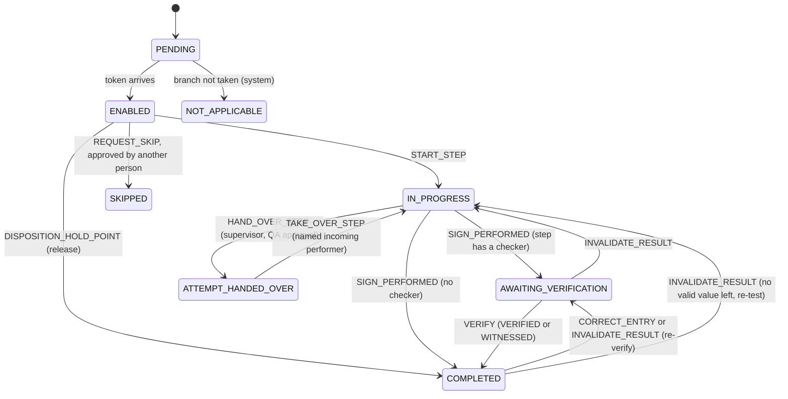

NOT_APPLICABLE and SKIPPED never change again, and nothing goes back to ENABLED. The batch itself
(`BatchStatus` in [engine/types.ts](../../../packages/recipe-core/src/engine/types.ts)):

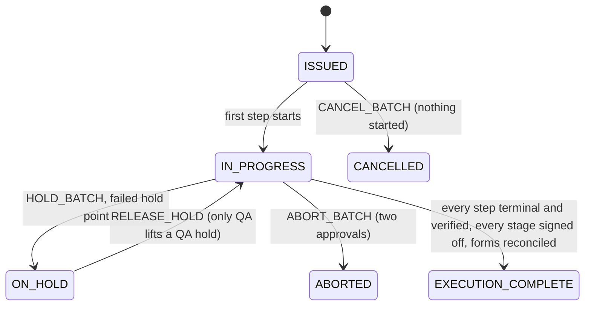

### The trigger chain on a stored row

Every row the store writes passes these triggers (PostgreSQL fires triggers of one event in name order, so the
prefixes `a`, `z`, `zz`, `zzz` set the order). Each is a refusal point; the table below lists the codes.

| Trigger | On | Checks |
|---|---|---|
| [a0_record_lock](../../../packages/recipe-core/sql/0870_record_lock.sql#sym=a0_record_lock) | command, state | the record is not locked ([record lock](#record-lock-and-amendment)) |
| [a1_form_reconciliation](../../../packages/recipe-core/sql/0911_execution_complete_form_gate.sql#sym=a1_form_reconciliation) | state (status) | EXECUTION_COMPLETE only with contingency forms reconciled (0911, [DI-43](../../../compliance/controls/DI-43.yaml)) |
| [ab_execution_source_room](../../../packages/recipe-core/sql/0285_evidence_source.sql#sym=ab_execution_source_room), [ab_execution_stale_command](../../../packages/recipe-core/sql/0326_stale_command_rows.sql#sym=ab_execution_stale_command) | command | value source and terminal room; a command from a stale screen |
| [ad_plant_status_entry](../../../packages/recipe-core/sql/0521_status_v2_plant_binding.sql#sym=ad_plant_status_entry) | command | G-09@2 and G-10@2 entries match the plant status |
| [ae_execution_disposition_involvement](../../../packages/recipe-core/sql/0310_involvement_from_rows.sql#sym=ae_execution_disposition_involvement) | command | the person dispositioning an exception was not involved in its step |
| [zz_execution_attribution](../../../packages/recipe-core/sql/0210_execution_writers.sql#sym=zz_execution_attribution), [zz_execution_row_shape](../../../packages/recipe-core/sql/0335_execution_row_shape.sql#sym=zz_execution_row_shape), [zz_execution_row_refusal](../../../packages/recipe-core/sql/0336_execution_refusal_shape.sql#sym=zz_execution_row_refusal), [zz_execution_row_shape_approver](../../../packages/recipe-core/sql/0340_approval_roles.sql#sym=zz_execution_row_shape_approver), [zz_execution_row_shape_approver_person](../../../packages/recipe-core/sql/0342_approval_person.sql#sym=zz_execution_row_shape_approver_person), [zz_execution_row_start_data](../../../packages/recipe-core/sql/0345_start_data_and_status_equipment.sql#sym=zz_execution_row_start_data) | command | who acted, the exact command shape, the refusal as the engine builds it, approvers' roles and identity, start data |
| [zz_execution_system_facts](../../../packages/recipe-core/sql/0280_system_facts.sql#sym=zz_execution_system_facts) | state | what the system recorded inside a person's call is the system's act (0280, 0299) |
| [zb_execution_state_binding](../../../packages/recipe-core/sql/0300_evidence_state_binding.sql#sym=zb_execution_state_binding), [zc_execution_recorded_state](../../../packages/recipe-core/sql/0303_recorded_state_binding.sql#sym=zc_execution_recorded_state) | state | the state stored is the one the command produces; recorded facts stay recorded |
| [zd_execution_step_order](../../../packages/recipe-core/sql/0307_step_order.sql#sym=zd_execution_step_order), [ze_execution_step_acts](../../../packages/recipe-core/sql/0308_step_act_guards.sql#sym=ze_execution_step_acts), [zf_execution_step_status](../../../packages/recipe-core/sql/0311_step_status_transitions.sql#sym=zf_execution_step_status), [zg_execution_own_node_events](../../../packages/recipe-core/sql/0312_own_node_events.sql#sym=zg_execution_own_node_events) | state | token order; minimum durations and blocking exceptions; status changes; start and end events |
| [zh_execution_entry_data](../../../packages/recipe-core/sql/0313_entry_data_binding.sql#sym=zh_execution_entry_data), [zj_execution_container_entry](../../../packages/recipe-core/sql/0317_container_entry_binding.sql#sym=zj_execution_container_entry), [zk_execution_stage_summary](../../../packages/recipe-core/sql/0319_stage_summary_content.sql#sym=zk_execution_stage_summary), [zl_execution_weighing_net](../../../packages/recipe-core/sql/0321_weighing_net_resolution.sql#sym=zl_execution_weighing_net), [zm_execution_weighing_record](../../../packages/recipe-core/sql/0322_weighing_label_and_total.sql#sym=zm_execution_weighing_record), [zm_execution_weighing_item](../../../packages/recipe-core/sql/0323_weighing_counted_item.sql#sym=zm_execution_weighing_item) | state | entries hold what the command sent; containers; stage summary signed; net = gross - tare exactly |
| [zzb_execution_exception_source](../../../packages/recipe-core/sql/0327_exception_source_step.sql#sym=zzb_execution_exception_source), [zzc_execution_entry_references](../../../packages/recipe-core/sql/0328_entry_mbr_references.sql#sym=zzc_execution_entry_references), [zzd_execution_entry_block](../../../packages/recipe-core/sql/0330_entry_block_data.sql#sym=zzd_execution_entry_block), [zze_execution_entry_schema](../../../packages/recipe-core/sql/0332_entry_block_schema.sql#sym=zze_execution_entry_schema) | state | exception raised at the right step; entries name only what the MBR names and meet the block's schema |
| [zzf_execution_late_check](../../../packages/recipe-core/sql/0333_late_witness_review.sql#sym=zzf_execution_late_check), [zzg_execution_step_times](../../../packages/recipe-core/sql/0334_step_times_and_witness_window.sql#sym=zzg_execution_step_times) | state | late witness completed by review; step times and witness window |
| [zzh_execution_row_context](../../../packages/recipe-core/sql/0338_row_context_and_content_versions.sql#sym=zzh_execution_row_context), [zzi_execution_state_engine_version](../../../packages/recipe-core/sql/0338_row_context_and_content_versions.sql#sym=zzi_execution_state_engine_version), [zzj_execution_state_records](../../../packages/recipe-core/sql/0339_state_record_names.sql#sym=zzj_execution_state_records), [zzk_execution_act_target](../../../packages/recipe-core/sql/0343_exception_and_hold_targets.sql#sym=zzk_execution_act_target), [zzl_execution_status_equipment](../../../packages/recipe-core/sql/0345_start_data_and_status_equipment.sql#sym=zzl_execution_status_equipment), [zzm_execution_signature_invalidation](../../../packages/recipe-core/sql/0382_signature_invalidation_rows.sql#sym=zzm_execution_signature_invalidation) | state | context, engine version, record names, act targets, status equipment, signature invalidation only where the engine does it |
| [zzn_execution_change_paths](../../../packages/recipe-core/sql/0452_change_path_guards.sql#sym=zzn_execution_change_paths), [zzo_execution_hand_over](../../../packages/recipe-core/sql/0463_hand_over_guards.sql#sym=zzo_execution_hand_over) | state | [change paths and hand-over](#change-paths-approvals-and-hand-over) |
| [zzr_exception_register](../../../packages/recipe-core/sql/0440_exception_register.sql#sym=zzr_exception_register) | state | the [exception register](#exceptions-and-limits) follows the state |
| [zr_g21](../../../packages/recipe-core/sql/0581_g21_guards.sql#sym=zr_g21), [zr_g24_v1_gmp](../../../packages/recipe-core/sql/0620_g24_database_path.sql#sym=zr_g24_v1_gmp), [zr_g24v2](../../../packages/recipe-core/sql/0622_source_addition_guards.sql#sym=zr_g24v2) | state | block rules of G-21 and G-24 |
| [zzs_execution_consumption_entries](../../../packages/recipe-core/sql/0700_consumption_guards.sql#sym=zzs_execution_consumption_entries), [zzt_execution_batch_end](../../../packages/recipe-core/sql/0700_consumption_guards.sql#sym=zzt_execution_batch_end) | state | consumption matches entries; reservations end with the batch |
| [zzzr_execution_review_freeze](../../../packages/recipe-core/sql/0713_review_freeze.sql#sym=zzzr_execution_review_freeze) | state | nothing changes while the record is in review |
| [zzz_sandbox_free_text](../../../packages/recipe-core/sql/0344_sandbox_free_text_identifiers.sql#sym=zzz_sandbox_free_text) | command, state | no real-format identifiers in a test run |
| [zzze_epoch_command](../../../packages/recipe-core/sql/0714_evidence_epoch_triggers.sql#sym=zzze_epoch_command) | command | bumps the batch's evidence epoch |

> **Why this exists**
> - **Pharma reason:** a step must not start before the steps before it are finished (for example, dispensing before
>   the line clearance), or material can go into a line that was not cleared.
> - **Control:** [DI-34](../../../compliance/controls/DI-34.yaml), [PR-13](../../../compliance/controls/PR-13.yaml), invariant INV-18.
> - **Code:** [recipe.execution_step_order_check](../../../packages/recipe-core/sql/0502_gmp_batch_content_readers.sql#sym=recipe.execution_step_order_check) and [recipe.execution_step_status_check](../../../packages/recipe-core/sql/0311_step_status_transitions.sql#sym=recipe.execution_step_status_check); the engine side is [guards.ts](../../../packages/recipe-core/src/engine/guards.ts).
> - **Tests:** [step-order-sql.test.ts](../../../packages/recipe-core/test/execution/step-order-sql.test.ts), [step-status-sql.test.ts](../../../packages/recipe-core/test/execution/step-status-sql.test.ts), [db-guards-step-order.test.ts](../../../apps/tablets-server/test/execution/db-guards-step-order.test.ts), tests named `[DI-34]`.
> - **Error:** `EBMR-EXE-129`, `EBMR-EXE-132`.

> **Why this exists**
> - **Pharma reason:** a step with a minimum time (a mixing time, a drying time) must not be signed before the time
>   has passed, and a step blocked by an open action-limit breach waits for its deviation or QA decision.
> - **Control:** [PR-30](../../../compliance/controls/PR-30.yaml), [PR-08](../../../compliance/controls/PR-08.yaml), invariant INV-20.
> - **Code:** [recipe.execution_step_acts_check](../../../packages/recipe-core/sql/0502_gmp_batch_content_readers.sql#sym=recipe.execution_step_acts_check) (trigger `ze_execution_step_acts`, 0308; the version in force is 0502's, which reads GMP content too).
> - **Tests:** [step-acts-sql.test.ts](../../../packages/recipe-core/test/execution/step-acts-sql.test.ts), [db-guards-step-acts.test.ts](../../../apps/tablets-server/test/execution/db-guards-step-acts.test.ts).
> - **Error:** `EBMR-EXE-130`, `EBMR-EXE-131`.

> **Why this exists**
> - **Pharma reason:** a weighed net quantity must be gross minus tare, exactly; a typed net is a classic way to hide
>   a weighing error.
> - **Control:** [DI-33](../../../compliance/controls/DI-33.yaml), [PR-19](../../../compliance/controls/PR-19.yaml), invariant INV-25.
> - **Code:** [recipe.execution_weighing_net_check](../../../packages/recipe-core/sql/0321_weighing_net_resolution.sql#sym=recipe.execution_weighing_net_check), [recipe.execution_weighing_record_check](../../../packages/recipe-core/sql/0502_gmp_batch_content_readers.sql#sym=recipe.execution_weighing_record_check), [recipe.execution_weighing_item_check](../../../packages/recipe-core/sql/0502_gmp_batch_content_readers.sql#sym=recipe.execution_weighing_item_check) (0321 to 0323).
> - **Tests:** [weighing-item-sql.test.ts](../../../packages/recipe-core/test/execution/weighing-item-sql.test.ts), [weighed-units-sql.test.ts](../../../packages/recipe-core/test/execution/weighed-units-sql.test.ts), [db-guards-weighing-net.test.ts](../../../apps/tablets-server/test/execution/db-guards-weighing-net.test.ts).
> - **Error:** `EBMR-EXE-136` to `EBMR-EXE-139`.

> **Why this exists**
> - **Pharma reason:** a batch is complete only when every paper contingency form used during a system outage is
>   reconciled into the electronic record; otherwise part of the record lives on paper nobody reviewed.
> - **Control:** [DI-43](../../../compliance/controls/DI-43.yaml), [PR-16](../../../compliance/controls/PR-16.yaml).
> - **Code:** [recipe.refuse_unreconciled_completion](../../../packages/recipe-core/sql/0911_execution_complete_form_gate.sql#sym=recipe.refuse_unreconciled_completion) (trigger `a1_form_reconciliation`, 0911).
> - **Tests:** [execution-complete-forms.test.ts](../../../packages/recipe-core/test/lifecycle/execution-complete-forms.test.ts), [records-contingency-forms.test.ts](../../../packages/recipe-core/test/mutation/records-contingency-forms.test.ts).
> - **Error:** `EBMR-EXE-310`.

**Signatures in the store.** Each signed command carries e-signatures made by the kernel in the same transaction
(0297). [recipe.check_signatures](../../../packages/recipe-core/sql/0471_approved_act_signatures.sql#sym=recipe.check_signatures) accepts a signature only with the meaning the step asks for (0296: exactly the
block's perform or check meaning), on the content version the row acts on, and never one whose validity flag is
missing (0381). A row invalidates a recorded signature only where the engine does (0382). See
[architecture section 9](../03-architecture.md#9-e-signatures) for the kernel side.

**Errors raised in TypeScript.** [run.ts](../../../packages/recipe-core/src/execution/run.ts) and
[store.ts](../../../packages/recipe-core/src/execution/store.ts) refuse before the database is asked, with
`ExecutionStoreError`: `EBMR-EXE-060` (definition runs another MBR content than the pin), `EBMR-EXE-061` (another
engine version, ADR 0010), `EBMR-EXE-062` (other block versions), `EBMR-EXE-063` (other policy), `EBMR-EXE-064`
(definition made for the other installation, sandbox or GMP: DI-05, INV-18), `EBMR-EXE-024` (command applied
already), `EBMR-EXE-010` (no stored state), `EBMR-EXE-192` (control recipe holds no content).

**How to test it.** `packages/recipe-core/test/engine/` (pure engine: flow, loops, corrections, segregation,
agreement property test), `packages/recipe-core/test/execution/` (`*-sql.test.ts` compare the SQL guard with the
engine's own runs), and the attack tests `apps/tablets-server/test/execution/db-guards-*.test.ts` (raw SQL through
the application role must be refused). Mutation kill tests: `packages/recipe-core/test/mutation/execution-*.test.ts`.

**Pitfalls.**
- The engine walks the flow; the database must independently refuse any row the walk would not produce. Before 0307
  a row could enable a step ahead of the token ([P2-F66](../08-defect-log.md#p2-f66-critic-reproduced-the-database-let-a-step-start-that-the-token-could-not-have-reached)).
- Minimum durations and exception blocks were held only by the engine before 0308
  ([P2-F67](../08-defect-log.md#p2-f67-minimum-durations-and-exception-blocks-held-only-by-the-engine)).
- A late witness used to leave the run stuck for good; since 0333 the step is completed by its later review, which
  raises WITNESS_LATE for QA ([defect log](../08-defect-log.md#p2-t12late-and-t12doc-a-late-witness-stuck-the-run)).
  Every refusal must leave the run a way forward.
- A proposed QA decision must be serialised with every signing of its record (0309, 0329, 0331: READ COMMITTED only);
  see [P2-F37](../08-defect-log.md#p2-f37-and-f37r-a-proposal-during-a-signing-landed-on-the-signed-version).
- Triggers fire in name order. When you add one, choose the prefix deliberately, and remember an `after` trigger on
  `execution_state` sees the row the store already wrote.
- `check_function_bodies = off` in 0719 is needed because it names a table 0740 creates; body checks are lazy
  ([defect log](../08-defect-log.md#p4-recipe-core-0719-check_function_bodies--off)).

**Every refusal of the store's writers and row guards (0200 to 0299)**, generated:

**Every refusal in this area** (generated from the migrations, see the note at the top):

| Function | Refuses (code and message, shortened) | Controls | Tests that assert a code |
|---|---|---|---|
| [recipe.append_execution](../../../packages/recipe-core/sql/0295_signed_decisions.sql#sym=recipe.append_execution) | `EBMR-EXE-010` There is no test batch with this id (DI-34)<br>`EBMR-EXE-022` A … row cannot be appended; a batch is issued once (DI-34)<br>`EBMR-EXE-023` The batch moved on (row …) since the command read it (row …); reload and try again (DI-34)<br>`EBMR-EXE-024` Every engine call needs a command id (outline 5.7)<br>`EBMR-EXE-030` An engine call is recorded with its command and as accepted or refused (DI-34)<br>`EBMR-EXE-038` Only the system sweeper records a time sweep (INV-20)<br>`EBMR-EXE-039` The engine command names another person than the one signed in: a command is attributed to the person who … | [DI-34](../../../compliance/controls/DI-34.yaml), [DI-14](../../../compliance/controls/DI-14.yaml), INV-20, INV-26 | [sql-guards.test.ts](../../../packages/recipe-core/test/execution/sql-guards.test.ts), [exceptions-and-dispositions.test.ts](../../../packages/recipe-core/test/mutation/exceptions-and-dispositions.test.ts) (+7) |
| [recipe.assert_marker](../../../packages/recipe-core/sql/0210_execution_writers.sql#sym=recipe.assert_marker) | `EBMR-EXE-021` The engine ran at …, not at the trusted database time of this transaction (…): the recorded time always … | INV-16 | [store.test.ts](../../../apps/tablets-server/test/execution/store.test.ts) |
| [recipe.begin_issue](../../../packages/recipe-core/sql/0501_gmp_batch_issue.sql#sym=recipe.begin_issue) | `EBMR-EXE-011` A test batch with this id exists already (DI-34) | [DI-34](../../../compliance/controls/DI-34.yaml) | [sandbox-and-import.test.ts](../../../apps/tablets-server/test/mutation/sandbox-and-import.test.ts) |
| [recipe.check_disposition_proposal](../../../packages/recipe-core/sql/0270_execution_guards.sql#sym=recipe.check_disposition_proposal) | `EBMR-EXE-086` The signature on exception … covers no proposed disposition, so nothing was signed to disposition it … | [PR-49](../../../compliance/controls/PR-49.yaml), [DI-37](../../../compliance/controls/DI-37.yaml) | [sql-guards.test.ts](../../../packages/recipe-core/test/execution/sql-guards.test.ts), [exceptions-and-dispositions.test.ts](../../../packages/recipe-core/test/mutation/exceptions-and-dispositions.test.ts) (+6) |
| [recipe.check_disposition_state](../../../packages/recipe-core/sql/0306_disposition_involvement.sql#sym=recipe.check_disposition_state) | `EBMR-EXE-086` Exception … is not open in the stored state, so it cannot be dispositioned (DI-26, PR-49)<br>`EBMR-EXE-087` … started, entered data in, corrected or signed performed step …, which raised exception …, so the … | [DI-26](../../../compliance/controls/DI-26.yaml), [PR-49](../../../compliance/controls/PR-49.yaml), [PR-13](../../../compliance/controls/PR-13.yaml), INV-03 | [sql-guards.test.ts](../../../packages/recipe-core/test/execution/sql-guards.test.ts), [exceptions-and-dispositions.test.ts](../../../packages/recipe-core/test/mutation/exceptions-and-dispositions.test.ts) (+9) |
| [recipe.check_engine_roles](../../../packages/recipe-core/sql/0270_execution_guards.sql#sym=recipe.check_engine_roles) | `EBMR-EXE-035` The role evidence of the command is malformed (INV-26)<br>`EBMR-EXE-036` Engine role … is not backed by an allowed authority evaluation of … made for this person in this command, …<br>`EBMR-EXE-037` The command claims engine role … without a stored authority evaluation behind it; roles come from the … | INV-26 | [db-guards-issuer.test.ts](../../../apps/tablets-server/test/execution/db-guards-issuer.test.ts), [db-guards-roles.test.ts](../../../apps/tablets-server/test/execution/db-guards-roles.test.ts) (+3) |
| [recipe.check_exception_changes](../../../packages/recipe-core/sql/0502_gmp_batch_content_readers.sql#sym=recipe.check_exception_changes) | `EBMR-EXE-030` The exceptions of the engine state are malformed (DI-34)<br>`EBMR-EXE-044` The state no longer holds exception …; an exception is never removed (DI-26, INV-41) | [DI-34](../../../compliance/controls/DI-34.yaml), [DI-26](../../../compliance/controls/DI-26.yaml), INV-41 | [sql-guards.test.ts](../../../packages/recipe-core/test/execution/sql-guards.test.ts), [exceptions-and-dispositions.test.ts](../../../packages/recipe-core/test/mutation/exceptions-and-dispositions.test.ts) (+14) |
| [recipe.check_hold_point_changes](../../../packages/recipe-core/sql/0295_signed_decisions.sql#sym=recipe.check_hold_point_changes) | `EBMR-EXE-030` The steps of the engine state are malformed (DI-34)<br>`EBMR-EXE-044` The state changes or removes the decision recorded on hold point …; a signed decision is kept as recorded …<br>`EBMR-EXE-086` The state records another decision on hold point … than the signed one (PR-45, DI-37) | [DI-34](../../../compliance/controls/DI-34.yaml), [PR-45](../../../compliance/controls/PR-45.yaml), [DI-37](../../../compliance/controls/DI-37.yaml) | [sql-guards.test.ts](../../../packages/recipe-core/test/execution/sql-guards.test.ts), [exceptions-and-dispositions.test.ts](../../../packages/recipe-core/test/mutation/exceptions-and-dispositions.test.ts) (+16) |
| [recipe.check_hold_point_decision](../../../packages/recipe-core/sql/0295_signed_decisions.sql#sym=recipe.check_hold_point_decision) | `EBMR-EXE-086` The signature on hold point … covers no proposed decision, so nothing was signed to decide it (PR-45, DI-37) | [PR-45](../../../compliance/controls/PR-45.yaml), [DI-37](../../../compliance/controls/DI-37.yaml) | [sql-guards.test.ts](../../../packages/recipe-core/test/execution/sql-guards.test.ts), [exceptions-and-dispositions.test.ts](../../../packages/recipe-core/test/mutation/exceptions-and-dispositions.test.ts) (+6) |
| [recipe.check_issued_state](../../../packages/recipe-core/sql/0298_exception_facts_and_issue_state.sql#sym=recipe.check_issued_state) | `EBMR-EXE-030` The issued state already records …; a batch starts with nothing done, entered, decided or signed by a … | [DI-34](../../../compliance/controls/DI-34.yaml), INV-41 | [sql-guards.test.ts](../../../packages/recipe-core/test/execution/sql-guards.test.ts), [exceptions-and-dispositions.test.ts](../../../packages/recipe-core/test/mutation/exceptions-and-dispositions.test.ts) (+6) |
| [recipe.check_signatures](../../../packages/recipe-core/sql/0471_approved_act_signatures.sql#sym=recipe.check_signatures) | `EBMR-EXE-050` … is a signed act whose signature test runs cannot check in this release (DI-35)<br>`EBMR-EXE-051` The correction of … needs the signed approval of a supervisor or QA: the value is not declared …<br>`EBMR-EXE-052` A correction is approved by another person than the corrector, who signs the approval themselves (DI-24, … | [DI-24](../../../compliance/controls/DI-24.yaml), [DI-35](../../../compliance/controls/DI-35.yaml) | [db-guards-change-paths.test.ts](../../../apps/tablets-server/test/execution/db-guards-change-paths.test.ts), [db-guards-corrections.test.ts](../../../apps/tablets-server/test/execution/db-guards-corrections.test.ts) (+7) |
| [recipe.check_state](../../../packages/recipe-core/sql/0270_execution_guards.sql#sym=recipe.check_state) | `EBMR-EXE-030` The engine state or events of the command are malformed (DI-34)<br>`EBMR-EXE-031` The engine state or events do not hash to what the command states (DI-34)<br>`EBMR-EXE-034` The engine state belongs to another batch or MBR version (INV-02, DI-34) | [DI-34](../../../compliance/controls/DI-34.yaml), INV-02 | [sql-guards.test.ts](../../../packages/recipe-core/test/execution/sql-guards.test.ts), [exceptions-and-dispositions.test.ts](../../../packages/recipe-core/test/mutation/exceptions-and-dispositions.test.ts) (+6) |
| [recipe.check_verifier](../../../packages/recipe-core/sql/0210_execution_writers.sql#sym=recipe.check_verifier) | `EBMR-EXE-032` The step to verify does not exist in the stored state (DI-34)<br>`EBMR-EXE-033` … performed, entered data in or corrected step …, so the verification is refused: the verifier is always … | [DI-34](../../../compliance/controls/DI-34.yaml), INV-03 | [db-guards-hand-over.test.ts](../../../apps/tablets-server/test/execution/db-guards-hand-over.test.ts), [store.test.ts](../../../apps/tablets-server/test/execution/store.test.ts) |
| [recipe.execution_actor](../../../packages/recipe-core/sql/0501_gmp_batch_issue.sql#sym=recipe.execution_actor) | `EBMR-EXE-001` The command names no session, so it cannot be attributed (DI-14) | [DI-14](../../../compliance/controls/DI-14.yaml) |  |
| [recipe.execution_attribution_check](../../../packages/recipe-core/sql/0210_execution_writers.sql#sym=recipe.execution_attribution_check)<br>trigger `zz_execution_attribution` on `recipe.execution_command` | `EBMR-EXE-040` An entry on a shared terminal must carry the fresh badge tap of the person that this command consumed (INV-40) | INV-40 | [store.test.ts](../../../apps/tablets-server/test/execution/store.test.ts), [execution-commands.test.ts](../../../apps/tablets-server/test/mutation/execution-commands.test.ts) |
| [recipe.execution_source_room_check](../../../packages/recipe-core/sql/0502_gmp_batch_content_readers.sql#sym=recipe.execution_source_room_check)<br>trigger `ab_execution_source_room` on `recipe.execution_command` | `EBMR-EXE-121` A value a person records is a hand entry: the … source is not attested by any device the database knows, …<br>`EBMR-EXE-122` A hand entry carries no attachment hash: no attachment the database stored stands behind it, so it is not …<br>`EBMR-EXE-123` The data of a step is accepted only from a terminal of the step's room: … (DI-20)<br>`EBMR-EXE-124` A value captured from a device is accepted only from an active instrument of the terminal's room: … is not …<br>`EBMR-EXE-125` A step command is recorded only for a step of the batch's MBR; … (DI-20, DI-34) | [DI-30](../../../compliance/controls/DI-30.yaml), [DI-32](../../../compliance/controls/DI-32.yaml), [DI-20](../../../compliance/controls/DI-20.yaml), [DI-34](../../../compliance/controls/DI-34.yaml) | [manual-weighing-gate.test.ts](../../../apps/tablets-server/test/devices/manual-weighing-gate.test.ts), [commands.test.ts](../../../apps/tablets-server/test/execution/commands.test.ts) (+11) |
| [recipe.execution_system_fact_check](../../../packages/recipe-core/sql/0502_gmp_batch_content_readers.sql#sym=recipe.execution_system_fact_check)<br>trigger `zz_execution_system_facts` on `recipe.execution_state` | `EBMR-EXE-025` The state of row … records … as the last time seen, not the later of the previous one (…) and the row's …<br>`EBMR-EXE-026` Row … changes or removes node event …; a recorded start or end is kept as recorded (DI-27, INV-20)<br>`EBMR-EXE-030` The exceptions of the engine state are malformed (DI-34)<br>`EBMR-EXE-045` Exception … (…) is a finding of the system about time; it is raised by SYSTEM, not by …, whose … row only …<br>`EBMR-EXE-046` Exception … (…) raised by SYSTEM in this … row is not a finding the system can have made there: … (INV-20, …<br>`EBMR-EXE-047` An EXCEPTION\_RAISED event of row … names no exception or no type (DI-26, DI-34)<br>`EBMR-EXE-048` Row … adds step instance … without its STEP\_STATUS\_CHANGED event from PENDING; a record and the event … | [DI-34](../../../compliance/controls/DI-34.yaml), [DI-27](../../../compliance/controls/DI-27.yaml), [DI-26](../../../compliance/controls/DI-26.yaml), [DI-14](../../../compliance/controls/DI-14.yaml), INV-16, INV-20, INV-03 | [sql-guards.test.ts](../../../packages/recipe-core/test/execution/sql-guards.test.ts), [system-facts-sql.test.ts](../../../packages/recipe-core/test/execution/system-facts-sql.test.ts) (+12) |
| [recipe.import_test_package](../../../packages/recipe-core/sql/0501_gmp_batch_issue.sql#sym=recipe.import_test_package) | `EBMR-EXE-016` The file is not an ebmr.mbr-test-package version 1 (DI-05)<br>`EBMR-EXE-017` The package hash does not match its content or its file name: the file was changed after export (DI-05, DI-37)<br>`EBMR-EXE-018` The package does not come from a GMP installation; only MBR versions exported from GMP are test-run …<br>`EBMR-EXE-019` This test package has been imported already (DI-05) | [DI-05](../../../compliance/controls/DI-05.yaml), [DI-37](../../../compliance/controls/DI-37.yaml), INV-18 | [commands.test.ts](../../../apps/tablets-server/test/execution/commands.test.ts), [db-guards-package-header.test.ts](../../../apps/tablets-server/test/execution/db-guards-package-header.test.ts) (+2) |
| [recipe.insert_contents](../../../packages/recipe-core/sql/0299_system_fact_bookkeeping.sql#sym=recipe.insert_contents) | `EBMR-EXE-030` The state of batch … is not the one row … produced (DI-34)<br>`EBMR-EXE-055` The signable content of the command is malformed (DI-37)<br>`EBMR-EXE-056` The content of …:… does not hash to … (DI-37)<br>`EBMR-EXE-057` Row … raises or creates … without storing its first content version: an exception or hold point is stored … | [DI-37](../../../compliance/controls/DI-37.yaml), [DI-34](../../../compliance/controls/DI-34.yaml), [DI-14](../../../compliance/controls/DI-14.yaml), INV-03 | [sql-guards.test.ts](../../../packages/recipe-core/test/execution/sql-guards.test.ts), [exceptions-and-dispositions.test.ts](../../../packages/recipe-core/test/mutation/exceptions-and-dispositions.test.ts) (+7) |
| [recipe.issue_execution](../../../packages/recipe-core/sql/0501_gmp_batch_issue.sql#sym=recipe.issue_execution) | `EBMR-EXE-012` The batch number was not allocated for this batch in this transaction (DI-05)<br>`EBMR-EXE-013` The test package has not been imported (DI-05)<br>`EBMR-EXE-014` The pinned engine policy does not hash to its stated hash (INV-26)<br>`EBMR-EXE-015` The issue request names another person, batch or number than this command (DI-14)<br>`EBMR-EXE-030` The issued state is not the engine's initial state of this request (DI-34)<br>`EBMR-EXE-035` The role evidence of the command is malformed (INV-26)<br>`EBMR-EXE-037` The issue request gives the issuer engine role … without a stored authority evaluation in the declared … | [DI-05](../../../compliance/controls/DI-05.yaml), [DI-14](../../../compliance/controls/DI-14.yaml), [DI-34](../../../compliance/controls/DI-34.yaml), INV-26 | [sql-guards.test.ts](../../../packages/recipe-core/test/execution/sql-guards.test.ts), [gmp-issue.test.ts](../../../packages/recipe-core/test/lifecycle/gmp-issue.test.ts) (+10) |
| [recipe.lock_execution](../../../packages/recipe-core/sql/0210_execution_writers.sql#sym=recipe.lock_execution) | `EBMR-EXE-010` There is no test batch with this id (DI-34) | [DI-34](../../../compliance/controls/DI-34.yaml) | [execution-commands.test.ts](../../../apps/tablets-server/test/mutation/execution-commands.test.ts) |
| [recipe.propose_disposition](../../../packages/recipe-core/sql/0331_proposal_read_committed.sql#sym=recipe.propose_disposition) | `EBMR-EXE-084` A disposition of exception … is proposed only in a READ COMMITTED transaction: under … the proposal would … | [DI-37](../../../compliance/controls/DI-37.yaml), INV-09 | [db-guards-proposal-race.test.ts](../../../apps/tablets-server/test/execution/db-guards-proposal-race.test.ts), [db-guards-signatures.test.ts](../../../apps/tablets-server/test/execution/db-guards-signatures.test.ts) (+3) |
| [recipe.propose_hold_point_decision](../../../packages/recipe-core/sql/0502_gmp_batch_content_readers.sql#sym=recipe.propose_hold_point_decision) | `EBMR-EXE-084` A decision on hold point … is proposed only in a READ COMMITTED transaction: under … the proposal would … | [DI-37](../../../compliance/controls/DI-37.yaml), [PR-45](../../../compliance/controls/PR-45.yaml), INV-09 | [db-guards-proposal-race.test.ts](../../../apps/tablets-server/test/execution/db-guards-proposal-race.test.ts), [db-guards-signatures.test.ts](../../../apps/tablets-server/test/execution/db-guards-signatures.test.ts) (+3) |
| [recipe.require_command_permission](../../../packages/recipe-core/sql/0210_execution_writers.sql#sym=recipe.require_command_permission) | `EBMR-EXE-003` … is not available on test runs in this release; it arrives with the next increment (DI-34) | [DI-34](../../../compliance/controls/DI-34.yaml) | [execution-commands.test.ts](../../../apps/tablets-server/test/mutation/execution-commands.test.ts) |

**Every refusal of the state-binding guards (0300 to 0384)**, generated:

**Every refusal in this area** (generated from the migrations, see the note at the top):

| Function | Refuses (code and message, shortened) | Controls | Tests that assert a code |
|---|---|---|---|
| [recipe.audit_free_text_check](../../../packages/recipe-core/sql/0350_sandbox_digit_words_bound.sql#sym=recipe.audit_free_text_check)<br>trigger `zzz_sandbox_free_text` on `kernel.audit_event` | `EBMR-EXE-147` This … entry of audit chain …… cannot be recorded: it holds, at …, a word of the form of a batch or lot … | [DI-05](../../../compliance/controls/DI-05.yaml), [DI-30](../../../compliance/controls/DI-30.yaml) | [claim.test.ts](../../../apps/tablets-server/test/devices/claim.test.ts), [db-guards-free-text-bound-names.test.ts](../../../apps/tablets-server/test/execution/db-guards-free-text-bound-names.test.ts) (+6) |
| [recipe.execution_act_target_check](../../../packages/recipe-core/sql/0343_exception_and_hold_targets.sql#sym=recipe.execution_act_target_check)<br>trigger `zzk_execution_act_target` on `recipe.execution_state` | `EBMR-EXE-126` This accepted … row cannot be recorded: …. An accepted command names the exception or hold of the state it … | [DI-05](../../../compliance/controls/DI-05.yaml), [DI-30](../../../compliance/controls/DI-30.yaml) | [process-readings.test.ts](../../../apps/tablets-server/test/devices/process-readings.test.ts), [db-guards-act-targets.test.ts](../../../apps/tablets-server/test/execution/db-guards-act-targets.test.ts) (+17) |
| [recipe.execution_approval_person_check](../../../packages/recipe-core/sql/0342_approval_person.sql#sym=recipe.execution_approval_person_check)<br>trigger `zz_execution_row_shape_approver_person` on `recipe.execution_command` | `EBMR-EXE-126` This … … row cannot be recorded: …. An approval names its approver by the id of a person of this … | [DI-05](../../../compliance/controls/DI-05.yaml), [DI-30](../../../compliance/controls/DI-30.yaml) | [process-readings.test.ts](../../../apps/tablets-server/test/devices/process-readings.test.ts), [db-guards-act-targets.test.ts](../../../apps/tablets-server/test/execution/db-guards-act-targets.test.ts) (+17) |
| [recipe.execution_approval_roles_check](../../../packages/recipe-core/sql/0340_approval_roles.sql#sym=recipe.execution_approval_roles_check)<br>trigger `zz_execution_row_shape_approver` on `recipe.execution_command` | `EBMR-EXE-126` This … … row cannot be recorded: …. An approval names only the engine roles its approver holds, read from … | [DI-05](../../../compliance/controls/DI-05.yaml), [DI-30](../../../compliance/controls/DI-30.yaml), INV-26 | [process-readings.test.ts](../../../apps/tablets-server/test/devices/process-readings.test.ts), [db-guards-act-targets.test.ts](../../../apps/tablets-server/test/execution/db-guards-act-targets.test.ts) (+17) |
| [recipe.execution_container_entry_check](../../../packages/recipe-core/sql/0502_gmp_batch_content_readers.sql#sym=recipe.execution_container_entry_check)<br>trigger `zj_execution_container_entry` on `recipe.execution_state` | `EBMR-EXE-126` This … … row …: a container is registered by the entry that names it, in a block that registers containers … | [DI-30](../../../compliance/controls/DI-30.yaml), [DI-05](../../../compliance/controls/DI-05.yaml) | [process-readings.test.ts](../../../apps/tablets-server/test/devices/process-readings.test.ts), [db-guards-act-targets.test.ts](../../../apps/tablets-server/test/execution/db-guards-act-targets.test.ts) (+17) |
| [recipe.execution_content_version_check](../../../packages/recipe-core/sql/0502_gmp_batch_content_readers.sql#sym=recipe.execution_content_version_check)<br>trigger `ab_content_version` on 4 tables | `EBMR-EXE-126` Content …:… of row … cannot be recorded: …. A content version is the content of a step instance, stage … | [DI-05](../../../compliance/controls/DI-05.yaml), [DI-30](../../../compliance/controls/DI-30.yaml), [DI-37](../../../compliance/controls/DI-37.yaml) | [process-readings.test.ts](../../../apps/tablets-server/test/devices/process-readings.test.ts), [db-guards-act-targets.test.ts](../../../apps/tablets-server/test/execution/db-guards-act-targets.test.ts) (+17) |
| [recipe.execution_disposition_involvement_check](../../../packages/recipe-core/sql/0315_exception_raising_row.sql#sym=recipe.execution_disposition_involvement_check)<br>trigger `ae_execution_disposition_involvement` on `recipe.execution_command` | `EBMR-EXE-087` … started, entered data in, corrected or signed performed step …, which raised exception …, as the … | [PR-13](../../../compliance/controls/PR-13.yaml), [PR-49](../../../compliance/controls/PR-49.yaml), INV-03 | [sql-guards.test.ts](../../../packages/recipe-core/test/execution/sql-guards.test.ts), [db-guards-disposition-involvement.test.ts](../../../apps/tablets-server/test/execution/db-guards-disposition-involvement.test.ts) (+3) |
| [recipe.execution_engine_version_check](../../../packages/recipe-core/sql/0338_row_context_and_content_versions.sql#sym=recipe.execution_engine_version_check)<br>trigger `af_execution_engine_version` on `recipe.batch_execution` | `EBMR-EXE-126` Test batch … cannot be recorded with engine version "…": …. A batch names the engine it runs on, so … | [DI-05](../../../compliance/controls/DI-05.yaml), [DI-10](../../../compliance/controls/DI-10.yaml), [DI-30](../../../compliance/controls/DI-30.yaml) | [process-readings.test.ts](../../../apps/tablets-server/test/devices/process-readings.test.ts), [db-guards-act-targets.test.ts](../../../apps/tablets-server/test/execution/db-guards-act-targets.test.ts) (+17) |
| [recipe.execution_entry_block_check](../../../packages/recipe-core/sql/0502_gmp_batch_content_readers.sql#sym=recipe.execution_entry_block_check)<br>trigger `zzd_execution_entry_block` on `recipe.execution_state` | `EBMR-EXE-126` This … … row …: an entry holds exactly what its block builds from what was entered, the batch's MBR, the … | [DI-05](../../../compliance/controls/DI-05.yaml), [DI-10](../../../compliance/controls/DI-10.yaml), [DI-30](../../../compliance/controls/DI-30.yaml), [PR-14](../../../compliance/controls/PR-14.yaml), [PR-18](../../../compliance/controls/PR-18.yaml) | [process-readings.test.ts](../../../apps/tablets-server/test/devices/process-readings.test.ts), [db-guards-act-targets.test.ts](../../../apps/tablets-server/test/execution/db-guards-act-targets.test.ts) (+17) |
| [recipe.execution_entry_data_check](../../../packages/recipe-core/sql/0313_entry_data_binding.sql#sym=recipe.execution_entry_data_check)<br>trigger `zh_execution_entry_data` on `recipe.execution_state` | `EBMR-EXE-126` This … … row …: an entry records what was entered (DI-30, DI-05) | [DI-30](../../../compliance/controls/DI-30.yaml), [DI-05](../../../compliance/controls/DI-05.yaml) | [process-readings.test.ts](../../../apps/tablets-server/test/devices/process-readings.test.ts), [db-guards-act-targets.test.ts](../../../apps/tablets-server/test/execution/db-guards-act-targets.test.ts) (+17) |
| [recipe.execution_entry_references_check](../../../packages/recipe-core/sql/0502_gmp_batch_content_readers.sql#sym=recipe.execution_entry_references_check)<br>trigger `zzc_execution_entry_references` on `recipe.execution_state` | `EBMR-EXE-126` This … … row …: an entry names only what its step's node in the batch's MBR names (the BOM lines it … | [DI-05](../../../compliance/controls/DI-05.yaml), [DI-30](../../../compliance/controls/DI-30.yaml), [PR-18](../../../compliance/controls/PR-18.yaml), [PR-21](../../../compliance/controls/PR-21.yaml), [PR-23](../../../compliance/controls/PR-23.yaml) | [process-readings.test.ts](../../../apps/tablets-server/test/devices/process-readings.test.ts), [db-guards-act-targets.test.ts](../../../apps/tablets-server/test/execution/db-guards-act-targets.test.ts) (+17) |
| [recipe.execution_entry_schema_check](../../../packages/recipe-core/sql/0502_gmp_batch_content_readers.sql#sym=recipe.execution_entry_schema_check)<br>trigger `zze_execution_entry_schema` on `recipe.execution_state` | `EBMR-EXE-126` This … … row …: an entry and a step's start data meet the data schema of the step's block version and are … | [DI-05](../../../compliance/controls/DI-05.yaml), [DI-30](../../../compliance/controls/DI-30.yaml), [PR-18](../../../compliance/controls/PR-18.yaml), [PR-23](../../../compliance/controls/PR-23.yaml), [PR-29](../../../compliance/controls/PR-29.yaml) | [process-readings.test.ts](../../../apps/tablets-server/test/devices/process-readings.test.ts), [db-guards-act-targets.test.ts](../../../apps/tablets-server/test/execution/db-guards-act-targets.test.ts) (+17) |
| [recipe.execution_exception_source_check](../../../packages/recipe-core/sql/0502_gmp_batch_content_readers.sql#sym=recipe.execution_exception_source_check)<br>trigger `zzb_execution_exception_source` on `recipe.execution_state` | `EBMR-EXE-044` This … … row …: an exception is recorded at the step instance the engine raises it at, the step its row … | [PR-13](../../../compliance/controls/PR-13.yaml), [PR-49](../../../compliance/controls/PR-49.yaml), [DI-26](../../../compliance/controls/DI-26.yaml), INV-03 | [sql-guards.test.ts](../../../packages/recipe-core/test/execution/sql-guards.test.ts), [exceptions-and-dispositions.test.ts](../../../packages/recipe-core/test/mutation/exceptions-and-dispositions.test.ts) (+9) |
| [recipe.execution_free_text_check](../../../packages/recipe-core/sql/0350_sandbox_digit_words_bound.sql#sym=recipe.execution_free_text_check)<br>trigger `zzz_sandbox_free_text` on 12 tables | `EBMR-EXE-147` This … row of test batch … cannot be recorded: … holds, at …, a word of the form of a batch or lot number … | [DI-05](../../../compliance/controls/DI-05.yaml), [DI-30](../../../compliance/controls/DI-30.yaml) | [claim.test.ts](../../../apps/tablets-server/test/devices/claim.test.ts), [db-guards-free-text-bound-names.test.ts](../../../apps/tablets-server/test/execution/db-guards-free-text-bound-names.test.ts) (+6) |
| [recipe.execution_issue_request_check](../../../packages/recipe-core/sql/0502_gmp_batch_content_readers.sql#sym=recipe.execution_issue_request_check)<br>trigger `ae_execution_issue_request` on `recipe.batch_execution` | `EBMR-EXE-126` The issue request of test batch … cannot be recorded: …. A batch is issued only with a request its MBR … | [DI-05](../../../compliance/controls/DI-05.yaml), [DI-10](../../../compliance/controls/DI-10.yaml), [DI-34](../../../compliance/controls/DI-34.yaml) | [process-readings.test.ts](../../../apps/tablets-server/test/devices/process-readings.test.ts), [db-guards-act-targets.test.ts](../../../apps/tablets-server/test/execution/db-guards-act-targets.test.ts) (+17) |
| [recipe.execution_late_check](../../../packages/recipe-core/sql/0502_gmp_batch_content_readers.sql#sym=recipe.execution_late_check)<br>trigger `zzf_execution_late_check` on `recipe.execution_state` | `EBMR-EXE-141` This … row adds exception … of type WITNESS\_LATE, which only the later review of a step whose witness is … | [DI-35](../../../compliance/controls/DI-35.yaml), [DI-30](../../../compliance/controls/DI-30.yaml), [PR-14](../../../compliance/controls/PR-14.yaml) | [refusals-and-room-views.test.ts](../../../apps/tablets-server/test/execution/refusals-and-room-views.test.ts), [witness-without-printout.test.ts](../../../apps/tablets-server/test/execution/witness-without-printout.test.ts) (+1) |
| [recipe.execution_own_node_events_check](../../../packages/recipe-core/sql/0502_gmp_batch_content_readers.sql#sym=recipe.execution_own_node_events_check)<br>trigger `zg_execution_own_node_events` on `recipe.execution_state` | `EBMR-EXE-133` This … … row …: the start and end of a step or construct are recorded by the act or arrival that makes … | [DI-27](../../../compliance/controls/DI-27.yaml), [DI-34](../../../compliance/controls/DI-34.yaml), INV-20 | [db-guards-step-acts.test.ts](../../../apps/tablets-server/test/execution/db-guards-step-acts.test.ts), [refusals-and-room-views.test.ts](../../../apps/tablets-server/test/execution/refusals-and-room-views.test.ts) (+1) |
| [recipe.execution_policy_shape_check](../../../packages/recipe-core/sql/0335_execution_row_shape.sql#sym=recipe.execution_policy_shape_check)<br>trigger `ad_execution_policy_shape` on `recipe.batch_execution` | `EBMR-EXE-126` The pinned engine policy of test batch … cannot be recorded: …. A batch pins exactly the members of the … | [DI-05](../../../compliance/controls/DI-05.yaml), [DI-30](../../../compliance/controls/DI-30.yaml) | [process-readings.test.ts](../../../apps/tablets-server/test/devices/process-readings.test.ts), [db-guards-act-targets.test.ts](../../../apps/tablets-server/test/execution/db-guards-act-targets.test.ts) (+17) |
| [recipe.execution_recorded_state_check](../../../packages/recipe-core/sql/0303_recorded_state_binding.sql#sym=recipe.execution_recorded_state_check)<br>trigger `zc_execution_recorded_state` on `recipe.execution_state` | `EBMR-EXE-030` The state of batch … names row …, which does not exist (DI-34)<br>`EBMR-EXE-126` This … … row …: a value, entry, container or computed value once recorded is kept as recorded; it changes …<br>`EBMR-EXE-128` Row … is a time sweep, and the state it stores …: a sweep records what it finds about time and the time … | [DI-34](../../../compliance/controls/DI-34.yaml), [DI-27](../../../compliance/controls/DI-27.yaml), [DI-24](../../../compliance/controls/DI-24.yaml), [DI-29](../../../compliance/controls/DI-29.yaml), [DI-30](../../../compliance/controls/DI-30.yaml), INV-20, INV-41 | [sql-guards.test.ts](../../../packages/recipe-core/test/execution/sql-guards.test.ts), [exceptions-and-dispositions.test.ts](../../../packages/recipe-core/test/mutation/exceptions-and-dispositions.test.ts) (+25) |
| [recipe.execution_row_context_check](../../../packages/recipe-core/sql/0502_gmp_batch_content_readers.sql#sym=recipe.execution_row_context_check)<br>trigger `zzh_execution_row_context` on `recipe.execution_state` | `EBMR-EXE-126` This … … row cannot be recorded: …. A command's context names the step instance, stage frame or decision … | [DI-05](../../../compliance/controls/DI-05.yaml), [DI-30](../../../compliance/controls/DI-30.yaml) | [process-readings.test.ts](../../../apps/tablets-server/test/devices/process-readings.test.ts), [db-guards-act-targets.test.ts](../../../apps/tablets-server/test/execution/db-guards-act-targets.test.ts) (+17) |
| [recipe.execution_row_refusal_check](../../../packages/recipe-core/sql/0336_execution_refusal_shape.sql#sym=recipe.execution_row_refusal_check)<br>trigger `zz_execution_row_refusal` on `recipe.execution_command` | `EBMR-EXE-126` This … … row cannot be recorded: …. A refused row records the engine's refusal as the engine builds it, … | [DI-05](../../../compliance/controls/DI-05.yaml), [DI-30](../../../compliance/controls/DI-30.yaml), [DI-34](../../../compliance/controls/DI-34.yaml) | [process-readings.test.ts](../../../apps/tablets-server/test/devices/process-readings.test.ts), [db-guards-act-targets.test.ts](../../../apps/tablets-server/test/execution/db-guards-act-targets.test.ts) (+17) |
| [recipe.execution_row_shape_check](../../../packages/recipe-core/sql/0335_execution_row_shape.sql#sym=recipe.execution_row_shape_check)<br>trigger `zz_execution_row_shape` on `recipe.execution_command` | `EBMR-EXE-126` This … … row cannot be recorded: …. A row records the engine command of its type with exactly the members … | [DI-05](../../../compliance/controls/DI-05.yaml), [DI-30](../../../compliance/controls/DI-30.yaml) | [process-readings.test.ts](../../../apps/tablets-server/test/devices/process-readings.test.ts), [db-guards-act-targets.test.ts](../../../apps/tablets-server/test/execution/db-guards-act-targets.test.ts) (+17) |
| [recipe.execution_signature_invalidation_check](../../../packages/recipe-core/sql/0382_signature_invalidation_rows.sql#sym=recipe.execution_signature_invalidation_check)<br>trigger `zzm_execution_signature_invalidation` on `recipe.execution_state` | `EBMR-EXE-128` This … … row changes the signatures of step … otherwise than the engine does: …. The engine makes a … | [DI-35](../../../compliance/controls/DI-35.yaml), [PR-14](../../../compliance/controls/PR-14.yaml), INV-10 | [evidence-source-room.test.ts](../../../apps/tablets-server/test/execution/evidence-source-room.test.ts), [evidence-source.test.ts](../../../apps/tablets-server/test/execution/evidence-source.test.ts) (+3) |
| [recipe.execution_stage_summary_check](../../../packages/recipe-core/sql/0502_gmp_batch_content_readers.sql#sym=recipe.execution_stage_summary_check)<br>trigger `zk_execution_stage_summary` on `recipe.execution_state` | `EBMR-EXE-135` The sign-off of stage … is not the one the engine records: …. A stage sign-off records its signer, … | [DI-37](../../../compliance/controls/DI-37.yaml), [IN-15](../../../compliance/controls/IN-15.yaml), [PR-16](../../../compliance/controls/PR-16.yaml) | [db-guards-stage-sign-off.test.ts](../../../apps/tablets-server/test/execution/db-guards-stage-sign-off.test.ts), [db-guards-stage-summary.test.ts](../../../apps/tablets-server/test/execution/db-guards-stage-summary.test.ts) (+2) |
| [recipe.execution_stale_command_check](../../../packages/recipe-core/sql/0326_stale_command_rows.sql#sym=recipe.execution_stale_command_check)<br>trigger `ab_execution_stale_command` on `recipe.execution_command` | `EBMR-EXE-140` This … … row … (DI-34) | [DI-34](../../../compliance/controls/DI-34.yaml) | [commands.test.ts](../../../apps/tablets-server/test/execution/commands.test.ts), [db-guards-stale-row.test.ts](../../../apps/tablets-server/test/execution/db-guards-stale-row.test.ts) (+2) |
| [recipe.execution_stale_refusal_check](../../../packages/recipe-core/sql/0326_stale_command_rows.sql#sym=recipe.execution_stale_refusal_check)<br>trigger `zn_execution_stale_refusal` on `recipe.execution_state` | `EBMR-EXE-140` Row … is the refusal ENG-STALE of a … command from a screen that showed an older version of the run, and … | [DI-34](../../../compliance/controls/DI-34.yaml) | [commands.test.ts](../../../apps/tablets-server/test/execution/commands.test.ts), [db-guards-stale-row.test.ts](../../../apps/tablets-server/test/execution/db-guards-stale-row.test.ts) (+2) |
| [recipe.execution_start_data_check](../../../packages/recipe-core/sql/0345_start_data_and_status_equipment.sql#sym=recipe.execution_start_data_check)<br>trigger `zz_execution_row_start_data` on `recipe.execution_command` | `EBMR-EXE-126` This … … row cannot be recorded: …. A test run records only start data it can bind, so nothing sits in the … | [DI-05](../../../compliance/controls/DI-05.yaml), [DI-30](../../../compliance/controls/DI-30.yaml), [PR-47](../../../compliance/controls/PR-47.yaml) | [process-readings.test.ts](../../../apps/tablets-server/test/devices/process-readings.test.ts), [db-guards-act-targets.test.ts](../../../apps/tablets-server/test/execution/db-guards-act-targets.test.ts) (+17) |
| [recipe.execution_state_binding_check](../../../packages/recipe-core/sql/0502_gmp_batch_content_readers.sql#sym=recipe.execution_state_binding_check)<br>trigger `zb_execution_state_binding` on `recipe.execution_state` | `EBMR-EXE-030` The state of batch … names row …, which does not exist (DI-34)<br>`EBMR-EXE-126` Data point … is a hand entry that this … … row does not key: a value keyed by hand is recorded only by the …<br>`EBMR-EXE-127` … is … and keyed by hand, so step … needs a second person's check before it completes; the state does not …<br>`EBMR-EXE-128` Entry … (… of step …) is not the entry this … row records: an entry is recorded by the accepted … | [DI-34](../../../compliance/controls/DI-34.yaml), [DI-30](../../../compliance/controls/DI-30.yaml), [DI-32](../../../compliance/controls/DI-32.yaml), [PR-14](../../../compliance/controls/PR-14.yaml), [DI-20](../../../compliance/controls/DI-20.yaml) | [sql-guards.test.ts](../../../packages/recipe-core/test/execution/sql-guards.test.ts), [exceptions-and-dispositions.test.ts](../../../packages/recipe-core/test/mutation/exceptions-and-dispositions.test.ts) (+25) |
| [recipe.execution_state_engine_version_check](../../../packages/recipe-core/sql/0338_row_context_and_content_versions.sql#sym=recipe.execution_state_engine_version_check)<br>trigger `zzi_execution_state_engine_version` on `recipe.execution_state` | `EBMR-EXE-126` The state of test batch … names engine version "…", but the batch was issued with engine …. A batch names … | [DI-05](../../../compliance/controls/DI-05.yaml), [DI-10](../../../compliance/controls/DI-10.yaml), [DI-30](../../../compliance/controls/DI-30.yaml) | [process-readings.test.ts](../../../apps/tablets-server/test/devices/process-readings.test.ts), [db-guards-act-targets.test.ts](../../../apps/tablets-server/test/execution/db-guards-act-targets.test.ts) (+17) |
| [recipe.execution_state_records_check](../../../packages/recipe-core/sql/0502_gmp_batch_content_readers.sql#sym=recipe.execution_state_records_check)<br>trigger `zzj_execution_state_records` on `recipe.execution_state` | `EBMR-EXE-126` The state of test batch … adds …. A record the state brings in is named as the engine names it, in the … | [DI-05](../../../compliance/controls/DI-05.yaml), [DI-30](../../../compliance/controls/DI-30.yaml) | [process-readings.test.ts](../../../apps/tablets-server/test/devices/process-readings.test.ts), [db-guards-act-targets.test.ts](../../../apps/tablets-server/test/execution/db-guards-act-targets.test.ts) (+17) |
| [recipe.execution_status_equipment_check](../../../packages/recipe-core/sql/0502_gmp_batch_content_readers.sql#sym=recipe.execution_status_equipment_check)<br>trigger `zzl_execution_status_equipment` on `recipe.execution_state` | `EBMR-EXE-126` This … … row …: an equipment status names equipment the MBR binds where its step runs, so the record never … | [DI-05](../../../compliance/controls/DI-05.yaml), [DI-30](../../../compliance/controls/DI-30.yaml), [PR-23](../../../compliance/controls/PR-23.yaml) | [process-readings.test.ts](../../../apps/tablets-server/test/devices/process-readings.test.ts), [db-guards-act-targets.test.ts](../../../apps/tablets-server/test/execution/db-guards-act-targets.test.ts) (+17) |
| [recipe.execution_step_acts_check](../../../packages/recipe-core/sql/0502_gmp_batch_content_readers.sql#sym=recipe.execution_step_acts_check)<br>trigger `ze_execution_step_acts` on `recipe.execution_state` | `EBMR-EXE-130` The …: no step starts or completes before its minimum duration (INV-20, PR-30)<br>`EBMR-EXE-131` This … row is refused: …; a blocked step waits for its deviation or QA decision (PR-08, PR-13, INV-20) | [PR-30](../../../compliance/controls/PR-30.yaml), [PR-08](../../../compliance/controls/PR-08.yaml), [PR-13](../../../compliance/controls/PR-13.yaml), INV-20 | [db-guards-step-acts.test.ts](../../../apps/tablets-server/test/execution/db-guards-step-acts.test.ts), [refusals-and-room-views.test.ts](../../../apps/tablets-server/test/execution/refusals-and-room-views.test.ts) (+1) |
| [recipe.execution_step_order_check](../../../packages/recipe-core/sql/0502_gmp_batch_content_readers.sql#sym=recipe.execution_step_order_check)<br>trigger `zd_execution_step_order` on `recipe.execution_state` | `EBMR-EXE-030` The steps of the engine state are malformed (DI-34)<br>`EBMR-EXE-129` Step instance …: …; a step is finished, and the token moves on, only as the engine finishes it (DI-34, PR-13) | [DI-34](../../../compliance/controls/DI-34.yaml), [PR-13](../../../compliance/controls/PR-13.yaml) | [sql-guards.test.ts](../../../packages/recipe-core/test/execution/sql-guards.test.ts), [exceptions-and-dispositions.test.ts](../../../packages/recipe-core/test/mutation/exceptions-and-dispositions.test.ts) (+10) |
| [recipe.execution_step_status_check](../../../packages/recipe-core/sql/0311_step_status_transitions.sql#sym=recipe.execution_step_status_check)<br>trigger `zf_execution_step_status` on `recipe.execution_state` | `EBMR-EXE-132` This … … row … (DI-34, PR-13) | [DI-34](../../../compliance/controls/DI-34.yaml), [PR-13](../../../compliance/controls/PR-13.yaml) | [db-guards-step-order.test.ts](../../../apps/tablets-server/test/execution/db-guards-step-order.test.ts), [refusals-and-room-views.test.ts](../../../apps/tablets-server/test/execution/refusals-and-room-views.test.ts) (+1) |
| [recipe.execution_step_times_check](../../../packages/recipe-core/sql/0334_step_times_and_witness_window.sql#sym=recipe.execution_step_times_check)<br>trigger `zzg_execution_step_times` on `recipe.execution_state` | `EBMR-EXE-142` This … row …: a start or end time recorded for a step is kept as recorded; the witness window and whether …<br>`EBMR-EXE-143` This … row …: a step starts when its own START\_STEP is recorded, at the time the database gave that row, …<br>`EBMR-EXE-144` This … row …: a step ends when its own PERFORMED signature or hold-point release is recorded, at the time …<br>`EBMR-EXE-145` This … row …: a value is recorded at the time the database gave its row, never earlier or later; whether … | [DI-27](../../../compliance/controls/DI-27.yaml), [DI-35](../../../compliance/controls/DI-35.yaml), [PR-14](../../../compliance/controls/PR-14.yaml), INV-20, INV-16 | [step-times-sql.test.ts](../../../packages/recipe-core/test/execution/step-times-sql.test.ts), [late-witness-and-step-times.test.ts](../../../packages/recipe-core/test/mutation/late-witness-and-step-times.test.ts) (+4) |
| [recipe.execution_weighing_item_check](../../../packages/recipe-core/sql/0502_gmp_batch_content_readers.sql#sym=recipe.execution_weighing_item_check)<br>trigger `zm_execution_weighing_item` on `recipe.execution_state` | `EBMR-EXE-139` This … row stores entry … …: a weighing counts into the quantity its phase records in the MBR, decided by … | [PR-19](../../../compliance/controls/PR-19.yaml), INV-25 | [weighed-units-sql.test.ts](../../../packages/recipe-core/test/execution/weighed-units-sql.test.ts), [data.test.ts](../../../packages/recipe-core/test/validator/data.test.ts) (+3) |
| [recipe.execution_weighing_net_check](../../../packages/recipe-core/sql/0321_weighing_net_resolution.sql#sym=recipe.execution_weighing_net_check)<br>trigger `zl_execution_weighing_net` on `recipe.execution_state` | `EBMR-EXE-136` This … … row stores entry … …: a net weight is gross minus tare, exactly, at the resolution of the … | [PR-19](../../../compliance/controls/PR-19.yaml), INV-25 | [db-guards-weighing-net.test.ts](../../../apps/tablets-server/test/execution/db-guards-weighing-net.test.ts) |
| [recipe.execution_weighing_record_check](../../../packages/recipe-core/sql/0502_gmp_batch_content_readers.sql#sym=recipe.execution_weighing_record_check)<br>trigger `zm_execution_weighing_record` on `recipe.execution_state` | `EBMR-EXE-137` This … row stores entry … …: a container's label carries its weighing's own net, unit, lot and container …<br>`EBMR-EXE-138` This … row records …: a quantity counted from weighings is the sum of their nets, every one, at the … | [PR-19](../../../compliance/controls/PR-19.yaml), INV-25 | [db-guards.test.ts](../../../apps/tablets-server/test/blocks/granulation/db-guards.test.ts), [db-guards-weighing-record.test.ts](../../../apps/tablets-server/test/execution/db-guards-weighing-record.test.ts) (+1) |
| [recipe.execution_witness_window_check](../../../packages/recipe-core/sql/0334_step_times_and_witness_window.sql#sym=recipe.execution_witness_window_check)<br>trigger `ac_execution_witness_window` on `recipe.batch_execution` | `EBMR-EXE-146` The pinned engine policy's witness window …; a test batch is issued only with a window no shorter than the … | [DI-35](../../../compliance/controls/DI-35.yaml), [PR-14](../../../compliance/controls/PR-14.yaml), INV-26 | [step-times-sql.test.ts](../../../packages/recipe-core/test/execution/step-times-sql.test.ts), [refusals-and-room-views.test.ts](../../../apps/tablets-server/test/execution/refusals-and-room-views.test.ts) (+1) |
| [recipe.step_time_problem](../../../packages/recipe-core/sql/0334_step_times_and_witness_window.sql#sym=recipe.step_time_problem) | `EBMR-EXE-142` changes the … time recorded for step … (… to …)<br>`EBMR-EXE-143` records a start time for step …, which only that step's own accepted START\_STEP records<br>`EBMR-EXE-144` records an end time for step …, which only that step's own accepted PERFORMED signature or hold-point …<br>`EBMR-EXE-145` records value … (… at …) at …, not at the row's trusted time … | [DI-35](../../../compliance/controls/DI-35.yaml), [PR-14](../../../compliance/controls/PR-14.yaml), [DI-27](../../../compliance/controls/DI-27.yaml), INV-16, INV-20, INV-26 | [step-times-sql.test.ts](../../../packages/recipe-core/test/execution/step-times-sql.test.ts), [late-witness-and-step-times.test.ts](../../../packages/recipe-core/test/mutation/late-witness-and-step-times.test.ts) (+4) |
| [recipe.test_package_header_check](../../../packages/recipe-core/sql/0318_test_package_header.sql#sym=recipe.test_package_header_check)<br>trigger `a2_test_package_header` on `recipe.test_package` | `EBMR-EXE-134` Test package … is refused: …. The family and product a test run shows are those of the MBR content its … | [DI-04](../../../compliance/controls/DI-04.yaml), [DI-37](../../../compliance/controls/DI-37.yaml) | [db-guards-package-header.test.ts](../../../apps/tablets-server/test/execution/db-guards-package-header.test.ts), [refusals-and-room-views.test.ts](../../../apps/tablets-server/test/execution/refusals-and-room-views.test.ts) (+1) |

**Execution complete (0911)**, generated:

**Every refusal in this area** (generated from the migrations, see the note at the top):

| Function | Refuses (code and message, shortened) | Controls | Tests that assert a code |
|---|---|---|---|
| [recipe.refuse_unreconciled_completion](../../../packages/recipe-core/sql/0911_execution_complete_form_gate.sql#sym=recipe.refuse_unreconciled_completion)<br>trigger `a1_form_reconciliation` on `recipe.execution_state` | `EBMR-EXE-310` the batch cannot complete before its contingency forms are reconciled: … (DI-43, PR-16) | [DI-43](../../../compliance/controls/DI-43.yaml), [PR-16](../../../compliance/controls/PR-16.yaml) | [execution-complete-forms.test.ts](../../../packages/recipe-core/test/lifecycle/execution-complete-forms.test.ts) |

## Exceptions and limits

**What it does.** An *exception* is anything off-plan during execution: a value outside a limit, a missed check, a
late entry, a failed hold point. The engine raises it; since 0440 every exception also has an insert-only register row
([recipe.exception_register](../../../packages/recipe-core/sql/0440_exception_register.sql#sym=recipe.exception_register)) written in the same transaction, and every later act on it (deviation link,
disposition, QA query, response, acceptance, escalation) a new row in [recipe.exception_register_act](../../../packages/recipe-core/sql/0440_exception_register.sql#sym=recipe.exception_register_act).
[recipe.exception_register_sync](../../../packages/recipe-core/sql/0441_exception_register_qa_roles.sql#sym=recipe.exception_register_sync) (trigger `zzr_exception_register`) keeps the register and the state in step: an
exception keeps the facts it was raised with, is never taken out, and closes only by its disposition (INV-41). A
limit exception is stored as the value and the MBR's limits give it (0305), and the row that decides a loop's exit is
judged against the endpoint's limits (0370).

**Pharma context.** Deviations from instructions must be recorded and investigated (21 CFR 211.100(b) and 211.192;
EU GMP chapter 1; Schedule M). Review by exception is allowed only when every exception type that matters is captured
and cannot be switched off ([DI-26](../../../compliance/controls/DI-26.yaml)). Limit tiers are
[PR-08](../../../compliance/controls/PR-08.yaml); a registered-limit breach is decided only by QA. Whoever worked on
the step must not disposition its exception (INV-03, four-eyes).

**Main tables.** [recipe.exception_register](../../../packages/recipe-core/sql/0440_exception_register.sql#sym=recipe.exception_register), [recipe.exception_register_act](../../../packages/recipe-core/sql/0440_exception_register.sql#sym=recipe.exception_register_act),
[recipe.exception_review_category](../../../packages/recipe-core/sql/0440_exception_register.sql#sym=recipe.exception_review_category) (every category mandatory, insert-only), [recipe.exception_review_permission](../../../packages/recipe-core/sql/0440_exception_register.sql#sym=recipe.exception_review_permission).

```mermaid
stateDiagram-v2
  [*] --> OPEN: raised by the engine row (register row written)
  OPEN --> LINKED: ATTACH_DEVIATION (deviation reference checked, 0601)
  OPEN --> DISPOSITIONED: DISPOSITION_EXCEPTION (uninvolved person; QA-only ones by QA)
  LINKED --> DISPOSITIONED: DISPOSITION_EXCEPTION
  DISPOSITIONED --> [*]
  note right of DISPOSITIONED
    In review: QUERIED, RESPONDED,
    ACCEPTED_BY_QA, ESCALATED acts
  end note
```

> **Why this exists**
> - **Pharma reason:** a QA-only exception (a registered or validated limit breached) is decided by the quality unit,
>   and the person who raised it or worked in its step never decides it.
> - **Control:** [PR-08](../../../compliance/controls/PR-08.yaml), [PR-13](../../../compliance/controls/PR-13.yaml), [PR-49](../../../compliance/controls/PR-49.yaml), invariants INV-03 and INV-41.
> - **Code:** [recipe.exception_register_sync](../../../packages/recipe-core/sql/0441_exception_register_qa_roles.sql#sym=recipe.exception_register_sync), [recipe.check_disposition_state](../../../packages/recipe-core/sql/0306_disposition_involvement.sql#sym=recipe.check_disposition_state), [recipe.execution_disposition_involvement_check](../../../packages/recipe-core/sql/0315_exception_raising_row.sql#sym=recipe.execution_disposition_involvement_check) (trigger `ae_execution_disposition_involvement`).
> - **Tests:** [exceptions-and-dispositions.test.ts](../../../packages/recipe-core/test/mutation/exceptions-and-dispositions.test.ts), [limit-exceptions.test.ts](../../../packages/recipe-core/test/mutation/limit-exceptions.test.ts), [db-guards-exception-register.test.ts](../../../apps/tablets-server/test/execution/db-guards-exception-register.test.ts), [db-guards-disposition-involvement.test.ts](../../../apps/tablets-server/test/execution/db-guards-disposition-involvement.test.ts).
> - **Error:** `EBMR-EXE-160` to `EBMR-EXE-163`, `EBMR-EXE-086`, `EBMR-EXE-087`.

**How to test it.** `packages/recipe-core/test/engine/exceptions.test.ts` (engine), the mutation and db-guards files
above (database).

**Pitfalls.** An exception's raiser could disposition it through the store until the content provider named the whole
involvement set and the step was read from the raising row ([P2-F11](../08-defect-log.md#p2-f11-an-exceptions-raiser-dispositioned-it)).
The register's id sequence is protected against reuse after a restore (0490, INV-27).

**Every refusal in this area** (generated from the migrations, see the note at the top):

| Function | Refuses (code and message, shortened) | Controls | Tests that assert a code |
|---|---|---|---|
| [recipe.exception_register_sync](../../../packages/recipe-core/sql/0441_exception_register_qa_roles.sql#sym=recipe.exception_register_sync)<br>trigger `zzr_exception_register` on `recipe.execution_state` | `EBMR-EXE-160` The state of batch … names row …, which is not recorded, so its exceptions cannot be registered (DI-26, …<br>`EBMR-EXE-161` Exception … arrives already linked or closed; an exception is raised open and closes only by its …<br>`EBMR-EXE-162` Exception … (……) is dispositioned only by QA, and the row holds no quality-unit role (QA, QA\_REVIEWER) …<br>`EBMR-EXE-163` … …, so the disposition of exception … is refused: an exception is decided by a person outside the work … | [DI-26](../../../compliance/controls/DI-26.yaml), [PR-08](../../../compliance/controls/PR-08.yaml), [PR-13](../../../compliance/controls/PR-13.yaml), INV-41, INV-03 | [change-paths-and-hand-over.test.ts](../../../packages/recipe-core/test/mutation/change-paths-and-hand-over.test.ts), [db-guards-disposition-involvement.test.ts](../../../apps/tablets-server/test/execution/db-guards-disposition-involvement.test.ts) (+3) |
| [recipe.register_exception](../../../packages/recipe-core/sql/0440_exception_register.sql#sym=recipe.register_exception) | `EBMR-EXE-160` Exception … of the state is not an exception record, so it cannot be registered (DI-26, INV-41) | [DI-26](../../../compliance/controls/DI-26.yaml), INV-41 | [change-paths-and-hand-over.test.ts](../../../packages/recipe-core/test/mutation/change-paths-and-hand-over.test.ts), [db-guards-disposition-involvement.test.ts](../../../apps/tablets-server/test/execution/db-guards-disposition-involvement.test.ts) (+2) |
| [recipe.review_exception](../../../packages/recipe-core/sql/0721_review_acts_after_quick_review.sql#sym=recipe.review_exception) | `EBMR-EXE-164` … is not a review act; an exception is QUERIED, RESPONDED, ACCEPTED\_BY\_QA or ESCALATED in review (DI-26)<br>`EBMR-EXE-165` … asked the query on exception … and cannot answer it too (INV-03, DI-26)<br>`EBMR-EXE-604` Exception … cannot be escalated to …: … (PR-49, PR-13)<br>`EBMR-REV-059` on a GMP batch QA … exception … only in the QA review of the record, with its signed disposition (PR-52, …<br>`EBMR-REV-065` the record is …; on a GMP batch a query and its answer belong to the QA review, after the production … | [DI-26](../../../compliance/controls/DI-26.yaml), [PR-52](../../../compliance/controls/PR-52.yaml), [DI-34](../../../compliance/controls/DI-34.yaml), [PR-49](../../../compliance/controls/PR-49.yaml), [PR-13](../../../compliance/controls/PR-13.yaml), INV-30, INV-03 | [gmp-references.test.ts](../../../packages/recipe-core/test/lifecycle/gmp-references.test.ts), [review.test.ts](../../../packages/recipe-core/test/review/review.test.ts) (+2) |

## Change paths, approvals and hand-over

**What it does.** The ways a recorded batch may change, each a signed command with its own approval
(0450 to 0453, 0470 to 0472):

| Path | Who | Approval |
|---|---|---|
| REQUEST_SKIP | performer or supervisor | SKIP_APPROVED by another person; only steps the MBR declares skippable, never CPP/CQA inputs, dispensing, clearance, sign-off |
| CORRECT_ENTRY (path a) | the person, keeping the original | CORRECTED; critical data needs approval (S25); fail-to-pass needs evidence and QA |
| VOID_ATTEMPT (path b) | performer | VOID_AUTHORISED by QA, always (S28) |
| INVALIDATE_RESULT (path c) | supervisor or QA | INVALIDATION_APPROVED by the quality unit |
| ABORT_BATCH | supervisor, head of production or QA | BATCH_ABORT_APPROVED by head of production and by QA |
| CANCEL_BATCH | supervisor | BATCH_CANCELLED |
| HAND_OVER_STEP / TAKE_OVER_STEP | supervisor hands over, named incoming performer takes over | QA approves the hand-over (0461 to 0463, 0480) |

Approvals are signed on the batch record as it stood at one state version (aggregate `batch_record`,
`<batch>:record@<version>`), so any row recorded since asks for the approval again (0450). An approval binds the very
act it approves: the act is proposed first ([recipe.propose_act](../../../packages/recipe-core/sql/0470_approved_act.sql#sym=recipe.propose_act), table [recipe.execution_act_proposal](../../../packages/recipe-core/sql/0470_approved_act.sql#sym=recipe.execution_act_proposal)),
then signed (0470, 0471). A deviation reference a GMP batch records is checked in the database (0601).

**Pharma context.** Corrections must keep the original, say why, and be approved where the data are critical
(21 CFR 211.188 and Part 11, 11.10(e); EU GMP Annex 11 section 9; ALCOA+; [DI-24](../../../compliance/controls/DI-24.yaml),
[PR-12](../../../compliance/controls/PR-12.yaml)). Every attempt and invalidated result stays in the record
([DI-29](../../../compliance/controls/DI-29.yaml)). A step handed over mid-way must show who did which part
([DI-14](../../../compliance/controls/DI-14.yaml), L-07).

> **Why this exists**
> - **Pharma reason:** a failing result turned into a passing one is the most sensitive change in a batch record; it
>   needs documented evidence and the quality unit, and the original stays visible.
> - **Control:** [DI-24](../../../compliance/controls/DI-24.yaml), [PR-12](../../../compliance/controls/PR-12.yaml), invariant INV-41.
> - **Code:** [recipe.execution_change_path_check](../../../packages/recipe-core/sql/0601_gmp_deviation_references.sql#sym=recipe.execution_change_path_check) (trigger `zzn_execution_change_paths`; reasons from `recipe.change_path_problem`); evidence documents checked by bytes, not by a typed hash (0770).
> - **Tests:** [change-paths-and-hand-over.test.ts](../../../packages/recipe-core/test/mutation/change-paths-and-hand-over.test.ts), [db-guards-change-paths.test.ts](../../../apps/tablets-server/test/execution/db-guards-change-paths.test.ts), [db-guards-corrections.test.ts](../../../apps/tablets-server/test/execution/db-guards-corrections.test.ts), [gmp-references.test.ts](../../../packages/recipe-core/test/lifecycle/gmp-references.test.ts).
> - **Error:** `EBMR-EXE-172` (skip) to `EBMR-EXE-178`, `EBMR-EXE-600` to `EBMR-EXE-603` (deviation references).

> **Why this exists**
> - **Pharma reason:** when an operator's shift ends mid-step, the record must show the hand-over, approved, and the
>   people involved must not then check or disposition that step.
> - **Control:** [DI-14](../../../compliance/controls/DI-14.yaml), [PR-14](../../../compliance/controls/PR-14.yaml), invariant INV-03.
> - **Code:** [recipe.execution_hand_over_check](../../../packages/recipe-core/sql/0463_hand_over_guards.sql#sym=recipe.execution_hand_over_check) (trigger `zzo_execution_hand_over`).
> - **Tests:** [db-guards-hand-over.test.ts](../../../apps/tablets-server/test/execution/db-guards-hand-over.test.ts), [hand-over.test.ts](../../../packages/recipe-core/test/engine/hand-over.test.ts).
> - **Error:** `EBMR-EXE-185`.

**Pitfalls.** Approvals were once free UUIDs not bound to the act
([P1-F24](../08-defect-log.md#p1-f24-f76-high-approvals-behind-a-loosening-were-free-uuids),
[P3 slice 2](../08-defect-log.md#p3-slice-2-findings-1-and-3-hand-over-3-approvals-not-bound-to-the-act-they-approve));
a hand-over could stay stuck when the incoming person never came
([defect log](../08-defect-log.md#p3-hand-over-slice-2-hand-over-dead-ends-and-conflicts)); a fail-to-pass
correction's evidence was matched by a typed hash ([defect log](../08-defect-log.md#p4-slice-2-high-evidence-matched-by-hash-alone)).

**Every refusal in this area** (generated from the migrations, see the note at the top):

| Function | Refuses (code and message, shortened) | Controls | Tests that assert a code |
|---|---|---|---|
| [recipe.approval_refs](../../../packages/recipe-core/sql/0451_change_path_signatures.sql#sym=recipe.approval_refs) | `EBMR-EXE-052` … is approved by another person than the one who asks for it, who signs the approval themselves (DI-24, DI-35) | [DI-24](../../../compliance/controls/DI-24.yaml), [DI-35](../../../compliance/controls/DI-35.yaml) | [db-guards-change-paths.test.ts](../../../apps/tablets-server/test/execution/db-guards-change-paths.test.ts), [db-guards-corrections.test.ts](../../../apps/tablets-server/test/execution/db-guards-corrections.test.ts) (+2) |
| [recipe.batch_record_identity_guard](../../../packages/recipe-core/sql/0500_gmp_batch_store.sql#sym=recipe.batch_record_identity_guard)<br>trigger `ag_batch_record_identity` on `recipe.batch_execution` | `EBMR-EXE-170` The identity of test batch … is part of its signed record and never changes once issued (DI-37, INV-09) | [DI-37](../../../compliance/controls/DI-37.yaml), INV-09 | [refusals-and-room-views.test.ts](../../../apps/tablets-server/test/execution/refusals-and-room-views.test.ts) |
| [recipe.check_approver_roles](../../../packages/recipe-core/sql/0462_hand_over_signatures.sql#sym=recipe.check_approver_roles) | `EBMR-EXE-171` The hand-over is signed by …, who held … when signing; a hand-over is signed by a production supervisor … | [PR-14](../../../compliance/controls/PR-14.yaml), [DI-17](../../../compliance/controls/DI-17.yaml), [DI-35](../../../compliance/controls/DI-35.yaml) | [change-paths-and-hand-over.test.ts](../../../packages/recipe-core/test/mutation/change-paths-and-hand-over.test.ts), [db-guards-change-paths.test.ts](../../../apps/tablets-server/test/execution/db-guards-change-paths.test.ts) (+1) |
| [recipe.execution_change_path_check](../../../packages/recipe-core/sql/0601_gmp_deviation_references.sql#sym=recipe.execution_change_path_check)<br>trigger `zzn_execution_change_paths` on `recipe.execution_state` | `EBMR-EXE-172` a rule its problem function reports (PR-13, DI-07, DI-34)<br>`EBMR-EXE-173` a rule its problem function reports (DI-24, DI-29)<br>`EBMR-EXE-174` a rule its problem function reports (DI-29, INV-41)<br>`EBMR-EXE-175` a rule its problem function reports (INV-41, PR-12, DI-24)<br>`EBMR-EXE-176` a rule its problem function reports (DI-34, DI-35)<br>`EBMR-EXE-177` a rule its problem function reports (PR-10, DI-34)<br>`EBMR-EXE-178` a rule its problem function reports (DI-34, DI-24)<br>`EBMR-EXE-600` a rule its problem function reports (PR-49, IN-20)<br>`EBMR-EXE-601` a rule its problem function reports (PR-49, PR-50)<br>`EBMR-EXE-602` a rule its problem function reports (IN-20, DI-24, INV-41)<br>`EBMR-EXE-603` a rule its problem function reports (DI-24, INV-41) | [PR-13](../../../compliance/controls/PR-13.yaml), [DI-07](../../../compliance/controls/DI-07.yaml), [DI-34](../../../compliance/controls/DI-34.yaml), [DI-24](../../../compliance/controls/DI-24.yaml), [DI-29](../../../compliance/controls/DI-29.yaml), INV-41 | [gmp-references.test.ts](../../../packages/recipe-core/test/lifecycle/gmp-references.test.ts), [db-guards-change-paths.test.ts](../../../apps/tablets-server/test/execution/db-guards-change-paths.test.ts) (+1) |
| [recipe.execution_hand_over_check](../../../packages/recipe-core/sql/0463_hand_over_guards.sql#sym=recipe.execution_hand_over_check)<br>trigger `zzo_execution_hand_over` on `recipe.execution_state` | `EBMR-EXE-185` This … … row cannot be recorded: it …. A step in progress is handed over only by a supervisor and QA, … | [PR-14](../../../compliance/controls/PR-14.yaml), [DI-14](../../../compliance/controls/DI-14.yaml), [DI-24](../../../compliance/controls/DI-24.yaml), INV-03 | [db-guards-hand-over.test.ts](../../../apps/tablets-server/test/execution/db-guards-hand-over.test.ts) |
| [recipe.propose_act](../../../packages/recipe-core/sql/0470_approved_act.sql#sym=recipe.propose_act) | `EBMR-EXE-010` There is no test batch with this id (DI-34)<br>`EBMR-EXE-179` An act asked for approval is a skip, a void, an invalidation, an abort or a hand-over, as its command will … | [DI-24](../../../compliance/controls/DI-24.yaml), [DI-35](../../../compliance/controls/DI-35.yaml), [DI-34](../../../compliance/controls/DI-34.yaml) | [refusals-and-room-views.test.ts](../../../apps/tablets-server/test/execution/refusals-and-room-views.test.ts), [execution-commands.test.ts](../../../apps/tablets-server/test/mutation/execution-commands.test.ts) |

## Plant

**What it does.** Plant master data and plant records (schema `plant`): equipment (PROCESS units, instruments,
utilities), rooms and lines, cleaning, line clearance, equipment use and room occupancy, calibration and instrument
checks, utilities, campaigns, failures and repairs, and the logbook view. Plant data lives in recipe-core because
both editions need it (decision D-S1-3). Two kernel state machines, generated from
[plant/machine.ts](../../../packages/recipe-core/src/plant/machine.ts) into 0401 and 0402, carry the status; every
guard of them is a consistency check against the plant rows, so a transition made directly through
`platform.transition` without the command's rows is refused. Hazardous products (hormones, steroids, cytotoxics) and
the areas dedicated to them come in 0890 and need a second person's signature since 0912.

**Pharma context.** Equipment must be clean, calibrated and fit before use, with its status visibly identified and
its use logged (Schedule M, equipment section; 21 CFR 211.67, 211.68, 211.105, 211.182; EU GMP 3.36 to 3.44;
[IN-25](../../../compliance/controls/IN-25.yaml), [PR-23](../../../compliance/controls/PR-23.yaml),
[PR-24](../../../compliance/controls/PR-24.yaml)). A room or line is cleared before a batch starts in it, to prevent
mix-ups and cross-contamination ([IN-21](../../../compliance/controls/IN-21.yaml),
[PR-26](../../../compliance/controls/PR-26.yaml), [PR-34](../../../compliance/controls/PR-34.yaml)). Schedule M
asks for dedicated, segregated facilities for hazardous products ([IN-27](../../../compliance/controls/IN-27.yaml)).

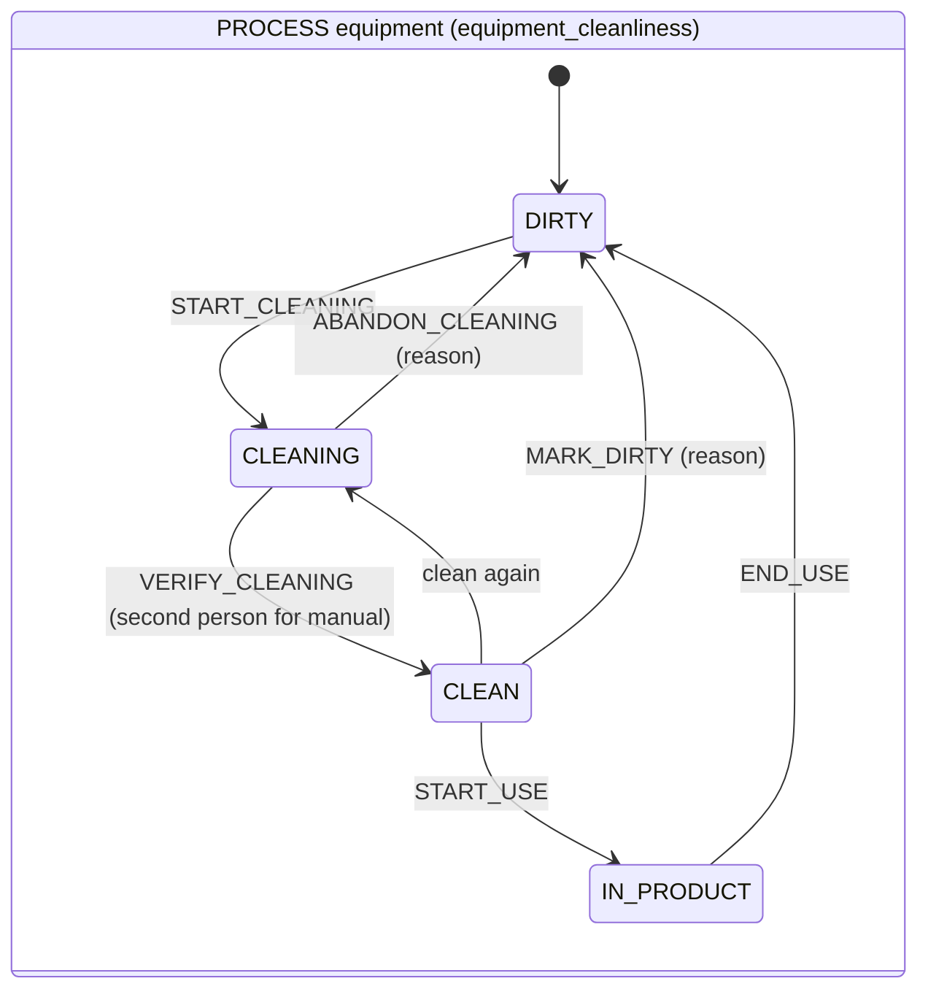

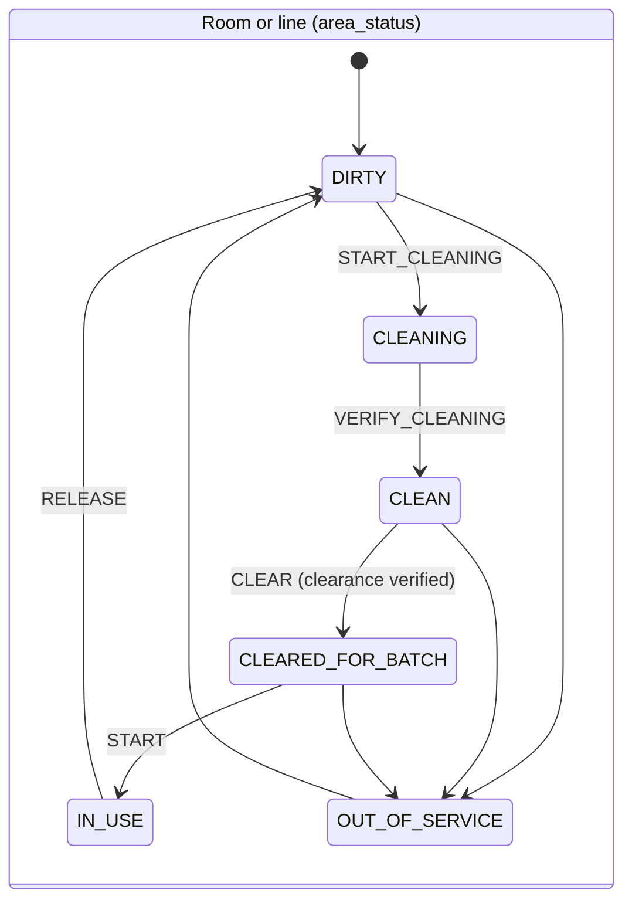

**Main tables.** [plant.equipment](../../../packages/recipe-core/sql/0400_plant_foundation.sql#sym=plant.equipment), [plant.equipment_class](../../../packages/recipe-core/sql/0400_plant_foundation.sql#sym=plant.equipment_class), [plant.area](../../../packages/recipe-core/sql/0400_plant_foundation.sql#sym=plant.area), [plant.cleaning](../../../packages/recipe-core/sql/0400_plant_foundation.sql#sym=plant.cleaning),
[plant.cleaning_verification](../../../packages/recipe-core/sql/0400_plant_foundation.sql#sym=plant.cleaning_verification), [plant.clearance](../../../packages/recipe-core/sql/0400_plant_foundation.sql#sym=plant.clearance), [plant.clearance_verification](../../../packages/recipe-core/sql/0400_plant_foundation.sql#sym=plant.clearance_verification),
[plant.equipment_use](../../../packages/recipe-core/sql/0400_plant_foundation.sql#sym=plant.equipment_use), [plant.area_occupancy](../../../packages/recipe-core/sql/0400_plant_foundation.sql#sym=plant.area_occupancy), [plant.calibration](../../../packages/recipe-core/sql/0400_plant_foundation.sql#sym=plant.calibration), [plant.instrument_check](../../../packages/recipe-core/sql/0400_plant_foundation.sql#sym=plant.instrument_check),
[plant.equipment_event](../../../packages/recipe-core/sql/0400_plant_foundation.sql#sym=plant.equipment_event), [plant.equipment_repair](../../../packages/recipe-core/sql/0460_plant_repair_verification.sql#sym=plant.equipment_repair), [plant.campaign](../../../packages/recipe-core/sql/0400_plant_foundation.sql#sym=plant.campaign), [plant.utility_reading](../../../packages/recipe-core/sql/0400_plant_foundation.sql#sym=plant.utility_reading),
[plant.product_hazard](../../../packages/recipe-core/sql/0890_hazard_dedication.sql#sym=plant.product_hazard), [plant.area_dedication](../../../packages/recipe-core/sql/0890_hazard_dedication.sql#sym=plant.area_dedication).

**Main functions.** [plant.start_cleaning](../../../packages/recipe-core/sql/0403_plant_equipment_commands.sql#sym=plant.start_cleaning), [plant.complete_cleaning](../../../packages/recipe-core/sql/0403_plant_equipment_commands.sql#sym=plant.complete_cleaning), [plant.verify_cleaning](../../../packages/recipe-core/sql/0403_plant_equipment_commands.sql#sym=plant.verify_cleaning),
[plant.abandon_cleaning](../../../packages/recipe-core/sql/0403_plant_equipment_commands.sql#sym=plant.abandon_cleaning), [plant.start_equipment_use](../../../packages/recipe-core/sql/0403_plant_equipment_commands.sql#sym=plant.start_equipment_use), [plant.end_equipment_use](../../../packages/recipe-core/sql/0403_plant_equipment_commands.sql#sym=plant.end_equipment_use),
[plant.record_clearance](../../../packages/recipe-core/sql/0404_plant_area_commands.sql#sym=plant.record_clearance), [plant.verify_clearance](../../../packages/recipe-core/sql/0404_plant_area_commands.sql#sym=plant.verify_clearance), [plant.start_area_occupancy](../../../packages/recipe-core/sql/0404_plant_area_commands.sql#sym=plant.start_area_occupancy),
[plant.record_calibration](../../../packages/recipe-core/sql/0403_plant_equipment_commands.sql#sym=plant.record_calibration), [plant.record_repair](../../../packages/recipe-core/sql/0460_plant_repair_verification.sql#sym=plant.record_repair), [plant.verify_repair](../../../packages/recipe-core/sql/0460_plant_repair_verification.sql#sym=plant.verify_repair),
[plant.record_product_hazard](../../../packages/recipe-core/sql/0890_hazard_dedication.sql#sym=plant.record_product_hazard), [plant.approve_product_hazard](../../../packages/recipe-core/sql/0912_hazard_second_person.sql#sym=plant.approve_product_hazard), [plant.record_area_dedication](../../../packages/recipe-core/sql/0890_hazard_dedication.sql#sym=plant.record_area_dedication),
[plant.approve_area_dedication](../../../packages/recipe-core/sql/0912_hazard_second_person.sql#sym=plant.approve_area_dedication). The step side reads status through [recipe.plant_status_entry_check](../../../packages/recipe-core/sql/0521_status_v2_plant_binding.sql#sym=recipe.plant_status_entry_check)
(G-09@2 and G-10@2, 0521).

> **Why this exists**
> - **Pharma reason:** a press used while dirty, past its clean-hold time or out of calibration carries the last
>   product into the next one; the status must come from the plant records, not from a person ticking a box.
> - **Control:** [IN-25](../../../compliance/controls/IN-25.yaml), [PR-23](../../../compliance/controls/PR-23.yaml), invariant INV-12.
> - **Code:** [plant.start_equipment_use](../../../packages/recipe-core/sql/0403_plant_equipment_commands.sql#sym=plant.start_equipment_use), [plant.equipment_use_chain_guard](../../../packages/recipe-core/sql/0400_plant_foundation.sql#sym=plant.equipment_use_chain_guard); on the step, [recipe.plant_status_entry_check](../../../packages/recipe-core/sql/0521_status_v2_plant_binding.sql#sym=recipe.plant_status_entry_check).
> - **Tests:** [equipment.test.ts](../../../packages/recipe-core/test/plant/equipment.test.ts), [status-blocks.test.ts](../../../packages/recipe-core/test/plant/status-blocks.test.ts), [plant-equipment-and-areas.test.ts](../../../packages/recipe-core/test/mutation/plant-equipment-and-areas.test.ts).
> - **Error:** `EBMR-PLANT-060` to `EBMR-PLANT-064`.

> **Why this exists**
> - **Pharma reason:** cleaning, clearance and repair are checked by a second person; one person cannot both do and
>   confirm the work that makes equipment fit again.
> - **Control:** [IN-25](../../../compliance/controls/IN-25.yaml) (d), [PR-34](../../../compliance/controls/PR-34.yaml), invariant INV-03.
> - **Code:** [plant.verify_cleaning](../../../packages/recipe-core/sql/0403_plant_equipment_commands.sql#sym=plant.verify_cleaning) and the table guard [plant.cleaning_verification_guard](../../../packages/recipe-core/sql/0400_plant_foundation.sql#sym=plant.cleaning_verification_guard); [plant.verify_clearance](../../../packages/recipe-core/sql/0404_plant_area_commands.sql#sym=plant.verify_clearance); [plant.verify_repair](../../../packages/recipe-core/sql/0460_plant_repair_verification.sql#sym=plant.verify_repair) with [plant.repaired_event_verified_guard](../../../packages/recipe-core/sql/0460_plant_repair_verification.sql#sym=plant.repaired_event_verified_guard) (0460).
> - **Tests:** [equipment.test.ts](../../../packages/recipe-core/test/plant/equipment.test.ts), [area.test.ts](../../../packages/recipe-core/test/plant/area.test.ts).
> - **Error:** `EBMR-PLANT-047`, `EBMR-PLANT-104`, `EBMR-PLANT-030`, `EBMR-PLANT-032`.

> **Why this exists**
> - **Pharma reason:** a hazardous product may run only in an area dedicated to its hazard class; reclassifying a
>   product or an area is a quality decision that needs two people.
> - **Control:** [IN-27](../../../compliance/controls/IN-27.yaml).
> - **Code:** [plant.assert_hazard_approval](../../../packages/recipe-core/sql/0912_hazard_second_person.sql#sym=plant.assert_hazard_approval), [plant.approve_product_hazard](../../../packages/recipe-core/sql/0912_hazard_second_person.sql#sym=plant.approve_product_hazard), [plant.approve_area_dedication](../../../packages/recipe-core/sql/0912_hazard_second_person.sql#sym=plant.approve_area_dedication) (0912); the issue gate reads it ([India gates](#india-issue-gates-labels-and-schedule-h2)).
> - **Tests:** [india.test.ts](../../../packages/recipe-core/test/release/india.test.ts), [india-issue-gate.test.ts](../../../packages/recipe-core/test/mutation/india-issue-gate.test.ts).
> - **Error:** `EBMR-IND-035`, `EBMR-IND-036`, `EBMR-IND-060` to `EBMR-IND-063`.

**How to test it.** `pnpm vitest run --project db packages/recipe-core/test/plant`; the machine seeds are checked by
`machine.test.ts` against [plant/write-seeds.ts](../../../packages/recipe-core/src/plant/write-seeds.ts).

**Pitfalls.** Phase 3 slice 1 found plant guards that trusted a caller-supplied product and batch, CIP chosen to skip
the two-person check, and an abandoned cleaning that reset the dirty-hold clock
([defect log](../08-defect-log.md#slice-1-findings-1-to-4-two-high)); a GMP batch first had no product scope
([defect log](../08-defect-log.md#slice-2b-gmp-batches-had-no-product-scope)); recipe-core once had its own copy of
the platform authority function, replaced by the kernel SCOPE hook (0523;
[defect log](../08-defect-log.md#slice-3a-high-recipe-core-had-its-own-copy-of-the-platform-authority-function)).

**Every refusal in this area** (generated from the migrations, see the note at the top):

| Function | Refuses (code and message, shortened) | Controls | Tests that assert a code |
|---|---|---|---|
| [plant.abandon_cleaning](../../../packages/recipe-core/sql/0403_plant_equipment_commands.sql#sym=plant.abandon_cleaning) | `EBMR-PLANT-049` Abandoning a cleaning carries the reason code and reason text of the person who abandons it (DI-22 | [DI-22](../../../compliance/controls/DI-22.yaml) | [plant-equipment-and-areas.test.ts](../../../packages/recipe-core/test/mutation/plant-equipment-and-areas.test.ts), [equipment.test.ts](../../../packages/recipe-core/test/plant/equipment.test.ts) |
| [plant.approve_area_dedication](../../../packages/recipe-core/sql/0912_hazard_second_person.sql#sym=plant.approve_area_dedication) | `EBMR-IND-060` unknown area dedication …<br>`EBMR-IND-061` this dedication of … is …; only the latest record of an area and class is approved, once | [IN-27](../../../compliance/controls/IN-27.yaml) | [india-issue-gate.test.ts](../../../packages/recipe-core/test/mutation/india-issue-gate.test.ts), [india.test.ts](../../../packages/recipe-core/test/release/india.test.ts) |
| [plant.approve_product_hazard](../../../packages/recipe-core/sql/0912_hazard_second_person.sql#sym=plant.approve_product_hazard) | `EBMR-IND-060` unknown hazard classification …<br>`EBMR-IND-061` this classification of … is …; only the latest record of a product is approved, once | [IN-27](../../../compliance/controls/IN-27.yaml) | [india-issue-gate.test.ts](../../../packages/recipe-core/test/mutation/india-issue-gate.test.ts), [india.test.ts](../../../packages/recipe-core/test/release/india.test.ts) |
| [plant.area_by_code](../../../packages/recipe-core/sql/0403_plant_equipment_commands.sql#sym=plant.area_by_code) | `EBMR-PLANT-011` Unknown room or line … | [IN-25](../../../compliance/controls/IN-25.yaml), [PR-23](../../../compliance/controls/PR-23.yaml), [IN-26](../../../compliance/controls/IN-26.yaml), [PR-27](../../../compliance/controls/PR-27.yaml), [DI-18](../../../compliance/controls/DI-18.yaml), INV-12 |  |
| [plant.area_occupancy_chain_guard](../../../packages/recipe-core/sql/0400_plant_foundation.sql#sym=plant.area_occupancy_chain_guard)<br>trigger `a1_chain` on `plant.area_occupancy` | `EBMR-PLANT-124` Only a segregated room holds concurrent batches (IN-26 (b)<br>`EBMR-PLANT-130` An occupancy follows the latest occupancy of the area (INV-15 | [IN-26](../../../compliance/controls/IN-26.yaml), INV-15 | [plant-equipment-and-areas.test.ts](../../../packages/recipe-core/test/mutation/plant-equipment-and-areas.test.ts), [area.test.ts](../../../packages/recipe-core/test/plant/area.test.ts) |
| [plant.assert_hazard_approval](../../../packages/recipe-core/sql/0912_hazard_second_person.sql#sym=plant.assert_hazard_approval) | `EBMR-IND-062` a hazard classification or dedication is approved by another person than its recorder (IN-27, DI-35)<br>`EBMR-IND-063` person\_id | [IN-27](../../../compliance/controls/IN-27.yaml), [DI-35](../../../compliance/controls/DI-35.yaml) | [india-issue-gate.test.ts](../../../packages/recipe-core/test/mutation/india-issue-gate.test.ts), [india.test.ts](../../../packages/recipe-core/test/release/india.test.ts) |
| [plant.assert_utility_usable](../../../packages/recipe-core/sql/0403_plant_equipment_commands.sql#sym=plant.assert_utility_usable) | `EBMR-PLANT-027` The utility cannot be used: … (IN-25 (b) | [IN-25](../../../compliance/controls/IN-25.yaml) | [equipment.test.ts](../../../packages/recipe-core/test/plant/equipment.test.ts), [status-blocks.test.ts](../../../packages/recipe-core/test/plant/status-blocks.test.ts) |
| [plant.batch_facts](../../../packages/recipe-core/sql/0504_gmp_batch_product_scope.sql#sym=plant.batch_facts) | `EBMR-PLANT-014` Unknown batch … | [IN-25](../../../compliance/controls/IN-25.yaml), [PR-23](../../../compliance/controls/PR-23.yaml), [IN-26](../../../compliance/controls/IN-26.yaml), [PR-27](../../../compliance/controls/PR-27.yaml), [DI-18](../../../compliance/controls/DI-18.yaml), INV-12 | [equipment.test.ts](../../../packages/recipe-core/test/plant/equipment.test.ts) |
| [plant.cleaning_abandonment_guard](../../../packages/recipe-core/sql/0400_plant_foundation.sql#sym=plant.cleaning_abandonment_guard)<br>trigger `a1_guard` on `plant.cleaning_abandonment` | `EBMR-PLANT-049` A verified cleaning is never abandoned | [IN-25](../../../compliance/controls/IN-25.yaml), [PR-23](../../../compliance/controls/PR-23.yaml), [IN-21](../../../compliance/controls/IN-21.yaml), [PR-26](../../../compliance/controls/PR-26.yaml), [PR-34](../../../compliance/controls/PR-34.yaml), INV-12, INV-15 | [plant-equipment-and-areas.test.ts](../../../packages/recipe-core/test/mutation/plant-equipment-and-areas.test.ts), [equipment.test.ts](../../../packages/recipe-core/test/plant/equipment.test.ts) |
| [plant.cleaning_method_guard](../../../packages/recipe-core/sql/0400_plant_foundation.sql#sym=plant.cleaning_method_guard)<br>trigger `a1_guard` on `plant.cleaning` | `EBMR-PLANT-050` The class of this unit has no validated CIP program: it is cleaned manually, with a performer and a … | [IN-25](../../../compliance/controls/IN-25.yaml), [PR-23](../../../compliance/controls/PR-23.yaml), [IN-21](../../../compliance/controls/IN-21.yaml), [PR-26](../../../compliance/controls/PR-26.yaml), [PR-34](../../../compliance/controls/PR-34.yaml), INV-12, INV-15 | [equipment.test.ts](../../../packages/recipe-core/test/plant/equipment.test.ts) |
| [plant.cleaning_verification_guard](../../../packages/recipe-core/sql/0400_plant_foundation.sql#sym=plant.cleaning_verification_guard)<br>trigger `a1_guard` on `plant.cleaning_verification` | `EBMR-PLANT-046` An abandoned cleaning is never verified<br>`EBMR-PLANT-047` A manual cleaning is verified by a person other than the one who performed it (S22 | [IN-25](../../../compliance/controls/IN-25.yaml), [PR-23](../../../compliance/controls/PR-23.yaml), [IN-21](../../../compliance/controls/IN-21.yaml), [PR-26](../../../compliance/controls/PR-26.yaml), [PR-34](../../../compliance/controls/PR-34.yaml), INV-12, INV-15 | [plant-equipment-and-areas.test.ts](../../../packages/recipe-core/test/mutation/plant-equipment-and-areas.test.ts), [equipment.test.ts](../../../packages/recipe-core/test/plant/equipment.test.ts) |
| [plant.clearance_verification_guard](../../../packages/recipe-core/sql/0400_plant_foundation.sql#sym=plant.clearance_verification_guard)<br>trigger `a1_guard` on `plant.clearance_verification` | `EBMR-PLANT-104` A clearance is verified by a person other than the one who performed it (S23, S24 | [IN-25](../../../compliance/controls/IN-25.yaml), [PR-23](../../../compliance/controls/PR-23.yaml), [IN-21](../../../compliance/controls/IN-21.yaml), [PR-26](../../../compliance/controls/PR-26.yaml), [PR-34](../../../compliance/controls/PR-34.yaml), INV-12, INV-15 | [plant-equipment-and-areas.test.ts](../../../packages/recipe-core/test/mutation/plant-equipment-and-areas.test.ts), [area.test.ts](../../../packages/recipe-core/test/plant/area.test.ts) |
| [plant.close_campaign](../../../packages/recipe-core/sql/0403_plant_equipment_commands.sql#sym=plant.close_campaign) | `EBMR-PLANT-082` Closing a campaign states why | [IN-25](../../../compliance/controls/IN-25.yaml), [PR-23](../../../compliance/controls/PR-23.yaml), [IN-26](../../../compliance/controls/IN-26.yaml), [PR-27](../../../compliance/controls/PR-27.yaml), [DI-18](../../../compliance/controls/DI-18.yaml), INV-12 | [plant-equipment-and-areas.test.ts](../../../packages/recipe-core/test/mutation/plant-equipment-and-areas.test.ts) |
| [plant.complete_cleaning](../../../packages/recipe-core/sql/0403_plant_equipment_commands.sql#sym=plant.complete_cleaning) | `EBMR-PLANT-044` Cleaning … is not in progress<br>`EBMR-PLANT-045` A CIP cleaning cites the cycle record of the validated CIP program (S22 | [IN-25](../../../compliance/controls/IN-25.yaml), [PR-23](../../../compliance/controls/PR-23.yaml), [IN-26](../../../compliance/controls/IN-26.yaml), [PR-27](../../../compliance/controls/PR-27.yaml), [DI-18](../../../compliance/controls/DI-18.yaml), INV-12 | [plant-equipment-and-areas.test.ts](../../../packages/recipe-core/test/mutation/plant-equipment-and-areas.test.ts), [equipment.test.ts](../../../packages/recipe-core/test/plant/equipment.test.ts) |
| [plant.define_area](../../../packages/recipe-core/sql/0403_plant_equipment_commands.sql#sym=plant.define_area) | `EBMR-PLANT-003` A segregated room needs its recorded risk justification (IN-26 (b) | [IN-26](../../../compliance/controls/IN-26.yaml) | [area.test.ts](../../../packages/recipe-core/test/plant/area.test.ts) |
| [plant.define_equipment](../../../packages/recipe-core/sql/0403_plant_equipment_commands.sql#sym=plant.define_equipment) | `EBMR-PLANT-013` Unknown equipment class … | [IN-25](../../../compliance/controls/IN-25.yaml), [PR-23](../../../compliance/controls/PR-23.yaml), [IN-26](../../../compliance/controls/IN-26.yaml), [PR-27](../../../compliance/controls/PR-27.yaml), [DI-18](../../../compliance/controls/DI-18.yaml), INV-12 |  |
| [plant.define_product](../../../packages/recipe-core/sql/0403_plant_equipment_commands.sql#sym=plant.define_product) | `EBMR-PLANT-001` A product states whether it is highly potent (IN-26 (c) | [IN-26](../../../compliance/controls/IN-26.yaml) |  |
| [plant.end_area_occupancy](../../../packages/recipe-core/sql/0404_plant_area_commands.sql#sym=plant.end_area_occupancy) | `EBMR-PLANT-129` Unknown occupancy … | [IN-21](../../../compliance/controls/IN-21.yaml), [PR-26](../../../compliance/controls/PR-26.yaml), [PR-34](../../../compliance/controls/PR-34.yaml), [PR-35](../../../compliance/controls/PR-35.yaml), [IN-26](../../../compliance/controls/IN-26.yaml), INV-15 | [plant-equipment-and-areas.test.ts](../../../packages/recipe-core/test/mutation/plant-equipment-and-areas.test.ts) |
| [plant.end_equipment_use](../../../packages/recipe-core/sql/0403_plant_equipment_commands.sql#sym=plant.end_equipment_use) | `EBMR-PLANT-063` Unknown use … | [IN-25](../../../compliance/controls/IN-25.yaml), [PR-23](../../../compliance/controls/PR-23.yaml), [IN-26](../../../compliance/controls/IN-26.yaml), [PR-27](../../../compliance/controls/PR-27.yaml), [DI-18](../../../compliance/controls/DI-18.yaml), INV-12 |  |
| [plant.equipment_by_code](../../../packages/recipe-core/sql/0403_plant_equipment_commands.sql#sym=plant.equipment_by_code) | `EBMR-PLANT-010` Unknown equipment … | [IN-25](../../../compliance/controls/IN-25.yaml), [PR-23](../../../compliance/controls/PR-23.yaml), [IN-26](../../../compliance/controls/IN-26.yaml), [PR-27](../../../compliance/controls/PR-27.yaml), [DI-18](../../../compliance/controls/DI-18.yaml), INV-12 |  |
| [plant.equipment_use_chain_guard](../../../packages/recipe-core/sql/0400_plant_foundation.sql#sym=plant.equipment_use_chain_guard)<br>trigger `a1_chain` on `plant.equipment_use` | `EBMR-PLANT-062` Only PROCESS equipment is occupied by a batch (L-27<br>`EBMR-PLANT-064` A use follows the latest use of the unit (INV-12 | [IN-25](../../../compliance/controls/IN-25.yaml), [PR-23](../../../compliance/controls/PR-23.yaml), [IN-21](../../../compliance/controls/IN-21.yaml), [PR-26](../../../compliance/controls/PR-26.yaml), [PR-34](../../../compliance/controls/PR-34.yaml), INV-12 | [plant-equipment-and-areas.test.ts](../../../packages/recipe-core/test/mutation/plant-equipment-and-areas.test.ts), [equipment.test.ts](../../../packages/recipe-core/test/plant/equipment.test.ts) |
| [plant.open_campaign](../../../packages/recipe-core/sql/0403_plant_equipment_commands.sql#sym=plant.open_campaign) | `EBMR-PLANT-080` A campaign is opened on one PROCESS unit or one room<br>`EBMR-PLANT-081` A campaign cites the validation of its cleaning interval (IN-26 (a), PR-27 | [IN-26](../../../compliance/controls/IN-26.yaml), [PR-27](../../../compliance/controls/PR-27.yaml) | [plant-equipment-and-areas.test.ts](../../../packages/recipe-core/test/mutation/plant-equipment-and-areas.test.ts), [equipment.test.ts](../../../packages/recipe-core/test/plant/equipment.test.ts) |
| [plant.record_area_dedication](../../../packages/recipe-core/sql/0890_hazard_dedication.sql#sym=plant.record_area_dedication) | `EBMR-IND-036` a dedication names the room or line, the hazard class, whether it is dedicated, the breathing-air supply … | [IN-27](../../../compliance/controls/IN-27.yaml) | [india-issue-gate.test.ts](../../../packages/recipe-core/test/mutation/india-issue-gate.test.ts) |
| [plant.record_calibration](../../../packages/recipe-core/sql/0403_plant_equipment_commands.sql#sym=plant.record_calibration) | `EBMR-PLANT-023` … is of a class without calibration<br>`EBMR-PLANT-024` A calibration states a due instant in the future | [IN-25](../../../compliance/controls/IN-25.yaml), [PR-23](../../../compliance/controls/PR-23.yaml), [IN-26](../../../compliance/controls/IN-26.yaml), [PR-27](../../../compliance/controls/PR-27.yaml), [DI-18](../../../compliance/controls/DI-18.yaml), INV-12 | [plant-equipment-and-areas.test.ts](../../../packages/recipe-core/test/mutation/plant-equipment-and-areas.test.ts) |
| [plant.record_clearance](../../../packages/recipe-core/sql/0404_plant_area_commands.sql#sym=plant.record_clearance) | `EBMR-PLANT-100` … is …: a clearance is recorded in a CLEAN area (or alongside a batch in a segregated room) (IN-21<br>`EBMR-PLANT-101` A line clearance is a PACKAGING\_ORDER clearance naming the packaging order and the artwork set (L-29, PR-34<br>`EBMR-PLANT-103` A clearance records its finding, PASSED or FAILED | [IN-21](../../../compliance/controls/IN-21.yaml), [PR-34](../../../compliance/controls/PR-34.yaml) | [plant-equipment-and-areas.test.ts](../../../packages/recipe-core/test/mutation/plant-equipment-and-areas.test.ts), [area.test.ts](../../../packages/recipe-core/test/plant/area.test.ts) |
| [plant.record_equipment_event](../../../packages/recipe-core/sql/0460_plant_repair_verification.sql#sym=plant.record_equipment_event) | `EBMR-PLANT-020` … is retired; nothing more is recorded on it<br>`EBMR-PLANT-021` … is not out of service<br>`EBMR-PLANT-022` A failure signalled from a step names its batch (IN-25 (d)<br>`EBMR-PLANT-030` A repair of a signalled failure is recorded with plant.record\_repair and becomes effective only once a … | [IN-25](../../../compliance/controls/IN-25.yaml) | [plant-equipment-and-areas.test.ts](../../../packages/recipe-core/test/mutation/plant-equipment-and-areas.test.ts), [equipment.test.ts](../../../packages/recipe-core/test/plant/equipment.test.ts) (+1) |
| [plant.record_instrument_check](../../../packages/recipe-core/sql/0403_plant_equipment_commands.sql#sym=plant.record_instrument_check) | `EBMR-PLANT-025` … is … equipment; checks are recorded for instruments | [IN-25](../../../compliance/controls/IN-25.yaml), [PR-23](../../../compliance/controls/PR-23.yaml), [IN-26](../../../compliance/controls/IN-26.yaml), [PR-27](../../../compliance/controls/PR-27.yaml), [DI-18](../../../compliance/controls/DI-18.yaml), INV-12 |  |
| [plant.record_instrument_use](../../../packages/recipe-core/sql/0403_plant_equipment_commands.sql#sym=plant.record_instrument_use) | `EBMR-PLANT-025` … is … equipment, not an instrument<br>`EBMR-PLANT-060` A use states its planned end, in the future<br>`EBMR-PLANT-061` … cannot be used for batch …: … (IN-25 (b), PR-23 | [IN-25](../../../compliance/controls/IN-25.yaml), [PR-23](../../../compliance/controls/PR-23.yaml) | [plant-equipment-and-areas.test.ts](../../../packages/recipe-core/test/mutation/plant-equipment-and-areas.test.ts), [equipment.test.ts](../../../packages/recipe-core/test/plant/equipment.test.ts) |
| [plant.record_product_hazard](../../../packages/recipe-core/sql/0890_hazard_dedication.sql#sym=plant.record_product_hazard) | `EBMR-IND-035` a hazard classification names the product, its class (NONE, SEX\_HORMONE, STEROID or CYTOTOXIC) and the … | [IN-27](../../../compliance/controls/IN-27.yaml) | [india.test.ts](../../../packages/recipe-core/test/release/india.test.ts) |
| [plant.record_repair](../../../packages/recipe-core/sql/0460_plant_repair_verification.sql#sym=plant.record_repair) | `EBMR-PLANT-020` … is retired; nothing more is recorded on it<br>`EBMR-PLANT-021` … has no open failure to repair<br>`EBMR-PLANT-031` A repair states what was done and cites its work order | [IN-25](../../../compliance/controls/IN-25.yaml), [PR-23](../../../compliance/controls/PR-23.yaml) | [plant-equipment-and-areas.test.ts](../../../packages/recipe-core/test/mutation/plant-equipment-and-areas.test.ts), [plant.test.tsx](../../../apps/tablets-web/test/office/plant.test.tsx) |
| [plant.record_utility_reading](../../../packages/recipe-core/sql/0403_plant_equipment_commands.sql#sym=plant.record_utility_reading) | `EBMR-PLANT-026` … is … equipment; feed readings are recorded for utilities | [IN-25](../../../compliance/controls/IN-25.yaml), [PR-23](../../../compliance/controls/PR-23.yaml), [IN-26](../../../compliance/controls/IN-26.yaml), [PR-27](../../../compliance/controls/PR-27.yaml), [DI-18](../../../compliance/controls/DI-18.yaml), INV-12 |  |
| [plant.repair_verification_guard](../../../packages/recipe-core/sql/0460_plant_repair_verification.sql#sym=plant.repair_verification_guard)<br>trigger `a1_guard` on `plant.equipment_repair_verification` | `EBMR-PLANT-032` A repair of a signalled failure is verified by a person other than the one who signalled the failure and …<br>`EBMR-PLANT-033` A repair verification names the REPAIRED event of the repaired unit | [IN-25](../../../compliance/controls/IN-25.yaml) | [plant-equipment-and-areas.test.ts](../../../packages/recipe-core/test/mutation/plant-equipment-and-areas.test.ts), [equipment.test.ts](../../../packages/recipe-core/test/plant/equipment.test.ts) |
| [plant.repaired_event_verified_guard](../../../packages/recipe-core/sql/0460_plant_repair_verification.sql#sym=plant.repaired_event_verified_guard)<br>trigger `z1_repaired_verified` on `plant.equipment_event` | `EBMR-PLANT-030` A REPAIRED event is written only with a second person's verification of the repair (plant.verify\_repair) … | [IN-25](../../../compliance/controls/IN-25.yaml) | [equipment.test.ts](../../../packages/recipe-core/test/plant/equipment.test.ts) |
| [plant.require_product](../../../packages/recipe-core/sql/0403_plant_equipment_commands.sql#sym=plant.require_product) | `EBMR-PLANT-012` Unknown product …: define it in the plant product list first | [IN-25](../../../compliance/controls/IN-25.yaml), [PR-23](../../../compliance/controls/PR-23.yaml), [IN-26](../../../compliance/controls/IN-26.yaml), [PR-27](../../../compliance/controls/PR-27.yaml), [DI-18](../../../compliance/controls/DI-18.yaml), INV-12 | [equipment.test.ts](../../../packages/recipe-core/test/plant/equipment.test.ts), [db-guards.test.ts](../../../apps/tablets-server/test/blocks/compression/db-guards.test.ts) |
| [plant.set_utility_feed_age](../../../packages/recipe-core/sql/0522_plant_feed_age.sql#sym=plant.set_utility_feed_age) | `EBMR-PLANT-140` … is not a utility class | [IN-25](../../../compliance/controls/IN-25.yaml) | [status-blocks.test.ts](../../../packages/recipe-core/test/plant/status-blocks.test.ts) |
| [plant.start_area_occupancy](../../../packages/recipe-core/sql/0404_plant_area_commands.sql#sym=plant.start_area_occupancy) | `EBMR-PLANT-120` A start in a room or line names the batch and the stage<br>`EBMR-PLANT-121` A start on a line names the packaging order and its artwork set (L-29<br>`EBMR-PLANT-122` … is highly potent: it is processed only in a room with a negative pressure cascade, and … is not one …<br>`EBMR-PLANT-123` … already runs packaging order …: one active packaging order per line (PR-35<br>`EBMR-PLANT-124` … holds open batch … of …: a second batch of another product is allowed only in a segregated room (IN-26 …<br>`EBMR-PLANT-125` … is in use by batch …: release, clean and clear it first (INV-15<br>`EBMR-PLANT-126` … is ……: a batch starts only in a room or line cleared for it (IN-21, INV-15<br>`EBMR-PLANT-127` … has no passed … clearance for batch … of …… recorded and verified since its last occupancy or cleaning …<br>`EBMR-PLANT-128` …: a product change needs a MAJOR cleaning of the area; the last one was … (IN-26 (a) | [IN-26](../../../compliance/controls/IN-26.yaml), [PR-35](../../../compliance/controls/PR-35.yaml), [PR-25](../../../compliance/controls/PR-25.yaml), [IN-21](../../../compliance/controls/IN-21.yaml), [PR-26](../../../compliance/controls/PR-26.yaml), INV-15 | [plant-equipment-and-areas.test.ts](../../../packages/recipe-core/test/mutation/plant-equipment-and-areas.test.ts), [area.test.ts](../../../packages/recipe-core/test/plant/area.test.ts) |
| [plant.start_cleaning](../../../packages/recipe-core/sql/0403_plant_equipment_commands.sql#sym=plant.start_cleaning) | `EBMR-PLANT-040` A cleaning names its target (EQUIPMENT or AREA), level (MINOR or MAJOR) and method (MANUAL or CIP)<br>`EBMR-PLANT-041` … is … equipment, which has no cleanliness state (L-27<br>`EBMR-PLANT-042` … is …; a cleaning starts from DIRTY or CLEAN<br>`EBMR-PLANT-043` … has been DIRTY since …, past its dirty-hold of …: only a MAJOR cleaning is accepted (IN-25 (c)<br>`EBMR-PLANT-050` … has no validated CIP program: it is cleaned manually, with a performer and a different verifier (S22 | [IN-25](../../../compliance/controls/IN-25.yaml) | [plant-equipment-and-areas.test.ts](../../../packages/recipe-core/test/mutation/plant-equipment-and-areas.test.ts), [equipment.test.ts](../../../packages/recipe-core/test/plant/equipment.test.ts) |
| [plant.start_equipment_use](../../../packages/recipe-core/sql/0403_plant_equipment_commands.sql#sym=plant.start_equipment_use) | `EBMR-PLANT-060` A use states its planned end, in the future<br>`EBMR-PLANT-061` … cannot be used for batch …: … (INV-12, IN-25, PR-23<br>`EBMR-PLANT-062` … is … equipment, which has no occupancy; record its use with the instrument or utility check (L-27 | [IN-25](../../../compliance/controls/IN-25.yaml), [PR-23](../../../compliance/controls/PR-23.yaml), INV-12 | [plant-equipment-and-areas.test.ts](../../../packages/recipe-core/test/mutation/plant-equipment-and-areas.test.ts), [equipment.test.ts](../../../packages/recipe-core/test/plant/equipment.test.ts) |
| [plant.verify_cleaning](../../../packages/recipe-core/sql/0403_plant_equipment_commands.sql#sym=plant.verify_cleaning) | `EBMR-PLANT-046` Cleaning … is not awaiting verification (it must be completed and neither verified nor abandoned)<br>`EBMR-PLANT-047` A manual cleaning is verified by a person other than the one who performed it (S22<br>`EBMR-PLANT-048` The verification signature is the verifier's own | [IN-25](../../../compliance/controls/IN-25.yaml), [PR-23](../../../compliance/controls/PR-23.yaml), [IN-26](../../../compliance/controls/IN-26.yaml), [PR-27](../../../compliance/controls/PR-27.yaml), [DI-18](../../../compliance/controls/DI-18.yaml), INV-12 | [plant-equipment-and-areas.test.ts](../../../packages/recipe-core/test/mutation/plant-equipment-and-areas.test.ts), [equipment.test.ts](../../../packages/recipe-core/test/plant/equipment.test.ts) |
| [plant.verify_clearance](../../../packages/recipe-core/sql/0404_plant_area_commands.sql#sym=plant.verify_clearance) | `EBMR-PLANT-102` Unknown clearance …<br>`EBMR-PLANT-104` A clearance is verified by a person other than the one who performed it (S23, S24<br>`EBMR-PLANT-105` The verification signature is the verifier's own<br>`EBMR-PLANT-106` A batch started or ended, or a cleaning was verified, in the area after this clearance was performed: … | [IN-21](../../../compliance/controls/IN-21.yaml), [PR-26](../../../compliance/controls/PR-26.yaml), [PR-34](../../../compliance/controls/PR-34.yaml), [PR-35](../../../compliance/controls/PR-35.yaml), [IN-26](../../../compliance/controls/IN-26.yaml), INV-15 | [plant-equipment-and-areas.test.ts](../../../packages/recipe-core/test/mutation/plant-equipment-and-areas.test.ts), [area.test.ts](../../../packages/recipe-core/test/plant/area.test.ts) |
| [plant.verify_repair](../../../packages/recipe-core/sql/0460_plant_repair_verification.sql#sym=plant.verify_repair) | `EBMR-PLANT-020` The unit is retired; nothing more is recorded on it<br>`EBMR-PLANT-032` A repair of a signalled failure is verified by a person other than the one who signalled the failure and …<br>`EBMR-PLANT-033` Unknown repair …<br>`EBMR-PLANT-034` The verification signature is the verifier's own | [IN-25](../../../compliance/controls/IN-25.yaml) | [plant-equipment-and-areas.test.ts](../../../packages/recipe-core/test/mutation/plant-equipment-and-areas.test.ts), [equipment.test.ts](../../../packages/recipe-core/test/plant/equipment.test.ts) (+1) |
| [recipe.plant_status_entry_check](../../../packages/recipe-core/sql/0521_status_v2_plant_binding.sql#sym=recipe.plant_status_entry_check)<br>trigger `ad_plant_status_entry` on `recipe.execution_command` | `EBMR-EXE-210` A … entry stands on the open … of this batch that site services started for the person recording it: … … | [IN-21](../../../compliance/controls/IN-21.yaml), [IN-25](../../../compliance/controls/IN-25.yaml), [PR-23](../../../compliance/controls/PR-23.yaml), [PR-34](../../../compliance/controls/PR-34.yaml), INV-12, INV-15 | [status-blocks.test.ts](../../../packages/recipe-core/test/plant/status-blocks.test.ts) |

## Output containers

**What it does.** The containers a stage discharges into (for example, the drums of compressed tablets from a press):
their identification label, the in-process checks (IPC) that bracket them, the holds a failing check raises, and
QA's sorting, rejection or release of held containers. State machine `output_container`, generated from
[containers/machine.ts](../../../packages/recipe-core/src/containers/machine.ts) into 0421. Whether a container may be
used (merged, charged, packed) is decided by the database ([plant.container_usable_problem](../../../packages/recipe-core/sql/0740_container_close_net_check.sql#sym=plant.container_usable_problem)): CLOSED once
bracketed by a passing IPC recorded after its close, or RELEASED_BY_QA; never HELD or SORTED.

**Pharma context.** In-process material must be identified and its status known
([PR-22](../../../compliance/controls/PR-22.yaml), [IN-21](../../../compliance/controls/IN-21.yaml)); when an IPC
fails, everything made since the last good check is suspect and is held for QA (L-30, TB-11). A manually typed
critical value needs a second person's check (21 CFR 211.68(b) asks that computer input be checked for accuracy; [DI-30](../../../compliance/controls/DI-30.yaml)).

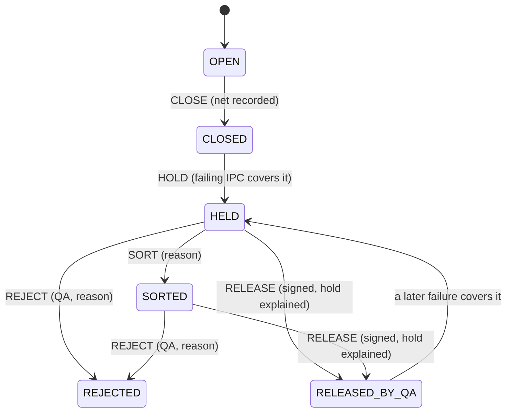

**Main tables.** [plant.output_container](../../../packages/recipe-core/sql/0420_output_containers.sql#sym=plant.output_container), [plant.container_close](../../../packages/recipe-core/sql/0420_output_containers.sql#sym=plant.container_close), [plant.container_close_verification](../../../packages/recipe-core/sql/0740_container_close_net_check.sql#sym=plant.container_close_verification),
[plant.ipc_check](../../../packages/recipe-core/sql/0420_output_containers.sql#sym=plant.ipc_check), [plant.container_hold](../../../packages/recipe-core/sql/0420_output_containers.sql#sym=plant.container_hold), [plant.container_merge](../../../packages/recipe-core/sql/0420_output_containers.sql#sym=plant.container_merge), [plant.container_charge](../../../packages/recipe-core/sql/0420_output_containers.sql#sym=plant.container_charge),
[plant.press_discharge](../../../packages/recipe-core/sql/0420_output_containers.sql#sym=plant.press_discharge).

**Main functions.** [plant.open_container](../../../packages/recipe-core/sql/0540_press_codes_and_hold_race.sql#sym=plant.open_container), [plant.close_container](../../../packages/recipe-core/sql/0740_container_close_net_check.sql#sym=plant.close_container), [plant.verify_container_close](../../../packages/recipe-core/sql/0740_container_close_net_check.sql#sym=plant.verify_container_close),
[plant.record_ipc_check](../../../packages/recipe-core/sql/0541_ipc_missed_by_sweeper.sql#sym=plant.record_ipc_check), [plant.merge_container](../../../packages/recipe-core/sql/0422_output_container_commands.sql#sym=plant.merge_container), [plant.charge_container](../../../packages/recipe-core/sql/0624_whole_batch_reprocessing.sql#sym=plant.charge_container), [plant.dispose_container](../../../packages/recipe-core/sql/0422_output_container_commands.sql#sym=plant.dispose_container),
[plant.container_release_problem](../../../packages/recipe-core/sql/0741_container_release_after_hold_closed.sql#sym=plant.container_release_problem).

> **Why this exists**
> - **Pharma reason:** a held container is released only once what held it is explained (the exception dispositioned,
>   the deviation concluded, the missed check recorded); and a net quantity typed by hand is checked by a second
>   person before the container is used.
> - **Control:** [DI-30](../../../compliance/controls/DI-30.yaml), [PR-49](../../../compliance/controls/PR-49.yaml), L-30, invariant INV-41.
> - **Code:** [plant.container_release_problem](../../../packages/recipe-core/sql/0741_container_release_after_hold_closed.sql#sym=plant.container_release_problem) (0741), [plant.verify_container_close](../../../packages/recipe-core/sql/0740_container_close_net_check.sql#sym=plant.verify_container_close) and [plant.guard_container_close_verification](../../../packages/recipe-core/sql/0740_container_close_net_check.sql#sym=plant.guard_container_close_verification) (0740).
> - **Tests:** [net-and-release.test.ts](../../../packages/recipe-core/test/containers/net-and-release.test.ts), [containers.test.ts](../../../packages/recipe-core/test/containers/containers.test.ts), [output-containers.test.ts](../../../packages/recipe-core/test/mutation/output-containers.test.ts).
> - **Error:** `EBMR-CNT-046` to `EBMR-CNT-053`.

**How to test it.** `pnpm vitest run --project db packages/recipe-core/test/containers`.

**Pitfalls.** The close and hold race: a container could stay CLOSED with a hold row, or a container opened during a
failing check could miss its hold. Fixed in 0540 by always taking the container lock first, then the hold; the lock
assumes READ COMMITTED ([defect log](../08-defect-log.md#p3-slice-3c-close-and-hold-race-on-containers)). A source
container could be charged twice at once until a charge waited for the take lock
([defect log](../08-defect-log.md#p3-slice-5-review-the-charge-lock-on-source-containers)).

**Every refusal in this area** (generated from the migrations, see the note at the top):

| Function | Refuses (code and message, shortened) | Controls | Tests that assert a code |
|---|---|---|---|
| [plant.batch_scope](../../../packages/recipe-core/sql/0504_gmp_batch_product_scope.sql#sym=plant.batch_scope) | `EBMR-CNT-020` Unknown batch … | [IN-21](../../../compliance/controls/IN-21.yaml), [IN-26](../../../compliance/controls/IN-26.yaml), [DI-18](../../../compliance/controls/DI-18.yaml), [DI-17](../../../compliance/controls/DI-17.yaml) | [gmp-issue.test.ts](../../../packages/recipe-core/test/lifecycle/gmp-issue.test.ts), [output-containers.test.ts](../../../packages/recipe-core/test/mutation/output-containers.test.ts) (+1) |
| [plant.charge_container](../../../packages/recipe-core/sql/0624_whole_batch_reprocessing.sql#sym=plant.charge_container) | `EBMR-CNT-020` Unknown batch …<br>`EBMR-CNT-040` The scanned label … names no output container; scan refused (IN-26 (c)<br>`EBMR-CNT-041` Container … is labelled for batch …, not batch …; scan refused (IN-26 (c)<br>`EBMR-CNT-042` Container … cannot be …: … (L-30, TB-11 | [IN-26](../../../compliance/controls/IN-26.yaml) | [containers.test.ts](../../../packages/recipe-core/test/containers/containers.test.ts), [net-and-release.test.ts](../../../packages/recipe-core/test/containers/net-and-release.test.ts) (+3) |
| [plant.close_container](../../../packages/recipe-core/sql/0740_container_close_net_check.sql#sym=plant.close_container) | `EBMR-CNT-030` Unknown output container … | [IN-21](../../../compliance/controls/IN-21.yaml), [IN-26](../../../compliance/controls/IN-26.yaml), [DI-18](../../../compliance/controls/DI-18.yaml), [DI-17](../../../compliance/controls/DI-17.yaml) | [output-containers.test.ts](../../../packages/recipe-core/test/mutation/output-containers.test.ts) |
| [plant.configure_press_discharge](../../../packages/recipe-core/sql/0540_press_codes_and_hold_race.sql#sym=plant.configure_press_discharge) | `EBMR-CNT-010` State whether the press's streams discharge into separate containers<br>`EBMR-CNT-023` A discharge configuration names a press of the plant: … (PR-22 | [PR-22](../../../compliance/controls/PR-22.yaml) | [containers.test.ts](../../../packages/recipe-core/test/containers/containers.test.ts), [output-containers.test.ts](../../../packages/recipe-core/test/mutation/output-containers.test.ts) |
| [plant.container_close_record](../../../packages/recipe-core/sql/0740_container_close_net_check.sql#sym=plant.container_close_record) | `EBMR-CNT-030` Unknown output container …<br>`EBMR-CNT-031` Container … is closed with its net quantity, above zero (L-30<br>`EBMR-CNT-032` Container … is closed already; it is closed once (L-30 | [DI-30](../../../compliance/controls/DI-30.yaml), INV-03 | [containers.test.ts](../../../packages/recipe-core/test/containers/containers.test.ts), [output-containers.test.ts](../../../packages/recipe-core/test/mutation/output-containers.test.ts) |
| [plant.container_release_problem](../../../packages/recipe-core/sql/0741_container_release_after_hold_closed.sql#sym=plant.container_release_problem) | `EBMR-CNT-030` the output container does not exist<br>`EBMR-CNT-050` the typed net quantity of container … has not been verified by a second person (DI-30<br>`EBMR-CNT-051` container … is held for a check the alarm found missed (…); the step has not recorded the missed check …<br>`EBMR-CNT-052` container … is held (…) and exception … (…) of step … is still open; it is released once the exception is …<br>`EBMR-CNT-053` container … is held (…) and deviation … linked to exception … is …; it is released once the investigation … | [DI-30](../../../compliance/controls/DI-30.yaml), [PR-49](../../../compliance/controls/PR-49.yaml), INV-41 | [net-and-release.test.ts](../../../packages/recipe-core/test/containers/net-and-release.test.ts), [output-containers.test.ts](../../../packages/recipe-core/test/mutation/output-containers.test.ts) |
| [plant.dispose_container](../../../packages/recipe-core/sql/0422_output_container_commands.sql#sym=plant.dispose_container) | `EBMR-CNT-030` Unknown output container … | [IN-21](../../../compliance/controls/IN-21.yaml), [IN-26](../../../compliance/controls/IN-26.yaml), [DI-18](../../../compliance/controls/DI-18.yaml), [DI-17](../../../compliance/controls/DI-17.yaml) | [output-containers.test.ts](../../../packages/recipe-core/test/mutation/output-containers.test.ts) |
| [plant.guard_container_close_verification](../../../packages/recipe-core/sql/0740_container_close_net_check.sql#sym=plant.guard_container_close_verification)<br>trigger `aa_container_close_verification_guard` on `plant.container_close_verification` | `EBMR-CNT-047` Container … was not closed with a typed net quantity; there is nothing to verify (DI-30<br>`EBMR-CNT-048` The typed net quantity of container … is verified by a second person, not by the person who closed or …<br>`EBMR-CNT-049` The verification of container … carries the verifier's own signature (DI-30 | [DI-30](../../../compliance/controls/DI-30.yaml), INV-03 | [net-and-release.test.ts](../../../packages/recipe-core/test/containers/net-and-release.test.ts) |
| [plant.merge_container](../../../packages/recipe-core/sql/0422_output_container_commands.sql#sym=plant.merge_container) | `EBMR-CNT-040` A scanned label names no output container; merge refused (IN-26 (c)<br>`EBMR-CNT-043` Containers … and … differ in batch, stage or unit; merge refused (IN-26 (c)<br>`EBMR-CNT-044` Container … cannot be merged: … (L-30, TB-11<br>`EBMR-CNT-045` Container … is not open or is under a hold; a merge pours only into an open container that is not held (L-30 | [IN-26](../../../compliance/controls/IN-26.yaml) | [containers.test.ts](../../../packages/recipe-core/test/containers/containers.test.ts), [output-containers.test.ts](../../../packages/recipe-core/test/mutation/output-containers.test.ts) |
| [plant.open_container](../../../packages/recipe-core/sql/0540_press_codes_and_hold_race.sql#sym=plant.open_container) | `EBMR-CNT-020` Unknown batch …<br>`EBMR-CNT-021` Batch … names no product code and strength; a container carries both (IN-21<br>`EBMR-CNT-022` A stream belongs to a press: name the press<br>`EBMR-CNT-023` A container is opened on a press of the plant: … (PR-22, IN-21 | [IN-21](../../../compliance/controls/IN-21.yaml), [PR-22](../../../compliance/controls/PR-22.yaml) | [containers.test.ts](../../../packages/recipe-core/test/containers/containers.test.ts), [gmp-issue.test.ts](../../../packages/recipe-core/test/lifecycle/gmp-issue.test.ts) (+2) |
| [plant.record_ipc_check](../../../packages/recipe-core/sql/0541_ipc_missed_by_sweeper.sql#sym=plant.record_ipc_check) | `EBMR-CNT-020` Unknown batch … | [IN-21](../../../compliance/controls/IN-21.yaml), [IN-26](../../../compliance/controls/IN-26.yaml), [DI-18](../../../compliance/controls/DI-18.yaml), [DI-17](../../../compliance/controls/DI-17.yaml) | [gmp-issue.test.ts](../../../packages/recipe-core/test/lifecycle/gmp-issue.test.ts), [output-containers.test.ts](../../../packages/recipe-core/test/mutation/output-containers.test.ts) (+1) |
| [plant.verify_container_close](../../../packages/recipe-core/sql/0740_container_close_net_check.sql#sym=plant.verify_container_close) | `EBMR-CNT-030` Unknown output container …<br>`EBMR-CNT-046` Container … is not closed; its net quantity is verified after the close (DI-30<br>`EBMR-CNT-047` Container … was not closed with a typed net quantity; there is nothing to verify (DI-30<br>`EBMR-CNT-048` The typed net quantity of container … is verified by a second person, not by the person who closed or … | [DI-30](../../../compliance/controls/DI-30.yaml), INV-03 | [net-and-release.test.ts](../../../packages/recipe-core/test/containers/net-and-release.test.ts), [output-containers.test.ts](../../../packages/recipe-core/test/mutation/output-containers.test.ts) |

## Material consumption

**What it does.** The batch side of material use. The site's lot register (in [site-services](site-services.md))
holds stock and reservations; recipe-core records that a quantity of a lot was consumed into a batch, only into a
running batch (ISSUED or IN_PROGRESS) and only together with the entry that consumed it, in the same command
([recipe.consume_lot](../../../packages/recipe-core/sql/0700_consumption_guards.sql#sym=recipe.consume_lot), [recipe.consumption_entry](../../../packages/recipe-core/sql/0700_consumption_guards.sql#sym=recipe.consumption_entry), trigger `zzs_execution_consumption_entries`).
Reservations end with the batch (trigger `zzt_execution_batch_end`). A packaging order packs only bulk its processing
batch released for packing: [recipe.issue_packaging_bulk](../../../packages/recipe-core/sql/0871_bulk_reconciliation_and_bright_stock.sql#sym=recipe.issue_packaging_bulk) writes [recipe.packaging_bulk_issue](../../../packages/recipe-core/sql/0701_packaging_bulk_issue.sql#sym=recipe.packaging_bulk_issue) (0701; the
version in force is 0871's).

**Pharma context.** Every material lot used must be traceable to the batch, and the quantities must reconcile
(21 CFR 211.184, 211.101(c); [PR-18](../../../compliance/controls/PR-18.yaml),
[PR-57](../../../compliance/controls/PR-57.yaml); invariants INV-13 and INV-14). Bulk may be packed only after the
release for packing (hold point H-PACK; [IN-18](../../../compliance/controls/IN-18.yaml), INV-27).

> **Why this exists**
> - **Pharma reason:** material "consumed" into a batch that is not running, or without a matching entry, leaves a
>   stock balance that does not match the batch record: a reconciliation failure.
> - **Control:** [PR-18](../../../compliance/controls/PR-18.yaml), invariants INV-13 and INV-14.
> - **Code:** [recipe.consume_lot](../../../packages/recipe-core/sql/0700_consumption_guards.sql#sym=recipe.consume_lot), [recipe.consumption_named_check](../../../packages/recipe-core/sql/0700_consumption_guards.sql#sym=recipe.consumption_named_check).
> - **Tests:** [tb-01-gmp.test.ts](../../../apps/tablets-server/test/blocks/dispensing/tb-01-gmp.test.ts) "[INV-13][INV-14] ... refused by the database"; [gmp-issue.test.ts](../../../packages/recipe-core/test/lifecycle/gmp-issue.test.ts).
> - **Error:** `EBMR-RCP-430` to `EBMR-RCP-433`.

> **Why this exists**
> - **Pharma reason:** bulk goes to packaging only after QA released it for packing at the hold point.
> - **Control:** [IN-18](../../../compliance/controls/IN-18.yaml), [PR-37](../../../compliance/controls/PR-37.yaml), invariant INV-27.
> - **Code:** [recipe.issue_packaging_bulk](../../../packages/recipe-core/sql/0871_bulk_reconciliation_and_bright_stock.sql#sym=recipe.issue_packaging_bulk); reads [recipe.release_for_packing_problem](../../../packages/recipe-core/sql/0701_packaging_bulk_issue.sql#sym=recipe.release_for_packing_problem).
> - **Tests:** [packaging-issue.test.ts](../../../packages/recipe-core/test/lifecycle/packaging-issue.test.ts), [bulk-gate-gmp.test.ts](../../../apps/tablets-server/test/blocks/packaging/bulk-gate-gmp.test.ts).
> - **Error:** `EBMR-PKG-001` to `EBMR-PKG-006`.

**Pitfalls.** Orphan consumption ([P3 exit HIGH-4](../08-defect-log.md#p3-exit-high-4-orphan-consumption)) and a
packaging order that skipped the release for packing ([P3 exit HIGH-3](../08-defect-log.md#p3-exit-high-3-a-packaging-order-skipped-release-for-packing)).

**Every refusal in this area** (generated from the migrations, see the note at the top):

| Function | Refuses (code and message, shortened) | Controls | Tests that assert a code |
|---|---|---|---|
| [recipe.consume_lot](../../../packages/recipe-core/sql/0700_consumption_guards.sql#sym=recipe.consume_lot) | `EBMR-RCP-430` No validated command: material is consumed inside a command started with kernel.begin\_command (INV-07<br>`EBMR-RCP-431` Unknown batch …: material is consumed only into an issued batch (INV-14<br>`EBMR-RCP-432` batch … is …: material is consumed only into a running batch (ISSUED or IN\_PROGRESS), never into one … | [IN-24](../../../compliance/controls/IN-24.yaml), [PR-18](../../../compliance/controls/PR-18.yaml), INV-07, INV-14, INV-13 | [tb-01-gmp.test.ts](../../../apps/tablets-server/test/blocks/dispensing/tb-01-gmp.test.ts), [exit-review.test.ts](../../../packages/site-services/test/lots/exit-review.test.ts) (+1) |
| [recipe.consumption_named_check](../../../packages/recipe-core/sql/0700_consumption_guards.sql#sym=recipe.consumption_named_check)<br>trigger `zz_consumption_named_by_entry` on `site.lot_consumption` | `EBMR-RCP-433` the consumption of … … of material … into batch … is named by no entry this command recorded in the batch … | INV-13, INV-14 | [tb-01-gmp.test.ts](../../../apps/tablets-server/test/blocks/dispensing/tb-01-gmp.test.ts) |
| [recipe.issue_packaging_bulk](../../../packages/recipe-core/sql/0871_bulk_reconciliation_and_bright_stock.sql#sym=recipe.issue_packaging_bulk) | `EBMR-PKG-001` batch … is no issued GMP batch: bulk is issued to a packaging order (D-S4-2)<br>`EBMR-PKG-002` the bulk of batch … is issued to packaging order … only once the batch is released for packing: … (D-S4-2, …<br>`EBMR-PKG-003` a bulk issue names one or more output containers by their labels, each once<br>`EBMR-PKG-004` label … names no output container of batch …, the batch packaging order … packs (IN-26 (c))<br>`EBMR-PKG-005` container … cannot be issued for packing: … (L-30, TB-11)<br>`EBMR-PKG-006` a rule its problem function reports (the reason its check returns) | [IN-26](../../../compliance/controls/IN-26.yaml), INV-27 | [packaging-issue.test.ts](../../../packages/recipe-core/test/lifecycle/packaging-issue.test.ts), [record-lock.test.ts](../../../packages/recipe-core/test/lifecycle/record-lock.test.ts) (+3) |

## GMP batches, issue and packaging orders

**What it does.** A GMP batch is stored in the same execution tables as a test run (0500), with its own writers
(0501). Issue is a two-step act: plan the batch against an ERP production order whose bill of materials matches the
MBR ([recipe.prepare_gmp_issue](../../../packages/recipe-core/sql/0761_packaging_order_planning.sql#sym=recipe.prepare_gmp_issue), 0602 and 0761), then issue it with a number the site's register allocated
([recipe.begin_gmp_issue](../../../packages/recipe-core/sql/0501_gmp_batch_issue.sql#sym=recipe.begin_gmp_issue), [recipe.issue_gmp_execution](../../../packages/recipe-core/sql/0501_gmp_batch_issue.sql#sym=recipe.issue_gmp_execution); [recipe.batch_allocation_link](../../../packages/recipe-core/sql/0500_gmp_batch_store.sql#sym=recipe.batch_allocation_link),
[recipe.batch_erp_order](../../../packages/recipe-core/sql/0602_gmp_issue_erp_order.sql#sym=recipe.batch_erp_order)). A packaging order is a GMP batch of record kind PACKAGING that names the processing
batch it packs (0582, 0761, 0762). The batch side names its batches and containers to site services (0600) and
checks every deviation reference it records (0601). Expiry is computed by the database from the manufacture date and
the shelf life, never typed ([recipe.expiry_month_end](../../../packages/recipe-core/sql/0893_expiry_dating.sql#sym=recipe.expiry_month_end), [recipe.batch_expiry](../../../packages/recipe-core/sql/0893_expiry_dating.sql#sym=recipe.batch_expiry), 0893). The batch-number
allocation register shows the use of every number ([recipe.allocation_register](../../../packages/recipe-core/sql/0913_allocation_register_permission.sql#sym=recipe.allocation_register), 0895, permission since 0913).

**Pharma context.** Each batch has a unique number, allocated and recorded in a register (Schedule M batch numbering;
21 CFR 211.130(c); [IN-18](../../../compliance/controls/IN-18.yaml), [PR-10](../../../compliance/controls/PR-10.yaml)).
A batch record is issued from the current approved master, controlled and reconciled
([DI-42](../../../compliance/controls/DI-42.yaml)). The expiry date follows the approved shelf life
([PR-43](../../../compliance/controls/PR-43.yaml); 21 CFR 211.137).

> **Why this exists**
> - **Pharma reason:** a batch number is used once, for the batch it was allocated to, and the batch is issued only as
>   planned from an approved master and a matching production order.
> - **Control:** [IN-18](../../../compliance/controls/IN-18.yaml), [PR-10](../../../compliance/controls/PR-10.yaml), invariants INV-01, INV-02, INV-27.
> - **Code:** [recipe.prepare_gmp_issue](../../../packages/recipe-core/sql/0761_packaging_order_planning.sql#sym=recipe.prepare_gmp_issue), [recipe.issue_gmp_execution](../../../packages/recipe-core/sql/0501_gmp_batch_issue.sql#sym=recipe.issue_gmp_execution), [recipe.batch_allocation_link_guard](../../../packages/recipe-core/sql/0500_gmp_batch_store.sql#sym=recipe.batch_allocation_link_guard), [recipe.packaging_link_guard](../../../packages/recipe-core/sql/0582_packaging_batch_issue.sql#sym=recipe.packaging_link_guard).
> - **Tests:** [gmp-issue.test.ts](../../../packages/recipe-core/test/lifecycle/gmp-issue.test.ts), [packaging-issue.test.ts](../../../packages/recipe-core/test/lifecycle/packaging-issue.test.ts), [gmp-batch-issue.test.ts](../../../packages/recipe-core/test/mutation/gmp-batch-issue.test.ts), [gmp-batch.test.ts](../../../apps/tablets-server/test/execution/gmp-batch.test.ts).
> - **Error:** `EBMR-EXE-191`, `EBMR-EXE-192`, `EBMR-EXE-197`, `EBMR-EXE-198`, `EBMR-EXE-605`, `EBMR-PLN-004`, `EBMR-PLN-005`.

**How to test it.** `packages/recipe-core/test/lifecycle/gmp-issue.test.ts`, `packaging-issue.test.ts`,
`gmp-references.test.ts`; expiry and allocation in `packages/recipe-core/test/mutation/india-expiry.test.ts` and
`india-h2-and-allocation.test.ts`.

**Pitfalls.** `recipe.batch_record_identity_guard` and a SITE-165 branch of `consume_reservation` can never fire
([dead functions](../08-defect-log.md#dead-functions)); keep that in mind before you rely on them.

**Every refusal in this area** (generated from the migrations, see the note at the top):

| Function | Refuses (code and message, shortened) | Controls | Tests that assert a code |
|---|---|---|---|
| [recipe.batch_allocation_link_guard](../../../packages/recipe-core/sql/0500_gmp_batch_store.sql#sym=recipe.batch_allocation_link_guard)<br>trigger `a1_guard` on `recipe.batch_allocation_link` | `EBMR-EXE-191` A batch number is linked to a planned batch before it is pinned, once (INV-27, IN-18) | [IN-18](../../../compliance/controls/IN-18.yaml), INV-27 | [gmp-issue.test.ts](../../../packages/recipe-core/test/lifecycle/gmp-issue.test.ts), [gmp-batch.test.ts](../../../apps/tablets-server/test/execution/gmp-batch.test.ts) (+1) |
| [recipe.batch_execution_origin_check](../../../packages/recipe-core/sql/0500_gmp_batch_store.sql#sym=recipe.batch_execution_origin_check)<br>trigger `aa_execution_origin` on `recipe.batch_execution` | `EBMR-EXE-190` Batch … is a … record and this is a … database: a sandbox record never becomes a GMP record, and a GMP …<br>`EBMR-EXE-191` (see the function)<br>`EBMR-EXE-192` (see the function)<br>`EBMR-EXE-193` (see the function)<br>`EBMR-EXE-194` (see the function)<br>`EBMR-EXE-195` (see the function) | [DI-05](../../../compliance/controls/DI-05.yaml), INV-18 | [gmp-issue.test.ts](../../../packages/recipe-core/test/lifecycle/gmp-issue.test.ts), [packaging-issue.test.ts](../../../packages/recipe-core/test/lifecycle/packaging-issue.test.ts) (+4) |
| [recipe.begin_gmp_issue](../../../packages/recipe-core/sql/0501_gmp_batch_issue.sql#sym=recipe.begin_gmp_issue) | `EBMR-EXE-192` There is no GMP batch planned with this id; a GMP batch is issued only as planned from an effective MBR … | [DI-05](../../../compliance/controls/DI-05.yaml), INV-01 | [gmp-issue.test.ts](../../../packages/recipe-core/test/lifecycle/gmp-issue.test.ts), [packaging-issue.test.ts](../../../packages/recipe-core/test/lifecycle/packaging-issue.test.ts) (+3) |
| [recipe.control_recipe_sandbox_only_guard](../../../packages/recipe-core/sql/0500_gmp_batch_store.sql#sym=recipe.control_recipe_sandbox_only_guard)<br>trigger `b1_sandbox_only_blocks` on `recipe.control_recipe` | `EBMR-EXE-195` The MBR version holds …, which run only in the sandbox; a GMP batch is never issued with a sandbox-only … | [DI-05](../../../compliance/controls/DI-05.yaml), INV-18 | [gmp-issue.test.ts](../../../packages/recipe-core/test/lifecycle/gmp-issue.test.ts), [refusals-and-room-views.test.ts](../../../apps/tablets-server/test/execution/refusals-and-room-views.test.ts) |
| [recipe.gmp_issue_problem](../../../packages/recipe-core/sql/0891_india_issue_gate.sql#sym=recipe.gmp_issue_problem) | `EBMR-EXE-191` The batch number of batch … is not the register's: … (INV-27, IN-18)<br>`EBMR-EXE-192` The control recipe of batch … does not verify: … (INV-02)<br>`EBMR-EXE-196` Batch … was planned on version …, which is no longer the version its markets and scope may use now (…): …<br>`EBMR-EXE-197` Batch … is …; a GMP batch is issued once (DI-34) | [DI-34](../../../compliance/controls/DI-34.yaml), [PR-05](../../../compliance/controls/PR-05.yaml), [IN-18](../../../compliance/controls/IN-18.yaml), INV-01, INV-02, INV-27 | [gmp-issue.test.ts](../../../packages/recipe-core/test/lifecycle/gmp-issue.test.ts), [packaging-issue.test.ts](../../../packages/recipe-core/test/lifecycle/packaging-issue.test.ts) (+3) |
| [recipe.issue_gmp_execution](../../../packages/recipe-core/sql/0501_gmp_batch_issue.sql#sym=recipe.issue_gmp_execution) | `EBMR-EXE-012` The batch number was not allocated for this batch in this transaction (DI-05)<br>`EBMR-EXE-014` The pinned engine policy does not hash to its stated hash (INV-26)<br>`EBMR-EXE-015` The issue request names another person, batch or number than this command (DI-14)<br>`EBMR-EXE-030` The issued state is not the engine's initial state of this request (DI-34)<br>`EBMR-EXE-035` The role evidence of the command is malformed (INV-26)<br>`EBMR-EXE-037` The issue request gives the issuer engine role … without a stored authority evaluation in the declared …<br>`EBMR-EXE-191` Batch number … is not the number the site's register allocated for this batch (…); a batch is issued only …<br>`EBMR-EXE-192` There is no GMP batch planned with this id; a GMP batch is issued only as planned from an effective MBR …<br>`EBMR-EXE-193` Batch … is issued only under the issuer's valid ISSUED signature of its issue content: … (DI-35, INV-10)<br>`EBMR-EXE-194` The issue request names market set … and batch size …; batch … was pinned for market set … and batch size … | [DI-05](../../../compliance/controls/DI-05.yaml), [IN-18](../../../compliance/controls/IN-18.yaml), [DI-14](../../../compliance/controls/DI-14.yaml), [PR-04](../../../compliance/controls/PR-04.yaml), [DI-35](../../../compliance/controls/DI-35.yaml), INV-01, INV-27, INV-26 | [sql-guards.test.ts](../../../packages/recipe-core/test/execution/sql-guards.test.ts), [gmp-issue.test.ts](../../../packages/recipe-core/test/lifecycle/gmp-issue.test.ts) (+13) |
| [recipe.packaging_link_guard](../../../packages/recipe-core/sql/0582_packaging_batch_issue.sql#sym=recipe.packaging_link_guard)<br>trigger `a2_packaging_parent` on `recipe.batch_allocation_link` | `EBMR-EXE-198` Packaging order … cannot take batch number …: …; a packaging number is allocated for an issued processing … | [IN-18](../../../compliance/controls/IN-18.yaml), INV-27 | [packaging-issue.test.ts](../../../packages/recipe-core/test/lifecycle/packaging-issue.test.ts), [packaging-planning-routes.test.ts](../../../apps/tablets-server/test/execution/packaging-planning-routes.test.ts) |
| [recipe.prepare_gmp_issue](../../../packages/recipe-core/sql/0761_packaging_order_planning.sql#sym=recipe.prepare_gmp_issue) | `EBMR-EXE-191` The batch number names no allocation of the site's register (INV-27, IN-18)<br>`EBMR-EXE-192` A GMP batch is planned with its id and its MBR family, market set and scope (INV-01)<br>`EBMR-EXE-197` A batch with this id exists already; a batch is planned and issued once (DI-34)<br>`EBMR-EXE-198` A packaging order is planned with the processing batch it packs (parentBatch): its number comes from the …<br>`EBMR-EXE-605` The GMP batch cannot be planned: … (outline 5.2.2; D-S5-4)<br>`EBMR-PLN-004` batch number … was allocated by another person; a number allocated ahead is planned only by the person who …<br>`EBMR-PLN-005` the packaging order cannot be planned on MBR … version …: … (outline 5.2.9; PR-37, IN-16) | [DI-34](../../../compliance/controls/DI-34.yaml), [IN-18](../../../compliance/controls/IN-18.yaml), [PR-37](../../../compliance/controls/PR-37.yaml), [IN-16](../../../compliance/controls/IN-16.yaml), [DI-14](../../../compliance/controls/DI-14.yaml), INV-01, INV-27 | [gmp-issue.test.ts](../../../packages/recipe-core/test/lifecycle/gmp-issue.test.ts), [gmp-references.test.ts](../../../packages/recipe-core/test/lifecycle/gmp-references.test.ts) (+6) |

## Reprocessing and recovery

**What it does.** Three cases (outline 5.2.9): adding a recovered residue or a reprocessed portion of an earlier batch
into a new batch (source additions), and reprocessing a whole batch as a child batch of record kind REPROCESSING.
Block G-24@2 starts only on the quality unit's signed authorisation, held in the database
([recipe.propose_reprocessing_authorisation](../../../packages/recipe-core/sql/0621_reprocessing_registers.sql#sym=recipe.propose_reprocessing_authorisation), [recipe.authorise_reprocessing](../../../packages/recipe-core/sql/0621_reprocessing_registers.sql#sym=recipe.authorise_reprocessing), 0623); QA reserves the source
material ([recipe.reserve_residue](../../../packages/recipe-core/sql/0621_reprocessing_registers.sql#sym=recipe.reserve_residue)); a source addition takes only what the records allow
([recipe.g24v2_check](../../../packages/recipe-core/sql/0625_reprocessing_review_fixes.sql#sym=recipe.g24v2_check)); a whole-batch reprocessing is planned on an authorised request
([recipe.propose_reprocessing_request](../../../packages/recipe-core/sql/0624_whole_batch_reprocessing.sql#sym=recipe.propose_reprocessing_request), [recipe.authorise_reprocessing_request](../../../packages/recipe-core/sql/0624_whole_batch_reprocessing.sql#sym=recipe.authorise_reprocessing_request),
[recipe.prepare_reprocessing_issue](../../../packages/recipe-core/sql/0624_whole_batch_reprocessing.sql#sym=recipe.prepare_reprocessing_issue)) and names its parent batches ([recipe.batch_parent_link](../../../packages/recipe-core/sql/0624_whole_batch_reprocessing.sql#sym=recipe.batch_parent_link)). The release
side reads [recipe.reprocessing_release_problem](../../../packages/recipe-core/sql/0624_whole_batch_reprocessing.sql#sym=recipe.reprocessing_release_problem); a recovered input caps the expiry ([recipe.recovered_expiry_cap](../../../packages/recipe-core/sql/0625_reprocessing_review_fixes.sql#sym=recipe.recovered_expiry_cap)).

**Pharma context.** Reprocessing needs an investigation, a risk evaluation and the quality unit's approval before it
starts; the reprocessed batch carries extra testing and its genealogy (21 CFR 211.115; EU GMP 5.62 to 5.65; Schedule
M; [PR-47](../../../compliance/controls/PR-47.yaml), [IN-19](../../../compliance/controls/IN-19.yaml),
[PR-57](../../../compliance/controls/PR-57.yaml); invariant INV-33).

**Main tables.** [recipe.reprocessing_authorisation](../../../packages/recipe-core/sql/0621_reprocessing_registers.sql#sym=recipe.reprocessing_authorisation), [recipe.reprocessing_request](../../../packages/recipe-core/sql/0624_whole_batch_reprocessing.sql#sym=recipe.reprocessing_request),
[recipe.residue_reservation](../../../packages/recipe-core/sql/0621_reprocessing_registers.sql#sym=recipe.residue_reservation), [recipe.source_addition](../../../packages/recipe-core/sql/0621_reprocessing_registers.sql#sym=recipe.source_addition), [recipe.batch_parent_link](../../../packages/recipe-core/sql/0624_whole_batch_reprocessing.sql#sym=recipe.batch_parent_link),
[recipe.reprocessing_step_start](../../../packages/recipe-core/sql/0625_reprocessing_review_fixes.sql#sym=recipe.reprocessing_step_start).

> **Why this exists**
> - **Pharma reason:** material from an earlier batch is added to a new one only with QA's signed authorisation and
>   only in the quantity and from the source the records allow; otherwise reprocessing hides a failure.
> - **Control:** [PR-47](../../../compliance/controls/PR-47.yaml), [IN-19](../../../compliance/controls/IN-19.yaml), invariant INV-33.
> - **Code:** [recipe.g24v2_check](../../../packages/recipe-core/sql/0625_reprocessing_review_fixes.sql#sym=recipe.g24v2_check) (trigger `zr_g24v2`), [recipe.source_container_charge_check](../../../packages/recipe-core/sql/0625_reprocessing_review_fixes.sql#sym=recipe.source_container_charge_check), [recipe.reprocessing_parents_check](../../../packages/recipe-core/sql/0624_whole_batch_reprocessing.sql#sym=recipe.reprocessing_parents_check).
> - **Tests:** [reprocessing.test.ts](../../../packages/recipe-core/test/blocks/reprocessing.test.ts), [db-guards.test.ts](../../../apps/tablets-server/test/blocks/reprocessing/db-guards.test.ts), [reprocessing-g24v2.test.ts](../../../apps/tablets-server/test/mutation/reprocessing-g24v2.test.ts).
> - **Error:** `EBMR-RPR-030`, `EBMR-RPR-041`, `EBMR-RPR-052`, `EBMR-RPR-053`.

**Pitfalls.** `recipe.reprocessing_start_problem` was dead after 0625 and was dropped by 0930
([dead functions](../08-defect-log.md#dead-functions)).

**Every refusal in this area** (generated from the migrations, see the note at the top):

| Function | Refuses (code and message, shortened) | Controls | Tests that assert a code |
|---|---|---|---|
| [recipe.authorise_reprocessing](../../../packages/recipe-core/sql/0621_reprocessing_registers.sql#sym=recipe.authorise_reprocessing) | `EBMR-RPR-021` There is no reprocessing authorisation … (PR-47) | [PR-47](../../../compliance/controls/PR-47.yaml) | [reprocessing.test.ts](../../../packages/site-services/test/mutation/reprocessing.test.ts) |
| [recipe.authorise_reprocessing_request](../../../packages/recipe-core/sql/0624_whole_batch_reprocessing.sql#sym=recipe.authorise_reprocessing_request) | `EBMR-RPR-051` There is no reprocessing request … (PR-47) | [PR-47](../../../compliance/controls/PR-47.yaml) | [reprocessing.test.ts](../../../packages/site-services/test/mutation/reprocessing.test.ts) |
| [recipe.g24_v1_gmp_check](../../../packages/recipe-core/sql/0620_g24_database_path.sql#sym=recipe.g24_v1_gmp_check)<br>trigger `zr_g24_v1_gmp` on `recipe.execution_state` | `EBMR-RPR-001` This row is refused: … (PR-47, IN-19; D-S5-8) | [PR-47](../../../compliance/controls/PR-47.yaml), [IN-19](../../../compliance/controls/IN-19.yaml) |  |
| [recipe.g24v2_check](../../../packages/recipe-core/sql/0625_reprocessing_review_fixes.sql#sym=recipe.g24v2_check)<br>trigger `zr_g24v2` on `recipe.execution_state` | `EBMR-RPR-030` This … … row …: a reprocessing step adds only material its records allow, from the database's facts, under … | [PR-47](../../../compliance/controls/PR-47.yaml), [IN-19](../../../compliance/controls/IN-19.yaml), INV-33 | [db-guards.test.ts](../../../apps/tablets-server/test/blocks/reprocessing/db-guards.test.ts), [reprocessing-g24v2.test.ts](../../../apps/tablets-server/test/mutation/reprocessing-g24v2.test.ts) |
| [recipe.prepare_reprocessing_issue](../../../packages/recipe-core/sql/0624_whole_batch_reprocessing.sql#sym=recipe.prepare_reprocessing_issue) | `EBMR-RPR-052` A reprocessing batch is planned on its master with the authorised request (reprocessingRequest) (PR-47, IN-18) | [PR-47](../../../compliance/controls/PR-47.yaml), [IN-18](../../../compliance/controls/IN-18.yaml) | [reprocessing.test.ts](../../../packages/site-services/test/mutation/reprocessing.test.ts), [reprocessing.test.ts](../../../packages/site-services/test/quality/reprocessing.test.ts) |
| [recipe.propose_reprocessing_authorisation](../../../packages/recipe-core/sql/0621_reprocessing_registers.sql#sym=recipe.propose_reprocessing_authorisation) | `EBMR-RPR-020` Batch … does not exist (PR-47) | [PR-47](../../../compliance/controls/PR-47.yaml) | [reprocessing.test.ts](../../../packages/site-services/test/mutation/reprocessing.test.ts) |
| [recipe.propose_reprocessing_request](../../../packages/recipe-core/sql/0624_whole_batch_reprocessing.sql#sym=recipe.propose_reprocessing_request) | `EBMR-RPR-050` A whole-batch reprocessing runs on a master of record kind REPROCESSING (D-S5-6; PR-47) | [PR-47](../../../compliance/controls/PR-47.yaml) | [reprocessing.test.ts](../../../packages/site-services/test/mutation/reprocessing.test.ts), [reprocessing.test.ts](../../../packages/site-services/test/quality/reprocessing.test.ts) |
| [recipe.reprocessing_parents_check](../../../packages/recipe-core/sql/0624_whole_batch_reprocessing.sql#sym=recipe.reprocessing_parents_check)<br>trigger `zz_reprocessing_parents` on `recipe.stub_batch` | `EBMR-RPR-053` Batch … runs a reprocessing master but names no parent batches: a reprocessed batch takes a new number … | [IN-18](../../../compliance/controls/IN-18.yaml), INV-33 | [reprocessing.test.ts](../../../packages/site-services/test/mutation/reprocessing.test.ts), [reprocessing.test.ts](../../../packages/site-services/test/quality/reprocessing.test.ts) |
| [recipe.reserve_residue](../../../packages/recipe-core/sql/0621_reprocessing_registers.sql#sym=recipe.reserve_residue) | `EBMR-RPR-010` Container … is not an output container of this site (PR-47)<br>`EBMR-RPR-011` The quality unit records its own reservation: the signer is the person who reserves (PR-47) | [PR-47](../../../compliance/controls/PR-47.yaml) | [db-guards.test.ts](../../../apps/tablets-server/test/blocks/reprocessing/db-guards.test.ts), [routes.test.ts](../../../apps/tablets-server/test/quality/routes.test.ts) (+1) |
| [recipe.source_addition_remaining_check](../../../packages/recipe-core/sql/0621_reprocessing_registers.sql#sym=recipe.source_addition_remaining_check)<br>trigger `ab_source_addition_remaining` on `recipe.source_addition` | `EBMR-RPR-040` Container … holds … …; … cannot be taken from it: its remaining quantity never goes below zero (PR-47, INV-33) | [PR-47](../../../compliance/controls/PR-47.yaml), INV-33 | [db-guards.test.ts](../../../apps/tablets-server/test/blocks/reprocessing/db-guards.test.ts), [reprocessing.test.ts](../../../packages/site-services/test/mutation/reprocessing.test.ts) |
| [recipe.source_container_charge_check](../../../packages/recipe-core/sql/0625_reprocessing_review_fixes.sql#sym=recipe.source_container_charge_check)<br>trigger `ab_rpr_charge`, `ab_rpr_merge` on `plant.container_charge`, `plant.container_merge` | `EBMR-RPR-041` This container cannot be …: it is reserved for reprocessing or an addition took from it, so what it holds … | [PR-47](../../../compliance/controls/PR-47.yaml), INV-33 | [db-guards.test.ts](../../../apps/tablets-server/test/blocks/reprocessing/db-guards.test.ts), [reprocessing.test.ts](../../../packages/site-services/test/mutation/reprocessing.test.ts) |

## Formulation library

**What it does.** The company formulation library (schema `formulary`): a formula per product, strength and batch
size, versioned and approved by a second person, pinned to a DRAFT MBR version whose bill of materials must carry its
composition ([recipe.formula_create](../../../packages/recipe-core/sql/0640_formulation_library.sql#sym=recipe.formula_create), [recipe.formula_add_version](../../../packages/recipe-core/sql/0640_formulation_library.sql#sym=recipe.formula_add_version), [recipe.formula_approve](../../../packages/recipe-core/sql/0640_formulation_library.sql#sym=recipe.formula_approve),
[recipe.formula_pin_mbr](../../../packages/recipe-core/sql/0640_formulation_library.sql#sym=recipe.formula_pin_mbr), [recipe.formula_choice](../../../packages/recipe-core/sql/0640_formulation_library.sql#sym=recipe.formula_choice)). The composition is confidential: readable only with
FORMULA.READ ([recipe.formula_read](../../../packages/recipe-core/sql/0640_formulation_library.sql#sym=recipe.formula_read), [recipe.formula_listing](../../../packages/recipe-core/sql/0642_formula_readers_by_flag.sql#sym=recipe.formula_listing); readers for a caller that decided the
permission itself in 0642). An active stated as its base with a salt factor may stand in the BOM on the base (0690).
Planning reads open ERP production orders ([recipe.planning_orders](../../../packages/recipe-core/sql/0762_packaging_planning_reads.sql#sym=recipe.planning_orders), 0641). TypeScript callers:
[formula/index.ts](../../../packages/recipe-core/src/formula/index.ts).

**Pharma context.** The master formula is a controlled document (Schedule M master formula; 21 CFR 211.186(b);
[IN-13](../../../compliance/controls/IN-13.yaml)); quantities are computed, never typed (INV-25); the composition is
confidential company data ([DI-13](../../../compliance/controls/DI-13.yaml) clause 3).

**Main tables.** [formulary.formula](../../../packages/recipe-core/sql/0640_formulation_library.sql#sym=formulary.formula), [formulary.formula_version](../../../packages/recipe-core/sql/0640_formulation_library.sql#sym=formulary.formula_version), [formulary.formula_line](../../../packages/recipe-core/sql/0640_formulation_library.sql#sym=formulary.formula_line),
[formulary.formula_approval](../../../packages/recipe-core/sql/0640_formulation_library.sql#sym=formulary.formula_approval), [formulary.mbr_formula_pin](../../../packages/recipe-core/sql/0640_formulation_library.sql#sym=formulary.mbr_formula_pin).

> **Why this exists**
> - **Pharma reason:** a formula is approved by someone other than its author, and an MBR carries exactly the
>   composition of the approved formula it pins.
> - **Control:** [DI-35](../../../compliance/controls/DI-35.yaml), [IN-13](../../../compliance/controls/IN-13.yaml), invariant INV-25.
> - **Code:** [recipe.formula_approve](../../../packages/recipe-core/sql/0640_formulation_library.sql#sym=recipe.formula_approve), [recipe.formula_pin_mbr](../../../packages/recipe-core/sql/0640_formulation_library.sql#sym=recipe.formula_pin_mbr).
> - **Tests:** [formulas.test.ts](../../../packages/recipe-core/test/mutation/formulas.test.ts), [formula.test.ts](../../../apps/tablets-server/test/master-data/formula.test.ts).
> - **Error:** `EBMR-FRM-012`, `EBMR-FRM-013`, `EBMR-FRM-017` to `EBMR-FRM-019`.

**Pitfalls.** Confidential master data was readable too widely before the slice 6 review
([defect log](../08-defect-log.md#p3-slice-6-review-high-1-confidential-and-master-data)).

**Every refusal in this area** (generated from the migrations, see the note at the top):

| Function | Refuses (code and message, shortened) | Controls | Tests that assert a code |
|---|---|---|---|
| [recipe.formula_add_version](../../../packages/recipe-core/sql/0640_formulation_library.sql#sym=recipe.formula_add_version) | `EBMR-FRM-003` There is no formula …<br>`EBMR-FRM-004` A formula version carries its author's reason (DI-22)<br>`EBMR-FRM-005` A formula version lists 1 to 60 lines (D-S6-3)<br>`EBMR-FRM-006` Version … of this formula is still a draft; a new version follows an approved one<br>`EBMR-FRM-007` Line …: quantities are decimal text, the basis PER\_UNIT or PER\_BATCH, and the flags yes or no (INV-25)<br>`EBMR-FRM-008` Line …: material … is not in the ERP material master<br>`EBMR-FRM-009` Line …: only a processing aid is given per batch; a component of the unit is given per unit (INV-25)<br>`EBMR-FRM-010` Line … is not a valid formula line: a line id once, a material once, overage and salt factor only on a …<br>`EBMR-FRM-011` A formula has at most one compensating excipient (TB-01) | [DI-22](../../../compliance/controls/DI-22.yaml), INV-25 | [formulas.test.ts](../../../packages/recipe-core/test/mutation/formulas.test.ts), [formula.test.ts](../../../apps/tablets-server/test/master-data/formula.test.ts) |
| [recipe.formula_approve](../../../packages/recipe-core/sql/0640_formulation_library.sql#sym=recipe.formula_approve) | `EBMR-FRM-003` There is no formula version …<br>`EBMR-FRM-012` A formula version is approved by the person who signed FORMULA\_APPROVED (DI-35)<br>`EBMR-FRM-013` A formula version is approved by another person than its author (DI-35, two-person rule)<br>`EBMR-FRM-014` Version … of this formula is approved already | [DI-35](../../../compliance/controls/DI-35.yaml) | [formulas.test.ts](../../../packages/recipe-core/test/mutation/formulas.test.ts), [formula.test.ts](../../../apps/tablets-server/test/master-data/formula.test.ts) |
| [recipe.formula_choice](../../../packages/recipe-core/sql/0640_formulation_library.sql#sym=recipe.formula_choice) | `EBMR-FRM-015` No formula of … … for … units is recorded in the library<br>`EBMR-FRM-016` The formula of … … for … units has no approved version (D-S6-3) | [DI-13](../../../compliance/controls/DI-13.yaml), [DI-35](../../../compliance/controls/DI-35.yaml), [PR-06](../../../compliance/controls/PR-06.yaml), INV-25 | [formula.test.ts](../../../apps/tablets-server/test/master-data/formula.test.ts) |
| [recipe.formula_choice_of](../../../packages/recipe-core/sql/0642_formula_readers_by_flag.sql#sym=recipe.formula_choice_of) | `EBMR-FRM-015` No formula of … … for … units is recorded in the library<br>`EBMR-FRM-016` The formula of … … for … units has no approved version (D-S6-3) | [DI-13](../../../compliance/controls/DI-13.yaml), INV-40 | [formula.test.ts](../../../apps/tablets-server/test/master-data/formula.test.ts) |
| [recipe.formula_create](../../../packages/recipe-core/sql/0640_formulation_library.sql#sym=recipe.formula_create) | `EBMR-FRM-001` A formula names a product, a strength and a batch size in whole units (D-S6-3)<br>`EBMR-FRM-002` Product … … is not in the ERP product master; a formula is recorded only for a known product (D-S6-3) | [DI-13](../../../compliance/controls/DI-13.yaml), [DI-35](../../../compliance/controls/DI-35.yaml), [PR-06](../../../compliance/controls/PR-06.yaml), INV-25 | [formulas.test.ts](../../../packages/recipe-core/test/mutation/formulas.test.ts) |
| [recipe.formula_listing](../../../packages/recipe-core/sql/0642_formula_readers_by_flag.sql#sym=recipe.formula_listing) | `EBMR-FRM-003` There is no formula … | [DI-13](../../../compliance/controls/DI-13.yaml), INV-40 | [formulas.test.ts](../../../packages/recipe-core/test/mutation/formulas.test.ts) |
| [recipe.formula_pin_mbr](../../../packages/recipe-core/sql/0640_formulation_library.sql#sym=recipe.formula_pin_mbr) | `EBMR-FRM-017` An MBR version takes a formula while it is a DRAFT; this one is … (PR-06)<br>`EBMR-FRM-018` This MBR version has its formula already; another formula version is a new MBR version (PR-06)<br>`EBMR-FRM-019` The MBR does not carry the formula's composition: … (INV-25) | [PR-06](../../../compliance/controls/PR-06.yaml), INV-25 | [formula.test.ts](../../../apps/tablets-server/test/master-data/formula.test.ts) |
| [recipe.formula_read](../../../packages/recipe-core/sql/0640_formulation_library.sql#sym=recipe.formula_read) | `EBMR-FRM-003` There is no formula … | [DI-13](../../../compliance/controls/DI-13.yaml), [DI-35](../../../compliance/controls/DI-35.yaml), [PR-06](../../../compliance/controls/PR-06.yaml), INV-25 | [formulas.test.ts](../../../packages/recipe-core/test/mutation/formulas.test.ts) |
| [recipe.formula_version_for_mbr](../../../packages/recipe-core/sql/0640_formulation_library.sql#sym=recipe.formula_version_for_mbr) | `EBMR-FRM-003` There is no formula version …<br>`EBMR-FRM-016` Formula version … is …; an MBR takes its composition only from an approved version (D-S6-3) | [DI-13](../../../compliance/controls/DI-13.yaml), [DI-35](../../../compliance/controls/DI-35.yaml), [PR-06](../../../compliance/controls/PR-06.yaml), INV-25 | [formulas.test.ts](../../../packages/recipe-core/test/mutation/formulas.test.ts), [formula.test.ts](../../../apps/tablets-server/test/master-data/formula.test.ts) |

## Evidence epochs and signing (INV-05)

This mechanism is used by the review, the release, the market dispositions, the after-release decisions, the record
amendment and the PQR. Learn it before you touch any of them.

**The problem.** A QA person opens the release screen at 10:00 and sees every check green. At 10:02 a lab analyst
revises a test result of a material used in the batch. At 10:03 the QA person signs. The signature must not stand:
the decision rested on evidence that is no longer true. Invariant INV-05 says that at the instant of release or market
disposition, G-REL holds at an unchanged evidence epoch.

**The pieces.**

- [recipe.evidence_epoch](../../../packages/recipe-core/sql/0710_review_register.sql#sym=recipe.evidence_epoch) holds one version counter per subject: `BATCH`, `LOT`, `CONTAINER`, `DEVIATION`. It is
  a counter, not GMP data, so it is not audited; every bump is caused by an audited change.
- [recipe.bump_epoch](../../../packages/recipe-core/sql/0718_review_gates_and_epoch_rows.sql#sym=recipe.bump_epoch) adds one; [recipe.epoch_of](../../../packages/recipe-core/sql/0718_review_gates_and_epoch_rows.sql#sym=recipe.epoch_of) reads it; [recipe.lock_epoch](../../../packages/recipe-core/sql/0718_review_gates_and_epoch_rows.sql#sym=recipe.lock_epoch) takes the row lock that
  serialises an act with every write that would bump it.
- Triggers bump the epochs whenever evidence changes (0714, 0720, 0781, 0822, 0824):
  [zzze_epoch_exception](../../../packages/recipe-core/sql/0714_evidence_epoch_triggers.sql#sym=zzze_epoch_exception) and [zzze_epoch_exception_act](../../../packages/recipe-core/sql/0714_evidence_epoch_triggers.sql#sym=zzze_epoch_exception_act) (exceptions and their acts),
  [zzze_epoch_command](../../../packages/recipe-core/sql/0714_evidence_epoch_triggers.sql#sym=zzze_epoch_command) (every execution row), [zzze_epoch_deviation_link](../../../packages/recipe-core/sql/0714_evidence_epoch_triggers.sql#sym=zzze_epoch_deviation_link), [zzze_epoch_deviation_event](../../../packages/recipe-core/sql/0714_evidence_epoch_triggers.sql#sym=zzze_epoch_deviation_event),
  [zzze_epoch_deviation_finding](../../../packages/recipe-core/sql/0714_evidence_epoch_triggers.sql#sym=zzze_epoch_deviation_finding), [zzze_epoch_deviation_conclusion](../../../packages/recipe-core/sql/0714_evidence_epoch_triggers.sql#sym=zzze_epoch_deviation_conclusion) (deviations in site services),
  [zzze_epoch_lot_state](../../../packages/recipe-core/sql/0714_evidence_epoch_triggers.sql#sym=zzze_epoch_lot_state), [zzze_epoch_lot_result](../../../packages/recipe-core/sql/0714_evidence_epoch_triggers.sql#sym=zzze_epoch_lot_result), [zzze_epoch_lot_approval](../../../packages/recipe-core/sql/0714_evidence_epoch_triggers.sql#sym=zzze_epoch_lot_approval) (lot status and LIMS
  results), [zzze_epoch_audit_event](../../../packages/recipe-core/sql/0714_evidence_epoch_triggers.sql#sym=zzze_epoch_audit_event) (audit events in the review's scope), [zzze_epoch_container_state](../../../packages/recipe-core/sql/0720_review_epochs_follow_evidence.sql#sym=zzze_epoch_container_state)
  (container state), [zzze_epoch_release](../../../packages/recipe-core/sql/0781_manufacturer_release.sql#sym=zzze_epoch_release) (post-change evaluation, PPQ outcome, justification, samples) and
  [zzze_epoch_market](../../../packages/recipe-core/sql/0822_market_dispositions.sql#sym=zzze_epoch_market) (US decisions, QP outcomes). A batch's epoch also follows the lots and containers it
  relied on ([recipe.bump_lot_batches](../../../packages/recipe-core/sql/0720_review_epochs_follow_evidence.sql#sym=recipe.bump_lot_batches), [recipe.bump_container_batches](../../../packages/recipe-core/sql/0720_review_epochs_follow_evidence.sql#sym=recipe.bump_container_batches), 0720).
- An evaluation returns an `epoch`: for the QA review the batch epoch; for G-REL the SHA-256 of all the evidence
  versions of the lot (the BATCH epochs of the record set, the LOT epoch of the lot and of every consumed lot, the
  DEVIATION epochs of the linked records, the kernel's blocker epochs) and of the evaluated items themselves
  ([recipe.grel_versions](../../../packages/recipe-core/sql/0781_manufacturer_release.sql#sym=recipe.grel_versions), [recipe.grel_evaluate](../../../packages/recipe-core/sql/0892_grel_licence_item.sql#sym=recipe.grel_evaluate)).

**The act, step by step** (for example [recipe.record_manufacturer_release](../../../packages/recipe-core/sql/0823_manufacturer_release_cascade.sql#sym=recipe.record_manufacturer_release)):

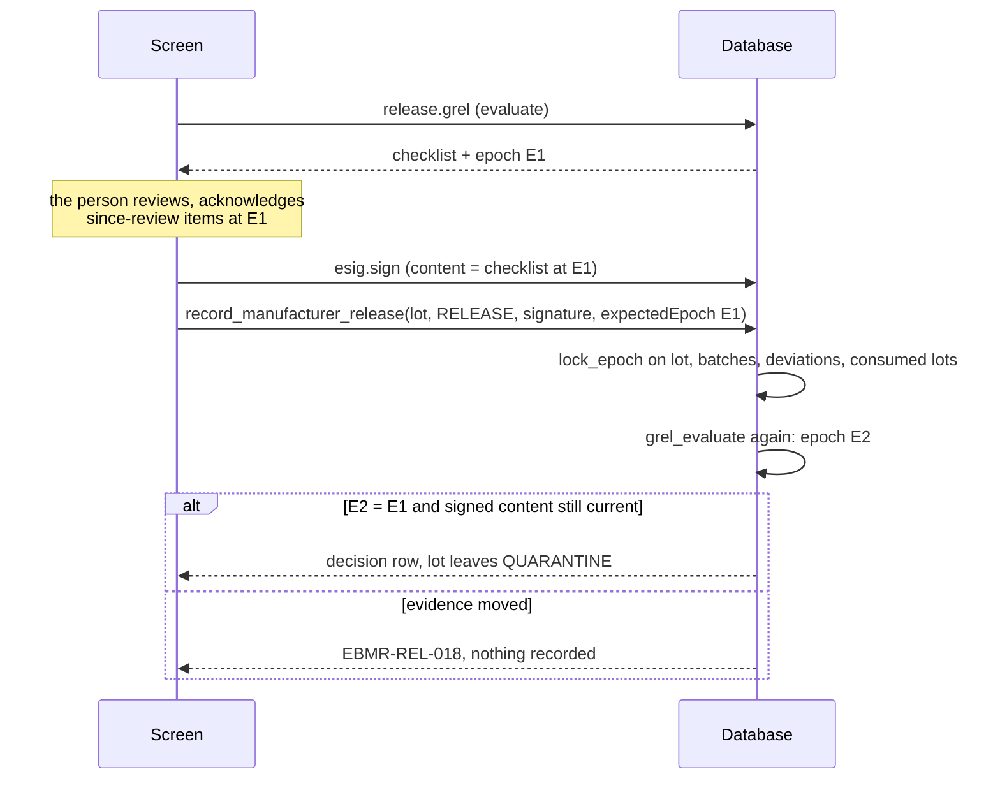

The signature itself is also tied to the content: the content provider (`recipe.manufacturer_release_content`, in
the same way `recipe.batch_review_content` for a review) gives the kernel the checklist as evaluated now, so a
signature made over an older checklist is no longer the current one (`EBMR-REL-017`, `EBMR-DSP-*`, `EBMR-ARL-017`).
Items whose evidence changed after the QA review are flagged "since review" and must each be acknowledged by the
signer at the evaluated epoch ([recipe.acknowledge_release_item](../../../packages/recipe-core/sql/0826_qp_review_fixes.sql#sym=recipe.acknowledge_release_item)) before a RELEASE.

> **Why this exists**
> - **Pharma reason:** a release must rest on the evidence as it is at the moment of signing, not as it was when the
>   screen was opened (EU GMP Annex 16 on certification; 21 CFR 211.22 and 211.192 on the quality unit's review).
> - **Control:** [IN-05](../../../compliance/controls/IN-05.yaml), [DI-37](../../../compliance/controls/DI-37.yaml), invariant INV-05.
> - **Code:** [recipe.record_manufacturer_release](../../../packages/recipe-core/sql/0823_manufacturer_release_cascade.sql#sym=recipe.record_manufacturer_release), [recipe.record_qa_review](../../../packages/recipe-core/sql/0718_review_gates_and_epoch_rows.sql#sym=recipe.record_qa_review), [recipe.check_us_disposition](../../../packages/recipe-core/sql/0822_market_dispositions.sql#sym=recipe.check_us_disposition), [recipe.record_qp_certification](../../../packages/recipe-core/sql/0826_qp_review_fixes.sql#sym=recipe.record_qp_certification), [recipe.record_after_release_decision](../../../packages/recipe-core/sql/0840_after_release.sql#sym=recipe.record_after_release_decision).
> - **Tests:** [release.test.ts](../../../packages/recipe-core/test/release/release.test.ts), [review.test.ts](../../../packages/recipe-core/test/review/review.test.ts), [dispositions.test.ts](../../../packages/recipe-core/test/release/dispositions.test.ts), [release-gate.test.ts](../../../packages/recipe-core/test/mutation/release-gate.test.ts), tests named `[INV-05]`.
> - **Error:** `EBMR-REV-021`, `EBMR-REL-018`, `EBMR-DSP-036`, `EBMR-DSP-075`, `EBMR-ARL-014`.

Where else to read: [architecture section 9](../03-architecture.md#9-e-signatures) for the kernel signing ceremony,
and [the life of a batch, section 10](../04-life-of-a-batch.md#10-record-review-review-by-exception-and-evidence-epochs).

## Batch record review

**What it does.** After execution, Production approves the record, then QA reviews it by exception
(0710 to 0721, 0770, 0931). The register lists every exception and item that needs a decision; QA dispositions each
one, reviews the audit trail of the record (with a delta review for events after the mark), and signs the QA review.
QA can reopen a review; while the record is in review nothing in it changes ([recipe.execution_review_freeze_check](../../../packages/recipe-core/sql/0713_review_freeze.sql#sym=recipe.execution_review_freeze_check),
trigger `zzzr_execution_review_freeze`). Three deviations on a step pause review by exception for that step and open a
re-review task (0715). Free text in another language needs a verified translation; an aborted batch needs its abort
checklist.

**Pharma context.** The quality unit reviews and approves the production record before release (21 CFR 211.192 and
211.22; EU GMP chapter 1; Schedule M). Review by exception is acceptable only when the system reliably flags every
exception ([PR-52](../../../compliance/controls/PR-52.yaml), [DI-26](../../../compliance/controls/DI-26.yaml)). The audit
trail of the record is reviewed as part of the batch review (EU GMP Annex 11 section 9;
[DI-25](../../../compliance/controls/DI-25.yaml)). Nobody involved in the batch reviews it (INV-35).

**Main tables.** [recipe.batch_review_act](../../../packages/recipe-core/sql/0710_review_register.sql#sym=recipe.batch_review_act) (insert-only, one row per signed act and cycle),
[recipe.review_item_disposition](../../../packages/recipe-core/sql/0712_review_acts.sql#sym=recipe.review_item_disposition), [recipe.review_item_view](../../../packages/recipe-core/sql/0712_review_acts.sql#sym=recipe.review_item_view), [recipe.review_list_view](../../../packages/recipe-core/sql/0712_review_acts.sql#sym=recipe.review_list_view),
[recipe.audit_review_scope](../../../packages/recipe-core/sql/0714_evidence_epoch_triggers.sql#sym=recipe.audit_review_scope), [recipe.rbe_rereview_task](../../../packages/recipe-core/sql/0715_rbe_pause.sql#sym=recipe.rbe_rereview_task), [recipe.abort_checklist](../../../packages/recipe-core/sql/0712_review_acts.sql#sym=recipe.abort_checklist),
[recipe.free_text_translation](../../../packages/recipe-core/sql/0712_review_acts.sql#sym=recipe.free_text_translation), [recipe.evidence_epoch](../../../packages/recipe-core/sql/0710_review_register.sql#sym=recipe.evidence_epoch).

**Main functions.** [recipe.record_production_approval](../../../packages/recipe-core/sql/0718_review_gates_and_epoch_rows.sql#sym=recipe.record_production_approval), [recipe.show_review_register](../../../packages/recipe-core/sql/0718_review_gates_and_epoch_rows.sql#sym=recipe.show_review_register),
[recipe.open_review_item](../../../packages/recipe-core/sql/0718_review_gates_and_epoch_rows.sql#sym=recipe.open_review_item), [recipe.dispose_review_items](../../../packages/recipe-core/sql/0721_review_acts_after_quick_review.sql#sym=recipe.dispose_review_items), [recipe.record_audit_trail_review](../../../packages/recipe-core/sql/0721_review_acts_after_quick_review.sql#sym=recipe.record_audit_trail_review),
[recipe.audit_review_events](../../../packages/recipe-core/sql/0931_audit_review_events_once.sql#sym=recipe.audit_review_events), [recipe.record_qa_review](../../../packages/recipe-core/sql/0718_review_gates_and_epoch_rows.sql#sym=recipe.record_qa_review), [recipe.reopen_review](../../../packages/recipe-core/sql/0721_review_acts_after_quick_review.sql#sym=recipe.reopen_review),
[recipe.review_gate_problems](../../../packages/recipe-core/sql/0721_review_acts_after_quick_review.sql#sym=recipe.review_gate_problems), [recipe.batch_review_state](../../../packages/recipe-core/sql/0710_review_register.sql#sym=recipe.batch_review_state), [recipe.batch_involvement](../../../packages/recipe-core/sql/0719_review_involvement_and_scope.sql#sym=recipe.batch_involvement).

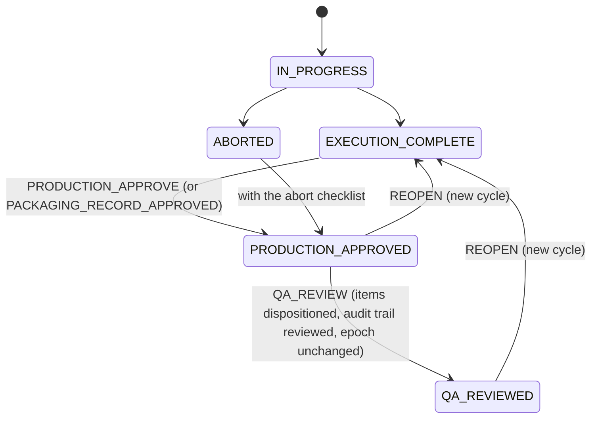

(`recipe.batch_review_state` derives this from the execution status and the acts of the current cycle; it is never
stored.)

> **Why this exists**
> - **Pharma reason:** a reviewer who worked on the batch would be checking their own work.
> - **Control:** [DI-25](../../../compliance/controls/DI-25.yaml), [PR-52](../../../compliance/controls/PR-52.yaml), invariant INV-35.
> - **Code:** the kernel refuses an involved signer from the content provider's `involved` set (`recipe.batch_involvement`, which counts container work since 0719); [recipe.record_audit_trail_review](../../../packages/recipe-core/sql/0721_review_acts_after_quick_review.sql#sym=recipe.record_audit_trail_review) checks it again; [recipe.dispose_review_items](../../../packages/recipe-core/sql/0721_review_acts_after_quick_review.sql#sym=recipe.dispose_review_items) refuses a person who raised, worked in the step of, or dispositioned the exception.
> - **Tests:** [review.test.ts](../../../packages/recipe-core/test/review/review.test.ts) "[INV-35][DI-25] a person involved in the batch cannot sign its audit-trail review", [involvement-and-independence.test.ts](../../../packages/recipe-core/test/mutation/involvement-and-independence.test.ts).
> - **Error:** `EBMR-ESIG-045` (kernel, at signing), `EBMR-REV-012`, `EBMR-REV-053`.

> **Why this exists**
> - **Pharma reason:** after Production approved the record, corrections go only through a QA reopen, so what QA
>   reviews is what stays in the record.
> - **Control:** [PR-52](../../../compliance/controls/PR-52.yaml), L-09, invariant INV-30.
> - **Code:** [recipe.execution_review_freeze_check](../../../packages/recipe-core/sql/0713_review_freeze.sql#sym=recipe.execution_review_freeze_check) (0713).
> - **Tests:** [review.test.ts](../../../packages/recipe-core/test/review/review.test.ts), [review-routes.test.ts](../../../apps/tablets-server/test/review/review-routes.test.ts).
> - **Error:** `EBMR-REV-040`.

> **Why this exists**
> - **Pharma reason:** review by exception is valid only if grouped acceptance is limited to non-critical items with
>   one justification, and critical items are opened before they are escalated.
> - **Control:** [PR-52](../../../compliance/controls/PR-52.yaml), [DI-26](../../../compliance/controls/DI-26.yaml).
> - **Code:** [recipe.dispose_review_items](../../../packages/recipe-core/sql/0721_review_acts_after_quick_review.sql#sym=recipe.dispose_review_items), [recipe.open_review_item](../../../packages/recipe-core/sql/0718_review_gates_and_epoch_rows.sql#sym=recipe.open_review_item).
> - **Tests:** [review.test.ts](../../../packages/recipe-core/test/review/review.test.ts), [register-routes.test.ts](../../../apps/tablets-server/test/review/register-routes.test.ts).
> - **Error:** `EBMR-REV-050` to `EBMR-REV-058`.

**How to test it.** `pnpm vitest run --project db packages/recipe-core/test/review`;
`apps/tablets-server/test/review/` over HTTP; the browser test `tools/e2e/specs/review/review-flow.spec.ts`.

**Pitfalls.**
- The register once recorded "an item was shown" from a function called in a `WHERE` clause, which PostgreSQL may call
  any number of times; never put a side effect in `WHERE` ([defect log](../08-defect-log.md#p4-the-review-register-recorded-a-showing-from-a-where-clause)).
- The audit-trail review's event list was 80 times slower than its query until 0931 read each event once
  ([audit-events-once.test.ts](../../../apps/tablets-server/test/review/audit-events-once.test.ts)).
- A correction's evidence document counts only while its stored bytes match its SHA-256 (0770;
  [defect log](../08-defect-log.md#p4-slice-2-high-evidence-matched-by-hash-alone)).

**Every refusal in this area** (generated from the migrations, see the note at the top):

| Function | Refuses (code and message, shortened) | Controls | Tests that assert a code |
|---|---|---|---|
| [recipe.assert_review_signature](../../../packages/recipe-core/sql/0712_review_acts.sql#sym=recipe.assert_review_signature) | `EBMR-REV-005` … (DI-35, DI-37) | [DI-35](../../../compliance/controls/DI-35.yaml), [DI-37](../../../compliance/controls/DI-37.yaml) | [review.test.ts](../../../packages/recipe-core/test/review/review.test.ts) |
| [recipe.assert_translation_open](../../../packages/recipe-core/sql/0712_review_acts.sql#sym=recipe.assert_translation_open) | `EBMR-REV-061` the record is …; translations are completed before the production approval (D-P4-12; reopen the review to … | [DI-25](../../../compliance/controls/DI-25.yaml), [DI-26](../../../compliance/controls/DI-26.yaml), [DI-34](../../../compliance/controls/DI-34.yaml), [PR-52](../../../compliance/controls/PR-52.yaml), [PR-16](../../../compliance/controls/PR-16.yaml), INV-30, INV-35, INV-48 | [review.test.ts](../../../packages/recipe-core/test/review/review.test.ts) |
| [recipe.dispose_review_items](../../../packages/recipe-core/sql/0721_review_acts_after_quick_review.sql#sym=recipe.dispose_review_items) | `EBMR-REV-050` the record is …; QA dispositions register items in its review, which follows the production approval …<br>`EBMR-REV-051` a … names one item; only non-critical items are accepted together (PR-52)<br>`EBMR-REV-052` exception … is already … in review (DI-26)<br>`EBMR-REV-053` this person raised, worked in the step of, or dispositioned exception …, so they cannot conclude its …<br>`EBMR-REV-054` items accepted together carry one justification (PR-52)<br>`EBMR-REV-055` exception … is critical; its detail is opened before it is escalated (PR-52, outline 7.3)<br>`EBMR-REV-056` exception … is on step …, whose review by exception is paused after three deviations; it is reviewed on …<br>`EBMR-REV-057` items are accepted together only when they share one linked deviation (PR-52, outline 7.3)<br>`EBMR-REV-058` grouped acceptance follows the showing of the full list of register items to this person (PR-52, outline 7.3) | [DI-34](../../../compliance/controls/DI-34.yaml), [PR-52](../../../compliance/controls/PR-52.yaml), [DI-26](../../../compliance/controls/DI-26.yaml), [PR-07](../../../compliance/controls/PR-07.yaml), INV-30, INV-03 | [gmp-references.test.ts](../../../packages/recipe-core/test/lifecycle/gmp-references.test.ts), [review.test.ts](../../../packages/recipe-core/test/review/review.test.ts) (+1) |
| [recipe.execution_review_freeze_check](../../../packages/recipe-core/sql/0713_review_freeze.sql#sym=recipe.execution_review_freeze_check)<br>trigger `zzzr_execution_review_freeze` on `recipe.execution_state` | `EBMR-REV-040` the record of batch … is …: nothing in it changes until QA reopens its review with a reason; corrections … | [PR-52](../../../compliance/controls/PR-52.yaml), [DI-34](../../../compliance/controls/DI-34.yaml), INV-30 | [review.test.ts](../../../packages/recipe-core/test/review/review.test.ts), [review.test.tsx](../../../apps/tablets-web/test/review/review.test.tsx) |
| [recipe.open_review_item](../../../packages/recipe-core/sql/0718_review_gates_and_epoch_rows.sql#sym=recipe.open_review_item) | `EBMR-REV-050` batch … has no register item … (DI-26) | [DI-26](../../../compliance/controls/DI-26.yaml) | [review.test.ts](../../../packages/recipe-core/test/review/review.test.ts) |
| [recipe.record_abort_checklist](../../../packages/recipe-core/sql/0718_review_gates_and_epoch_rows.sql#sym=recipe.record_abort_checklist) | `EBMR-REV-060` the record is …; the abort checklist belongs to an ABORTED record before its production approval (L-20) | [DI-25](../../../compliance/controls/DI-25.yaml), [DI-26](../../../compliance/controls/DI-26.yaml), [DI-34](../../../compliance/controls/DI-34.yaml), [PR-52](../../../compliance/controls/PR-52.yaml), [PR-16](../../../compliance/controls/PR-16.yaml), INV-30, INV-35, INV-48 | [review.test.ts](../../../packages/recipe-core/test/review/review.test.ts) |
| [recipe.record_audit_trail_review](../../../packages/recipe-core/sql/0721_review_acts_after_quick_review.sql#sym=recipe.record_audit_trail_review) | `EBMR-REV-010` … names no audit-trail review of a batch record (&lt;batch&gt;/&lt;n&gt;)<br>`EBMR-REV-011` … is not the next audit-trail review of the record (… is); reload the report<br>`EBMR-REV-012` a person involved in the batch (who entered, corrected or signed in it, or approved it for production) …<br>`EBMR-REV-013` audit events in scope were recorded while review … was signed; reload the report and sign again (INV-48, … | [DI-37](../../../compliance/controls/DI-37.yaml), INV-35, INV-48 |  |
| [recipe.record_production_approval](../../../packages/recipe-core/sql/0718_review_gates_and_epoch_rows.sql#sym=recipe.record_production_approval) | `EBMR-REV-002` the record cannot be approved by production | [DI-25](../../../compliance/controls/DI-25.yaml), [DI-26](../../../compliance/controls/DI-26.yaml), [DI-34](../../../compliance/controls/DI-34.yaml), [PR-52](../../../compliance/controls/PR-52.yaml), [PR-16](../../../compliance/controls/PR-16.yaml), INV-30, INV-35, INV-48 | [review.test.ts](../../../packages/recipe-core/test/review/review.test.ts) |
| [recipe.record_qa_review](../../../packages/recipe-core/sql/0718_review_gates_and_epoch_rows.sql#sym=recipe.record_qa_review) | `EBMR-REV-020` the record cannot be QA reviewed<br>`EBMR-REV-021` the evidence of the record changed after it was evaluated (epoch …, now …); review it again (DI-37) | [DI-37](../../../compliance/controls/DI-37.yaml) | [review.test.ts](../../../packages/recipe-core/test/review/review.test.ts), [review-routes.test.ts](../../../apps/tablets-server/test/review/review-routes.test.ts) (+1) |
| [recipe.record_translation](../../../packages/recipe-core/sql/0718_review_gates_and_epoch_rows.sql#sym=recipe.record_translation) | `EBMR-REV-062` the record holds no free text … (D-P4-12) | [DI-25](../../../compliance/controls/DI-25.yaml), [DI-26](../../../compliance/controls/DI-26.yaml), [DI-34](../../../compliance/controls/DI-34.yaml), [PR-52](../../../compliance/controls/PR-52.yaml), [PR-16](../../../compliance/controls/PR-16.yaml), INV-30, INV-35, INV-48 | [review.test.ts](../../../packages/recipe-core/test/review/review.test.ts) |
| [recipe.reopen_review](../../../packages/recipe-core/sql/0721_review_acts_after_quick_review.sql#sym=recipe.reopen_review) | `EBMR-REV-030` the review cannot be reopened | [DI-25](../../../compliance/controls/DI-25.yaml), [DI-26](../../../compliance/controls/DI-26.yaml), [DI-34](../../../compliance/controls/DI-34.yaml), [PR-52](../../../compliance/controls/PR-52.yaml), [PR-16](../../../compliance/controls/PR-16.yaml), INV-30, INV-35, INV-48 | [review.test.ts](../../../packages/recipe-core/test/review/review.test.ts) |
| [recipe.review_batch](../../../packages/recipe-core/sql/0712_review_acts.sql#sym=recipe.review_batch) | `EBMR-REV-001` … is no GMP batch record; review applies to the records of issued GMP batches (outline 5.2.2) | [DI-25](../../../compliance/controls/DI-25.yaml), [DI-26](../../../compliance/controls/DI-26.yaml), [DI-34](../../../compliance/controls/DI-34.yaml), [PR-52](../../../compliance/controls/PR-52.yaml), [PR-16](../../../compliance/controls/PR-16.yaml), INV-30, INV-35, INV-48 |  |
| [recipe.review_gate_problems](../../../packages/recipe-core/sql/0721_review_acts_after_quick_review.sql#sym=recipe.review_gate_problems) | `EBMR-REV-001` … is not a review act | [DI-25](../../../compliance/controls/DI-25.yaml), [DI-26](../../../compliance/controls/DI-26.yaml), [DI-34](../../../compliance/controls/DI-34.yaml), [PR-52](../../../compliance/controls/PR-52.yaml), [PR-16](../../../compliance/controls/PR-16.yaml), INV-30, INV-35, INV-48 |  |
| [recipe.verify_translation](../../../packages/recipe-core/sql/0718_review_gates_and_epoch_rows.sql#sym=recipe.verify_translation) | `EBMR-REV-063` there is no translation … (D-P4-12)<br>`EBMR-REV-064` a translation is verified by a second person, not by its translator (D-P4-12, outline 7.4) | [DI-25](../../../compliance/controls/DI-25.yaml), [DI-26](../../../compliance/controls/DI-26.yaml), [DI-34](../../../compliance/controls/DI-34.yaml), [PR-52](../../../compliance/controls/PR-52.yaml), [PR-16](../../../compliance/controls/PR-16.yaml), INV-30, INV-35, INV-48 | [review.test.ts](../../../packages/recipe-core/test/review/review.test.ts) |

## The release gate G-REL and the manufacturer release

**What it does.** G-REL is the checklist a finished lot must pass before release, per market
([recipe.grel_evaluate](../../../packages/recipe-core/sql/0892_grel_licence_item.sql#sym=recipe.grel_evaluate); core items [recipe.grel_core_items](../../../packages/recipe-core/sql/0932_grel_validation_basis_lineage.sql#sym=recipe.grel_core_items), market items [recipe.grel_market_items](../../../packages/recipe-core/sql/0822_market_dispositions.sql#sym=recipe.grel_market_items),
licence item [recipe.grel_licence_item](../../../packages/recipe-core/sql/0892_grel_licence_item.sql#sym=recipe.grel_licence_item); the edition adds its own items through a registered hook,
[recipe.register_grel_edition_hook](../../../packages/recipe-core/sql/0780_grel_interfaces.sql#sym=recipe.register_grel_edition_hook)). Groups: G1 review, G2 deviations (and registration, change notification),
G3 LIMS, extra testing, reserve samples, G4 reconciliation and G9 pack examination (edition, fail closed), G5
materials, G6 validation basis, post-change evaluation, PPQ, licence, G7 incidents, G8 market add, G11 market items.
The manufacturer release ([recipe.record_manufacturer_release](../../../packages/recipe-core/sql/0823_manufacturer_release_cascade.sql#sym=recipe.record_manufacturer_release)) is signed by the authorised person (AP) or a
named delegate; RELEASE needs every item green and every since-review item acknowledged; REJECT needs a reason. The
finished lot leaves QUARANTINE in the same transaction. Supporting acts: [recipe.record_post_change_evaluation](../../../packages/recipe-core/sql/0781_manufacturer_release.sql#sym=recipe.record_post_change_evaluation),
[recipe.record_ppq_outcome](../../../packages/recipe-core/sql/0781_manufacturer_release.sql#sym=recipe.record_ppq_outcome), [recipe.justify_open_investigation](../../../packages/recipe-core/sql/0783_justification_links.sql#sym=recipe.justify_open_investigation) (PR-53: an open investigation may be
justified for release, never an OOS, a registration-relevant or a yield exception, never a CONFIRMED impact). Reads for
the cockpit are in 0782. Item G6.VALIDATION_BASIS walks back to the last process-impacting master version (0932).

**Pharma context.** Release is the decision that a lot may be sold. Schedule M and 21 CFR 211.22 give it to the quality
unit; EU GMP Annex 16 to the QP; the batch must have been made and checked per its master and marketing
authorisation, with every deviation assessed ([IN-05](../../../compliance/controls/IN-05.yaml),
[PR-45](../../../compliance/controls/PR-45.yaml), [PR-53](../../../compliance/controls/PR-53.yaml),
[IN-03](../../../compliance/controls/IN-03.yaml), [PR-09](../../../compliance/controls/PR-09.yaml),
[PR-44](../../../compliance/controls/PR-44.yaml), [IN-32](../../../compliance/controls/IN-32.yaml),
[DI-12](../../../compliance/controls/DI-12.yaml)). See the [primer, section 11](../01-pharma-primer.md#11-release-manufacturer-release-market-dispositions-and-the-gate-g-rel).

**Main tables.** [recipe.manufacturer_release_decision](../../../packages/recipe-core/sql/0781_manufacturer_release.sql#sym=recipe.manufacturer_release_decision), [recipe.grel_acknowledgement](../../../packages/recipe-core/sql/0781_manufacturer_release.sql#sym=recipe.grel_acknowledgement),
[recipe.post_change_evaluation](../../../packages/recipe-core/sql/0781_manufacturer_release.sql#sym=recipe.post_change_evaluation), [recipe.ppq_outcome](../../../packages/recipe-core/sql/0781_manufacturer_release.sql#sym=recipe.ppq_outcome), [recipe.open_investigation_justification](../../../packages/recipe-core/sql/0781_manufacturer_release.sql#sym=recipe.open_investigation_justification),
[recipe.grel_edition_hook](../../../packages/recipe-core/sql/0780_grel_interfaces.sql#sym=recipe.grel_edition_hook).

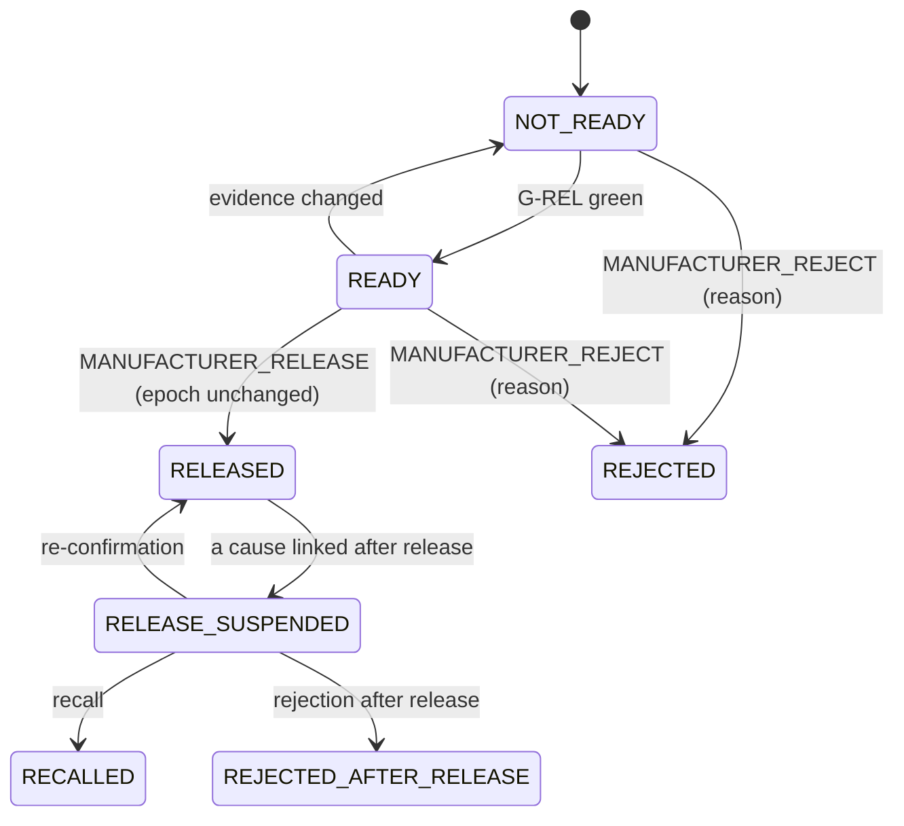

Only RELEASED and REJECTED are stored; [recipe.manufacturer_release_state](../../../packages/recipe-core/sql/0840_after_release.sql#sym=recipe.manufacturer_release_state) derives the rest (through
[recipe.after_release_state](../../../packages/recipe-core/sql/0840_after_release.sql#sym=recipe.after_release_state) since 0840).

> **Why this exists**
> - **Pharma reason:** only the authorised person (or a named, still-valid delegate) releases, never someone involved in
>   the lot's records, and only from quarantine.
> - **Control:** [IN-05](../../../compliance/controls/IN-05.yaml), [DI-35](../../../compliance/controls/DI-35.yaml), invariants INV-05 and INV-35.
> - **Code:** [recipe.record_manufacturer_release](../../../packages/recipe-core/sql/0823_manufacturer_release_cascade.sql#sym=recipe.record_manufacturer_release), [recipe.assert_release_signature](../../../packages/recipe-core/sql/0781_manufacturer_release.sql#sym=recipe.assert_release_signature), [recipe.release_involvement](../../../packages/recipe-core/sql/0781_manufacturer_release.sql#sym=recipe.release_involvement).
> - **Tests:** [release.test.ts](../../../packages/recipe-core/test/release/release.test.ts) "[INV-35][IN-05] a person involved in the lot's records never decides its release", [release-routes.test.ts](../../../apps/tablets-server/test/release/release-routes.test.ts).
> - **Error:** `EBMR-REL-014`, `EBMR-REL-015`, `EBMR-REL-016`, `EBMR-REL-018`, `EBMR-REL-019`, `EBMR-REL-020`.

> **Why this exists**
> - **Pharma reason:** a lot is released only once every linked investigation is closed, unless the release authority
>   signs a justification that the investigation is advanced enough; an OOS or a confirmed impact can never be
>   justified away.
> - **Control:** [PR-53](../../../compliance/controls/PR-53.yaml), [PR-08](../../../compliance/controls/PR-08.yaml), invariant INV-46.
> - **Code:** [recipe.justify_open_investigation](../../../packages/recipe-core/sql/0783_justification_links.sql#sym=recipe.justify_open_investigation) (0783 reads every link structurally).
> - **Tests:** [release.test.ts](../../../packages/recipe-core/test/release/release.test.ts) "[PR-53] every link of an open record is read structurally".
> - **Error:** `EBMR-REL-040` to `EBMR-REL-044`.

**How to test it.** `pnpm vitest run --project db packages/recipe-core/test/release/release.test.ts
packages/recipe-core/test/mutation/release-gate.test.ts`; the Tablets items in
[grel-tablets-items.test.ts](../../../apps/tablets-server/test/release/grel-tablets-items.test.ts); browser tests
`tools/e2e/specs/release/`.

**Pitfalls.** The PR-53 justification once read the first message only, and a CONFIRMED impact could be justified
([defect log](../08-defect-log.md#p4-slice-3-pr-53-justification-read-the-first-message-only)); Tablets items failed
open ([defect log](../08-defect-log.md#p4-slice-3-tablets-items-failed-open)): an item that cannot be evaluated must
be RED, never NA; G6.VALIDATION_BASIS read only the batch's own master version, so a harmless revision blocked every
later lot ([F-A1](../08-defect-log.md#f-a1-g6validation_basis-phase-4-mutation-run-recipe-core-0932)).

**Every refusal in this area** (generated from the migrations, see the note at the top):

| Function | Refuses (code and message, shortened) | Controls | Tests that assert a code |
|---|---|---|---|
| [recipe.acknowledge_release_item](../../../packages/recipe-core/sql/0826_qp_review_fixes.sql#sym=recipe.acknowledge_release_item) | `EBMR-REL-050` the evidence changed since it was shown; acknowledge the item in the current evaluation (INV-05)<br>`EBMR-REL-051` … is no item that changed after the QA review | [IN-05](../../../compliance/controls/IN-05.yaml), [PR-53](../../../compliance/controls/PR-53.yaml), [PR-09](../../../compliance/controls/PR-09.yaml), [IN-03](../../../compliance/controls/IN-03.yaml), [DI-12](../../../compliance/controls/DI-12.yaml), INV-05 | [release.test.ts](../../../packages/recipe-core/test/release/release.test.ts), [release-routes.test.ts](../../../apps/tablets-server/test/release/release-routes.test.ts) |
| [recipe.assert_release_signature](../../../packages/recipe-core/sql/0781_manufacturer_release.sql#sym=recipe.assert_release_signature) | `EBMR-REL-013` … (DI-35, DI-37) | [DI-35](../../../compliance/controls/DI-35.yaml), [DI-37](../../../compliance/controls/DI-37.yaml) | [record-lock.test.ts](../../../packages/recipe-core/test/lifecycle/record-lock.test.ts), [release-gate.test.ts](../../../packages/recipe-core/test/mutation/release-gate.test.ts) (+3) |
| [recipe.grel_evaluate](../../../packages/recipe-core/sql/0892_grel_licence_item.sql#sym=recipe.grel_evaluate) | `EBMR-REL-002` G-REL is evaluated for IN, US or EU, not … |  | [grel-interfaces.test.ts](../../../apps/tablets-server/test/release/grel-interfaces.test.ts) |
| [recipe.justify_open_investigation](../../../packages/recipe-core/sql/0783_justification_links.sql#sym=recipe.justify_open_investigation) | `EBMR-REL-040` an open investigation is justified for the manufacturer release (IN) here, not for …<br>`EBMR-REL-041` the open-investigation path is off: a lot is released only once every linked investigation is closed or …<br>`EBMR-REL-042` the deviation is not linked to the lot or a batch of its records<br>`EBMR-REL-043` a rule its problem function reports (the reason its check returns)<br>`EBMR-REL-044` the justification states why the investigation is advanced enough to support the decision (PR-53) | [PR-53](../../../compliance/controls/PR-53.yaml) | [release-gate.test.ts](../../../packages/recipe-core/test/mutation/release-gate.test.ts), [release.test.ts](../../../packages/recipe-core/test/release/release.test.ts) |
| [recipe.record_manufacturer_release](../../../packages/recipe-core/sql/0823_manufacturer_release_cascade.sql#sym=recipe.record_manufacturer_release) | `EBMR-REL-011` … is no decision of the manufacturer release (RELEASE or REJECT)<br>`EBMR-REL-012` the manufacturer release of lot … is already …<br>`EBMR-REL-013` … (DI-35, DI-37)<br>`EBMR-REL-014` the manufacturer release is signed by the authorised person or a named delegate in that role, not as … …<br>`EBMR-REL-015` the delegation the signer cited is no longer valid: … (IN-05 (b), outline 7.1)<br>`EBMR-REL-016` a person involved in the lot's records never decides its release (INV-35, IN-05)<br>`EBMR-REL-017` a rule its problem function reports (the reason its check returns)<br>`EBMR-REL-018` the evidence of lot … changed after it was evaluated (epoch …, now …); evaluate G-REL again (INV-05, DI-37)<br>`EBMR-REL-019` lot … is …: the manufacturer release decides a lot in quarantine<br>`EBMR-REL-020` lot … is not READY: … (IN-05, INV-05)<br>`EBMR-REL-021` item … changed after the QA review; the signer acknowledges it at the current evaluation before releasing …<br>`EBMR-REL-022` a rejection states the person's own reason (DI-22, L-20) | [DI-37](../../../compliance/controls/DI-37.yaml), [DI-35](../../../compliance/controls/DI-35.yaml), [IN-05](../../../compliance/controls/IN-05.yaml), [DI-22](../../../compliance/controls/DI-22.yaml), INV-05, INV-35 | [record-lock.test.ts](../../../packages/recipe-core/test/lifecycle/record-lock.test.ts), [release-gate.test.ts](../../../packages/recipe-core/test/mutation/release-gate.test.ts) (+4) |
| [recipe.record_post_change_evaluation](../../../packages/recipe-core/sql/0781_manufacturer_release.sql#sym=recipe.record_post_change_evaluation) | `EBMR-REL-030` the batch is not the first made under a changed master; no post-change evaluation is due (IN-03 (c))<br>`EBMR-REL-031` the record is …; the post-change evaluation follows its QA review (IN-03 (c))<br>`EBMR-REL-032` the post-change evaluation of the batch is already recorded<br>`EBMR-REL-033` the post-change evaluation states what was evaluated and found (IN-03 (c)) | [IN-03](../../../compliance/controls/IN-03.yaml) | [release-gate.test.ts](../../../packages/recipe-core/test/mutation/release-gate.test.ts), [release.test.ts](../../../packages/recipe-core/test/release/release.test.ts) |
| [recipe.record_ppq_outcome](../../../packages/recipe-core/sql/0781_manufacturer_release.sql#sym=recipe.record_ppq_outcome) | `EBMR-REL-034` the batch was made for …, under no validation protocol (PR-09)<br>`EBMR-REL-035` … is no validation outcome (PASSED, FAILED or CONCURRENT\_RELEASE)<br>`EBMR-REL-036` the validation outcome of the batch is already …; it is final (PR-09)<br>`EBMR-REL-037` concurrent release is recorded on the batch's complete protocol results, after its QA review (PR-09) | [PR-09](../../../compliance/controls/PR-09.yaml) | [release-gate.test.ts](../../../packages/recipe-core/test/mutation/release-gate.test.ts), [release.test.ts](../../../packages/recipe-core/test/release/release.test.ts) |
| [recipe.register_grel_edition_hook](../../../packages/recipe-core/sql/0780_grel_interfaces.sql#sym=recipe.register_grel_edition_hook) | `EBMR-REL-001` the G-REL edition hook … must have the signature (uuid, text) returns jsonb |  |  |
| [recipe.release_scope](../../../packages/recipe-core/sql/0781_manufacturer_release.sql#sym=recipe.release_scope) | `EBMR-REL-010` … is no finished lot of a packaging batch | [IN-05](../../../compliance/controls/IN-05.yaml), [PR-53](../../../compliance/controls/PR-53.yaml), [PR-09](../../../compliance/controls/PR-09.yaml), [IN-03](../../../compliance/controls/IN-03.yaml), [DI-12](../../../compliance/controls/DI-12.yaml), INV-05, INV-35, INV-48 | [release-gate.test.ts](../../../packages/recipe-core/test/mutation/release-gate.test.ts), [dispositions.test.ts](../../../packages/recipe-core/test/release/dispositions.test.ts) (+1) |

## Notification centre

**What it does.** Notifications to departments (0810 to 0812). When a manufacturer decision is recorded, the trigger
[zzzn_notify_departments](../../../packages/recipe-core/sql/0811_release_decision_notifies.sql#sym=zzzn_notify_departments) calls [recipe.notify_on_release_decision](../../../packages/recipe-core/sql/0811_release_decision_notifies.sql#sym=recipe.notify_on_release_decision), which notifies Production and QA
([recipe.notify_departments_of_release](../../../packages/recipe-core/sql/0810_notification_centre.sql#sym=recipe.notify_departments_of_release)). A person of the department acknowledges a notification
([recipe.acknowledge_notification](../../../packages/recipe-core/sql/0812_notification_ack_permission.sql#sym=recipe.acknowledge_notification)), which is a write and so checks a permission after refusing administrators
(0812). Tables: [recipe.notification](../../../packages/recipe-core/sql/0810_notification_centre.sql#sym=recipe.notification), [recipe.notification_acknowledgement](../../../packages/recipe-core/sql/0810_notification_centre.sql#sym=recipe.notification_acknowledgement),
[recipe.notification_department](../../../packages/recipe-core/sql/0810_notification_centre.sql#sym=recipe.notification_department), [recipe.notification_department_role](../../../packages/recipe-core/sql/0810_notification_centre.sql#sym=recipe.notification_department_role). The general outbox is in
[architecture section 16](../03-architecture.md#16-notifications-and-the-outbox).

**Pharma context.** Both Production and QA are told of a release decision (Schedule M; control
[IN-39](../../../compliance/controls/IN-39.yaml) clause 2).

**Every refusal in this area** (generated from the migrations, see the note at the top):

| Function | Refuses (code and message, shortened) | Controls | Tests that assert a code |
|---|---|---|---|
| [recipe.acknowledge_notification](../../../packages/recipe-core/sql/0812_notification_ack_permission.sql#sym=recipe.acknowledge_notification) | `EBMR-NTF-002` there is no notification …<br>`EBMR-NTF-003` the notification is for the … department; you are working as …, which is not part of it (IN-39)<br>`EBMR-NTF-004` you acknowledged this notification already | [IN-39](../../../compliance/controls/IN-39.yaml) | [notification-centre.test.ts](../../../apps/tablets-server/test/notifications/notification-centre.test.ts) |
| [recipe.notify_departments_of_release](../../../packages/recipe-core/sql/0810_notification_centre.sql#sym=recipe.notify_departments_of_release) | `EBMR-NTF-001` decision … is neither RELEASE nor REJECT: both departments could not be notified (IN-39) | [IN-39](../../../compliance/controls/IN-39.yaml) | [notification-centre.test.ts](../../../apps/tablets-server/test/notifications/notification-centre.test.ts) |

## Market dispositions and QP certification

**What it does.** After the manufacturer release (always India, the licence market), each export market gets its own
decision (0820 to 0826):

- **US:** the quality control unit releases or rejects ([recipe.record_us_disposition](../../../packages/recipe-core/sql/0822_market_dispositions.sql#sym=recipe.record_us_disposition), checks in
  [recipe.check_us_disposition](../../../packages/recipe-core/sql/0822_market_dispositions.sql#sym=recipe.check_us_disposition)). The AP who also holds the QCU permission may release for the manufacturer and
  the US in one ceremony ([recipe.record_release_with_us_disposition](../../../packages/recipe-core/sql/0822_market_dispositions.sql#sym=recipe.record_release_with_us_disposition)). A rejection names its deviation record.
- **EU:** a qualified person (QP) of the importer certifies. The outcome arrives as a signed message
  ([recipe.take_qp_message](../../../packages/recipe-core/sql/0826_qp_review_fixes.sql#sym=recipe.take_qp_message), every message acknowledged ACCEPTED or REFUSED), as a transcription checked by a
  second QA person ([recipe.record_qp_transcription](../../../packages/recipe-core/sql/0824_qp_certification.sql#sym=recipe.record_qp_transcription), [recipe.verify_qp_transcription](../../../packages/recipe-core/sql/0824_qp_certification.sql#sym=recipe.verify_qp_transcription)), or, with the switch
  on, signed in the system by a registered QP ([recipe.record_qp_certification](../../../packages/recipe-core/sql/0826_qp_review_fixes.sql#sym=recipe.record_qp_certification), [recipe.register_qp](../../../packages/recipe-core/sql/0824_qp_certification.sql#sym=recipe.register_qp)).
  Importers are registered by QA ([recipe.register_eu_importer](../../../packages/recipe-core/sql/0824_qp_certification.sql#sym=recipe.register_eu_importer)).
- **Market set changes** after issue: a market is added under a change record and evaluated
  ([recipe.record_market_change](../../../packages/recipe-core/sql/0821_market_changes.sql#sym=recipe.record_market_change), [recipe.market_add_evaluate](../../../packages/recipe-core/sql/0821_market_changes.sql#sym=recipe.market_add_evaluate): MET, UNMET_RECOVERABLE or UNMET_FINAL); a
  market is removed with a linked deviation record. India can never be removed (INV-28).
- The manufacturer release cascades: a decided export market reads RELEASE_SUSPENDED while the manufacturer release is
  not RELEASED ([recipe.cascade_market_dispositions](../../../packages/recipe-core/sql/0822_market_dispositions.sql#sym=recipe.cascade_market_dispositions), INV-39). The state of each market is
  [recipe.disposition_state](../../../packages/recipe-core/sql/0840_after_release.sql#sym=recipe.disposition_state); the shipping interlock (site services) reads it.

**Pharma context.** One batch may serve several markets; each market's rules decide who releases it there (21 CFR
211.22 for the US QCU, EU GMP Annex 16 for the QP; [PR-54](../../../compliance/controls/PR-54.yaml),
[PR-55](../../../compliance/controls/PR-55.yaml), [PR-56](../../../compliance/controls/PR-56.yaml),
[DI-39](../../../compliance/controls/DI-39.yaml)). A transcribed certificate is a manually entered critical record, so
a second person checks it ([DI-30](../../../compliance/controls/DI-30.yaml)). A rejection in one market is visible to
the others (PR-56).

**Main tables.** [recipe.us_disposition_decision](../../../packages/recipe-core/sql/0822_market_dispositions.sql#sym=recipe.us_disposition_decision), [recipe.qp_certification](../../../packages/recipe-core/sql/0824_qp_certification.sql#sym=recipe.qp_certification), [recipe.qp_message_ack](../../../packages/recipe-core/sql/0824_qp_certification.sql#sym=recipe.qp_message_ack),
[recipe.qp_register](../../../packages/recipe-core/sql/0824_qp_certification.sql#sym=recipe.qp_register), [recipe.qp_transcription_check](../../../packages/recipe-core/sql/0824_qp_certification.sql#sym=recipe.qp_transcription_check), [recipe.eu_importer](../../../packages/recipe-core/sql/0820_market_disposition_interfaces.sql#sym=recipe.eu_importer),
[recipe.eu_importer_product](../../../packages/recipe-core/sql/0820_market_disposition_interfaces.sql#sym=recipe.eu_importer_product), [recipe.market_change](../../../packages/recipe-core/sql/0821_market_changes.sql#sym=recipe.market_change), [recipe.market_disposition_event](../../../packages/recipe-core/sql/0822_market_dispositions.sql#sym=recipe.market_disposition_event).

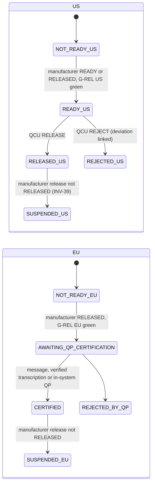

(SUSPENDED_US and SUSPENDED_EU are both the state `RELEASE_SUSPENDED`; the names differ only to draw two boxes. Either
market may also read INELIGIBLE, terminal after an UNMET_FINAL market-add evaluation, or REMOVED.)

> **Why this exists**
> - **Pharma reason:** a market is decided only after the manufacturer release, on the evidence current at signing,
>   by the right person for that market, never by someone involved in the lot.
> - **Control:** [PR-54](../../../compliance/controls/PR-54.yaml), [PR-55](../../../compliance/controls/PR-55.yaml), [DI-39](../../../compliance/controls/DI-39.yaml), invariants INV-05, INV-35, INV-39.
> - **Code:** [recipe.check_us_disposition](../../../packages/recipe-core/sql/0822_market_dispositions.sql#sym=recipe.check_us_disposition), [recipe.record_qp_certification](../../../packages/recipe-core/sql/0826_qp_review_fixes.sql#sym=recipe.record_qp_certification), [recipe.eu_outcome_problem](../../../packages/recipe-core/sql/0824_qp_certification.sql#sym=recipe.eu_outcome_problem), [recipe.market_act_problem](../../../packages/recipe-core/sql/0822_market_dispositions.sql#sym=recipe.market_act_problem).
> - **Tests:** [dispositions.test.ts](../../../packages/recipe-core/test/release/dispositions.test.ts), [market-routes.test.ts](../../../apps/tablets-server/test/release/market-routes.test.ts), [qp-shipping-routes.test.ts](../../../apps/tablets-server/test/release/qp-shipping-routes.test.ts).
> - **Error:** `EBMR-DSP-030` to `EBMR-DSP-042`, `EBMR-DSP-050` to `EBMR-DSP-076`.

> **Why this exists**
> - **Pharma reason:** a certification message is trusted only when signed with the registered importer's key and
>   naming the importer of the lot's product; a refused message changes nothing, and a correct resend is evaluated
>   afresh.
> - **Control:** [DI-39](../../../compliance/controls/DI-39.yaml), [DI-31](../../../compliance/controls/DI-31.yaml).
> - **Code:** [recipe.take_qp_message](../../../packages/recipe-core/sql/0826_qp_review_fixes.sql#sym=recipe.take_qp_message) (owner only; the edition's intake verifies the Ed25519 signature).
> - **Tests:** [dispositions.test.ts](../../../packages/recipe-core/test/release/dispositions.test.ts) "[DI-39] a resend of a refused message is evaluated afresh".
> - **Error:** `EBMR-DSP-080` to `EBMR-DSP-085`.

**Pitfalls.** Deduplication once applied to refusals, so a correct resend was ignored
([defect log](../08-defect-log.md#p4-slice-4-high-a-refused-qp-message-blocked-the-importers-correct-resend)). A
recalled or rejected market could be removed from the lot's set, hiding a recall (0841;
[defect log](../08-defect-log.md#p4-commit-7bd4a37c-a-recalled-or-rejected-market-was-removed-from-the-lots-set)).

**Every refusal in this area** (generated from the migrations, see the note at the top):

| Function | Refuses (code and message, shortened) | Controls | Tests that assert a code |
|---|---|---|---|
| [recipe.check_us_disposition](../../../packages/recipe-core/sql/0822_market_dispositions.sql#sym=recipe.check_us_disposition) | `EBMR-DSP-030` … is no decision of the US disposition (RELEASE or REJECT)<br>`EBMR-DSP-035` the US disposition of lot … is already …<br>`EBMR-DSP-036` the evidence of lot … changed after it was evaluated for US (epoch …, now …); evaluate G-REL again …<br>`EBMR-DSP-037` lot … is not READY for US: … (PR-54, INV-05)<br>`EBMR-DSP-038` item … changed after the QA review; the signer acknowledges it at the current evaluation before releasing …<br>`EBMR-DSP-039` a rejection states the person's own reason (DI-22, L-20)<br>`EBMR-DSP-040` a rejection names the investigation opened for it: a deviation record linked to the lot, not cancelled … | [DI-37](../../../compliance/controls/DI-37.yaml), [PR-54](../../../compliance/controls/PR-54.yaml), [DI-22](../../../compliance/controls/DI-22.yaml), [PR-56](../../../compliance/controls/PR-56.yaml), INV-05 | [dispositions.test.ts](../../../packages/recipe-core/test/release/dispositions.test.ts) |
| [recipe.eu_outcome_problem](../../../packages/recipe-core/sql/0824_qp_certification.sql#sym=recipe.eu_outcome_problem) | `EBMR-DSP-050` the lot is no finished lot of a packaging batch<br>`EBMR-DSP-051` the EU disposition of the lot is already …<br>`EBMR-DSP-052` … is no certification outcome (CERTIFIED or REJECTED\_BY\_QP)<br>`EBMR-DSP-053` the lot is … for EU: a certification is taken only while it awaits QP certification (G-REL for EU ready; …<br>`EBMR-DSP-054` no EU importer is named for the lot's product: an EU certification comes from the importer of the …<br>`EBMR-DSP-055` the certifier's MIA number … is not the importer's (… …)<br>`EBMR-DSP-056` the certification time is in the future or before the manufacturer release of the lot | [DI-39](../../../compliance/controls/DI-39.yaml), [DI-30](../../../compliance/controls/DI-30.yaml), [PR-55](../../../compliance/controls/PR-55.yaml), [PR-56](../../../compliance/controls/PR-56.yaml), INV-05, INV-39 | [dispositions.test.ts](../../../packages/recipe-core/test/release/dispositions.test.ts) |
| [recipe.eu_pending_transcription_problem](../../../packages/recipe-core/sql/0826_qp_review_fixes.sql#sym=recipe.eu_pending_transcription_problem) | `EBMR-DSP-090` a transcribed certification of the lot waits for its second person: one outcome path at a time (DI-30, DI-39) | [DI-30](../../../compliance/controls/DI-30.yaml), [DI-39](../../../compliance/controls/DI-39.yaml) | [dispositions.test.ts](../../../packages/recipe-core/test/release/dispositions.test.ts) |
| [recipe.market_act_problem](../../../packages/recipe-core/sql/0822_market_dispositions.sql#sym=recipe.market_act_problem) | `EBMR-DSP-031` … is not in the market set of lot …<br>`EBMR-DSP-032` lot … is INELIGIBLE for …: the market-add evaluation signed with its addition has an UNMET\_FINAL item (3.3.3)<br>`EBMR-DSP-033` the manufacturer release of lot … is …: every market disposition needs it RELEASED at that instant (INV-39)<br>`EBMR-DSP-034` a person involved in the lot's records never decides a market disposition (INV-35, S10) | [PR-54](../../../compliance/controls/PR-54.yaml), [PR-56](../../../compliance/controls/PR-56.yaml), [DI-39](../../../compliance/controls/DI-39.yaml), INV-39, INV-35 | [dispositions.test.ts](../../../packages/recipe-core/test/release/dispositions.test.ts) |
| [recipe.market_add_evaluate](../../../packages/recipe-core/sql/0821_market_changes.sql#sym=recipe.market_add_evaluate) | `EBMR-DSP-010` a market-add evaluation is for a BATCH or LOT and the market IN, US or EU, not … … | [PR-54](../../../compliance/controls/PR-54.yaml), [PR-55](../../../compliance/controls/PR-55.yaml), [PR-56](../../../compliance/controls/PR-56.yaml), [DI-39](../../../compliance/controls/DI-39.yaml), [DI-30](../../../compliance/controls/DI-30.yaml), INV-39, INV-43, INV-42 |  |
| [recipe.market_change_scope](../../../packages/recipe-core/sql/0821_market_changes.sql#sym=recipe.market_change_scope) | `EBMR-DSP-010` a market change is made to a BATCH or a LOT, not …<br>`EBMR-DSP-011` … is no issued batch | INV-43, INV-28 |  |
| [recipe.packaging_order_markets_check](../../../packages/recipe-core/sql/0821_market_changes.sql#sym=recipe.packaging_order_markets_check)<br>trigger `zzzm_packaging_order_markets` on `recipe.batch_allocation_link` | `EBMR-DSP-016` the packaging order is planned for …, outside the set of the processing batch it packs (…): add the market … | INV-43, INV-28 | [packaging-issue.test.ts](../../../packages/recipe-core/test/lifecycle/packaging-issue.test.ts) |
| [recipe.record_market_change](../../../packages/recipe-core/sql/0821_market_changes.sql#sym=recipe.record_market_change) | `EBMR-DSP-011` … … is no issued GMP batch or finished lot<br>`EBMR-DSP-012` … is no market change (ADD or REMOVE)<br>`EBMR-DSP-013` … cannot be added or removed: India applies to every batch (INV-28); US and EU are added or removed after …<br>`EBMR-DSP-014` … is already in the set of … …<br>`EBMR-DSP-015` a market is added after issue under a change record (3.3.3)<br>`EBMR-DSP-016` the processing batch … this packaging order packs does not hold …: add the market to it first (3.3.3)<br>`EBMR-DSP-017` … is not in the set of … …<br>`EBMR-DSP-018` a market is removed after issue with a linked deviation record (3.3.3)<br>`EBMR-DSP-019` lot … is … for …: a decided market is not removed; it follows the after-release paths (slice 5)<br>`EBMR-DSP-020` packaging order … of the batch holds …: remove it there first (3.3.3)<br>`EBMR-DSP-021` the signed market change is not the current one (its evaluation moved); sign it again (DI-37) | [DI-37](../../../compliance/controls/DI-37.yaml), INV-28 | [packaging-issue.test.ts](../../../packages/recipe-core/test/lifecycle/packaging-issue.test.ts), [dispositions.test.ts](../../../packages/recipe-core/test/release/dispositions.test.ts) |
| [recipe.record_qp_certification](../../../packages/recipe-core/sql/0826_qp_review_fixes.sql#sym=recipe.record_qp_certification) | `EBMR-DSP-068` a QP rejection carries the QP's reason<br>`EBMR-DSP-073` in-system QP certification is off: the certification of the importer's QP is received as a signed message …<br>`EBMR-DSP-074` only a qualified person registered in the system certifies here (PR-55, DI-39)<br>`EBMR-DSP-075` the evidence of the lot changed after it was evaluated for EU; evaluate G-REL again (INV-05, DI-37)<br>`EBMR-DSP-076` the lot cannot be certified: … (PR-55) | [PR-55](../../../compliance/controls/PR-55.yaml), [DI-39](../../../compliance/controls/DI-39.yaml), [DI-37](../../../compliance/controls/DI-37.yaml), INV-05 | [dispositions.test.ts](../../../packages/recipe-core/test/release/dispositions.test.ts) |
| [recipe.record_qp_transcription](../../../packages/recipe-core/sql/0824_qp_certification.sql#sym=recipe.record_qp_transcription) | `EBMR-DSP-067` a transcription names the certifying QP, the MIA number, the certification time with its offset and the …<br>`EBMR-DSP-068` a QP rejection carries the QP's reason<br>`EBMR-DSP-069` a transcription of this lot waits for its second person already | [DI-39](../../../compliance/controls/DI-39.yaml) | [dispositions.test.ts](../../../packages/recipe-core/test/release/dispositions.test.ts) |
| [recipe.record_release_with_us_disposition](../../../packages/recipe-core/sql/0822_market_dispositions.sql#sym=recipe.record_release_with_us_disposition) | `EBMR-DSP-041` the two-row release names two signatures: the manufacturer release and the US disposition (D-P4-5)<br>`EBMR-DSP-042` the two rows of a two-row release are the signer's own, both made in this ceremony (D-P4-5; DI-14, S16) | [DI-14](../../../compliance/controls/DI-14.yaml) | [dispositions.test.ts](../../../packages/recipe-core/test/release/dispositions.test.ts) |
| [recipe.register_eu_importer](../../../packages/recipe-core/sql/0824_qp_certification.sql#sym=recipe.register_eu_importer) | `EBMR-DSP-060` an EU importer is defined by its code, name, technical agreement, MIA number, Ed25519 public key and the …<br>`EBMR-DSP-061` importer … is registered already<br>`EBMR-DSP-062` product … is imported by another importer already (one importer per product) | [DI-39](../../../compliance/controls/DI-39.yaml), [DI-30](../../../compliance/controls/DI-30.yaml), [PR-55](../../../compliance/controls/PR-55.yaml), [PR-56](../../../compliance/controls/PR-56.yaml), INV-39, INV-35, INV-05 |  |
| [recipe.register_qp](../../../packages/recipe-core/sql/0824_qp_certification.sql#sym=recipe.register_qp) | `EBMR-DSP-063` … is no QP register action (REGISTER or WITHDRAW)<br>`EBMR-DSP-064` a QP is registered on the authorisation (MIA number) of a registered EU importer<br>`EBMR-DSP-065` nobody registers themselves as a qualified person (S14)<br>`EBMR-DSP-066` the person's QP registration is already … | [DI-39](../../../compliance/controls/DI-39.yaml), [DI-30](../../../compliance/controls/DI-30.yaml), [PR-55](../../../compliance/controls/PR-55.yaml), [PR-56](../../../compliance/controls/PR-56.yaml), INV-39, INV-35, INV-05 |  |
| [recipe.suspend_release](../../../packages/recipe-core/sql/0840_after_release.sql#sym=recipe.suspend_release) | `EBMR-ARL-002` … is no finished lot | [PR-54](../../../compliance/controls/PR-54.yaml), [PR-55](../../../compliance/controls/PR-55.yaml), [PR-56](../../../compliance/controls/PR-56.yaml), [DI-39](../../../compliance/controls/DI-39.yaml), [DI-30](../../../compliance/controls/DI-30.yaml), INV-39, INV-43, INV-42 | [after-release.test.ts](../../../packages/recipe-core/test/release/after-release.test.ts) |
| [recipe.take_qp_message](../../../packages/recipe-core/sql/0826_qp_review_fixes.sql#sym=recipe.take_qp_message) | `EBMR-DSP-068` a QP rejection carries the QP's reason<br>`EBMR-DSP-080` the message is not a certification message of format ebmr.qp-certification.v1 with a message id<br>`EBMR-DSP-081` importer … is not registered<br>`EBMR-DSP-082` the message is not signed with the key of importer … (DI-39)<br>`EBMR-DSP-083` no finished lot … of product … from batch …<br>`EBMR-DSP-084` importer … is not the importer of the lot's product<br>`EBMR-DSP-085` the message names no certifying QP | [DI-39](../../../compliance/controls/DI-39.yaml) | [dispositions.test.ts](../../../packages/recipe-core/test/release/dispositions.test.ts), [market-routes.test.ts](../../../apps/tablets-server/test/release/market-routes.test.ts) |
| [recipe.verify_qp_transcription](../../../packages/recipe-core/sql/0824_qp_certification.sql#sym=recipe.verify_qp_transcription) | `EBMR-DSP-070` there is no transcribed certification with this id<br>`EBMR-DSP-071` the transcription is verified already<br>`EBMR-DSP-072` the person who transcribed a certification never verifies it (DI-30) | [DI-30](../../../compliance/controls/DI-30.yaml) |  |

## After release

**What it does.** Suspension, re-confirmation, recall, rejection after release and disposal (0840, 0841, 0875). A
*cause* (a deviation linked to a lot, batch or container; a kernel incident or DI investigation; a revised LIMS result;
an as-found calibration failure) is linked to a node of the genealogy. An AFTER INSERT trigger
(`zzzs_suspend_after_release`: [recipe.suspend_on_deviation_link](../../../packages/recipe-core/sql/0840_after_release.sql#sym=recipe.suspend_on_deviation_link), [recipe.suspend_on_kernel_link](../../../packages/recipe-core/sql/0840_after_release.sql#sym=recipe.suspend_on_kernel_link),
[recipe.suspend_on_revised_result](../../../packages/recipe-core/sql/0840_after_release.sql#sym=recipe.suspend_on_revised_result), [recipe.suspend_on_calibration_failure](../../../packages/recipe-core/sql/0840_after_release.sql#sym=recipe.suspend_on_calibration_failure)) finds every finished lot at or
downstream of the node ([recipe.genealogy_downstream_lots](../../../packages/recipe-core/sql/0840_after_release.sql#sym=recipe.genealogy_downstream_lots)) and suspends each released one
([recipe.suspend_lot](../../../packages/recipe-core/sql/0875_suspension_again_after_reconfirm.sql#sym=recipe.suspend_lot)): a row in [recipe.release_suspension](../../../packages/recipe-core/sql/0840_after_release.sql#sym=recipe.release_suspension) per market, the market cascade, an ERP
stock-block message and the AP's recall-assessment task, all in the same transaction. The AP then decides per market
([recipe.record_after_release_decision](../../../packages/recipe-core/sql/0840_after_release.sql#sym=recipe.record_after_release_decision): RECONFIRM, RECALL or REJECT_AFTER_RELEASE, at an unchanged epoch). A
rejected or recalled lot is disposed of once ([recipe.record_disposal](../../../packages/recipe-core/sql/0840_after_release.sql#sym=recipe.record_disposal)); a destruction is completed by an
independent witness ([recipe.witness_disposal](../../../packages/recipe-core/sql/0840_after_release.sql#sym=recipe.witness_disposal)). A cause linked again after a re-confirmation suspends the lot
again (0875).

**Pharma context.** When new information questions a released batch, the company must assess it, block stock and, if
needed, recall (21 CFR 211.198 and 21 CFR part 7; EU GMP chapter 8; Schedule M complaints and recalls;
[IN-29](../../../compliance/controls/IN-29.yaml), [PR-57](../../../compliance/controls/PR-57.yaml), L-19). Rejected
material is destroyed or returned under control, with a witness ([PR-46](../../../compliance/controls/PR-46.yaml),
[IN-05](../../../compliance/controls/IN-05.yaml) (e)).

**Main tables.** [recipe.release_suspension](../../../packages/recipe-core/sql/0840_after_release.sql#sym=recipe.release_suspension), [recipe.after_release_decision](../../../packages/recipe-core/sql/0840_after_release.sql#sym=recipe.after_release_decision), [recipe.release_task](../../../packages/recipe-core/sql/0840_after_release.sql#sym=recipe.release_task),
[recipe.release_task_closure](../../../packages/recipe-core/sql/0840_after_release.sql#sym=recipe.release_task_closure), [recipe.lot_disposal](../../../packages/recipe-core/sql/0840_after_release.sql#sym=recipe.lot_disposal), [recipe.lot_disposal_witness](../../../packages/recipe-core/sql/0840_after_release.sql#sym=recipe.lot_disposal_witness).

> **Why this exists**
> - **Pharma reason:** a released lot touched by a late finding is blocked at once, everywhere downstream, and stays
>   blocked until the authorised person decides; nobody has to remember to do it.
> - **Control:** [IN-29](../../../compliance/controls/IN-29.yaml), [PR-57](../../../compliance/controls/PR-57.yaml), L-19, invariant INV-39.
> - **Code:** the `zzzs_suspend_after_release` triggers, [recipe.suspend_lot](../../../packages/recipe-core/sql/0875_suspension_again_after_reconfirm.sql#sym=recipe.suspend_lot), [recipe.suspension_cause](../../../packages/recipe-core/sql/0840_after_release.sql#sym=recipe.suspension_cause).
> - **Tests:** [after-release.test.ts](../../../packages/recipe-core/test/release/after-release.test.ts), [after-release-routes.test.ts](../../../apps/tablets-server/test/release/after-release-routes.test.ts).
> - **Error:** `EBMR-ARL-001`, `EBMR-ARL-002`.

> **Why this exists**
> - **Pharma reason:** the destruction of a rejected lot is witnessed by a second person, and the record says what was
>   done, how much, and by whom.
> - **Control:** [PR-46](../../../compliance/controls/PR-46.yaml), invariant INV-03.
> - **Code:** [recipe.record_disposal](../../../packages/recipe-core/sql/0840_after_release.sql#sym=recipe.record_disposal), [recipe.witness_disposal](../../../packages/recipe-core/sql/0840_after_release.sql#sym=recipe.witness_disposal).
> - **Tests:** [after-release.test.ts](../../../packages/recipe-core/test/release/after-release.test.ts) "[PR-46][IN-05] a disposal states a known route ...", [after-release-acts.test.ts](../../../apps/tablets-server/test/release/after-release-acts.test.ts).
> - **Error:** `EBMR-ARL-030` to `EBMR-ARL-044`.

**Pitfalls.** A market recalled or rejected after release is never removed from the lot's set
([recipe.market_removal_after_release_check](../../../packages/recipe-core/sql/0841_after_release_market_removal.sql#sym=recipe.market_removal_after_release_check), 0841). A cause linked again after a re-confirmation did not suspend
the lot again until 0875 ([defect log](../08-defect-log.md#p4-slice-5-high-an-amendments-cause-lacked-its-reference)).

**Every refusal in this area** (generated from the migrations, see the note at the top):

| Function | Refuses (code and message, shortened) | Controls | Tests that assert a code |
|---|---|---|---|
| [recipe.market_removal_after_release_check](../../../packages/recipe-core/sql/0841_after_release_market_removal.sql#sym=recipe.market_removal_after_release_check)<br>trigger `a_market_removal_after_release` on `recipe.market_change` | `EBMR-ARL-050` lot … has an after-release decision for …: a decided market is not removed (3.3.3, L-19) |  | [after-release.test.ts](../../../packages/recipe-core/test/release/after-release.test.ts) |
| [recipe.record_after_release_decision](../../../packages/recipe-core/sql/0840_after_release.sql#sym=recipe.record_after_release_decision) | `EBMR-ARL-010` … is no after-release act (RECONFIRM, RECALL or REJECT\_AFTER\_RELEASE)<br>`EBMR-ARL-011` … is not a market (IN, US or EU)<br>`EBMR-ARL-012` lot …, …: … (L-19, D-5-4, D-5-5)<br>`EBMR-ARL-013` a re-confirmation records the person's impact assessment (D-5-4)<br>`EBMR-ARL-014` the evidence of lot … changed after it was evaluated (epoch …, now …); evaluate G-REL again (INV-05, DI-37)<br>`EBMR-ARL-015` an after-release decision is signed by the authorised person, not as … (D-5-4, D-5-5)<br>`EBMR-ARL-016` a person involved in the lot's records never decides its release after release (INV-35)<br>`EBMR-ARL-017` the signed decision is not the current one (its causes or evaluation moved); sign it again (INV-05, DI-37)<br>`EBMR-ARL-018` lot … is not ready for …: … (INV-05, D-5-4) | [DI-37](../../../compliance/controls/DI-37.yaml), INV-05, INV-35 | [after-release.test.ts](../../../packages/recipe-core/test/release/after-release.test.ts), [record-amendment.test.ts](../../../packages/recipe-core/test/release/record-amendment.test.ts) (+1) |
| [recipe.record_disposal](../../../packages/recipe-core/sql/0840_after_release.sql#sym=recipe.record_disposal) | `EBMR-ARL-030` a rule its problem function reports (the reason its check returns)<br>`EBMR-ARL-031` … is no disposal route (WITNESSED\_DESTRUCTION, REPROCESSING or RETURN; D-5-6)<br>`EBMR-ARL-032` the quantity disposed of is a positive decimal in …, at most the lot's … (PR-46)<br>`EBMR-ARL-033` a return names SUPPLIER or CUSTOMER and its reference; only a return does (D-5-6)<br>`EBMR-ARL-034` a disposal by reprocessing names its reprocessing authorisation or request; only it does (D-5-6)<br>`EBMR-ARL-035` the reprocessing named is no signed reprocessing authorisation or request (D-5-6)<br>`EBMR-ARL-036` a note, when given, is not blank<br>`EBMR-ARL-037` the signed disposal is not the current one; sign it again (DI-37) | [PR-46](../../../compliance/controls/PR-46.yaml), [DI-37](../../../compliance/controls/DI-37.yaml) | [after-release.test.ts](../../../packages/recipe-core/test/release/after-release.test.ts) |
| [recipe.suspension_cause](../../../packages/recipe-core/sql/0840_after_release.sql#sym=recipe.suspension_cause) | `EBMR-ARL-001` a suspension names its cause: kind (DEVIATION, INCIDENT, DI\_INVESTIGATION, LIMS\_REVISION, … | [IN-29](../../../compliance/controls/IN-29.yaml), [PR-46](../../../compliance/controls/PR-46.yaml), [IN-05](../../../compliance/controls/IN-05.yaml), [PR-57](../../../compliance/controls/PR-57.yaml), INV-39, INV-05, INV-35 | [after-release.test.ts](../../../packages/recipe-core/test/release/after-release.test.ts) |
| [recipe.witness_disposal](../../../packages/recipe-core/sql/0840_after_release.sql#sym=recipe.witness_disposal) | `EBMR-ARL-040` there is no disposal …<br>`EBMR-ARL-041` the disposal of lot … is a …: only a destruction is witnessed<br>`EBMR-ARL-042` the destruction of lot … is witnessed already<br>`EBMR-ARL-043` the witness of a destruction is a person other than the one who recorded it (PR-46, INV-03)<br>`EBMR-ARL-044` the signed destruction is not the recorded one; sign it again (DI-37) | [PR-46](../../../compliance/controls/PR-46.yaml), [DI-37](../../../compliance/controls/DI-37.yaml), INV-03 | [after-release.test.ts](../../../packages/recipe-core/test/release/after-release.test.ts) |

## Record lock and amendment

**What it does.** A batch record locks, and a locked record refuses every write (0870 to 0874).

- A processing record locks when its bulk reconciliation closes ([recipe.close_bulk_reconciliation](../../../packages/recipe-core/sql/0871_bulk_reconciliation_and_bright_stock.sql#sym=recipe.close_bulk_reconciliation), 0871);
  a packaging record when its finished lot gets its first manufacturer disposition (trigger
  [zzzl_lock_at_first_disposition](../../../packages/recipe-core/sql/0870_record_lock.sql#sym=zzzl_lock_at_first_disposition)).
- [recipe.refuse_locked_write](../../../packages/recipe-core/sql/0870_record_lock.sql#sym=recipe.refuse_locked_write) (trigger `a0_record_lock`, before insert, update or delete, for every writer
  including the owner) sits on every table that holds a batch record's content and calls
  [recipe.assert_record_writable](../../../packages/recipe-core/sql/0870_record_lock.sql#sym=recipe.assert_record_writable). The edition adds the same trigger to its own tables (tablets 1190).
- An amendment opens on a LOCKED record under an open deviation or a change record, signed by QA
  ([recipe.open_record_amendment](../../../packages/recipe-core/sql/0874_amendment_with_suspension.sql#sym=recipe.open_record_amendment)); released lots made from the record are suspended in the same transaction
  (0874). Entries are appended to the amendment, never to the record ([recipe.append_amendment_entry](../../../packages/recipe-core/sql/0873_record_lock_roles_and_entries.sql#sym=recipe.append_amendment_entry)). A QA person
  who appended nothing closes it ([recipe.close_record_amendment](../../../packages/recipe-core/sql/0872_record_amendment.sql#sym=recipe.close_record_amendment)). Every act bumps the record's epoch.
- Bright stock (filled but unlabelled containers) has a maximum hold ([recipe.set_bright_stock_hold](../../../packages/recipe-core/sql/0871_bulk_reconciliation_and_bright_stock.sql#sym=recipe.set_bright_stock_hold)).

**Pharma context.** Once a record is complete and reviewed it must not change silently; any later addition is an
amendment that keeps the original, with a reason, under QA control (21 CFR 211.192 and Part 11; EU GMP chapter 4 and
Annex 11 section 9; INV-21, R-04). Bulk is reconciled before the processing record closes
([PR-38](../../../compliance/controls/PR-38.yaml), [IN-17](../../../compliance/controls/IN-17.yaml)).

**Main tables.** [recipe.record_lock_event](../../../packages/recipe-core/sql/0870_record_lock.sql#sym=recipe.record_lock_event), [recipe.bulk_reconciliation](../../../packages/recipe-core/sql/0871_bulk_reconciliation_and_bright_stock.sql#sym=recipe.bulk_reconciliation), [recipe.record_amendment](../../../packages/recipe-core/sql/0872_record_amendment.sql#sym=recipe.record_amendment),
[recipe.record_amendment_entry](../../../packages/recipe-core/sql/0872_record_amendment.sql#sym=recipe.record_amendment_entry), [recipe.record_amendment_close](../../../packages/recipe-core/sql/0872_record_amendment.sql#sym=recipe.record_amendment_close), [recipe.amendment_market_task](../../../packages/recipe-core/sql/0872_record_amendment.sql#sym=recipe.amendment_market_task),
[recipe.bright_stock_max_hold](../../../packages/recipe-core/sql/0871_bulk_reconciliation_and_bright_stock.sql#sym=recipe.bright_stock_max_hold).

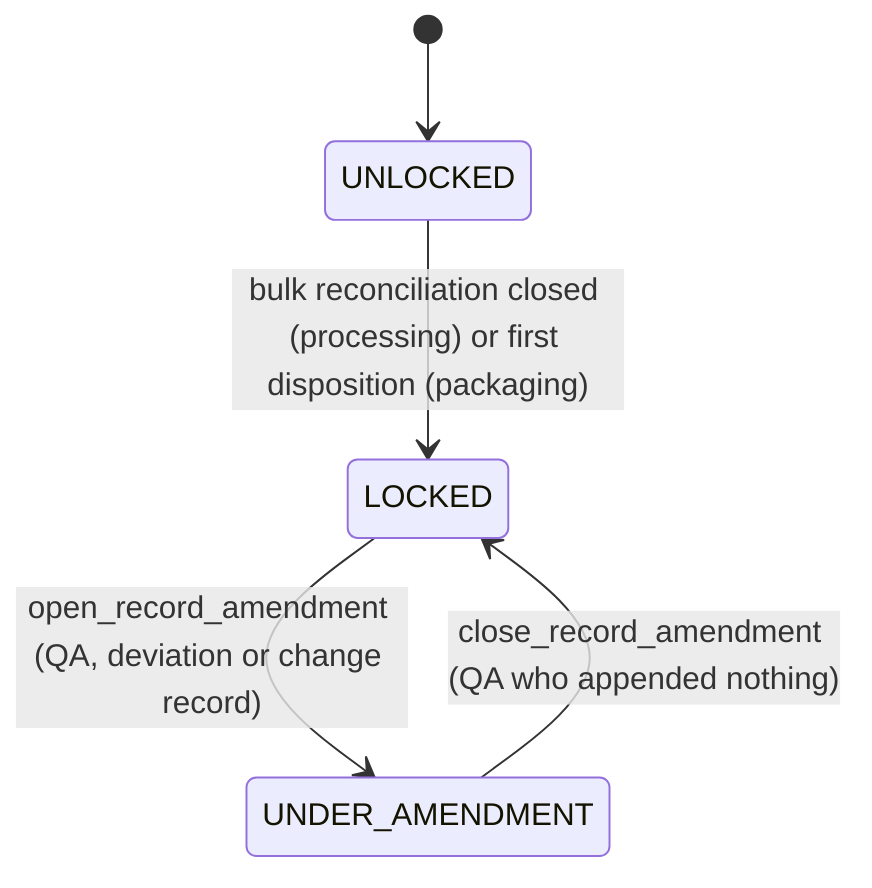

(`recipe.record_lock_state` derives the state from [recipe.record_lock_event](../../../packages/recipe-core/sql/0870_record_lock.sql#sym=recipe.record_lock_event); it is never stored.)

> **Why this exists**
> - **Pharma reason:** a locked record is final evidence; even an administrator or the owner role must not change it.
> - **Control:** [DI-24](../../../compliance/controls/DI-24.yaml), [IN-06](../../../compliance/controls/IN-06.yaml), invariant INV-21.
> - **Code:** [recipe.refuse_locked_write](../../../packages/recipe-core/sql/0870_record_lock.sql#sym=recipe.refuse_locked_write), [recipe.assert_record_writable](../../../packages/recipe-core/sql/0870_record_lock.sql#sym=recipe.assert_record_writable); [recipe.refuse_order_of_locked_record](../../../packages/recipe-core/sql/0870_record_lock.sql#sym=recipe.refuse_order_of_locked_record) refuses a new packaging order of a locked processing record.
> - **Tests:** [record-lock.test.ts](../../../packages/recipe-core/test/lifecycle/record-lock.test.ts), [record-amendment.test.ts](../../../packages/recipe-core/test/release/record-amendment.test.ts).
> - **Error:** `EBMR-LCK-001`.

> **Why this exists**
> - **Pharma reason:** an amendment of a released record means the release may no longer be valid: the lots are
>   suspended until the AP re-assesses each market, and the person who wrote the amendment does not close it.
> - **Control:** [IN-29](../../../compliance/controls/IN-29.yaml), L-19, invariants INV-21 and INV-39.
> - **Code:** [recipe.open_record_amendment](../../../packages/recipe-core/sql/0874_amendment_with_suspension.sql#sym=recipe.open_record_amendment), [recipe.close_record_amendment](../../../packages/recipe-core/sql/0872_record_amendment.sql#sym=recipe.close_record_amendment).
> - **Tests:** [record-amendment.test.ts](../../../packages/recipe-core/test/release/record-amendment.test.ts).
> - **Error:** `EBMR-LCK-030` to `EBMR-LCK-044`.

**Pitfalls.** Some tables are deliberately not locked: QA's container holds and releases (a disposition of the bulk),
plant logbooks (they belong to the equipment) and the review acts (a review runs again after an amendment). The cause
of an appending amendment once lacked its reference, so every opening was refused
([defect log](../08-defect-log.md#p4-slice-5-high-an-amendments-cause-lacked-its-reference)).

**Every refusal in this area** (generated from the migrations, see the note at the top):

| Function | Refuses (code and message, shortened) | Controls | Tests that assert a code |
|---|---|---|---|
| [recipe.append_amendment_entry](../../../packages/recipe-core/sql/0873_record_lock_roles_and_entries.sql#sym=recipe.append_amendment_entry) | `EBMR-LCK-030` … is no GMP batch record<br>`EBMR-LCK-040` amendment … of the record is not open: entries are appended to an open amendment only (INV-21)<br>`EBMR-LCK-041` an amendment entry is a LATE\_ENTRY, CORRECTION or NOTE naming what it amends, its text, its value if any … | [IN-29](../../../compliance/controls/IN-29.yaml), INV-21 | [record-lock.test.ts](../../../packages/recipe-core/test/lifecycle/record-lock.test.ts), [records-routes.test.ts](../../../apps/tablets-server/test/records/records-routes.test.ts) |
| [recipe.assert_record_writable](../../../packages/recipe-core/sql/0870_record_lock.sql#sym=recipe.assert_record_writable) | `EBMR-LCK-001` batch record … is …: it is not written any more (…); a locked record changes only through an amendment, … | INV-21 | [record-lock.test.ts](../../../packages/recipe-core/test/lifecycle/record-lock.test.ts), [record-amendment.test.ts](../../../packages/recipe-core/test/release/record-amendment.test.ts) |
| [recipe.bulk_issue_within_produced](../../../packages/recipe-core/sql/0871_bulk_reconciliation_and_bright_stock.sql#sym=recipe.bulk_issue_within_produced)<br>trigger `zzzl_bulk_issue_within_produced` on `recipe.packaging_bulk_issue` | `EBMR-LCK-014` a bulk issue records the closed net quantity of a container of the processing batch, in its unit (… … …<br>`EBMR-LCK-015` the bulk issued from batch … across its packaging orders (… …) would exceed what it produced (… …) (PR-38) | [PR-38](../../../compliance/controls/PR-38.yaml) | [record-lock.test.ts](../../../packages/recipe-core/test/lifecycle/record-lock.test.ts) |
| [recipe.close_bulk_reconciliation](../../../packages/recipe-core/sql/0871_bulk_reconciliation_and_bright_stock.sql#sym=recipe.close_bulk_reconciliation) | `EBMR-LCK-010` … is no GMP batch: a bulk reconciliation is closed for a processing batch<br>`EBMR-LCK-011` the bulk reconciliation of batch … cannot be closed: … (INV-21, D-5-7)<br>`EBMR-LCK-012` … container(s) of bulk are left: the closure holds them, with the reason they are held (at least 10 …<br>`EBMR-LCK-013` more bulk was issued (… …) than batch … produced (PR-38) | [PR-38](../../../compliance/controls/PR-38.yaml), INV-21 | [record-lock.test.ts](../../../packages/recipe-core/test/lifecycle/record-lock.test.ts), [records-routes.test.ts](../../../apps/tablets-server/test/records/records-routes.test.ts) |
| [recipe.close_record_amendment](../../../packages/recipe-core/sql/0872_record_amendment.sql#sym=recipe.close_record_amendment) | `EBMR-LCK-030` … is no GMP batch record<br>`EBMR-LCK-040` amendment … of the record is not open (INV-21)<br>`EBMR-LCK-042` an amendment is closed with a statement of what it found and appended (at least 10 characters)<br>`EBMR-LCK-043` a person who appended an entry to the amendment does not close it (outline 7.2 S10)<br>`EBMR-LCK-044` the signed amendment is not the current one (an entry was appended since); sign it again (DI-37) | [DI-37](../../../compliance/controls/DI-37.yaml), INV-21 | [record-lock.test.ts](../../../packages/recipe-core/test/lifecycle/record-lock.test.ts), [records-routes.test.ts](../../../apps/tablets-server/test/records/records-routes.test.ts) |
| [recipe.open_record_amendment](../../../packages/recipe-core/sql/0874_amendment_with_suspension.sql#sym=recipe.open_record_amendment) | `EBMR-LCK-030` … is no GMP batch record<br>`EBMR-LCK-031` batch record … is …: an amendment is opened on a LOCKED record only (…) (INV-21)<br>`EBMR-LCK-032` an amendment is opened under an open deviation (the deviation is …) or a change record (D-5-7)<br>`EBMR-LCK-033` the deviation is not linked to batch record … or to a lot made from it (D-5-7)<br>`EBMR-LCK-034` an amendment carries the person's own reason: a code and a text of at least 10 characters (DI-22)<br>`EBMR-LCK-035` the signed amendment is not the current one (the record or its lots moved); sign it again (DI-37) | [DI-22](../../../compliance/controls/DI-22.yaml), [DI-37](../../../compliance/controls/DI-37.yaml), INV-21 | [record-lock.test.ts](../../../packages/recipe-core/test/lifecycle/record-lock.test.ts), [records-routes.test.ts](../../../apps/tablets-server/test/records/records-routes.test.ts) |
| [recipe.record_lock_actor_role](../../../packages/recipe-core/sql/0873_record_lock_roles_and_entries.sql#sym=recipe.record_lock_actor_role)<br>trigger `a1_actor_role` on 5 tables | `EBMR-LCK-060` the role of the act is the role the person is working in (the actor context), never another | [DI-22](../../../compliance/controls/DI-22.yaml) | [record-lock.test.ts](../../../packages/recipe-core/test/lifecycle/record-lock.test.ts) |
| [recipe.set_bright_stock_hold](../../../packages/recipe-core/sql/0871_bulk_reconciliation_and_bright_stock.sql#sym=recipe.set_bright_stock_hold) | `EBMR-LCK-020` a maximum hold for bright stock names the product code, the strength, a whole number of hours (1 to 99999) … | [PR-38](../../../compliance/controls/PR-38.yaml) | [record-lock.test.ts](../../../packages/recipe-core/test/lifecycle/record-lock.test.ts) |

## India issue gates, labels and Schedule H2

**What it does.** India-specific checks (0891, 0894; the hazard dedication is in [Plant](#plant)). At GMP batch issue,
[recipe.india_issue_problem](../../../packages/recipe-core/sql/0891_india_issue_gate.sql#sym=recipe.india_issue_problem) checks the manufacturing or loan licence (IN-30), the export permission of every
export market, and the hazard dedication of the line (IN-27); the licence basis is recorded with the batch
([recipe.record_batch_licence_basis](../../../packages/recipe-core/sql/0891_india_issue_gate.sql#sym=recipe.record_batch_licence_basis), [recipe.batch_licence_basis](../../../packages/recipe-core/sql/0891_india_issue_gate.sql#sym=recipe.batch_licence_basis)). G-REL item G6.LICENCE checks them again
at release ([recipe.grel_licence_item](../../../packages/recipe-core/sql/0892_grel_licence_item.sql#sym=recipe.grel_licence_item), 0892). The India-domestic label particulars
([recipe.india_label_particulars](../../../packages/recipe-core/sql/0894_india_label_and_h2.sql#sym=recipe.india_label_particulars)) and the Schedule H2 QR payload ([recipe.h2_payload](../../../packages/recipe-core/sql/0894_india_label_and_h2.sql#sym=recipe.h2_payload),
[recipe.issue_h2_payload](../../../packages/recipe-core/sql/0894_india_label_and_h2.sql#sym=recipe.issue_h2_payload), [recipe.h2_payload_issue](../../../packages/recipe-core/sql/0894_india_label_and_h2.sql#sym=recipe.h2_payload_issue)) are bound to the batch record as a versioned stub.

**Pharma context.** Indian manufacture needs a valid manufacturing licence (Form 25 or 28) or a loan licence; exports
need permission; domestic labels carry prescribed particulars, and Schedule H2 asks for a QR code with product
details on certain products ([IN-30](../../../compliance/controls/IN-30.yaml),
[IN-31](../../../compliance/controls/IN-31.yaml), [PR-43](../../../compliance/controls/PR-43.yaml)).

> **Why this exists**
> - **Pharma reason:** a batch may not be issued under a licence that is not current, or for an export market without
>   permission, or on a line not dedicated to a hazardous product.
> - **Control:** [IN-30](../../../compliance/controls/IN-30.yaml), [IN-27](../../../compliance/controls/IN-27.yaml).
> - **Code:** [recipe.india_issue_problem](../../../packages/recipe-core/sql/0891_india_issue_gate.sql#sym=recipe.india_issue_problem).
> - **Tests:** [india.test.ts](../../../packages/recipe-core/test/release/india.test.ts), [india-issue-gate.test.ts](../../../packages/recipe-core/test/mutation/india-issue-gate.test.ts), [india-h2-and-allocation.test.ts](../../../packages/recipe-core/test/mutation/india-h2-and-allocation.test.ts).
> - **Error:** `EBMR-IND-040` to `EBMR-IND-042`, `EBMR-IND-050`, `EBMR-IND-051`.

**Pitfalls.** The export-permission problem said "lapsed" for a permission not yet approved; only the text was wrong
([defect log](../08-defect-log.md#export-permission-reason-text-phase-4-mutation-run-site-services-0903)).

**Every refusal in this area** (generated from the migrations, see the note at the top):

| Function | Refuses (code and message, shortened) | Controls | Tests that assert a code |
|---|---|---|---|
| [recipe.h2_payload](../../../packages/recipe-core/sql/0894_india_label_and_h2.sql#sym=recipe.h2_payload) | `EBMR-IND-051` the H2 payload of batch … cannot carry …: it must be printable text without ; or = (D-P4-14, IN-31) | [IN-31](../../../compliance/controls/IN-31.yaml) | [india-h2-and-allocation.test.ts](../../../packages/recipe-core/test/mutation/india-h2-and-allocation.test.ts) |
| [recipe.india_issue_problem](../../../packages/recipe-core/sql/0891_india_issue_gate.sql#sym=recipe.india_issue_problem) | `EBMR-IND-040` There is no GMP batch planned with id … (IN-30)<br>`EBMR-IND-041` Batch … is not issued for market …: …<br>`EBMR-IND-042` Batch … is not issued: … | [IN-30](../../../compliance/controls/IN-30.yaml) | [india-issue-gate.test.ts](../../../packages/recipe-core/test/mutation/india-issue-gate.test.ts), [india.test.ts](../../../packages/recipe-core/test/release/india.test.ts) |
| [recipe.india_label_particulars](../../../packages/recipe-core/sql/0894_india_label_and_h2.sql#sym=recipe.india_label_particulars) | `EBMR-IND-050` … is no issued GMP batch, so it has no label particulars (IN-31) | [IN-31](../../../compliance/controls/IN-31.yaml) | [india-h2-and-allocation.test.ts](../../../packages/recipe-core/test/mutation/india-h2-and-allocation.test.ts), [india.test.ts](../../../packages/recipe-core/test/release/india.test.ts) (+1) |

## Product quality review extract

**What it does.** The PQR (also called APR) extract for one product and period (0910). The extract is a versioned SQL
query ([recipe.pqr_extract_v1](../../../packages/recipe-core/sql/0910_pqr_extract.sql#sym=recipe.pqr_extract_v1); [recipe.pqr_query_version](../../../packages/recipe-core/sql/0910_pqr_extract.sql#sym=recipe.pqr_query_version) keeps the SHA-256 of its definition, and a run
refuses a query whose definition changed). It lists every GMP batch, failed ones included, with lots, market states,
deviations, CAPA as recorded and change records, ordered so the same data give the same hash. It is reconciled against
the registers ([recipe.pqr_reconciliation](../../../packages/recipe-core/sql/0910_pqr_extract.sql#sym=recipe.pqr_reconciliation)); any difference fails the run and nothing is stored.
[recipe.run_pqr_extract](../../../packages/recipe-core/sql/0910_pqr_extract.sql#sym=recipe.run_pqr_extract) stores the run; [recipe.sign_off_pqr](../../../packages/recipe-core/sql/0910_pqr_extract.sql#sym=recipe.sign_off_pqr) lets the AP sign it off while it still
reproduces ([recipe.pqr_reproduces](../../../packages/recipe-core/sql/0910_pqr_extract.sql#sym=recipe.pqr_reproduces)).

**Pharma context.** A yearly product quality review looks at all batches, deviations, changes and results to see
whether the process stays in control (21 CFR 211.180(e); EU GMP 1.10; Schedule M;
[IN-01](../../../compliance/controls/IN-01.yaml) (b), [PR-58](../../../compliance/controls/PR-58.yaml)). An extract
that silently misses a batch would hide a trend, so it must reconcile to the registers.

**Main tables.** [recipe.pqr_extract](../../../packages/recipe-core/sql/0910_pqr_extract.sql#sym=recipe.pqr_extract), [recipe.pqr_query_version](../../../packages/recipe-core/sql/0910_pqr_extract.sql#sym=recipe.pqr_query_version), [recipe.pqr_signoff](../../../packages/recipe-core/sql/0910_pqr_extract.sql#sym=recipe.pqr_signoff).

> **Why this exists**
> - **Pharma reason:** the PQR must cover every batch of the period; the AP signs off only an extract that still
>   reproduces from the records and reconciles to the registers, and was not involved in those batches.
> - **Control:** [IN-01](../../../compliance/controls/IN-01.yaml), [PR-58](../../../compliance/controls/PR-58.yaml), invariant INV-35 (by analogy).
> - **Code:** [recipe.run_pqr_extract](../../../packages/recipe-core/sql/0910_pqr_extract.sql#sym=recipe.run_pqr_extract), [recipe.sign_off_pqr](../../../packages/recipe-core/sql/0910_pqr_extract.sql#sym=recipe.sign_off_pqr), [recipe.pqr_run_query](../../../packages/recipe-core/sql/0910_pqr_extract.sql#sym=recipe.pqr_run_query).
> - **Tests:** [pqr-extract.test.ts](../../../packages/recipe-core/test/release/pqr-extract.test.ts), [pqr-extract.test.ts (mutation)](../../../packages/recipe-core/test/mutation/pqr-extract.test.ts), [apps/tablets-server/test/pqr/](../../../apps/tablets-server/test/pqr/).
> - **Error:** `EBMR-PQR-001` to `EBMR-PQR-015`.

**Every refusal in this area** (generated from the migrations, see the note at the top):

| Function | Refuses (code and message, shortened) | Controls | Tests that assert a code |
|---|---|---|---|
| [recipe.pqr_run_query](../../../packages/recipe-core/sql/0910_pqr_extract.sql#sym=recipe.pqr_run_query) | `EBMR-PQR-004` a rule its problem function reports (the reason its check returns) | [IN-01](../../../compliance/controls/IN-01.yaml), [PR-58](../../../compliance/controls/PR-58.yaml), INV-28, INV-35 | [pqr-extract.test.ts](../../../packages/recipe-core/test/mutation/pqr-extract.test.ts) |
| [recipe.run_pqr_extract](../../../packages/recipe-core/sql/0910_pqr_extract.sql#sym=recipe.run_pqr_extract) | `EBMR-PQR-001` … is not a product code<br>`EBMR-PQR-002` the period runs from a first day to a last day on or after it<br>`EBMR-PQR-003` a review period is at most three years (normally twelve months; IN-01)<br>`EBMR-PQR-006` the extract for …, … to …, does not reconcile to the registers: …; nothing is stored (IN-01, PR-58) | [IN-01](../../../compliance/controls/IN-01.yaml), [PR-58](../../../compliance/controls/PR-58.yaml) | [pqr-extract.test.ts](../../../packages/recipe-core/test/mutation/pqr-extract.test.ts), [pqr-extract.test.ts](../../../packages/recipe-core/test/release/pqr-extract.test.ts) (+1) |
| [recipe.sign_off_pqr](../../../packages/recipe-core/sql/0910_pqr_extract.sql#sym=recipe.sign_off_pqr) | `EBMR-PQR-006` the extract no longer reconciles to the registers; nothing is signed (IN-01, PR-58)<br>`EBMR-PQR-010` there is no PQR extract …<br>`EBMR-PQR-011` this extract is signed off already<br>`EBMR-PQR-012` the records changed after the extract was run (its SHA-256 differs now); run the extract again and sign …<br>`EBMR-PQR-013` a PQR is signed off by the authorised person, not as … (IN-01 (b))<br>`EBMR-PQR-014` a person involved in the records of the reviewed batches never signs off their quality review (INV-35)<br>`EBMR-PQR-015` the signed extract is not the current one; sign it again (DI-37) | [PR-58](../../../compliance/controls/PR-58.yaml), [IN-01](../../../compliance/controls/IN-01.yaml), [DI-37](../../../compliance/controls/DI-37.yaml), INV-35 | [pqr-extract.test.ts](../../../packages/recipe-core/test/mutation/pqr-extract.test.ts), [pqr-extract.test.ts](../../../packages/recipe-core/test/release/pqr-extract.test.ts) (+1) |

## How to test recipe-core

- Everything in the package: `pnpm vitest run --project db packages/recipe-core/test` (long; on a 4-CPU pod run only
  the folders you changed).
- One area: `pnpm vitest run --project db packages/recipe-core/test/<area>`, areas `blocks`, `containers`, `engine`,
  `execution`, `flow`, `integration`, `lifecycle`, `limits`, `plant`, `release`, `review`, `simulator`, `validator`,
  `mutation`.
- Attacks through the application role and HTTP behaviour: `pnpm vitest run --project server apps/tablets-server/test/<area>`.
- One control: `pnpm vitest run <file> -t "INV-05"`.
- SQL mutation of a group of recipe functions: the `mutation-check` skill and
  [the SQL mutation harness](../05-database.md#the-sql-mutation-harness); kill tests go in
  `packages/recipe-core/test/mutation/<group>.test.ts`.
- Golden batches GB-T-01 and GB-T-02 run the whole package end to end
  ([testing guide](../06-testing-and-debugging.md#golden-batches)).

A test that proves a guard asserts the **exact code** (`toThrow('EBMR-LCK-001')`), runs as the application role, and
carries the control ID in its name. See [how to write a test that proves a control](../06-testing-and-debugging.md#how-to-write-a-test-that-proves-a-control)
and [how to debug a failing guard](../06-testing-and-debugging.md#how-to-debug-a-failing-guard).

## Pitfalls across the package

- **Find the version in force.** Many functions are replaced by later migrations (`create or replace`). Before you
  read or change one, find its last definition: `grep -lE "function recipe\.<name>\b" packages/recipe-core/sql/*.sql
  | tail -1`, or the [database catalogue](../reference/db-catalogue.md). Replace a function by a new migration from
  its latest definition; never edit an applied migration ([database reference](../05-database.md#never-edit-a-released-migration-add-a-new-one)).
- **Fail closed.** An item or check that cannot be evaluated is RED or a refusal, never NA or a pass (Tablets items,
  G-REL group 4 and 9 placeholders, the validator's throwing rule).
- **Never match on message text** for a control decision; match on structured links (PR-53 lesson).
- **No side effect in `WHERE`** or in a view's `SELECT` list.
- **READ COMMITTED is assumed** by the container lock and the proposal locks; a decision is proposed only in a READ
  COMMITTED transaction (0331).
- **Hashing and sorting** must be defined (`collate "C"` for anything hashed or signed;
  [defect log](../08-defect-log.md#p3-exit-medium-collation-changed-signing-order)).
- **Time** comes from the database's trusted clock, never `Date.now()`; GMP values are decimal strings, never
  JavaScript numbers (CLAUDE.md hard rules).

## Related pages

- [The life of a batch](../04-life-of-a-batch.md): every step of a batch with the screens, routes and these functions.
- [Architecture](../03-architecture.md), [Database reference](../05-database.md), [Testing and debugging](../06-testing-and-debugging.md).
- [Defects and lessons](../08-defect-log.md), [Removed and replaced](../09-removed-and-replaced.md).
- Module guides: [kernel](kernel.md) (identity, e-signatures, audit, state engine), [site-services](site-services.md)
  (lots, deviations, LIMS-lite, shipping interlock), [expr](expr.md) (decimals and rounding),
  [tablets-server](tablets-server.md) (the edition's blocks, G-REL items and routes).
- Generated: [code map](../code-map.md), [database catalogue](../reference/db-catalogue.md),
  [control-to-code map](../reference/control-map.md), [error codes](../reference/error-codes.md).
