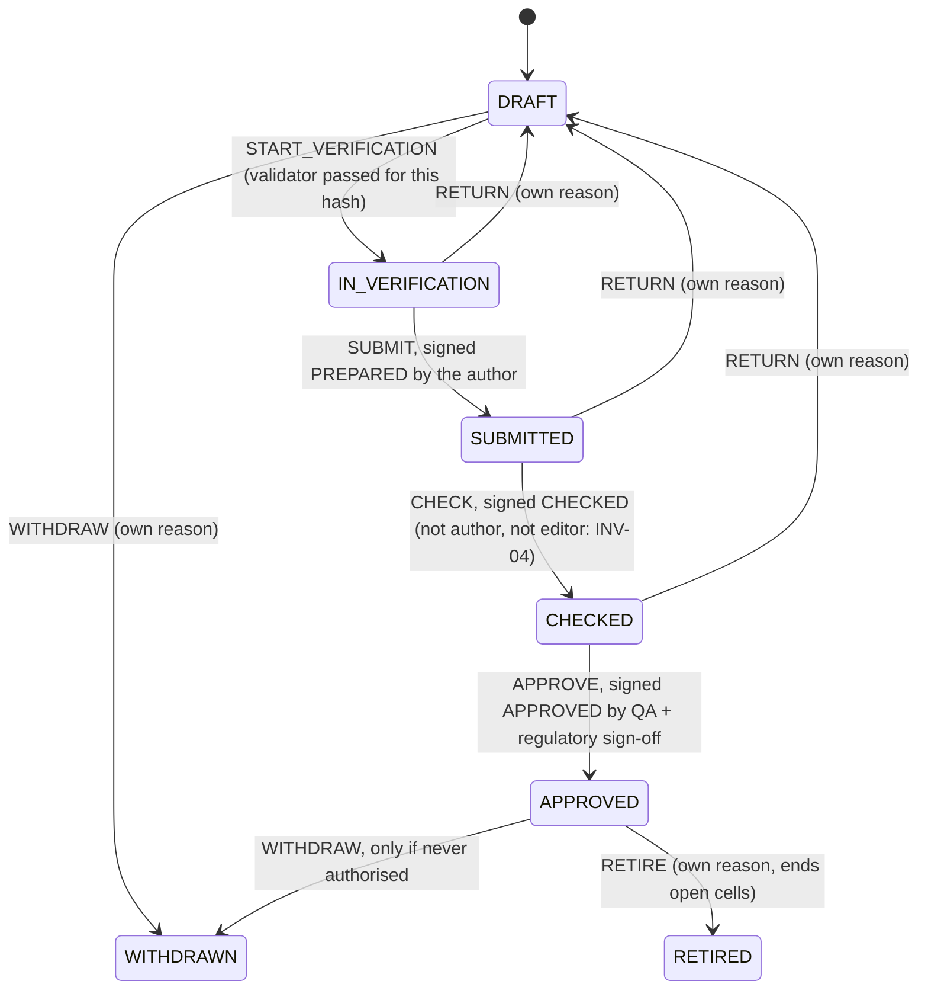
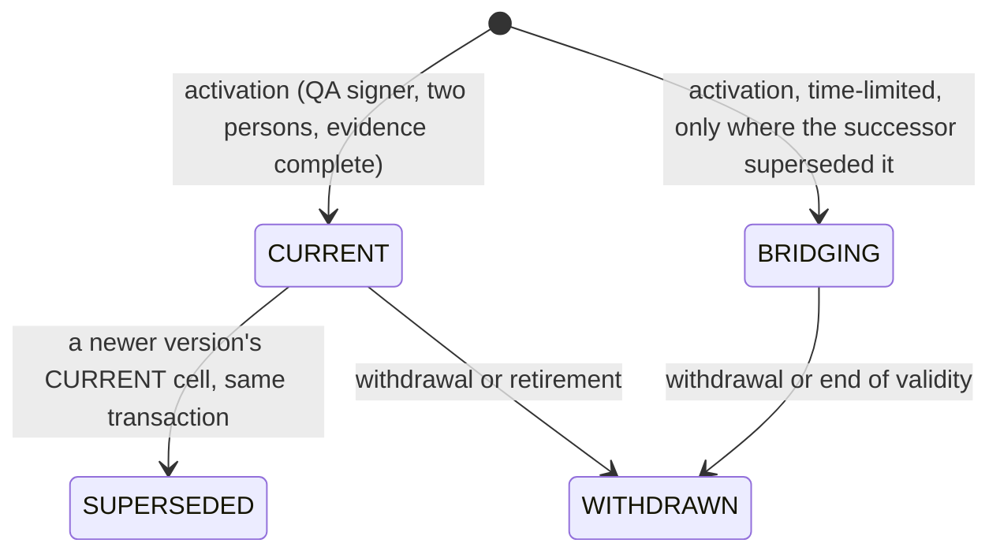
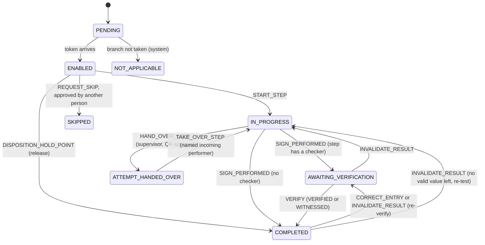
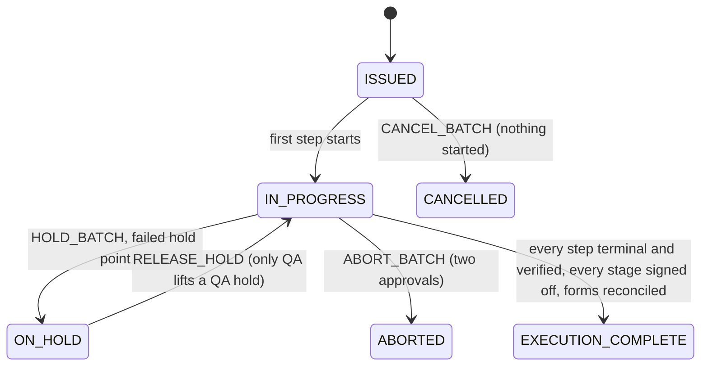

# Module guide: recipe-core

**Draft**

`packages/recipe-core` is the heart of the product. It holds the master batch record (MBR) and everything that happens
to a batch made from it: how a master is designed, checked, approved and authorised per market; how a batch is
issued from it; how each step is executed, verified, corrected and handed over; how exceptions, equipment, rooms,
containers and material use are controlled; how the finished record is reviewed, released for each market,
suspended, recalled, locked and amended; and the India-specific fields and the product quality review extract. Most
of its rules live in PostgreSQL (195 migrations in [packages/recipe-core/sql](../../../packages/recipe-core/sql/));
the TypeScript part is the pure flow model, validator, limit model, simulator and execution engine, plus thin
callers. Read this page when you change anything in the package, debug a refusal whose code starts with
`EBMR-RCP`, `EXE`, `PLANT`, `CNT`, `REV`, `REL`, `DSP`, `ARL`, `LCK`, `IND`, `PQR`, `FRM`, `RPR`, `PKG`, `PLN` or
`NTF`, or need to know which pharma rule a guard carries. Pharma words are explained in the
[primer](../01-pharma-primer.md) and the [glossary](../02-glossary.md); the request path, signatures and roles in
[architecture](../03-architecture.md); one batch end to end in [the life of a batch](../04-life-of-a-batch.md).

How to read the guard tables. Each area ends with a table of **every function in force that refuses something with
an `EBMR-` code**, built from the migrations: the function (linked to the migration that holds the version in
force), each code with its message shortened (`…` stands for a value filled in at run time), the controls the
message or the migration header names, and test files that assert one of the codes. A function that is called by a
trigger says so under its name. Codes of the kernel (`EBMR-AUDIT`, `EBMR-IAM`, `EBMR-ESIG`, `EBMR-PLAT`, `EBMR-SBX`)
raised inside recipe functions are listed too; their meaning is in the [kernel guide](kernel.md). The full list of
codes and files is the generated [error-code reference](../reference/error-codes.md); every function and trigger, with
the migrations that replaced it, is in the [database catalogue](../reference/db-catalogue.md).

## Where the code is

| What | Where |
|---|---|
| Migrations (schemas `recipe`, `plant`, `formulary`) | [packages/recipe-core/sql/](../../../packages/recipe-core/sql/), 0100 to 0932 |
| Flow model, compiler, token game | [src/flow/](../../../packages/recipe-core/src/flow/) ([README](../../../packages/recipe-core/src/flow/README.md)) |
| Static MBR validator | [src/validator/](../../../packages/recipe-core/src/validator/) ([README](../../../packages/recipe-core/src/validator/README.md)) |
| Limit model (CPP, IPC, yield tiers) | [src/limits/](../../../packages/recipe-core/src/limits/) ([README](../../../packages/recipe-core/src/limits/README.md)) |
| Simulator (verification evidence) | [src/simulator/](../../../packages/recipe-core/src/simulator/) ([README](../../../packages/recipe-core/src/simulator/README.md)) |
| Generic blocks G-01 to G-24 | [src/blocks/](../../../packages/recipe-core/src/blocks/) ([README](../../../packages/recipe-core/src/blocks/README.md)) |
| Execution engine (pure) | [src/engine/](../../../packages/recipe-core/src/engine/) ([README](../../../packages/recipe-core/src/engine/README.md)) |
| Execution store (database side of the engine) | [src/execution/](../../../packages/recipe-core/src/execution/) ([README](../../../packages/recipe-core/src/execution/README.md)) |
| MBR life cycle (machine, commands, selection) | [src/lifecycle/](../../../packages/recipe-core/src/lifecycle/) ([README](../../../packages/recipe-core/src/lifecycle/README.md)) |
| Plant machines and commands | [src/plant/](../../../packages/recipe-core/src/plant/) |
| Output-container machine | [src/containers/](../../../packages/recipe-core/src/containers/) |
| Formulation library callers | [src/formula/index.ts](../../../packages/recipe-core/src/formula/index.ts) |
| Package entry (Node) and pure entry (browser) | [src/index.ts](../../../packages/recipe-core/src/index.ts), [src/pure.ts](../../../packages/recipe-core/src/pure.ts) |
| Tests | [packages/recipe-core/test/](../../../packages/recipe-core/test/) (one folder per area, `mutation/` for SQL mutation kill tests) and, through the Tablets server, [apps/tablets-server/test/](../../../apps/tablets-server/test/) (`execution/db-guards-*.test.ts`, `release/`, `review/`, `india/`, `pqr/`) |
| Code map of this package (generated) | [code map](../code-map.md#rc-lifecycle) and the `rc-*` modules after it |

The migrations, grouped by area (the same grouping as the [code map](../code-map.md) and
[modules.yaml](../modules.yaml)):

| Area | Migrations | Section |
|---|---|---|
| MBR life cycle, market authorisation, stub batch issue | 0100 to 0180, 0290, 0324, 0341, 0371, 0380, 0383, 0760, 0800 | [MBR life cycle](#mbr-life-cycle) |
| Execution store: rows, guards, state binding, signatures | 0200 to 0350, 0370 to 0384 | [Execution store and engine](#execution-store-and-engine) |
| Exception register | 0440, 0441, 0490 | [Exceptions and limits](#exceptions-and-limits) |
| Change paths, approvals, hand-over | 0450 to 0453, 0461 to 0463, 0470 to 0472, 0480 | [Change paths, approvals and hand-over](#change-paths-approvals-and-hand-over) |
| Execution complete with contingency forms | 0911 | [Execution store and engine](#execution-store-and-engine) |
| Plant: equipment, rooms, logbook, hazard dedication | 0400 to 0405, 0460, 0521 to 0523, 0691, 0890, 0912 | [Plant](#plant) |
| Output containers | 0420 to 0422, 0540, 0740, 0741 | [Output containers](#output-containers) |
| Material consumption (batch side) | 0430, 0700, 0701 | [Material consumption](#material-consumption) |
| GMP batch store and issue, packaging orders, allocation register, expiry | 0500 to 0504, 0582, 0600 to 0602, 0761, 0762, 0893, 0895, 0913 | [GMP batches, issue and packaging orders](#gmp-batches-issue-and-packaging-orders) |
| Block versions in the database (G-06, G-09@2, G-10@2, G-21) | 0520, 0541, 0580, 0581 | [Blocks](#blocks) |
| Reprocessing and recovery | 0603, 0620 to 0625, 0930 | [Reprocessing and recovery](#reprocessing-and-recovery) |
| Formulation library | 0640 to 0643, 0690 | [Formulation library](#formulation-library) |
| Record review, evidence epochs | 0710 to 0721, 0770, 0931 | [Batch record review](#batch-record-review) |
| G-REL and the manufacturer release | 0780 to 0783, 0892, 0932 | [The release gate G-REL and the manufacturer release](#the-release-gate-g-rel-and-the-manufacturer-release) |
| Notification centre | 0810 to 0812 | [Notification centre](#notification-centre) |
| Market dispositions, QP certification | 0820 to 0826 | [Market dispositions and QP certification](#market-dispositions-and-qp-certification) |
| After release | 0840, 0841, 0875 | [After release](#after-release) |
| Record lock, bulk reconciliation, amendment | 0870 to 0874 | [Record lock and amendment](#record-lock-and-amendment) |
| India gates, label particulars, Schedule H2 | 0891, 0894 | [India issue gates, labels and Schedule H2](#india-issue-gates-labels-and-schedule-h2) |
| Product quality review extract | 0910 | [Product quality review extract](#product-quality-review-extract) |

## How the package is built

Three ideas run through every area. Learn them once.

1. **The engine decides, the database re-checks.** The execution engine
   ([createEngine](../../../packages/recipe-core/src/engine/engine.ts#sym=createEngine)) is pure TypeScript: it takes the state of a batch
   and a command and returns the new state and events, or a refusal. The server stores what the engine decided. The
   database does not trust that: triggers on the stored rows re-check the facts that matter for GMP (step order,
   who may act, minimum times, signatures, exceptions). ADR 0012 asks that every rule holds even when someone uses
   the application's own database credentials directly. That is why most areas below have both a TypeScript rule
   and a SQL guard with the same meaning, and tests that compare them.
2. **Every write is a SECURITY DEFINER function.** The application role (`ebmr_app`) can read the recipe tables but
   writes none. Every write goes through a function that refuses administrators first (DI-18), checks the
   permission (DI-17), checks the person's own reason where one is needed (DI-22), and checks any e-signature
   against its meaning, record and state. See [architecture section 4](../03-architecture.md#4-rules-live-in-postgresql)
   and [database security conventions](../05-database.md#security-conventions).
3. **Evaluate, then sign the same thing.** A decision that relies on evidence (a QA review, a release, a market
   disposition, an after-release decision) names the version of the evidence it saw, the *evidence epoch*. When the
   signature is recorded, the database evaluates again under locks and refuses the act if the epoch moved. See
   [Evidence epochs and signing (INV-05)](#evidence-epochs-and-signing-inv-05).

Refusals use the shape described in [database: how errors are raised](../05-database.md#how-errors-are-raised): the
message starts (or, in older execution guards, ends in brackets) with the code, then says in plain words what was
refused and names the control. A guard of a kernel state machine (the MBR version, plant and container machines)
refuses as `EBMR-PLAT-068` with the guard's own text.

## Flows, validator, limits and simulator

**What it does.** These four folders define what an MBR *is* and prove a master sound before anyone can approve
it. All are pure TypeScript with no database and no clock; the designer screen and the server run the same code.

- **Flow** ([flow/README.md](../../../packages/recipe-core/src/flow/README.md)): the MBR content is JSON
  (`ebmr.mbr-content` v1) shaped like the ISA-88 hierarchy: procedure, stage, operation, phase. Each phase is one
  configured *block* (see [Blocks](#blocks)). Constructs are block-structured: sequence, parallel, alternative, loop,
  hold point, library call, replicate (sub-lots). [parseMbr](../../../packages/recipe-core/src/flow/parse.ts#sym=parseMbr) reads it
  strictly (GMP values are decimal strings, unknown fields refused); [compileMbr](../../../packages/recipe-core/src/flow/compile.ts#sym=compileMbr)
  makes an execution graph; [TokenGame](../../../packages/recipe-core/src/flow/tokens.ts#sym=TokenGame) is the execution semantics: only
  a node holding a token is enabled.
- **Validator** ([validator/README.md](../../../packages/recipe-core/src/validator/README.md)):
  [validateMbr](../../../packages/recipe-core/src/validator/validate.ts#sym=validateMbr) runs structure, graph, data, time and GMP-content
  rules (FLOW-*, GRAPH-*, DATA-*, TIME-*, GMP-*). [gate](../../../packages/recipe-core/src/validator/validate.ts#sym=gate) passes only
  with zero errors and every warning justified. A rule that throws is a failed check, never a pass.
- **Limits** ([limits/README.md](../../../packages/recipe-core/src/limits/README.md)): four nested tiers per
  parameter: REGISTERED and VALIDATED (outer), INTERNAL_ACTION, ALERT.
  [evaluateLimits](../../../packages/recipe-core/src/limits/evaluate.ts#sym=evaluateLimits) says what a breach requires: ALERT a register item,
  INTERNAL_ACTION a stop until a deviation, REGISTERED or VALIDATED a registration-relevant deviation that only QA
  dispositions. Rounding happens only at the comparison, through the expression language ([expr guide](expr.md)).
- **Simulator** ([simulator/README.md](../../../packages/recipe-core/src/simulator/README.md)):
  [simulate](../../../packages/recipe-core/src/simulator/simulate.ts#sym=simulate) enumerates the paths, tests every limit bound on, just
  inside and just outside, every time constraint and every golden calculation. Its report is the verification
  evidence stored for a master version.

**Pharma context.** A master instruction must be prepared, independently checked and approved by the quality unit
before use (Schedule M, the master formula section; 21 CFR 211.186; EU GMP chapter 4). EU GMP Annex 11 section 4 asks
that a computerised system is validated for its intended use; for a configurable recipe system that means each master
version is verified before it becomes effective. The validator and the simulator produce that evidence
([DI-04](../../../compliance/controls/DI-04.yaml), [PR-03](../../../compliance/controls/PR-03.yaml)). The limit tiers
carry [PR-08](../../../compliance/controls/PR-08.yaml): a registered limit is part of the marketing authorisation, so
breaching it is a matter for QA and the regulator, not for the floor.

**Controls.** DI-04, PR-03, PR-08, DI-34, INV-19 (loops and sub-lots keep every iteration apart), INV-20 (time limits).

**How to test it.** `pnpm vitest run --project db packages/recipe-core/test/flow packages/recipe-core/test/validator
packages/recipe-core/test/limits packages/recipe-core/test/simulator` (no database needed for these, but they run in
the `db` project). The `readme.test.ts` files keep the READMEs' names true. Property tests:
[property.test.ts](../../../packages/recipe-core/test/validator/property.test.ts).

**Pitfalls.** Catch impossible masters in the validator, where the author can fix them, and keep the database refusal
as the last line: two defects (a minimum time ending at the start of a node; two nested loops on one endpoint) let
honest runs break the engine's own invariant until the rules TIME-MIN-AT-ARRIVAL and FLOW-LOOPS were added
([defect log](../08-defect-log.md#p2-d6-d12-the-designer-let-impossible-mbrs-through)).

## Blocks

**What it does.** A *block* is a reusable kind of phase: weighing, charge-in, IPC check, hold point, printing. Each
block version declares its configuration schema, the data it records, its signatures and the controls it carries
([blocks/README.md](../../../packages/recipe-core/src/blocks/README.md); registry
[genericBlockRegistry](../../../packages/recipe-core/src/blocks/generic/index.ts#sym=genericBlockRegistry)). The generic blocks G-01 to G-24 live
here; the Tablets edition adds its TB-xx blocks. Some block versions also have database registers and guards:

- G-06@1 (automated equipment phase), G-09@2 and G-10@2 (equipment and area status read from the plant schema, never
  from a person's word) in 0520 and 0521.
- G-21@1 (printed materials, coding, challenges, serialisation) in 0580 and 0581.
- The sweeper records a missed in-process check and its hold at the moment the alarm finds it overdue (0541).

**Pharma context.** G-09@2 and G-10@2 carry the rule that equipment and rooms are checked clean and fit before use
(Schedule M; 21 CFR 211.67 and 211.130; [PR-23](../../../compliance/controls/PR-23.yaml),
[PR-34](../../../compliance/controls/PR-34.yaml)). G-21 carries label and print control: printed packaging is the
most common cause of recalls, so counts must reconcile and codes must be challenged
([PR-36](../../../compliance/controls/PR-36.yaml), [PR-39](../../../compliance/controls/PR-39.yaml),
[PR-42](../../../compliance/controls/PR-42.yaml)).

> **Why this exists**
> - **Pharma reason:** packaging lines must prove the printer and reader work (challenge tests) and every printed item
>   is accounted for; a skipped challenge or a count that does not reconcile can put a wrong batch code on the market.
> - **Control:** [PR-36](../../../compliance/controls/PR-36.yaml), [PR-37](../../../compliance/controls/PR-37.yaml), [PR-39](../../../compliance/controls/PR-39.yaml).
> - **Code:** [recipe.g21_state_check](../../../packages/recipe-core/sql/0581_g21_guards.sql#sym=recipe.g21_state_check) (row trigger on the execution state).
> - **Tests:** [g21-sql.test.ts](../../../packages/recipe-core/test/execution/g21-sql.test.ts), [g21-edges.test.ts](../../../packages/recipe-core/test/blocks/g21-edges.test.ts), [packaging-g21-rules.test.ts](../../../packages/recipe-core/test/mutation/packaging-g21-rules.test.ts).
> - **Error:** `EBMR-EXE-290` to `EBMR-EXE-294`.

**How to test it.** `packages/recipe-core/test/blocks/` (golden fixtures of every phase block through the engine,
edge files per block).

**Pitfalls.** Slice 4a of Phase 3 found two high and four medium G-21 defects (a FAIL challenge could be dropped and a
stale PASS reused, counts not compared with the printer's, and others); see
[the defect log](../08-defect-log.md#p3-slice-4a-two-high-four-medium).

**Every refusal in this area** (generated from the migrations, see the note at the top):

| Function | Refuses (code and message, shortened) | Controls | Tests that assert a code |
|---|---|---|---|
| [plant.ipc_check_record](../../../packages/recipe-core/sql/0541_ipc_missed_by_sweeper.sql#sym=plant.ipc_check_record) | `EBMR-CNT-023` An in-process check is recorded for a press of the plant: … (PR-22 | [PR-22](../../../compliance/controls/PR-22.yaml) | [containers.test.ts](../../../packages/recipe-core/test/containers/containers.test.ts) |
| [plant.record_missed_ipc_check](../../../packages/recipe-core/sql/0541_ipc_missed_by_sweeper.sql#sym=plant.record_missed_ipc_check) | `EBMR-CNT-020` Unknown batch … | [IN-35](../../../compliance/controls/IN-35.yaml), [PR-29](../../../compliance/controls/PR-29.yaml), [DI-17](../../../compliance/controls/DI-17.yaml), [DI-18](../../../compliance/controls/DI-18.yaml) | [gmp-issue.test.ts](../../../packages/recipe-core/test/lifecycle/gmp-issue.test.ts), [output-containers.test.ts](../../../packages/recipe-core/test/mutation/output-containers.test.ts) (+1) |
| [recipe.g21_state_check](../../../packages/recipe-core/sql/0581_g21_guards.sql#sym=recipe.g21_state_check)<br>trigger `zr_g21` on `recipe.execution_state` | `EBMR-EXE-290`<br>`EBMR-EXE-291`<br>`EBMR-EXE-292`<br>`EBMR-EXE-293` This … … row …: printed materials are reconciled always and within limits, challenges hold the output, …<br>`EBMR-EXE-294` This … … row …: printed materials are reconciled always and within limits, challenges hold the output, … | [IN-17](../../../compliance/controls/IN-17.yaml), [IN-22](../../../compliance/controls/IN-22.yaml), [PR-37](../../../compliance/controls/PR-37.yaml), [PR-39](../../../compliance/controls/PR-39.yaml), [PR-40](../../../compliance/controls/PR-40.yaml), INV-32 | [completion.test.ts](../../../apps/tablets-server/test/blocks/packaging/completion.test.ts), [db-guards.test.ts](../../../apps/tablets-server/test/blocks/packaging/db-guards.test.ts) |

## MBR life cycle

**What it does.** Decides which approved master a batch may use, in which market, and how a master gets there
([lifecycle/README.md](../../../packages/recipe-core/src/lifecycle/README.md) is the detailed reference).

- An **MBR family** ([recipe.mbr_family](../../../packages/recipe-core/sql/0110_mbr_family_version.sql#sym=recipe.mbr_family)) is one product, strength, batch-size set, dosage form, edition and
  record kind (processing or packaging; a packaging family is keyed by pack size and pack type too, 0760). A
  **version** ([recipe.mbr_version](../../../packages/recipe-core/sql/0110_mbr_family_version.sql#sym=recipe.mbr_version)) holds content revisions ([recipe.mbr_content](../../../packages/recipe-core/sql/0110_mbr_family_version.sql#sym=recipe.mbr_content), hashed by the database),
  draft cycles, a version log of every edit ([recipe.mbr_version_log](../../../packages/recipe-core/sql/0110_mbr_family_version.sql#sym=recipe.mbr_version_log)), verification evidence
  ([recipe.mbr_evidence](../../../packages/recipe-core/sql/0120_mbr_evidence.sql#sym=recipe.mbr_evidence)), the change record and risk assessment it was made under.
- The version moves through the kernel state machine `mbr_version` (seed generated from
  [MBR_VERSION_V1](../../../packages/recipe-core/src/lifecycle/machine.ts#sym=MBR_VERSION_V1) into 0140). Its guards are SQL functions.
- **Market authorisation** (ADR 0014): an APPROVED version becomes usable for a market and a scope (site, line, batch
  size) only through a record signed by QA and by a regulatory signer, two persons, then activated
  ([recipe.market_authorisation](../../../packages/recipe-core/sql/0160_market_authorisation.sql#sym=recipe.market_authorisation), [recipe.authorisation_cell](../../../packages/recipe-core/sql/0160_market_authorisation.sql#sym=recipe.authorisation_cell)). Cells are CURRENT, BRIDGING (time-limited),
  SUPERSEDED or WITHDRAWN.
- **Selection at issue** ([recipe.select_version_for_issue](../../../packages/recipe-core/sql/0170_batch_issue.sql#sym=recipe.select_version_for_issue)): the newest version CURRENT for every market of the
  batch, else a bridging one, else a refusal naming each market. The pin ([recipe.batch_mbr_pin](../../../packages/recipe-core/sql/0170_batch_issue.sql#sym=recipe.batch_mbr_pin)) and the
  control-recipe snapshot ([recipe.control_recipe](../../../packages/recipe-core/sql/0170_batch_issue.sql#sym=recipe.control_recipe)) are written at issue and never change.
- Periodic review, the controlled-document inventory and the invariant queries (`recipe.inv01_violations` and
  siblings) are in 0180.

**Pharma context.** Masters are prepared, independently checked and approved by the quality unit (21 CFR 211.186,
EU GMP 4.3, Schedule M master formula), are reviewed periodically and are superseded in a controlled way (EU GMP
4.5). A master must match what the marketing authorisation of each market says (PR-04): an India-only master cannot be
used for a US batch. Change control (PR-06, ICH Q10) records why a new version exists and whether it impacts the
process. The person who wrote or edited a version may not check or approve it (INV-04, four-eyes).

**Main tables.** [recipe.mbr_family](../../../packages/recipe-core/sql/0110_mbr_family_version.sql#sym=recipe.mbr_family), [recipe.mbr_version](../../../packages/recipe-core/sql/0110_mbr_family_version.sql#sym=recipe.mbr_version), [recipe.mbr_content](../../../packages/recipe-core/sql/0110_mbr_family_version.sql#sym=recipe.mbr_content),
[recipe.mbr_draft_entry](../../../packages/recipe-core/sql/0110_mbr_family_version.sql#sym=recipe.mbr_draft_entry), [recipe.mbr_version_log](../../../packages/recipe-core/sql/0110_mbr_family_version.sql#sym=recipe.mbr_version_log), [recipe.mbr_evidence](../../../packages/recipe-core/sql/0120_mbr_evidence.sql#sym=recipe.mbr_evidence), [recipe.change_record](../../../packages/recipe-core/sql/0110_mbr_family_version.sql#sym=recipe.change_record),
[recipe.risk_assessment](../../../packages/recipe-core/sql/0110_mbr_family_version.sql#sym=recipe.risk_assessment), [recipe.mbr_risk_link](../../../packages/recipe-core/sql/0110_mbr_family_version.sql#sym=recipe.mbr_risk_link), [recipe.market_authorisation](../../../packages/recipe-core/sql/0160_market_authorisation.sql#sym=recipe.market_authorisation),
[recipe.authorisation_cell](../../../packages/recipe-core/sql/0160_market_authorisation.sql#sym=recipe.authorisation_cell), [recipe.stub_batch](../../../packages/recipe-core/sql/0170_batch_issue.sql#sym=recipe.stub_batch), [recipe.batch_mbr_pin](../../../packages/recipe-core/sql/0170_batch_issue.sql#sym=recipe.batch_mbr_pin), [recipe.control_recipe](../../../packages/recipe-core/sql/0170_batch_issue.sql#sym=recipe.control_recipe),
[recipe.in_flight_disposition](../../../packages/recipe-core/sql/0170_batch_issue.sql#sym=recipe.in_flight_disposition), [recipe.periodic_review](../../../packages/recipe-core/sql/0180_review_inventory_invariants.sql#sym=recipe.periodic_review), [recipe.mbr_family_pack](../../../packages/recipe-core/sql/0760_packaging_family_pack_type.sql#sym=recipe.mbr_family_pack).

**Main functions.** Commands: [recipe.define_family](../../../packages/recipe-core/sql/0760_packaging_family_pack_type.sql#sym=recipe.define_family), [recipe.create_version](../../../packages/recipe-core/sql/0150_mbr_commands.sql#sym=recipe.create_version), [recipe.derive_version](../../../packages/recipe-core/sql/0150_mbr_commands.sql#sym=recipe.derive_version),
[recipe.save_content](../../../packages/recipe-core/sql/0150_mbr_commands.sql#sym=recipe.save_content), [recipe.record_evidence](../../../packages/recipe-core/sql/0150_mbr_commands.sql#sym=recipe.record_evidence), [recipe.propose_market_authorisation](../../../packages/recipe-core/sql/0160_market_authorisation.sql#sym=recipe.propose_market_authorisation),
[recipe.activate_market_authorisation](../../../packages/recipe-core/sql/0290_market_activation_reason.sql#sym=recipe.activate_market_authorisation), [recipe.withdraw_market_authorisation](../../../packages/recipe-core/sql/0290_market_activation_reason.sql#sym=recipe.withdraw_market_authorisation), [recipe.issue_stub_batch](../../../packages/recipe-core/sql/0250_user_edit_own_reason.sql#sym=recipe.issue_stub_batch),
[recipe.record_periodic_review](../../../packages/recipe-core/sql/0180_review_inventory_invariants.sql#sym=recipe.record_periodic_review). Signing content: [recipe.mbr_version_content](../../../packages/recipe-core/sql/0130_mbr_guards.sql#sym=recipe.mbr_version_content). Guards of the machine:
[recipe.guard_draft_entry_recorded](../../../packages/recipe-core/sql/0301_visible_reason_text.sql#sym=recipe.guard_draft_entry_recorded), [recipe.guard_never_authorised](../../../packages/recipe-core/sql/0301_visible_reason_text.sql#sym=recipe.guard_never_authorised), [recipe.guard_no_open_authorisation](../../../packages/recipe-core/sql/0290_market_activation_reason.sql#sym=recipe.guard_no_open_authorisation),
[recipe.guard_registered_ranges_kept](../../../packages/recipe-core/sql/0640_formulation_library.sql#sym=recipe.guard_registered_ranges_kept). Reason rule: [recipe.require_own_reason](../../../packages/recipe-core/sql/0290_market_activation_reason.sql#sym=recipe.require_own_reason).



A market-authorisation cell, per market and scope:



> **Why this exists**
> - **Pharma reason:** a batch must be made only to a master that is approved and valid for every market it is made
>   for; picking a version by hand invites using a superseded or unregistered recipe.
> - **Control:** [PR-04](../../../compliance/controls/PR-04.yaml), [PR-05](../../../compliance/controls/PR-05.yaml), invariants INV-01 and INV-17.
> - **Code:** [recipe.batch_mbr_pin_guard](../../../packages/recipe-core/sql/0170_batch_issue.sql#sym=recipe.batch_mbr_pin_guard) recomputes the selection at the issue instant whoever inserts the pin;
>   [recipe.authorisation_cell_insert_guard](../../../packages/recipe-core/sql/0160_market_authorisation.sql#sym=recipe.authorisation_cell_insert_guard) and [recipe.authorisation_cell_supersession_guard](../../../packages/recipe-core/sql/0383_market_activation_rows.sql#sym=recipe.authorisation_cell_supersession_guard) keep the cells
>   honest; exclusion constraints forbid overlapping CURRENT validities.
> - **Tests:** [market.test.ts](../../../packages/recipe-core/test/lifecycle/market.test.ts), [issue.test.ts](../../../packages/recipe-core/test/lifecycle/issue.test.ts), [selection.property.test.ts](../../../packages/recipe-core/test/lifecycle/selection.property.test.ts) (the pure model [selectVersion](../../../packages/recipe-core/src/lifecycle/selection.ts#sym=selectVersion) equals the SQL), [market-authorisation-and-issue.test.ts](../../../packages/recipe-core/test/mutation/market-authorisation-and-issue.test.ts).
> - **Error:** `EBMR-RCP-100` to `EBMR-RCP-102`, `EBMR-RCP-089`, `EBMR-RCP-092`.

> **Why this exists**
> - **Pharma reason:** the person who wrote a master must not be the one who checks or approves it, and a change after
>   a signature must void that signature.
> - **Control:** [PR-02](../../../compliance/controls/PR-02.yaml), [DI-37](../../../compliance/controls/DI-37.yaml), invariants INV-04 and INV-09.
> - **Code:** the version log written by triggers in [0110_mbr_family_version.sql](../../../packages/recipe-core/sql/0110_mbr_family_version.sql); the content provider [recipe.mbr_version_content](../../../packages/recipe-core/sql/0130_mbr_guards.sql#sym=recipe.mbr_version_content) signs the content hash and the key fields, and every table holding them is registered with the e-signature module, so a change supersedes the signatures in the same transaction.
> - **Tests:** [approval.test.ts](../../../packages/recipe-core/test/lifecycle/approval.test.ts), [machine.test.ts](../../../packages/recipe-core/test/lifecycle/machine.test.ts), [mbr-lifecycle.test.ts](../../../packages/recipe-core/test/mutation/mbr-lifecycle.test.ts).
> - **Error:** `EBMR-PLAT-068` (a machine guard), `EBMR-ESIG-*` from the kernel at signing.

> **Why this exists**
> - **Pharma reason:** every change to a GMP record carries the reason of the person who made it, both a code and a
>   text; software must not fill in a reason on someone's behalf.
> - **Control:** [DI-22](../../../compliance/controls/DI-22.yaml), [DI-24](../../../compliance/controls/DI-24.yaml).
> - **Code:** [recipe.require_own_reason](../../../packages/recipe-core/sql/0290_market_activation_reason.sql#sym=recipe.require_own_reason) (market-authorisation commands, 0290), [recipe.guard_draft_entry_recorded](../../../packages/recipe-core/sql/0301_visible_reason_text.sql#sym=recipe.guard_draft_entry_recorded) and [recipe.guard_never_authorised](../../../packages/recipe-core/sql/0301_visible_reason_text.sql#sym=recipe.guard_never_authorised) (0301).
> - **Tests:** [audit-reason.test.ts](../../../packages/recipe-core/test/lifecycle/audit-reason.test.ts), tests named `[DI-22]`.
> - **Error:** `EBMR-AUDIT-002`.

**How to test it.** `pnpm vitest run --project db packages/recipe-core/test/lifecycle`. The machine seed is checked
with `npx tsx packages/recipe-core/src/lifecycle/write-seeds.ts --check`.

**Pitfalls.**
- The SQL mutation run found market-authorisation cells that could be written around the activation command (D10,
  fixed by 0383) and a family-code refusal naming the wrong value (D14, 0384)
  ([defect log](../08-defect-log.md#d-series-sql-mutation-guards-that-could-not-fire)).
- A blank reason is not only the empty string: `kernel.is_blank` also treats zero-width and other invisible
  characters as blank (0301; [defect log](../08-defect-log.md#p2-f30-to-f33-nul-characters-and-lone-surrogates-in-free-text)).
- `recipe.stub_batch` is the Phase 2 stand-in for a batch; GMP batches use the execution store
  ([GMP batches](#gmp-batches-issue-and-packaging-orders)). Its number follows the sandbox identifier rule (0341).

**Every refusal in this area** (generated from the migrations, see the note at the top):

| Function | Refuses (code and message, shortened) | Controls | Tests that assert a code |
|---|---|---|---|
| [recipe.activate_market_authorisation](../../../packages/recipe-core/sql/0290_market_activation_reason.sql#sym=recipe.activate_market_authorisation) | `EBMR-RCP-082` The bridging window has already ended (INV-17<br>`EBMR-RCP-083` Unknown market authorisation …<br>`EBMR-RCP-085` The QA person who signed the authorisation activates it (DI-37<br>`EBMR-RCP-086` Version … is …: only an APPROVED version becomes CURRENT or BRIDGING (ADR 0014<br>`EBMR-RCP-087` The version has no complete verification record for its content (…); it cannot become effective for a …<br>`EBMR-RCP-088` The newer version … is CURRENT for … at …; an older version cannot supersede it (PR-05<br>`EBMR-RCP-089` The newer version … is CURRENT for … at …; an older version cannot supersede it (PR-05<br>`EBMR-RCP-090` BRIDGING is given only where the named successor superseded this version: not the case for … at … (ADR 0014<br>`EBMR-RCP-093` Version … remains valid for … at … until …; a new version can take effect for that scope only after it (INV-17 | [DI-37](../../../compliance/controls/DI-37.yaml), [DI-04](../../../compliance/controls/DI-04.yaml), [PR-05](../../../compliance/controls/PR-05.yaml), INV-17 | [concurrency.test.ts](../../../packages/recipe-core/test/lifecycle/concurrency.test.ts), [market.test.ts](../../../packages/recipe-core/test/lifecycle/market.test.ts) (+1) |
| [recipe.assert_draft](../../../packages/recipe-core/sql/0110_mbr_family_version.sql#sym=recipe.assert_draft) | `EBMR-RCP-021` This MBR version is …: … can change only in DRAFT; to change an approved master derive a new version (PR-06 | [PR-06](../../../compliance/controls/PR-06.yaml) | [change-control.test.ts](../../../packages/recipe-core/test/lifecycle/change-control.test.ts), [concurrency.test.ts](../../../packages/recipe-core/test/lifecycle/concurrency.test.ts) (+1) |
| [recipe.authorisation_cell_activation_guard](../../../packages/recipe-core/sql/0383_market_activation_rows.sql#sym=recipe.authorisation_cell_activation_guard)<br>trigger `a2_activation` on `recipe.authorisation_cell` | `EBMR-RCP-086` Version … is …: only an APPROVED version becomes CURRENT or BRIDGING (ADR 0014<br>`EBMR-RCP-089` A cell supersedes only the CURRENT cell of an earlier version of the same family, market and scope, which …<br>`EBMR-RCP-090` BRIDGING is given only where the named successor superseded this version: not the case for … at … (ADR 0014<br>`EBMR-RCP-092` A version becomes CURRENT or BRIDGING for a market only through an activated authorisation record with … | [PR-05](../../../compliance/controls/PR-05.yaml), INV-17 | [concurrency.test.ts](../../../packages/recipe-core/test/lifecycle/concurrency.test.ts), [market.test.ts](../../../packages/recipe-core/test/lifecycle/market.test.ts) (+1) |
| [recipe.authorisation_cell_insert_guard](../../../packages/recipe-core/sql/0160_market_authorisation.sql#sym=recipe.authorisation_cell_insert_guard)<br>trigger `a1_guard` on `recipe.authorisation_cell` | `EBMR-RCP-092` A version becomes CURRENT or BRIDGING for a market only through an activated authorisation record with … | [PR-04](../../../compliance/controls/PR-04.yaml), [PR-05](../../../compliance/controls/PR-05.yaml), INV-17 | [market.test.ts](../../../packages/recipe-core/test/lifecycle/market.test.ts), [market-authorisation-and-issue.test.ts](../../../packages/recipe-core/test/mutation/market-authorisation-and-issue.test.ts) |
| [recipe.authorisation_cell_supersession_guard](../../../packages/recipe-core/sql/0383_market_activation_rows.sql#sym=recipe.authorisation_cell_supersession_guard)<br>trigger `a2_supersession` on `recipe.authorisation_cell` | `EBMR-RCP-089` A cell is superseded only by its successor written after it in the same transaction, not by cell …, which … | [PR-05](../../../compliance/controls/PR-05.yaml), INV-17 | [concurrency.test.ts](../../../packages/recipe-core/test/lifecycle/concurrency.test.ts), [market.test.ts](../../../packages/recipe-core/test/lifecycle/market.test.ts) (+1) |
| [recipe.authorisation_cell_update_guard](../../../packages/recipe-core/sql/0160_market_authorisation.sql#sym=recipe.authorisation_cell_update_guard)<br>trigger `a1_guard_update` on `recipe.authorisation_cell` | `EBMR-RCP-091` Authorisation cells are never deleted (INV-17 | [PR-04](../../../compliance/controls/PR-04.yaml), [PR-05](../../../compliance/controls/PR-05.yaml), INV-17 | [market-authorisation-and-issue.test.ts](../../../packages/recipe-core/test/mutation/market-authorisation-and-issue.test.ts) |
| [recipe.batch_mbr_pin_guard](../../../packages/recipe-core/sql/0170_batch_issue.sql#sym=recipe.batch_mbr_pin_guard)<br>trigger `a1_guard` on `recipe.batch_mbr_pin` | `EBMR-RCP-100` Batch … cannot be issued. …<br>`EBMR-RCP-101` Batch … may use only version … of … at issue (…); version … is not valid for its markets now (PR-05; INV-01<br>`EBMR-RCP-102` Batch … is …; a batch is pinned once, at issue (INV-01<br>`EBMR-RCP-120` Unknown batch … | [PR-05](../../../compliance/controls/PR-05.yaml), INV-01 | [issue.test.ts](../../../packages/recipe-core/test/lifecycle/issue.test.ts), [market-authorisation-and-issue.test.ts](../../../packages/recipe-core/test/mutation/market-authorisation-and-issue.test.ts) |
| [recipe.build_control_recipe](../../../packages/recipe-core/sql/0170_batch_issue.sql#sym=recipe.build_control_recipe) | `EBMR-RCP-103` Unknown pin … | [PR-04](../../../compliance/controls/PR-04.yaml), [PR-05](../../../compliance/controls/PR-05.yaml), INV-01, INV-02, INV-28 | [market-authorisation-and-issue.test.ts](../../../packages/recipe-core/test/mutation/market-authorisation-and-issue.test.ts) |
| [recipe.canonical_batch_sizes](../../../packages/recipe-core/sql/0110_mbr_family_version.sql#sym=recipe.canonical_batch_sizes) | `EBMR-RCP-011` A family needs at least one approved batch size (PR-01 | [PR-01](../../../compliance/controls/PR-01.yaml) | [mbr-lifecycle.test.ts](../../../packages/recipe-core/test/mutation/mbr-lifecycle.test.ts) |
| [recipe.canonical_cells](../../../packages/recipe-core/sql/0160_market_authorisation.sql#sym=recipe.canonical_cells) | `EBMR-RCP-080` An authorisation names at least one scope cell {site, line, batch\_size} (ADR 0014 | [PR-04](../../../compliance/controls/PR-04.yaml), [PR-05](../../../compliance/controls/PR-05.yaml), INV-17 | [market.test.ts](../../../packages/recipe-core/test/lifecycle/market.test.ts), [market-authorisation-and-issue.test.ts](../../../packages/recipe-core/test/mutation/market-authorisation-and-issue.test.ts) |
| [recipe.content_roles_check](../../../packages/recipe-core/sql/0324_mbr_content_roles.sql#sym=recipe.content_roles_check)<br>trigger `a3_content_roles` on `recipe.mbr_content`, `recipe.test_package` | `EBMR-RCP-123` This MBR content is not stored: …. Every role a master names must be one a person can carry, and a QA hold … | [PR-45](../../../compliance/controls/PR-45.yaml), INV-26 | [roles.test.ts](../../../apps/tablets-server/test/designer/roles.test.ts), [db-guards-content-roles.test.ts](../../../apps/tablets-server/test/execution/db-guards-content-roles.test.ts) |
| [recipe.control_recipe_guard](../../../packages/recipe-core/sql/0170_batch_issue.sql#sym=recipe.control_recipe_guard)<br>trigger `a1_guard` on `recipe.control_recipe` | `EBMR-RCP-104` A control recipe belongs to its batch's pin (INV-02 | [PR-04](../../../compliance/controls/PR-04.yaml), [PR-05](../../../compliance/controls/PR-05.yaml), INV-02 | [market-authorisation-and-issue.test.ts](../../../packages/recipe-core/test/mutation/market-authorisation-and-issue.test.ts) |
| [recipe.create_stub_batch](../../../packages/recipe-core/sql/0170_batch_issue.sql#sym=recipe.create_stub_batch) | `EBMR-RCP-010` Unknown MBR family … | [PR-04](../../../compliance/controls/PR-04.yaml), [PR-05](../../../compliance/controls/PR-05.yaml), INV-01, INV-02, INV-28 | [authorization.test.ts](../../../packages/recipe-core/test/lifecycle/authorization.test.ts), [mbr-lifecycle.test.ts](../../../packages/recipe-core/test/mutation/mbr-lifecycle.test.ts) |
| [recipe.create_version](../../../packages/recipe-core/sql/0150_mbr_commands.sql#sym=recipe.create_version) | `EBMR-RCP-010` Unknown MBR family …<br>`EBMR-RCP-025` This family already has an approved version: derive the next version from it so the change is compared … | [PR-06](../../../compliance/controls/PR-06.yaml) | [authorization.test.ts](../../../packages/recipe-core/test/lifecycle/authorization.test.ts), [change-control.test.ts](../../../packages/recipe-core/test/lifecycle/change-control.test.ts) (+1) |
| [recipe.define_family](../../../packages/recipe-core/sql/0760_packaging_family_pack_type.sql#sym=recipe.define_family) | `EBMR-PLN-003` a … family names no pack type; only a packaging family does (D-P4-13) | [PR-01](../../../compliance/controls/PR-01.yaml), INV-17 | [packaging-issue.test.ts](../../../packages/recipe-core/test/lifecycle/packaging-issue.test.ts) |
| [recipe.derive_version](../../../packages/recipe-core/sql/0150_mbr_commands.sql#sym=recipe.derive_version) | `EBMR-RCP-020` Unknown MBR version …<br>`EBMR-RCP-027` A new version states why it is needed (PR-06 | [PR-06](../../../compliance/controls/PR-06.yaml) | [market-authorisation-and-issue.test.ts](../../../packages/recipe-core/test/mutation/market-authorisation-and-issue.test.ts), [mbr-lifecycle.test.ts](../../../packages/recipe-core/test/mutation/mbr-lifecycle.test.ts) (+2) |
| [recipe.guard_draft_entry_recorded](../../../packages/recipe-core/sql/0301_visible_reason_text.sql#sym=recipe.guard_draft_entry_recorded) | `EBMR-AUDIT-002` the system writes no part of it (DI-22, DI-24 | [DI-22](../../../compliance/controls/DI-22.yaml), [DI-24](../../../compliance/controls/DI-24.yaml) |  |
| [recipe.guard_never_authorised](../../../packages/recipe-core/sql/0301_visible_reason_text.sql#sym=recipe.guard_never_authorised) | `EBMR-AUDIT-002` the system writes no part of it (DI-22, DI-24 | [DI-22](../../../compliance/controls/DI-22.yaml), [DI-24](../../../compliance/controls/DI-24.yaml) |  |
| [recipe.guard_no_open_authorisation](../../../packages/recipe-core/sql/0290_market_activation_reason.sql#sym=recipe.guard_no_open_authorisation) | `EBMR-AUDIT-002` the system writes no part of it (DI-22, DI-24 | [DI-22](../../../compliance/controls/DI-22.yaml), [DI-24](../../../compliance/controls/DI-24.yaml) |  |
| [recipe.guard_registered_ranges_kept](../../../packages/recipe-core/sql/0640_formulation_library.sql#sym=recipe.guard_registered_ranges_kept) | `EBMR-FRM-020` the formula version this MBR pins is …, not APPROVED: a formula is approved before the MBR that uses it, … | [PR-06](../../../compliance/controls/PR-06.yaml) | [formula.test.ts](../../../apps/tablets-server/test/master-data/formula.test.ts) |
| [recipe.in_flight_disposition_guard](../../../packages/recipe-core/sql/0170_batch_issue.sql#sym=recipe.in_flight_disposition_guard)<br>trigger `a1_guard` on `recipe.in_flight_disposition` | `EBMR-RCP-070` An in-flight disposition is recorded for a batch of an earlier version of the same family (ADR 0014<br>`EBMR-RCP-071` Batch … has started: CANCEL\_UNSTARTED applies only to a batch not yet started (ADR 0014 | [PR-04](../../../compliance/controls/PR-04.yaml), [PR-05](../../../compliance/controls/PR-05.yaml), INV-01, INV-02, INV-28 | [issue.test.ts](../../../packages/recipe-core/test/lifecycle/issue.test.ts), [market-authorisation-and-issue.test.ts](../../../packages/recipe-core/test/mutation/market-authorisation-and-issue.test.ts) |
| [recipe.issue_stub_batch](../../../packages/recipe-core/sql/0250_user_edit_own_reason.sql#sym=recipe.issue_stub_batch) | `EBMR-RCP-100` Batch … cannot be issued. …<br>`EBMR-RCP-102` Batch … is …; only a PLANNED batch is issued<br>`EBMR-RCP-120` Unknown batch … | [DI-22](../../../compliance/controls/DI-22.yaml), [DI-24](../../../compliance/controls/DI-24.yaml) | [issue.test.ts](../../../packages/recipe-core/test/lifecycle/issue.test.ts), [market-authorisation-and-issue.test.ts](../../../packages/recipe-core/test/mutation/market-authorisation-and-issue.test.ts) |
| [recipe.link_risk_assessment](../../../packages/recipe-core/sql/0150_mbr_commands.sql#sym=recipe.link_risk_assessment) | `EBMR-RCP-020` Unknown MBR version …<br>`EBMR-RCP-061` Unknown risk assessment … (PR-07 | [PR-07](../../../compliance/controls/PR-07.yaml) | [market-authorisation-and-issue.test.ts](../../../packages/recipe-core/test/mutation/market-authorisation-and-issue.test.ts), [mbr-lifecycle.test.ts](../../../packages/recipe-core/test/mutation/mbr-lifecycle.test.ts) (+2) |
| [recipe.market_authorisation_activation_guard](../../../packages/recipe-core/sql/0383_market_activation_rows.sql#sym=recipe.market_authorisation_activation_guard)<br>trigger `a2_guard` on `recipe.market_authorisation_activation` | `EBMR-RCP-082` The bridging window has already ended (INV-17<br>`EBMR-RCP-083` Unknown market authorisation …<br>`EBMR-RCP-085` The QA person who signed the authorisation activates it (DI-37<br>`EBMR-RCP-086` Version … is …: only an APPROVED version becomes CURRENT or BRIDGING (ADR 0014<br>`EBMR-RCP-087` The version has no complete verification record for its content (…); it cannot become effective for a …<br>`EBMR-RCP-095` An activation takes effect at the latest of the requested date (…), the version's effective date (…) and … | [DI-37](../../../compliance/controls/DI-37.yaml), [DI-04](../../../compliance/controls/DI-04.yaml), [PR-02](../../../compliance/controls/PR-02.yaml), INV-17 | [market.test.ts](../../../packages/recipe-core/test/lifecycle/market.test.ts), [market-authorisation-and-issue.test.ts](../../../packages/recipe-core/test/mutation/market-authorisation-and-issue.test.ts) |
| [recipe.market_authorisation_guard](../../../packages/recipe-core/sql/0371_market_authorisation_family.sql#sym=recipe.market_authorisation_guard)<br>trigger `a1_guard` on `recipe.market_authorisation` | `EBMR-RCP-094` A market authorisation is recorded under its version's own family (INV-17 | [PR-04](../../../compliance/controls/PR-04.yaml), INV-17 | [market-authorisation-and-issue.test.ts](../../../packages/recipe-core/test/mutation/market-authorisation-and-issue.test.ts) |
| [recipe.mbr_content_guard](../../../packages/recipe-core/sql/0110_mbr_family_version.sql#sym=recipe.mbr_content_guard)<br>trigger `a1_guard` on `recipe.mbr_content` | `EBMR-RCP-020` Unknown MBR version …<br>`EBMR-RCP-022` The content hash … does not match the canonical hash … computed by the database; nothing was saved (DI-04<br>`EBMR-RCP-023` The content does not belong to family …: … | [DI-04](../../../compliance/controls/DI-04.yaml) | [market-authorisation-and-issue.test.ts](../../../packages/recipe-core/test/mutation/market-authorisation-and-issue.test.ts), [mbr-lifecycle.test.ts](../../../packages/recipe-core/test/mutation/mbr-lifecycle.test.ts) (+3) |
| [recipe.mbr_draft_entry_guard](../../../packages/recipe-core/sql/0110_mbr_family_version.sql#sym=recipe.mbr_draft_entry_guard)<br>trigger `a1_guard` on `recipe.mbr_draft_entry` | `EBMR-RCP-026` A return to DRAFT names the state it returns from | [PR-06](../../../compliance/controls/PR-06.yaml), [DI-37](../../../compliance/controls/DI-37.yaml), [PR-04](../../../compliance/controls/PR-04.yaml), [PR-07](../../../compliance/controls/PR-07.yaml), INV-04, INV-09 | [mbr-lifecycle.test.ts](../../../packages/recipe-core/test/mutation/mbr-lifecycle.test.ts) |
| [recipe.mbr_evidence_guard](../../../packages/recipe-core/sql/0120_mbr_evidence.sql#sym=recipe.mbr_evidence_guard)<br>trigger `a1_guard` on `recipe.mbr_evidence` | `EBMR-RCP-020` Unknown MBR version …<br>`EBMR-RCP-040` Verification evidence is recorded only in DRAFT or IN\_VERIFICATION; this version is … (DI-04<br>`EBMR-RCP-041` Unknown kind of verification evidence …: VALIDATOR, VERIFICATION, TEST\_VECTORS or SANDBOX\_RUN (DI-04 | [DI-04](../../../compliance/controls/DI-04.yaml) | [market-authorisation-and-issue.test.ts](../../../packages/recipe-core/test/mutation/market-authorisation-and-issue.test.ts), [mbr-lifecycle.test.ts](../../../packages/recipe-core/test/mutation/mbr-lifecycle.test.ts) (+2) |
| [recipe.mbr_family_pack_guard](../../../packages/recipe-core/sql/0760_packaging_family_pack_type.sql#sym=recipe.mbr_family_pack_guard)<br>trigger `a1_guard` on `recipe.mbr_family_pack` | `EBMR-PLN-001` family … is no packaging family: only a packaging family has a pack type (D-P4-13) | [PR-01](../../../compliance/controls/PR-01.yaml), INV-17 |  |
| [recipe.mbr_family_pack_required](../../../packages/recipe-core/sql/0760_packaging_family_pack_type.sql#sym=recipe.mbr_family_pack_required)<br>trigger `a2_pack_type` on `recipe.mbr_family` | `EBMR-PLN-002` packaging family … has no pack type: a packaging family is defined with its pack type, part of its … | [PR-01](../../../compliance/controls/PR-01.yaml) |  |
| [recipe.mbr_risk_link_guard](../../../packages/recipe-core/sql/0110_mbr_family_version.sql#sym=recipe.mbr_risk_link_guard)<br>trigger `a1_guard` on `recipe.mbr_risk_link` | `EBMR-RCP-061` Risk-assessment subjects are parameter or calculation ids (PR-07 | [PR-07](../../../compliance/controls/PR-07.yaml) | [mbr-lifecycle.test.ts](../../../packages/recipe-core/test/mutation/mbr-lifecycle.test.ts) |
| [recipe.mbr_version_guard](../../../packages/recipe-core/sql/0110_mbr_family_version.sql#sym=recipe.mbr_version_guard)<br>trigger `a1_guard` on `recipe.mbr_version` | `EBMR-RCP-024` The identity of an MBR version (family, number, author, predecessor) never changes (PR-05 | [PR-05](../../../compliance/controls/PR-05.yaml) | [approval.test.ts](../../../packages/recipe-core/test/lifecycle/approval.test.ts), [mbr-lifecycle.test.ts](../../../packages/recipe-core/test/mutation/mbr-lifecycle.test.ts) |
| [recipe.propose_market_authorisation](../../../packages/recipe-core/sql/0160_market_authorisation.sql#sym=recipe.propose_market_authorisation) | `EBMR-RCP-020` Unknown MBR version …<br>`EBMR-RCP-081` The master is not linked to market …: its market set is …, so it cannot be authorised there (PR-04<br>`EBMR-RCP-082` An authorisation is CURRENT or BRIDGING (ADR 0014<br>`EBMR-RCP-086` Version … is …: only an APPROVED version can be authorised for a market (ADR 0014 | [PR-04](../../../compliance/controls/PR-04.yaml) | [market.test.ts](../../../packages/recipe-core/test/lifecycle/market.test.ts), [market-authorisation-and-issue.test.ts](../../../packages/recipe-core/test/mutation/market-authorisation-and-issue.test.ts) (+3) |
| [recipe.record_change_record](../../../packages/recipe-core/sql/0150_mbr_commands.sql#sym=recipe.record_change_record) | `EBMR-RCP-060` A change record states whether the change affects the process (PR-06 | [PR-06](../../../compliance/controls/PR-06.yaml) | [mbr-lifecycle.test.ts](../../../packages/recipe-core/test/mutation/mbr-lifecycle.test.ts) |
| [recipe.record_evidence](../../../packages/recipe-core/sql/0150_mbr_commands.sql#sym=recipe.record_evidence) | `EBMR-RCP-020` Unknown MBR version … | [DI-18](../../../compliance/controls/DI-18.yaml), [DI-17](../../../compliance/controls/DI-17.yaml), [PR-06](../../../compliance/controls/PR-06.yaml), [PR-07](../../../compliance/controls/PR-07.yaml), [DI-04](../../../compliance/controls/DI-04.yaml) | [market-authorisation-and-issue.test.ts](../../../packages/recipe-core/test/mutation/market-authorisation-and-issue.test.ts), [mbr-lifecycle.test.ts](../../../packages/recipe-core/test/mutation/mbr-lifecycle.test.ts) (+2) |
| [recipe.record_in_flight_disposition](../../../packages/recipe-core/sql/0170_batch_issue.sql#sym=recipe.record_in_flight_disposition) | `EBMR-RCP-020` Unknown MBR version … | [PR-04](../../../compliance/controls/PR-04.yaml), [PR-05](../../../compliance/controls/PR-05.yaml), INV-01, INV-02, INV-28 | [market-authorisation-and-issue.test.ts](../../../packages/recipe-core/test/mutation/market-authorisation-and-issue.test.ts), [mbr-lifecycle.test.ts](../../../packages/recipe-core/test/mutation/mbr-lifecycle.test.ts) (+2) |
| [recipe.record_periodic_review](../../../packages/recipe-core/sql/0180_review_inventory_invariants.sql#sym=recipe.record_periodic_review) | `EBMR-RCP-020` Unknown MBR version …<br>`EBMR-RCP-072` A periodic review is recorded for an APPROVED version; this one is … (PR-05 | [PR-05](../../../compliance/controls/PR-05.yaml) | [review-inventory.test.ts](../../../packages/recipe-core/test/lifecycle/review-inventory.test.ts), [market-authorisation-and-issue.test.ts](../../../packages/recipe-core/test/mutation/market-authorisation-and-issue.test.ts) (+3) |
| [recipe.require_actor](../../../packages/recipe-core/sql/0100_recipe_foundation.sql#sym=recipe.require_actor) | `EBMR-RCP-001` No validated command: every recipe change runs inside a command started with kernel.begin\_command (INV-07 | [PR-02](../../../compliance/controls/PR-02.yaml), [PR-04](../../../compliance/controls/PR-04.yaml), [PR-05](../../../compliance/controls/PR-05.yaml), [PR-06](../../../compliance/controls/PR-06.yaml), [PR-07](../../../compliance/controls/PR-07.yaml), INV-07 | [mbr-lifecycle.test.ts](../../../packages/recipe-core/test/mutation/mbr-lifecycle.test.ts) |
| [recipe.require_own_reason](../../../packages/recipe-core/sql/0290_market_activation_reason.sql#sym=recipe.require_own_reason) | `EBMR-AUDIT-002` … needs the reason of the person who gives it: a reason code and a reason text, neither blank | [DI-22](../../../compliance/controls/DI-22.yaml), [DI-24](../../../compliance/controls/DI-24.yaml) |  |
| [recipe.save_content](../../../packages/recipe-core/sql/0150_mbr_commands.sql#sym=recipe.save_content) | `EBMR-RCP-020` Unknown MBR version … | [DI-18](../../../compliance/controls/DI-18.yaml), [DI-17](../../../compliance/controls/DI-17.yaml), [PR-06](../../../compliance/controls/PR-06.yaml), [PR-07](../../../compliance/controls/PR-07.yaml), [DI-04](../../../compliance/controls/DI-04.yaml) | [market-authorisation-and-issue.test.ts](../../../packages/recipe-core/test/mutation/market-authorisation-and-issue.test.ts), [mbr-lifecycle.test.ts](../../../packages/recipe-core/test/mutation/mbr-lifecycle.test.ts) (+2) |
| [recipe.set_draft_attributes](../../../packages/recipe-core/sql/0250_user_edit_own_reason.sql#sym=recipe.set_draft_attributes) | `EBMR-RCP-020` Unknown MBR version …<br>`EBMR-RCP-028` … is not a draft attribute of an MBR version<br>`EBMR-RCP-060` Unknown change record … (PR-06 | [PR-06](../../../compliance/controls/PR-06.yaml) | [market-authorisation-and-issue.test.ts](../../../packages/recipe-core/test/mutation/market-authorisation-and-issue.test.ts), [mbr-lifecycle.test.ts](../../../packages/recipe-core/test/mutation/mbr-lifecycle.test.ts) (+2) |
| [recipe.set_stub_batch_status](../../../packages/recipe-core/sql/0250_user_edit_own_reason.sql#sym=recipe.set_stub_batch_status) | `EBMR-RCP-120` Unknown batch …<br>`EBMR-RCP-122` A batch is issued through recipe.issue\_stub\_batch (INV-01 | [DI-22](../../../compliance/controls/DI-22.yaml), [DI-24](../../../compliance/controls/DI-24.yaml), INV-01 | [issue.test.ts](../../../packages/recipe-core/test/lifecycle/issue.test.ts), [market-authorisation-and-issue.test.ts](../../../packages/recipe-core/test/mutation/market-authorisation-and-issue.test.ts) |
| [recipe.stub_batch_guard](../../../packages/recipe-core/sql/0170_batch_issue.sql#sym=recipe.stub_batch_guard)<br>trigger `a1_guard` on `recipe.stub_batch` | `EBMR-RCP-120` Batches are never deleted<br>`EBMR-RCP-121` A batch cannot go from … to …<br>`EBMR-RCP-122` A batch is ISSUED only with its pinned MBR version and control-recipe snapshot (INV-01; INV-02 | [PR-04](../../../compliance/controls/PR-04.yaml), [PR-05](../../../compliance/controls/PR-05.yaml), INV-01, INV-02 | [issue.test.ts](../../../packages/recipe-core/test/lifecycle/issue.test.ts), [market-authorisation-and-issue.test.ts](../../../packages/recipe-core/test/mutation/market-authorisation-and-issue.test.ts) |
| [recipe.unlink_risk_assessment](../../../packages/recipe-core/sql/0150_mbr_commands.sql#sym=recipe.unlink_risk_assessment) | `EBMR-RCP-020` Unknown MBR version …<br>`EBMR-RCP-061` That risk assessment is not linked to this version (PR-07 | [PR-07](../../../compliance/controls/PR-07.yaml) | [market-authorisation-and-issue.test.ts](../../../packages/recipe-core/test/mutation/market-authorisation-and-issue.test.ts), [mbr-lifecycle.test.ts](../../../packages/recipe-core/test/mutation/mbr-lifecycle.test.ts) (+2) |
| [recipe.withdraw_market_authorisation](../../../packages/recipe-core/sql/0290_market_activation_reason.sql#sym=recipe.withdraw_market_authorisation) | `EBMR-RCP-083` Unknown market authorisation …<br>`EBMR-RCP-084` A withdrawal states its reason | [DI-22](../../../compliance/controls/DI-22.yaml), [DI-24](../../../compliance/controls/DI-24.yaml) | [audit-reason.test.ts](../../../packages/recipe-core/test/lifecycle/audit-reason.test.ts), [market.test.ts](../../../packages/recipe-core/test/lifecycle/market.test.ts) (+1) |

## Execution store and engine

**What it does.** Runs a batch. The pure engine ([engine/README.md](../../../packages/recipe-core/src/engine/README.md))
decides which step is enabled, who may start, record, sign or verify it, what a value means against its limits and
when the batch is complete. The execution store ([execution/README.md](../../../packages/recipe-core/src/execution/README.md),
1,400 lines, the reference for every guard) writes down what the engine decided, one row per engine call, and
re-checks it in the database.

- [defineBatch](../../../packages/recipe-core/src/engine/definition.ts#sym=defineBatch) compiles the pinned MBR once and refuses what the
  engine cannot run safely (a step with neither performer nor checker, INV-31, and others).
- [createEngine](../../../packages/recipe-core/src/engine/engine.ts#sym=createEngine) gives `issue`, `step(state, command, clock)` and
  `sweep` (the time sweeper, INV-20). Commands: START_STEP, RECORD_DATA, RECORD_ENTRY, SIGN_PERFORMED, VERIFY,
  CHOOSE_ALTERNATIVE, REQUEST_SKIP, DISPOSITION_HOLD_POINT, SIGN_OFF_STAGE, RAISE_EXCEPTION, ATTACH_DEVIATION,
  DISPOSITION_EXCEPTION, HOLD_BATCH, RELEASE_HOLD, CORRECT_ENTRY, VOID_ATTEMPT, INVALIDATE_RESULT, ABORT_BATCH,
  CANCEL_BATCH, HAND_OVER_STEP, TAKE_OVER_STEP and a few more. A refusal has an engine rule code (`ENG-...`) and a
  plain-language message.
- [ExecutionTx](../../../packages/recipe-core/src/execution/run.ts#sym=ExecutionTx) opens a batch under a lock with the database's trusted
  time (INV-16), runs a command and writes the row. Replay ([verify.ts](../../../packages/recipe-core/src/execution/verify.ts))
  re-runs every stored row through the engine and reports the first difference (ADR 0010).
- In the database: [recipe.batch_execution](../../../packages/recipe-core/sql/0200_execution_store.sql#sym=recipe.batch_execution) (one row per batch, test or GMP), [recipe.execution_command](../../../packages/recipe-core/sql/0200_execution_store.sql#sym=recipe.execution_command)
  (one row per engine call, gapless sequence, hash chain), [recipe.execution_event](../../../packages/recipe-core/sql/0200_execution_store.sql#sym=recipe.execution_event), [recipe.execution_state](../../../packages/recipe-core/sql/0200_execution_store.sql#sym=recipe.execution_state)
  (the projection) and four signable content tables, one per aggregate (step, stage, exception, hold point). The
  writer is [recipe.append_execution](../../../packages/recipe-core/sql/0295_signed_decisions.sql#sym=recipe.append_execution); issue is [recipe.issue_execution](../../../packages/recipe-core/sql/0501_gmp_batch_issue.sql#sym=recipe.issue_execution).
- A *test run* (TEST- batch, sandbox) and a *GMP batch* share these tables; GMP issue is in
  [GMP batches](#gmp-batches-issue-and-packaging-orders). The sandbox rules (no real-format identifiers in a test run,
  0344 to 0350) are explained in [the defect log](../08-defect-log.md#test-mode-isolation-p2-f12-eight-rounds).

**Pharma context.** The executed batch record must show that each significant step was done as the master says, by
whom and when, with a second person checking the critical ones (21 CFR 211.188 and 211.101; EU GMP 4.20; Schedule M
batch processing record). The order of operations is enforced (sequencing checks, 21 CFR 211.100;
[DI-34](../../../compliance/controls/DI-34.yaml)). Data are recorded at the time of the act with a trusted time
(ALCOA+; [DI-27](../../../compliance/controls/DI-27.yaml), [DI-28](../../../compliance/controls/DI-28.yaml)). Every
attempt, repeat and invalidated result is kept ([DI-29](../../../compliance/controls/DI-29.yaml)).

**Controls.** DI-05, DI-34, DI-35, DI-37, PR-08, PR-13, PR-14, PR-16, PR-30; invariants INV-03 (checker not the
performer), INV-09 (a change supersedes signatures), INV-10, INV-16, INV-18, INV-19, INV-20, INV-25 (computed values
are never typed), INV-26, INV-40.

### Step and batch states

A step instance (keyed `step@context`, the context being the loop iteration and sub-lot) moves only along this
machine. The engine enforces it in `guards.ts` and `steps.ts`; the database enforces it with
[recipe.execution_step_status_check](../../../packages/recipe-core/sql/0311_step_status_transitions.sql#sym=recipe.execution_step_status_check) (trigger `zf_execution_step_status`, 0311) and
[recipe.execution_step_order_check](../../../packages/recipe-core/sql/0502_gmp_batch_content_readers.sql#sym=recipe.execution_step_order_check) (trigger `zd_execution_step_order`, 0307: an instance appears only where the
token can have reached it).



NOT_APPLICABLE and SKIPPED never change again, and nothing goes back to ENABLED. The batch itself
(`BatchStatus` in [engine/types.ts](../../../packages/recipe-core/src/engine/types.ts)):



### The trigger chain on a stored row

Every row the store writes passes these triggers (PostgreSQL fires triggers of one event in name order, so the
prefixes `a`, `z`, `zz`, `zzz` set the order). Each is a refusal point; the table below lists the codes.

| Trigger | On | Checks |
|---|---|---|
| [a0_record_lock](../../../packages/recipe-core/sql/0870_record_lock.sql#sym=a0_record_lock) | command, state | the record is not locked ([record lock](#record-lock-and-amendment)) |
| [a1_form_reconciliation](../../../packages/recipe-core/sql/0911_execution_complete_form_gate.sql#sym=a1_form_reconciliation) | state (status) | EXECUTION_COMPLETE only with contingency forms reconciled (0911, [DI-43](../../../compliance/controls/DI-43.yaml)) |
| [ab_execution_source_room](../../../packages/recipe-core/sql/0285_evidence_source.sql#sym=ab_execution_source_room), [ab_execution_stale_command](../../../packages/recipe-core/sql/0326_stale_command_rows.sql#sym=ab_execution_stale_command) | command | value source and terminal room; a command from a stale screen |
| [ad_plant_status_entry](../../../packages/recipe-core/sql/0521_status_v2_plant_binding.sql#sym=ad_plant_status_entry) | command | G-09@2 and G-10@2 entries match the plant status |
| [ae_execution_disposition_involvement](../../../packages/recipe-core/sql/0310_involvement_from_rows.sql#sym=ae_execution_disposition_involvement) | command | the person dispositioning an exception was not involved in its step |
| [zz_execution_attribution](../../../packages/recipe-core/sql/0210_execution_writers.sql#sym=zz_execution_attribution), [zz_execution_row_shape](../../../packages/recipe-core/sql/0335_execution_row_shape.sql#sym=zz_execution_row_shape), [zz_execution_row_refusal](../../../packages/recipe-core/sql/0336_execution_refusal_shape.sql#sym=zz_execution_row_refusal), [zz_execution_row_shape_approver](../../../packages/recipe-core/sql/0340_approval_roles.sql#sym=zz_execution_row_shape_approver), [zz_execution_row_shape_approver_person](../../../packages/recipe-core/sql/0342_approval_person.sql#sym=zz_execution_row_shape_approver_person), [zz_execution_row_start_data](../../../packages/recipe-core/sql/0345_start_data_and_status_equipment.sql#sym=zz_execution_row_start_data) | command | who acted, the exact command shape, the refusal as the engine builds it, approvers' roles and identity, start data |
| [zz_execution_system_facts](../../../packages/recipe-core/sql/0280_system_facts.sql#sym=zz_execution_system_facts) | state | what the system recorded inside a person's call is the system's act (0280, 0299) |
| [zb_execution_state_binding](../../../packages/recipe-core/sql/0300_evidence_state_binding.sql#sym=zb_execution_state_binding), [zc_execution_recorded_state](../../../packages/recipe-core/sql/0303_recorded_state_binding.sql#sym=zc_execution_recorded_state) | state | the state stored is the one the command produces; recorded facts stay recorded |
| [zd_execution_step_order](../../../packages/recipe-core/sql/0307_step_order.sql#sym=zd_execution_step_order), [ze_execution_step_acts](../../../packages/recipe-core/sql/0308_step_act_guards.sql#sym=ze_execution_step_acts), [zf_execution_step_status](../../../packages/recipe-core/sql/0311_step_status_transitions.sql#sym=zf_execution_step_status), [zg_execution_own_node_events](../../../packages/recipe-core/sql/0312_own_node_events.sql#sym=zg_execution_own_node_events) | state | token order; minimum durations and blocking exceptions; status changes; start and end events |
| [zh_execution_entry_data](../../../packages/recipe-core/sql/0313_entry_data_binding.sql#sym=zh_execution_entry_data), [zj_execution_container_entry](../../../packages/recipe-core/sql/0317_container_entry_binding.sql#sym=zj_execution_container_entry), [zk_execution_stage_summary](../../../packages/recipe-core/sql/0319_stage_summary_content.sql#sym=zk_execution_stage_summary), [zl_execution_weighing_net](../../../packages/recipe-core/sql/0321_weighing_net_resolution.sql#sym=zl_execution_weighing_net), [zm_execution_weighing_record](../../../packages/recipe-core/sql/0322_weighing_label_and_total.sql#sym=zm_execution_weighing_record), [zm_execution_weighing_item](../../../packages/recipe-core/sql/0323_weighing_counted_item.sql#sym=zm_execution_weighing_item) | state | entries hold what the command sent; containers; stage summary signed; net = gross - tare exactly |
| [zzb_execution_exception_source](../../../packages/recipe-core/sql/0327_exception_source_step.sql#sym=zzb_execution_exception_source), [zzc_execution_entry_references](../../../packages/recipe-core/sql/0328_entry_mbr_references.sql#sym=zzc_execution_entry_references), [zzd_execution_entry_block](../../../packages/recipe-core/sql/0330_entry_block_data.sql#sym=zzd_execution_entry_block), [zze_execution_entry_schema](../../../packages/recipe-core/sql/0332_entry_block_schema.sql#sym=zze_execution_entry_schema) | state | exception raised at the right step; entries name only what the MBR names and meet the block's schema |
| [zzf_execution_late_check](../../../packages/recipe-core/sql/0333_late_witness_review.sql#sym=zzf_execution_late_check), [zzg_execution_step_times](../../../packages/recipe-core/sql/0334_step_times_and_witness_window.sql#sym=zzg_execution_step_times) | state | late witness completed by review; step times and witness window |
| [zzh_execution_row_context](../../../packages/recipe-core/sql/0338_row_context_and_content_versions.sql#sym=zzh_execution_row_context), [zzi_execution_state_engine_version](../../../packages/recipe-core/sql/0338_row_context_and_content_versions.sql#sym=zzi_execution_state_engine_version), [zzj_execution_state_records](../../../packages/recipe-core/sql/0339_state_record_names.sql#sym=zzj_execution_state_records), [zzk_execution_act_target](../../../packages/recipe-core/sql/0343_exception_and_hold_targets.sql#sym=zzk_execution_act_target), [zzl_execution_status_equipment](../../../packages/recipe-core/sql/0345_start_data_and_status_equipment.sql#sym=zzl_execution_status_equipment), [zzm_execution_signature_invalidation](../../../packages/recipe-core/sql/0382_signature_invalidation_rows.sql#sym=zzm_execution_signature_invalidation) | state | context, engine version, record names, act targets, status equipment, signature invalidation only where the engine does it |
| [zzn_execution_change_paths](../../../packages/recipe-core/sql/0452_change_path_guards.sql#sym=zzn_execution_change_paths), [zzo_execution_hand_over](../../../packages/recipe-core/sql/0463_hand_over_guards.sql#sym=zzo_execution_hand_over) | state | [change paths and hand-over](#change-paths-approvals-and-hand-over) |
| [zzr_exception_register](../../../packages/recipe-core/sql/0440_exception_register.sql#sym=zzr_exception_register) | state | the [exception register](#exceptions-and-limits) follows the state |
| [zr_g21](../../../packages/recipe-core/sql/0581_g21_guards.sql#sym=zr_g21), [zr_g24_v1_gmp](../../../packages/recipe-core/sql/0620_g24_database_path.sql#sym=zr_g24_v1_gmp), [zr_g24v2](../../../packages/recipe-core/sql/0622_source_addition_guards.sql#sym=zr_g24v2) | state | block rules of G-21 and G-24 |
| [zzs_execution_consumption_entries](../../../packages/recipe-core/sql/0700_consumption_guards.sql#sym=zzs_execution_consumption_entries), [zzt_execution_batch_end](../../../packages/recipe-core/sql/0700_consumption_guards.sql#sym=zzt_execution_batch_end) | state | consumption matches entries; reservations end with the batch |
| [zzzr_execution_review_freeze](../../../packages/recipe-core/sql/0713_review_freeze.sql#sym=zzzr_execution_review_freeze) | state | nothing changes while the record is in review |
| [zzz_sandbox_free_text](../../../packages/recipe-core/sql/0344_sandbox_free_text_identifiers.sql#sym=zzz_sandbox_free_text) | command, state | no real-format identifiers in a test run |
| [zzze_epoch_command](../../../packages/recipe-core/sql/0714_evidence_epoch_triggers.sql#sym=zzze_epoch_command) | command | bumps the batch's evidence epoch |

> **Why this exists**
> - **Pharma reason:** a step must not start before the steps before it are finished (for example, dispensing before
>   the line clearance), or material can go into a line that was not cleared.
> - **Control:** [DI-34](../../../compliance/controls/DI-34.yaml), [PR-13](../../../compliance/controls/PR-13.yaml), invariant INV-18.
> - **Code:** [recipe.execution_step_order_check](../../../packages/recipe-core/sql/0502_gmp_batch_content_readers.sql#sym=recipe.execution_step_order_check) and [recipe.execution_step_status_check](../../../packages/recipe-core/sql/0311_step_status_transitions.sql#sym=recipe.execution_step_status_check); the engine side is [guards.ts](../../../packages/recipe-core/src/engine/guards.ts).
> - **Tests:** [step-order-sql.test.ts](../../../packages/recipe-core/test/execution/step-order-sql.test.ts), [step-status-sql.test.ts](../../../packages/recipe-core/test/execution/step-status-sql.test.ts), [db-guards-step-order.test.ts](../../../apps/tablets-server/test/execution/db-guards-step-order.test.ts), tests named `[DI-34]`.
> - **Error:** `EBMR-EXE-129`, `EBMR-EXE-132`.

> **Why this exists**
> - **Pharma reason:** a step with a minimum time (a mixing time, a drying time) must not be signed before the time
>   has passed, and a step blocked by an open action-limit breach waits for its deviation or QA decision.
> - **Control:** [PR-30](../../../compliance/controls/PR-30.yaml), [PR-08](../../../compliance/controls/PR-08.yaml), invariant INV-20.
> - **Code:** [recipe.execution_step_acts_check](../../../packages/recipe-core/sql/0502_gmp_batch_content_readers.sql#sym=recipe.execution_step_acts_check) (trigger `ze_execution_step_acts`, 0308; the version in force is 0502's, which reads GMP content too).
> - **Tests:** [step-acts-sql.test.ts](../../../packages/recipe-core/test/execution/step-acts-sql.test.ts), [db-guards-step-acts.test.ts](../../../apps/tablets-server/test/execution/db-guards-step-acts.test.ts).
> - **Error:** `EBMR-EXE-130`, `EBMR-EXE-131`.

> **Why this exists**
> - **Pharma reason:** a weighed net quantity must be gross minus tare, exactly; a typed net is a classic way to hide
>   a weighing error.
> - **Control:** [DI-33](../../../compliance/controls/DI-33.yaml), [PR-19](../../../compliance/controls/PR-19.yaml), invariant INV-25.
> - **Code:** [recipe.execution_weighing_net_check](../../../packages/recipe-core/sql/0321_weighing_net_resolution.sql#sym=recipe.execution_weighing_net_check), [recipe.execution_weighing_record_check](../../../packages/recipe-core/sql/0502_gmp_batch_content_readers.sql#sym=recipe.execution_weighing_record_check), [recipe.execution_weighing_item_check](../../../packages/recipe-core/sql/0502_gmp_batch_content_readers.sql#sym=recipe.execution_weighing_item_check) (0321 to 0323).
> - **Tests:** [weighing-item-sql.test.ts](../../../packages/recipe-core/test/execution/weighing-item-sql.test.ts), [weighed-units-sql.test.ts](../../../packages/recipe-core/test/execution/weighed-units-sql.test.ts), [db-guards-weighing-net.test.ts](../../../apps/tablets-server/test/execution/db-guards-weighing-net.test.ts).
> - **Error:** `EBMR-EXE-136` to `EBMR-EXE-139`.

> **Why this exists**
> - **Pharma reason:** a batch is complete only when every paper contingency form used during a system outage is
>   reconciled into the electronic record; otherwise part of the record lives on paper nobody reviewed.
> - **Control:** [DI-43](../../../compliance/controls/DI-43.yaml), [PR-16](../../../compliance/controls/PR-16.yaml).
> - **Code:** [recipe.refuse_unreconciled_completion](../../../packages/recipe-core/sql/0911_execution_complete_form_gate.sql#sym=recipe.refuse_unreconciled_completion) (trigger `a1_form_reconciliation`, 0911).
> - **Tests:** [execution-complete-forms.test.ts](../../../packages/recipe-core/test/lifecycle/execution-complete-forms.test.ts), [records-contingency-forms.test.ts](../../../packages/recipe-core/test/mutation/records-contingency-forms.test.ts).
> - **Error:** `EBMR-EXE-310`.

**Signatures in the store.** Each signed command carries e-signatures made by the kernel in the same transaction
(0297). [recipe.check_signatures](../../../packages/recipe-core/sql/0471_approved_act_signatures.sql#sym=recipe.check_signatures) accepts a signature only with the meaning the step asks for (0296: exactly the
block's perform or check meaning), on the content version the row acts on, and never one whose validity flag is
missing (0381). A row invalidates a recorded signature only where the engine does (0382). See
[architecture section 9](../03-architecture.md#9-e-signatures) for the kernel side.

**Errors raised in TypeScript.** [run.ts](../../../packages/recipe-core/src/execution/run.ts) and
[store.ts](../../../packages/recipe-core/src/execution/store.ts) refuse before the database is asked, with
`ExecutionStoreError`: `EBMR-EXE-060` (definition runs another MBR content than the pin), `EBMR-EXE-061` (another
engine version, ADR 0010), `EBMR-EXE-062` (other block versions), `EBMR-EXE-063` (other policy), `EBMR-EXE-064`
(definition made for the other installation, sandbox or GMP: DI-05, INV-18), `EBMR-EXE-024` (command applied
already), `EBMR-EXE-010` (no stored state), `EBMR-EXE-192` (control recipe holds no content).

**How to test it.** `packages/recipe-core/test/engine/` (pure engine: flow, loops, corrections, segregation,
agreement property test), `packages/recipe-core/test/execution/` (`*-sql.test.ts` compare the SQL guard with the
engine's own runs), and the attack tests `apps/tablets-server/test/execution/db-guards-*.test.ts` (raw SQL through
the application role must be refused). Mutation kill tests: `packages/recipe-core/test/mutation/execution-*.test.ts`.

**Pitfalls.**
- The engine walks the flow; the database must independently refuse any row the walk would not produce. Before 0307
  a row could enable a step ahead of the token ([P2-F66](../08-defect-log.md#p2-f66-critic-reproduced-the-database-let-a-step-start-that-the-token-could-not-have-reached)).
- Minimum durations and exception blocks were held only by the engine before 0308
  ([P2-F67](../08-defect-log.md#p2-f67-minimum-durations-and-exception-blocks-held-only-by-the-engine)).
- A late witness used to leave the run stuck for good; since 0333 the step is completed by its later review, which
  raises WITNESS_LATE for QA ([defect log](../08-defect-log.md#p2-t12late-and-t12doc-a-late-witness-stuck-the-run)).
  Every refusal must leave the run a way forward.
- A proposed QA decision must be serialised with every signing of its record (0309, 0329, 0331: READ COMMITTED only);
  see [P2-F37](../08-defect-log.md#p2-f37-and-f37r-a-proposal-during-a-signing-landed-on-the-signed-version).
- Triggers fire in name order. When you add one, choose the prefix deliberately, and remember an `after` trigger on
  `execution_state` sees the row the store already wrote.
- `check_function_bodies = off` in 0719 is needed because it names a table 0740 creates; body checks are lazy
  ([defect log](../08-defect-log.md#p4-recipe-core-0719-check_function_bodies--off)).

**Every refusal of the store's writers and row guards (0200 to 0299)**, generated:

**Every refusal in this area** (generated from the migrations, see the note at the top):

| Function | Refuses (code and message, shortened) | Controls | Tests that assert a code |
|---|---|---|---|
| [recipe.append_execution](../../../packages/recipe-core/sql/0295_signed_decisions.sql#sym=recipe.append_execution) | `EBMR-EXE-010` There is no test batch with this id (DI-34)<br>`EBMR-EXE-022` A … row cannot be appended; a batch is issued once (DI-34)<br>`EBMR-EXE-023` The batch moved on (row …) since the command read it (row …); reload and try again (DI-34)<br>`EBMR-EXE-024` Every engine call needs a command id (outline 5.7)<br>`EBMR-EXE-030` An engine call is recorded with its command and as accepted or refused (DI-34)<br>`EBMR-EXE-038` Only the system sweeper records a time sweep (INV-20)<br>`EBMR-EXE-039` The engine command names another person than the one signed in: a command is attributed to the person who … | [DI-34](../../../compliance/controls/DI-34.yaml), [DI-14](../../../compliance/controls/DI-14.yaml), INV-20, INV-26 | [sql-guards.test.ts](../../../packages/recipe-core/test/execution/sql-guards.test.ts), [exceptions-and-dispositions.test.ts](../../../packages/recipe-core/test/mutation/exceptions-and-dispositions.test.ts) (+7) |
| [recipe.assert_marker](../../../packages/recipe-core/sql/0210_execution_writers.sql#sym=recipe.assert_marker) | `EBMR-EXE-021` The engine ran at …, not at the trusted database time of this transaction (…): the recorded time always … | INV-16 | [store.test.ts](../../../apps/tablets-server/test/execution/store.test.ts) |
| [recipe.begin_issue](../../../packages/recipe-core/sql/0501_gmp_batch_issue.sql#sym=recipe.begin_issue) | `EBMR-EXE-011` A test batch with this id exists already (DI-34) | [DI-34](../../../compliance/controls/DI-34.yaml) | [sandbox-and-import.test.ts](../../../apps/tablets-server/test/mutation/sandbox-and-import.test.ts) |
| [recipe.check_disposition_proposal](../../../packages/recipe-core/sql/0270_execution_guards.sql#sym=recipe.check_disposition_proposal) | `EBMR-EXE-086` The signature on exception … covers no proposed disposition, so nothing was signed to disposition it … | [PR-49](../../../compliance/controls/PR-49.yaml), [DI-37](../../../compliance/controls/DI-37.yaml) | [sql-guards.test.ts](../../../packages/recipe-core/test/execution/sql-guards.test.ts), [exceptions-and-dispositions.test.ts](../../../packages/recipe-core/test/mutation/exceptions-and-dispositions.test.ts) (+6) |
| [recipe.check_disposition_state](../../../packages/recipe-core/sql/0306_disposition_involvement.sql#sym=recipe.check_disposition_state) | `EBMR-EXE-086` Exception … is not open in the stored state, so it cannot be dispositioned (DI-26, PR-49)<br>`EBMR-EXE-087` … started, entered data in, corrected or signed performed step …, which raised exception …, so the … | [DI-26](../../../compliance/controls/DI-26.yaml), [PR-49](../../../compliance/controls/PR-49.yaml), [PR-13](../../../compliance/controls/PR-13.yaml), INV-03 | [sql-guards.test.ts](../../../packages/recipe-core/test/execution/sql-guards.test.ts), [exceptions-and-dispositions.test.ts](../../../packages/recipe-core/test/mutation/exceptions-and-dispositions.test.ts) (+9) |
| [recipe.check_engine_roles](../../../packages/recipe-core/sql/0270_execution_guards.sql#sym=recipe.check_engine_roles) | `EBMR-EXE-035` The role evidence of the command is malformed (INV-26)<br>`EBMR-EXE-036` Engine role … is not backed by an allowed authority evaluation of … made for this person in this command, …<br>`EBMR-EXE-037` The command claims engine role … without a stored authority evaluation behind it; roles come from the … | [DI-17](../../../compliance/controls/DI-17.yaml), [DI-35](../../../compliance/controls/DI-35.yaml), [DI-37](../../../compliance/controls/DI-37.yaml), [PR-49](../../../compliance/controls/PR-49.yaml), [DI-26](../../../compliance/controls/DI-26.yaml), INV-26 | [db-guards-issuer.test.ts](../../../apps/tablets-server/test/execution/db-guards-issuer.test.ts), [db-guards-roles.test.ts](../../../apps/tablets-server/test/execution/db-guards-roles.test.ts) (+3) |
| [recipe.check_exception_changes](../../../packages/recipe-core/sql/0502_gmp_batch_content_readers.sql#sym=recipe.check_exception_changes) | `EBMR-EXE-030` The exceptions of the engine state are malformed (DI-34)<br>`EBMR-EXE-044` The state no longer holds exception …; an exception is never removed (DI-26, INV-41) | [DI-34](../../../compliance/controls/DI-34.yaml), [DI-26](../../../compliance/controls/DI-26.yaml), INV-41 | [sql-guards.test.ts](../../../packages/recipe-core/test/execution/sql-guards.test.ts), [exceptions-and-dispositions.test.ts](../../../packages/recipe-core/test/mutation/exceptions-and-dispositions.test.ts) (+14) |
| [recipe.check_hold_point_changes](../../../packages/recipe-core/sql/0295_signed_decisions.sql#sym=recipe.check_hold_point_changes) | `EBMR-EXE-030` The steps of the engine state are malformed (DI-34)<br>`EBMR-EXE-044` The state changes or removes the decision recorded on hold point …; a signed decision is kept as recorded …<br>`EBMR-EXE-086` The state records another decision on hold point … than the signed one (PR-45, DI-37) | [DI-34](../../../compliance/controls/DI-34.yaml), [PR-45](../../../compliance/controls/PR-45.yaml), [DI-37](../../../compliance/controls/DI-37.yaml) | [sql-guards.test.ts](../../../packages/recipe-core/test/execution/sql-guards.test.ts), [exceptions-and-dispositions.test.ts](../../../packages/recipe-core/test/mutation/exceptions-and-dispositions.test.ts) (+16) |
| [recipe.check_hold_point_decision](../../../packages/recipe-core/sql/0295_signed_decisions.sql#sym=recipe.check_hold_point_decision) | `EBMR-EXE-086` The signature on hold point … covers no proposed decision, so nothing was signed to decide it (PR-45, DI-37) | [PR-45](../../../compliance/controls/PR-45.yaml), [DI-37](../../../compliance/controls/DI-37.yaml) | [sql-guards.test.ts](../../../packages/recipe-core/test/execution/sql-guards.test.ts), [exceptions-and-dispositions.test.ts](../../../packages/recipe-core/test/mutation/exceptions-and-dispositions.test.ts) (+6) |
| [recipe.check_issued_state](../../../packages/recipe-core/sql/0298_exception_facts_and_issue_state.sql#sym=recipe.check_issued_state) | `EBMR-EXE-030` The issued state already records …; a batch starts with nothing done, entered, decided or signed by a … | [DI-34](../../../compliance/controls/DI-34.yaml), INV-41 | [sql-guards.test.ts](../../../packages/recipe-core/test/execution/sql-guards.test.ts), [exceptions-and-dispositions.test.ts](../../../packages/recipe-core/test/mutation/exceptions-and-dispositions.test.ts) (+6) |
| [recipe.check_signatures](../../../packages/recipe-core/sql/0471_approved_act_signatures.sql#sym=recipe.check_signatures) | `EBMR-EXE-050` … is a signed act whose signature test runs cannot check in this release (DI-35)<br>`EBMR-EXE-051` The correction of … needs the signed approval of a supervisor or QA: the value is not declared …<br>`EBMR-EXE-052` A correction is approved by another person than the corrector, who signs the approval themselves (DI-24, … | [DI-24](../../../compliance/controls/DI-24.yaml), [DI-35](../../../compliance/controls/DI-35.yaml) | [db-guards-change-paths.test.ts](../../../apps/tablets-server/test/execution/db-guards-change-paths.test.ts), [db-guards-corrections.test.ts](../../../apps/tablets-server/test/execution/db-guards-corrections.test.ts) (+7) |
| [recipe.check_state](../../../packages/recipe-core/sql/0270_execution_guards.sql#sym=recipe.check_state) | `EBMR-EXE-030` The engine state or events of the command are malformed (DI-34)<br>`EBMR-EXE-031` The engine state or events do not hash to what the command states (DI-34)<br>`EBMR-EXE-034` The engine state belongs to another batch or MBR version (INV-02, DI-34) | [DI-34](../../../compliance/controls/DI-34.yaml), INV-02 | [sql-guards.test.ts](../../../packages/recipe-core/test/execution/sql-guards.test.ts), [exceptions-and-dispositions.test.ts](../../../packages/recipe-core/test/mutation/exceptions-and-dispositions.test.ts) (+6) |
| [recipe.check_verifier](../../../packages/recipe-core/sql/0210_execution_writers.sql#sym=recipe.check_verifier) | `EBMR-EXE-032` The step to verify does not exist in the stored state (DI-34)<br>`EBMR-EXE-033` … performed, entered data in or corrected step …, so the verification is refused: the verifier is always … | [DI-34](../../../compliance/controls/DI-34.yaml), INV-03 | [db-guards-hand-over.test.ts](../../../apps/tablets-server/test/execution/db-guards-hand-over.test.ts), [store.test.ts](../../../apps/tablets-server/test/execution/store.test.ts) |
| [recipe.execution_actor](../../../packages/recipe-core/sql/0501_gmp_batch_issue.sql#sym=recipe.execution_actor) | `EBMR-EXE-001` The command names no session, so it cannot be attributed (DI-14) | [DI-14](../../../compliance/controls/DI-14.yaml) |  |
| [recipe.execution_attribution_check](../../../packages/recipe-core/sql/0210_execution_writers.sql#sym=recipe.execution_attribution_check)<br>trigger `zz_execution_attribution` on `recipe.execution_command` | `EBMR-EXE-040` An entry on a shared terminal must carry the fresh badge tap of the person that this command consumed (INV-40) | INV-40 | [store.test.ts](../../../apps/tablets-server/test/execution/store.test.ts), [execution-commands.test.ts](../../../apps/tablets-server/test/mutation/execution-commands.test.ts) |
| [recipe.execution_source_room_check](../../../packages/recipe-core/sql/0502_gmp_batch_content_readers.sql#sym=recipe.execution_source_room_check)<br>trigger `ab_execution_source_room` on `recipe.execution_command` | `EBMR-EXE-121` A value a person records is a hand entry: the … source is not attested by any device the database knows, …<br>`EBMR-EXE-122` A hand entry carries no attachment hash: no attachment the database stored stands behind it, so it is not …<br>`EBMR-EXE-123` The data of a step is accepted only from a terminal of the step's room: … (DI-20)<br>`EBMR-EXE-124` A value captured from a device is accepted only from an active instrument of the terminal's room: … is not …<br>`EBMR-EXE-125` A step command is recorded only for a step of the batch's MBR; … (DI-20, DI-34) | [DI-30](../../../compliance/controls/DI-30.yaml), [DI-32](../../../compliance/controls/DI-32.yaml), [DI-20](../../../compliance/controls/DI-20.yaml), [DI-34](../../../compliance/controls/DI-34.yaml) | [manual-weighing-gate.test.ts](../../../apps/tablets-server/test/devices/manual-weighing-gate.test.ts), [commands.test.ts](../../../apps/tablets-server/test/execution/commands.test.ts) (+11) |
| [recipe.execution_system_fact_check](../../../packages/recipe-core/sql/0502_gmp_batch_content_readers.sql#sym=recipe.execution_system_fact_check)<br>trigger `zz_execution_system_facts` on `recipe.execution_state` | `EBMR-EXE-025` The state of row … records … as the last time seen, not the later of the previous one (…) and the row's …<br>`EBMR-EXE-026` Row … changes or removes node event …; a recorded start or end is kept as recorded (DI-27, INV-20)<br>`EBMR-EXE-030` The exceptions of the engine state are malformed (DI-34)<br>`EBMR-EXE-045` Exception … (…) is a finding of the system about time; it is raised by SYSTEM, not by …, whose … row only …<br>`EBMR-EXE-046` Exception … (…) raised by SYSTEM in this … row is not a finding the system can have made there: … (INV-20, …<br>`EBMR-EXE-047` An EXCEPTION\_RAISED event of row … names no exception or no type (DI-26, DI-34)<br>`EBMR-EXE-048` Row … adds step instance … without its STEP\_STATUS\_CHANGED event from PENDING; a record and the event … | [DI-34](../../../compliance/controls/DI-34.yaml), [DI-27](../../../compliance/controls/DI-27.yaml), [DI-26](../../../compliance/controls/DI-26.yaml), [DI-14](../../../compliance/controls/DI-14.yaml), INV-16, INV-20, INV-03 | [sql-guards.test.ts](../../../packages/recipe-core/test/execution/sql-guards.test.ts), [system-facts-sql.test.ts](../../../packages/recipe-core/test/execution/system-facts-sql.test.ts) (+12) |
| [recipe.import_test_package](../../../packages/recipe-core/sql/0501_gmp_batch_issue.sql#sym=recipe.import_test_package) | `EBMR-EXE-016` The file is not an ebmr.mbr-test-package version 1 (DI-05)<br>`EBMR-EXE-017` The package hash does not match its content or its file name: the file was changed after export (DI-05, DI-37)<br>`EBMR-EXE-018` The package does not come from a GMP installation; only MBR versions exported from GMP are test-run …<br>`EBMR-EXE-019` This test package has been imported already (DI-05) | [DI-05](../../../compliance/controls/DI-05.yaml), [DI-37](../../../compliance/controls/DI-37.yaml), INV-18 | [commands.test.ts](../../../apps/tablets-server/test/execution/commands.test.ts), [db-guards-package-header.test.ts](../../../apps/tablets-server/test/execution/db-guards-package-header.test.ts) (+2) |
| [recipe.insert_contents](../../../packages/recipe-core/sql/0299_system_fact_bookkeeping.sql#sym=recipe.insert_contents) | `EBMR-EXE-030` The state of batch … is not the one row … produced (DI-34)<br>`EBMR-EXE-055` The signable content of the command is malformed (DI-37)<br>`EBMR-EXE-056` The content of …:… does not hash to … (DI-37)<br>`EBMR-EXE-057` Row … raises or creates … without storing its first content version: an exception or hold point is stored … | [DI-37](../../../compliance/controls/DI-37.yaml), [DI-34](../../../compliance/controls/DI-34.yaml), [DI-14](../../../compliance/controls/DI-14.yaml), INV-03 | [sql-guards.test.ts](../../../packages/recipe-core/test/execution/sql-guards.test.ts), [exceptions-and-dispositions.test.ts](../../../packages/recipe-core/test/mutation/exceptions-and-dispositions.test.ts) (+7) |
| [recipe.issue_execution](../../../packages/recipe-core/sql/0501_gmp_batch_issue.sql#sym=recipe.issue_execution) | `EBMR-EXE-012` The batch number was not allocated for this batch in this transaction (DI-05)<br>`EBMR-EXE-013` The test package has not been imported (DI-05)<br>`EBMR-EXE-014` The pinned engine policy does not hash to its stated hash (INV-26)<br>`EBMR-EXE-015` The issue request names another person, batch or number than this command (DI-14)<br>`EBMR-EXE-030` The issued state is not the engine's initial state of this request (DI-34)<br>`EBMR-EXE-035` The role evidence of the command is malformed (INV-26)<br>`EBMR-EXE-037` The issue request gives the issuer engine role … without a stored authority evaluation in the declared … | [DI-05](../../../compliance/controls/DI-05.yaml), [DI-14](../../../compliance/controls/DI-14.yaml), [DI-34](../../../compliance/controls/DI-34.yaml), INV-26 | [sql-guards.test.ts](../../../packages/recipe-core/test/execution/sql-guards.test.ts), [gmp-issue.test.ts](../../../packages/recipe-core/test/lifecycle/gmp-issue.test.ts) (+10) |
| [recipe.lock_execution](../../../packages/recipe-core/sql/0210_execution_writers.sql#sym=recipe.lock_execution) | `EBMR-EXE-010` There is no test batch with this id (DI-34) | [DI-34](../../../compliance/controls/DI-34.yaml) | [execution-commands.test.ts](../../../apps/tablets-server/test/mutation/execution-commands.test.ts) |
| [recipe.propose_disposition](../../../packages/recipe-core/sql/0331_proposal_read_committed.sql#sym=recipe.propose_disposition) | `EBMR-EXE-084` A disposition of exception … is proposed only in a READ COMMITTED transaction: under … the proposal would … | [DI-37](../../../compliance/controls/DI-37.yaml), INV-09 | [db-guards-proposal-race.test.ts](../../../apps/tablets-server/test/execution/db-guards-proposal-race.test.ts), [db-guards-signatures.test.ts](../../../apps/tablets-server/test/execution/db-guards-signatures.test.ts) (+3) |
| [recipe.propose_hold_point_decision](../../../packages/recipe-core/sql/0502_gmp_batch_content_readers.sql#sym=recipe.propose_hold_point_decision) | `EBMR-EXE-084` A decision on hold point … is proposed only in a READ COMMITTED transaction: under … the proposal would … | [DI-37](../../../compliance/controls/DI-37.yaml), [PR-45](../../../compliance/controls/PR-45.yaml), INV-09 | [db-guards-proposal-race.test.ts](../../../apps/tablets-server/test/execution/db-guards-proposal-race.test.ts), [db-guards-signatures.test.ts](../../../apps/tablets-server/test/execution/db-guards-signatures.test.ts) (+3) |
| [recipe.require_command_permission](../../../packages/recipe-core/sql/0210_execution_writers.sql#sym=recipe.require_command_permission) | `EBMR-EXE-003` … is not available on test runs in this release; it arrives with the next increment (DI-34) | [DI-34](../../../compliance/controls/DI-34.yaml) | [execution-commands.test.ts](../../../apps/tablets-server/test/mutation/execution-commands.test.ts) |

**Every refusal of the state-binding guards (0300 to 0384)**, generated:

**Every refusal in this area** (generated from the migrations, see the note at the top):

| Function | Refuses (code and message, shortened) | Controls | Tests that assert a code |
|---|---|---|---|
| [recipe.audit_free_text_check](../../../packages/recipe-core/sql/0350_sandbox_digit_words_bound.sql#sym=recipe.audit_free_text_check)<br>trigger `zzz_sandbox_free_text` on `kernel.audit_event` | `EBMR-EXE-147` This … entry of audit chain …… cannot be recorded: it holds, at …, a word of the form of a batch or lot … | [DI-05](../../../compliance/controls/DI-05.yaml), [DI-30](../../../compliance/controls/DI-30.yaml) | [claim.test.ts](../../../apps/tablets-server/test/devices/claim.test.ts), [db-guards-free-text-bound-names.test.ts](../../../apps/tablets-server/test/execution/db-guards-free-text-bound-names.test.ts) (+6) |
| [recipe.execution_act_target_check](../../../packages/recipe-core/sql/0343_exception_and_hold_targets.sql#sym=recipe.execution_act_target_check)<br>trigger `zzk_execution_act_target` on `recipe.execution_state` | `EBMR-EXE-126` This accepted … row cannot be recorded: …. An accepted command names the exception or hold of the state it … | [DI-05](../../../compliance/controls/DI-05.yaml), [DI-30](../../../compliance/controls/DI-30.yaml) | [process-readings.test.ts](../../../apps/tablets-server/test/devices/process-readings.test.ts), [db-guards-act-targets.test.ts](../../../apps/tablets-server/test/execution/db-guards-act-targets.test.ts) (+17) |
| [recipe.execution_approval_person_check](../../../packages/recipe-core/sql/0342_approval_person.sql#sym=recipe.execution_approval_person_check)<br>trigger `zz_execution_row_shape_approver_person` on `recipe.execution_command` | `EBMR-EXE-126` This … … row cannot be recorded: …. An approval names its approver by the id of a person of this … | [DI-05](../../../compliance/controls/DI-05.yaml), [DI-30](../../../compliance/controls/DI-30.yaml) | [process-readings.test.ts](../../../apps/tablets-server/test/devices/process-readings.test.ts), [db-guards-act-targets.test.ts](../../../apps/tablets-server/test/execution/db-guards-act-targets.test.ts) (+17) |
| [recipe.execution_approval_roles_check](../../../packages/recipe-core/sql/0340_approval_roles.sql#sym=recipe.execution_approval_roles_check)<br>trigger `zz_execution_row_shape_approver` on `recipe.execution_command` | `EBMR-EXE-126` This … … row cannot be recorded: …. An approval names only the engine roles its approver holds, read from … | [DI-05](../../../compliance/controls/DI-05.yaml), [DI-30](../../../compliance/controls/DI-30.yaml), INV-26 | [process-readings.test.ts](../../../apps/tablets-server/test/devices/process-readings.test.ts), [db-guards-act-targets.test.ts](../../../apps/tablets-server/test/execution/db-guards-act-targets.test.ts) (+17) |
| [recipe.execution_container_entry_check](../../../packages/recipe-core/sql/0502_gmp_batch_content_readers.sql#sym=recipe.execution_container_entry_check)<br>trigger `zj_execution_container_entry` on `recipe.execution_state` | `EBMR-EXE-126` This … … row …: a container is registered by the entry that names it, in a block that registers containers … | [DI-30](../../../compliance/controls/DI-30.yaml), [DI-05](../../../compliance/controls/DI-05.yaml) | [process-readings.test.ts](../../../apps/tablets-server/test/devices/process-readings.test.ts), [db-guards-act-targets.test.ts](../../../apps/tablets-server/test/execution/db-guards-act-targets.test.ts) (+17) |
| [recipe.execution_content_version_check](../../../packages/recipe-core/sql/0502_gmp_batch_content_readers.sql#sym=recipe.execution_content_version_check)<br>trigger `ab_content_version` on 4 tables | `EBMR-EXE-126` Content …:… of row … cannot be recorded: …. A content version is the content of a step instance, stage … | [DI-05](../../../compliance/controls/DI-05.yaml), [DI-30](../../../compliance/controls/DI-30.yaml), [DI-37](../../../compliance/controls/DI-37.yaml) | [process-readings.test.ts](../../../apps/tablets-server/test/devices/process-readings.test.ts), [db-guards-act-targets.test.ts](../../../apps/tablets-server/test/execution/db-guards-act-targets.test.ts) (+17) |
| [recipe.execution_disposition_involvement_check](../../../packages/recipe-core/sql/0315_exception_raising_row.sql#sym=recipe.execution_disposition_involvement_check)<br>trigger `ae_execution_disposition_involvement` on `recipe.execution_command` | `EBMR-EXE-087` … started, entered data in, corrected or signed performed step …, which raised exception …, as the … | [PR-13](../../../compliance/controls/PR-13.yaml), [PR-49](../../../compliance/controls/PR-49.yaml), INV-03 | [sql-guards.test.ts](../../../packages/recipe-core/test/execution/sql-guards.test.ts), [db-guards-disposition-involvement.test.ts](../../../apps/tablets-server/test/execution/db-guards-disposition-involvement.test.ts) (+3) |
| [recipe.execution_engine_version_check](../../../packages/recipe-core/sql/0338_row_context_and_content_versions.sql#sym=recipe.execution_engine_version_check)<br>trigger `af_execution_engine_version` on `recipe.batch_execution` | `EBMR-EXE-126` Test batch … cannot be recorded with engine version "…": …. A batch names the engine it runs on, so … | [DI-05](../../../compliance/controls/DI-05.yaml), [DI-10](../../../compliance/controls/DI-10.yaml), [DI-30](../../../compliance/controls/DI-30.yaml) | [process-readings.test.ts](../../../apps/tablets-server/test/devices/process-readings.test.ts), [db-guards-act-targets.test.ts](../../../apps/tablets-server/test/execution/db-guards-act-targets.test.ts) (+17) |
| [recipe.execution_entry_block_check](../../../packages/recipe-core/sql/0502_gmp_batch_content_readers.sql#sym=recipe.execution_entry_block_check)<br>trigger `zzd_execution_entry_block` on `recipe.execution_state` | `EBMR-EXE-126` This … … row …: an entry holds exactly what its block builds from what was entered, the batch's MBR, the … | [DI-05](../../../compliance/controls/DI-05.yaml), [DI-10](../../../compliance/controls/DI-10.yaml), [DI-30](../../../compliance/controls/DI-30.yaml), [PR-14](../../../compliance/controls/PR-14.yaml), [PR-18](../../../compliance/controls/PR-18.yaml) | [process-readings.test.ts](../../../apps/tablets-server/test/devices/process-readings.test.ts), [db-guards-act-targets.test.ts](../../../apps/tablets-server/test/execution/db-guards-act-targets.test.ts) (+17) |
| [recipe.execution_entry_data_check](../../../packages/recipe-core/sql/0313_entry_data_binding.sql#sym=recipe.execution_entry_data_check)<br>trigger `zh_execution_entry_data` on `recipe.execution_state` | `EBMR-EXE-126` This … … row …: an entry records what was entered (DI-30, DI-05) | [DI-30](../../../compliance/controls/DI-30.yaml), [DI-05](../../../compliance/controls/DI-05.yaml) | [process-readings.test.ts](../../../apps/tablets-server/test/devices/process-readings.test.ts), [db-guards-act-targets.test.ts](../../../apps/tablets-server/test/execution/db-guards-act-targets.test.ts) (+17) |
| [recipe.execution_entry_references_check](../../../packages/recipe-core/sql/0502_gmp_batch_content_readers.sql#sym=recipe.execution_entry_references_check)<br>trigger `zzc_execution_entry_references` on `recipe.execution_state` | `EBMR-EXE-126` This … … row …: an entry names only what its step's node in the batch's MBR names (the BOM lines it … | [DI-05](../../../compliance/controls/DI-05.yaml), [DI-30](../../../compliance/controls/DI-30.yaml), [PR-18](../../../compliance/controls/PR-18.yaml), [PR-21](../../../compliance/controls/PR-21.yaml), [PR-23](../../../compliance/controls/PR-23.yaml) | [process-readings.test.ts](../../../apps/tablets-server/test/devices/process-readings.test.ts), [db-guards-act-targets.test.ts](../../../apps/tablets-server/test/execution/db-guards-act-targets.test.ts) (+17) |
| [recipe.execution_entry_schema_check](../../../packages/recipe-core/sql/0502_gmp_batch_content_readers.sql#sym=recipe.execution_entry_schema_check)<br>trigger `zze_execution_entry_schema` on `recipe.execution_state` | `EBMR-EXE-126` This … … row …: an entry and a step's start data meet the data schema of the step's block version and are … | [DI-05](../../../compliance/controls/DI-05.yaml), [DI-30](../../../compliance/controls/DI-30.yaml), [PR-18](../../../compliance/controls/PR-18.yaml), [PR-23](../../../compliance/controls/PR-23.yaml), [PR-29](../../../compliance/controls/PR-29.yaml) | [process-readings.test.ts](../../../apps/tablets-server/test/devices/process-readings.test.ts), [db-guards-act-targets.test.ts](../../../apps/tablets-server/test/execution/db-guards-act-targets.test.ts) (+17) |
| [recipe.execution_exception_source_check](../../../packages/recipe-core/sql/0502_gmp_batch_content_readers.sql#sym=recipe.execution_exception_source_check)<br>trigger `zzb_execution_exception_source` on `recipe.execution_state` | `EBMR-EXE-044` This … … row …: an exception is recorded at the step instance the engine raises it at, the step its row … | [PR-13](../../../compliance/controls/PR-13.yaml), [PR-49](../../../compliance/controls/PR-49.yaml), [DI-26](../../../compliance/controls/DI-26.yaml), INV-03 | [sql-guards.test.ts](../../../packages/recipe-core/test/execution/sql-guards.test.ts), [exceptions-and-dispositions.test.ts](../../../packages/recipe-core/test/mutation/exceptions-and-dispositions.test.ts) (+9) |
| [recipe.execution_free_text_check](../../../packages/recipe-core/sql/0350_sandbox_digit_words_bound.sql#sym=recipe.execution_free_text_check)<br>trigger `zzz_sandbox_free_text` on 12 tables | `EBMR-EXE-147` This … row of test batch … cannot be recorded: … holds, at …, a word of the form of a batch or lot number … | [DI-05](../../../compliance/controls/DI-05.yaml), [DI-30](../../../compliance/controls/DI-30.yaml) | [claim.test.ts](../../../apps/tablets-server/test/devices/claim.test.ts), [db-guards-free-text-bound-names.test.ts](../../../apps/tablets-server/test/execution/db-guards-free-text-bound-names.test.ts) (+6) |
| [recipe.execution_issue_request_check](../../../packages/recipe-core/sql/0502_gmp_batch_content_readers.sql#sym=recipe.execution_issue_request_check)<br>trigger `ae_execution_issue_request` on `recipe.batch_execution` | `EBMR-EXE-126` The issue request of test batch … cannot be recorded: …. A batch is issued only with a request its MBR … | [DI-05](../../../compliance/controls/DI-05.yaml), [DI-10](../../../compliance/controls/DI-10.yaml), [DI-34](../../../compliance/controls/DI-34.yaml) | [process-readings.test.ts](../../../apps/tablets-server/test/devices/process-readings.test.ts), [db-guards-act-targets.test.ts](../../../apps/tablets-server/test/execution/db-guards-act-targets.test.ts) (+17) |
| [recipe.execution_late_check](../../../packages/recipe-core/sql/0502_gmp_batch_content_readers.sql#sym=recipe.execution_late_check)<br>trigger `zzf_execution_late_check` on `recipe.execution_state` | `EBMR-EXE-141` This … row adds exception … of type WITNESS\_LATE, which only the later review of a step whose witness is … | [DI-35](../../../compliance/controls/DI-35.yaml), [DI-30](../../../compliance/controls/DI-30.yaml), [PR-14](../../../compliance/controls/PR-14.yaml) | [refusals-and-room-views.test.ts](../../../apps/tablets-server/test/execution/refusals-and-room-views.test.ts), [witness-without-printout.test.ts](../../../apps/tablets-server/test/execution/witness-without-printout.test.ts) (+1) |
| [recipe.execution_own_node_events_check](../../../packages/recipe-core/sql/0502_gmp_batch_content_readers.sql#sym=recipe.execution_own_node_events_check)<br>trigger `zg_execution_own_node_events` on `recipe.execution_state` | `EBMR-EXE-133` This … … row …: the start and end of a step or construct are recorded by the act or arrival that makes … | [DI-27](../../../compliance/controls/DI-27.yaml), [DI-34](../../../compliance/controls/DI-34.yaml), INV-20 | [db-guards-step-acts.test.ts](../../../apps/tablets-server/test/execution/db-guards-step-acts.test.ts), [refusals-and-room-views.test.ts](../../../apps/tablets-server/test/execution/refusals-and-room-views.test.ts) (+1) |
| [recipe.execution_policy_shape_check](../../../packages/recipe-core/sql/0335_execution_row_shape.sql#sym=recipe.execution_policy_shape_check)<br>trigger `ad_execution_policy_shape` on `recipe.batch_execution` | `EBMR-EXE-126` The pinned engine policy of test batch … cannot be recorded: …. A batch pins exactly the members of the … | [DI-05](../../../compliance/controls/DI-05.yaml), [DI-30](../../../compliance/controls/DI-30.yaml) | [process-readings.test.ts](../../../apps/tablets-server/test/devices/process-readings.test.ts), [db-guards-act-targets.test.ts](../../../apps/tablets-server/test/execution/db-guards-act-targets.test.ts) (+17) |
| [recipe.execution_recorded_state_check](../../../packages/recipe-core/sql/0303_recorded_state_binding.sql#sym=recipe.execution_recorded_state_check)<br>trigger `zc_execution_recorded_state` on `recipe.execution_state` | `EBMR-EXE-030` The state of batch … names row …, which does not exist (DI-34)<br>`EBMR-EXE-126` This … … row …: a value, entry, container or computed value once recorded is kept as recorded; it changes …<br>`EBMR-EXE-128` Row … is a time sweep, and the state it stores …: a sweep records what it finds about time and the time … | [DI-34](../../../compliance/controls/DI-34.yaml), [DI-27](../../../compliance/controls/DI-27.yaml), [DI-24](../../../compliance/controls/DI-24.yaml), [DI-29](../../../compliance/controls/DI-29.yaml), [DI-30](../../../compliance/controls/DI-30.yaml), INV-20, INV-41 | [sql-guards.test.ts](../../../packages/recipe-core/test/execution/sql-guards.test.ts), [exceptions-and-dispositions.test.ts](../../../packages/recipe-core/test/mutation/exceptions-and-dispositions.test.ts) (+25) |
| [recipe.execution_row_context_check](../../../packages/recipe-core/sql/0502_gmp_batch_content_readers.sql#sym=recipe.execution_row_context_check)<br>trigger `zzh_execution_row_context` on `recipe.execution_state` | `EBMR-EXE-126` This … … row cannot be recorded: …. A command's context names the step instance, stage frame or decision … | [DI-05](../../../compliance/controls/DI-05.yaml), [DI-30](../../../compliance/controls/DI-30.yaml) | [process-readings.test.ts](../../../apps/tablets-server/test/devices/process-readings.test.ts), [db-guards-act-targets.test.ts](../../../apps/tablets-server/test/execution/db-guards-act-targets.test.ts) (+17) |
| [recipe.execution_row_refusal_check](../../../packages/recipe-core/sql/0336_execution_refusal_shape.sql#sym=recipe.execution_row_refusal_check)<br>trigger `zz_execution_row_refusal` on `recipe.execution_command` | `EBMR-EXE-126` This … … row cannot be recorded: …. A refused row records the engine's refusal as the engine builds it, … | [DI-05](../../../compliance/controls/DI-05.yaml), [DI-30](../../../compliance/controls/DI-30.yaml), [DI-34](../../../compliance/controls/DI-34.yaml) | [process-readings.test.ts](../../../apps/tablets-server/test/devices/process-readings.test.ts), [db-guards-act-targets.test.ts](../../../apps/tablets-server/test/execution/db-guards-act-targets.test.ts) (+17) |
| [recipe.execution_row_shape_check](../../../packages/recipe-core/sql/0335_execution_row_shape.sql#sym=recipe.execution_row_shape_check)<br>trigger `zz_execution_row_shape` on `recipe.execution_command` | `EBMR-EXE-126` This … … row cannot be recorded: …. A row records the engine command of its type with exactly the members … | [DI-05](../../../compliance/controls/DI-05.yaml), [DI-30](../../../compliance/controls/DI-30.yaml) | [process-readings.test.ts](../../../apps/tablets-server/test/devices/process-readings.test.ts), [db-guards-act-targets.test.ts](../../../apps/tablets-server/test/execution/db-guards-act-targets.test.ts) (+17) |
| [recipe.execution_signature_invalidation_check](../../../packages/recipe-core/sql/0382_signature_invalidation_rows.sql#sym=recipe.execution_signature_invalidation_check)<br>trigger `zzm_execution_signature_invalidation` on `recipe.execution_state` | `EBMR-EXE-128` This … … row changes the signatures of step … otherwise than the engine does: …. The engine makes a … | [DI-35](../../../compliance/controls/DI-35.yaml), [PR-14](../../../compliance/controls/PR-14.yaml), INV-10 | [evidence-source-room.test.ts](../../../apps/tablets-server/test/execution/evidence-source-room.test.ts), [evidence-source.test.ts](../../../apps/tablets-server/test/execution/evidence-source.test.ts) (+3) |
| [recipe.execution_stage_summary_check](../../../packages/recipe-core/sql/0502_gmp_batch_content_readers.sql#sym=recipe.execution_stage_summary_check)<br>trigger `zk_execution_stage_summary` on `recipe.execution_state` | `EBMR-EXE-135` The sign-off of stage … is not the one the engine records: …. A stage sign-off records its signer, … | [DI-37](../../../compliance/controls/DI-37.yaml), [IN-15](../../../compliance/controls/IN-15.yaml), [PR-16](../../../compliance/controls/PR-16.yaml) | [db-guards-stage-sign-off.test.ts](../../../apps/tablets-server/test/execution/db-guards-stage-sign-off.test.ts), [db-guards-stage-summary.test.ts](../../../apps/tablets-server/test/execution/db-guards-stage-summary.test.ts) (+2) |
| [recipe.execution_stale_command_check](../../../packages/recipe-core/sql/0326_stale_command_rows.sql#sym=recipe.execution_stale_command_check)<br>trigger `ab_execution_stale_command` on `recipe.execution_command` | `EBMR-EXE-140` This … … row … (DI-34) | [DI-34](../../../compliance/controls/DI-34.yaml) | [commands.test.ts](../../../apps/tablets-server/test/execution/commands.test.ts), [db-guards-stale-row.test.ts](../../../apps/tablets-server/test/execution/db-guards-stale-row.test.ts) (+2) |
| [recipe.execution_stale_refusal_check](../../../packages/recipe-core/sql/0326_stale_command_rows.sql#sym=recipe.execution_stale_refusal_check)<br>trigger `zn_execution_stale_refusal` on `recipe.execution_state` | `EBMR-EXE-140` Row … is the refusal ENG-STALE of a … command from a screen that showed an older version of the run, and … | [DI-34](../../../compliance/controls/DI-34.yaml) | [commands.test.ts](../../../apps/tablets-server/test/execution/commands.test.ts), [db-guards-stale-row.test.ts](../../../apps/tablets-server/test/execution/db-guards-stale-row.test.ts) (+2) |
| [recipe.execution_start_data_check](../../../packages/recipe-core/sql/0345_start_data_and_status_equipment.sql#sym=recipe.execution_start_data_check)<br>trigger `zz_execution_row_start_data` on `recipe.execution_command` | `EBMR-EXE-126` This … … row cannot be recorded: …. A test run records only start data it can bind, so nothing sits in the … | [DI-05](../../../compliance/controls/DI-05.yaml), [DI-30](../../../compliance/controls/DI-30.yaml), [PR-47](../../../compliance/controls/PR-47.yaml) | [process-readings.test.ts](../../../apps/tablets-server/test/devices/process-readings.test.ts), [db-guards-act-targets.test.ts](../../../apps/tablets-server/test/execution/db-guards-act-targets.test.ts) (+17) |
| [recipe.execution_state_binding_check](../../../packages/recipe-core/sql/0502_gmp_batch_content_readers.sql#sym=recipe.execution_state_binding_check)<br>trigger `zb_execution_state_binding` on `recipe.execution_state` | `EBMR-EXE-030` The state of batch … names row …, which does not exist (DI-34)<br>`EBMR-EXE-126` Data point … is a hand entry that this … … row does not key: a value keyed by hand is recorded only by the …<br>`EBMR-EXE-127` … is … and keyed by hand, so step … needs a second person's check before it completes; the state does not …<br>`EBMR-EXE-128` Entry … (… of step …) is not the entry this … row records: an entry is recorded by the accepted … | [DI-34](../../../compliance/controls/DI-34.yaml), [DI-30](../../../compliance/controls/DI-30.yaml), [DI-32](../../../compliance/controls/DI-32.yaml), [PR-14](../../../compliance/controls/PR-14.yaml), [DI-20](../../../compliance/controls/DI-20.yaml) | [sql-guards.test.ts](../../../packages/recipe-core/test/execution/sql-guards.test.ts), [exceptions-and-dispositions.test.ts](../../../packages/recipe-core/test/mutation/exceptions-and-dispositions.test.ts) (+25) |
| [recipe.execution_state_engine_version_check](../../../packages/recipe-core/sql/0338_row_context_and_content_versions.sql#sym=recipe.execution_state_engine_version_check)<br>trigger `zzi_execution_state_engine_version` on `recipe.execution_state` | `EBMR-EXE-126` The state of test batch … names engine version "…", but the batch was issued with engine …. A batch names … | [DI-05](../../../compliance/controls/DI-05.yaml), [DI-10](../../../compliance/controls/DI-10.yaml), [DI-30](../../../compliance/controls/DI-30.yaml) | [process-readings.test.ts](../../../apps/tablets-server/test/devices/process-readings.test.ts), [db-guards-act-targets.test.ts](../../../apps/tablets-server/test/execution/db-guards-act-targets.test.ts) (+17) |
| [recipe.execution_state_records_check](../../../packages/recipe-core/sql/0502_gmp_batch_content_readers.sql#sym=recipe.execution_state_records_check)<br>trigger `zzj_execution_state_records` on `recipe.execution_state` | `EBMR-EXE-126` The state of test batch … adds …. A record the state brings in is named as the engine names it, in the … | [DI-05](../../../compliance/controls/DI-05.yaml), [DI-30](../../../compliance/controls/DI-30.yaml) | [process-readings.test.ts](../../../apps/tablets-server/test/devices/process-readings.test.ts), [db-guards-act-targets.test.ts](../../../apps/tablets-server/test/execution/db-guards-act-targets.test.ts) (+17) |
| [recipe.execution_status_equipment_check](../../../packages/recipe-core/sql/0502_gmp_batch_content_readers.sql#sym=recipe.execution_status_equipment_check)<br>trigger `zzl_execution_status_equipment` on `recipe.execution_state` | `EBMR-EXE-126` This … … row …: an equipment status names equipment the MBR binds where its step runs, so the record never … | [DI-05](../../../compliance/controls/DI-05.yaml), [DI-30](../../../compliance/controls/DI-30.yaml), [PR-23](../../../compliance/controls/PR-23.yaml) | [process-readings.test.ts](../../../apps/tablets-server/test/devices/process-readings.test.ts), [db-guards-act-targets.test.ts](../../../apps/tablets-server/test/execution/db-guards-act-targets.test.ts) (+17) |
| [recipe.execution_step_acts_check](../../../packages/recipe-core/sql/0502_gmp_batch_content_readers.sql#sym=recipe.execution_step_acts_check)<br>trigger `ze_execution_step_acts` on `recipe.execution_state` | `EBMR-EXE-130` The …: no step starts or completes before its minimum duration (INV-20, PR-30)<br>`EBMR-EXE-131` This … row is refused: …; a blocked step waits for its deviation or QA decision (PR-08, PR-13, INV-20) | [PR-30](../../../compliance/controls/PR-30.yaml), [PR-08](../../../compliance/controls/PR-08.yaml), [PR-13](../../../compliance/controls/PR-13.yaml), INV-20 | [db-guards-step-acts.test.ts](../../../apps/tablets-server/test/execution/db-guards-step-acts.test.ts), [refusals-and-room-views.test.ts](../../../apps/tablets-server/test/execution/refusals-and-room-views.test.ts) (+1) |
| [recipe.execution_step_order_check](../../../packages/recipe-core/sql/0502_gmp_batch_content_readers.sql#sym=recipe.execution_step_order_check)<br>trigger `zd_execution_step_order` on `recipe.execution_state` | `EBMR-EXE-030` The steps of the engine state are malformed (DI-34)<br>`EBMR-EXE-129` Step instance …: …; a step is finished, and the token moves on, only as the engine finishes it (DI-34, PR-13) | [DI-34](../../../compliance/controls/DI-34.yaml), [PR-13](../../../compliance/controls/PR-13.yaml) | [sql-guards.test.ts](../../../packages/recipe-core/test/execution/sql-guards.test.ts), [exceptions-and-dispositions.test.ts](../../../packages/recipe-core/test/mutation/exceptions-and-dispositions.test.ts) (+10) |
| [recipe.execution_step_status_check](../../../packages/recipe-core/sql/0311_step_status_transitions.sql#sym=recipe.execution_step_status_check)<br>trigger `zf_execution_step_status` on `recipe.execution_state` | `EBMR-EXE-132` This … … row … (DI-34, PR-13) | [DI-34](../../../compliance/controls/DI-34.yaml), [PR-13](../../../compliance/controls/PR-13.yaml) | [db-guards-step-order.test.ts](../../../apps/tablets-server/test/execution/db-guards-step-order.test.ts), [refusals-and-room-views.test.ts](../../../apps/tablets-server/test/execution/refusals-and-room-views.test.ts) (+1) |
| [recipe.execution_step_times_check](../../../packages/recipe-core/sql/0334_step_times_and_witness_window.sql#sym=recipe.execution_step_times_check)<br>trigger `zzg_execution_step_times` on `recipe.execution_state` | `EBMR-EXE-142` This … row …: a start or end time recorded for a step is kept as recorded; the witness window and whether …<br>`EBMR-EXE-143` This … row …: a step starts when its own START\_STEP is recorded, at the time the database gave that row, …<br>`EBMR-EXE-144` This … row …: a step ends when its own PERFORMED signature or hold-point release is recorded, at the time …<br>`EBMR-EXE-145` This … row …: a value is recorded at the time the database gave its row, never earlier or later; whether … | [DI-27](../../../compliance/controls/DI-27.yaml), [DI-35](../../../compliance/controls/DI-35.yaml), [PR-14](../../../compliance/controls/PR-14.yaml), INV-20, INV-16 | [step-times-sql.test.ts](../../../packages/recipe-core/test/execution/step-times-sql.test.ts), [late-witness-and-step-times.test.ts](../../../packages/recipe-core/test/mutation/late-witness-and-step-times.test.ts) (+4) |
| [recipe.execution_weighing_item_check](../../../packages/recipe-core/sql/0502_gmp_batch_content_readers.sql#sym=recipe.execution_weighing_item_check)<br>trigger `zm_execution_weighing_item` on `recipe.execution_state` | `EBMR-EXE-139` This … row stores entry … …: a weighing counts into the quantity its phase records in the MBR, decided by … | [PR-19](../../../compliance/controls/PR-19.yaml), INV-25 | [weighed-units-sql.test.ts](../../../packages/recipe-core/test/execution/weighed-units-sql.test.ts), [data.test.ts](../../../packages/recipe-core/test/validator/data.test.ts) (+3) |
| [recipe.execution_weighing_net_check](../../../packages/recipe-core/sql/0321_weighing_net_resolution.sql#sym=recipe.execution_weighing_net_check)<br>trigger `zl_execution_weighing_net` on `recipe.execution_state` | `EBMR-EXE-136` This … … row stores entry … …: a net weight is gross minus tare, exactly, at the resolution of the … | [PR-19](../../../compliance/controls/PR-19.yaml), INV-25 | [db-guards-weighing-net.test.ts](../../../apps/tablets-server/test/execution/db-guards-weighing-net.test.ts) |
| [recipe.execution_weighing_record_check](../../../packages/recipe-core/sql/0502_gmp_batch_content_readers.sql#sym=recipe.execution_weighing_record_check)<br>trigger `zm_execution_weighing_record` on `recipe.execution_state` | `EBMR-EXE-137` This … row stores entry … …: a container's label carries its weighing's own net, unit, lot and container …<br>`EBMR-EXE-138` This … row records …: a quantity counted from weighings is the sum of their nets, every one, at the … | [PR-19](../../../compliance/controls/PR-19.yaml), INV-25 | [db-guards.test.ts](../../../apps/tablets-server/test/blocks/granulation/db-guards.test.ts), [db-guards-weighing-record.test.ts](../../../apps/tablets-server/test/execution/db-guards-weighing-record.test.ts) (+1) |
| [recipe.execution_witness_window_check](../../../packages/recipe-core/sql/0334_step_times_and_witness_window.sql#sym=recipe.execution_witness_window_check)<br>trigger `ac_execution_witness_window` on `recipe.batch_execution` | `EBMR-EXE-146` The pinned engine policy's witness window …; a test batch is issued only with a window no shorter than the … | [DI-35](../../../compliance/controls/DI-35.yaml), [PR-14](../../../compliance/controls/PR-14.yaml), INV-26 | [step-times-sql.test.ts](../../../packages/recipe-core/test/execution/step-times-sql.test.ts), [refusals-and-room-views.test.ts](../../../apps/tablets-server/test/execution/refusals-and-room-views.test.ts) (+1) |
| [recipe.step_time_problem](../../../packages/recipe-core/sql/0334_step_times_and_witness_window.sql#sym=recipe.step_time_problem) | `EBMR-EXE-142` changes the … time recorded for step … (… to …)<br>`EBMR-EXE-143` records a start time for step …, which only that step's own accepted START\_STEP records<br>`EBMR-EXE-144` records an end time for step …, which only that step's own accepted PERFORMED signature or hold-point …<br>`EBMR-EXE-145` records value … (… at …) at …, not at the row's trusted time … | [DI-35](../../../compliance/controls/DI-35.yaml), [PR-14](../../../compliance/controls/PR-14.yaml), [DI-27](../../../compliance/controls/DI-27.yaml), INV-16, INV-20, INV-26 | [step-times-sql.test.ts](../../../packages/recipe-core/test/execution/step-times-sql.test.ts), [late-witness-and-step-times.test.ts](../../../packages/recipe-core/test/mutation/late-witness-and-step-times.test.ts) (+4) |
| [recipe.test_package_header_check](../../../packages/recipe-core/sql/0318_test_package_header.sql#sym=recipe.test_package_header_check)<br>trigger `a2_test_package_header` on `recipe.test_package` | `EBMR-EXE-134` Test package … is refused: …. The family and product a test run shows are those of the MBR content its … | [DI-04](../../../compliance/controls/DI-04.yaml), [DI-37](../../../compliance/controls/DI-37.yaml) | [db-guards-package-header.test.ts](../../../apps/tablets-server/test/execution/db-guards-package-header.test.ts), [refusals-and-room-views.test.ts](../../../apps/tablets-server/test/execution/refusals-and-room-views.test.ts) (+1) |

**Execution complete (0911)**, generated:

**Every refusal in this area** (generated from the migrations, see the note at the top):

| Function | Refuses (code and message, shortened) | Controls | Tests that assert a code |
|---|---|---|---|
| [recipe.refuse_unreconciled_completion](../../../packages/recipe-core/sql/0911_execution_complete_form_gate.sql#sym=recipe.refuse_unreconciled_completion)<br>trigger `a1_form_reconciliation` on `recipe.execution_state` | `EBMR-EXE-310` the batch cannot complete before its contingency forms are reconciled: … (DI-43, PR-16) | [DI-43](../../../compliance/controls/DI-43.yaml), [PR-16](../../../compliance/controls/PR-16.yaml) | [execution-complete-forms.test.ts](../../../packages/recipe-core/test/lifecycle/execution-complete-forms.test.ts) |

## Exceptions and limits

**What it does.** An *exception* is anything off-plan during execution: a value outside a limit, a missed check, a
late entry, a failed hold point. The engine raises it; since 0440 every exception also has an insert-only register row
([recipe.exception_register](../../../packages/recipe-core/sql/0440_exception_register.sql#sym=recipe.exception_register)) written in the same transaction, and every later act on it (deviation link,
disposition, QA query, response, acceptance, escalation) a new row in [recipe.exception_register_act](../../../packages/recipe-core/sql/0440_exception_register.sql#sym=recipe.exception_register_act).
[recipe.exception_register_sync](../../../packages/recipe-core/sql/0441_exception_register_qa_roles.sql#sym=recipe.exception_register_sync) (trigger `zzr_exception_register`) keeps the register and the state in step: an
exception keeps the facts it was raised with, is never taken out, and closes only by its disposition (INV-41). A
limit exception is stored as the value and the MBR's limits give it (0305), and the row that decides a loop's exit is
judged against the endpoint's limits (0370).

**Pharma context.** Deviations from instructions must be recorded and investigated (21 CFR 211.100(b) and 211.192;
EU GMP 1.4 (xiv); Schedule M). Review by exception is allowed only when every exception type that matters is captured
and cannot be switched off ([DI-26](../../../compliance/controls/DI-26.yaml)). Limit tiers are
[PR-08](../../../compliance/controls/PR-08.yaml); a registered-limit breach is decided only by QA. Whoever worked on
the step must not disposition its exception (INV-03, four-eyes).

**Main tables.** [recipe.exception_register](../../../packages/recipe-core/sql/0440_exception_register.sql#sym=recipe.exception_register), [recipe.exception_register_act](../../../packages/recipe-core/sql/0440_exception_register.sql#sym=recipe.exception_register_act),
[recipe.exception_review_category](../../../packages/recipe-core/sql/0440_exception_register.sql#sym=recipe.exception_review_category) (every category mandatory, insert-only), [recipe.exception_review_permission](../../../packages/recipe-core/sql/0440_exception_register.sql#sym=recipe.exception_review_permission).

```mermaid
stateDiagram-v2
  [*] --> OPEN: raised by the engine row (register row written)
  OPEN --> LINKED: ATTACH_DEVIATION (deviation reference checked, 0601)
  OPEN --> DISPOSITIONED: DISPOSITION_EXCEPTION (uninvolved person; QA-only ones by QA)
  LINKED --> DISPOSITIONED: DISPOSITION_EXCEPTION
  DISPOSITIONED --> [*]
  note right of DISPOSITIONED
    In review: QUERIED, RESPONDED,
    ACCEPTED_BY_QA, ESCALATED acts
  end note
```

> **Why this exists**
> - **Pharma reason:** a QA-only exception (a registered or validated limit breached) is decided by the quality unit,
>   and the person who raised it or worked in its step never decides it.
> - **Control:** [PR-08](../../../compliance/controls/PR-08.yaml), [PR-13](../../../compliance/controls/PR-13.yaml), [PR-49](../../../compliance/controls/PR-49.yaml), invariants INV-03 and INV-41.
> - **Code:** [recipe.exception_register_sync](../../../packages/recipe-core/sql/0441_exception_register_qa_roles.sql#sym=recipe.exception_register_sync), [recipe.check_disposition_state](../../../packages/recipe-core/sql/0306_disposition_involvement.sql#sym=recipe.check_disposition_state), [recipe.execution_disposition_involvement_check](../../../packages/recipe-core/sql/0315_exception_raising_row.sql#sym=recipe.execution_disposition_involvement_check) (trigger `ae_execution_disposition_involvement`).
> - **Tests:** [exceptions-and-dispositions.test.ts](../../../packages/recipe-core/test/mutation/exceptions-and-dispositions.test.ts), [limit-exceptions.test.ts](../../../packages/recipe-core/test/mutation/limit-exceptions.test.ts), [db-guards-exception-register.test.ts](../../../apps/tablets-server/test/execution/db-guards-exception-register.test.ts), [db-guards-disposition-involvement.test.ts](../../../apps/tablets-server/test/execution/db-guards-disposition-involvement.test.ts).
> - **Error:** `EBMR-EXE-160` to `EBMR-EXE-163`, `EBMR-EXE-086`, `EBMR-EXE-087`.

**How to test it.** `packages/recipe-core/test/engine/exceptions.test.ts` (engine), the mutation and db-guards files
above (database).

**Pitfalls.** An exception's raiser could disposition it through the store until the content provider named the whole
involvement set and the step was read from the raising row ([P2-F11](../08-defect-log.md#p2-f11-an-exceptions-raiser-dispositioned-it)).
The register's id sequence is protected against reuse after a restore (0490, INV-27).

**Every refusal in this area** (generated from the migrations, see the note at the top):

| Function | Refuses (code and message, shortened) | Controls | Tests that assert a code |
|---|---|---|---|
| [recipe.exception_register_sync](../../../packages/recipe-core/sql/0441_exception_register_qa_roles.sql#sym=recipe.exception_register_sync)<br>trigger `zzr_exception_register` on `recipe.execution_state` | `EBMR-EXE-160` The state of batch … names row …, which is not recorded, so its exceptions cannot be registered (DI-26, …<br>`EBMR-EXE-161` Exception … arrives already linked or closed; an exception is raised open and closes only by its …<br>`EBMR-EXE-162` Exception … (……) is dispositioned only by QA, and the row holds no quality-unit role (QA, QA\_REVIEWER) …<br>`EBMR-EXE-163` … …, so the disposition of exception … is refused: an exception is decided by a person outside the work … | [DI-26](../../../compliance/controls/DI-26.yaml), [PR-08](../../../compliance/controls/PR-08.yaml), [PR-13](../../../compliance/controls/PR-13.yaml), INV-41, INV-03 | [change-paths-and-hand-over.test.ts](../../../packages/recipe-core/test/mutation/change-paths-and-hand-over.test.ts), [db-guards-disposition-involvement.test.ts](../../../apps/tablets-server/test/execution/db-guards-disposition-involvement.test.ts) (+3) |
| [recipe.register_exception](../../../packages/recipe-core/sql/0440_exception_register.sql#sym=recipe.register_exception) | `EBMR-EXE-160` Exception … of the state is not an exception record, so it cannot be registered (DI-26, INV-41) | [DI-26](../../../compliance/controls/DI-26.yaml), INV-41 | [change-paths-and-hand-over.test.ts](../../../packages/recipe-core/test/mutation/change-paths-and-hand-over.test.ts), [db-guards-disposition-involvement.test.ts](../../../apps/tablets-server/test/execution/db-guards-disposition-involvement.test.ts) (+2) |
| [recipe.review_exception](../../../packages/recipe-core/sql/0721_review_acts_after_quick_review.sql#sym=recipe.review_exception) | `EBMR-EXE-164` … is not a review act; an exception is QUERIED, RESPONDED, ACCEPTED\_BY\_QA or ESCALATED in review (DI-26)<br>`EBMR-EXE-165` … asked the query on exception … and cannot answer it too (INV-03, DI-26)<br>`EBMR-EXE-604` Exception … cannot be escalated to …: … (PR-49, PR-13)<br>`EBMR-REV-059` on a GMP batch QA … exception … only in the QA review of the record, with its signed disposition (PR-52, …<br>`EBMR-REV-065` the record is …; on a GMP batch a query and its answer belong to the QA review, after the production … | [DI-26](../../../compliance/controls/DI-26.yaml), [PR-52](../../../compliance/controls/PR-52.yaml), [DI-34](../../../compliance/controls/DI-34.yaml), [PR-49](../../../compliance/controls/PR-49.yaml), [PR-13](../../../compliance/controls/PR-13.yaml), INV-30, INV-03 | [gmp-references.test.ts](../../../packages/recipe-core/test/lifecycle/gmp-references.test.ts), [review.test.ts](../../../packages/recipe-core/test/review/review.test.ts) (+2) |

## Change paths, approvals and hand-over

**What it does.** The ways a recorded batch may change, each a signed command with its own approval
(0450 to 0453, 0470 to 0472):

| Path | Who | Approval |
|---|---|---|
| REQUEST_SKIP | performer or supervisor | SKIP_APPROVED by another person; only steps the MBR declares skippable, never CPP/CQA inputs, dispensing, clearance, sign-off |
| CORRECT_ENTRY (path a) | the person, keeping the original | CORRECTED; critical data needs approval (S25); fail-to-pass needs evidence and QA |
| VOID_ATTEMPT (path b) | performer | VOID_AUTHORISED by QA, always (S28) |
| INVALIDATE_RESULT (path c) | supervisor or QA | INVALIDATION_APPROVED by the quality unit |
| ABORT_BATCH | supervisor, head of production or QA | BATCH_ABORT_APPROVED by head of production and by QA |
| CANCEL_BATCH | supervisor | BATCH_CANCELLED |
| HAND_OVER_STEP / TAKE_OVER_STEP | supervisor hands over, named incoming performer takes over | QA approves the hand-over (0461 to 0463, 0480) |

Approvals are signed on the batch record as it stood at one state version (aggregate `batch_record`,
`<batch>:record@<version>`), so any row recorded since asks for the approval again (0450). An approval binds the very
act it approves: the act is proposed first ([recipe.propose_act](../../../packages/recipe-core/sql/0470_approved_act.sql#sym=recipe.propose_act), table [recipe.execution_act_proposal](../../../packages/recipe-core/sql/0470_approved_act.sql#sym=recipe.execution_act_proposal)),
then signed (0470, 0471). A deviation reference a GMP batch records is checked in the database (0601).

**Pharma context.** Corrections must keep the original, say why, and be approved where the data are critical
(21 CFR 211.194, Annex 11 section 9, ALCOA+; [DI-24](../../../compliance/controls/DI-24.yaml),
[PR-12](../../../compliance/controls/PR-12.yaml)). Every attempt and invalidated result stays in the record
([DI-29](../../../compliance/controls/DI-29.yaml)). A step handed over mid-way must show who did which part
([DI-14](../../../compliance/controls/DI-14.yaml), L-07).

> **Why this exists**
> - **Pharma reason:** a failing result turned into a passing one is the most sensitive change in a batch record; it
>   needs documented evidence and the quality unit, and the original stays visible.
> - **Control:** [DI-24](../../../compliance/controls/DI-24.yaml), [PR-12](../../../compliance/controls/PR-12.yaml), invariant INV-41.
> - **Code:** [recipe.execution_change_path_check](../../../packages/recipe-core/sql/0601_gmp_deviation_references.sql#sym=recipe.execution_change_path_check) (trigger `zzn_execution_change_paths`; reasons from `recipe.change_path_problem`); evidence documents checked by bytes, not by a typed hash (0770).
> - **Tests:** [change-paths-and-hand-over.test.ts](../../../packages/recipe-core/test/mutation/change-paths-and-hand-over.test.ts), [db-guards-change-paths.test.ts](../../../apps/tablets-server/test/execution/db-guards-change-paths.test.ts), [db-guards-corrections.test.ts](../../../apps/tablets-server/test/execution/db-guards-corrections.test.ts), [gmp-references.test.ts](../../../packages/recipe-core/test/lifecycle/gmp-references.test.ts).
> - **Error:** `EBMR-EXE-172` (skip) to `EBMR-EXE-178`, `EBMR-EXE-600` to `EBMR-EXE-603` (deviation references).

> **Why this exists**
> - **Pharma reason:** when an operator's shift ends mid-step, the record must show the hand-over, approved, and the
>   people involved must not then check or disposition that step.
> - **Control:** [DI-14](../../../compliance/controls/DI-14.yaml), [PR-14](../../../compliance/controls/PR-14.yaml), invariant INV-03.
> - **Code:** [recipe.execution_hand_over_check](../../../packages/recipe-core/sql/0463_hand_over_guards.sql#sym=recipe.execution_hand_over_check) (trigger `zzo_execution_hand_over`).
> - **Tests:** [db-guards-hand-over.test.ts](../../../apps/tablets-server/test/execution/db-guards-hand-over.test.ts), [hand-over.test.ts](../../../packages/recipe-core/test/engine/hand-over.test.ts).
> - **Error:** `EBMR-EXE-185`.

**Pitfalls.** Approvals were once free UUIDs not bound to the act
([P1-F24](../08-defect-log.md#p1-f24-f76-high-approvals-behind-a-loosening-were-free-uuids),
[P3 slice 2](../08-defect-log.md#p3-slice-2-findings-1-and-3-hand-over-3-approvals-not-bound-to-the-act-they-approve));
a hand-over could stay stuck when the incoming person never came
([defect log](../08-defect-log.md#p3-hand-over-slice-2-hand-over-dead-ends-and-conflicts)); a fail-to-pass
correction's evidence was matched by a typed hash ([defect log](../08-defect-log.md#p4-slice-2-high-evidence-matched-by-hash-alone)).

**Every refusal in this area** (generated from the migrations, see the note at the top):

| Function | Refuses (code and message, shortened) | Controls | Tests that assert a code |
|---|---|---|---|
| [recipe.approval_refs](../../../packages/recipe-core/sql/0451_change_path_signatures.sql#sym=recipe.approval_refs) | `EBMR-EXE-052` … is approved by another person than the one who asks for it, who signs the approval themselves (DI-24, DI-35) | [DI-24](../../../compliance/controls/DI-24.yaml), [DI-35](../../../compliance/controls/DI-35.yaml) | [db-guards-change-paths.test.ts](../../../apps/tablets-server/test/execution/db-guards-change-paths.test.ts), [db-guards-corrections.test.ts](../../../apps/tablets-server/test/execution/db-guards-corrections.test.ts) (+2) |
| [recipe.batch_record_identity_guard](../../../packages/recipe-core/sql/0500_gmp_batch_store.sql#sym=recipe.batch_record_identity_guard)<br>trigger `ag_batch_record_identity` on `recipe.batch_execution` | `EBMR-EXE-170` The identity of test batch … is part of its signed record and never changes once issued (DI-37, INV-09) | [DI-37](../../../compliance/controls/DI-37.yaml), INV-09 | [refusals-and-room-views.test.ts](../../../apps/tablets-server/test/execution/refusals-and-room-views.test.ts) |
| [recipe.check_approver_roles](../../../packages/recipe-core/sql/0462_hand_over_signatures.sql#sym=recipe.check_approver_roles) | `EBMR-EXE-171` The hand-over is signed by …, who held … when signing; a hand-over is signed by a production supervisor … | [PR-14](../../../compliance/controls/PR-14.yaml), [DI-17](../../../compliance/controls/DI-17.yaml), [DI-35](../../../compliance/controls/DI-35.yaml) | [change-paths-and-hand-over.test.ts](../../../packages/recipe-core/test/mutation/change-paths-and-hand-over.test.ts), [db-guards-change-paths.test.ts](../../../apps/tablets-server/test/execution/db-guards-change-paths.test.ts) (+1) |
| [recipe.execution_change_path_check](../../../packages/recipe-core/sql/0601_gmp_deviation_references.sql#sym=recipe.execution_change_path_check)<br>trigger `zzn_execution_change_paths` on `recipe.execution_state` | `EBMR-EXE-172` (PR-13, DI-07, DI-34)<br>`EBMR-EXE-173` (DI-24, DI-29)<br>`EBMR-EXE-174` (DI-29, INV-41)<br>`EBMR-EXE-175` (INV-41, PR-12, DI-24)<br>`EBMR-EXE-176` (DI-34, DI-35)<br>`EBMR-EXE-177` (PR-10, DI-34)<br>`EBMR-EXE-178` (DI-34, DI-24)<br>`EBMR-EXE-600` (PR-49, IN-20)<br>`EBMR-EXE-601` (PR-49, PR-50)<br>`EBMR-EXE-602` (IN-20, DI-24, INV-41)<br>`EBMR-EXE-603` (DI-24, INV-41) | [PR-13](../../../compliance/controls/PR-13.yaml), [DI-07](../../../compliance/controls/DI-07.yaml), [DI-34](../../../compliance/controls/DI-34.yaml), [DI-24](../../../compliance/controls/DI-24.yaml), [DI-29](../../../compliance/controls/DI-29.yaml), INV-41 | [gmp-references.test.ts](../../../packages/recipe-core/test/lifecycle/gmp-references.test.ts), [db-guards-change-paths.test.ts](../../../apps/tablets-server/test/execution/db-guards-change-paths.test.ts) (+1) |
| [recipe.execution_hand_over_check](../../../packages/recipe-core/sql/0463_hand_over_guards.sql#sym=recipe.execution_hand_over_check)<br>trigger `zzo_execution_hand_over` on `recipe.execution_state` | `EBMR-EXE-185` This … … row cannot be recorded: it …. A step in progress is handed over only by a supervisor and QA, … | [PR-14](../../../compliance/controls/PR-14.yaml), [DI-14](../../../compliance/controls/DI-14.yaml), [DI-24](../../../compliance/controls/DI-24.yaml), INV-03 | [db-guards-hand-over.test.ts](../../../apps/tablets-server/test/execution/db-guards-hand-over.test.ts) |
| [recipe.propose_act](../../../packages/recipe-core/sql/0470_approved_act.sql#sym=recipe.propose_act) | `EBMR-EXE-010` There is no test batch with this id (DI-34)<br>`EBMR-EXE-179` An act asked for approval is a skip, a void, an invalidation, an abort or a hand-over, as its command will … | [DI-24](../../../compliance/controls/DI-24.yaml), [DI-35](../../../compliance/controls/DI-35.yaml), [DI-34](../../../compliance/controls/DI-34.yaml) | [refusals-and-room-views.test.ts](../../../apps/tablets-server/test/execution/refusals-and-room-views.test.ts), [execution-commands.test.ts](../../../apps/tablets-server/test/mutation/execution-commands.test.ts) |
