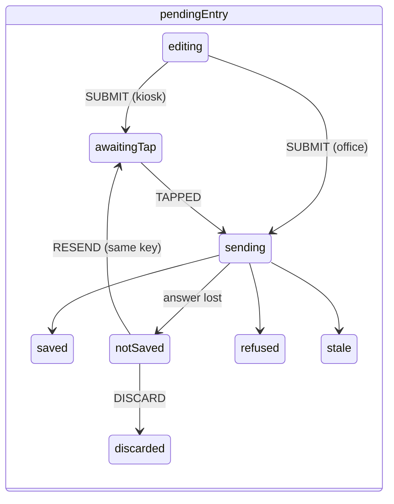

# shared-kits: ui-kit, test-kit and validation-kit

**Draft.** This page is still being written; facts on it were checked against the code on 14 October 2026.

This page explains three shared packages that hold no business rules of their own but that every developer uses:
`packages/ui-kit` (the components and state machines every screen is built from), `packages/test-kit` (test
databases, sandboxes, the demo personas and their keys: read this before you write a database or server test), and
`packages/validation-kit` (a placeholder for the validation pack generators of Phase 7). The pharma terms are in the
[glossary](../02-glossary.md).

## Where the code is

| What | Where |
|---|---|
| Design tokens (colours, densities) and the CSS they mirror | [ui-kit/src/tokens/](../../../packages/ui-kit/src/tokens/) |
| Primitives (Button, Field, SecretInput, DecimalField, Banner, Dialog, Table, Layout, Watermark) | [ui-kit/src/primitives/](../../../packages/ui-kit/src/primitives/) |
| Identity components (SignatureDialog, SignableContent, PinPad, BadgePrompt, LockOverlay, Manifestation) | [ui-kit/src/identity/](../../../packages/ui-kit/src/identity/) |
| Floor components (NumericEntry, LimitDisplay, NotSavedDialog, Keypad, ...) | [ui-kit/src/floor/](../../../packages/ui-kit/src/floor/) |
| Audit components (AuditEventList, ChainVerifyBadge) | [ui-kit/src/audit/](../../../packages/ui-kit/src/audit/) |
| State machines (ceremony, kiosk lock, pending entry) | [ui-kit/src/machines/](../../../packages/ui-kit/src/machines/) |
| English text catalogue | [ui-kit/src/i18n/](../../../packages/ui-kit/src/i18n/) |
| ui-kit tests (Vitest `dom` project) | [ui-kit/test/](../../../packages/ui-kit/test/) |
| Test databases, pools, teardown | [test-kit/src/db.ts](../../../packages/test-kit/src/db.ts) |
| Sandbox provisioning | [test-kit/src/sandbox.ts](../../../packages/test-kit/src/sandbox.ts) |
| Persona and terminal catalogue | [test-kit/src/personas.ts](../../../packages/test-kit/src/personas.ts) |
| Seeding through the kernel's identity administration | [test-kit/src/seed.ts](../../../packages/test-kit/src/seed.ts) |
| DEMO-ONLY keys and device proofs | [test-kit/src/keys.ts](../../../packages/test-kit/src/keys.ts) |
| test-kit tests | [test-kit/test/](../../../packages/test-kit/test/) |
| Validation kit (identity only) | [validation-kit/src/index.ts](../../../packages/validation-kit/src/index.ts) |

## ui-kit

`@ebmr/ui-kit` is the browser component library of both editions. It may depend only on React, react-aria-components,
XState, the API contract, `expr` and the pure folders of recipe-core (boundary rule `ui-kit-allowed-deps` in
[.dependency-cruiser.cjs](../../../.dependency-cruiser.cjs)), so it runs in the browser under the strict CSP and is
edition-neutral. The Tablets screens that use it are on the [tablets-web](tablets-web.md) page.

### Pharma context

The kit is where the screen-side rules of GMP data entry are written once, so no screen can forget them:

- **A value is typed, echoed and never pre-filled** (contemporaneous, accurate recording: [DI-28](../../../compliance/controls/DI-28.yaml)).
  A pre-filled target invites the operator to accept it without measuring.
- **Colour is never the only signal**: every state has a colour, an icon and a word, so a colour-blind operator in a
  gown reads it right.
- **Secrets never stay in memory the app can read back** (badge UIDs, PINs, passwords:
  [DI-19](../../../compliance/controls/DI-19.yaml), [DI-38](../../../compliance/controls/DI-38.yaml)).
- **The signer sees exactly what they sign** ([DI-36](../../../compliance/controls/DI-36.yaml),
  [DI-37](../../../compliance/controls/DI-37.yaml)).
- **Sandbox screens are marked TEST, NOT GMP** ([DI-05](../../../compliance/controls/DI-05.yaml)).

### Tokens and primitives

[tokens.ts](../../../packages/ui-kit/src/tokens/tokens.ts#sym=PALETTE) holds the state palette (each pair at least
4.5:1 contrast, WCAG 2.2 AA; [contrast](../../../packages/ui-kit/src/tokens/tokens.ts#sym=contrast)) and two densities
([DENSITY](../../../packages/ui-kit/src/tokens/tokens.ts#sym=DENSITY)): office, and floor with glove-sized targets.
`tokens.css` mirrors them; the web app imports it with `@ebmr/ui-kit/tokens.css`.

Primitives in [src/primitives/](../../../packages/ui-kit/src/primitives/):

- [DecimalField](../../../packages/ui-kit/src/primitives/DecimalField.tsx#sym=DecimalField): **the only numeric input
  for GMP values.** It works on text end to end (never a JavaScript number, never exponent form), the unit is fixed and
  shown, the field is never pre-filled, and a complete value is echoed back ("You entered 12.503 kg") before the
  person commits. react-aria's `NumberField` is banned by lint because it produces numbers.
- [SecretInput](../../../packages/ui-kit/src/primitives/SecretInput.tsx#sym=SecretInput): the input for passwords,
  PINs and badge UIDs. A plain native masked `<input>` with no `value` and no `defaultValue`; React keeps nothing. The
  caller reads it once with [takeSecret](../../../packages/ui-kit/src/primitives/SecretInput.tsx#sym=takeSecret), which
  also clears it. A kiosk field no password manager may fill (`noAutofill`) refuses a value the browser filled in.
- [WatermarkBand](../../../packages/ui-kit/src/primitives/Watermark.tsx#sym=WatermarkBand) and
  [WatermarkOverlay](../../../packages/ui-kit/src/primitives/Watermark.tsx#sym=WatermarkOverlay): the TEST, NOT GMP
  band and diagonal mark of every sandbox screen.
- `Banner`, `Button`, `Dialog`, `Field`, `Layout`, `StatusChip`, `Table`: plain building blocks over react-aria.

> **Why this exists** (a secret is never kept by React)
> - **Pharma reason:** a password or PIN left in a page's memory, in an input's value attribute or in browser storage
>   could be read by the next person at a shared kiosk or by injected script, and then used to sign as someone else.
> - **Control:** [DI-19](../../../compliance/controls/DI-19.yaml), [DI-38](../../../compliance/controls/DI-38.yaml),
>   [DI-14](../../../compliance/controls/DI-14.yaml).
> - **Code:** [SecretInput](../../../packages/ui-kit/src/primitives/SecretInput.tsx#sym=SecretInput),
>   [PinPad](../../../packages/ui-kit/src/identity/PinPad.tsx#sym=PinPad),
>   [BadgePrompt](../../../packages/ui-kit/src/identity/BadgePrompt.tsx#sym=BadgePrompt).
> - **Tests:** [identity/secret-inputs.test.tsx](../../../packages/ui-kit/test/identity/secret-inputs.test.tsx),
>   [identity/badge-autofill.test.tsx](../../../packages/ui-kit/test/identity/badge-autofill.test.tsx); the helper
>   [support/secret-traces.ts](../../../packages/ui-kit/test/support/secret-traces.ts) walks the DOM, browser storage
>   and every React fiber and hook to find any place a typed secret is still kept.

### Identity components

- [SignatureDialog](../../../packages/ui-kit/src/identity/SignatureDialog.tsx#sym=SignatureDialog) renders one state
  of the ceremony machine: what is signed (the record, then the exact canonical text and its SHA-256), the meaning
  statement, how the signature will show, the 120 s countdown, then the PIN pad (kiosk) or user ID and password
  (office).
- [SignableContent](../../../packages/ui-kit/src/identity/SignableContent.tsx#sym=SignableContent) renders the server's
  description of a record per kind (batch step, stage, exception, release, ...). Information that is shown but not
  part of the signature sits under the heading "For information: not part of this signature"
  ([NOT_SIGNED_TITLE](../../../packages/ui-kit/src/identity/SignableContent.tsx#sym=NOT_SIGNED_TITLE)), so the signer
  never believes they signed something they did not.
- [ManifestationPreview](../../../packages/ui-kit/src/identity/Manifestation.tsx#sym=ManifestationPreview) and
  [ManifestationCard](../../../packages/ui-kit/src/identity/Manifestation.tsx#sym=ManifestationCard): printed name,
  user ID, role, meaning, date and time with UTC offset and site zone (21 CFR 11.50). A signature no longer valid is
  shown as such.
- [PinPad](../../../packages/ui-kit/src/identity/PinPad.tsx#sym=PinPad) (72 px keys; only the number of digits is
  shown) and [BadgePrompt](../../../packages/ui-kit/src/identity/BadgePrompt.tsx#sym=BadgePrompt): a badge reader types
  the UID as a fast burst of keys plus Enter; a key typed more than [BURST_GAP_MS](../../../packages/ui-kit/src/identity/BadgePrompt.tsx#sym=BURST_GAP_MS)
  (100 ms) after the previous one starts afresh, and text that cannot be a badge UID is not sent (review F56).
- `LockOverlay`, `IdentityBanner`, `RefusalNotice`.

Tests: [identity/](../../../packages/ui-kit/test/identity/) (`signable-content`, `signed-content`, `identity`).

### Floor components

[src/floor/](../../../packages/ui-kit/src/floor/) holds the shop-floor parts of the step screen:
[NumericEntry](../../../packages/ui-kit/src/floor/NumericEntry.tsx#sym=NumericEntry) (DecimalField with the keypad,
the echo and the limit tiers beside it; the target shown as information only),
[LimitDisplay](../../../packages/ui-kit/src/floor/LimitDisplay.tsx#sym=LimitDisplay) (the limits as the server sent
them; **it never compares a value with a limit**: the verdict comes from the server after commit,
[PR-08](../../../compliance/controls/PR-08.yaml)), [NotSavedDialog](../../../packages/ui-kit/src/floor/NotSavedDialog.tsx#sym=NotSavedDialog)
(the blocking notice of a lost answer: resend or discard, nothing else), `AttemptList`, `ChecklistEntry`,
`ChoiceGroup`, `ExceptionBanner`, `Keypad`, `PrimaryActionBar`, `RefusalPanel`, `ScanField`, `SignatureList`,
`StatusOutline`, `StepHeader`, `TimerChip`, `TwoPersonNotice`. Tests: [floor/components.test.tsx](../../../packages/ui-kit/test/floor/components.test.tsx).

### Audit components

[AuditEventList](../../../packages/ui-kit/src/audit/AuditEventList.tsx#sym=AuditEventList) groups the trail by command:
the plain-language business entry first, then the field changes (old to new), each with who, when (site time and UTC),
why, the terminal, and its place in the hash chain. [ChainVerifyBadge](../../../packages/ui-kit/src/audit/ChainVerifyBadge.tsx#sym=ChainVerifyBadge)
shows the server's verification of a chain; no verdict is shown while one runs (review F07). Controls
[DI-22](../../../compliance/controls/DI-22.yaml), [DI-23](../../../compliance/controls/DI-23.yaml). Test
[audit/audit.test.tsx](../../../packages/ui-kit/test/audit/audit.test.tsx).

### State machines

Three XState machines in [src/machines/](../../../packages/ui-kit/src/machines/) carry the screen-side flows that must
never take a wrong turn. In all three, **secrets never enter the machine**: events carry no payload, and the host's
actors read the secret from a ref and wipe it.



- [ceremonyMachine](../../../packages/ui-kit/src/machines/ceremony.ts): loadingContent, reviewing, awaitingTap (kiosk),
  challenging, awaitingSecret, signing, then done, refused, expired, changed, cancelled, switchOffered, or
  reconciling to notConfirmed. Content whose SHA-256 is not the server's hash stops the ceremony before any challenge
  (DI-37). A lost answer never re-sends credentials (INV-10). The web app drives it from
  [access/ceremony.tsx](../../../apps/tablets-web/src/features/access/ceremony.tsx#sym=CeremonyHost).
- [kioskLockMachine](../../../packages/ui-kit/src/machines/kiosk-lock.ts#sym=kioskLockMachine): active, locking,
  locked, unlocking, switching, ended. The kernel is authoritative (it locks idle sessions); every change is announced
  as `ebmr:session-change` ([announceSessionChange](../../../packages/ui-kit/src/machines/kiosk-lock.ts#sym=announceSessionChange))
  so unsent floor entries are discarded.
- [pendingEntryMachine](../../../packages/ui-kit/src/machines/pending-entry.ts#sym=pendingEntryMachine): the diagram
  above. NOT SAVED is blocking and is left only by a resend (same idempotency key, same body, a fresh tap) or a
  discard; a session change or another person's badge discards anything pending.

> **Why this exists** (the machines are tested on every path)
> - **Pharma reason:** a signature or an entry that ends in an unclear state ("was it saved? was it signed?") breaks
>   the record's reliability; a credential re-sent automatically could sign twice.
> - **Control:** [DI-28](../../../compliance/controls/DI-28.yaml), [DI-36](../../../compliance/controls/DI-36.yaml) to
>   [DI-38](../../../compliance/controls/DI-38.yaml), invariants INV-10 and INV-40.
> - **Code:** [src/machines/](../../../packages/ui-kit/src/machines/).
> - **Tests:** [machines/ceremony.test.ts](../../../packages/ui-kit/test/machines/ceremony.test.ts),
>   [machines/kiosk-lock.test.ts](../../../packages/ui-kit/test/machines/kiosk-lock.test.ts),
>   [floor/pending-entry.test.ts](../../../packages/ui-kit/test/floor/pending-entry.test.ts). They use `@xstate/graph`
>   to reach every state and walk every path (for example "on every path a resend uses the same idempotency key and the
>   same body as the lost send").

### Text

[t](../../../packages/ui-kit/src/i18n/index.ts#sym=t) returns the English text of a typed key from
[en.ts](../../../packages/ui-kit/src/i18n/en.ts) with `{placeholders}` filled in. Hindi and a regional language are
planned for Phase 6.

## test-kit

`@ebmr/test-kit` gives tests, the demo and the browser suite their databases and people. Product code never imports it
(boundary rule `product-never-imports-test-kit`); the only exception is the tablets server's set-up CLI
([apps/tablets-server/src/cli/](../../../apps/tablets-server/src/cli/)), which seeds demo and E2E databases. The kernel's
own tests do not use it (the kernel imports nothing else in the repository) and keep their own copy of the pool helper.

**Every credential and key in test-kit is DEMO-ONLY.** It exists in demo, E2E and test databases, never in a real
installation.

### Template databases and copies

Building a database with every migration takes long, so tests **build a template once and copy it per test file**
(`create database ... template ...`, a fast file copy). The full pattern, the variables (`EBMR_PG_ADMIN_URL`,
`EBMR_MIGRATIONS`, `EBMR_TEMPLATE_DB`, `EBMR_SERVER_TEMPLATES`) and the clusters are explained in
[Database reference, test databases](../05-database.md#test-databases). The test-kit functions:

| Function | What it does |
|---|---|
| [editionMigrationSources](../../../packages/test-kit/src/db.ts#sym=editionMigrationSources) | the migration sources of the Tablets edition, kernel first |
| [createTemplateDatabase](../../../packages/test-kit/src/db.ts#sym=createTemplateDatabase) | a migrated GMP template `ebmr_tpl...` |
| [createGmpDatabase](../../../packages/test-kit/src/db.ts#sym=createGmpDatabase) | a migrated GMP database of a given name |
| [copyDatabase](../../../packages/test-kit/src/db.ts#sym=copyDatabase) | a copy of a template, with the database-level privileges re-applied |
| [provisionSandboxTemplate](../../../packages/test-kit/src/sandbox.ts#sym=provisionSandboxTemplate), [copySandbox](../../../packages/test-kit/src/sandbox.ts#sym=copySandbox) | a bootstrapped sandbox template and its copies, through the kernel's own provisioning |
| [bootstrapInstallation](../../../packages/test-kit/src/seed.ts#sym=bootstrapInstallation) | the installation's first administrator and process owner |
| [seedDemoSite](../../../packages/test-kit/src/seed.ts#sym=seedDemoSite) | personas, terminals, badges, PINs, grants and service identities |
| [openDatabase](../../../packages/test-kit/src/db.ts#sym=openDatabase) | a `DatabaseHandle` with an admin pool, the application role's pool and the authentication pool; `close()` ends them all |
| [openPool](../../../packages/test-kit/src/db.ts#sym=openPool), [endPool](../../../packages/test-kit/src/db.ts#sym=endPool) | the only way to make and end a pool in test code |
| [dropDatabase](../../../packages/test-kit/src/db.ts#sym=dropDatabase), [asAdmin](../../../packages/test-kit/src/db.ts#sym=asAdmin) | drop a database; run work as the superuser |

**Why copies re-apply privileges.** PostgreSQL does not copy database-level privileges with a template, so every copy
removes TEMPORARY from PUBLIC and applies the sandbox connect policy again
([copyDatabase](../../../packages/test-kit/src/db.ts#sym=copyDatabase)). Without it a test database would be weaker
than a real installation, and a security test could pass by accident.

**The login roles.** GMP uses `ebmr_app` (the application) and `ebmr_authn` (the authentication service); a sandbox
uses `ebmr_sandbox` for both; the gateway listener has its own roles
([APP_LOGIN](../../../packages/test-kit/src/db.ts#sym=APP_LOGIN) and the others). The roles are explained in
[Database reference, database roles](../05-database.md#database-roles).

### Teardown: `openPool` and `endPool`

`pg-pool`'s own `end()` returns as soon as it has asked its clients to close, before their database backends have
exited. A `drop database ... with (force)` right after it killed backends still closing, and the run reported an
unhandled `FATAL 57P01`: a flaky failure that looked random. [openPool](../../../packages/test-kit/src/db.ts#sym=openPool)
makes a pool that follows every connection; its own `end()` throws; [endPool](../../../packages/test-kit/src/db.ts#sym=endPool)
waits until every socket has closed. A test in [teardown.test.ts](../../../packages/test-kit/test/teardown.test.ts)
fails if any test code outside the kernel makes a `pg.Pool` without `openPool`.

```ts
const db = openDatabase(name, 'GMP');
try {
  // ... the test, through db.app (the application role) ...
} finally {
  await db.close();          // endPool on each pool
  await dropDatabase(name);  // safe now: no backend left
}
```

See [Testing, test flakiness](../08-defect-log.md#test-flakiness-and-races) for the history.

### Personas, terminals and services

[personas.ts](../../../packages/test-kit/src/personas.ts) is the catalogue of the demo and E2E installations
(site `SITE-1`):

- [TERMINALS](../../../packages/test-kit/src/personas.ts#sym=TERMINALS): office PCs (`PC-QA-01`, `PC-PLAN-01`, ...,
  class PERSONAL), kiosks per room (`KIOSK-DISP-1`, `KIOSK-GRAN-1`, ..., `KIOSK-PACK-1`, class SHARED), and servers
  (`SRV-ERP-01`, `GW-01`, class SERVER). Several QA PCs exist only so each browser spec stays under the device rate
  limit. Sandbox terminals start with `TEST-`.
- [PERSONAS](../../../packages/test-kit/src/personas.ts#sym=PERSONAS): the people of the demo, by key (`author`,
  `checker`, `approver`, `issuer`, `operator1`, `verifier1`, `supervisor1`, `qa1`, `qcAnalyst`, `head1`, `usQcu`,
  `euQp`, ...), with role, login, badge and PIN. Each Playwright worker gets its own set (suffix `-wN`,
  [personaForSet](../../../packages/test-kit/src/personas.ts#sym=personaForSet)) because the kernel allows one
  shop-floor session per person. Names carry no digit: in the sandbox a word joining letters and digits reads as a
  batch or lot number and is refused (`EBMR-SBX-024`).
- [SERVICES](../../../packages/test-kit/src/personas.ts#sym=SERVICES): the service identities (sweeper, gateway,
  monitor, ERP interface), each holding only the role its work needs ([DI-17](../../../compliance/controls/DI-17.yaml), INV-20).

### Seeding through the kernel

[seedDemoSite](../../../packages/test-kit/src/seed.ts#sym=seedDemoSite) creates everything **through the kernel's
identity administration functions**, as a real administrator would: verified persons and accounts with changed
secrets, grants requested by the administrator and approved by the process owner (two people), badges and PINs,
devices (kiosks with a hardening attestation), and service identities with SERVICE_KEY secrets on SERVER devices. No
row is inserted behind the kernel's back, so a seeded database obeys every rule a real one does. Every actor context
declares the site's time zone as the database's site policy holds it ([siteZoneOf](../../../packages/test-kit/src/seed.ts#sym=siteZoneOf));
the kernel refuses any other (`EBMR-IAM-118`, [DI-27](../../../compliance/controls/DI-27.yaml)).

Helpers for tests: [openPersonaSession](../../../packages/test-kit/src/seed.ts#sym=openPersonaSession) (a session of a
persona on a terminal), [freshTap](../../../packages/test-kit/src/seed.ts#sym=freshTap) (a fresh badge tap for a
kiosk command), [openServiceSession](../../../packages/test-kit/src/seed.ts#sym=openServiceSession),
[personaOf](../../../packages/test-kit/src/seed.ts#sym=personaOf), [terminalOf](../../../packages/test-kit/src/seed.ts#sym=terminalOf).

[keys.ts](../../../packages/test-kit/src/keys.ts) makes terminal keys (ECDSA P-256, the browser's kind; the kernel's
fingerprint is SHA-256 of the SPKI) and service keys (Ed25519), and signs device proofs
([signDeviceProof](../../../packages/test-kit/src/keys.ts#sym=signDeviceProof)) the way the browser does.

> **Why this exists** (the sandbox is built like the real thing and marked TEST-)
> - **Pharma reason:** training and test runs must never be mistaken for GMP records, and the sandbox must be closed
>   to the GMP roles. A test sandbox built differently from a real one would prove nothing about the real one.
> - **Control:** [DI-05](../../../compliance/controls/DI-05.yaml), invariant INV-18; [DI-14](../../../compliance/controls/DI-14.yaml),
>   [DI-15](../../../compliance/controls/DI-15.yaml), [DI-17](../../../compliance/controls/DI-17.yaml),
>   [DI-20](../../../compliance/controls/DI-20.yaml), [DI-27](../../../compliance/controls/DI-27.yaml) for the seed.
> - **Code:** [provisionBootstrappedSandbox](../../../packages/test-kit/src/sandbox.ts#sym=provisionBootstrappedSandbox)
>   (calls the kernel's `sandbox.provisionSandboxDatabase`), [seedDemoSite](../../../packages/test-kit/src/seed.ts#sym=seedDemoSite).
> - **Tests:** [seed.test.ts](../../../packages/test-kit/test/seed.test.ts) (`[DI-05][INV-18]` the sandbox is marked,
>   closed to GMP roles and segregated; `[DI-05]` every sandbox label carries TEST-; `[DI-17][INV-20]` each service
>   identity holds only what its work needs).

### Who uses test-kit

- The server tests' global set-up ([apps/tablets-server/test/support/global-setup.ts](../../../apps/tablets-server/test/support/global-setup.ts))
  builds a GMP and a sandbox template and seeds them; each test file copies one through
  [startServer](../../../apps/tablets-server/test/support/harness.ts#sym=startServer).
- The browser suite's [global-setup.ts](../../../tools/e2e/global-setup.ts) and fixtures.
- The demo set-up through the server's CLI ([tools, tools-demo](tools.md#tools-demo-the-demo-stack)).
- The SQL mutation harness, which prepares templates once and hands them to the tests
  ([tools, tools-sql-mutation](tools.md#tools-sql-mutation-the-sql-mutation-harness)).

## validation-kit

`@ebmr/validation-kit` is a **placeholder**. Today [index.ts](../../../packages/validation-kit/src/index.ts) exposes
only the package identity ([PACKAGE](../../../packages/validation-kit/src/index.ts#sym=PACKAGE)); its one test checks
that. It is reserved for the validation pack generators of Phase 7: the user requirements (URS), the risk assessment,
the trace matrix and the PDF test records.

Pharma context: a regulated company must show that its computerised system was validated for its intended use
(EU GMP Annex 11 section 4, 21 CFR 11.10(a)). The validation pack is that evidence. Pieces already exist elsewhere:
the control register and the trace from controls to tests ([tools, tools-register](tools.md#tools-register-the-control-register)),
and the browser suite's evidence report ([tools, tools-e2e](tools.md#tools-e2e-the-browser-suite)).

## How to test them

- ui-kit: `pnpm vitest run --project dom packages/ui-kit` (happy-dom, no database).
- test-kit: `pnpm vitest run --project db packages/test-kit` (needs PostgreSQL).
- validation-kit: `pnpm vitest run --project db packages/validation-kit`.

## Pitfalls

- **Never use react-aria's `TextField` or `NumberField` for a secret or a GMP number.** Use `SecretInput` and
  `DecimalField`.
- **Never pre-fill a GMP value**, not even with the target.
- **Never compare a value with a limit in a component**; show the server's verdict.
- **Never `new pg.Pool` in test code.** Use `openPool` and `endPool`; a test enforces it.
- **Never insert seed rows directly** into identity or GMP tables; seed through the kernel's functions, or the
  database you test is not one a real installation could be.
- **Leftover databases.** A cancelled test file can leave its copy (`ebmr_t_*`, `ebmr_tpl_*`); drop them only on a
  cluster you are using alone ([Database reference, test databases](../05-database.md#test-databases)).
- **No digit in a sandbox name**: `EBMR-SBX-024`.

## Differences between the code and the docs (14 October 2026)

- The header of [tokens.ts](../../../packages/ui-kit/src/tokens/tokens.ts) says `test/tokens.test.ts` proves the
  contrast ratios; there is no such file. The contrast check is in
  [primitives.test.tsx](../../../packages/ui-kit/test/primitives.test.tsx).
- The descriptions of test-kit ([package.json](../../../packages/test-kit/package.json)) promise golden batches, an
  invariant SQL library and bypass tests; none is in test-kit. The golden batches live in
  [apps/tablets-server/test/golden/](../../../apps/tablets-server/test/golden/).
- The ui-kit description mentions "review components"; the review screens are built in the web app from the
  primitives, not in the kit.

## Related pages

- [tablets-web](tablets-web.md): the screens built from ui-kit.
- [Database reference, test databases](../05-database.md#test-databases) and [the clusters](../05-database.md#the-clusters).
- [Testing and debugging](../06-testing-and-debugging.md).
- [tools](tools.md): the browser suite, the demo, the SQL mutation harness.
- Generated: [code map](../code-map.md#ui-kit), [control map](../reference/control-map.md).
