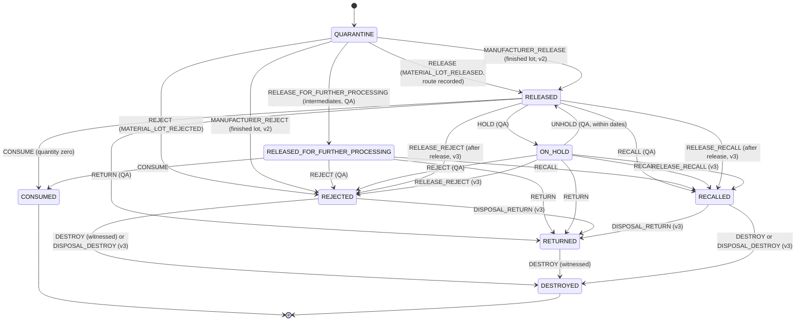
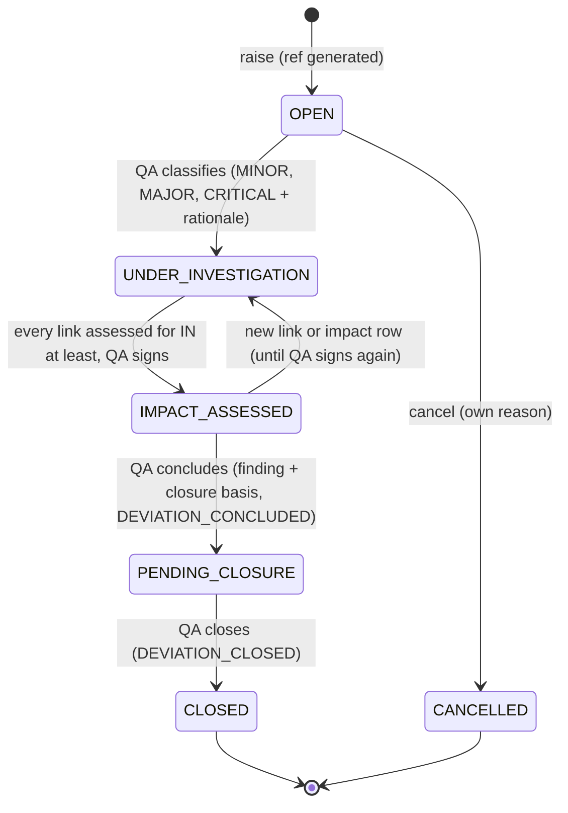
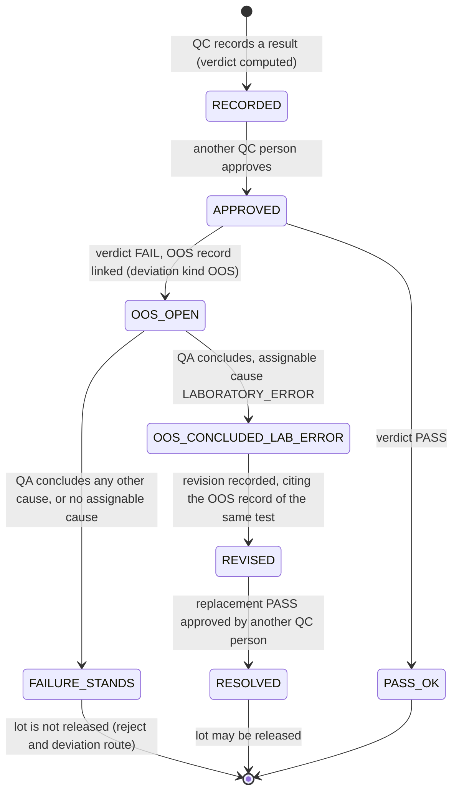

# Site services (`packages/site-services`)

**Draft** (14 October 2026).

Site services hold what one manufacturing site shares between its two editions (Tablets and Injectables): the batch
number register, the material lots and their status, the quality records (deviations, OOS, laboratory results,
specifications, samples, evidence documents), the stand-in for the ERP (product and material masters, production
orders, shipping, stock blocks) and the Indian licences a batch is made under. Almost all of it is PostgreSQL in the
`site` schema: insert-only tables, SECURITY DEFINER commands that refuse anything the rules do not allow, and guards
that the batch side (recipe-core, the Tablets edition) calls before it issues, dispenses, releases or ships. The
TypeScript in `src/` is a thin typed wrapper over those commands, plus the material-lot state machine. Read this page if
you change anything in `packages/site-services`, or if an `EBMR-SITE`, `EBMR-IND` or `EBMR-SHP` error stops you. If
"lot", "quarantine", "OOS" or "QA" are new words, read the [pharma primer](../01-pharma-primer.md) and the
[glossary](../02-glossary.md) first.

## Where the code is

| What | Where |
|---|---|
| Migrations (46 files, run in number order, after the kernel's) | [packages/site-services/sql/](../../../packages/site-services/sql/) |
| Package entry point | [src/index.ts](../../../packages/site-services/src/index.ts) |
| Batch-number register wrapper and its README | [src/batch-numbers/](../../../packages/site-services/src/batch-numbers/), [README.md](../../../packages/site-services/src/batch-numbers/README.md) |
| Material-lot machine (XState, versions 1 to 3) and the seed writer | [src/lots/machine.ts](../../../packages/site-services/src/lots/machine.ts#sym=MATERIAL_LOT_V3), [src/lots/write-seeds.ts](../../../packages/site-services/src/lots/write-seeds.ts) |
| Lot command wrappers | [src/lots/commands.ts](../../../packages/site-services/src/lots/commands.ts) |
| Deviations, evidence, ERP, QC decision wrappers | [src/quality/index.ts](../../../packages/site-services/src/quality/index.ts) |
| India licences and export permission wrappers | [src/india/index.ts](../../../packages/site-services/src/india/index.ts) |
| Tests | [packages/site-services/test/](../../../packages/site-services/test/) |
| SQL mutation tests of site guards | [packages/site-services/test/mutation/](../../../packages/site-services/test/mutation/) |
| Controls the package carries | DI-09, DI-13, DI-17, DI-18, DI-22, DI-24, DI-27, DI-33, DI-35, DI-37, DI-39, DI-41, DI-42, IN-02, IN-05, IN-18, IN-19, IN-20, IN-24, IN-30, IN-32, IN-33, IN-38, PR-17, PR-18, PR-19, PR-43 to PR-50, PR-56, PR-57 (`grep -l site-services compliance/controls/*.yaml`) |
| Generated lists: every function and trigger, every error code, the code map | [db-catalogue.md](../reference/db-catalogue.md), [error-codes.md](../reference/error-codes.md), [code-map.md](../code-map.md#ss-batch-numbers) |

The areas, their migrations and their code-map modules (the same split as [modules.yaml](../modules.yaml)):

| Area (section below) | Migrations | Code map | TypeScript |
|---|---|---|---|
| [Batch-number register](#batch-number-register) | 0600, 0690, 0700 | [ss-batch-numbers](../code-map.md#ss-batch-numbers) | `src/batch-numbers` |
| [Material lots: receipt, release, retest, reservations](#material-lots-receipt-release-retest-reservations) | 0710 to 0721, 0752, 0760 to 0762, 0800, 0801, 0861, 0881 | [ss-lots](../code-map.md#ss-lots) | `src/lots` |
| [Finished lots, returned goods and shelf life](#finished-lots-returned-goods-and-shelf-life) | 0842, 0886 | [ss-lots](../code-map.md#ss-lots) | `src/lots`, `src/india` |
| [Deviations, lite and full](#deviations-lite-and-full) | 0730, 0753, 0820 to 0825 | [ss-quality](../code-map.md#ss-quality) | `src/quality` |
| [Evidence documents](#evidence-documents) | 0731, 0823 | [ss-quality](../code-map.md#ss-quality) | `src/quality` |
| [LIMS-lite, specifications, samples and OOS](#lims-lite-specifications-samples-and-oos) | 0733, 0740, 0810, 0840, 0841, 0843, 0844, 0859 | [ss-quality](../code-map.md#ss-quality) | `src/quality` |
| [ERP masters and production orders](#erp-masters-and-production-orders) | 0732, 0750, 0751, 0802, 0803 | [ss-erp](../code-map.md#ss-erp) | `src/quality` |
| [Manufacturer release guard, shipping interlock, after-release exits](#manufacturer-release-guard-shipping-interlock-after-release-exits) | 0860, 0870, 0871, 0880 | [ss-shipping](../code-map.md#ss-shipping) | (none) |
| [India licences and export permission](#india-licences-and-export-permission) | 0885, 0903 | [ss-india](../code-map.md#ss-india) | `src/india` |

## How site services are built (read this once)

The kernel's rules apply here unchanged; read [kernel, "How the kernel is built"](kernel.md#how-the-kernel-is-built-read-this-once)
and the [database reference](../05-database.md) first. What is particular to site services:

- **One schema, `site`.** Every table and function is `site.*`. The application role (`ebmr_app`) reads the tables and
  writes only by calling SECURITY DEFINER commands (controls [DI-17](../../../compliance/controls/DI-17.yaml) and
  [DI-18](../../../compliance/controls/DI-18.yaml)). Each command first calls `iam.assert_not_administrator` (an
  administrator never writes GMP data) and `iam.require_permission` for the action in the site's scope.
- **Insert-only.** No site row is ever updated or deleted. A lot's status is the state of its machine; a deviation's
  state is derived from its event rows; a "change" is a new row that names the one it replaces. Every table is
  registered with the audit trail.
- **States derived, not stored.** `site.deviation_state`, `site.lot_test_state`, `site.specification_state`,
  `site.licence_state`: each is a function over the rows. Retest-due and expired lots are computed from the dates at
  database time (view [`site.material_lot_usage`](../../../packages/site-services/sql/0712_material_lot_commands.sql#sym=site.material_lot_usage)), never stored.
- **Applied before recipe-core.** Site migrations run before the batch side's, so site services never name a recipe-core
  table at creation. When a site guard needs a batch-side fact (the manufacturer release decision, the release model's
  disposition, the identity of a batch), it either calls a function registered later through an extension point
  ([`site.register_subject_resolver`](../../../packages/site-services/sql/0730_deviation_lite.sql#sym=site.register_subject_resolver)), or looks the recipe-core function up when the guard runs. Without the batch
  side installed, such a guard **refuses** (fails closed).
- **Signatures bind content.** A signature is bound to the hash of the aggregate's signed content and to nothing else
  (no command arguments). So whatever a signer decides (a release route, a new retest date, a hold) must be **in the
  content** before the signing. Several fixes in this package were about exactly that (see
  [Pitfalls](#pitfalls-that-apply-to-the-whole-package)).
- **Error codes.** `EBMR-SITE-0xx` to `-8xx` by area (batch numbers 0xx, lots 1xx, deviations 3xx and 8xx, LIMS 4xx,
  ERP 17x and 34x), `EBMR-IND-0xx` (India licences, shelf life), `EBMR-SHP-0xx` (shipping interlock).
- **New migrations** numbered above 0903 must carry a `-- Handbook: modules/site-services.md` line within their first
  ten lines ([modules.yaml](../modules.yaml), `migration_header_from`).

## Batch-number register

### What it does

Allocates batch numbers from numbering rules, or registers numbers issued by the ERP, and keeps every number in one
register per site, shared by both editions. A number is never reissued, also not after a void, a rework or a database
restore. The register can be exported (CSV) for an inspector. The demo batch GB-T-01 got its number here.

### Pharma context

A batch number identifies one batch for its whole life: in the batch record, on every label, in the distribution
records and in a recall. Schedule M and 21 CFR 211.130 and 211.188 ask that each batch is uniquely identified, and
the build outline (section 4.2) asks for one register across editions. If a number could come back after a restore,
two batches would share it and a recall could miss one. Control [IN-18](../../../compliance/controls/IN-18.yaml)
(batch numbering and allocation register), invariant INV-27 (identifiers never reused after a restore).

### Main tables

| Table | What it holds |
|---|---|
| [`site.batch_number_rule`](../../../packages/site-services/sql/0600_batch_number_register.sql#sym=site.batch_number_rule) | Numbering rule per site, product (or site-wide) and batch kind (PROCESSING, PACKAGING): format and the site zone |
| [`site.batch_number_allocation`](../../../packages/site-services/sql/0600_batch_number_register.sql#sym=site.batch_number_allocation) | Every number: unique per site, product, edition, kind, parent (for packaging), batch size and unit, source (GENERATED, EXTERNAL, RECOVERED_AFTER_RESTORE) |
| [`site.batch_number_void`](../../../packages/site-services/sql/0600_batch_number_register.sql#sym=site.batch_number_void) | A void with its reason; the number stays |
| [`site.batch_number_serial_skip`](../../../packages/site-services/sql/0600_batch_number_register.sql#sym=site.batch_number_serial_skip) | A serial whose rendered number was taken already (for example by the ERP) |
| [`site.batch_number_register`](../../../packages/site-services/sql/0600_batch_number_register.sql#sym=site.batch_number_register) (view) | The export: site-local date, product identity, batch size, status, void reason |

Format tokens: `{SITE}`, `{PRODUCT}`, `{YYYY}`, `{YY}`, `{MM}` (site calendar at allocation), `{SEQ:n}` (the serial,
exactly once), `{PARENT}` (packaging numbers carry the processing batch number). The full table of functions and
permissions is in the [README](../../../packages/site-services/src/batch-numbers/README.md).

### Main functions and guards

- [`site.allocate_batch_number`](../../../packages/site-services/sql/0600_batch_number_register.sql#sym=site.allocate_batch_number) draws the next serial from a protected, write-ahead continuity counter
  (`continuity.next_counter_value`, see [kernel, Continuity](kernel.md#continuity)). A product rule wins over a
  site-wide rule.
- [`site.register_external_batch_number`](../../../packages/site-services/sql/0600_batch_number_register.sql#sym=site.register_external_batch_number) enters a number the ERP issued; an existing number, voided ones included, is
  refused (`EBMR-SITE-013`). The input is never silently changed.
- [`site.void_batch_number`](../../../packages/site-services/sql/0600_batch_number_register.sql#sym=site.void_batch_number) voids with a reason; the number is never reissued.
- [`site.recover_batch_number`](../../../packages/site-services/sql/0600_batch_number_register.sql#sym=site.recover_batch_number) re-enters, after a completed restore, a number issued in the lost window, with
  evidence, only for a serial inside the range the restore skipped.
- [`site.batch_number_invariant_violations`](../../../packages/site-services/sql/0600_batch_number_register.sql#sym=site.batch_number_invariant_violations) is the invariant query (must return nothing).
- [`site.site_zone_row_guard`](../../../packages/site-services/sql/0700_batch_number_site_zone.sql#sym=site.site_zone_row_guard) (0700) refuses a rule or an allocation whose zone is not the site policy `site.zone`, so
  `{YY}` and `{MM}` and the register date are always the site's own calendar.
- 0690 adds the sandbox identifier guard: `TEST-...` numbers are refused on a GMP installation and real-looking numbers
  on a sandbox ([kernel, Sandbox](kernel.md#sandbox)).

> **Why this exists**
> - **Pharma reason:** a batch number must identify one batch only, forever, so a recall finds every unit (Schedule M;
>   21 CFR 211.130, 211.188).
> - **Control:** [IN-18](../../../compliance/controls/IN-18.yaml), [DI-42](../../../compliance/controls/DI-42.yaml)
>   (controlled issuance), [DI-27](../../../compliance/controls/DI-27.yaml) (trusted time: the site zone); invariant INV-27.
> - **Code:** [`site.allocate_batch_number`](../../../packages/site-services/sql/0600_batch_number_register.sql#sym=site.allocate_batch_number), [`site.register_external_batch_number`](../../../packages/site-services/sql/0600_batch_number_register.sql#sym=site.register_external_batch_number), [`site.recover_batch_number`](../../../packages/site-services/sql/0600_batch_number_register.sql#sym=site.recover_batch_number),
>   [`site.site_zone_row_guard`](../../../packages/site-services/sql/0700_batch_number_site_zone.sql#sym=site.site_zone_row_guard).
> - **Tests:** [batch-number-register.test.ts](../../../packages/site-services/test/batch-number-register.test.ts)
>   (`[IN-18]`, `[INV-27]`, `[DI-27]`, `[DI-42]`).
> - **Error:** `EBMR-SITE-010` bad format, `-011` no rule in force, `-013` number already in the register, `-014`
>   packaging number without its processing parent, `-017` counter moved back, `EBMR-CONT-011` write-ahead block used up.

### How to test it

`pnpm vitest run --project db packages/site-services/test/batch-number-register.test.ts`. Allocation must run inside
the kernel's protected-number wrapper; the tests show how.

### Pitfalls

- **The zone came from the caller** (Phase 2 exit, T10): a rule could carry `EST` or `Etc/GMT+5` and date numbers on
  another day around midnight. Migration 0700 fixed it with a row guard on both tables; it holds for the owner's code
  too.
- After a change of `site.zone`, a rule defined before it generates nothing until it is defined again.

## Material lots: receipt, release, retest, reservations

### What it does

A **material lot** is one delivery of one material (an active ingredient, an excipient, a packaging material) or one
intermediate or finished product. It arrives in QUARANTINE, is tested, and is RELEASED (usable), REJECTED, put ON_HOLD,
RETURNED, RECALLED, CONSUMED or DESTROYED. Site services record the receipt, the identity test, the release route, each
status decision, the retest of a lot past its retest date, the reservations a batch holds on a lot, the consumption, and
the witnessed destruction. In GB-T-01 the active ingredient lot is released on the identity-tested route; in GB-T-02 an
excipient lot is released on the vendor-history route.

### Pharma context

- **Quarantine until released.** Starting materials may be used only after QC tests them and QA (or QC) releases them
  (Schedule M; 21 CFR 211.84; EU GMP chapter 5). Control [PR-45](../../../compliance/controls/PR-45.yaml) (quarantine and
  release status model), [PR-18](../../../compliance/controls/PR-18.yaml) (status checked at dispensing, issue and
  charge-in), invariant INV-13 (only usable lots are consumed).
- **Release routes.** Every lot needs an identity test; India's Revised Schedule M lets an excipient be released on its
  supplier's history under conditions (QA's statistical justification), which the US rules do not. So a lot released
  on the vendor-history route cannot serve a US batch. Control [IN-24](../../../compliance/controls/IN-24.yaml) (a)(c).
- **Retest and expiry.** A material past its retest date must be tested again before use; past its expiry it is never
  used. The new retest date is QC's signed decision on approved results, and never beyond the limit the material master
  sets.
- **Destruction.** Rejected material is destroyed under a witness who did not perform the destruction (four eyes).
- **Reservations.** A batch reserves the quantity it will use, so two batches cannot plan on the same kilograms.

### Main tables

| Table | What it holds |
|---|---|
| [`site.material_lot`](../../../packages/site-services/sql/0710_material_lots.sql#sym=site.material_lot) | One received lot, insert-only: material, kind (API, EXCIPIENT, PRIMARY_PACKAGING, PRINTED_PACKAGING, INTERMEDIATE, FINISHED, RETURNED), received quantity and unit, retest and expiry instants |
| [`site.lot_status_command`](../../../packages/site-services/sql/0710_material_lots.sql#sym=site.lot_status_command) | Every status change, written with its transition; a RELEASE row records the route |
| [`site.lot_identity_result`](../../../packages/site-services/sql/0710_material_lots.sql#sym=site.lot_identity_result) | Identity test results recorded by QC (PASS or FAIL) |
| [`site.vendor_route`](../../../packages/site-services/sql/0710_material_lots.sql#sym=site.vendor_route), [`site.vendor_route_enablement`](../../../packages/site-services/sql/0710_material_lots.sql#sym=site.vendor_route_enablement), [`site.vendor_route_disablement`](../../../packages/site-services/sql/0710_material_lots.sql#sym=site.vendor_route_disablement) | QA's justification of the vendor-history route for one excipient, effective only once QA signed it |
| [`site.lot_decision_intent`](../../../packages/site-services/sql/0800_lot_decision_signed_event.sql#sym=site.lot_decision_intent) | A QA decision proposed before it is signed (HOLD, UNHOLD, RETURN, RECALL, RELEASE_FOR_FURTHER_PROCESSING), so the signature binds it |
| [`site.lot_retest`](../../../packages/site-services/sql/0752_lot_retest.sql#sym=site.lot_retest), [`site.lot_retest_signature`](../../../packages/site-services/sql/0762_lot_retest_signed_content.sql#sym=site.lot_retest_signature) | QC's decision of a new retest instant, on named approved results; each signature used once |
| [`site.lot_reservation`](../../../packages/site-services/sql/0710_material_lots.sql#sym=site.lot_reservation), [`site.lot_reservation_revocation`](../../../packages/site-services/sql/0710_material_lots.sql#sym=site.lot_reservation_revocation) | A batch's reservation on a lot; its revocation (cancelled, lot no longer usable, batch ended) |
| [`site.lot_consumption`](../../../packages/site-services/sql/0710_material_lots.sql#sym=site.lot_consumption) | What a batch consumed from a reservation (genealogy) |
| [`site.lot_destruction`](../../../packages/site-services/sql/0710_material_lots.sql#sym=site.lot_destruction) | The destruction record (performer); the witness signs the DESTROY |
| [`site.material_lot_usage`](../../../packages/site-services/sql/0712_material_lot_commands.sql#sym=site.material_lot_usage) (view) | Current state, quantity left, and RETEST_DUE or EXPIRED computed at database time |

### Main functions and guards

The commands (permissions in brackets) are listed in the header of
[0712_material_lot_commands.sql](../../../packages/site-services/sql/0712_material_lot_commands.sql). The main ones:

- [`site.receive_lot`](../../../packages/site-services/sql/0750_erp_material_master.sql#sym=site.receive_lot) (MATERIAL.HANDLE) puts a lot in QUARANTINE. Since 0750 the kind, name and unit come from the
  ERP material master; an unknown material, or a receipt that states another kind, name or unit, is refused (a
  purchased material can never arrive as INTERMEDIATE and skip its identity test).
- [`site.record_identity_result`](../../../packages/site-services/sql/0712_material_lot_commands.sql#sym=site.record_identity_result) (QC.RESULT_RECORD).
- [`site.propose_vendor_route`](../../../packages/site-services/sql/0712_material_lot_commands.sql#sym=site.propose_vendor_route), [`site.enable_vendor_route`](../../../packages/site-services/sql/0712_material_lot_commands.sql#sym=site.enable_vendor_route) (with QA's `VENDOR_ROUTE_ENABLED` signature),
  [`site.disable_vendor_route`](../../../packages/site-services/sql/0712_material_lot_commands.sql#sym=site.disable_vendor_route).
- [`site.change_lot_status`](../../../packages/site-services/sql/0712_material_lot_commands.sql#sym=site.change_lot_status) fires RELEASE (with its route), RELEASE_FOR_FURTHER_PROCESSING, REJECT, HOLD, UNHOLD,
  RETURN, RECALL through the kernel state engine. Leaving a usable status revokes every open reservation of the lot.
  QA decisions other than release and reject are first proposed with [`site.propose_lot_decision`](../../../packages/site-services/sql/0842_finished_and_returned_lots.sql#sym=site.propose_lot_decision).
- [`site.record_lot_destruction`](../../../packages/site-services/sql/0712_material_lot_commands.sql#sym=site.record_lot_destruction) and [`site.destroy_lot`](../../../packages/site-services/sql/0712_material_lot_commands.sql#sym=site.destroy_lot) (DESTROY with the witness's signature).
- [`site.reserve_lot`](../../../packages/site-services/sql/0752_lot_retest.sql#sym=site.reserve_lot), [`site.cancel_reservation`](../../../packages/site-services/sql/0712_material_lot_commands.sql#sym=site.cancel_reservation); [`site.consume_reservation`](../../../packages/site-services/sql/0712_material_lot_commands.sql#sym=site.consume_reservation) is not callable by `ebmr_app`: the
  batch side's definer (`recipe.consume_lot`, recipe-core 0430) calls it with the batch's own number and markets.
  It checks DISPENSE.EXECUTE again in the lot's site with the batch's product as the register knows the batch
  (`site.subject_identity`; site services [1103](../../../packages/site-services/sql/1103_consumption_batch_product_scope.sql),
  6jc-R16), so a training requirement limited to another product does not refuse the consumption; a test run, which the
  register does not know, keeps the lot's site only.
- [`site.revoke_batch_reservations`](../../../packages/site-services/sql/0801_batch_end_reservations.sql#sym=site.revoke_batch_reservations) (0801): a batch that completes, aborts or is cancelled gives back its open
  reservations.
- [`site.record_signed_lot_retest`](../../../packages/site-services/sql/0762_lot_retest_signed_content.sql#sym=site.record_signed_lot_retest) (QC.RESULT_APPROVE, with QC's own `LOT_RETEST_APPROVED` signature on the aggregate
  `lot_retest:<lot>/<new instant>/<result ids>`), which then applies [`site.record_lot_retest`](../../../packages/site-services/sql/0752_lot_retest.sql#sym=site.record_lot_retest)'s rules: every named
  result is a current, approved, passing RETEST result since the last retest basis; no approved RETEST failure is
  unresolved; the lot is not expired; the new instant is in the future, before expiry, and within the material
  master's maximum retest interval. The unsigned writer is the owner's only (0761).
- Readers: [`site.lot_available`](../../../packages/site-services/sql/0710_material_lots.sql#sym=site.lot_available), [`site.lot_quantity`](../../../packages/site-services/sql/0710_material_lots.sql#sym=site.lot_quantity), [`site.lot_retest_at`](../../../packages/site-services/sql/0752_lot_retest.sql#sym=site.lot_retest_at), [`site.lot_release_route`](../../../packages/site-services/sql/0710_material_lots.sql#sym=site.lot_release_route).

The machine guards (registered in 0710, run inside `platform.transition` with the lot's state row locked). A guard
returns NULL to allow or a plain-language reason, which the state engine raises
([database reference, the state engine](../05-database.md#how-a-transition-runs)):

| Guard | Function | Refuses |
|---|---|---|
| `material_lot.command_recorded` | [`site.guard_command_recorded`](../../../packages/site-services/sql/0800_lot_decision_signed_event.sql#sym=site.guard_command_recorded) | a transition not fired by a `site.*` command (so side effects cannot be skipped) |
| `material_lot.release_route_satisfied` | [`site.guard_release_route_satisfied`](../../../packages/site-services/sql/0740_lims_lite.sql#sym=site.guard_release_route_satisfied) | a RELEASE without a satisfied route, or whose route is not the one in the signed content (`EBMR-SITE-112`), or with LIMS problems |
| `material_lot.within_dates` | [`site.guard_within_dates`](../../../packages/site-services/sql/0710_material_lots.sql#sym=site.guard_within_dates) | a release or unhold of a lot past its retest or expiry |
| `material_lot.signer_is_actor` | [`site.guard_signer_is_actor`](../../../packages/site-services/sql/0710_material_lots.sql#sym=site.guard_signer_is_actor) | a release signed by someone other than the person acting |
| `material_lot.not_finished`, `not_intermediate`, `intermediate_only` | [`site.guard_not_finished`](../../../packages/site-services/sql/0842_finished_and_returned_lots.sql#sym=site.guard_not_finished), [`site.guard_not_intermediate`](../../../packages/site-services/sql/0710_material_lots.sql#sym=site.guard_not_intermediate), [`site.guard_intermediate_only`](../../../packages/site-services/sql/0740_lims_lite.sql#sym=site.guard_intermediate_only) | a finished lot leaving quarantine through this route; an intermediate released (it is released for further processing) |
| `material_lot.quantity_zero` | [`site.guard_quantity_zero`](../../../packages/site-services/sql/0710_material_lots.sql#sym=site.guard_quantity_zero) | CONSUMED while quantity is left |
| `material_lot.destruction_witnessed` | [`site.guard_destruction_witnessed`](../../../packages/site-services/sql/0721_lot_release_received_quantity.sql#sym=site.guard_destruction_witnessed) | DESTROY without a witness other than the performer and any person who consumed from the lot |
| `material_lot.manufacturer_decision` (v2) | [`site.guard_manufacturer_decision`](../../../packages/site-services/sql/0860_manufacturer_release_guard.sql#sym=site.guard_manufacturer_decision) | see [Manufacturer release guard](#manufacturer-release-guard-shipping-interlock-after-release-exits) |
| `material_lot.after_release_decision`, `disposal_recorded` (v3) | [`site.guard_after_release_decision`](../../../packages/site-services/sql/0880_after_release_lot_exits_and_erp_stock_block.sql#sym=site.guard_after_release_decision), [`site.guard_disposal_recorded`](../../../packages/site-services/sql/0880_after_release_lot_exits_and_erp_stock_block.sql#sym=site.guard_disposal_recorded) | see the same section |

> **Why this exists** (release and usability)
> - **Pharma reason:** a material is used only after it is tested and released, within its retest and expiry dates,
>   and only on a release route its market accepts (Schedule M; 21 CFR 211.84, 211.87; EU GMP chapter 5).
> - **Control:** [PR-45](../../../compliance/controls/PR-45.yaml), [PR-18](../../../compliance/controls/PR-18.yaml),
>   [IN-24](../../../compliance/controls/IN-24.yaml), [PR-17](../../../compliance/controls/PR-17.yaml); invariants
>   INV-13, INV-14.
> - **Code:** [`site.change_lot_status`](../../../packages/site-services/sql/0712_material_lot_commands.sql#sym=site.change_lot_status), [`site.guard_release_route_satisfied`](../../../packages/site-services/sql/0740_lims_lite.sql#sym=site.guard_release_route_satisfied), [`site.guard_within_dates`](../../../packages/site-services/sql/0710_material_lots.sql#sym=site.guard_within_dates),
>   [`site.reserve_lot`](../../../packages/site-services/sql/0752_lot_retest.sql#sym=site.reserve_lot), [`site.lot_available`](../../../packages/site-services/sql/0710_material_lots.sql#sym=site.lot_available).
> - **Tests:** [lots.test.ts](../../../packages/site-services/test/lots/lots.test.ts) (`[IN-24]`, `[INV-13]`,
>   `[PR-18]`), [machine.test.ts](../../../packages/site-services/test/lots/machine.test.ts),
>   [mutation/lots-and-lims.test.ts](../../../packages/site-services/test/mutation/lots-and-lims.test.ts).
> - **Error:** `EBMR-SITE-1xx` (for example `-112` route not the signed one).

> **Why this exists** (signatures that bind the decision)
> - **Pharma reason:** a signature must show what the signer decided; one given for one act must not serve another
>   (21 CFR 11.70: signatures linked to their records; Annex 11 section 14).
> - **Control:** [DI-37](../../../compliance/controls/DI-37.yaml), [DI-35](../../../compliance/controls/DI-35.yaml);
>   invariant INV-09.
> - **Code:** [`site.material_lot_content`](../../../packages/site-services/sql/0800_lot_decision_signed_event.sql#sym=site.material_lot_content) (the release route and the received quantity in the content, 0720, 0721),
>   [`site.propose_lot_decision`](../../../packages/site-services/sql/0842_finished_and_returned_lots.sql#sym=site.propose_lot_decision) and [`site.lot_decision_intent`](../../../packages/site-services/sql/0800_lot_decision_signed_event.sql#sym=site.lot_decision_intent) (0800), [`site.record_signed_lot_retest`](../../../packages/site-services/sql/0762_lot_retest_signed_content.sql#sym=site.record_signed_lot_retest) and
>   [`site.lot_retest_content`](../../../packages/site-services/sql/0762_lot_retest_signed_content.sql#sym=site.lot_retest_content) (0762).
> - **Tests:** [exit-review.test.ts](../../../packages/site-services/test/lots/exit-review.test.ts) (`[DI-37]`,
>   `[IN-24]`), [lims.test.ts](../../../packages/site-services/test/quality/lims.test.ts) ("[PR-18][DI-35] a retest is
>   recorded only under QC's own LOT_RETEST_APPROVED signature").
> - **Error:** `EBMR-SITE-112`, `-190`.

### The material-lot state machine

The machine is written once in TypeScript ([machine.ts](../../../packages/site-services/src/lots/machine.ts#sym=MATERIAL_LOT_V3)),
and [write-seeds.ts](../../../packages/site-services/src/lots/write-seeds.ts) generates the SQL that publishes it in the
kernel state engine ([0711](../../../packages/site-services/sql/0711_machine_material_lot_v1.sql),
[0861](../../../packages/site-services/sql/0861_machine_material_lot_v2.sql),
[0881](../../../packages/site-services/sql/0881_machine_material_lot_v3.sql); a test proves the two agree). A
published version never changes; a change is a new version. Version 3 is in force:

The usable states are RELEASED and RELEASED_FOR_FURTHER_PROCESSING
([`USABLE_LOT_STATES`](../../../packages/site-services/src/lots/machine.ts#sym=USABLE_LOT_STATES)), and then only within
the retest and expiry dates. A FINISHED lot never leaves quarantine through RELEASE or REJECT: only the manufacturer
release does that (version 2). The events added by versions 2 and 3 carry no signature of their own: they are fired by
a signed act of the release model in the same transaction, and their guard reads that act.

### How to test it

`pnpm vitest run --project db packages/site-services/test/lots`. The [support.ts](../../../packages/site-services/test/lots/support.ts)
helpers receive and release lots through the real commands. Regenerate the machine seed with
`npx tsx packages/site-services/src/lots/write-seeds.ts` only for a new version and a new migration, never over a
published one.

### Pitfalls

- **Release and use undid each other** (P3 slice 2, finding 7): the release signature covered the current quantity, so
  each consumption superseded it. The content now holds the received quantity, which never changes (0721).
- **One signature served several decisions** (P3 exit HIGH-2): a HOLD signature could serve a RECALL. Decisions are now
  proposed first and the signature binds the proposal (0800).
- **A retest signature did not bind its date** (P3 slice 6 review): fixed by the `lot_retest` aggregate (0762). All three
  are in the [defect log](../08-defect-log.md#p3-slice-1-finding-4-slice-2-finding-7-high-2-lot-signatures-that-did-not-bind-enough).
- **Stock held for a finished batch** (P3 exit HIGH-4, [defect log](../08-defect-log.md#p3-exit-high-4-orphan-consumption)):
  reservations are now revoked when the batch ends (0801).
- **Never call `platform.transition` on a lot directly**; the `command_recorded` guard refuses it. Use the `site.*`
  command.

## Finished lots, returned goods and shelf life

### What it does

When a packaging batch ends, the edition posts its output as a **finished lot**: a material lot of kind FINISHED whose
lot code is the batch number, in QUARANTINE until the manufacturer release (written only by
[`site.create_finished_lot`](../../../packages/site-services/sql/0842_finished_and_returned_lots.sql#sym=site.create_finished_lot), called by the Tablets edition, `tab.post_finished_lot` in
[1150_finished_lot_post.sql](../../../apps/tablets-server/sql/1150_finished_lot_post.sql)). Goods that come back from
the market are booked in as a lot of kind RETURNED, in QUARANTINE, linked to the finished lot they came from; QC assesses
them and signs the assessment. The **stability basis** of a product's shelf life is recorded, and a new shelf life from
the ERP takes effect only when its basis exists.

### Pharma context

- Finished product is released only by the authorised person (AP), never by stores (control
  [IN-05](../../../compliance/controls/IN-05.yaml) (a), [PR-45](../../../compliance/controls/PR-45.yaml)).
- Returned goods are destroyed unless QC is sure of their quality: their storage, condition and history, and whether the
  reason points at other batches (21 CFR 211.204; Schedule M; control [PR-48](../../../compliance/controls/PR-48.yaml)).
- An expiry date must rest on stability data; a shelf life from accelerated data only is tentative (21 CFR 211.137;
  Schedule M; control [PR-43](../../../compliance/controls/PR-43.yaml)).

### Main tables and functions

| Table | What it holds |
|---|---|
| [`site.finished_lot`](../../../packages/site-services/sql/0842_finished_and_returned_lots.sql#sym=site.finished_lot) | The finished lot of one packaging batch: batch number, edition, product, strength, market set |
| [`site.returned_goods`](../../../packages/site-services/sql/0842_finished_and_returned_lots.sql#sym=site.returned_goods), [`site.returned_goods_assessment`](../../../packages/site-services/sql/0842_finished_and_returned_lots.sql#sym=site.returned_goods_assessment), [`site.returned_goods_assessment_signature`](../../../packages/site-services/sql/0842_finished_and_returned_lots.sql#sym=site.returned_goods_assessment_signature) | Returns booked in; QC's assessment (latest counts); QC's `RETURNED_GOODS_ASSESSED` signature |
| [`site.shelf_life_stability`](../../../packages/site-services/sql/0886_shelf_life_basis.sql#sym=site.shelf_life_stability) | The stability basis of a shelf life (months, study or report, TENTATIVE when accelerated) |

- [`site.create_finished_lot`](../../../packages/site-services/sql/0842_finished_and_returned_lots.sql#sym=site.create_finished_lot), [`site.finished_lot_of`](../../../packages/site-services/sql/0842_finished_and_returned_lots.sql#sym=site.finished_lot_of).
- [`site.receive_returned_goods`](../../../packages/site-services/sql/0842_finished_and_returned_lots.sql#sym=site.receive_returned_goods), [`site.record_returned_goods_assessment`](../../../packages/site-services/sql/0842_finished_and_returned_lots.sql#sym=site.record_returned_goods_assessment), [`site.sign_returned_goods_assessment`](../../../packages/site-services/sql/0842_finished_and_returned_lots.sql#sym=site.sign_returned_goods_assessment)
  (by the QC person who recorded the assessment), [`site.returned_goods_signed_disposition`](../../../packages/site-services/sql/0842_finished_and_returned_lots.sql#sym=site.returned_goods_signed_disposition).
- [`site.record_shelf_life_basis`](../../../packages/site-services/sql/0886_shelf_life_basis.sql#sym=site.record_shelf_life_basis) (SHELF_LIFE.RECORD, head of QC or QA, never an administrator).
- [`site.shelf_life_change_check`](../../../packages/site-services/sql/0886_shelf_life_basis.sql#sym=site.shelf_life_change_check): the trigger on [`site.erp_master_effect`](../../../packages/site-services/sql/0802_erp_master_confirmation.sql#sym=site.erp_master_effect) that refuses a product master version
  that changes the shelf life in effect without a recorded stability basis for the new one (`EBMR-IND-031`).
- [`site.erp_product_effective_at`](../../../packages/site-services/sql/0886_shelf_life_basis.sql#sym=site.erp_product_effective_at): the product master in effect at an instant, so a new shelf life applies only to
  batches made after it took effect (recipe-core reads it).

> **Why this exists** (shelf life basis)
> - **Pharma reason:** an expiry date printed on a pack must be supported by stability data (21 CFR 211.137; Schedule M).
> - **Control:** [PR-43](../../../compliance/controls/PR-43.yaml).
> - **Code:** [`site.shelf_life_change_check`](../../../packages/site-services/sql/0886_shelf_life_basis.sql#sym=site.shelf_life_change_check), [`site.record_shelf_life_basis`](../../../packages/site-services/sql/0886_shelf_life_basis.sql#sym=site.record_shelf_life_basis).
> - **Tests:** [india/licences.test.ts](../../../packages/site-services/test/india/licences.test.ts) (`[PR-43]`),
>   [mutation/india-licences.test.ts](../../../packages/site-services/test/mutation/india-licences.test.ts) (`[PR-43]`).
> - **Error:** `EBMR-IND-031`.

> **Why this exists** (returned goods)
> - **Pharma reason:** returned product goes back to stock only when its quality is beyond doubt; otherwise it is
>   destroyed, and other batches are investigated when the reason may affect them.
> - **Control:** [PR-48](../../../compliance/controls/PR-48.yaml), [IN-24](../../../compliance/controls/IN-24.yaml).
> - **Code:** [`site.record_returned_goods_assessment`](../../../packages/site-services/sql/0842_finished_and_returned_lots.sql#sym=site.record_returned_goods_assessment), [`site.sign_returned_goods_assessment`](../../../packages/site-services/sql/0842_finished_and_returned_lots.sql#sym=site.sign_returned_goods_assessment).
> - **Tests:** [specifications.test.ts](../../../packages/site-services/test/quality/specifications.test.ts) (`[PR-48]`).

The first shelf life of a new product comes with its registration and is not checked here (default D-6a-4, open for
the owner).

## Deviations, lite and full

### What it does

A **deviation** record is raised when something departs from the approved instructions; an **OOS** record when a
laboratory result is out of specification; an **investigation** record for a wider inquiry. Each gets a generated
reference (`DEV-<site>-<yyyy>-<nnnnn>`, or `TEST-DEV-...` in a sandbox), is linked to the batches, lots and containers it
concerns, is classified and investigated, has its impact assessed per subject and market (India, US, EU), is concluded by
QA and closed. Phase 3 built the "lite" core (0730, 0753); Phase 4 the full stand-in for a QMS (0820 to 0825). The links
**block release** from the moment they are made until QA has signed that the subject is not affected.

### Pharma context

Every unplanned departure must be recorded, assessed for its risk, investigated to its root cause, and closed with a
conclusion and corrective actions (CAPA) before the batch it affects is released (Schedule M; 21 CFR 211.192; EU GMP
chapter 1 and Annex 16). The investigation must look at other batches that may share the cause. QA independent of the
initiator concludes and closes it. Controls [PR-49](../../../compliance/controls/PR-49.yaml) (record, classification,
approval), [PR-50](../../../compliance/controls/PR-50.yaml) (investigation), [IN-20](../../../compliance/controls/IN-20.yaml)
(scope), [IN-02](../../../compliance/controls/IN-02.yaml) (risk classification); invariant INV-46 (a linked subject is
blocked until assessed as not affected).

### Main tables

| Table | What it holds |
|---|---|
| [`site.deviation`](../../../packages/site-services/sql/0730_deviation_lite.sql#sym=site.deviation) | One record: generated ref, kind (DEVIATION, OOS, INVESTIGATION), title, description, initial classification and risk rationale, initiator |
| [`site.deviation_link`](../../../packages/site-services/sql/0730_deviation_lite.sql#sym=site.deviation_link) | A subject: BATCH, LOT or CONTAINER |
| [`site.deviation_event`](../../../packages/site-services/sql/0730_deviation_lite.sql#sym=site.deviation_event) | INVESTIGATION_STARTED, CLOSED, CANCELLED |
| [`site.deviation_classification`](../../../packages/site-services/sql/0820_deviation_full_records.sql#sym=site.deviation_classification) | QA's classification (MINOR, MAJOR, CRITICAL) with the rationale (10 characters at least), owner and due date; a later row reclassifies |
| [`site.deviation_finding`](../../../packages/site-services/sql/0730_deviation_lite.sql#sym=site.deviation_finding) | The investigator's finding: assignable cause or not, cause, root-cause category (`LABORATORY_ERROR` among them) |
| [`site.deviation_impact`](../../../packages/site-services/sql/0820_deviation_full_records.sql#sym=site.deviation_impact), [`site.deviation_impact_signoff`](../../../packages/site-services/sql/0820_deviation_full_records.sql#sym=site.deviation_impact_signoff) | Impact per link and market (NONE, POTENTIAL, CONFIRMED) with rationale; QA's `DEVIATION_IMPACT_ASSESSED` sign-off |
| [`site.deviation_closure_basis`](../../../packages/site-services/sql/0820_deviation_full_records.sql#sym=site.deviation_closure_basis) | Root-cause method, CAPA references, regulatory-notification assessment, the other batches and products assessed |
| [`site.deviation_conclusion`](../../../packages/site-services/sql/0730_deviation_lite.sql#sym=site.deviation_conclusion), [`site.deviation_conclusion_basis`](../../../packages/site-services/sql/0820_deviation_full_records.sql#sym=site.deviation_conclusion_basis) | QA's signed conclusion and what it concluded |
| [`site.subject_resolver`](../../../packages/site-services/sql/0730_deviation_lite.sql#sym=site.subject_resolver) | The extension point through which the batch side names a batch or container (recipe-core 0600 registers it) |

### Main functions and guards

- [`site.raise_deviation`](../../../packages/site-services/sql/0730_deviation_lite.sql#sym=site.raise_deviation), [`site.link_deviation`](../../../packages/site-services/sql/0730_deviation_lite.sql#sym=site.link_deviation).
- [`site.start_deviation_investigation`](../../../packages/site-services/sql/0821_deviation_full_commands.sql#sym=site.start_deviation_investigation) and [`site.reclassify_deviation`](../../../packages/site-services/sql/0821_deviation_full_commands.sql#sym=site.reclassify_deviation) (DEVIATION.CLASSIFY, never the initiator).
- [`site.record_deviation_impact`](../../../packages/site-services/sql/0821_deviation_full_commands.sql#sym=site.record_deviation_impact) (DEVIATION.INVESTIGATE), [`site.assess_deviation_impact`](../../../packages/site-services/sql/0824_deviation_review_fixes.sql#sym=site.assess_deviation_impact) (QA's signature; refuses
  the classifier and anyone who recorded an impact row).
- [`site.record_deviation_finding`](../../../packages/site-services/sql/0821_deviation_full_commands.sql#sym=site.record_deviation_finding), [`site.record_deviation_closure_basis`](../../../packages/site-services/sql/0821_deviation_full_commands.sql#sym=site.record_deviation_closure_basis).
- [`site.conclude_deviation`](../../../packages/site-services/sql/0821_deviation_full_commands.sql#sym=site.conclude_deviation) and [`site.close_deviation`](../../../packages/site-services/sql/0821_deviation_full_commands.sql#sym=site.close_deviation), both through [`site.assert_deviation_qa_signature`](../../../packages/site-services/sql/0824_deviation_review_fixes.sql#sym=site.assert_deviation_qa_signature): QA,
  not the initiator, not the investigator who recorded the finding, not the classifier or an impact recorder.
- [`site.cancel_deviation`](../../../packages/site-services/sql/0821_deviation_full_commands.sql#sym=site.cancel_deviation) with the person's own reason.
- [`site.deviation_state`](../../../packages/site-services/sql/0820_deviation_full_records.sql#sym=site.deviation_state) derives the state; [`site.deviation_content`](../../../packages/site-services/sql/0824_deviation_review_fixes.sql#sym=site.deviation_content) is the signed content (it names every
  performer).
- [`site.deviation_release_items`](../../../packages/site-services/sql/0824_deviation_review_fixes.sql#sym=site.deviation_release_items) and [`site.deviation_release_problem`](../../../packages/site-services/sql/0822_deviation_release_blocking.sql#sym=site.deviation_release_problem) answer "does a deviation block this subject
  for this market?"; the triggers [`site.guard_release_deviations`](../../../packages/site-services/sql/0822_deviation_release_blocking.sql#sym=site.guard_release_deviations) on `platform.state_history` refuse a lot or
  container release while one does.
- [`site.deviation_ref_problem`](../../../packages/site-services/sql/0753_review_lab_error_and_investigator.sql#sym=site.deviation_ref_problem): may a GMP batch cite this reference for this use (LINK, DISPOSITION, INVALIDATION,
  REPROCESSING)? An invalidation needs a record concluded with a laboratory error.
- [`site.deviation_epoch_hook`](../../../packages/site-services/sql/0820_deviation_full_records.sql#sym=site.deviation_epoch_hook): a new classification, impact, sign-off or closure basis bumps the evidence epoch of the
  linked batch, so a release signed on older evidence is refused ([The life of a batch, step 10](../04-life-of-a-batch.md#10-record-review-review-by-exception-and-evidence-epochs)).

Release blocking (0822, 0824), for one subject and market:

- a CANCELLED record does not block (it is listed);
- a CLOSED record does not block, **unless** a link's latest impact for the market is CONFIRMED (then the subject stays
  blocked after closure: rejected, or released only through a signed QA disposition of that link; default D-2a-9, open
  for the owner);
- otherwise every link blocks unless its latest impact for that market is NONE and inside QA's latest sign-off.

A BATCH subject covers links to the batch and to its output containers. A person who cancelled a record linked to the
subject does not sign its release (L-21).

> **Why this exists** (independence)
> - **Pharma reason:** the person who raised or investigated a deviation must not be the one who concludes and closes
>   it; QA approves independently (Schedule M; 21 CFR 211.192; the four-eyes principle).
> - **Control:** [PR-50](../../../compliance/controls/PR-50.yaml), [PR-49](../../../compliance/controls/PR-49.yaml),
>   [DI-35](../../../compliance/controls/DI-35.yaml); invariant INV-03.
> - **Code:** [`site.assert_deviation_qa_signature`](../../../packages/site-services/sql/0824_deviation_review_fixes.sql#sym=site.assert_deviation_qa_signature), [`site.assess_deviation_impact`](../../../packages/site-services/sql/0824_deviation_review_fixes.sql#sym=site.assess_deviation_impact).
> - **Tests:** [deviation.test.ts](../../../packages/site-services/test/quality/deviation.test.ts) (`[PR-50]`),
>   [deviation-full.test.ts](../../../packages/site-services/test/quality/deviation-full.test.ts) (`[PR-50]`, `[INV-03]`),
>   [mutation/deviations.test.ts](../../../packages/site-services/test/mutation/deviations.test.ts).
> - **Error:** `EBMR-SITE-832` classifier or impact recorder concluding, `-833`, `-834` self-assessment.

> **Why this exists** (release blocking)
> - **Pharma reason:** a batch or lot touched by an open deviation must not be released or shipped until QA has
>   assessed it as not affected (Schedule M; EU GMP Annex 16 section 1.7).
> - **Control:** [PR-49](../../../compliance/controls/PR-49.yaml), [IN-20](../../../compliance/controls/IN-20.yaml);
>   invariant INV-46.
> - **Code:** [`site.deviation_release_items`](../../../packages/site-services/sql/0824_deviation_review_fixes.sql#sym=site.deviation_release_items), [`site.deviation_release_problem`](../../../packages/site-services/sql/0822_deviation_release_blocking.sql#sym=site.deviation_release_problem), [`site.guard_release_deviations`](../../../packages/site-services/sql/0822_deviation_release_blocking.sql#sym=site.guard_release_deviations).
> - **Tests:** [deviation-full.test.ts](../../../packages/site-services/test/quality/deviation-full.test.ts)
>   (`[INV-46]`, `[PR-49]`).

### The deviation state machine

Not a published machine: [`site.deviation_state`](../../../packages/site-services/sql/0820_deviation_full_records.sql#sym=site.deviation_state) derives the state from the rows each time.

Deviation-lite's old CONCLUDED state reads as PENDING_CLOSURE (D-P4-2). [`site.conclude_deviation`](../../../packages/site-services/sql/0821_deviation_full_commands.sql#sym=site.conclude_deviation)
refuses a conclusion unless the record is IMPACT_ASSESSED and has a finding, a QA classification and a closure basis
(`EBMR-SITE-309`, `-827`, `-829`); a human-error finding also needs the assessment of process and system factors.

### Pitfalls

- **The classifier or impact recorder concluded** (P4 slice 2, high;
  [defect log](../08-defect-log.md#p4-slice-2-high-the-person-who-classified-or-assessed-the-deviation-also-concluded-it)).
  Any new role on a deviation must be named in `deviation_content`'s performers and excluded from the QA acts.
- **`site.deviation_seq` is a protected sequence** (0825): after a restore it must never hand out a used value, because
  coverage of sign-offs is decided by it. Do not order impact rows by time.
- The **subject resolver** is registered by recipe-core; without it every BATCH or CONTAINER subject is unknown and
  refused (fails closed).

## Evidence documents

### What it does

A document that a GMP record cites as evidence (the objective evidence of a fail-to-pass correction, the risk
evaluation of a whole-batch reprocessing, a deviation's risk document) is **stored**, not typed. The database keeps the
bytes, computes their SHA-256 and size, names the storage key itself, and can verify later that the bytes still match.

### Pharma context

Evidence must be the original (ALCOA+ "original"), unchangeable, and retrievable for an inspector (21 CFR 11.10(b) and
(c); Annex 11 section 7). A hash typed by the uploader proves nothing. Controls [DI-22](../../../compliance/controls/DI-22.yaml),
[DI-24](../../../compliance/controls/DI-24.yaml).

### Main tables and functions

| Table | What it holds |
|---|---|
| [`site.evidence_document`](../../../packages/site-services/sql/0731_evidence_documents.sql#sym=site.evidence_document) | SHA-256, media type, size, storage key, title, uploader, site; insert-only |
| [`site.evidence_document_content`](../../../packages/site-services/sql/0823_evidence_document_bytes.sql#sym=site.evidence_document_content) | The bytes, one row per document; insert-only, never truncated; not readable by `ebmr_app` directly |

- [`site.store_evidence_document`](../../../packages/site-services/sql/0823_evidence_document_bytes.sql#sym=site.store_evidence_document) (EVIDENCE.STORE) stores the bytes and computes everything else.
- [`site.evidence_document_bytes`](../../../packages/site-services/sql/0823_evidence_document_bytes.sql#sym=site.evidence_document_bytes) returns them to a person at the document's site;
  [`site.evidence_document_verified`](../../../packages/site-services/sql/0823_evidence_document_bytes.sql#sym=site.evidence_document_verified) rehashes them.
- [`site.evidence_document_problem`](../../../packages/site-services/sql/0823_evidence_document_bytes.sql#sym=site.evidence_document_problem): NULL when the id names a stored document of that site.
- [`site.register_evidence_document`](../../../packages/site-services/sql/0823_evidence_document_bytes.sql#sym=site.register_evidence_document), the old self-attested form, is refused since 0823 (`EBMR-SITE-835`).

> **Why this exists**
> - **Pharma reason:** a document cited as evidence must be the real one, unchanged since it was stored.
> - **Control:** [DI-22](../../../compliance/controls/DI-22.yaml), [DI-24](../../../compliance/controls/DI-24.yaml).
> - **Code:** [`site.store_evidence_document`](../../../packages/site-services/sql/0823_evidence_document_bytes.sql#sym=site.store_evidence_document), [`site.evidence_document_verified`](../../../packages/site-services/sql/0823_evidence_document_bytes.sql#sym=site.evidence_document_verified).
> - **Tests:** recipe-core [gmp-references.test.ts](../../../packages/recipe-core/test/lifecycle/gmp-references.test.ts)
>   ("[DI-24][INV-41] a document row without stored bytes ... is not evidence").
> - **Error:** `EBMR-SITE-330` to `-335`.

Defect: [evidence matched by hash alone](../08-defect-log.md#p4-slice-2-high-evidence-matched-by-hash-alone) (P4 slice 2).

## LIMS-lite, specifications, samples and OOS

### What it does

A small laboratory system ("LIMS-lite") in the database:

- **Specifications** per material (or finished product) and site: each test with its method, unit, decimal limits,
  whether it is required for release, the pharmacopoeia and edition of its limit (IP, BP, PH_EUR, USP or IN_HOUSE), and
  the sample quantity. A draft is approved by QA or the head of QC, never by its drafter; the highest approved version
  is in effect.
- **Lot test results**: one result of one test of one lot, an exact decimal with its unit, judged against the
  specification's limits; the verdict (PASS or FAIL) is a generated column, never typed. Another QC person approves it.
  A revision is a new row with the person's reason.
- **OOS**: an approved FAIL gets an OOS record (a deviation of kind OOS linked to the lot). The failure is resolved only
  by a confirmed laboratory error **and** an approved passing replacement result.
- **Samples**: reserve samples of finished lots and retention samples of starting materials, with the quantity and the
  keep-until date the database computes.
- **QC's extra-testing decision** for a reprocessed or recovered batch.

In GB-T-01, the active lot's ASSAY and WATER results are recorded, approved by a second QC person, and the lot is
released; [The life of a batch, step 8](../04-life-of-a-batch.md#8-qc-specifications-samples-results-oos) shows the
screens and routes.

### Pharma context

- Results must be judged against an approved specification, and each limit must name its pharmacopoeia and edition
  (Schedule M; 21 CFR 211.160, 211.194; control [IN-33](../../../compliance/controls/IN-33.yaml)).
- A second person checks each result ([DI-35](../../../compliance/controls/DI-35.yaml)).
- An OOS result cannot be "tested into compliance": a retest replaces it only after an investigation found a laboratory
  error (FDA's OOS guidance; Schedule M; [IN-20](../../../compliance/controls/IN-20.yaml),
  [PR-19](../../../compliance/controls/PR-19.yaml)).
- Reserve samples of each finished lot are kept for one year past expiry (US, EU) or three months past expiry (India),
  in twice the quantity of all release tests; retention samples of starting materials likewise
  ([PR-44](../../../compliance/controls/PR-44.yaml), [IN-32](../../../compliance/controls/IN-32.yaml)).

### Main tables

| Table | What it holds |
|---|---|
| [`site.pharmacopoeia_edition`](../../../packages/site-services/sql/0840_specifications.sql#sym=site.pharmacopoeia_edition) | Pharmacopoeia editions and when each became effective |
| [`site.specification`](../../../packages/site-services/sql/0840_specifications.sql#sym=site.specification), [`site.specification_test`](../../../packages/site-services/sql/0840_specifications.sql#sym=site.specification_test), [`site.specification_approval`](../../../packages/site-services/sql/0840_specifications.sql#sym=site.specification_approval) | Versions per material and site, their tests (with limit source and edition, sample quantity), QA's `SPECIFICATION_APPROVED` |
| [`site.lot_test_result`](../../../packages/site-services/sql/0740_lims_lite.sql#sym=site.lot_test_result) | Result, unit, limits copied from the specification test, purpose (RELEASE or RETEST), generated verdict, `revises`, `revision_oos` |
| [`site.lot_test_approval`](../../../packages/site-services/sql/0740_lims_lite.sql#sym=site.lot_test_approval) | Approval by a QC person other than the recorder (`QC_RESULT_APPROVED`) |
| [`site.lot_test_oos`](../../../packages/site-services/sql/0740_lims_lite.sql#sym=site.lot_test_oos) | The OOS record of an approved FAIL |
| [`site.lot_sample`](../../../packages/site-services/sql/0843_lot_samples.sql#sym=site.lot_sample), [`site.lot_sample_disposal`](../../../packages/site-services/sql/0843_lot_samples.sql#sym=site.lot_sample_disposal) | Samples pulled (RESERVE or RETENTION) with required quantity and keep-until; their disposal |
| [`site.qc_extra_testing_decision`](../../../packages/site-services/sql/0733_qc_extra_testing_decision.sql#sym=site.qc_extra_testing_decision) | QC's signed decision: NONE_REQUIRED or EXTRA_TESTS with the tests |

### Main functions and guards

- [`site.draft_specification`](../../../packages/site-services/sql/0840_specifications.sql#sym=site.draft_specification), [`site.approve_specification`](../../../packages/site-services/sql/0840_specifications.sql#sym=site.approve_specification) (never the drafter),
  [`site.specification_in_effect`](../../../packages/site-services/sql/0840_specifications.sql#sym=site.specification_in_effect), [`site.mark_edition_effective`](../../../packages/site-services/sql/0840_specifications.sql#sym=site.mark_edition_effective), [`site.specification_edition_review`](../../../packages/site-services/sql/0840_specifications.sql#sym=site.specification_edition_review) (which
  specifications cite an edition that is no longer current).
- [`site.record_lot_test_result`](../../../packages/site-services/sql/0844_revision_oos_same_test.sql#sym=site.record_lot_test_result): the limits are never typed (`EBMR-SITE-410`); the test must belong to the
  specification in effect (`-411`); unit and method are the specification's (`-412`); a revision of a RELEASE result
  cites an OOS record of the lot (`-413`) about the same test (`-416`, 0844). The trigger
  [`site.lot_test_result_spec_check`](../../../packages/site-services/sql/0841_lims_from_specification.sql#sym=site.lot_test_result_spec_check) holds every row to its specification test (`-414`).
- [`site.approve_lot_test_result`](../../../packages/site-services/sql/0740_lims_lite.sql#sym=site.approve_lot_test_result) (another QC person), [`site.link_lot_test_oos`](../../../packages/site-services/sql/0740_lims_lite.sql#sym=site.link_lot_test_oos).
- [`site.lot_test_state`](../../../packages/site-services/sql/0740_lims_lite.sql#sym=site.lot_test_state): RECORDED, APPROVED, or REVISED once a revision names it.
- [`site.oos_confirmed_lab_error`](../../../packages/site-services/sql/0859_oos_lab_error_full_states.sql#sym=site.oos_confirmed_lab_error) (0859): true only when QA's signed conclusion names an assignable cause of category
  LABORATORY_ERROR **and** the record is PENDING_CLOSURE or CLOSED.
- [`site.lot_test_failure_resolved`](../../../packages/site-services/sql/0821_deviation_full_commands.sql#sym=site.lot_test_failure_resolved): a FAIL is resolved only by that confirmed laboratory error and a later, current,
  approved PASS of the same lot, test and purpose.
- [`site.lot_lims_release_problem`](../../../packages/site-services/sql/0841_lims_from_specification.sql#sym=site.lot_lims_release_problem): NULL when a specification is in effect, every required test has a current approved
  result, and no approved failure is unresolved. Release, release for further processing, retest and the manufacturer
  release all read it.
- [`site.pull_lot_sample`](../../../packages/site-services/sql/0843_lot_samples.sql#sym=site.pull_lot_sample) computes the required quantity and keep-until date ([`site.lot_sample_required`](../../../packages/site-services/sql/0843_lot_samples.sql#sym=site.lot_sample_required),
  [`site.lot_sample_retain_until`](../../../packages/site-services/sql/0843_lot_samples.sql#sym=site.lot_sample_retain_until)); [`site.dispose_lot_sample`](../../../packages/site-services/sql/0843_lot_samples.sql#sym=site.dispose_lot_sample) refuses a disposal before that date.
- [`site.record_qc_extra_testing_decision`](../../../packages/site-services/sql/0841_lims_from_specification.sql#sym=site.record_qc_extra_testing_decision) under QC's `QC_EXTRA_TESTING_DECIDED` signature on the aggregate
  [`site.qc_extra_testing_aggregate_id`](../../../packages/site-services/sql/0733_qc_extra_testing_decision.sql#sym=site.qc_extra_testing_aggregate_id) (`<batch>/<decision>/<tests joined by +>`, tests sorted in "C" order by
  [`site.qc_test_codes`](../../../packages/site-services/sql/0810_qc_test_codes_collation.sql#sym=site.qc_test_codes)).

> **Why this exists** (computed verdict, approved specification)
> - **Pharma reason:** a result is judged against the approved limit with its pharmacopoeia edition, and the pass or
>   fail is computed, never typed (21 CFR 211.160, 211.194; Schedule M).
> - **Control:** [IN-33](../../../compliance/controls/IN-33.yaml), [PR-45](../../../compliance/controls/PR-45.yaml),
>   [DI-33](../../../compliance/controls/DI-33.yaml).
> - **Code:** [`site.record_lot_test_result`](../../../packages/site-services/sql/0844_revision_oos_same_test.sql#sym=site.record_lot_test_result), [`site.lot_test_result_spec_check`](../../../packages/site-services/sql/0841_lims_from_specification.sql#sym=site.lot_test_result_spec_check), [`site.approve_specification`](../../../packages/site-services/sql/0840_specifications.sql#sym=site.approve_specification).
> - **Tests:** [specifications.test.ts](../../../packages/site-services/test/quality/specifications.test.ts) (`[IN-33]`,
>   `[PR-45]`, `[DI-33]`), [lims.test.ts](../../../packages/site-services/test/quality/lims.test.ts).
> - **Error:** `EBMR-SITE-410` to `-416`.

> **Why this exists** (OOS resolution)
> - **Pharma reason:** a failing result stands unless an investigation proves a laboratory error; then a valid
>   replacement result is needed. Any other cause (equipment, process) means the lot failed.
> - **Control:** [IN-20](../../../compliance/controls/IN-20.yaml), [PR-19](../../../compliance/controls/PR-19.yaml).
> - **Code:** [`site.lot_test_failure_resolved`](../../../packages/site-services/sql/0821_deviation_full_commands.sql#sym=site.lot_test_failure_resolved), [`site.oos_confirmed_lab_error`](../../../packages/site-services/sql/0859_oos_lab_error_full_states.sql#sym=site.oos_confirmed_lab_error), [`site.lot_lims_release_problem`](../../../packages/site-services/sql/0841_lims_from_specification.sql#sym=site.lot_lims_release_problem).
> - **Tests:** [lims.test.ts](../../../packages/site-services/test/quality/lims.test.ts) ("[IN-20][PR-19] an approved
>   failure whose OOS concluded any other assignable cause than a laboratory error stands"),
>   [mutation/lots-and-lims.test.ts](../../../packages/site-services/test/mutation/lots-and-lims.test.ts).

> **Why this exists** (samples)
> - **Pharma reason:** reserve samples let a complaint or a recall be investigated years later; the quantity and how
>   long they are kept are fixed by each market's rules, and the strictest applies.
> - **Control:** [PR-44](../../../compliance/controls/PR-44.yaml), [IN-32](../../../compliance/controls/IN-32.yaml).
> - **Code:** [`site.pull_lot_sample`](../../../packages/site-services/sql/0843_lot_samples.sql#sym=site.pull_lot_sample), [`site.lot_sample_retain_until`](../../../packages/site-services/sql/0843_lot_samples.sql#sym=site.lot_sample_retain_until), [`site.dispose_lot_sample`](../../../packages/site-services/sql/0843_lot_samples.sql#sym=site.dispose_lot_sample).
> - **Tests:** [specifications.test.ts](../../../packages/site-services/test/quality/specifications.test.ts) (`[PR-44]`,
>   `[IN-32]`).

### The OOS path

The result states stored in the database are only RECORDED, APPROVED and REVISED; the other boxes are the release rule
of [`site.lot_lims_release_problem`](../../../packages/site-services/sql/0841_lims_from_specification.sql#sym=site.lot_lims_release_problem) and the deviation states.

### Pitfalls

- **A revision could cite an OOS about another test** (P4 slice 2 review): a WATER lab error unblocked an ASSAY
  failure. Fixed in 0844.
- **Any assignable cause resolved a failure** (P3 slice 5, HIGH 1;
  [defect log](../08-defect-log.md#slice-5-three-high-reprocessing-and-lab-results)): now only a laboratory error with a
  passing replacement.
- **Collation changed the signed order of test codes** (P3 exit medium,
  [defect log](../08-defect-log.md#p3-exit-medium-collation-changed-signing-order)): anything hashed sorts with
  `collate "C"` (0810).
- A state added between OPEN and the conclusion would have counted as concluded (0859 now names the concluded states).

## ERP masters and production orders

### What it does

A stand-in for the ERP (the company's business system), written by the ERP interface only:

- **Product master**: per product and strength, whether reprocessing is permitted, whether it is beta-lactam, the shelf
  life in months.
- **Material master**: per material code, name, kind, stock unit and the maximum retest interval.
- **Production orders**: order number, site, product, strength, batch size and the bill of materials (BOM), exact
  decimals. At GMP issue recipe-core checks that the order's BOM matches the MBR's
  (`recipe.prepare_gmp_issue`, [The life of a batch, step 3](../04-life-of-a-batch.md#3-production-order-and-batch-issue)).

Each is versioned (insert-only); the latest version takes effect at once **unless** it changes a controlled value
(reprocessing permission, shelf life, beta-lactam flag, material kind, retest interval, or a new code): then it waits
for QA's `ERP_MASTER_CONFIRMED` signature.

### Pharma context

Master data drive GMP decisions: the shelf life sets the expiry printed on the pack; the beta-lactam flag isolates a
packing line against cross-contamination (penicillin traces are dangerous to allergic patients); the reprocessing
permission comes from the product's registration. A change that loosens such a rule is a change under control: QA
confirms it ([PR-17](../../../compliance/controls/PR-17.yaml), [PR-47](../../../compliance/controls/PR-47.yaml),
[IN-19](../../../compliance/controls/IN-19.yaml), [IN-38](../../../compliance/controls/IN-38.yaml),
[DI-17](../../../compliance/controls/DI-17.yaml)).

### Main tables and functions

| Table | What it holds |
|---|---|
| [`site.erp_product`](../../../packages/site-services/sql/0732_erp_product_master.sql#sym=site.erp_product), [`site.erp_material`](../../../packages/site-services/sql/0750_erp_material_master.sql#sym=site.erp_material), [`site.erp_production_order`](../../../packages/site-services/sql/0751_erp_production_orders.sql#sym=site.erp_production_order) | Versions as received |
| [`site.erp_master_effect`](../../../packages/site-services/sql/0802_erp_master_confirmation.sql#sym=site.erp_master_effect) | Which version is in effect and why (on receipt, or by QA's confirmation) |

- [`site.erp_receive_product`](../../../packages/site-services/sql/0802_erp_master_confirmation.sql#sym=site.erp_receive_product), [`site.erp_receive_material`](../../../packages/site-services/sql/0802_erp_master_confirmation.sql#sym=site.erp_receive_material), [`site.erp_receive_order`](../../../packages/site-services/sql/0802_erp_master_confirmation.sql#sym=site.erp_receive_order): permission
  `ERP.MASTER_WRITE`, held by role ERP_INTERFACE only (0802; before, any interface identity could write).
- [`site.erp_effect_if_unchanged`](../../../packages/site-services/sql/0803_erp_beta_lactam_confirmed.sql#sym=site.erp_effect_if_unchanged) decides whether a version takes effect on receipt (0803 added the beta-lactam flag).
- [`site.confirm_erp_master`](../../../packages/site-services/sql/0802_erp_master_confirmation.sql#sym=site.confirm_erp_master) (QA, never the ERP's own person), [`site.erp_master_pending`](../../../packages/site-services/sql/0802_erp_master_confirmation.sql#sym=site.erp_master_pending).
- Readers: [`site.product_master_of`](../../../packages/site-services/sql/0802_erp_master_confirmation.sql#sym=site.product_master_of), [`site.material_master_of`](../../../packages/site-services/sql/0802_erp_master_confirmation.sql#sym=site.material_master_of), [`site.erp_order_of`](../../../packages/site-services/sql/0751_erp_production_orders.sql#sym=site.erp_order_of),
  [`site.erp_product_effective_at`](../../../packages/site-services/sql/0886_shelf_life_basis.sql#sym=site.erp_product_effective_at).

> **Why this exists**
> - **Pharma reason:** a GMP-relevant master-data change takes effect only after QA approves it (change control,
>   Schedule M; Annex 11 section 10).
> - **Control:** [PR-17](../../../compliance/controls/PR-17.yaml), [PR-47](../../../compliance/controls/PR-47.yaml),
>   [IN-38](../../../compliance/controls/IN-38.yaml), [DI-17](../../../compliance/controls/DI-17.yaml).
> - **Code:** [`site.erp_effect_if_unchanged`](../../../packages/site-services/sql/0803_erp_beta_lactam_confirmed.sql#sym=site.erp_effect_if_unchanged), [`site.confirm_erp_master`](../../../packages/site-services/sql/0802_erp_master_confirmation.sql#sym=site.confirm_erp_master).
> - **Tests:** [interfaces.test.ts](../../../packages/site-services/test/quality/interfaces.test.ts) (`[PR-47]`,
>   `[IN-38]`, `[PR-17]`), [mutation/erp-interfaces.test.ts](../../../packages/site-services/test/mutation/erp-interfaces.test.ts).
> - **Error:** `EBMR-SITE-170` to `-179`, `-340` to `-344`.

Defect: [P3 slice 6 review, HIGH-1](../08-defect-log.md#p3-slice-6-review-high-1-confidential-and-master-data).

## Manufacturer release guard, shipping interlock, after-release exits

### What it does

- **Manufacturer release guard** (0860): a finished lot leaves QUARANTINE only through the AP's signed manufacturer
  release (or rejection) recorded by recipe-core in the same transaction.
- **Shipping interlock** (0870, 0871): the ERP asks before it ships ([`site.shipment_problems`](../../../packages/site-services/sql/0870_erp_shipping_interlock.sql#sym=site.shipment_problems): may this lot go to this
  consignee for this market now?) and records the shipment ([`site.erp_record_shipment`](../../../packages/site-services/sql/0870_erp_shipping_interlock.sql#sym=site.erp_record_shipment)). A trigger on
  [`site.erp_shipment`](../../../packages/site-services/sql/0870_erp_shipping_interlock.sql#sym=site.erp_shipment) checks every row again, whoever writes it, under the same locks as the release acts.
- **QP subject** (0871): [`site.qp_package_subject`](../../../packages/site-services/sql/0871_qp_subject_and_shipping_locks.sql#sym=site.qp_package_subject) tells the kernel's QP package which record chains of a finished lot
  a package may copy, and whether it is served now.
- **After-release exits** (0880): a released finished lot is recalled or rejected after release, and a rejected or
  recalled one disposed of (destroyed under a witness or returned), only by the release model's recorded act.
- **ERP stock block** (0880): when a lot is suspended, an outbox message asks the ERP to block its stock; the ERP stub
  applies each message once.

### Pharma context

No lot ships before the authorised person released it for that market, and none ships while a deviation or a
suspension stands (Schedule M; 21 CFR 211.142, 211.165; EU GMP Annex 16: for the EU, the QP certifies; goods before
certification travel only in quarantine to the importer named in the technical agreement). Controls
[IN-05](../../../compliance/controls/IN-05.yaml) (disposition by the authorised person),
[DI-39](../../../compliance/controls/DI-39.yaml) (quarantine interlock), [PR-56](../../../compliance/controls/PR-56.yaml)
(market-specific disposition), [PR-46](../../../compliance/controls/PR-46.yaml) (rejected product),
[DI-41](../../../compliance/controls/DI-41.yaml) (true copies in the QP package); invariant INV-42 (nothing ships
without a current release for its market).

### Main tables and functions

| Table | What it holds |
|---|---|
| [`site.erp_shipment`](../../../packages/site-services/sql/0870_erp_shipping_interlock.sql#sym=site.erp_shipment) | What shipped, to whom, for which market, in quarantine or not, and the states the interlock saw |
| [`site.erp_stock_block_request`](../../../packages/site-services/sql/0880_after_release_lot_exits_and_erp_stock_block.sql#sym=site.erp_stock_block_request), [`site.erp_stock_block_delivery`](../../../packages/site-services/sql/0880_after_release_lot_exits_and_erp_stock_block.sql#sym=site.erp_stock_block_delivery) | The outbox (BLOCK or UNBLOCK per lot and cause) and its deliveries |

- [`site.guard_manufacturer_decision`](../../../packages/site-services/sql/0860_manufacturer_release_guard.sql#sym=site.guard_manufacturer_decision), [`site.guard_after_release_decision`](../../../packages/site-services/sql/0880_after_release_lot_exits_and_erp_stock_block.sql#sym=site.guard_after_release_decision), [`site.guard_disposal_recorded`](../../../packages/site-services/sql/0880_after_release_lot_exits_and_erp_stock_block.sql#sym=site.guard_disposal_recorded): the
  machine guards of versions 2 and 3. Each looks up recipe-core's in-transaction decision when it runs; without the
  release model it refuses.
- [`site.shipment_problems`](../../../packages/site-services/sql/0870_erp_shipping_interlock.sql#sym=site.shipment_problems) returns the reasons, empty when allowed. Refused when: the lot is not a finished lot or the
  market is not in its set; it has no current manufacturer release or is not RELEASED in the lot register; a deviation
  linked at or after the release is open (or closed with CONFIRMED impact); a kernel disposition blocker stands; for the
  US the US disposition is not RELEASED; for the EU the disposition is neither awaiting QP certification nor certified,
  the consignee is not the importer of the technical agreement, or uncertified goods are not shipped as quarantined;
  the unit is wrong or the quantity exceeds what is left.
- [`site.erp_shipment_interlock`](../../../packages/site-services/sql/0871_qp_subject_and_shipping_locks.sql#sym=site.erp_shipment_interlock) (trigger `a1_interlock`) runs the same check under `recipe.lock_release_evidence`'s
  locks, in the same order.
- [`site.request_erp_stock_block`](../../../packages/site-services/sql/0880_after_release_lot_exits_and_erp_stock_block.sql#sym=site.request_erp_stock_block) (owner only, called by recipe-core's suspension), [`site.erp_stub_apply_stock_block`](../../../packages/site-services/sql/0880_after_release_lot_exits_and_erp_stock_block.sql#sym=site.erp_stub_apply_stock_block),
  [`site.erp_stub_deliver_stock_blocks`](../../../packages/site-services/sql/0880_after_release_lot_exits_and_erp_stock_block.sql#sym=site.erp_stub_deliver_stock_blocks), [`site.erp_stock_state`](../../../packages/site-services/sql/0880_after_release_lot_exits_and_erp_stock_block.sql#sym=site.erp_stock_state).

> **Why this exists** (shipping interlock)
> - **Pharma reason:** a lot reaches patients only after its release for that market; the ERP must not be able to ship
>   around the quality system.
> - **Control:** [IN-05](../../../compliance/controls/IN-05.yaml), [DI-39](../../../compliance/controls/DI-39.yaml),
>   [PR-56](../../../compliance/controls/PR-56.yaml); invariant INV-42.
> - **Code:** [`site.shipment_problems`](../../../packages/site-services/sql/0870_erp_shipping_interlock.sql#sym=site.shipment_problems), [`site.erp_shipment_interlock`](../../../packages/site-services/sql/0871_qp_subject_and_shipping_locks.sql#sym=site.erp_shipment_interlock), [`site.erp_record_shipment`](../../../packages/site-services/sql/0870_erp_shipping_interlock.sql#sym=site.erp_record_shipment).
> - **Tests:** [erp-shipping.test.ts](../../../packages/site-services/test/shipping/erp-shipping.test.ts) (`[INV-42]`,
>   `[PR-56]`, `[IN-05]`, `[DI-39]`, `[DI-41]`).
> - **Error:** `EBMR-SHP-001` to `-019`.

> **Why this exists** (finished lot exits)
> - **Pharma reason:** only the authorised person releases, recalls or rejects a finished lot, and a rejected lot is
>   destroyed under a witness or returned, never quietly used (Schedule M; 21 CFR 211.89 for rejected materials).
> - **Control:** [IN-05](../../../compliance/controls/IN-05.yaml), [PR-45](../../../compliance/controls/PR-45.yaml),
>   [PR-46](../../../compliance/controls/PR-46.yaml).
> - **Code:** [`site.guard_manufacturer_decision`](../../../packages/site-services/sql/0860_manufacturer_release_guard.sql#sym=site.guard_manufacturer_decision), [`site.guard_after_release_decision`](../../../packages/site-services/sql/0880_after_release_lot_exits_and_erp_stock_block.sql#sym=site.guard_after_release_decision),
>   [`site.guard_disposal_recorded`](../../../packages/site-services/sql/0880_after_release_lot_exits_and_erp_stock_block.sql#sym=site.guard_disposal_recorded), [`site.guard_not_finished`](../../../packages/site-services/sql/0842_finished_and_returned_lots.sql#sym=site.guard_not_finished).
> - **Tests:** [machine.test.ts](../../../packages/site-services/test/lots/machine.test.ts) (`[IN-05]`, `[PR-46]`),
>   and the release tests in [recipe-core](recipe-core.md).

How the release model itself works (G-REL, market dispositions, QP certification, suspension) is in
[recipe-core](recipe-core.md) and [The life of a batch, steps 11 to 14](../04-life-of-a-batch.md#11-g-rel-and-the-manufacturer-release).

## India licences and export permission

### What it does

Records the site's **manufacturing licences** as the Indian licensing authority granted them (Form 25, or Form 28 for
Schedule C and C1 products), **loan licences** (Form 25A or 28A: another company's products made on this site under the
host's licence), the products each endorses, QA's approval, and suspensions. Records the **export permission** (NOC,
no-objection certificate) of a product and strength for a destination. The issue gate in recipe-core
([0891_india_issue_gate.sql](../../../packages/recipe-core/sql/0891_india_issue_gate.sql)) refuses a batch without a
current licence basis, and an export batch without a current permission.

### Pharma context

In India a drug may be made only under a licence that endorses it, at the licensed premises; a loan licensee's product
carries both licence numbers; an export may need a permission from the regulator (Drugs and Cosmetics Rules; Revised
Schedule M). Controls [IN-30](../../../compliance/controls/IN-30.yaml) (loan-licence and contract manufacture),
[DI-35](../../../compliance/controls/DI-35.yaml).

### Main tables and functions

| Table | What it holds |
|---|---|
| [`site.manufacturing_licence`](../../../packages/site-services/sql/0885_india_licences.sql#sym=site.manufacturing_licence), [`site.licence_product`](../../../packages/site-services/sql/0885_india_licences.sql#sym=site.licence_product) | The licence (kind, form, number, validity) and its endorsed products |
| [`site.licence_approval`](../../../packages/site-services/sql/0885_india_licences.sql#sym=site.licence_approval), [`site.licence_suspension`](../../../packages/site-services/sql/0885_india_licences.sql#sym=site.licence_suspension) | QA's `LICENCE_APPROVED`; a recorded suspension or cancellation |
| [`site.export_permission`](../../../packages/site-services/sql/0885_india_licences.sql#sym=site.export_permission), [`site.export_permission_approval`](../../../packages/site-services/sql/0885_india_licences.sql#sym=site.export_permission_approval), [`site.export_permission_suspension`](../../../packages/site-services/sql/0885_india_licences.sql#sym=site.export_permission_suspension) | The NOC per product, strength and destination; QA's approval; suspension |

All seven tables are insert-only (trigger [`site.india_record_immutable`](../../../packages/site-services/sql/0885_india_licences.sql#sym=site.india_record_immutable), `EBMR-IND-001`).

- [`site.record_manufacturing_licence`](../../../packages/site-services/sql/0885_india_licences.sql#sym=site.record_manufacturing_licence), [`site.approve_manufacturing_licence`](../../../packages/site-services/sql/0885_india_licences.sql#sym=site.approve_manufacturing_licence) (QA, never the recorder),
  [`site.suspend_manufacturing_licence`](../../../packages/site-services/sql/0885_india_licences.sql#sym=site.suspend_manufacturing_licence); the same three for export permissions.
- [`site.licence_state`](../../../packages/site-services/sql/0885_india_licences.sql#sym=site.licence_state): DRAFT, APPROVED or SUSPENDED. "Current" means approved, not suspended at the instant, and
  within the validity window.
- [`site.licence_basis`](../../../packages/site-services/sql/0885_india_licences.sql#sym=site.licence_basis): the licence a batch made at an instant is made under: a current LOAN licence endorsing the
  product whose host licence is current (the record then carries both numbers), else a current MANUFACTURING licence.
- [`site.licence_problem`](../../../packages/site-services/sql/0885_india_licences.sql#sym=site.licence_problem), [`site.export_permission_problem`](../../../packages/site-services/sql/0903_export_permission_problem_reason.sql#sym=site.export_permission_problem): NULL when allowed, else the reason in plain words.

> **Why this exists**
> - **Pharma reason:** making a drug without a licence that endorses it, or exporting without the required permission,
>   is illegal in India; the batch record must name the licence it was made under.
> - **Control:** [IN-30](../../../compliance/controls/IN-30.yaml), [DI-35](../../../compliance/controls/DI-35.yaml).
> - **Code:** [`site.licence_basis`](../../../packages/site-services/sql/0885_india_licences.sql#sym=site.licence_basis), [`site.licence_problem`](../../../packages/site-services/sql/0885_india_licences.sql#sym=site.licence_problem), [`site.export_permission_problem`](../../../packages/site-services/sql/0903_export_permission_problem_reason.sql#sym=site.export_permission_problem),
>   [`site.approve_manufacturing_licence`](../../../packages/site-services/sql/0885_india_licences.sql#sym=site.approve_manufacturing_licence).
> - **Tests:** [india/licences.test.ts](../../../packages/site-services/test/india/licences.test.ts) (`[IN-30]`),
>   [mutation/india-licences.test.ts](../../../packages/site-services/test/mutation/india-licences.test.ts) (29 tests).
> - **Error:** `EBMR-IND-001` to `-029`.

Defect: the [export permission reason text](../08-defect-log.md#export-permission-reason-text-phase-4-mutation-run-site-services-0903)
said "lapsed" for a permission not yet approved at the instant (0903, found by the SQL mutation run; only the text
was wrong).

## CAPA register and the QMS mirror (Phase 6 slice 6a)

Code: [0925_capa_and_qms_mirror.sql](../../../packages/site-services/sql/0925_capa_and_qms_mirror.sql),
[0926_lims_results_inbound.sql](../../../packages/site-services/sql/0926_lims_results_inbound.sql). Controls IN-01 (d),
PR-51, DI-31; defaults D-P6a-5, D-P6a-6.

**The CAPA stand-in** (QMS_STATUS in STAND_IN). `site.raise_capa` takes the source (DEVIATION, OOS, COMPLAINT, PQR,
SELF_INSPECTION, MANAGEMENT_REVIEW; a DEVIATION or OOS source names the deviation-lite record and is linked at once),
an owner, a due date, whether it needs a master change, and its first effectiveness check (criteria and a period in
days). The reference `CAPA-<site>-<yyyy>-<nnnnn>` is generated. The check's due date is a generated column
(`scheduled_on + period_days`, the site's date at scheduling): `site.capa_check_status(check, on)` answers OPEN up to
and including the due date and OVERDUE from the next day, so a 90-day check is overdue on day 91. `site.capa_view`
flags an overdue CAPA (after its own due date, not closed) for the register. Links go both ways
(`site.capa_deviation`), and a CAPA that needs a master change names the MBR version it waits for
(`site.link_capa_master_version`, checked by the resolver recipe-core 0952 registers, so site services never reads
recipe tables). `site.close_capa` (CAPA_CLOSED, QA other than the initiator) is refused (EBMR-CAPA-010, the words of
`site.capa_close_problem`) while the CAPA is not IMPLEMENTED, a check has no result or was not effective, or a named
master version is not APPROVED and effective. Rows added after a signature supersede it (registered signed tables).
Permissions CAPA.RECORD and CAPA.QA_APPROVE.

**The QMS mirror** (QMS_STATUS in MIRROR). The QMS adapter's receiving commands keep insert-only histories with the
QMS's version tokens: `site.qms_deviation_status` (the lots a QMS deviation names, refused when a lot is not held here),
`site.qms_capa_state` (a CAPA mirror row, origin QMS, reference `QMS:<ref>`), `site.qms_change_control`. In MIRROR every
stand-in CAPA write is refused (EBMR-CAPA-002). **At release** the server fetches the lot's QMS status live inside the
signing transaction and records it with `site.record_qms_release_fetch` (refused when its tokens differ from the
mirror's, EBMR-QMS-011); `site.qms_release_problem(lot)` is what the release decisions' trigger asks (recipe-core 0951).
See [integrations](integrations.md#qms-lims-lms-and-cmms-adapters-phase-6-slice-6a-builder-b).

**LIMS results** received from a LIMS are kept in `site.lims_sample_result` exactly as sent (decimal text and unit) and
shown beside LIMS-lite; they do not feed G3.LIMS in slice 6a (D-P6a-B-6).

## Receipt, approved manufacturers, stock locations and the ERP/WMS mirror (Phase 6 slice 6a)

Code: [0910](../../../packages/site-services/sql/0910_receipt_record_and_approved_manufacturers.sql) to
[0915](../../../packages/site-services/sql/0915_wms_location_question.sql). Controls PR-17 (clauses 2 to 4), PR-46
(clause 2), DI-31, DI-26, DI-14; defaults D-P6a-7 and D-P6a-A-1 to A-14 ([integrations](integrations.md#the-erpwms-adapter-and-the-worker-base-phase-6-slice-6a-builder-a)).

**The receipt record (PR-17).** A delivery with several supplier batches becomes one lot per supplier batch
(`site.receive_delivery` by stores, or the WMS's `wms.goods_receipt` through `site.erp_wms_receive`; both use
`site.receive_supplier_batches`), each in QUARANTINE with a `site.lot_receipt` row: delivery, name on the delivery
note, supplier, supplier (manufacturer's) batch, manufacturer, number of containers, the quantity exactly as received
(decimal text and unit, never converted), whether the manufacturer was approved at receipt and, from the WMS, the
inbound message. A lot received the old way (`site.receive_lot`) gets its record with `site.record_lot_receipt`. The
examiner records `site.record_receipt_examination` (a person, every container, ACCEPTABLE or DEFECTS_FOUND with
remarks). `site.receipt_problem(lot)` says why the record is not complete.

**The approved-manufacturer register.** `site.propose_approved_manufacturer` (QA, MATERIAL.QA_DISPOSITION, with the
basis of the approval), `site.approve_manufacturer` with QA's own MANUFACTURER_APPROVED signature (aggregate
`approved_manufacturer`), `site.withdraw_manufacturer_approval` with a reason. A lot whose receipt names a manufacturer
not approved now is not released (trigger `zz_manufacturer_approved` on `site.lot_status_command`, EBMR-SITE-918) and
not issued.

**Stock locations (PR-46).** `site.location_move_problem(lot, location_kind)` is the rule the WMS asks before a move
(through `site.wms_location_question`, which answers an unknown lot with words instead of an error). A move the WMS
reports is kept in `site.lot_location_move`; one that broke the rule (it already happened) raises an integration alarm
and a `site.lot_location_exception` linked to the lot, which blocks its release (trigger `zz_location_exception_open`)
and its issue until QA closes it with a deviation linked to the lot (`site.resolve_lot_location_exception`).

**The WMS lot-status mirror and the outbound queue.** `site.erp_lot_status` holds what the WMS reported (a late report
is refused STALE); in MIRROR, `site.erp_lot_status_problem` fails closed on a stale mirror (EBMR-INT-010) and refuses a
lot the WMS does not hold RELEASED. `site.erp_outbound_message` is the ERP/WMS queue (stock blocks, lot statuses, goods
issues, yields, each written by a trigger with its fact), delivered by the adapter (`site.erp_outbound_pending`,
`site.erp_outbound_delivered`, `site.erp_outbound_failed`).

**The issue gate.** Triggers `zz_issue_gate` and `zz_issue_by_person` on `site.lot_reservation` and
`site.lot_consumption` refuse, whoever writes the row: an incomplete receipt record (EBMR-SITE-917), an unapproved
manufacturer (918), an open location exception (920), the WMS mirror (EBMR-INT-010, SITE-922) and an account that is not
a person's (924). `site.issue_gate_problem(lot)` answers the same question for the screens.

**Corrections of WMS values (DI-31, DI-26).** `site.correct_lot_receipt_value(lot, field, value, reason)` (stores, a
person, a reason) changes containers, supplier batch, manufacturer or delivery-note name of a WMS receipt through
`platform.record_inbound_override` (kernel 1181); the stored row keeps the value as received and
`site.lot_receipt_effective` shows both.

### Guards: Receipt, approved manufacturers, locations, WMS mirror, issue gate

| Function or trigger function | Migration | Codes and what they refuse |
|---|---|---|
| [`site.propose_approved_manufacturer`](../../../packages/site-services/sql/0910_receipt_record_and_approved_manufacturers.sql#sym=site.propose_approved_manufacturer) | 0910 | `SITE-910` no basis (10 characters) or an unknown material |
| [`site.approve_manufacturer`](../../../packages/site-services/sql/0910_receipt_record_and_approved_manufacturers.sql#sym=site.approve_manufacturer) | 0910 | `SITE-911` unknown, already approved or a second approval; `SITE-912` the signature is not the recorder's or not valid |
| [`site.withdraw_manufacturer_approval`](../../../packages/site-services/sql/0910_receipt_record_and_approved_manufacturers.sql#sym=site.withdraw_manufacturer_approval) | 0910 | `SITE-913` not approved, or no reason |
| [`site.receive_supplier_batches`](../../../packages/site-services/sql/0910_receipt_record_and_approved_manufacturers.sql#sym=site.receive_supplier_batches) | 0910 | `SITE-914` delivery shape, a supplier batch twice, a delivery received again; `SITE-915` another unit or no quantity; `SITE-171`, `172`, `104`, `105` as a receipt |
| [`site.record_lot_receipt`](../../../packages/site-services/sql/0910_receipt_record_and_approved_manufacturers.sql#sym=site.record_lot_receipt) | 0910 | `SITE-914` shape; `SITE-915` a lot made here, a record already there, another supplier batch |
| [`site.record_receipt_examination`](../../../packages/site-services/sql/0910_receipt_record_and_approved_manufacturers.sql#sym=site.record_receipt_examination) | 0910 | `SITE-916` not a person, no receipt record, examined already, shape |
| [`site.lot_release_manufacturer_check`](../../../packages/site-services/sql/0910_receipt_record_and_approved_manufacturers.sql#sym=site.lot_release_manufacturer_check) | 0910 | `SITE-918` release of a lot from an unapproved manufacturer |
| [`site.location_move_problem`](../../../packages/site-services/sql/0911_stock_locations.sql#sym=site.location_move_problem) | 0911 | `SITE-919` unknown kind or lot |
| [`site.apply_wms_stock_move`](../../../packages/site-services/sql/0911_stock_locations.sql#sym=site.apply_wms_stock_move) | 0911 | `ERP-002` a lot this site does not hold; `ERP-003` another unit |
| [`site.resolve_lot_location_exception`](../../../packages/site-services/sql/0911_stock_locations.sql#sym=site.resolve_lot_location_exception) | 0911 | `SITE-921` unknown, closed already, no deviation linked to the lot, no note |
| [`site.lot_release_location_check`](../../../packages/site-services/sql/0911_stock_locations.sql#sym=site.lot_release_location_check) | 0911 | `SITE-920` release while a location exception is open |
| [`site.apply_wms_lot_status`](../../../packages/site-services/sql/0912_erp_lot_status_mirror_and_outbound.sql#sym=site.apply_wms_lot_status) | 0912 | `ERP-002` unknown lot; `ERP-004` not newer than the status held |
| [`site.require_erp_wms_adapter`](../../../packages/site-services/sql/0912_erp_lot_status_mirror_and_outbound.sql#sym=site.require_erp_wms_adapter) | 0912 | `ERP-010` an adapter of another system (and the kernel's `INT-002` for no adapter) |
| [`site.erp_outbound_delivered`](../../../packages/site-services/sql/0912_erp_lot_status_mirror_and_outbound.sql#sym=site.erp_outbound_delivered) | 0912 | `ERP-011` unknown message, no ERP reference, a limit out of range |
| [`site.erp_wms_receive`](../../../packages/site-services/sql/0913_erp_wms_inbound_and_issue_gate.sql#sym=site.erp_wms_receive) | 0913 | `ERP-001` a payload without its type's fields; the kernel's `INT-001` to `-006` |
| [`site.correct_lot_receipt_value`](../../../packages/site-services/sql/0913_erp_wms_inbound_and_issue_gate.sql#sym=site.correct_lot_receipt_value) | 0913 | `SITE-923` not a WMS receipt, another field, an invalid value; the kernel's `INT-020` to `-023` |
| [`site.issue_gate`](../../../packages/site-services/sql/0913_erp_wms_inbound_and_issue_gate.sql#sym=site.issue_gate) | 0913 | `SITE-917`, `918`, `920`, `922`, `INT-010` (see above) |
| [`site.issue_by_person`](../../../packages/site-services/sql/0914_erp_wms_interface_role.sql#sym=site.issue_by_person) | 0914 | `SITE-924` a reservation or consumption by an account that is not a person's |

## The label store (Phase 6 slice 6c)

[Site services 0950](../../../packages/site-services/sql/0950_label_store.sql) (PR-32, D-P6c-11). Only
WAREHOUSE_LABELLING holds LABEL_STORE.TRANSACT: `site.open_label_store_transaction` records a RECEIPT (up to what the lot
received), an ISSUE to a packaging order (a RELEASED lot, never more than the store holds), a RETURN (at most what the
order took) or a DESTRUCTION (with its reason) of a printed-packaging lot, in whole units; `site.label_store_balance`
is receipts and returns less issues and destructions. The G-21 ISSUE entry stays the record's issue (not linked to the
store's, residual). Tests: [label-store.test.ts](../../../packages/site-services/test/lots/label-store.test.ts).

## Guard catalogue

Every site-services function in force that names an `EBMR-` code, with the migration that holds the version in force and
each code with the start of its message (`…` stands for a value filled in at run time). Problem functions (`*_problem`)
return the text instead of raising it. Functions that call `iam.require_permission` or `iam.assert_not_administrator`
also raise `EBMR-IAM-040` or `-042`; those are not repeated. Generated from the migrations on 14 October 2026; check a row
against the code before relying on it.

### Guards: Batch-number register

| Function or trigger function | Migration | Codes and what they refuse |
|---|---|---|
| [`site.allocate_batch_number`](../../../packages/site-services/sql/0600_batch_number_register.sql#sym=site.allocate_batch_number) | 0600 | `SITE-002` allocation details are required `SITE-011` no … numbering rule is in force for product … at site … `SITE-014` packaging numbers link to an allocated, not voided processing batch number of the same sit... `SITE-017` serial … of rule … was already drawn: its counter has been moved back; open a data-integri... `SITE-013` rule … produced 100 numbers in a row that are already allocated |
| [`site.define_batch_number_rule`](../../../packages/site-services/sql/0600_batch_number_register.sql#sym=site.define_batch_number_rule) | 0600 | `SITE-002` numbering rule details are required `SITE-010` (see the function) |
| [`site.recover_batch_number`](../../../packages/site-services/sql/0600_batch_number_register.sql#sym=site.recover_batch_number) | 0600 | `SITE-016` restore_event_id must be a UUID and serial a whole number `SITE-014` a recovered packaging number needs its processing batch number of the same site (…) `SITE-013` that batch number or serial is already in the allocation register |
| [`site.register_external_batch_number`](../../../packages/site-services/sql/0600_batch_number_register.sql#sym=site.register_external_batch_number) | 0600 | `SITE-002` registration details are required `SITE-013` batch number … is already in the allocation register (voided numbers included); numbers ar... `SITE-014` packaging numbers link to an allocated, not voided processing batch number of the same sit... |
| [`site.render_batch_number`](../../../packages/site-services/sql/0600_batch_number_register.sql#sym=site.render_batch_number) | 0600 | `SITE-010` a batch-number format needs exactly one {SEQ:n} token `SITE-012` serial … does not fit the … digits of format …; define a new numbering rule `SITE-014` this format needs the processing (parent) batch number |
| [`site.require_actor`](../../../packages/site-services/sql/0600_batch_number_register.sql#sym=site.require_actor) | 0600 | `SITE-001` no actor context: call kernel.begin_command first |
| [`site.site_zone_row_guard`](../../../packages/site-services/sql/0700_batch_number_site_zone.sql#sym=site.site_zone_row_guard) | 0700 | `SITE-002` site zone … is not the zone of this site (…): batch numbers and the register are dated in ... |
| [`site.void_batch_number`](../../../packages/site-services/sql/0600_batch_number_register.sql#sym=site.void_batch_number) | 0600 | `SITE-015` allocation … does not exist |

### Guards: Material lots, finished lots, shelf life

| Function or trigger function | Migration | Codes and what they refuse |
|---|---|---|
| [`site.actor_site`](../../../packages/site-services/sql/0710_material_lots.sql#sym=site.actor_site) | 0710 | `SITE-101` the command's session has no site: material lots are handled at a site terminal |
| [`site.cancel_reservation`](../../../packages/site-services/sql/0712_material_lot_commands.sql#sym=site.cancel_reservation) | 0712 | `SITE-146` unknown reservation … |
| [`site.change_lot_status`](../../../packages/site-services/sql/0712_material_lot_commands.sql#sym=site.change_lot_status) | 0712 | `SITE-110` … is not a lot status decision: lots are consumed by dispensing and destroyed with a witne... `SITE-111` a RELEASE records its route (IDENTITY_TESTED or VENDOR_HISTORY), and only a RELEASE does (... |
| [`site.consume_reservation`](../../../packages/site-services/sql/0712_material_lot_commands.sql#sym=site.consume_reservation) | 0712 | `SITE-160` no reservation …: material is consumed only against a reservation (INV-13) `SITE-161` wrong material: lot … is …, the step expects … (PR-18) `SITE-162` the reservation is for batch …, not batch … (INV-13) `SITE-163` the reservation was revoked: … (INV-13) `SITE-164` the reservation expired at … (INV-13) `SITE-165` lot … is … and cannot be used (INV-13, PR-18) `SITE-166`  `SITE-167` a consumption is a positive quantity in the lot's unit … (INV-13) `SITE-168` the reservation has … … left; … … cannot be consumed (INV-13) `SITE-169`  |
| [`site.create_finished_lot`](../../../packages/site-services/sql/0842_finished_and_returned_lots.sql#sym=site.create_finished_lot) | 0842 | `SITE-422` a finished lot is posted at its batch's site `SITE-423` the finished lot of batch … is already posted |
| [`site.destroy_lot`](../../../packages/site-services/sql/0712_material_lot_commands.sql#sym=site.destroy_lot) | 0712 | `SITE-151` lot … is destroyed by the person who recorded its destruction, with a witness's signature |
| [`site.disable_vendor_route`](../../../packages/site-services/sql/0712_material_lot_commands.sql#sym=site.disable_vendor_route) | 0712 | `SITE-133` unknown vendor-history route … `SITE-135` disabling a vendor-history route states the reason |
| [`site.enable_vendor_route`](../../../packages/site-services/sql/0712_material_lot_commands.sql#sym=site.enable_vendor_route) | 0712 | `SITE-133` unknown vendor-history route … `SITE-134`  |
| [`site.guard_command_recorded`](../../../packages/site-services/sql/0800_lot_decision_signed_event.sql#sym=site.guard_command_recorded) | 0800 | `SITE-114` the MATERIAL_LOT_STATUS_DECIDED signature on lot … covers …; … is refused: QA proposes the... |
| [`site.guard_destruction_witnessed`](../../../packages/site-services/sql/0721_lot_release_received_quantity.sql#sym=site.guard_destruction_witnessed) | 0721 | `SITE-152` ) |
| [`site.guard_not_finished`](../../../packages/site-services/sql/0842_finished_and_returned_lots.sql#sym=site.guard_not_finished) | 0842 | `SITE-426` ) |
| [`site.guard_release_route_satisfied`](../../../packages/site-services/sql/0740_lims_lite.sql#sym=site.guard_release_route_satisfied) | 0740 | `SITE-112` ) |
| [`site.lock_lot`](../../../packages/site-services/sql/0712_material_lot_commands.sql#sym=site.lock_lot) | 0712 | `SITE-102` unknown material lot … |
| [`site.lot_consumption_stamp`](../../../packages/site-services/sql/0710_material_lots.sql#sym=site.lot_consumption_stamp) | 0710 | `SITE-121` (see the function) |
| [`site.material_lot_origin_check`](../../../packages/site-services/sql/0842_finished_and_returned_lots.sql#sym=site.material_lot_origin_check) | 0842 | `SITE-420` lot … is finished product: a finished lot is created in quarantine only from its packaging... |
| [`site.propose_lot_decision`](../../../packages/site-services/sql/0842_finished_and_returned_lots.sql#sym=site.propose_lot_decision) | 0842 | `SITE-113` … is no QA status decision on lot … in state …: a proposal names HOLD, UNHOLD, RETURN, REC... `SITE-421` lot … is finished product: it is recalled through the recall of the release model, not as ... |
| [`site.propose_vendor_route`](../../../packages/site-services/sql/0712_material_lot_commands.sql#sym=site.propose_vendor_route) | 0712 | `SITE-131` the vendor-history route is only for excipients; material … is not one (IN-24 (c)) `SITE-132` the vendor-history route needs QA's statistical justification (at least 20 characters) and... |
| [`site.receive_lot`](../../../packages/site-services/sql/0750_erp_material_master.sql#sym=site.receive_lot) | 0750 | `SITE-103` the lot details are required `SITE-171` material … is not in the ERP material master; a lot is received only for a known material ... `SITE-172` material … is … "…" in … in the material master; a receipt takes the kind, name and unit f... `SITE-104` a lot is received with an expiry instant in the future (PR-18) `SITE-105` material … is already known at site … as another kind than … |
| [`site.receive_returned_goods`](../../../packages/site-services/sql/0842_finished_and_returned_lots.sql#sym=site.receive_returned_goods) | 0842 | `SITE-424` a return names the finished lot it came from `SITE-425` the returned quantity is a positive decimal (INV-13) |
| [`site.record_identity_result`](../../../packages/site-services/sql/0712_material_lot_commands.sql#sym=site.record_identity_result) | 0712 | `SITE-106` lot … is …; no result is recorded for it |
| [`site.record_lot_destruction`](../../../packages/site-services/sql/0712_material_lot_commands.sql#sym=site.record_lot_destruction) | 0712 | `SITE-150` lot … is …: only a rejected, returned or recalled lot is destroyed |
| [`site.record_lot_retest`](../../../packages/site-services/sql/0752_lot_retest.sql#sym=site.record_lot_retest) | 0752 | `SITE-180` lot … is …; it is not retested `SITE-181` lot … expired at …; an expired lot is never retested into use (PR-18) `SITE-182` a retest decision names the approved passing retest results it rests on (PR-18, D-S5-3) `SITE-183` lot … has a retest result that is not approved, or an approved failure without an OOS reco... `SITE-184` the material master gives material … no maximum retest interval; its lots are not retested... `SITE-185` the new retest instant is in the future, never after the lot's expiry (…) and at most … mo... |
| [`site.record_returned_goods_assessment`](../../../packages/site-services/sql/0842_finished_and_returned_lots.sql#sym=site.record_returned_goods_assessment) | 0842 | `SITE-426` lot … is no returned goods in quarantine; only those are assessed (PR-48) `SITE-427` with any doubt about the returned goods only destruction or chemical recovery is chosen; D... `SITE-428` the return implicates other batches: the assessment links a deviation-lite investigation o... |
| [`site.record_shelf_life_basis`](../../../packages/site-services/sql/0886_shelf_life_basis.sql#sym=site.record_shelf_life_basis) | 0886 | `IND-030` a stability basis names the product, strength, the shelf life in whole months, the stabili... |
| [`site.record_signed_lot_retest`](../../../packages/site-services/sql/0762_lot_retest_signed_content.sql#sym=site.record_signed_lot_retest) | 0762 | `SITE-190` a retest decision is signed LOT_RETEST_APPROVED by the QC person who takes it (PR-18, DI-3... `SITE-191` this signature already records a retest; each retest decision is signed on its own (DI-37) |
| [`site.reserve_lot`](../../../packages/site-services/sql/0752_lot_retest.sql#sym=site.reserve_lot) | 0752 | `SITE-141` lot … is …: only a released lot is reserved (INV-13, PR-18) `SITE-142`  `SITE-143` a reservation is a positive quantity in the lot's unit … (INV-13) `SITE-144` a reservation expires in the future and no later than the lot's retest or expiry instant (... `SITE-145` lot … has … … available after open reservations; … … cannot be reserved (INV-13) |
| [`site.shelf_life_change_check`](../../../packages/site-services/sql/0886_shelf_life_basis.sql#sym=site.shelf_life_change_check) | 0886 | `IND-031` the shelf life of … … changes from … to … months without a recorded stability basis for … ... |
| [`site.sign_returned_goods_assessment`](../../../packages/site-services/sql/0842_finished_and_returned_lots.sql#sym=site.sign_returned_goods_assessment) | 0842 | `SITE-429` returned lot … has no assessment waiting for its signature (PR-48) |

### Guards: Deviations, evidence, LIMS-lite, specifications, samples

| Function or trigger function | Migration | Codes and what they refuse |
|---|---|---|
| [`site.approve_lot_test_result`](../../../packages/site-services/sql/0740_lims_lite.sql#sym=site.approve_lot_test_result) | 0740 | `SITE-203` unknown lot test result … `SITE-204` a result is approved by a QC person other than its recorder (D-S5-3; outline 7.2 S21) |
| [`site.approve_specification`](../../../packages/site-services/sql/0840_specifications.sql#sym=site.approve_specification) | 0840 | `SITE-403` unknown specification … `SITE-404` version … of the specification of … is below the version in effect; only a newer version i... `SITE-405` a specification is approved by another person than its drafter (DI-35; IN-33) |
| [`site.assert_deviation_qa_signature`](../../../packages/site-services/sql/0824_deviation_review_fixes.sql#sym=site.assert_deviation_qa_signature) | 0824 | `SITE-308`  `SITE-312` this person recorded a finding or the closure basis of …; its conclusion and closure are b... `SITE-832` this person classified … or recorded an impact of it; its conclusion and closure are by an... `SITE-307` … was raised by this person; its conclusion, closure and cancellation are by QA other than... `SITE-823` this person owns the investigation of …; its conclusion and closure are by QA other than t... |
| [`site.assess_deviation_impact`](../../../packages/site-services/sql/0824_deviation_review_fixes.sql#sym=site.assess_deviation_impact) | 0824 | `SITE-825` … is ……; QA signs the impact assessment of an investigated record whose impact rows are no... `SITE-308`  `SITE-307` … was raised by this person; its impact assessment is signed by QA other than the initiato... `SITE-823` this person owns the investigation of …; its impact assessment is signed by QA who is neit... `SITE-833` this person classified …; its impact assessment is signed by another QA person (INV-03; D-... `SITE-834` this person recorded an impact of …; QA signs an assessment it did not record (no self-app... |
| [`site.cancel_deviation`](../../../packages/site-services/sql/0821_deviation_full_commands.sql#sym=site.cancel_deviation) | 0821 | `SITE-311` … is …; only an OPEN record is cancelled (L-21; outline 5.2.5) `SITE-307` … was raised by this person; its conclusion, closure and cancellation are by QA other than... |
| [`site.close_deviation`](../../../packages/site-services/sql/0821_deviation_full_commands.sql#sym=site.close_deviation) | 0821 | `SITE-310` … is …; QA closes a record PENDING_CLOSURE (IN-20; outline 5.2.5) `SITE-828` the impact assessment of … does not cover every linked subject and impact row; QA signs it... |
| [`site.conclude_deviation`](../../../packages/site-services/sql/0821_deviation_full_commands.sql#sym=site.conclude_deviation) | 0821 | `SITE-309` … is …; QA concludes a record whose impact is assessed (IMPACT_ASSESSED) (IN-20; outline 5... `SITE-827` … has no closure basis: root-cause method, CAPA, regulatory-notification assessment and th... `SITE-829` … has no QA classification (its investigation started before slice 2a); QA reclassifies it... |
| [`site.deviation_classification_input`](../../../packages/site-services/sql/0821_deviation_full_commands.sql#sym=site.deviation_classification_input) | 0821 | `SITE-821` QA's classification is required: classification, risk rationale, owner and due date (IN-02... `SITE-822` the investigation has an owner (a person id) |
| [`site.deviation_release_items`](../../../packages/site-services/sql/0824_deviation_review_fixes.sql#sym=site.deviation_release_items) | 0824 | `SITE-831` … is not a market (IN, US or EU) |
| [`site.dispose_lot_sample`](../../../packages/site-services/sql/0843_lot_samples.sql#sym=site.dispose_lot_sample) | 0843 | `SITE-433` unknown sample … `SITE-434` a disposal states the person's own reason (DI-22) |
| [`site.draft_specification`](../../../packages/site-services/sql/0840_specifications.sql#sym=site.draft_specification) | 0840 | `SITE-400` a specification names its material, title, monograph reference and at least one test (IN-3... `SITE-401` each test of a specification is an object `SITE-402` test … cites the source of its limit (IP, BP, PH_EUR, USP or IN_HOUSE) and its edition (IN... |
| [`site.evidence_document_bytes`](../../../packages/site-services/sql/0823_evidence_document_bytes.sql#sym=site.evidence_document_bytes) | 0823 | `SITE-837` … is not a stored evidence document of this site |
| [`site.guard_release_deviations`](../../../packages/site-services/sql/0822_deviation_release_blocking.sql#sym=site.guard_release_deviations) | 0822 | `SITE-830` the … cannot be released: … |
| [`site.insert_deviation_classification`](../../../packages/site-services/sql/0821_deviation_full_commands.sql#sym=site.insert_deviation_classification) | 0821 | `SITE-307` … was raised by this person; QA other than the initiator classifies it (IN-02, PR-50; outl... |
| [`site.link_deviation`](../../../packages/site-services/sql/0730_deviation_lite.sql#sym=site.link_deviation) | 0730 | `SITE-303` … is …; nothing more is linked to it (PR-49) `SITE-304` no material lot … at site … (PR-49) |
| [`site.link_lot_test_oos`](../../../packages/site-services/sql/0740_lims_lite.sql#sym=site.link_lot_test_oos) | 0740 | `SITE-203` unknown lot test result … `SITE-205` only a current approved failing result is linked to an OOS record; this … result is …, … |
| [`site.lock_deviation`](../../../packages/site-services/sql/0730_deviation_lite.sql#sym=site.lock_deviation) | 0730 | `SITE-302` unknown deviation-lite record … |
| [`site.lot_test_result_spec_check`](../../../packages/site-services/sql/0841_lims_from_specification.sql#sym=site.lot_test_result_spec_check) | 0841 | `SITE-414` a … result carries the code, unit and limits of the specification test it is judged agains... |
| [`site.mark_edition_effective`](../../../packages/site-services/sql/0840_specifications.sql#sym=site.mark_edition_effective) | 0840 | `SITE-406` an edition names its pharmacopoeia (IP, BP, PH_EUR, USP), the edition and the instant it t... |
| [`site.pull_lot_sample`](../../../packages/site-services/sql/0843_lot_samples.sql#sym=site.pull_lot_sample) | 0843 | `SITE-430` lot … is …; no sample is pulled from it `SITE-431` the sample quantity is a positive decimal in the lot's unit `SITE-432` the quantity a sample of lot … needs is twice the sample quantities of its specification's... |
| [`site.raise_deviation`](../../../packages/site-services/sql/0730_deviation_lite.sql#sym=site.raise_deviation) | 0730 | `SITE-301` the deviation details are required |
| [`site.reclassify_deviation`](../../../packages/site-services/sql/0821_deviation_full_commands.sql#sym=site.reclassify_deviation) | 0821 | `SITE-821` … is …; it is reclassified while UNDER_INVESTIGATION or IMPACT_ASSESSED (IN-02) |
| [`site.record_deviation_closure_basis`](../../../packages/site-services/sql/0821_deviation_full_commands.sql#sym=site.record_deviation_closure_basis) | 0821 | `SITE-826` … is …; the closure basis is recorded while UNDER_INVESTIGATION or IMPACT_ASSESSED (outlin... |
| [`site.record_deviation_finding`](../../../packages/site-services/sql/0821_deviation_full_commands.sql#sym=site.record_deviation_finding) | 0821 | `SITE-306` … is …; a finding is recorded while it is UNDER_INVESTIGATION or IMPACT_ASSESSED (IN-20) |
| [`site.record_deviation_impact`](../../../packages/site-services/sql/0821_deviation_full_commands.sql#sym=site.record_deviation_impact) | 0821 | `SITE-824` … is …; impact is assessed once the investigation started and until the record is closed (... |
| [`site.record_lot_test_result`](../../../packages/site-services/sql/0844_revision_oos_same_test.sql#sym=site.record_lot_test_result) | 0844 | `SITE-200` lot … is …; no result is recorded for it `SITE-201` the result details are required `SITE-410` the limits of a result are the approved specification's; they are never typed (IN-33) `SITE-411` … is no test of an approved specification in effect for material … at site …; QC adds it t... `SITE-412` the specification measures … in … by method …; a result takes them from it (IN-33) `SITE-202` a revision names the current result of the same lot, test and purpose (DI-33) `SITE-413` a revision of a RELEASE result cites the OOS record of lot …: a deviation-lite record of k... `SITE-416` OOS record … is about another test than …; a revision of a RELEASE result cites the OOS re... |
| [`site.record_qc_extra_testing_decision`](../../../packages/site-services/sql/0841_lims_from_specification.sql#sym=site.record_qc_extra_testing_decision) | 0841 | `SITE-345` batch … is not a GMP batch of this installation (PR-47) `SITE-346` the decision is NONE_REQUIRED (no tests) or EXTRA_TESTS with at least one test code (PR-47... `SITE-415` an earlier decision on the batch named the tests …; a later decision keeps them all (PR-47... `SITE-347`  |
| [`site.register_evidence_document`](../../../packages/site-services/sql/0823_evidence_document_bytes.sql#sym=site.register_evidence_document) | 0823 | `SITE-835` a document is stored with its bytes (site.store_evidence_document); the database computes ... |
| [`site.register_subject_resolver`](../../../packages/site-services/sql/0730_deviation_lite.sql#sym=site.register_subject_resolver) | 0730 | `SITE-300` … is not a subject resolver fn(text, uuid) returns jsonb |
| [`site.start_deviation_investigation`](../../../packages/site-services/sql/0821_deviation_full_commands.sql#sym=site.start_deviation_investigation) | 0821 | `SITE-305` … is …; only an OPEN record moves to UNDER_INVESTIGATION (IN-20) |
| [`site.store_evidence_document`](../../../packages/site-services/sql/0823_evidence_document_bytes.sql#sym=site.store_evidence_document) | 0823 | `SITE-330` the document details are required `SITE-836` a stored document has between 1 byte and 16 MB of content |

### Guards: ERP masters and orders

| Function or trigger function | Migration | Codes and what they refuse |
|---|---|---|
| [`site.confirm_erp_master`](../../../packages/site-services/sql/0802_erp_master_confirmation.sql#sym=site.confirm_erp_master) | 0802 | `SITE-350` … is no received ERP … master version `SITE-351` version … of … is …: QA confirms the latest version received, once (HIGH-1) `SITE-352`  |
| [`site.erp_receive_material`](../../../packages/site-services/sql/0802_erp_master_confirmation.sql#sym=site.erp_receive_material) | 0802 | `SITE-170` a material master row names the material, its name, kind and stock unit, the maximum retes... |
| [`site.erp_receive_order`](../../../packages/site-services/sql/0802_erp_master_confirmation.sql#sym=site.erp_receive_order) | 0802 | `SITE-175` a production order names its number, site, product, strength, batch size (decimal text and... `SITE-176` a BOM line is {materialCode, quantity (exact decimal as text), unit} and nothing else (D-S... |
| [`site.erp_receive_product`](../../../packages/site-services/sql/0802_erp_master_confirmation.sql#sym=site.erp_receive_product) | 0802 | `SITE-340` a product master row names the product, strength and name, whether it is beta-lactam, its ... |

### Guards: Release guard, shipping, after-release exits

| Function or trigger function | Migration | Codes and what they refuse |
|---|---|---|
| [`site.erp_record_shipment`](../../../packages/site-services/sql/0870_erp_shipping_interlock.sql#sym=site.erp_record_shipment) | 0870 | `SHP-001` a shipment names its number, lot, market (IN, US or EU), consignee code and name, quantity... `SHP-003` shipment … is already recorded |
| [`site.erp_shipment_interlock`](../../../packages/site-services/sql/0871_qp_subject_and_shipping_locks.sql#sym=site.erp_shipment_interlock) | 0871 | `SHP-004` shipment … refused: the release model is not installed (INV-42) `SHP-002` shipment … refused: … |
| [`site.erp_stub_apply_stock_block`](../../../packages/site-services/sql/0880_after_release_lot_exits_and_erp_stock_block.sql#sym=site.erp_stub_apply_stock_block) | 0880 | `SITE-880` there is no stock-block message … |
| [`site.erp_stub_deliver_stock_blocks`](../../../packages/site-services/sql/0880_after_release_lot_exits_and_erp_stock_block.sql#sym=site.erp_stub_deliver_stock_blocks) | 0880 | `SITE-881` the delivery limit is between 1 and 1000 |
| [`site.release_model_text`](../../../packages/site-services/sql/0870_erp_shipping_interlock.sql#sym=site.release_model_text) | 0870 | `SHP-001` … is not a release-model read |

### Guards: India licences and export permission

| Function or trigger function | Migration | Codes and what they refuse |
|---|---|---|
| [`site.approve_export_permission`](../../../packages/site-services/sql/0885_india_licences.sql#sym=site.approve_export_permission) | 0885 | `IND-015` unknown export permission … `IND-016` export permission … is …; it is approved once `IND-017` an export permission is approved by another person than its recorder (D-6-2, DI-35) `IND-018`  |
| [`site.approve_manufacturing_licence`](../../../packages/site-services/sql/0885_india_licences.sql#sym=site.approve_manufacturing_licence) | 0885 | `IND-008` unknown licence … `IND-009` licence … is …; a licence is approved once `IND-010` a licence is approved by another person than its recorder (IN-30, DI-35) `IND-005` the host licence of this loan licence is no longer approved (IN-30) `IND-011`  |
| [`site.india_instant`](../../../packages/site-services/sql/0885_india_licences.sql#sym=site.india_instant) | 0885 | `IND-002` … is required (an ISO 8601 instant with its offset) |
| [`site.india_record_immutable`](../../../packages/site-services/sql/0885_india_licences.sql#sym=site.india_record_immutable) | 0885 | `IND-001` … is insert-only: a licence or permission record is never changed or removed (IN-30, DI-22... |
| [`site.record_export_permission`](../../../packages/site-services/sql/0885_india_licences.sql#sym=site.record_export_permission) | 0885 | `IND-013` an export permission names its product, strength, destination, number, authority and valid... `IND-014` export permission … is recorded already |
| [`site.record_manufacturing_licence`](../../../packages/site-services/sql/0885_india_licences.sql#sym=site.record_manufacturing_licence) | 0885 | `IND-003` a licence names its kind, form, number, holder, validity and at least one endorsed product... `IND-004` a … licence is on Form …, not … (IN-30) `IND-005` a loan licence names the host manufacturing licence and the technical agreement with the h... `IND-006` each endorsed product names its product code and strength (IN-30) `IND-007` licence number … is recorded already |
| [`site.suspend_export_permission`](../../../packages/site-services/sql/0885_india_licences.sql#sym=site.suspend_export_permission) | 0885 | `IND-015` unknown export permission … `IND-019` export permission … is …; only an approved permission is suspended |
| [`site.suspend_manufacturing_licence`](../../../packages/site-services/sql/0885_india_licences.sql#sym=site.suspend_manufacturing_licence) | 0885 | `IND-008` unknown licence … `IND-012` licence … is …; only an approved licence is suspended |

## Controlled API lots in the WMS (site services 0970)

Phase 6 slice 6e, draft control [IN-53](../../../compliance/controls/IN-53.yaml).
[0970](../../../packages/site-services/sql/0970_controlled_wms_moves.sql) re-creates `site.apply_wms_stock_move` (0911)
with one addition: a move of a lot whose material is controlled for some product in effect (`plant.material_is_controlled`,
recipe-core 1031) needs a CONFIRMED TRANSFER custody record from and to the same locations for exactly the quantity sent
(`recipe.controlled_transfer_for`, recipe-core 1032), which the move uses once. A move without one already happened, so it
is recorded with the problem, the alarm and the location exception of 0911, which blocks the lot until QA closes it with a
deviation (D-P6a-7). Test: the WMS block of
[controlled.test.ts](../../../packages/site-services/test/controlled/controlled.test.ts).
## Chemical recovery and distribution records (Phase 6 slice 6d; site services 0960, 0961)

[0960_chemical_recovery.sql](../../../packages/site-services/sql/0960_chemical_recovery.sql)
([IN-29](../../../compliance/controls/IN-29.yaml), [PR-48](../../../compliance/controls/PR-48.yaml)):
`site.record_chemical_recovery(returned lot, p)` turns returned goods whose signed QC assessment chose CHEMICAL_RECOVERY
into one INTERMEDIATE lot in QUARANTINE (QC releases it through the ordinary lot release) and writes the insert-only
`site.chemical_recovery` link in the same transaction; MATERIAL.HANDLE, once per returned lot, all of it or a stated part
(EBMR-SITE-960 to 965; D-P6d-0-4, D-P6d-0-5). The route is `samples.recoverReturn` (D-P6d-7).
[0961_distribution_records.sql](../../../packages/site-services/sql/0961_distribution_records.sql)
([PR-57](../../../compliance/controls/PR-57.yaml)): the ERP/WMS adapter's `erp.shipment` is applied in its receiving
command through the shipping interlock; `site.erp_shipment` gains the consignee address, shipped instant, lot number,
product name, strength and dosage form. The product fields and lot number come from the eBMR's own lot by a trigger,
never from the payload (D-P6d-0-6); a row from the adapter must be complete (EBMR-ERP-020 to 022, EBMR-SHP-003). Tests:
[recovery-distribution.test.ts](../../../packages/site-services/test/genealogy/recovery-distribution.test.ts) and the
genealogy and mock-recall tests beside it.

## Inter-site transfer packages (Phase 6 slice 6i; site services 0980, 0981)

[0980_transfer_packages.sql](../../../packages/site-services/sql/0980_transfer_packages.sql)
([DI-39](../../../compliance/controls/DI-39.yaml), [DI-31](../../../compliance/controls/DI-31.yaml)):
`site.prepare_transfer_package(lot, p)` (MATERIAL.HANDLE) builds the package of a released INTERMEDIATE lot from the
database's own records: status and release decision, the approved test results (CoA), the hold limit as an instant, the
rule resolutions of the current kernel and edition tables for the market set, and the backward genealogy excerpt with
its as-of. `site.seal_transfer_package` keeps the seal only if it verifies under the installation's current key; the
seal row is the genealogy edge TRANSFERRED. `site.lot_available` subtracts what left in packages.
[0981_transfer_receipts.sql](../../../packages/site-services/sql/0981_transfer_receipts.sql):
`site.import_transfer_package(payload, seal)` takes in a package exactly as received: malformed, unknown sender, broken
seal, wrong destination and a second import are refused with a refusal row and an installation alarm, nothing else; a
good one becomes a local INTERMEDIATE lot in QUARANTINE with its receipt, and the carried rule resolutions are resolved
again here, the stricter winning (D-P6i-0-6). Local QA decides the receipt (TRANSFER_RECEIPT_ACCEPTED or _REFUSED); a
trigger on `site.lot_status_command` and one on `site.lot_reservation` refuse the release and the reservation of a
received lot before the acceptance and after its hold limit (EBMR-XFR-040, -041), for every writer.

**Pitfalls.** The hold limit is an instant compared with this database's time, so it keeps running in transit
(D-P6i-0-5). The receiving site's ordinary release still needs its own specification and results (IN-33). Tests:
[transfer.test.ts](../../../packages/site-services/test/transfer/transfer.test.ts) with two installations, each its own
database ([world.ts](../../../packages/site-services/test/transfer/world.ts)).

## Deviations in the periodic evaluation (Phase 7 slice 7b-2; site services 1120)

[1120_evaluation_deviations.sql](../../../packages/site-services/sql/1120_evaluation_deviations.sql) registers the
topic DEVIATION of the periodic evaluation pack ([DI-11](../../../compliance/controls/DI-11.yaml)): every deviation
raised in the period, named by its row of `site.deviation`, with its reference, kind and classification. The kernel
reads it through the reporting path and checks the pack against it
([kernel](kernel.md#the-full-export-the-closed-records-and-the-periodic-evaluation-pack-phase-7-slice-7b-2-kernel-1335-1336)).

## How to test site services

| What | Command |
|---|---|
| The whole package | `pnpm vitest run --project db packages/site-services/test` |
| One area | `pnpm vitest run --project db packages/site-services/test/<area>` (areas: `lots`, `quality`, `shipping`, `india`, `mutation`) |
| One control | `pnpm vitest run --project db packages/site-services/test/quality -t "PR-50"` |
| Only the migrations needed (faster) | `EBMR_MIGRATIONS` as for the kernel, see [Testing and debugging](../06-testing-and-debugging.md#sql-level-tests-db-project) |
| SQL mutation run on a group of site guards | the `mutation-check` skill; the files are in [test/mutation/](../../../packages/site-services/test/mutation/) |

Test files and the controls their names carry:

| File | Tests | Controls named |
|---|---|---|
| [batch-number-register.test.ts](../../../packages/site-services/test/batch-number-register.test.ts) | 15 | IN-18, INV-27, DI-42, DI-27, DI-17 |
| [authorization.test.ts](../../../packages/site-services/test/authorization.test.ts) | 3 | DI-17, DI-18 |
| [lots/lots.test.ts](../../../packages/site-services/test/lots/lots.test.ts) | 20 | IN-24, INV-13, PR-18, DI-37, INV-14, DI-17, DI-18 |
| [lots/machine.test.ts](../../../packages/site-services/test/lots/machine.test.ts) | 5 | IN-24, IN-05, PR-46, INV-13 |
| [lots/exit-review.test.ts](../../../packages/site-services/test/lots/exit-review.test.ts) | 3 | IN-24, DI-37, INV-13, INV-14 |
| [quality/deviation.test.ts](../../../packages/site-services/test/quality/deviation.test.ts) | 8 | PR-50, PR-49, IN-20, DI-24 |
| [quality/deviation-full.test.ts](../../../packages/site-services/test/quality/deviation-full.test.ts) | 9 | PR-49, PR-50, INV-46, INV-03, IN-02, DI-24, DI-22 |
| [quality/lims.test.ts](../../../packages/site-services/test/quality/lims.test.ts) | 8 | PR-19, PR-18, IN-20, IN-24, DI-37, PR-17, DI-35, DI-33 |
| [quality/specifications.test.ts](../../../packages/site-services/test/quality/specifications.test.ts) | 13 | IN-33, PR-45, IN-32, IN-20, DI-33, PR-48, PR-47, PR-44, IN-05, DI-09 |
| [quality/interfaces.test.ts](../../../packages/site-services/test/quality/interfaces.test.ts) | 8 | PR-47, PR-17, IN-24, IN-38, IN-19, DI-35, DI-24, DI-17 |
| [quality/reprocessing.test.ts](../../../packages/site-services/test/quality/reprocessing.test.ts) | 5 | INV-33, PR-47, IN-19, IN-18, PR-57 |
| [shipping/erp-shipping.test.ts](../../../packages/site-services/test/shipping/erp-shipping.test.ts) | 10 | INV-42, PR-56, IN-05, PR-49, PR-45, DI-41, DI-39 |
| [india/licences.test.ts](../../../packages/site-services/test/india/licences.test.ts) | 6 | IN-30, PR-43 |
| [mutation/deviations.test.ts](../../../packages/site-services/test/mutation/deviations.test.ts) | 7 | PR-49, PR-50, IN-20, DI-35, DI-24 |
| [mutation/erp-interfaces.test.ts](../../../packages/site-services/test/mutation/erp-interfaces.test.ts) | 6 | PR-17, PR-18, INV-13, IN-24 |
| [mutation/india-licences.test.ts](../../../packages/site-services/test/mutation/india-licences.test.ts) | 29 | IN-30, PR-43, DI-35 |
| [mutation/lots-and-lims.test.ts](../../../packages/site-services/test/mutation/lots-and-lims.test.ts) | 9 | IN-24, INV-13, DI-35, DI-33, PR-18, IN-20, DI-22 |
| [mutation/reprocessing.test.ts](../../../packages/site-services/test/mutation/reprocessing.test.ts) | 24 | PR-47, IN-19, IN-18, INV-33, DI-37 |

(Counts are `it(` lines on 14 October 2026.) The reprocessing tests live here because the product master and the QC
extra-testing decision are site data; the reprocessing rules themselves are recipe-core's.

Rules for site tests are the kernel's ([kernel, How to test the kernel](kernel.md#how-to-test-the-kernel)): make actors
and lots through the real commands, write a bypass test with `ebmr_app` for each guard, test both orders of a
two-person act, and check the `EBMR-` code of a refusal.

## Pitfalls that apply to the whole package

- **Put the decision in the signed content.** A signature binds the content hash only. If the signer decides a route,
  a date, a list of results or an event, that must be in the aggregate's content (or its id) before the challenge.
  Five of this package's review findings were this mistake ([defect log](../08-defect-log.md#p3-slice-1-finding-4-slice-2-finding-7-high-2-lot-signatures-that-did-not-bind-enough)).
- **A signed unsigned-writer pair**: when you add a signed writer, take EXECUTE on the unsigned one away from
  `ebmr_app` (0761), or the signature can be skipped.
- **Fail closed when the batch side is missing.** A guard that looks up a recipe-core function must refuse when it is
  not there; never treat "not found" as "allowed".
- **Sort and compare with `collate "C"`** wherever the result is hashed or signed (0810).
- **Protected sequences**: a sequence whose values decide coverage or numbering is registered as protected
  (`continuity.register_protected_sequence`, 0825), so a restore never reuses a value.
- **Never edit a released migration**; re-create the function from its latest definition in a new migration and link
  that one ([db-catalogue.md](../reference/db-catalogue.md) shows which).
- **The site zone** is the site policy's, never the caller's (0700).
- [src/index.ts](../../../packages/site-services/src/index.ts) still describes Phase 1 and Phase 3 only and lists
  persons, qualifications and devices, which live in the kernel; trust this page and the migrations.

## Related pages

- [The life of a batch](../04-life-of-a-batch.md): steps 3 (issue), 4 (dispensing), 6 (deviations), 8 (QC), 11 to 14
  (release, markets, shipping, after release) call these functions.
- [kernel](kernel.md): the audit trail, e-signatures, the state engine, continuity counters, the QP package.
- [recipe-core](recipe-core.md): the batch side that consumes lots, cites deviations and owns the release model.
- [tablets-server](tablets-server.md): the `quality`, `release`, `erp-shipping` and `india` features over HTTP;
  [api-contract](api-contract.md): their routes and the `QUALITY_ACT`, `LOT_DECISION`, `LIMS_ACT`, `INDIA_ACT` signable
  actions.
- [Database reference](../05-database.md), [Glossary](../02-glossary.md),
  [invariants](../02-glossary.md#invariants-inv-01-to-inv-48).
- [Defects and lessons](../08-defect-log.md).
- Generated: [code map](../code-map.md#ss-lots), [database catalogue](../reference/db-catalogue.md),
  [control-to-code map](../reference/control-map.md), [error codes](../reference/error-codes.md).
