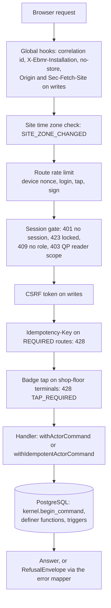

# tablets-server: the Tablets edition's server

**Draft.** This page is still being written; facts on it were checked against the code on 14 October 2026.

This page explains `apps/tablets-server`, the server of the Tablets edition. It covers the platform every request goes
through (sessions, terminals, the database call, errors, idempotency, start-up), then each feature module (what it does
in pharma terms, its routes, its handlers, the database functions it calls, the guards and their tests), then the
Tablets building blocks TB-01 to TB-24 and the golden batches. Read it when you change or debug anything under
`apps/tablets-server`. If "batch record", "MBR" or "QP" are new to you, read the
[pharma primer](../01-pharma-primer.md) first; every term in bold is in the [glossary](../02-glossary.md).

The [code map](../code-map.md) lists, per module, every migration, database object, server file, route and test. This
page explains them; it does not repeat every file name.

## Where the code is

| What | Where |
|---|---|
| Process entry (reads `EBMR_*` variables, starts the server, the gateway listener) | [main.ts](../../../apps/tablets-server/src/main.ts) |
| Server assembly: platform first, then the features | [app.ts](../../../apps/tablets-server/src/app.ts#sym=buildApp) |
| Configuration and its start-up refusals | [config.ts](../../../apps/tablets-server/src/config.ts#sym=parseConfig) |
| Platform: request gates, sessions, terminals, errors, database calls, time zone | [src/platform/](../../../apps/tablets-server/src/platform/) |
| The fixed list of feature modules | [features/index.ts](../../../apps/tablets-server/src/features/index.ts#sym=FEATURES) |
| What a feature module exports | [features/types.ts](../../../apps/tablets-server/src/features/types.ts#sym=FeatureModule) |
| Feature modules (one folder each) | [src/features/](../../../apps/tablets-server/src/features/) |
| Tablets building blocks TB-01 to TB-24 | [src/blocks/](../../../apps/tablets-server/src/blocks/) |
| Demo and end-to-end set-up, golden-batch masters, OpenAPI | [src/cli/](../../../apps/tablets-server/src/cli/) |
| Migrations of the `tab` schema (128 files, `0001` to `1209`) | [sql/](../../../apps/tablets-server/sql/) |
| Tests (one folder per area) | [test/](../../../apps/tablets-server/test/) |
| Golden batches GB-T-01 and GB-T-02 | [test/golden/](../../../apps/tablets-server/test/golden/) |
| The route table and the request and response shapes | [packages/api-contract](../../../packages/api-contract/) ([module guide](api-contract.md)) |
| The screens that call these routes | [apps/tablets-web](../../../apps/tablets-web/) ([module guide](tablets-web.md)) |

## What it does

The Tablets server is the only program the screens talk to. It does three things:

1. **It checks who is asking.** Every request carries a session cookie. The server looks the session up in the
   database, checks the terminal (the computer or tablet the person stands at), the role the person chose, and on
   shop-floor terminals a fresh badge tap for every entry.
2. **It hands the work to PostgreSQL.** The server holds almost no rules of its own. A write runs as a **command**: one
   database transaction that first declares who is acting, then calls `SECURITY DEFINER` functions of the kernel,
   site-services, recipe-core and the `tab` schema. Those functions and their triggers refuse anything the rules forbid
   ([Architecture, rules live in PostgreSQL](../03-architecture.md#4-rules-live-in-postgresql)).
3. **It explains refusals.** When the database refuses, the server turns the error code into a plain answer: what
   happened, why, what you can do, who can help.

Two installations run the same code: **GMP** (real batches) and **SANDBOX** (test runs of an MBR before it is
approved; see [Architecture, the sandbox](../03-architecture.md#14-the-sandbox)). Each feature says on which
installations it runs, and each route of the contract says the same.

### Pharma context

A batch record is evidence. A regulator reads it years later and must be able to trust that each entry was made by
the person named, at the time shown, on the terminal named, and was never changed without a trace (the ALCOA+
principles; 21 CFR Part 11 and EU GMP Annex 11). The server's part in that is narrow but strict: it must never let a
request act under the wrong person, the wrong role, the wrong terminal or the wrong time zone, and it must never
swallow a refusal. Every guard on this page exists for one of those reasons.

## The platform

`src/platform/` is the spine every feature uses. A feature never opens a transaction, reads a cookie or formats a time
on its own.

### How a request travels through the server

The order of the gates is written once, in
[bindRoutes](../../../apps/tablets-server/src/platform/http/bind.ts#sym=bindRoutes). A feature registers its part of
the contract with `bindRoutes(scope, app, routes.<namespace>, handlers)`; a missing handler is a compile error, and the
zod schemas of the contract check every request and every answer (so drift between server and contract fails the
server tests). Routes of the other installation are not registered at all and answer 404. The walkthrough from screen
to database is in [Architecture, how a request travels](../03-architecture.md#6-how-a-request-travels).

| Gate | Code | What it refuses |
|---|---|---|
| Security headers, origin | [installSecurity](../../../apps/tablets-server/src/platform/http/security.ts#sym=installSecurity) | A write whose `Origin` is not the installation's own address or whose `Sec-Fetch-Site` is not `same-origin` (403 `ORIGIN`, DI-13); another spelling of `/api` (404). Sets CSP, frame, referrer and HSTS headers. |
| Site time zone | [SiteZoneGuard](../../../apps/tablets-server/src/platform/site-zone.ts#sym=SiteZoneGuard) | Every API request after the site policy `site.zone` changed (`SITE_ZONE_CHANGED`, DI-27) until a restart. |
| Session | [admitSession](../../../apps/tablets-server/src/platform/http/bind.ts#sym=admitSession) | No live session (401), a locked session outside the unlock routes (423 `SESSION_LOCKED`, DI-38), a role not yet chosen (409 `ROLE_CHOICE_REQUIRED`), an EU QP reader outside its package routes (403 `QP_READER_SCOPE`, DI-14), a session whose role was withdrawn (ended at once). |
| Page binding | [pageBindingRefusal](../../../apps/tablets-server/src/platform/http/bind.ts#sym=pageBindingRefusal) | A request whose page was opened under another session (headers `x-ebmr-terminal-key`, `x-ebmr-page-person`). |
| CSRF | `@fastify/csrf-protection`, token bound to the session | A write without the session's CSRF token (`CSRF`). |
| Idempotency key | `bindRoutes` command gate | A `REQUIRED` route without a UUID `Idempotency-Key` header (428 `IDEMPOTENCY_KEY_REQUIRED`). |
| Badge tap (attribution) | [resolveAttribution](../../../apps/tablets-server/src/platform/auth/attribution.ts#sym=resolveAttribution) | A `FRESH_ON_SHARED` route on a SHARED or GRADE_A_B terminal without a fresh tap (428 `TAP_REQUIRED`, `TAP_PIN_REQUIRED`), a tap by another person (409 `SWITCH_USER`), more than 30 taps a minute per terminal and badge (429). |
| Role inside a handler | `requireRole` on the handler context | A role the function is not for (403 `ROLE_NOT_ALLOWED`). The database checks the permission again. |

> **Why this exists**
> - **Pharma reason:** a shared terminal on the shop floor is used by many operators. An entry must carry the person
>   who made it, not the person who signed in an hour ago. So each entry needs a fresh badge tap (or tap and PIN),
>   bound to that exact request and that exact terminal, used once.
> - **Control:** [DI-14](../../../compliance/controls/DI-14.yaml), [DI-20](../../../compliance/controls/DI-20.yaml),
>   invariant INV-40.
> - **Code:** [resolveAttribution](../../../apps/tablets-server/src/platform/auth/attribution.ts#sym=resolveAttribution);
>   the kernel's `begin_command` consumes the authentication event (same person, same terminal, single use).
> - **Tests:** [access/attribution.test.ts](../../../apps/tablets-server/test/access/attribution.test.ts).
> - **Error:** `TAP_REQUIRED`, `TAP_PIN_REQUIRED`, `SWITCH_USER`.

> **Why this exists**
> - **Pharma reason:** a request forged by another web site, or sent from a page opened elsewhere, would act in the
>   signed-in person's name. A record made that way is not attributable to that person's own act.
> - **Control:** [DI-13](../../../compliance/controls/DI-13.yaml).
> - **Code:** [installSecurity](../../../apps/tablets-server/src/platform/http/security.ts#sym=installSecurity),
>   [pageBindingRefusal](../../../apps/tablets-server/src/platform/http/bind.ts#sym=pageBindingRefusal).
> - **Tests:** [platform/security.test.ts](../../../apps/tablets-server/test/platform/security.test.ts),
>   [platform/security-encoded-path.test.ts](../../../apps/tablets-server/test/platform/security-encoded-path.test.ts),
>   tests named `[DI-13]`.
> - **Error:** `ORIGIN`, `CSRF`.

### Sessions and terminals

The session cookie is a random 256-bit token made at login. It is never the kernel's session id (that id appears in
audit payloads). The database keeps only the token's SHA-256 hash
([tab.bind_session](../../../apps/tablets-server/sql/0480_bind_session_needs_live_role.sql#sym=tab.bind_session),
[tab.resolve_session](../../../apps/tablets-server/sql/0550_session_terminal_key.sql#sym=tab.resolve_session),
[tab.unbind_session](../../../apps/tablets-server/sql/0001_tab_foundation.sql#sym=tab.unbind_session)). There is one
cookie name per installation (`ebmr_gmp_sid`, `ebmr_sbx_sid`, with the `__Host-` prefix on https; see
[cookieNames](../../../apps/tablets-server/src/config.ts#sym=cookieNames)), so a GMP and a sandbox session in the
same browser never collide. [resolveSession](../../../apps/tablets-server/src/platform/auth/session.ts#sym=resolveSession)
turns the database's answer into a `ResolvedSession`: person, account, terminal (device id, class, room, line), role,
state and the attribution method of the terminal class.

A **terminal** is enrolled with a key pair; the browser proves it holds the private key by signing a single-use
nonce ([webCryptoDeviceProvider](../../../apps/tablets-server/src/platform/auth/device-proof.ts#sym=webCryptoDeviceProvider),
nonces from [tab.mint_device_nonce](../../../apps/tablets-server/sql/0001_tab_foundation.sql#sym=tab.mint_device_nonce)
and [tab.consume_device_nonce](../../../apps/tablets-server/sql/0001_tab_foundation.sql#sym=tab.consume_device_nonce)).
The terminal classes are PERSONAL and SHARED (office and floor), GRADE_A_B (clean rooms), SERVER and INSTRUMENT
([isShopFloor](../../../apps/tablets-server/src/platform/auth/session.ts#sym=isShopFloor) marks SHARED and GRADE_A_B).
The device nonce route is rate-limited per terminal key and per client address
([DeviceRateLimitSpec](../../../apps/tablets-server/src/platform/http/bind.ts#sym=DeviceRateLimitSpec) explains the
four counts). Proof tickets and change tickets live in server memory for minutes; their lifetime is read from both
the monotonic and the wall clock and the shorter answer wins ([moment](../../../apps/tablets-server/src/platform/clock.ts#sym=moment)).
That file is the only place the app reads the process clock; GMP time always comes from the database
([dbNowUs](../../../apps/tablets-server/src/platform/db/commands.ts#sym=dbNowUs), which reads
[tab.now_micros](../../../apps/tablets-server/sql/0001_tab_foundation.sql#sym=tab.now_micros)).

The sign-in, lock, unlock and switch-user routes are in the features [session](#ts-session-sessions-and-sign-in) and
[access](#ts-access-kiosk-access-attribution-and-governance-read-doors). The kernel side (accounts, authentication
events, lockout) is in [Architecture, sessions and authentication](../03-architecture.md#7-sessions-and-authentication).

### How a handler calls the database

A handler gets a typed context ([HandlerContext](../../../apps/tablets-server/src/platform/http/bind.ts#sym=HandlerContext)):
the parsed params, query and body, the session, and `actor()`, which builds the kernel's `ActorContext` from the
session, the site's time zone, the correlation id and the tap's authentication event
([actorFrom](../../../apps/tablets-server/src/platform/auth/actor.ts#sym=actorFrom)).

- **Writes** go through [withActorCommand](../../../apps/tablets-server/src/platform/db/commands.ts#sym=withActorCommand)
  (the kernel's `identity.withGuardedCommand`): one transaction on the application pool that declares the actor with
  `kernel.begin_command` first, then runs the work. A refusal on authority (`EBMR-IAM-040`) or segregation
  (`EBMR-IAM-041`) is logged again outside the rolled-back transaction, so the attempt is not lost. A refusal that must
  leave a durable record of its own (for example the DI-20 alert of a refused scale-reading claim) attaches it with
  [afterRollback](../../../apps/tablets-server/src/platform/db/commands.ts#sym=afterRollback); it runs once the
  transaction has rolled back.
- **Reads** go through Kysely over the same pool ([createReadDb](../../../apps/tablets-server/src/platform/db/read.ts#sym=createReadDb))
  or through `tab.*` read functions. Kysely never writes.
- **Pools** ([createPools](../../../apps/tablets-server/src/platform/db/pools.ts#sym=createPools)): the application
  pool (`ebmr_app` on GMP, `ebmr_sandbox` in the sandbox) and the authentication pool (`ebmr_authn`). The application
  role holds no privilege on the `tab` tables; it may only execute the definer functions
  ([Database reference, security conventions](../05-database.md#security-conventions)).
- **Unstorable text**: [refuseUnstorableParameters](../../../apps/tablets-server/src/platform/db/pools.ts#sym=refuseUnstorableParameters)
  refuses any query parameter holding U+0000 or half a surrogate pair before it reaches the database (review F33).

### Idempotency

A route the contract marks `idempotency: 'REQUIRED'` needs an `Idempotency-Key` header (a UUID). The handler then runs
[withIdempotentActorCommand](../../../apps/tablets-server/src/platform/db/commands.ts#sym=withIdempotentActorCommand):
inside the command, `platform.claim_idempotency_key(key, requestHash)`
([kernel 0540](../../../packages/kernel/sql/0540_platform_idempotency.sql#sym=platform.claim_idempotency_key)) either
claims the key (`NEW`: the work runs and its JSON result is stored with `platform.complete_idempotency_key`) or finds
it (`REPLAY`: the stored result is returned and nothing runs again). The request hash
([requestHashOf](../../../apps/tablets-server/src/platform/http/bind.ts#sym=requestHashOf)) covers route, params,
query and body without secrets (attribution, PIN, password, proof), so a resend of the same request matches.

> **Why this exists**
> - **Pharma reason:** a tablet on a weak network resends a request. Without idempotency a weighing would be recorded
>   twice, and the batch record would show two entries for one act.
> - **Control:** decision D1 and invariant INV-40: `begin_command` runs first and consumes the authentication event,
>   so even a replay needs a fresh tap by the same person.
> - **Code:** [withIdempotentActorCommand](../../../apps/tablets-server/src/platform/db/commands.ts#sym=withIdempotentActorCommand).
> - **Tests:** [execution/commands.test.ts](../../../apps/tablets-server/test/execution/commands.test.ts),
>   [esig/ceremony.test.ts](../../../apps/tablets-server/test/esig/ceremony.test.ts) (a replayed refusal is logged
>   with the resend's own event).
> - **Error:** `IDEMPOTENCY_KEY_REQUIRED` (428).

### Error mapping

Every answer that is not 2xx is a `RefusalEnvelope`: a code, a kind, what happened, why, what you can do, who can help,
the controls, and the correlation id that also appears in the log line.
[mapError](../../../apps/tablets-server/src/platform/http/errors.ts#sym=mapError) decides, in order:

1. a feature's own [HttpRefusal](../../../apps/tablets-server/src/platform/http/refusal.ts#sym=HttpRefusal) is sent as
   it is;
2. a zod validation failure becomes `SCHEMA` (400);
3. a CSRF failure `CSRF`, a rate limit `RATE_LIMITED` (429), a failed sign-in `EBMR-IAM-140` or `AUTH_LOCKED`;
4. text no record can hold becomes `SCHEMA`, logged at warn;
5. an `EBMR-...` code raised by the database or the kernel is looked up in the guidance catalogue
   ([GuidanceCatalogue](../../../apps/tablets-server/src/platform/http/guidance.ts#sym=GuidanceCatalogue)); `why` is
   the database's own message without its code. A code with no entry still answers 422 `NOT_ALLOWED`;
6. anything else is `INTERNAL` (500), logged with the correlation id: nothing was saved.

Each feature registers its own entries (`guidance.ts` in its folder) beside the platform's
([PLATFORM_GUIDANCE](../../../apps/tablets-server/src/platform/http/guidance.ts#sym=PLATFORM_GUIDANCE)). The full list
of codes is the [error-code reference](../reference/error-codes.md); how codes are raised in SQL is in
[Database reference, how errors are raised](../05-database.md#how-errors-are-raised). Logs never carry secrets: the
redaction paths are [REDACT_PATHS](../../../apps/tablets-server/src/platform/http/logging.ts#sym=REDACT_PATHS).

### Installation and start-up

[buildApp](../../../apps/tablets-server/src/app.ts#sym=buildApp) refuses to start, before it listens, when:

- the database is not of the configured kind: a GMP server against a sandbox database or the other way round, or a
  copy under the wrong name (`EBMR-SBX-004`)
  ([assertInstallation](../../../apps/tablets-server/src/platform/installation.ts#sym=assertInstallation));
- the site policy `site.zone` is not an IANA time zone, or `EBMR_SITE_ZONE` names another zone
  ([siteZoneFromPolicy](../../../apps/tablets-server/src/platform/installation.ts#sym=siteZoneFromPolicy));
- in production, the public origin is http or a demo switch is on ([parseConfig](../../../apps/tablets-server/src/config.ts#sym=parseConfig)).

Demo switches (demo devices, demo keys) need both `EBMR_DEMO=1` and the database's demo marker
([tab.is_demo_installation](../../../apps/tablets-server/sql/0001_tab_foundation.sql#sym=tab.is_demo_installation);
[demoState](../../../apps/tablets-server/src/platform/installation.ts#sym=demoState), decision D6). While the server
runs, the [SiteZoneGuard](../../../apps/tablets-server/src/platform/site-zone.ts#sym=SiteZoneGuard) re-reads the policy
before every API request, every gateway request, every sweep and every 30 seconds; after a change it refuses
everything with `SITE_ZONE_CHANGED` rather than show a time in the old zone.

> **Why this exists**
> - **Pharma reason:** a GMP server writing into a sandbox database, or a sandbox server writing into the GMP
>   database, would mix test entries with real batch records. A time shown in the wrong zone would make a record
>   misstate when something happened.
> - **Control:** [DI-05](../../../compliance/controls/DI-05.yaml) (installation separation, invariant INV-18),
>   [DI-27](../../../compliance/controls/DI-27.yaml) (one site time).
> - **Code:** [assertInstallation](../../../apps/tablets-server/src/platform/installation.ts#sym=assertInstallation),
>   [siteZoneFromPolicy](../../../apps/tablets-server/src/platform/installation.ts#sym=siteZoneFromPolicy),
>   [SiteZoneGuard](../../../apps/tablets-server/src/platform/site-zone.ts#sym=SiteZoneGuard).
> - **Tests:** [platform/startup.test.ts](../../../apps/tablets-server/test/platform/startup.test.ts), tests named
>   `[DI-05]` and `[DI-27]`; [platform/invariants.test.ts](../../../apps/tablets-server/test/platform/invariants.test.ts).
> - **Error:** `EBMR-SBX-004`, `EBMR-IAM-118` (an actor context declaring another zone), `SITE_ZONE_CHANGED`.

### Ports and feature modules

A feature module ([FeatureModule](../../../apps/tablets-server/src/features/types.ts#sym=FeatureModule)) exports its
Fastify `plugin`, and optionally its `guidance`, a demo `seed`, its **signable actions** and the scale-reading port.
[FEATURES](../../../apps/tablets-server/src/features/index.ts#sym=FEATURES) is the fixed list, each with the
installations it runs on. The ports between features are in [ports.ts](../../../apps/tablets-server/src/platform/ports.ts):

- [SignableActionRegistry](../../../apps/tablets-server/src/platform/ports.ts#sym=SignableActionRegistry): the
  e-signature routes find here the handler of a signable action (an engine command, an MBR transition, a review or
  release act). Each feature registers its own (`signables.ts` in its folder).
- [DeviceReadingPort](../../../apps/tablets-server/src/platform/ports.ts#sym=DeviceReadingPort): execution claims scale
  readings through it; the devices feature provides it. The default
  ([REFUSING_DEVICE_READING_PORT](../../../apps/tablets-server/src/platform/ports.ts#sym=REFUSING_DEVICE_READING_PORT))
  refuses, so the manual two-person weighing path still works without devices.
- [formatInstant](../../../apps/tablets-server/src/platform/ports.ts#sym=formatInstant): every GMP time leaves the
  server as `{us, text}`, the text formatted in the site's zone (for example `28-SEP-2026 14:05:03 +05:30
  (Asia/Kolkata)`). The browser never formats GMP time.
- Rule tables: [publishRuleTables](../../../apps/tablets-server/src/platform/rule-tables.ts#sym=publishRuleTables)
  publishes `compliance/rule-tables` (kernel and tablets) on demo and end-to-end installations.

### The command-line tools

All in [src/cli/](../../../apps/tablets-server/src/cli/); all but `openapi.ts` are **DEMO-ONLY** and refuse
`EBMR_ENV=production`.

| File | What it does |
|---|---|
| [setup.ts](../../../apps/tablets-server/src/cli/setup.ts) | Creates and migrates a demo or end-to-end database (GMP or SANDBOX), marks it as a demo installation, registers the DEMO-ONLY seal key, runs each feature's seed and writes the personas' credentials to a keys directory. |
| [demo-app.ts](../../../apps/tablets-server/src/cli/demo-app.ts) | The real server built in-process, driven the way browsers drive it (cookies, CSRF, device proofs, badge taps, e-signatures). |
| [release-path.ts](../../../apps/tablets-server/src/cli/release-path.ts) | The release path of the demo through real signed acts, on the installation's real clock. |
| [review-batch.ts](../../../apps/tablets-server/src/cli/review-batch.ts) | A GMP batch at `EXECUTION_COMPLETE`, ready for review, for the demo and the review browser tests. |
| [golden-packaging.ts](../../../apps/tablets-server/src/cli/golden-packaging.ts), [golden-gb-t-02.ts](../../../apps/tablets-server/src/cli/golden-gb-t-02.ts) | The packaging masters of GB-T-01 (blisters) and the masters of GB-T-02 (direct compression, bottles). Invented data. |
| [openapi.ts](../../../apps/tablets-server/src/cli/openapi.ts) | Writes the OpenAPI document of the contract (a CI artifact). |

### Platform tests

| Test | Proves |
|---|---|
| [platform/startup.test.ts](../../../apps/tablets-server/test/platform/startup.test.ts) | Start-up refusals: wrong database kind, bad site zone, production switches (`[DI-05]`, `[DI-27]`). |
| [platform/security.test.ts](../../../apps/tablets-server/test/platform/security.test.ts), [platform/security-encoded-path.test.ts](../../../apps/tablets-server/test/platform/security-encoded-path.test.ts) | Origin, CSRF, headers, encoded `/api` spellings (`[DI-13]`, `[DI-27]`). |
| [platform/header-limit.test.ts](../../../apps/tablets-server/test/platform/header-limit.test.ts) | The 64 KiB header limit (an e-signature preview carries a long query). |
| [platform/unstorable-text.test.ts](../../../apps/tablets-server/test/platform/unstorable-text.test.ts) | Text no record can hold is refused, never a 500. |
| [platform/invariants.test.ts](../../../apps/tablets-server/test/platform/invariants.test.ts), [platform/read-db.test.ts](../../../apps/tablets-server/test/platform/read-db.test.ts) | The scheduled invariant queries find nothing on a tablets database: protected id sequences (INV-27, migration 0260) and database time on every audited `tab` table (INV-16, DI-27); Kysely cannot end the shared pool. |
| [contract/coverage.test.ts](../../../apps/tablets-server/test/contract/coverage.test.ts) | Every route of the contract is bound exactly once, on the right installation, and none answers 501. |
| [seed/](../../../apps/tablets-server/test/seed/) | The demo seeds (and that they refuse a non-demo database). |
| [mutation/](../../../apps/tablets-server/test/mutation/) | Tests written to kill mutants the SQL mutation harness found, one file per group of database functions ([Testing, mutation testing](../06-testing-and-debugging.md#mutation-testing)). |

The test helpers are in [test/support/](../../../apps/tablets-server/test/support/): `harness.ts` starts a server on a
fresh database, `gmp-world.ts` seeds a GMP world, `signed-acts.ts` runs real e-signature ceremonies.

<!-- FEATURES -->
