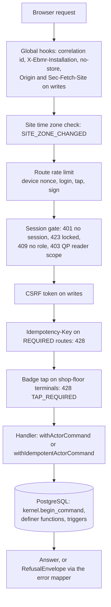

# tablets-server: the Tablets edition's server

**Draft.** This page is still being written; facts on it were checked against the code on 14 October 2026.

This page explains `apps/tablets-server`, the server of the Tablets edition. It covers the platform every request goes
through (sessions, terminals, the database call, errors, idempotency, start-up), then each feature module (what it does
in pharma terms, its routes, its handlers, the database functions it calls, the guards and their tests), then the
Tablets building blocks TB-01 to TB-24 and the golden batches. Read it when you change or debug anything under
`apps/tablets-server`. If "batch record", "MBR" or "QP" are new to you, read the
[pharma primer](../01-pharma-primer.md) first; every term in bold is in the [glossary](../02-glossary.md).

The [code map](../code-map.md) lists, per module, every migration, database object, server file, route and test. This
page explains them; it does not repeat every file name.

## Where the code is

| What | Where |
|---|---|
| Process entry (reads `EBMR_*` variables, starts the server, the gateway listener) | [main.ts](../../../apps/tablets-server/src/main.ts) |
| Server assembly: platform first, then the features | [app.ts](../../../apps/tablets-server/src/app.ts#sym=buildApp) |
| Configuration and its start-up refusals | [config.ts](../../../apps/tablets-server/src/config.ts#sym=parseConfig) |
| Platform: request gates, sessions, terminals, errors, database calls, time zone | [src/platform/](../../../apps/tablets-server/src/platform/) |
| The fixed list of feature modules | [features/index.ts](../../../apps/tablets-server/src/features/index.ts#sym=FEATURES) |
| What a feature module exports | [features/types.ts](../../../apps/tablets-server/src/features/types.ts#sym=FeatureModule) |
| Feature modules (one folder each) | [src/features/](../../../apps/tablets-server/src/features/) |
| Tablets building blocks TB-01 to TB-24 | [src/blocks/](../../../apps/tablets-server/src/blocks/) |
| Demo and end-to-end set-up, golden-batch masters, OpenAPI | [src/cli/](../../../apps/tablets-server/src/cli/) |
| Migrations of the `tab` schema (128 files, `0001` to `1209`) | [sql/](../../../apps/tablets-server/sql/) |
| Tests (one folder per area) | [test/](../../../apps/tablets-server/test/) |
| Golden batches GB-T-01, GB-T-02 and GB-T-03 | [test/golden/](../../../apps/tablets-server/test/golden/) |
| The route table and the request and response shapes | [packages/api-contract](../../../packages/api-contract/) ([module guide](api-contract.md)) |
| The screens that call these routes | [apps/tablets-web](../../../apps/tablets-web/) ([module guide](tablets-web.md)) |

## What it does

The Tablets server is the only program the screens talk to. It does three things:

1. **It checks who is asking.** Every request carries a session cookie. The server looks the session up in the
   database, checks the terminal (the computer or tablet the person stands at), the role the person chose, and on
   shop-floor terminals a fresh badge tap for every entry.
2. **It hands the work to PostgreSQL.** The server holds almost no rules of its own. A write runs as a **command**: one
   database transaction that first declares who is acting, then calls `SECURITY DEFINER` functions of the kernel,
   site-services, recipe-core and the `tab` schema. Those functions and their triggers refuse anything the rules forbid
   ([Architecture, rules live in PostgreSQL](../03-architecture.md#4-rules-live-in-postgresql)).
3. **It explains refusals.** When the database refuses, the server turns the error code into a plain answer: what
   happened, why, what you can do, who can help.

Two installations run the same code: **GMP** (real batches) and **SANDBOX** (test runs of an MBR before it is
approved; see [Architecture, the sandbox](../03-architecture.md#14-the-sandbox)). Each feature says on which
installations it runs, and each route of the contract says the same.

### Pharma context

A batch record is evidence. A regulator reads it years later and must be able to trust that each entry was made by
the person named, at the time shown, on the terminal named, and was never changed without a trace (the ALCOA+
principles; 21 CFR Part 11 and EU GMP Annex 11). The server's part in that is narrow but strict: it must never let a
request act under the wrong person, the wrong role, the wrong terminal or the wrong time zone, and it must never
swallow a refusal. Every guard on this page exists for one of those reasons.

## The platform

`src/platform/` is the spine every feature uses. A feature never opens a transaction, reads a cookie or formats a time
on its own.

### How a request travels through the server

The order of the gates is written once, in
[bindRoutes](../../../apps/tablets-server/src/platform/http/bind.ts#sym=bindRoutes). A feature registers its part of
the contract with `bindRoutes(scope, app, routes.<namespace>, handlers)`; a missing handler is a compile error, and the
zod schemas of the contract check every request and every answer (so drift between server and contract fails the
server tests). Routes of the other installation are not registered at all and answer 404. The walkthrough from screen
to database is in [Architecture, how a request travels](../03-architecture.md#6-how-a-request-travels).

| Gate | Code | What it refuses |
|---|---|---|
| Security headers, origin | [installSecurity](../../../apps/tablets-server/src/platform/http/security.ts#sym=installSecurity) | A write whose `Origin` is not the installation's own address or whose `Sec-Fetch-Site` is not `same-origin` (403 `ORIGIN`, DI-13); another spelling of `/api` (404). Sets CSP, frame, referrer and HSTS headers. |
| Site time zone | [SiteZoneGuard](../../../apps/tablets-server/src/platform/site-zone.ts#sym=SiteZoneGuard) | Every API request after the site policy `site.zone` changed (`SITE_ZONE_CHANGED`, DI-27) until a restart. |
| Session | [admitSession](../../../apps/tablets-server/src/platform/http/bind.ts#sym=admitSession) | No live session (401), a locked session outside the unlock routes (423 `SESSION_LOCKED`, DI-38), a role not yet chosen (409 `ROLE_CHOICE_REQUIRED`), an EU QP reader outside its package routes (403 `QP_READER_SCOPE`, DI-14), a session whose role was withdrawn (ended at once). |
| Page binding | [pageBindingRefusal](../../../apps/tablets-server/src/platform/http/bind.ts#sym=pageBindingRefusal) | A request whose page was opened under another session (headers `x-ebmr-terminal-key`, `x-ebmr-page-person`). |
| CSRF | `@fastify/csrf-protection`, token bound to the session | A write without the session's CSRF token (`CSRF`). |
| Idempotency key | `bindRoutes` command gate | A `REQUIRED` route without a UUID `Idempotency-Key` header (428 `IDEMPOTENCY_KEY_REQUIRED`). |
| Badge tap (attribution) | [resolveAttribution](../../../apps/tablets-server/src/platform/auth/attribution.ts#sym=resolveAttribution) | A `FRESH_ON_SHARED` route on a SHARED or GRADE_A_B terminal without a fresh tap (428 `TAP_REQUIRED`, `TAP_PIN_REQUIRED`), a tap by another person (409 `SWITCH_USER`), more than 30 taps a minute per terminal and badge (429). |
| Role inside a handler | `requireRole` on the handler context | A role the function is not for (403 `ROLE_NOT_ALLOWED`). The database checks the permission again. |

> **Why this exists**
> - **Pharma reason:** a shared terminal on the shop floor is used by many operators. An entry must carry the person
>   who made it, not the person who signed in an hour ago. So each entry needs a fresh badge tap (or tap and PIN),
>   bound to that exact request and that exact terminal, used once.
> - **Control:** [DI-14](../../../compliance/controls/DI-14.yaml), [DI-20](../../../compliance/controls/DI-20.yaml),
>   invariant INV-40.
> - **Code:** [resolveAttribution](../../../apps/tablets-server/src/platform/auth/attribution.ts#sym=resolveAttribution);
>   the kernel's `begin_command` consumes the authentication event (same person, same terminal, single use).
> - **Tests:** [access/attribution.test.ts](../../../apps/tablets-server/test/access/attribution.test.ts).
> - **Error:** `TAP_REQUIRED`, `TAP_PIN_REQUIRED`, `SWITCH_USER`.

> **Why this exists**
> - **Pharma reason:** a request forged by another web site, or sent from a page opened elsewhere, would act in the
>   signed-in person's name. A record made that way is not attributable to that person's own act.
> - **Control:** [DI-13](../../../compliance/controls/DI-13.yaml).
> - **Code:** [installSecurity](../../../apps/tablets-server/src/platform/http/security.ts#sym=installSecurity),
>   [pageBindingRefusal](../../../apps/tablets-server/src/platform/http/bind.ts#sym=pageBindingRefusal).
> - **Tests:** [platform/security.test.ts](../../../apps/tablets-server/test/platform/security.test.ts),
>   [platform/security-encoded-path.test.ts](../../../apps/tablets-server/test/platform/security-encoded-path.test.ts),
>   tests named `[DI-13]`.
> - **Error:** `ORIGIN`, `CSRF`.

### Sessions and terminals

The session cookie is a random 256-bit token made at login. It is never the kernel's session id (that id appears in
audit payloads). The database keeps only the token's SHA-256 hash
([tab.bind_session](../../../apps/tablets-server/sql/0480_bind_session_needs_live_role.sql#sym=tab.bind_session),
[tab.resolve_session](../../../apps/tablets-server/sql/1460_session_idle_lock_in.sql#sym=tab.resolve_session),
[tab.unbind_session](../../../apps/tablets-server/sql/0001_tab_foundation.sql#sym=tab.unbind_session)). There is one
cookie name per installation (`ebmr_gmp_sid`, `ebmr_sbx_sid`, with the `__Host-` prefix on https; see
[cookieNames](../../../apps/tablets-server/src/config.ts#sym=cookieNames)), so a GMP and a sandbox session in the
same browser never collide. [resolveSession](../../../apps/tablets-server/src/platform/auth/session.ts#sym=resolveSession)
turns the database's answer into a `ResolvedSession`: person, account, terminal (device id, class, room, line), role,
state and the attribution method of the terminal class.

A **terminal** is enrolled with a key pair; the browser proves it holds the private key by signing a single-use
nonce ([webCryptoDeviceProvider](../../../apps/tablets-server/src/platform/auth/device-proof.ts#sym=webCryptoDeviceProvider),
nonces from [tab.mint_device_nonce](../../../apps/tablets-server/sql/0001_tab_foundation.sql#sym=tab.mint_device_nonce)
and [tab.consume_device_nonce](../../../apps/tablets-server/sql/0001_tab_foundation.sql#sym=tab.consume_device_nonce)).
The terminal classes are PERSONAL and SHARED (office and floor), GRADE_A_B (clean rooms), SERVER and INSTRUMENT
([isShopFloor](../../../apps/tablets-server/src/platform/auth/session.ts#sym=isShopFloor) marks SHARED and GRADE_A_B).
The device nonce route is rate-limited per terminal key and per client address
([DeviceRateLimitSpec](../../../apps/tablets-server/src/platform/http/bind.ts#sym=DeviceRateLimitSpec) explains the
four counts). Proof tickets and change tickets live in server memory for minutes; their lifetime is read from both
the monotonic and the wall clock and the shorter answer wins ([moment](../../../apps/tablets-server/src/platform/clock.ts#sym=moment)).
That file is the only place the app reads the process clock; GMP time always comes from the database
([dbNowUs](../../../apps/tablets-server/src/platform/db/commands.ts#sym=dbNowUs), which reads
[tab.now_micros](../../../apps/tablets-server/sql/0001_tab_foundation.sql#sym=tab.now_micros)).

The sign-in, lock, unlock and switch-user routes are in the features [session](#ts-session-sessions-and-sign-in) and
[access](#ts-access-kiosk-access-attribution-and-governance-read-doors). The kernel side (accounts, authentication
events, lockout) is in [Architecture, sessions and authentication](../03-architecture.md#7-sessions-and-authentication).

### How a handler calls the database

A handler gets a typed context ([HandlerContext](../../../apps/tablets-server/src/platform/http/bind.ts#sym=HandlerContext)):
the parsed params, query and body, the session, and `actor()`, which builds the kernel's `ActorContext` from the
session, the site's time zone, the correlation id and the tap's authentication event
([actorFrom](../../../apps/tablets-server/src/platform/auth/actor.ts#sym=actorFrom)).

- **Writes** go through [withActorCommand](../../../apps/tablets-server/src/platform/db/commands.ts#sym=withActorCommand)
  (the kernel's `identity.withGuardedCommand`): one transaction on the application pool that declares the actor with
  `kernel.begin_command` first, then runs the work. A refusal on authority (`EBMR-IAM-040`) or segregation
  (`EBMR-IAM-041`) is logged again outside the rolled-back transaction, so the attempt is not lost. A refusal that must
  leave a durable record of its own (for example the DI-20 alert of a refused scale-reading claim) attaches it with
  [afterRollback](../../../apps/tablets-server/src/platform/db/commands.ts#sym=afterRollback); it runs once the
  transaction has rolled back.
- **Reads** go through Kysely over the same pool ([createReadDb](../../../apps/tablets-server/src/platform/db/read.ts#sym=createReadDb))
  or through `tab.*` read functions. Kysely never writes.
- **Pools** ([createPools](../../../apps/tablets-server/src/platform/db/pools.ts#sym=createPools)): the application
  pool (`ebmr_app` on GMP, `ebmr_sandbox` in the sandbox) and the authentication pool (`ebmr_authn`). The application
  role holds no privilege on the `tab` tables; it may only execute the definer functions
  ([Database reference, security conventions](../05-database.md#security-conventions)).
- **Unstorable text**: [refuseUnstorableParameters](../../../apps/tablets-server/src/platform/db/pools.ts#sym=refuseUnstorableParameters)
  refuses any query parameter holding U+0000 or half a surrogate pair before it reaches the database (review F33).

### Idempotency

A route the contract marks `idempotency: 'REQUIRED'` needs an `Idempotency-Key` header (a UUID). The handler then runs
[withIdempotentActorCommand](../../../apps/tablets-server/src/platform/db/commands.ts#sym=withIdempotentActorCommand):
inside the command, `platform.claim_idempotency_key(key, requestHash)`
([kernel 0540](../../../packages/kernel/sql/0540_platform_idempotency.sql#sym=platform.claim_idempotency_key)) either
claims the key (`NEW`: the work runs and its JSON result is stored with `platform.complete_idempotency_key`) or finds
it (`REPLAY`: the stored result is returned and nothing runs again). The request hash
([requestHashOf](../../../apps/tablets-server/src/platform/http/bind.ts#sym=requestHashOf)) covers route, params,
query and body without secrets (attribution, PIN, password, proof), so a resend of the same request matches.

> **Why this exists**
> - **Pharma reason:** a tablet on a weak network resends a request. Without idempotency a weighing would be recorded
>   twice, and the batch record would show two entries for one act.
> - **Control:** decision D1 and invariant INV-40: `begin_command` runs first and consumes the authentication event,
>   so even a replay needs a fresh tap by the same person.
> - **Code:** [withIdempotentActorCommand](../../../apps/tablets-server/src/platform/db/commands.ts#sym=withIdempotentActorCommand).
> - **Tests:** [execution/commands.test.ts](../../../apps/tablets-server/test/execution/commands.test.ts),
>   [esig/ceremony.test.ts](../../../apps/tablets-server/test/esig/ceremony.test.ts) (a replayed refusal is logged
>   with the resend's own event).
> - **Error:** `IDEMPOTENCY_KEY_REQUIRED` (428).

### Error mapping

Every answer that is not 2xx is a `RefusalEnvelope`: a code, a kind, what happened, why, what you can do, who can help,
the controls, and the correlation id that also appears in the log line.
[mapError](../../../apps/tablets-server/src/platform/http/errors.ts#sym=mapError) decides, in order:

1. a feature's own [HttpRefusal](../../../apps/tablets-server/src/platform/http/refusal.ts#sym=HttpRefusal) is sent as
   it is;
2. a zod validation failure becomes `SCHEMA` (400);
3. a CSRF failure `CSRF`, a rate limit `RATE_LIMITED` (429), a failed sign-in `EBMR-IAM-140` or `AUTH_LOCKED`;
4. text no record can hold becomes `SCHEMA`, logged at warn;
5. an `EBMR-...` code raised by the database or the kernel is looked up in the guidance catalogue
   ([GuidanceCatalogue](../../../apps/tablets-server/src/platform/http/guidance.ts#sym=GuidanceCatalogue)); `why` is
   the database's own message without its code. A code with no entry still answers 422 `NOT_ALLOWED`;
6. anything else is `INTERNAL` (500), logged with the correlation id: nothing was saved.

**Saved, but the answer failed (Phase 7 slice 7b-1, owner observation O-T13-1).** Most routes commit their command with
`withIdempotentActorCommand` and then read their answer outside it. When only that read failed, the answer used to be
`INTERNAL` "Nothing was saved", although the command had committed. The route binder now runs each handler in a command
scope ([inCommandScope](../../../apps/tablets-server/src/platform/db/commands.ts#sym=inCommandScope)): both command
wrappers note whether the request's latest command committed (or answered from its stored result) and its idempotency
key. A failure after such a command, other than a refusal the handler throws on purpose (the e-signature's recorded
refusal), is answered `SAVED_NOT_SHOWN` (500, kind `STALE`, not retryable): "Saved; the result could not be shown. Reload
the screen to see it.", with the command's idempotency key in `why` and `details.commandId`
([savedNotShown](../../../apps/tablets-server/src/platform/http/bind.ts#sym=savedNotShown)). A resend with the same key
returns the stored result. The `[meta]` test [saved-not-shown.test.ts](../../../apps/tablets-server/test/platform/saved-not-shown.test.ts)
lists every route whose handler commits with `withIdempotentActorCommand` and reads afterwards (84 at 7b-1, found with
the TypeScript parser in `later-read-scan.ts`), checks that each is bound through `bindRoutes` and runs no command the
scope cannot see after it, and shows the answer on a real route whose read fails once.

Each feature registers its own entries (`guidance.ts` in its folder) beside the platform's
([PLATFORM_GUIDANCE](../../../apps/tablets-server/src/platform/http/guidance.ts#sym=PLATFORM_GUIDANCE)). The full list
of codes is the [error-code reference](../reference/error-codes.md); how codes are raised in SQL is in
[Database reference, how errors are raised](../05-database.md#how-errors-are-raised). Logs never carry secrets: the
redaction paths are [REDACT_PATHS](../../../apps/tablets-server/src/platform/http/logging.ts#sym=REDACT_PATHS).

### Installation and start-up

[buildApp](../../../apps/tablets-server/src/app.ts#sym=buildApp) refuses to start, before it listens, when:

- the database is not of the configured kind: a GMP server against a sandbox database or the other way round, or a
  copy under the wrong name (`EBMR-SBX-004`)
  ([assertInstallation](../../../apps/tablets-server/src/platform/installation.ts#sym=assertInstallation));
- the site policy `site.zone` is not an IANA time zone, or `EBMR_SITE_ZONE` names another zone
  ([siteZoneFromPolicy](../../../apps/tablets-server/src/platform/installation.ts#sym=siteZoneFromPolicy));
- in production, the public origin is http or a demo switch is on ([parseConfig](../../../apps/tablets-server/src/config.ts#sym=parseConfig)).

Demo switches (demo devices, demo keys) need both `EBMR_DEMO=1` and the database's demo marker
([tab.is_demo_installation](../../../apps/tablets-server/sql/0001_tab_foundation.sql#sym=tab.is_demo_installation);
[demoState](../../../apps/tablets-server/src/platform/installation.ts#sym=demoState), decision D6). While the server
runs, the [SiteZoneGuard](../../../apps/tablets-server/src/platform/site-zone.ts#sym=SiteZoneGuard) re-reads the policy
before every API request, every gateway request, every sweep and every 30 seconds; after a change it refuses
everything with `SITE_ZONE_CHANGED` rather than show a time in the old zone.

> **Why this exists**
> - **Pharma reason:** a GMP server writing into a sandbox database, or a sandbox server writing into the GMP
>   database, would mix test entries with real batch records. A time shown in the wrong zone would make a record
>   misstate when something happened.
> - **Control:** [DI-05](../../../compliance/controls/DI-05.yaml) (installation separation, invariant INV-18),
>   [DI-27](../../../compliance/controls/DI-27.yaml) (one site time).
> - **Code:** [assertInstallation](../../../apps/tablets-server/src/platform/installation.ts#sym=assertInstallation),
>   [siteZoneFromPolicy](../../../apps/tablets-server/src/platform/installation.ts#sym=siteZoneFromPolicy),
>   [SiteZoneGuard](../../../apps/tablets-server/src/platform/site-zone.ts#sym=SiteZoneGuard).
> - **Tests:** [platform/startup.test.ts](../../../apps/tablets-server/test/platform/startup.test.ts), tests named
>   `[DI-05]` and `[DI-27]`; [platform/invariants.test.ts](../../../apps/tablets-server/test/platform/invariants.test.ts).
> - **Error:** `EBMR-SBX-004`, `EBMR-IAM-118` (an actor context declaring another zone), `SITE_ZONE_CHANGED`.

### Ports and feature modules

A feature module ([FeatureModule](../../../apps/tablets-server/src/features/types.ts#sym=FeatureModule)) exports its
Fastify `plugin`, and optionally its `guidance`, a demo `seed`, its **signable actions** and the scale-reading port.
[FEATURES](../../../apps/tablets-server/src/features/index.ts#sym=FEATURES) is the fixed list, each with the
installations it runs on. The ports between features are in [ports.ts](../../../apps/tablets-server/src/platform/ports.ts):

- [SignableActionRegistry](../../../apps/tablets-server/src/platform/ports.ts#sym=SignableActionRegistry): the
  e-signature routes find here the handler of a signable action (an engine command, an MBR transition, a review or
  release act). Each feature registers its own (`signables.ts` in its folder).
- [DeviceReadingPort](../../../apps/tablets-server/src/platform/ports.ts#sym=DeviceReadingPort): execution claims scale
  readings through it; the devices feature provides it. The default
  ([REFUSING_DEVICE_READING_PORT](../../../apps/tablets-server/src/platform/ports.ts#sym=REFUSING_DEVICE_READING_PORT))
  refuses, so the manual two-person weighing path still works without devices.
- [formatInstant](../../../apps/tablets-server/src/platform/ports.ts#sym=formatInstant): every GMP time leaves the
  server as `{us, text}`, the text formatted in the site's zone (for example `28-SEP-2026 14:05:03 +05:30
  (Asia/Kolkata)`). The browser never formats GMP time.
- Rule tables: [publishRuleTables](../../../apps/tablets-server/src/platform/rule-tables.ts#sym=publishRuleTables)
  publishes `compliance/rule-tables` (kernel and tablets) on demo and end-to-end installations.

### The command-line tools

All in [src/cli/](../../../apps/tablets-server/src/cli/); all but `openapi.ts` are **DEMO-ONLY** and refuse
`EBMR_ENV=production`.

| File | What it does |
|---|---|
| [setup.ts](../../../apps/tablets-server/src/cli/setup.ts) | Creates and migrates a demo or end-to-end database (GMP or SANDBOX), marks it as a demo installation, registers the DEMO-ONLY seal key, runs each feature's seed and writes the personas' credentials to a keys directory. |
| [demo-app.ts](../../../apps/tablets-server/src/cli/demo-app.ts) | The real server built in-process, driven the way browsers drive it (cookies, CSRF, device proofs, badge taps, e-signatures). |
| [release-path.ts](../../../apps/tablets-server/src/cli/release-path.ts) | The release path of the demo through real signed acts, on the installation's real clock. |
| [review-batch.ts](../../../apps/tablets-server/src/cli/review-batch.ts) | A GMP batch at `EXECUTION_COMPLETE`, ready for review, for the demo and the review browser tests. |
| [golden-packaging.ts](../../../apps/tablets-server/src/cli/golden-packaging.ts), [golden-gb-t-02.ts](../../../apps/tablets-server/src/cli/golden-gb-t-02.ts) | The packaging masters of GB-T-01 (blisters) and the masters of GB-T-02 (direct compression, bottles). Invented data. |
| [openapi.ts](../../../apps/tablets-server/src/cli/openapi.ts) | Writes the OpenAPI document of the contract (a CI artifact). |

### Platform tests

| Test | Proves |
|---|---|
| [platform/startup.test.ts](../../../apps/tablets-server/test/platform/startup.test.ts) | Start-up refusals: wrong database kind, bad site zone, production switches (`[DI-05]`, `[DI-27]`). |
| [platform/security.test.ts](../../../apps/tablets-server/test/platform/security.test.ts), [platform/security-encoded-path.test.ts](../../../apps/tablets-server/test/platform/security-encoded-path.test.ts) | Origin, CSRF, headers, encoded `/api` spellings (`[DI-13]`, `[DI-27]`). |
| [platform/header-limit.test.ts](../../../apps/tablets-server/test/platform/header-limit.test.ts) | The 64 KiB header limit (an e-signature preview carries a long query). |
| [platform/unstorable-text.test.ts](../../../apps/tablets-server/test/platform/unstorable-text.test.ts) | Text no record can hold is refused, never a 500. |
| [platform/invariants.test.ts](../../../apps/tablets-server/test/platform/invariants.test.ts), [platform/read-db.test.ts](../../../apps/tablets-server/test/platform/read-db.test.ts) | The scheduled invariant queries find nothing on a tablets database: protected id sequences (INV-27, migration 0260) and database time on every audited `tab` table (INV-16, DI-27); Kysely cannot end the shared pool. |
| [contract/coverage.test.ts](../../../apps/tablets-server/test/contract/coverage.test.ts) | Every route of the contract is bound exactly once, on the right installation, and none answers 501. |
| [seed/](../../../apps/tablets-server/test/seed/) | The demo seeds (and that they refuse a non-demo database). |
| [mutation/](../../../apps/tablets-server/test/mutation/) | Tests written to kill mutants the SQL mutation harness found, one file per group of database functions ([Testing, mutation testing](../06-testing-and-debugging.md#mutation-testing)). |

The test helpers are in [test/support/](../../../apps/tablets-server/test/support/): `harness.ts` starts a server on a
fresh database, `gmp-world.ts` seeds a GMP world, `signed-acts.ts` runs real e-signature ceremonies.

## The feature modules

Each section below is one module of the [code map](../code-map.md) (its `ts-...` id is in the heading). For each: what
it does in pharma terms, its routes (method, path, route name from the contract), its handler files, the SQL it calls,
its guards with a "Why this exists" box, and its tests. A link to SQL points at the migration that holds the version
in force ([database catalogue](../reference/db-catalogue.md)).

| Feature folder | Installations | Module |
|---|---|---|
| `meta`, `session`, `access`, `esig`, `audit` | GMP and SANDBOX | [ts-meta](#ts-meta-meta-routes), [ts-session](#ts-session-sessions-and-sign-in), [ts-access](#ts-access-kiosk-access-attribution-and-governance-read-doors), [ts-esig](#ts-esig-signing-ceremony-and-signing-meanings), [ts-audit](#ts-audit-audit-trail-reads) |
| `execution`, `devices` | GMP and SANDBOX (test runs sandbox only, GMP batch issue GMP only, by the routes' own installation) | [ts-execution](#ts-execution-execution-on-the-shop-floor-batches-entries-lots), [ts-devices](#ts-devices-devices-and-scale-or-process-readings) |
| `designer`, `master-data`, `containers`, `planning`, `plant`, `quality` (with `lims`), `review`, `release`, `notifications`, `qp-package`, `erp-shipping`, `records`, `pqr`, `archive`, `india` | GMP only | the sections below |

## ts-session: sessions and sign-in

**What it does.** A person signs in at a terminal that has first proven who it is. On an office PC (PERSONAL) that is
a user ID and password; on a shop-floor kiosk (SHARED, GRADE_A_B) a badge and PIN. A first or reset secret must be
changed before anything else. Then the person chooses the role they work in (one role per session) and later signs
out.

**Routes** (contract [session.ts](../../../packages/api-contract/src/ns/session.ts)):

| Method | Path | Route |
|---|---|---|
| POST | `/api/session/device-nonce` | `session.deviceNonce` |
| POST | `/api/session/identify` | `session.identify` |
| GET | `/api/demo/devices` | `session.demoDevices` (404 off demo installations) |
| POST | `/api/session/login` | `session.login` |
| POST | `/api/session/change-secret` | `session.changeSecret` |
| GET | `/api/session` | `session.get` |
| POST | `/api/session/role` | `session.chooseRole` |
| POST | `/api/session/logout` | `session.logout` |

**Handlers.** [session/index.ts](../../../apps/tablets-server/src/features/session/index.ts) (login: the kernel's
`identity.authenticate`, `identity.openSession`, then `tab.bind_session` and the cookie; logout: `tab.unbind_session`,
then `identity.endSession`), [session/guidance.ts](../../../apps/tablets-server/src/features/session/guidance.ts).
SQL: [tab.bind_session](../../../apps/tablets-server/sql/0480_bind_session_needs_live_role.sql#sym=tab.bind_session),
[tab.set_session_role](../../../apps/tablets-server/sql/0001_tab_foundation.sql#sym=tab.set_session_role),
[tab.unbind_session](../../../apps/tablets-server/sql/0001_tab_foundation.sql#sym=tab.unbind_session),
[tab.resolve_session](../../../apps/tablets-server/sql/0550_session_terminal_key.sql#sym=tab.resolve_session),
[tab.end_withdrawn_session](../../../apps/tablets-server/sql/0400_session_role_withdrawn.sql#sym=tab.end_withdrawn_session).

> **Why this exists** (a session needs a live role)
> - **Pharma reason:** when a person's role is withdrawn (they left the job, their training lapsed), their access must
>   stop at once, not at the end of their shift.
> - **Control:** [DI-16](../../../compliance/controls/DI-16.yaml), [DI-38](../../../compliance/controls/DI-38.yaml).
> - **Code:** [tab.bind_session](../../../apps/tablets-server/sql/0480_bind_session_needs_live_role.sql#sym=tab.bind_session)
>   (no binding without a live role; never a kernel session that ended, was opened more than 10 seconds before, or
>   belongs to another kind of account), [tab.session_role_withdrawn](../../../apps/tablets-server/sql/0400_session_role_withdrawn.sql#sym=tab.session_role_withdrawn)
>   (state `ROLE_WITHDRAWN`, which [admitSession](../../../apps/tablets-server/src/platform/http/bind.ts#sym=admitSession)
>   ends at once).
> - **Tests:** [session/no-role-binding.test.ts](../../../apps/tablets-server/test/session/no-role-binding.test.ts),
>   [session/role-withdrawn.test.ts](../../../apps/tablets-server/test/session/role-withdrawn.test.ts),
>   [mutation/tablets-sessions.test.ts](../../../apps/tablets-server/test/mutation/tablets-sessions.test.ts).
> - **Error:** `EBMR-TAB-010` to `EBMR-TAB-013`, `EBMR-TAB-016`, `EBMR-TAB-021`; `EBMR-TAB-015` (a second role in one session).

> **Why this exists** (the sign-in method and the secret)
> - **Pharma reason:** each terminal class has one way to sign in, so a kiosk never asks for a typed password where
>   others watch and an office PC never accepts a badge alone. A first or reset secret was known to the administrator;
>   only the person who just proved it may set the new one, within minutes.
> - **Control:** [DI-15](../../../compliance/controls/DI-15.yaml), [DI-20](../../../compliance/controls/DI-20.yaml).
> - **Code:** [session/index.ts](../../../apps/tablets-server/src/features/session/index.ts) (`LOGIN_METHOD`,
>   `MUST_CHANGE_SECRET`, the change ticket in [ChangeTicketStore](../../../apps/tablets-server/src/platform/auth/change-tickets.ts#sym=ChangeTicketStore));
>   the kernel keeps the change window.
> - **Tests:** [session/login.test.ts](../../../apps/tablets-server/test/session/login.test.ts),
>   [session/change-ticket-clock.test.ts](../../../apps/tablets-server/test/session/change-ticket-clock.test.ts),
>   [session/kiosk-secret-change.test.ts](../../../apps/tablets-server/test/session/kiosk-secret-change.test.ts),
>   [session/pin-length.test.ts](../../../apps/tablets-server/test/session/pin-length.test.ts).
> - **Error:** `LOGIN_METHOD`, `MUST_CHANGE_SECRET`, `CHANGE_TICKET`, `EBMR-IAM-092`, `EBMR-IAM-140`, `AUTH_LOCKED`.

Other tests: [session/device-nonce-limit.test.ts](../../../apps/tablets-server/test/session/device-nonce-limit.test.ts)
(the device nonce rate limit), [session/proof-ticket-clock.test.ts](../../../apps/tablets-server/test/session/proof-ticket-clock.test.ts)
(ticket lifetimes on both clocks), [session/sign-out.test.ts](../../../apps/tablets-server/test/session/sign-out.test.ts).

## ts-access: kiosk access, attribution and governance read doors

**What it does.** The life of a session on a kiosk: lock it when you walk away, unlock it (only you), keep it alive
(a tap on kiosks), or switch to the next operator by their badge and PIN. The module also owns the per-entry
attribution setting ([tab.attribution_method](../../../apps/tablets-server/sql/0100_tab_attribution.sql#sym=tab.attribution_method):
TAP or TAP_PIN per terminal class, insert-only) and a set of **governance read doors**: read functions in
[0430](../../../apps/tablets-server/sql/0430_governance_read_doors.sql) to
[0610](../../../apps/tablets-server/sql/0610_signature_table_plan_reads.sql) through which the application role reads
audit and signature data it has no table privilege on, with what a session may not see withheld
([tab.withheld_from](../../../apps/tablets-server/sql/0440_investigation_subject_reads.sql#sym=tab.withheld_from)).
The audit and e-signature features call those doors.

**Routes** (contract [access.ts](../../../packages/api-contract/src/ns/access.ts)):

| Method | Path | Route |
|---|---|---|
| POST | `/api/session/lock` | `access.lock` |
| POST | `/api/session/unlock` | `access.unlock` |
| POST | `/api/session/keep-alive` | `access.keepAlive` |
| POST | `/api/session/switch` | `access.switchUser` |

**Handlers.** [access/index.ts](../../../apps/tablets-server/src/features/access/index.ts),
[access/guidance.ts](../../../apps/tablets-server/src/features/access/guidance.ts); the tap itself is the platform's
[resolveAttribution](../../../apps/tablets-server/src/platform/auth/attribution.ts#sym=resolveAttribution). SQL:
[tab.unlock_session](../../../apps/tablets-server/sql/0400_session_role_withdrawn.sql#sym=tab.unlock_session),
[tab.keep_session_alive](../../../apps/tablets-server/sql/0400_session_role_withdrawn.sql#sym=tab.keep_session_alive)
(both through [tab.session_to_extend](../../../apps/tablets-server/sql/0400_session_role_withdrawn.sql#sym=tab.session_to_extend)),
`tab.bind_session` and `tab.unbind_session` for a switch.

> **Why this exists**
> - **Pharma reason:** a locked kiosk session is unlocked only by its own person, proven on the same terminal;
>   anyone else signs in as themselves (switch user). Otherwise the next operator would make entries under the
>   previous one's name. Switching user is for kiosks only.
> - **Control:** [DI-38](../../../compliance/controls/DI-38.yaml), [DI-20](../../../compliance/controls/DI-20.yaml),
>   [DI-16](../../../compliance/controls/DI-16.yaml), [DI-14](../../../compliance/controls/DI-14.yaml), invariant INV-40.
> - **Code:** [access/index.ts](../../../apps/tablets-server/src/features/access/index.ts) (`UNLOCK_OTHER_PERSON`,
>   `SWITCH_NOT_ON_OFFICE`), [switchUserRefusal](../../../apps/tablets-server/src/platform/auth/attribution.ts#sym=switchUserRefusal),
>   [otherTerminal](../../../apps/tablets-server/src/platform/auth/attribution.ts#sym=otherTerminal),
>   [tab.session_to_extend](../../../apps/tablets-server/sql/0400_session_role_withdrawn.sql#sym=tab.session_to_extend)
>   (no unlock or keep-alive of a session whose role was withdrawn).
> - **Tests:** [access/session.test.ts](../../../apps/tablets-server/test/access/session.test.ts),
>   [access/attribution.test.ts](../../../apps/tablets-server/test/access/attribution.test.ts).
> - **Error:** `UNLOCK_OTHER_PERSON`, `SWITCH_USER`, `SWITCH_NOT_ON_OFFICE`, `TAP_REQUIRED`, `EBMR-TAB-014`, `EBMR-TAB-017`.

**The warning before the inactivity lock** (slice 7d, finding A11Y-1; outline 7.4; WCAG 2.2 success criterion 2.2.1).
The session view names `idleLockInSeconds` and `endsInSeconds`, counted by the database's clock
([tab.resolve_session](../../../apps/tablets-server/sql/1460_session_idle_lock_in.sql#sym=tab.resolve_session), tablets
1460; the lock and the end are still decided by `iam.session_state` alone). The web app's session control
([controller.tsx](../../../apps/tablets-web/src/features/access/controller.tsx)) keeps the two deadlines from every
session answer, moves the idle one on after each command the server took, and opens
[IdleWarning](../../../packages/ui-kit/src/identity/IdleWarning.tsx#sym=IdleWarning) 60 s before the lock: "Keep
working" on an office PC, a badge tap of the session's own person on a kiosk (the keep-alive takes a tap there), or
"Lock now". Five minutes before the absolute end it says so once; nothing extends the end. Tests:
[access/session.test.ts](../../../apps/tablets-server/test/access/session.test.ts) and
[access/idle-warning.test.tsx](../../../apps/tablets-web/test/access/idle-warning.test.tsx).

## ts-audit: audit trail reads

**What it does.** Every change to GMP data writes an **audit trail** entry: who, when, what changed, why. The entries
form hash chains, so a changed or deleted entry breaks the chain. This feature is the read-only viewer: list chains,
page through events, verify a chain. There are no write routes; the trail is insert-only (kernel). See
[Architecture, the audit trail](../03-architecture.md#8-the-audit-trail).

**Routes** (contract [audit.ts](../../../packages/api-contract/src/ns/audit.ts)): GET `/api/audit/chains`
(`audit.chains`), GET `/api/audit/events` (`audit.events`), GET `/api/audit/chains/:chainKey/verify` (`audit.verifyChain`).

**Handlers.** [audit/index.ts](../../../apps/tablets-server/src/features/audit/index.ts),
[audit/read-model.ts](../../../apps/tablets-server/src/features/audit/read-model.ts),
[audit/horizon.ts](../../../apps/tablets-server/src/features/audit/horizon.ts) (the settled horizon: paging never skips
an entry whose transaction commits later). SQL:
[tab.audit_chains](../../../apps/tablets-server/sql/0560_subject_counts_shown_entries.sql#sym=tab.audit_chains),
[tab.audit_chain_length](../../../apps/tablets-server/sql/0560_subject_counts_shown_entries.sql#sym=tab.audit_chain_length),
[tab.audit_events](../../../apps/tablets-server/sql/0530_chain_verification_and_subject_answers.sql#sym=tab.audit_events),
[tab.audit_verify_chain](../../../apps/tablets-server/sql/0530_chain_verification_and_subject_answers.sql#sym=tab.audit_verify_chain),
[tab.audit_horizon_max](../../../apps/tablets-server/sql/0420_audit_read.sql#sym=tab.audit_horizon_max).

> **Why this exists**
> - **Pharma reason:** the audit trail is confidential in parts (an investigation is not shown to the person it is
>   about), and a reviewer must be able to see that nothing was altered: verification recomputes every hash and
>   names the altered entry.
> - **Control:** [DI-17](../../../compliance/controls/DI-17.yaml), [DI-22](../../../compliance/controls/DI-22.yaml),
>   [DI-23](../../../compliance/controls/DI-23.yaml), [DI-50](../../../compliance/controls/DI-50.yaml).
> - **Code:** [tab.audit_chain_length](../../../apps/tablets-server/sql/0560_subject_counts_shown_entries.sql#sym=tab.audit_chain_length),
>   [tab.audit_verify_chain](../../../apps/tablets-server/sql/0530_chain_verification_and_subject_answers.sql#sym=tab.audit_verify_chain)
>   (read authorisation; the kernel's `kernel.verify_chain`).
> - **Tests:** [audit/read-authorisation.test.ts](../../../apps/tablets-server/test/audit/read-authorisation.test.ts),
>   [audit/view-integrity.test.ts](../../../apps/tablets-server/test/audit/view-integrity.test.ts),
>   [audit/viewer.test.ts](../../../apps/tablets-server/test/audit/viewer.test.ts),
>   [audit/paging-horizon.test.ts](../../../apps/tablets-server/test/audit/paging-horizon.test.ts),
>   [audit/paging-late-commit.test.ts](../../../apps/tablets-server/test/audit/paging-late-commit.test.ts).
> - **Error:** `EBMR-TAB-020`.

## ts-esig: signing ceremony and signing meanings

**What it does.** An **electronic signature** is the legal equivalent of a handwritten one (21 CFR Part 11). The
ceremony has four steps: the screen shows the exact content to be signed (`esig.content`); the server makes a
**challenge** bound to the hash of that content; the person re-authenticates (password, or badge and PIN) and signs;
the stored signature is shown with its name, time and **meaning** (performed, verified, approved, released...). The
kernel does the signing ([kernel guide](kernel.md),
[Architecture, e-signatures](../03-architecture.md#9-e-signatures)); this feature is the server side of the ceremony
for every signable action of every feature (the [SignableActionRegistry](../../../apps/tablets-server/src/platform/ports.ts#sym=SignableActionRegistry)).
The Tablets **signing meanings** (which meaning a role may sign on which aggregate) are declared in
`tab.kernel_signing_meanings`, extended slice by slice
([1159](../../../apps/tablets-server/sql/1159_signing_meanings_slice2.sql) to
[1200](../../../apps/tablets-server/sql/1200_signing_meanings_slice6.sql); the version in force is in
[1209_signing_meanings_hazard.sql](../../../apps/tablets-server/sql/1209_signing_meanings_hazard.sql#sym=tab.kernel_signing_meanings)).

**Routes** (contract [esig.ts](../../../packages/api-contract/src/ns/esig.ts)):

| Method | Path | Route |
|---|---|---|
| GET | `/api/esig/content` | `esig.content` |
| POST | `/api/esig/challenges` | `esig.createChallenge` |
| POST | `/api/esig/sign` | `esig.sign` |
| POST | `/api/esig/describe` | `esig.describe` |
| GET | `/api/esig/signatures` | `esig.signatures` |

**Handlers.** [esig/index.ts](../../../apps/tablets-server/src/features/esig/index.ts) (routes),
[esig/content.ts](../../../apps/tablets-server/src/features/esig/content.ts) (the canonical content),
[esig/badges.ts](../../../apps/tablets-server/src/features/esig/badges.ts) (badge per challenge on kiosks),
[esig/db-acts.ts](../../../apps/tablets-server/src/features/esig/db-acts.ts) (signed acts whose rule is in the database),
[esig/views.ts](../../../apps/tablets-server/src/features/esig/views.ts), [esig/stub.ts](../../../apps/tablets-server/src/features/esig/stub.ts)
(DEMO-ONLY `ESIG_STUB`), [esig/guidance.ts](../../../apps/tablets-server/src/features/esig/guidance.ts). SQL: the kernel's
[esig.create_challenge](../../../packages/kernel/sql/0230_esig_sign.sql#sym=esig.create_challenge) and
[esig.sign](../../../packages/kernel/sql/0230_esig_sign.sql#sym=esig.sign); the Tablets reads
[tab.content_for_signing](../../../apps/tablets-server/sql/0530_chain_verification_and_subject_answers.sql#sym=tab.content_for_signing),
[tab.signatures_of](../../../apps/tablets-server/sql/0410_signing_content_read.sql#sym=tab.signatures_of),
[tab.signing_preview_problem](../../../apps/tablets-server/sql/0410_signing_content_read.sql#sym=tab.signing_preview_problem),
[tab.record_signing_failure](../../../apps/tablets-server/sql/0620_signing_failure_log_session.sql#sym=tab.record_signing_failure).

> **Why this exists**
> - **Pharma reason:** a signature must cover exactly what the person saw. If the record changed while they were
>   reading, the signature would cover something else. A verifier must not be the person who did the work; a
>   challenge is used once; the signer must be authorised and trained at the moment of signing.
> - **Control:** [DI-35](../../../compliance/controls/DI-35.yaml), [DI-37](../../../compliance/controls/DI-37.yaml),
>   [DI-38](../../../compliance/controls/DI-38.yaml), [DI-17](../../../compliance/controls/DI-17.yaml), invariants
>   INV-03, INV-10.
> - **Code:** [esig.create_challenge](../../../packages/kernel/sql/0230_esig_sign.sql#sym=esig.create_challenge) (the
>   content hash must match the server's), [esig.check_independence](../../../packages/kernel/sql/0230_esig_sign.sql#sym=esig.check_independence),
>   [esig.sign](../../../packages/kernel/sql/0230_esig_sign.sql#sym=esig.sign);
>   [tab.content_for_signing](../../../apps/tablets-server/sql/0530_chain_verification_and_subject_answers.sql#sym=tab.content_for_signing)
>   (no preview of a record the session may not see or sign).
> - **Tests:** [esig/ceremony.test.ts](../../../apps/tablets-server/test/esig/ceremony.test.ts),
>   [esig/disposition.test.ts](../../../apps/tablets-server/test/esig/disposition.test.ts),
>   [esig/read-authorisation.test.ts](../../../apps/tablets-server/test/esig/read-authorisation.test.ts),
>   [esig/refusal-one-command.test.ts](../../../apps/tablets-server/test/esig/refusal-one-command.test.ts).
> - **Error:** `EBMR-ESIG-013`, `EBMR-ESIG-031`, `EBMR-ESIG-033`, `EBMR-ESIG-040`, `EBMR-ESIG-044`, `EBMR-TAB-020`,
>   `ESIG_PREVIEW_NOT_ALLOWED`.

## ts-designer: MBR designer

**What it does.** The **MBR** (master batch record) is the approved recipe and instructions for making a product:
every step, every material, every limit. The designer is a document-first editor for MBRs. A person creates a family
from a template (GB-T-01's is [templates/gb-t-01.mbr.json](../../../apps/tablets-server/src/features/designer/templates/gb-t-01.mbr.json)),
saves DRAFT revisions, validates and simulates them, justifies each warning, starts verification, and exports a
write-once **test package** for the sandbox. Approval and effectiveness are e-signed MBR transitions (signable action
`MBR_TRANSITION`). See [The life of a batch, section 2](../04-life-of-a-batch.md#2-the-mbr-designed-validated-approved-made-effective).

**Routes** (contract [designer.ts](../../../packages/api-contract/src/ns/designer.ts)):

| Method | Path | Route |
|---|---|---|
| GET | `/api/designer/formula-choice` | `designer.formulaChoice` |
| GET | `/api/mbr/templates` | `designer.templates` |
| GET | `/api/mbr/palette` | `designer.palette` |
| GET | `/api/reference-documents` | `designer.referenceDocuments` |
| GET, POST | `/api/mbr/families` | `designer.families`, `designer.createFamily` |
| GET | `/api/mbr/versions/:versionId` | `designer.version` |
| PUT | `/api/mbr/versions/:versionId/content` | `designer.saveContent` |
| POST | `/api/mbr/validate` | `designer.validate` |
| POST | `/api/mbr/versions/:versionId/simulate` | `designer.simulate` |
| POST | `/api/mbr/versions/:versionId/justifications` | `designer.justify` |
| POST | `/api/mbr/versions/:versionId/start-verification` | `designer.startVerification` |
| POST | `/api/mbr/versions/:versionId/test-package` | `designer.testPackage` |

**Handlers** (in [features/designer/](../../../apps/tablets-server/src/features/designer/)): `index.ts` (routes),
`validation.ts` and `findings.ts` (the validator and its findings), `simulation.ts` with `simulate-worker.ts` (a
simulated run in a worker thread, watermarked SIMULATION), `package-export.ts`, `family.ts`, `formula-choice.ts`,
`signables.ts`, `views.ts`, `wire.ts`, `limits.ts`, `palette.ts`, `adapters/` (expressions, market minima, references)
and the DEMO-ONLY `seed.ts` and `reference-catalogue.ts`. Most SQL is recipe-core's MBR life cycle
([recipe-core guide](recipe-core.md)); the Tablets side is
[tab.record_designer_justification](../../../apps/tablets-server/sql/0280_designer_guards.sql#sym=tab.record_designer_justification),
[tab.record_test_package_export](../../../apps/tablets-server/sql/0150_designer.sql#sym=tab.record_test_package_export),
[tab.record_reference_document](../../../apps/tablets-server/sql/0150_designer.sql#sym=tab.record_reference_document),
[tab.formula_choice](../../../apps/tablets-server/sql/1042_slice6_review.sql#sym=tab.formula_choice),
[tab.mbr_composition_check](../../../apps/tablets-server/sql/1042_slice6_review.sql#sym=tab.mbr_composition_check).

> **Why this exists** (the market set)
> - **Pharma reason:** India's rules always apply to a batch made here; every MBR must name India among its markets,
>   and only markets the engine knows.
> - **Control:** [IN-52](../../../compliance/controls/IN-52.yaml), invariants INV-28, INV-34.
> - **Code:** [tab.mbr_content_market_guard](../../../apps/tablets-server/sql/0280_designer_guards.sql#sym=tab.mbr_content_market_guard)
>   (trigger `a2_tab_market_set` on `recipe.mbr_content`).
> - **Tests:** [designer/market-set.test.ts](../../../apps/tablets-server/test/designer/market-set.test.ts).
> - **Error:** `EBMR-TAB-165`.

> **Why this exists** (justifications and the test package)
> - **Pharma reason:** a warning the author accepted must be justified for the exact content saved, and a test package
>   must be the version as saved; a justification or package for an older revision would vouch for something else.
> - **Control:** [IN-02](../../../compliance/controls/IN-02.yaml), [DI-04](../../../compliance/controls/DI-04.yaml),
>   [DI-05](../../../compliance/controls/DI-05.yaml).
> - **Code:** [tab.record_designer_justification](../../../apps/tablets-server/sql/0280_designer_guards.sql#sym=tab.record_designer_justification),
>   [tab.mbr_test_package_export_guard](../../../apps/tablets-server/sql/0150_designer.sql#sym=tab.mbr_test_package_export_guard).
> - **Tests:** [designer/justification-binding.test.ts](../../../apps/tablets-server/test/designer/justification-binding.test.ts),
>   [designer/package-publish.test.ts](../../../apps/tablets-server/test/designer/package-publish.test.ts).
> - **Error:** `EBMR-TAB-156`, `EBMR-TAB-160`.

> **Why this exists** (no change outside DRAFT)
> - **Pharma reason:** an approved master never changes; a change is a new version that goes through approval again.
> - **Control:** [PR-06](../../../compliance/controls/PR-06.yaml), [PR-03](../../../compliance/controls/PR-03.yaml).
> - **Code:** recipe-core's [recipe.assert_draft](../../../packages/recipe-core/sql/0110_mbr_family_version.sql#sym=recipe.assert_draft)
>   and [recipe.mbr_evidence_guard](../../../packages/recipe-core/sql/0120_mbr_evidence.sql#sym=recipe.mbr_evidence_guard)
>   (verification evidence only for the current content hash).
> - **Tests:** [designer/routes.test.ts](../../../apps/tablets-server/test/designer/routes.test.ts) (`[PR-06]`,
>   `[PR-03]`, `[DI-04]`), [designer/roles.test.ts](../../../apps/tablets-server/test/designer/roles.test.ts).
> - **Error:** `EBMR-RCP-021`, `EBMR-RCP-040`, `EBMR-RCP-041`, `EBMR-RCP-123`.

The validator and the simulation have many more tests in [test/designer/](../../../apps/tablets-server/test/designer/)
(templates, finding locations, nested loops, weighed units, simulation limits). The validator refuses an impossible MBR
before the database does: see [P2 D6, D12](../08-defect-log.md#p2-d6-d12-the-designer-let-impossible-mbrs-through).

## ts-master-data: master data (formulas, ERP masters)

**What it does.** The **formulation library** holds each product's formula as a composition per tablet (for GB-T-01:
250 mg of active as base, 40 mg of microcrystalline cellulose, ...). The database computes every batch quantity from
it; nobody types a batch quantity. A second person approves a formula version (meaning `FORMULA_APPROVED`), and QA
confirms the product and material masters received from the ERP (signable action `MASTER_DATA_APPROVE`).

**Routes** (contract [master-data.ts](../../../packages/api-contract/src/ns/master-data.ts)): GET
`/api/master-data/formulas` (`masterData.formulas`), POST `/api/master-data/formulas` (`masterData.createFormula`), GET
`/api/master-data/formulas/:formulaId` (`masterData.formula`), POST `/api/master-data/formulas/:formulaId/versions`
(`masterData.addFormulaVersion`).

**Handler.** [master-data/index.ts](../../../apps/tablets-server/src/features/master-data/index.ts). SQL:
[tab.formula_read](../../../apps/tablets-server/sql/1042_slice6_review.sql#sym=tab.formula_read),
[tab.formula_reader_refusal](../../../apps/tablets-server/sql/1042_slice6_review.sql#sym=tab.formula_reader_refusal),
[recipe.formula_add_version](../../../packages/recipe-core/sql/0640_formulation_library.sql#sym=recipe.formula_add_version),
[recipe.formula_approve](../../../packages/recipe-core/sql/0640_formulation_library.sql#sym=recipe.formula_approve),
[site.confirm_erp_master](../../../packages/site-services/sql/0802_erp_master_confirmation.sql#sym=site.confirm_erp_master).

> **Why this exists**
> - **Pharma reason:** a formula is confidential, so only people with `FORMULA.READ` for the product read it. A typed
>   batch quantity could disagree with the formula; computing it removes that error. A formula approved by its author
>   has had no check, and an MBR must pin an approved formula version.
> - **Control:** [DI-13](../../../compliance/controls/DI-13.yaml), [DI-35](../../../compliance/controls/DI-35.yaml),
>   [PR-06](../../../compliance/controls/PR-06.yaml), invariant INV-25.
> - **Code:** [tab.formula_reader_refusal](../../../apps/tablets-server/sql/1042_slice6_review.sql#sym=tab.formula_reader_refusal),
>   [recipe.formula_add_version](../../../packages/recipe-core/sql/0640_formulation_library.sql#sym=recipe.formula_add_version),
>   [recipe.formula_approve](../../../packages/recipe-core/sql/0640_formulation_library.sql#sym=recipe.formula_approve),
>   [recipe.formula_version_for_mbr](../../../packages/recipe-core/sql/0640_formulation_library.sql#sym=recipe.formula_version_for_mbr).
> - **Tests:** [master-data/formula.test.ts](../../../apps/tablets-server/test/master-data/formula.test.ts),
>   [master-data/formula-base.test.ts](../../../apps/tablets-server/test/master-data/formula-base.test.ts).
> - **Error:** `EBMR-IAM-040`, `EBMR-FRM-007`, `EBMR-FRM-012`, `EBMR-FRM-013`, `EBMR-FRM-016`.

## ts-devices: devices and scale or process readings

**What it does.** Scales, presses, coaters and packaging-line devices send their readings through the **site gateway**
(see the [integrations guide](integrations.md)). Every reading is stored with its proof: a hash chain, the gateway's
Ed25519 signature and the raw line. A weighing entry claims a reading by its id: once only, while it is fresh, and only
from the session's own room. If no scale works, the manual weighing path (two persons) is allowed only when the
scales are genuinely unavailable.

**Routes** (contracts [devices.ts](../../../packages/api-contract/src/ns/devices.ts),
[device-readings.ts](../../../packages/api-contract/src/ns/device-readings.ts)): GET `/api/devices/scales`
(`devices.scales`), POST `/api/devices/scales/:code/capture` (`devices.capture`), GET `/api/devices/scales/:code/live`
(`devices.live`, a server-sent event stream), GET `/api/devices/process-readings` (`devices.processReadings`). The
gateway itself talks to a separate listener (`EBMR_GATEWAY_LISTEN`, `/gw/` paths), not to these routes.

**Handlers** (in [features/devices/](../../../apps/tablets-server/src/features/devices/)): `routes.ts`
([bindDeviceRoutes](../../../apps/tablets-server/src/features/devices/routes.ts#sym=bindDeviceRoutes)), `port.ts` (the
[DeviceReadingPort](../../../apps/tablets-server/src/platform/ports.ts#sym=DeviceReadingPort) claim), `listener.ts` (the
gateway uplink: session, challenge, readings, heartbeats, print and set-point messages), `runtime.ts`, `watch.ts`
(listener ticks for the manual-weighing gate), `enrol.ts` (gateway keys), `process-readings.ts`, `guidance.ts`. SQL:
[tab.claim_readings](../../../apps/tablets-server/sql/0360_reading_age_policy.sql#sym=tab.claim_readings),
[tab.ingest_reading](../../../apps/tablets-server/sql/0330_reading_freshness_challenge.sql#sym=tab.ingest_reading),
[tab.issue_ingest_challenge](../../../apps/tablets-server/sql/0330_reading_freshness_challenge.sql#sym=tab.issue_ingest_challenge),
[tab.enrol_gateway_key](../../../apps/tablets-server/sql/0702_gateway_key_large_order.sql#sym=tab.enrol_gateway_key),
[tab.bind_gateway_session](../../../apps/tablets-server/sql/0702_gateway_key_large_order.sql#sym=tab.bind_gateway_session),
[tab.scale_status](../../../apps/tablets-server/sql/0320_device_readiness_and_age.sql#sym=tab.scale_status),
[tab.ingest_process_readings](../../../apps/tablets-server/sql/0820_process_readings.sql#sym=tab.ingest_process_readings).
21 migrations in all ([code map](../code-map.md#ts-devices)); the triggers on `recipe.execution_command` check that an
entry's readings were claimed, are fresh and were used as stored.

> **Why this exists** (claiming a reading)
> - **Pharma reason:** a weight printed by a scale is the evidence; an operator must not type it or reuse it. One
>   weight is one entry, from a scale in the operator's own room, taken recently enough to belong to this weighing.
> - **Control:** [DI-20](../../../compliance/controls/DI-20.yaml), [DI-31](../../../compliance/controls/DI-31.yaml),
>   [DI-32](../../../compliance/controls/DI-32.yaml).
> - **Code:** [tab.claim_readings](../../../apps/tablets-server/sql/0360_reading_age_policy.sql#sym=tab.claim_readings)
>   (room, single use, proof, age policy); at ingestion
>   [tab.device_reading_proof](../../../apps/tablets-server/sql/0270_devices_readings_guards.sql#sym=tab.device_reading_proof)
>   (trigger `a2_reading_proof`).
> - **Tests:** [devices/claim-room.test.ts](../../../apps/tablets-server/test/devices/claim-room.test.ts),
>   [devices/claim.test.ts](../../../apps/tablets-server/test/devices/claim.test.ts),
>   [devices/reading-proof.test.ts](../../../apps/tablets-server/test/devices/reading-proof.test.ts),
>   [devices/reading-age-policy.test.ts](../../../apps/tablets-server/test/devices/reading-age-policy.test.ts),
>   [devices/stale-weighing-readings.test.ts](../../../apps/tablets-server/test/devices/stale-weighing-readings.test.ts).
> - **Error:** `EBMR-DEV-103`, `EBMR-DEV-105`, `EBMR-DEV-110`, `EBMR-DEV-061`.

> **Why this exists** (the gateway's key and its readings)
> - **Pharma reason:** a reading is trusted because the gateway signed it. A weak key (small order, or not Ed25519)
>   would let anyone forge readings; a reading out of sequence or tampered with breaks the chain.
> - **Control:** [DI-20](../../../compliance/controls/DI-20.yaml), [DI-31](../../../compliance/controls/DI-31.yaml),
>   [DI-32](../../../compliance/controls/DI-32.yaml).
> - **Code:** [tab.enrol_gateway_key](../../../apps/tablets-server/sql/0702_gateway_key_large_order.sql#sym=tab.enrol_gateway_key),
>   [tab.gateway_key_problem](../../../apps/tablets-server/sql/0702_gateway_key_large_order.sql#sym=tab.gateway_key_problem),
>   [tab.bind_gateway_session](../../../apps/tablets-server/sql/0702_gateway_key_large_order.sql#sym=tab.bind_gateway_session),
>   [tab.ingest_reading](../../../apps/tablets-server/sql/0330_reading_freshness_challenge.sql#sym=tab.ingest_reading).
> - **Tests:** [devices/gateway-key-order.test.ts](../../../apps/tablets-server/test/devices/gateway-key-order.test.ts),
>   [devices/ingest.test.ts](../../../apps/tablets-server/test/devices/ingest.test.ts).
> - **Error:** `EBMR-DEV-016` to `EBMR-DEV-018`, `EBMR-DEV-025`, `EBMR-DEV-040`, `EBMR-DEV-045`.

The manual weighing gate (no reading from a scale that works) is
[0310_manual_weighing_gate.sql](../../../apps/tablets-server/sql/0310_manual_weighing_gate.sql) and
[0340_manual_weighing_reachability.sql](../../../apps/tablets-server/sql/0340_manual_weighing_reachability.sql); tests
[devices/manual-weighing-gate.test.ts](../../../apps/tablets-server/test/devices/manual-weighing-gate.test.ts) and
[devices/manual-weighing-interference.test.ts](../../../apps/tablets-server/test/devices/manual-weighing-interference.test.ts).

## ts-containers: output container acts

**What it does.** The output of a process step (granules, cores, coated tablets) goes into **containers**
(drums, bins). Each is opened, filled, closed with its net weight, and may be sorted or rejected. The weight comes
from two scale readings (tare and gross), or is typed and then verified by a second person. QA releases a container
for the next step. Signable action `CONTAINER_ACT` (meanings for verify-close and release).

**Routes** (contract [containers.ts](../../../packages/api-contract/src/ns/containers.ts)): GET `/api/containers`
(`containers.list`), POST `/api/containers` (`containers.open`), POST `/api/containers/:containerId/close`
(`containers.close`), POST `/api/containers/:containerId/sort` (`containers.sort`), POST
`/api/containers/:containerId/reject` (`containers.reject`).

**Handler.** [containers/index.ts](../../../apps/tablets-server/src/features/containers/index.ts). SQL: recipe-core's
`plant.*` container commands and
[tab.close_container_weighed](../../../apps/tablets-server/sql/1141_weighed_close_one_balance.sql#sym=tab.close_container_weighed).

> **Why this exists**
> - **Pharma reason:** a container's net weight feeds the yield and the reconciliation. A typed net needs a second
>   person; a weighed net must come from one balance, in mass units, from readings taken after the container opened.
> - **Control:** [DI-30](../../../compliance/controls/DI-30.yaml), [DI-32](../../../compliance/controls/DI-32.yaml), invariant INV-03.
> - **Code:** [tab.close_container_weighed](../../../apps/tablets-server/sql/1141_weighed_close_one_balance.sql#sym=tab.close_container_weighed),
>   [plant.verify_container_close](../../../packages/recipe-core/sql/0740_container_close_net_check.sql#sym=plant.verify_container_close),
>   [plant.container_release_problem](../../../packages/recipe-core/sql/0741_container_release_after_hold_closed.sql#sym=plant.container_release_problem).
> - **Tests:** [containers/weighed-close.test.ts](../../../apps/tablets-server/test/containers/weighed-close.test.ts),
>   [containers/routes-gmp.test.ts](../../../apps/tablets-server/test/containers/routes-gmp.test.ts).
> - **Error:** `EBMR-CNT-031`, `EBMR-CNT-032`, `EBMR-CNT-046` to `EBMR-CNT-048`, `EBMR-CNT-050`, `EBMR-CNT-054` to `EBMR-CNT-057`.

## ts-planning: planning

**What it does.** The site's ERP holds the **production orders** (make batch X of product Y) and **packaging orders**
(pack this bulk into blisters or bottles). Planning shows the open orders and, for each, the MBR version authorised
now for its product, strength and batch size, or the reason none matches. The plan and the batch issue themselves are
execution's routes (`POST /api/batches`, [ts-execution](#ts-execution-execution-on-the-shop-floor-batches-entries-lots)).

**Routes** (contract [planning.ts](../../../packages/api-contract/src/ns/planning.ts)): GET `/api/planning/orders`
(`planning.orders`), GET `/api/planning/packaging-orders` (`planning.packagingOrders`), POST
`/api/planning/packaging-orders` (`planning.planPackagingOrder`), GET
`/api/planning/packaging-orders/:batchId/bulk` (`planning.packagingBulk`).

**Handler.** [planning/index.ts](../../../apps/tablets-server/src/features/planning/index.ts). SQL:
[tab.planning_orders](../../../apps/tablets-server/sql/1042_slice6_review.sql#sym=tab.planning_orders) (over
recipe-core's `recipe.planning_orders`),
[recipe.packaging_orders](../../../packages/recipe-core/sql/0762_packaging_planning_reads.sql#sym=recipe.packaging_orders),
[recipe.packaging_order_bulk](../../../packages/recipe-core/sql/0762_packaging_planning_reads.sql#sym=recipe.packaging_order_bulk).

> **Why this exists**
> - **Pharma reason:** order lists reveal what the site makes and when; only people who may issue batches read them.
>   A packaging order must be planned on a master that ends with a completion block, under a batch number this site
>   allocated, so the number cannot be reused.
> - **Control:** [DI-17](../../../compliance/controls/DI-17.yaml), [IN-18](../../../compliance/controls/IN-18.yaml), invariant INV-27.
> - **Code:** [tab.planning_orders](../../../apps/tablets-server/sql/1042_slice6_review.sql#sym=tab.planning_orders)
>   (needs `BATCH.ISSUE`), [recipe.prepare_gmp_issue](../../../packages/recipe-core/sql/0761_packaging_order_planning.sql#sym=recipe.prepare_gmp_issue).
> - **Tests:** [execution/gmp-batch-routes.test.ts](../../../apps/tablets-server/test/execution/gmp-batch-routes.test.ts)
>   (`[DI-17]`), [execution/packaging-planning-routes.test.ts](../../../apps/tablets-server/test/execution/packaging-planning-routes.test.ts)
>   (`[INV-27]`, `[IN-18]`). The code map lists only screen tests for planning; these server tests live in the
>   execution folder.
> - **Error:** `EBMR-IAM-040`, `EBMR-PLN-004`, `EBMR-PLN-005`, `EBMR-EXE-198`.

## ts-plant: plant screens and routes

**What it does.** The plant is the site's rooms, equipment and their status. Before a batch uses a room or a machine,
it must be **qualified**, **calibrated**, **clean** and **cleared** (no material or document of the previous product
left: **line clearance**). This feature records the plant master data (areas, equipment classes, equipment, tooling
sets, metal detectors and their test pieces, utilities) and the plant acts: cleaning, clearance, logbook events and
repairs. A second person verifies cleanings, clearances and repairs through the signable action `PLANT_VERIFY`.

**Routes** (contract [plant.ts](../../../packages/api-contract/src/ns/plant.ts)):

| Method | Path | Route |
|---|---|---|
| POST | `/api/master-data/plant/areas` | `plant.defineArea` |
| POST | `/api/master-data/plant/equipment-classes` | `plant.defineEquipmentClass` |
| POST | `/api/master-data/plant/equipment` | `plant.defineEquipment` |
| POST | `/api/master-data/plant/tooling-sets` | `plant.defineToolingSet` |
| POST | `/api/master-data/plant/detectors` | `plant.defineDetector` |
| POST | `/api/master-data/plant/test-pieces` | `plant.defineTestPiece` |
| POST | `/api/master-data/plant/utilities` | `plant.defineUtility` |
| POST | `/api/plant/cleanings` | `plant.startCleaning` |
| POST | `/api/plant/cleanings/:id/complete` | `plant.completeCleaning` |
| POST | `/api/plant/clearances` | `plant.recordClearance` |
| POST | `/api/plant/equipment/:code/events` | `plant.equipmentEvent` |
| GET | `/api/plant/pending-verifications` | `plant.pendingVerifications` |

**Handler.** [plant/index.ts](../../../apps/tablets-server/src/features/plant/index.ts). Most SQL is recipe-core's
`plant` schema ([recipe-core guide](recipe-core.md)); the Tablets registers are
[tab.define_tooling_set](../../../apps/tablets-server/sql/0871_tooling_register.sql#sym=tab.define_tooling_set),
[tab.define_test_piece](../../../apps/tablets-server/sql/0872_detector_challenges.sql#sym=tab.define_test_piece) and
[tab.define_detector](../../../apps/tablets-server/sql/1040_slice6_signing_and_detectors.sql#sym=tab.define_detector).

> **Why this exists**
> - **Pharma reason:** cleaning and clearance prevent cross-contamination and mix-ups. A person who cleaned a machine
>   cannot be the one who confirms it is clean, and a clearance is stale once the room is used again.
> - **Control:** invariant INV-15; [IN-25](../../../compliance/controls/IN-25.yaml) (repairs).
> - **Code:** [plant.verify_cleaning](../../../packages/recipe-core/sql/0403_plant_equipment_commands.sql#sym=plant.verify_cleaning),
>   [plant.verify_clearance](../../../packages/recipe-core/sql/0404_plant_area_commands.sql#sym=plant.verify_clearance),
>   [plant.verify_repair](../../../packages/recipe-core/sql/0460_plant_repair_verification.sql#sym=plant.verify_repair).
> - **Tests:** [quality/routes.test.ts](../../../apps/tablets-server/test/quality/routes.test.ts) ("plant
>   verifications (cleaning, clearance, repair)"; this test name carries no control ID); the guards' own tests are in
>   recipe-core (`packages/recipe-core/test/plant/`).
> - **Error:** `EBMR-PLANT-046` to `EBMR-PLANT-048`, `EBMR-PLANT-104`, `EBMR-PLANT-106`, `EBMR-PLANT-032`,
>   `EBMR-TAB-1040` (a detector of the wrong kind).

## ts-execution: execution on the shop floor (batches, entries, lots)

**What it does.** This is the batch record being filled in. An issued batch runs step by step through its MBR. At
each step the operator makes **entries** (a weight, a time, a check), signs what the step asks (performed, verified),
and the system raises **exceptions** when something is out of limits. The browser only says what the person did; the
server adds the facts the browser must not supply (the person's engine roles, the lot's facts, signatures), and the
database checks everything again before it records it. The engine itself is recipe-core's
([recipe-core guide](recipe-core.md)); this feature is the Tablets server around it. The walkthrough is
[The life of a batch, sections 3 to 7](../04-life-of-a-batch.md#3-production-order-and-batch-issue).

Two families of routes: `/api/batches/*` for GMP batches (contract [batches.ts](../../../packages/api-contract/src/ns/batches.ts))
and `/api/test-runs/*`, `/api/test-packages/*` for sandbox test runs of an MBR (contract
[execution.ts](../../../packages/api-contract/src/ns/execution.ts)).

| Method | Path | Route |
|---|---|---|
| POST | `/api/batches` | `execution.planBatch` |
| GET | `/api/batches` | `batches.list` |
| GET | `/api/batches/:batchId` | `batches.batch` |
| GET | `/api/batches/:batchId/work-queue` | `batches.workQueue` |
| GET | `/api/batches/:batchId/steps/:stepKey` | `batches.step` |
| GET | `/api/batches/:batchId/steps/:stepKey/addition-sources` | `batches.additionSources` |
| POST | `/api/batches/:batchId/commands` | `batches.command` |
| POST | `/api/batches/:batchId/acts` | `batches.proposeAct` |
| POST | `/api/batches/:batchId/bulk` | `batches.issueBulk` |
| GET | `/api/batches/:batchId/sscc` | `batches.sscc` |
| POST | `/api/batches/:batchId/steps/:stepKey/sscc` | `batches.issueSscc` |
| GET | `/api/batches/:batchId/timeline` | `batches.timeline` |
| POST | `/api/batches/:batchId/verify-replay` | `batches.verifyReplay` |
| GET | `/api/lots/:code` | `execution.lot` |
| GET | `/api/work-queue` | `execution.workQueue` |
| GET | `/api/test-packages` | `execution.testPackages` |
| POST | `/api/test-packages/:packageId/import` | `execution.importPackage` |
| GET | `/api/test-packages/:packageId/issue-form` | `execution.issueForm` |
| GET, POST | `/api/test-runs` | `execution.runs`, `execution.issue` |
| GET | `/api/test-runs/:runId` | `execution.run` |
| POST | `/api/test-runs/:runId/commands` | `execution.command` |
| GET | `/api/test-runs/:runId/steps/:stepKey` | `execution.step` |
| GET | `/api/test-runs/:runId/timeline` | `execution.timeline` |
| POST | `/api/test-runs/:runId/verify-replay` | `execution.verifyReplay` |

**Handlers** (all in [features/execution/](../../../apps/tablets-server/src/features/execution/)):

| File | What it does |
|---|---|
| [index.ts](../../../apps/tablets-server/src/features/execution/index.ts) | Binds the routes; step screen, work queue, commands, timeline, replay check, lots. |
| [intents.ts](../../../apps/tablets-server/src/features/execution/intents.ts) | Turns the browser's intent ("record this weight") into an engine command, with the actor, roles and lot facts taken from the server. |
| [signable.ts](../../../apps/tablets-server/src/features/execution/signable.ts) | The signable action `ENGINE_COMMAND`: performed, verified, hold-point decision, stage sign-off, exception disposition. |
| [act-approval.ts](../../../apps/tablets-server/src/features/execution/act-approval.ts) | The approval signature of a proposed act (for example a void or a correction). |
| [gmp-issue.ts](../../../apps/tablets-server/src/features/execution/gmp-issue.ts) | GMP batch plan and issue under the issuer's signature (`GMP_BATCH_ISSUE`). |
| [block-entries.ts](../../../apps/tablets-server/src/features/execution/block-entries.ts) | Block entry forms; fills the members the server supplies and refuses them from the browser. |
| [addition-sources.ts](../../../apps/tablets-server/src/features/execution/addition-sources.ts) | The containers a rework addition (TB-08, G-24) may take. |
| [lots.ts](../../../apps/tablets-server/src/features/execution/lots.ts), [tb01.ts](../../../apps/tablets-server/src/features/execution/tb01.ts) | Lot facts from this installation's register; the approved assay TB-01 needs. |
| [serialisation.ts](../../../apps/tablets-server/src/features/execution/serialisation.ts) | Client of the serialisation system; fails closed. |
| [roles.ts](../../../apps/tablets-server/src/features/execution/roles.ts), [runs.ts](../../../apps/tablets-server/src/features/execution/runs.ts), [views.ts](../../../apps/tablets-server/src/features/execution/views.ts), [people-text.ts](../../../apps/tablets-server/src/features/execution/people-text.ts), [guidance.ts](../../../apps/tablets-server/src/features/execution/guidance.ts) | Engine roles, the run and its MBR, view composers, readable names instead of ids, refusal texts. |
| [packages.ts](../../../apps/tablets-server/src/features/execution/packages.ts) | Sandbox: the test-package inbox, import and the TEST- issue. |
| [sweeper.ts](../../../apps/tablets-server/src/features/execution/sweeper.ts) | Every 15 seconds evaluates the time limits of running batches at database time (INV-20). |
| `seed*.ts` | DEMO-ONLY seeds (GB-T-01, GB-T-02, GMP world). |

**Main SQL.** [recipe.append_execution](../../../packages/recipe-core/sql/0295_signed_decisions.sql#sym=recipe.append_execution)
(every command), [recipe.prepare_gmp_issue](../../../packages/recipe-core/sql/0761_packaging_order_planning.sql#sym=recipe.prepare_gmp_issue),
[recipe.issue_execution](../../../packages/recipe-core/sql/0501_gmp_batch_issue.sql#sym=recipe.issue_execution),
[recipe.propose_act](../../../packages/recipe-core/sql/0470_approved_act.sql#sym=recipe.propose_act),
[recipe.consume_lot](../../../packages/recipe-core/sql/0700_consumption_guards.sql#sym=recipe.consume_lot); the Tablets
side [tab.engine_roles](../../../apps/tablets-server/sql/0200_execution.sql#sym=tab.engine_roles),
[tab.resolve_lot](../../../apps/tablets-server/sql/0801_gmp_execution_lots.sql#sym=tab.resolve_lot),
[tab.lot_facts](../../../apps/tablets-server/sql/1000_lot_retest_reads.sql#sym=tab.lot_facts),
[tab.lot_assay_of](../../../apps/tablets-server/sql/1001_lot_assay_from_lims.sql#sym=tab.lot_assay_of),
[tab.issue_sscc](../../../apps/tablets-server/sql/0985_bottle_registers.sql#sym=tab.issue_sscc). The `tab` migrations
of execution also add triggers on recipe-core's `recipe.execution_command` and `recipe.execution_state`: entry
identifiers ([0370](../../../apps/tablets-server/sql/0370_entry_identifiers.sql) to
[0390](../../../apps/tablets-server/sql/0390_state_container_identifiers.sql)), G-07 lot consumption
([1093](../../../apps/tablets-server/sql/1093_g07_lot_consumption.sql),
[1100](../../../apps/tablets-server/sql/1100_g07_consumption_claims.sql)) and "a packaging run needs bulk"
([1102](../../../apps/tablets-server/sql/1102_packaging_run_needs_bulk.sql)).

> **Why this exists** (engine roles)
> - **Pharma reason:** nobody acts in a GMP role they were not granted, at that place, at that time. The browser
>   could claim any role; so the roles come from a stored authority evaluation, never from the request.
> - **Control:** [DI-17](../../../compliance/controls/DI-17.yaml), invariant INV-26.
> - **Code:** [recipe.check_engine_roles](../../../packages/recipe-core/sql/0270_execution_guards.sql#sym=recipe.check_engine_roles),
>   fed by [tab.engine_roles](../../../apps/tablets-server/sql/0200_execution.sql#sym=tab.engine_roles).
> - **Tests:** [execution/db-guards-roles.test.ts](../../../apps/tablets-server/test/execution/db-guards-roles.test.ts).
> - **Error:** `EBMR-EXE-035`.

> **Why this exists** (corrections and voids)
> - **Pharma reason:** changing GMP data after the fact needs a second person's signed approval, and the person who
>   corrects may not approve their own correction. An abort needs two different approvers; a void needs QA.
> - **Control:** [DI-24](../../../compliance/controls/DI-24.yaml), [DI-35](../../../compliance/controls/DI-35.yaml),
>   [PR-13](../../../compliance/controls/PR-13.yaml), [DI-29](../../../compliance/controls/DI-29.yaml), invariant INV-10.
> - **Code:** [recipe.check_signatures](../../../packages/recipe-core/sql/0471_approved_act_signatures.sql#sym=recipe.check_signatures).
> - **Tests:** [execution/db-guards-corrections.test.ts](../../../apps/tablets-server/test/execution/db-guards-corrections.test.ts),
>   [execution/db-guards-change-paths.test.ts](../../../apps/tablets-server/test/execution/db-guards-change-paths.test.ts).
> - **Error:** `EBMR-EXE-051`, `EBMR-EXE-052`.

> **Why this exists** (signed decisions)
> - **Pharma reason:** a signature must cover exactly the decision recorded. A hold-point or exception decision that
>   differs from what the signer signed is a forged record (21 CFR 11.70: signatures linked to their records).
> - **Control:** [PR-45](../../../compliance/controls/PR-45.yaml), [PR-49](../../../compliance/controls/PR-49.yaml),
>   [DI-37](../../../compliance/controls/DI-37.yaml).
> - **Code:** [recipe.append_execution](../../../packages/recipe-core/sql/0295_signed_decisions.sql#sym=recipe.append_execution).
> - **Tests:** [execution/db-guards-dispositions.test.ts](../../../apps/tablets-server/test/execution/db-guards-dispositions.test.ts).
> - **Error:** `EBMR-EXE-084`, `EBMR-EXE-086`.

> **Why this exists** (batch issue and consumption)
> - **Pharma reason:** a batch is made only from an effective, approved MBR version, under a batch number allocated
>   once; material is booked only into an issued, running batch, and potency dispensing needs an approved assay.
> - **Control:** [IN-18](../../../compliance/controls/IN-18.yaml), [PR-19](../../../compliance/controls/PR-19.yaml),
>   [DI-33](../../../compliance/controls/DI-33.yaml), invariants INV-01, INV-13, INV-14, INV-27.
> - **Code:** [recipe.prepare_gmp_issue](../../../packages/recipe-core/sql/0761_packaging_order_planning.sql#sym=recipe.prepare_gmp_issue),
>   [recipe.consume_lot](../../../packages/recipe-core/sql/0700_consumption_guards.sql#sym=recipe.consume_lot),
>   [tb01.ts](../../../apps/tablets-server/src/features/execution/tb01.ts) (server check).
> - **Tests:** [execution/gmp-batch.test.ts](../../../apps/tablets-server/test/execution/gmp-batch.test.ts),
>   [blocks/dispensing/tb-01-gmp.test.ts](../../../apps/tablets-server/test/blocks/dispensing/tb-01-gmp.test.ts).
> - **Error:** `EBMR-EXE-191`, `EBMR-EXE-192`, `EBMR-EXE-197`, `EBMR-EXE-198`, `EBMR-RCP-432`, `EBMR-RCP-433`, `EBMR-EXE-243`.

**Tests.** [test/execution/](../../../apps/tablets-server/test/execution/) holds 80-odd files. The `db-guards-*.test.ts`
files each prove one family of database rules (roles, signatures, corrections, free text, step order, stale rows,
hand-over, stage sign-off and more); `commands.test.ts`, `block-entries.test.ts` and the `*-routes.test.ts` files test
through HTTP.

## ts-quality: quality (lots, deviations, LIMS-lite, specifications, samples)

**What it does.** The **quality unit** (QA and QC) keeps these records:

- **Deviations**: anything that departs from the approved process. Raised, classified (minor, major, critical) with a
  risk rationale, investigated, impact assessed, concluded and closed by independent QA.
- **LIMS-lite**: the laboratory results of a lot (an **OOS** is an out-of-specification result) and their approval.
- **Specifications** and their editions (pharmacopoeia editions), lot status decisions (release a material lot for
  use), finished-lot posting, reserve and retention **samples**, returned goods.
- The ERP import of masters and orders, and lot receipt.

**Routes** (contracts [quality.ts](../../../packages/api-contract/src/ns/quality.ts),
[deviation.ts](../../../packages/api-contract/src/ns/deviation.ts),
[specifications.ts](../../../packages/api-contract/src/ns/specifications.ts),
[samples.ts](../../../packages/api-contract/src/ns/samples.ts)): 39 routes; the full table is in the
[code map](../code-map.md#ts-quality). The main ones:

| Method | Path | Route |
|---|---|---|
| GET, POST | `/api/quality/deviations` | `quality.deviations`, `quality.raiseDeviation` |
| POST | `/api/quality/deviations/:deviationId/classification` | `quality.reclassifyDeviation` |
| POST | `/api/quality/deviations/:deviationId/investigation` | `quality.startInvestigation` |
| POST | `/api/quality/deviations/:deviationId/impacts` | `quality.recordDeviationImpact` |
| POST | `/api/quality/deviations/:deviationId/closure-basis` | `quality.recordDeviationClosureBasis` |
| GET | `/api/quality/deviation-release` | `quality.deviationRelease` |
| GET, POST | `/api/quality/lots/:lotId/results` | `quality.lotResults`, `quality.recordLotResult` |
| GET, POST | `/api/quality/specifications` | `specifications.list`, `specifications.draft` |
| POST | `/api/lots/:lotId/decisions` | `specifications.proposeLotDecision` |
| POST | `/api/quality/finished-lots` | `specifications.postFinishedLot` |
| GET, POST | `/api/lots/:lotId/samples` | `samples.list`, `samples.pull` |
| GET, POST | `/api/quality/returns` | `samples.returns`, `samples.receiveReturn` |
| POST | `/api/erp/import` | `quality.erpImport` |

**Handlers.** [quality/index.ts](../../../apps/tablets-server/src/features/quality/index.ts) (deviation-lite, results,
ERP import, lot receipt), [quality/deviation.ts](../../../apps/tablets-server/src/features/quality/deviation.ts) (the
full deviation), [quality/lims.ts](../../../apps/tablets-server/src/features/quality/lims.ts) (specifications,
lot decisions, finished lots, samples, returns; registered as its own feature `lims` in
[FEATURES](../../../apps/tablets-server/src/features/index.ts#sym=FEATURES)),
[quality/signables.ts](../../../apps/tablets-server/src/features/quality/signables.ts) (signable actions
`QUALITY_ACT`, `LOT_DECISION`, `REPROCESSING_ACT`), [quality/reads.ts](../../../apps/tablets-server/src/features/quality/reads.ts),
[quality/reprocessing.ts](../../../apps/tablets-server/src/features/quality/reprocessing.ts) (reprocessing registers,
read-only). Most SQL is site-services' ([site-services guide](site-services.md)); the Tablets functions are
[tab.post_finished_lot](../../../apps/tablets-server/sql/1201_one_expiry_rule.sql#sym=tab.post_finished_lot),
[tab.record_lot_assay](../../../apps/tablets-server/sql/1001_lot_assay_from_lims.sql#sym=tab.record_lot_assay) and the
lot reads of [1000](../../../apps/tablets-server/sql/1000_lot_retest_reads.sql).

> **Why this exists** (deviations)
> - **Pharma reason:** a deviation's risk must be justified, and it must be judged and closed by QA people independent
>   of the person who raised it, owns it or investigated it. Otherwise a problem could be classified away by those
>   who caused it.
> - **Control:** [IN-02](../../../compliance/controls/IN-02.yaml), [PR-49](../../../compliance/controls/PR-49.yaml),
>   [PR-50](../../../compliance/controls/PR-50.yaml).
> - **Code:** [site.reclassify_deviation](../../../packages/site-services/sql/0821_deviation_full_commands.sql#sym=site.reclassify_deviation),
>   [site.conclude_deviation](../../../packages/site-services/sql/0821_deviation_full_commands.sql#sym=site.conclude_deviation),
>   [site.close_deviation](../../../packages/site-services/sql/0821_deviation_full_commands.sql#sym=site.close_deviation),
>   [site.raise_deviation](../../../packages/site-services/sql/0730_deviation_lite.sql#sym=site.raise_deviation).
> - **Tests:** [quality/routes.test.ts](../../../apps/tablets-server/test/quality/routes.test.ts), tests named `[IN-02]`, `[PR-50]`.
> - **Error:** `EBMR-SITE-821`, `EBMR-SITE-301`, `EBMR-SITE-307`, `EBMR-SITE-312`, `EBMR-SITE-823`, `EBMR-SITE-827`, `EBMR-SITE-310`.

> **Why this exists** (specifications and lot decisions)
> - **Pharma reason:** the person who drafts a specification does not approve it (four eyes). A lot's status changes
>   only by the decision QA proposed and signed, not another one.
> - **Control:** [IN-33](../../../compliance/controls/IN-33.yaml), [DI-35](../../../compliance/controls/DI-35.yaml),
>   [DI-37](../../../compliance/controls/DI-37.yaml), [IN-24](../../../compliance/controls/IN-24.yaml).
> - **Code:** [site.approve_specification](../../../packages/site-services/sql/0840_specifications.sql#sym=site.approve_specification),
>   [site.propose_lot_decision](../../../packages/site-services/sql/0842_finished_and_returned_lots.sql#sym=site.propose_lot_decision).
> - **Tests:** [quality/lims-routes.test.ts](../../../apps/tablets-server/test/quality/lims-routes.test.ts), tests named `[IN-33]`, `[DI-37]`, `[IN-24]`.
> - **Error:** `EBMR-SITE-405`, `EBMR-SITE-113`, `EBMR-SITE-114`.

> **Why this exists** (finished lots)
> - **Pharma reason:** a finished lot exists only once its packaging order's execution is complete; posting it earlier
>   would put goods in stock that the record does not yet account for.
> - **Control:** [IN-05](../../../compliance/controls/IN-05.yaml), [PR-45](../../../compliance/controls/PR-45.yaml).
> - **Code:** [tab.post_finished_lot](../../../apps/tablets-server/sql/1201_one_expiry_rule.sql#sym=tab.post_finished_lot).
> - **Tests:** [quality/lims-routes.test.ts](../../../apps/tablets-server/test/quality/lims-routes.test.ts), tests named `[IN-05]`.
> - **Error:** `EBMR-TAB-850`.

## ts-review: batch record review

**What it does.** Before a batch is released, production and QA review its record. This system uses **review by
exception**: instead of reading every entry, reviewers work through the **exception register** (every out-of-limit
value, deviation, correction and late entry) and the audit-trail report. The acts, in order: production approval, the
audit-trail review, QA review; a review can be reopened; aborted batches have their own checklist; free text in
another language gets a verified translation. See [The life of a batch, section 10](../04-life-of-a-batch.md#10-record-review-review-by-exception-and-evidence-epochs).

**Routes** (contract [review.ts](../../../packages/api-contract/src/ns/review.ts)):

| Method | Path | Route |
|---|---|---|
| GET | `/api/review/batches` | `review.queue` |
| GET | `/api/review/batches/:batchId` | `review.batch` |
| GET | `/api/review/batches/:batchId/audit-trail` | `review.auditTrail` |
| POST | `/api/review/batches/:batchId/register` | `review.register` |
| POST | `/api/review/batches/:batchId/items/:exceptionId/open` | `review.openItem` |
| POST | `/api/review/batches/:batchId/items/:exceptionId/response` | `review.respond` |
| POST | `/api/review/batches/:batchId/abort-checklist` | `review.recordAbortChecklist` |
| POST | `/api/review/batches/:batchId/translations` | `review.recordTranslation` |
| POST | `/api/review/translations/:translationId/verification` | `review.verifyTranslation` |

**Handlers.** [review/index.ts](../../../apps/tablets-server/src/features/review/index.ts),
[review/reads.ts](../../../apps/tablets-server/src/features/review/reads.ts),
[review/signables.ts](../../../apps/tablets-server/src/features/review/signables.ts) (signable actions `REVIEW_ACT`
and `CORRECTION_APPROVAL`). SQL (recipe-core):
[recipe.record_qa_review](../../../packages/recipe-core/sql/0718_review_gates_and_epoch_rows.sql#sym=recipe.record_qa_review),
[recipe.record_production_approval](../../../packages/recipe-core/sql/0718_review_gates_and_epoch_rows.sql#sym=recipe.record_production_approval),
[recipe.record_audit_trail_review](../../../packages/recipe-core/sql/0721_review_acts_after_quick_review.sql#sym=recipe.record_audit_trail_review),
[recipe.review_gate_problems](../../../packages/recipe-core/sql/0721_review_acts_after_quick_review.sql#sym=recipe.review_gate_problems),
[recipe.dispose_review_items](../../../packages/recipe-core/sql/0721_review_acts_after_quick_review.sql#sym=recipe.dispose_review_items),
[recipe.reopen_review](../../../packages/recipe-core/sql/0721_review_acts_after_quick_review.sql#sym=recipe.reopen_review).
Tablets migration [1140_review_signing_meanings.sql](../../../apps/tablets-server/sql/1140_review_signing_meanings.sql)
adds the review's signing meanings.

> **Why this exists** (order and independence)
> - **Pharma reason:** QA reviews what production approved, after the audit trail was reviewed, and the audit trail
>   is reviewed by someone not involved in the batch, over the report as it is now: a review over a stale report, or
>   after the evidence changed, reviewed something else.
> - **Control:** [DI-34](../../../compliance/controls/DI-34.yaml), [DI-37](../../../compliance/controls/DI-37.yaml),
>   [DI-25](../../../compliance/controls/DI-25.yaml), invariants INV-30, INV-35, INV-48.
> - **Code:** [recipe.review_gate_problems](../../../packages/recipe-core/sql/0721_review_acts_after_quick_review.sql#sym=recipe.review_gate_problems),
>   [recipe.record_audit_trail_review](../../../packages/recipe-core/sql/0721_review_acts_after_quick_review.sql#sym=recipe.record_audit_trail_review),
>   [recipe.record_qa_review](../../../packages/recipe-core/sql/0718_review_gates_and_epoch_rows.sql#sym=recipe.record_qa_review).
> - **Tests:** [review/review-routes.test.ts](../../../apps/tablets-server/test/review/review-routes.test.ts) (`[INV-30]`,
>   `[INV-35]`, `[INV-48]`), [review/audit-events-once.test.ts](../../../apps/tablets-server/test/review/audit-events-once.test.ts) (`[INV-48]`, `[DI-25]`).
> - **Error:** `EBMR-REV-002`, `EBMR-REV-010`, `EBMR-REV-012`, `EBMR-REV-013`, `EBMR-REV-020`, `EBMR-REV-021`, `EBMR-REV-030`.

> **Why this exists** (the exception register)
> - **Pharma reason:** a critical exception is judged on its own, with a justification, after its detail was opened;
>   a person involved in an exception does not conclude it.
> - **Control:** [PR-52](../../../compliance/controls/PR-52.yaml), [DI-26](../../../compliance/controls/DI-26.yaml), invariant INV-03.
> - **Code:** [recipe.dispose_review_items](../../../packages/recipe-core/sql/0721_review_acts_after_quick_review.sql#sym=recipe.dispose_review_items).
> - **Tests:** [review/register-routes.test.ts](../../../apps/tablets-server/test/review/register-routes.test.ts), tests named `[PR-52]`, `[DI-26]`.
> - **Error:** `EBMR-REV-053`, `EBMR-REV-054`, `EBMR-REV-055`.

## ts-release: release cockpit and Tablets G-REL items

**What it does.** The **AP** (authorised person) decides whether a finished lot may leave quarantine. First the
**manufacturer release**, then per market: India, a US disposition, and for the EU the QP's certification. The decision
rests on **G-REL**, the release checklist: every item must be green (see
[The life of a batch, section 11](../04-life-of-a-batch.md#11-g-rel-and-the-manufacturer-release)). After release the
feature also carries suspension, re-confirmation, recall, rejection and witnessed disposal.

**Routes** (contract [release.ts](../../../packages/api-contract/src/ns/release.ts)):

| Method | Path | Route |
|---|---|---|
| GET | `/api/release/lots` | `release.queue` |
| GET | `/api/release/lots/:lotId` | `release.lot` |
| GET | `/api/release/lots/:lotId/grel` | `release.grel` |
| POST | `/api/release/lots/:lotId/acknowledgements` | `release.acknowledge` |
| GET | `/api/release/lots/:lotId/markets` | `release.markets` |
| GET | `/api/release/lots/:lotId/market-add` | `release.marketAdd` |
| GET | `/api/release/batches/:batchId/market-add` | `release.batchMarketAdd` |
| GET | `/api/release/lots/:lotId/after-release` | `release.afterRelease` |
| GET | `/api/release/suspended` | `release.suspended` |
| GET | `/api/release/eu-importers` | `release.importers` |
| POST | `/api/release/qp-messages` | `release.qpMessage` |

**Handlers.** [release/index.ts](../../../apps/tablets-server/src/features/release/index.ts),
[release/reads.ts](../../../apps/tablets-server/src/features/release/reads.ts),
[release/after-release.ts](../../../apps/tablets-server/src/features/release/after-release.ts),
[release/signables.ts](../../../apps/tablets-server/src/features/release/signables.ts) (signable actions `RELEASE_ACT`
and `BATCH_MARKET_ACT`: the signature and the `recipe.record_*` act run in the same transaction). SQL (recipe-core):
[recipe.record_manufacturer_release](../../../packages/recipe-core/sql/0823_manufacturer_release_cascade.sql#sym=recipe.record_manufacturer_release),
[recipe.grel_evaluate](../../../packages/recipe-core/sql/0892_grel_licence_item.sql#sym=recipe.grel_evaluate),
[recipe.record_us_disposition](../../../packages/recipe-core/sql/0822_market_dispositions.sql#sym=recipe.record_us_disposition),
[recipe.record_qp_certification](../../../packages/recipe-core/sql/0826_qp_review_fixes.sql#sym=recipe.record_qp_certification),
[recipe.record_after_release_decision](../../../packages/recipe-core/sql/0840_after_release.sql#sym=recipe.record_after_release_decision),
and [tab.take_qp_certification_message](../../../apps/tablets-server/sql/1180_qp_message_intake.sql#sym=tab.take_qp_certification_message).

### The Tablets G-REL items

G-REL's generic items live in recipe-core. The hook `recipe.grel_edition_items` asks the edition for its own items:
[tab.grel_edition_items](../../../apps/tablets-server/sql/1163_grel_edition_items_fail_closed.sql#sym=tab.grel_edition_items)
returns these eleven, each with `since_review` (changed since the review?) from
[tab.grel_changed_since](../../../apps/tablets-server/sql/1163_grel_edition_items_fail_closed.sql#sym=tab.grel_changed_since).
They **fail closed**: an item that cannot be determined is RED, never "not applicable" (defect
[P4 slice 3: Tablets items failed open](../08-defect-log.md#p4-slice-3-tablets-items-failed-open)).

| Item | Green when | Controls |
|---|---|---|
| `E.RECONCILIATION_PRINTED` | Every printed-materials step (G-21) of the packaging order is completed and no printed-reconciliation exception is open. RED if the master prints but has no G-21 step. | IN-17, PR-39 |
| `E.RECONCILIATION_PACKS` | Each completed TB-24 step has its reconciliation entry; no open pack-reconciliation exception. | |
| `E.RECONCILIATION_SERIAL` | Serialisation is reconciled; no open serial-reconciliation exception. | PR-42 |
| `E.RECONCILIATION_YIELD` | No open yield-out-of-limits exception in the processing batch or the packaging order. | |
| `E.POSTED_QUANTITY` | The quantity posted with the finished lot equals the packs put into shippers (TB-24). | |
| `E.FINISHED_PACK_EXAMINATION` | Every TB-24 step completed with its end-of-run examination. | PR-37 |
| `E.PRINTED_TABLETS_QC` | Every TB-19 printing step is followed by its QC hold point with a valid positive signature. | IN-37 |
| `E.HELD_CONTAINERS` | Every output container ever held is rejected, released by QA or reprocessed. | |
| `E.CONTAINER_RELEASE` | Every container issued to the packaging order is closed and bracketed by good checks, or released by QA. | |
| `E.RULE_SETS_VERIFIED` | Every compendial rule-set version the batch used has QA's signed verification ([1161_rule_set_verification.sql](../../../apps/tablets-server/sql/1161_rule_set_verification.sql)). | IN-34 |
| `E.WHOLE_BATCH_PARENTS` | Each batch reprocessed as a whole is rejected, with its containers and finished lots. | PR-47, INV-33 |

A lot that is not a Tablets finished lot gets one RED item, `E.EDITION`. Tests:
[release/grel-tablets-items.test.ts](../../../apps/tablets-server/test/release/grel-tablets-items.test.ts),
[release/grel-interfaces.test.ts](../../../apps/tablets-server/test/release/grel-interfaces.test.ts).

> **Why this exists** (manufacturer release)
> - **Pharma reason:** a lot is released only when every checklist item is green, by the AP (or a valid delegate) who
>   was not involved in its records, over the evidence as it is now. A checklist signed before the evidence changed
>   no longer describes the lot.
> - **Control:** [IN-05](../../../compliance/controls/IN-05.yaml), [DI-37](../../../compliance/controls/DI-37.yaml),
>   invariants INV-05, INV-35.
> - **Code:** [recipe.record_manufacturer_release](../../../packages/recipe-core/sql/0823_manufacturer_release_cascade.sql#sym=recipe.record_manufacturer_release).
>   The same freshness rule holds for the US disposition and the EU certification.
> - **Tests:** [release/release-routes.test.ts](../../../apps/tablets-server/test/release/release-routes.test.ts), tests named `[IN-05]`.
> - **Error:** `EBMR-REL-014`, `EBMR-REL-015`, `EBMR-REL-016`, `EBMR-REL-018`, `EBMR-REL-020`; `EBMR-DSP-036` (US), `EBMR-DSP-075` (EU).

> **Why this exists** (EU certification)
> - **Pharma reason:** only the QP of the importer named for the lot may certify it for the EU; the certifier's
>   authorisation number must be the importer's.
> - **Control:** [DI-39](../../../compliance/controls/DI-39.yaml).
> - **Code:** [recipe.eu_certification_gate_problems](../../../packages/recipe-core/sql/0824_qp_certification.sql#sym=recipe.eu_certification_gate_problems),
>   [tab.take_qp_certification_message](../../../apps/tablets-server/sql/1180_qp_message_intake.sql#sym=tab.take_qp_certification_message)
>   (the message's signature is verified in the database).
> - **Tests:** [release/market-routes.test.ts](../../../apps/tablets-server/test/release/market-routes.test.ts), tests named `[DI-39]`.
> - **Error:** `EBMR-DSP-054`, `EBMR-DSP-055`.

> **Why this exists** (after release)
> - **Pharma reason:** a suspension, recall or rejection after release carries the person's own reason and
>   assessment and is decided by someone not involved in the lot.
> - **Control:** [DI-22](../../../compliance/controls/DI-22.yaml), [PR-46](../../../compliance/controls/PR-46.yaml), invariant INV-35.
> - **Code:** [recipe.record_after_release_decision](../../../packages/recipe-core/sql/0840_after_release.sql#sym=recipe.record_after_release_decision).
> - **Tests:** [release/after-release-routes.test.ts](../../../apps/tablets-server/test/release/after-release-routes.test.ts),
>   [release/after-release-acts.test.ts](../../../apps/tablets-server/test/release/after-release-acts.test.ts).
> - **Error:** `EBMR-ARL-013`, `EBMR-ARL-016`.

## ts-notifications: notifications

**What it does.** When a lot is released or rejected, production and QA must know. The database writes a notification
to both departments in the same transaction as the decision
([recipe.notify_departments_of_release](../../../packages/recipe-core/sql/0810_notification_centre.sql#sym=recipe.notify_departments_of_release));
if it cannot, the release itself is refused. Members of a department acknowledge it as themselves
([recipe.acknowledge_notification](../../../packages/recipe-core/sql/0812_notification_ack_permission.sql#sym=recipe.acknowledge_notification)).

**Routes** (contract [notifications.ts](../../../packages/api-contract/src/ns/notifications.ts)): GET
`/api/notifications` (`notifications.list`), POST `/api/notifications/:notificationId/acknowledgements`
(`notifications.acknowledge`). Handler: [notifications/index.ts](../../../apps/tablets-server/src/features/notifications/index.ts).

> **Why this exists**
> - **Pharma reason:** a release decision that nobody downstream hears of can lead to goods shipped or held wrongly.
>   An acknowledgement must be by a member of the department, once per person.
> - **Control:** [IN-39](../../../compliance/controls/IN-39.yaml).
> - **Code:** [recipe.acknowledge_notification](../../../packages/recipe-core/sql/0812_notification_ack_permission.sql#sym=recipe.acknowledge_notification),
>   [recipe.notify_departments_of_release](../../../packages/recipe-core/sql/0810_notification_centre.sql#sym=recipe.notify_departments_of_release).
> - **Tests:** [notifications/notification-centre.test.ts](../../../apps/tablets-server/test/notifications/notification-centre.test.ts), tests named `[IN-39]`.
> - **Error:** `EBMR-NTF-001` to `EBMR-NTF-004`.

## ts-qp-package: EU QP batch package and certification message intake

**What it does.** A lot sold in the EU needs a **QP** (Qualified Person) of the EU importer to certify it. The QP works
for another company and does not use this system every day. So QA assembles a **QP batch package** for the lot: true
copies of the processing and packaging records, the manufacturer release and the deviations, with a manifest and
hashes. QA signs the package to issue it (meaning `TRUE_COPY_VERIFIED`), then grants the QP read-only access for a
limited time; every read is logged. The QP's answer comes back as a signed **certification message**
(`POST /api/release/qp-messages`, route `release.qpMessage`, in the [release](#ts-release-release-cockpit-and-tablets-g-rel-items)
feature), whose Ed25519 signature the database verifies in
[tab.take_qp_certification_message](../../../apps/tablets-server/sql/1180_qp_message_intake.sql#sym=tab.take_qp_certification_message)
before recipe-core acknowledges it, ACCEPTED or REFUSED with its reason.

**Routes** (contract [qp-shipping.ts](../../../packages/api-contract/src/ns/qp-shipping.ts)):

| Method | Path | Route |
|---|---|---|
| GET | `/api/qp-package/lots/:lotId` | `qpPackage.lot` |
| POST | `/api/qp-package/lots/:lotId/packages` | `qpPackage.assemble` |
| POST | `/api/qp-package/packages/:packageId/accesses` | `qpPackage.grantAccess` |
| POST | `/api/qp-package/accesses/:accessId/revocation` | `qpPackage.revokeAccess` |
| GET | `/api/qp/packages` | `qpPackage.readerPackages` |
| GET | `/api/qp/packages/:packageId` | `qpPackage.readerFile` |

**Handlers.** [qp-package/index.ts](../../../apps/tablets-server/src/features/qp-package/index.ts) binds the routes and
registers the signable action `QP_PACKAGE_ACT`;
[qp-package/assemble.ts](../../../apps/tablets-server/src/features/qp-package/assemble.ts) gathers the lot's facts
([assembleProblems](../../../apps/tablets-server/src/features/qp-package/assemble.ts#sym=assembleProblems),
[buildPackageParts](../../../apps/tablets-server/src/features/qp-package/assemble.ts#sym=buildPackageParts)) and
registers the package. The database functions are the kernel's `records.*` QP functions:
[records.register_qp_package](../../../packages/kernel/sql/1162_qp_package_review_fixes.sql#sym=records.register_qp_package),
[records.grant_qp_access](../../../packages/kernel/sql/1162_qp_package_review_fixes.sql#sym=records.grant_qp_access),
[records.read_qp_package](../../../packages/kernel/sql/1162_qp_package_review_fixes.sql#sym=records.read_qp_package),
[records.issue_qp_package](../../../packages/kernel/sql/1160_qp_batch_package.sql#sym=records.issue_qp_package),
[records.revoke_qp_access](../../../packages/kernel/sql/1160_qp_batch_package.sql#sym=records.revoke_qp_access).

> **Why this exists**
> - **Pharma reason:** the QP certifies on evidence. A package that does not match the records, or that is assembled
>   before the manufacturer released the lot, would let the QP certify something other than what was made.
> - **Control:** [DI-41](../../../compliance/controls/DI-41.yaml) (true copies).
> - **Code:** [assembleProblems](../../../apps/tablets-server/src/features/qp-package/assemble.ts#sym=assembleProblems)
>   (no package before manufacturer release, or for a lot without the EU in its market set; `EBMR-API-QP-PACKAGE`), then
>   [records.register_qp_package](../../../packages/kernel/sql/1162_qp_package_review_fixes.sql#sym=records.register_qp_package)
>   (hash, manifest and sections must match the registered true copies).
> - **Tests:** [release/qp-shipping-routes.test.ts](../../../apps/tablets-server/test/release/qp-shipping-routes.test.ts), tests named `[DI-41]`.
> - **Error:** `EBMR-API-QP-PACKAGE`, `EBMR-REC-080` to `EBMR-REC-083`, `EBMR-REC-093`.

> **Why this exists**
> - **Pharma reason:** the QP is an outsider. The account must read only the one lot its access names, for a limited
>   time, and must not be able to do anything else in the system.
> - **Control:** [DI-14](../../../compliance/controls/DI-14.yaml), [DI-17](../../../compliance/controls/DI-17.yaml).
> - **Code:** [records.grant_qp_access](../../../packages/kernel/sql/1162_qp_package_review_fixes.sql#sym=records.grant_qp_access)
>   (an issued package, an active personal account, one lot, a time box and a reason); the trigger function
>   [records.qp_access_role_guard](../../../packages/kernel/sql/1162_qp_package_review_fixes.sql#sym=records.qp_access_role_guard)
>   (no other role while an access is live); the server's `QP_READER_SCOPE` gate in
>   [admitSession](../../../apps/tablets-server/src/platform/http/bind.ts#sym=admitSession).
> - **Tests:** [release/qp-shipping-routes.test.ts](../../../apps/tablets-server/test/release/qp-shipping-routes.test.ts), tests named `[DI-14]`.
> - **Error:** `EBMR-REC-086` to `EBMR-REC-089`, `EBMR-REC-091`, `EBMR-REC-092`, `QP_READER_SCOPE`.

## ts-erp-shipping: ERP shipping interlock

**What it does.** The site's ERP ships goods. Before it does, it asks this system whether the shipment is allowed,
and records the shipment only through the database's interlock. The handler
([erp-shipping/index.ts](../../../apps/tablets-server/src/features/erp-shipping/index.ts)) runs under the
`ERP_INTERFACE` service identity. Its routes share the contract file with the QP package
([qp-shipping.ts](../../../packages/api-contract/src/ns/qp-shipping.ts)):

| Method | Path | Route |
|---|---|---|
| POST | `/api/erp/shipments/check` | `erpShipping.check` |
| POST | `/api/erp/shipments` | `erpShipping.record` |
| GET | `/api/erp/lots/:lotId/shipments` | `erpShipping.lot` |

The code map lists these routes under ts-qp-package, because the contract file is shared; the handler is here.

> **Why this exists**
> - **Pharma reason:** goods must not leave the site unless they are released for the market they go to. For the
>   EU, goods go only to the named importer, and stay in quarantine until the QP certifies. The check sits in a
>   trigger, so whoever inserts a shipment row is checked, not only this route.
> - **Control:** [IN-05](../../../compliance/controls/IN-05.yaml), invariant INV-42.
> - **Code:** [site.shipment_problems](../../../packages/site-services/sql/0870_erp_shipping_interlock.sql#sym=site.shipment_problems),
>   [site.erp_record_shipment](../../../packages/site-services/sql/0870_erp_shipping_interlock.sql#sym=site.erp_record_shipment),
>   trigger function [site.erp_shipment_interlock](../../../packages/site-services/sql/0871_qp_subject_and_shipping_locks.sql#sym=site.erp_shipment_interlock).
>   It refuses: no manufacturer release; an open post-release deviation or disposition blocker; US not RELEASED; EU
>   not awaiting certification or certified, a consignee other than the importer; a wrong unit or more than what is
>   left of the lot.
> - **Tests:** [release/qp-shipping-routes.test.ts](../../../apps/tablets-server/test/release/qp-shipping-routes.test.ts), tests named `[INV-42]`, `[IN-05]`.
> - **Error:** `EBMR-SHP-001` (malformed), `EBMR-SHP-002` (refused by the interlock), `EBMR-SHP-003` (duplicate).

## ts-records: record lock and bright stock

**What it does.** When packaging ends and the bulk is reconciled (every tablet made accounted for: packed, sampled,
rejected, returned), the batch record is **locked**. After that, nobody writes to it. A real error found later is
corrected only through a signed **amendment** opened under a deviation. The feature also sets the maximum hold time of
**bright stock** (filled but unlabelled bottles waiting for labels).

**Routes** (contract [records-lock.ts](../../../packages/api-contract/src/ns/records-lock.ts)):

| Method | Path | Route |
|---|---|---|
| GET | `/api/records/locks` | `records.locks` |
| GET | `/api/records/batches/:batchId/lock` | `records.lock` |
| GET | `/api/records/batches/:batchId/bulk-reconciliation` | `records.bulk` |
| POST | `/api/records/batches/:batchId/bulk-reconciliation` | `records.closeBulk` |
| POST | `/api/records/batches/:batchId/amendments/:number/entries` | `records.appendAmendmentEntry` |
| GET | `/api/records/bright-stock-holds` | `records.brightStockHolds` |
| POST | `/api/records/bright-stock-holds` | `records.setBrightStockHold` |

**Handlers.** [records/index.ts](../../../apps/tablets-server/src/features/records/index.ts) (routes),
[records/reads.ts](../../../apps/tablets-server/src/features/records/reads.ts) (views),
[records/signables.ts](../../../apps/tablets-server/src/features/records/signables.ts) (the signable action
`RECORD_LOCK_ACT`: opening and closing an amendment). The SQL is recipe-core's:
[recipe.close_bulk_reconciliation](../../../packages/recipe-core/sql/0871_bulk_reconciliation_and_bright_stock.sql#sym=recipe.close_bulk_reconciliation),
[recipe.set_bright_stock_hold](../../../packages/recipe-core/sql/0871_bulk_reconciliation_and_bright_stock.sql#sym=recipe.set_bright_stock_hold),
[recipe.append_amendment_entry](../../../packages/recipe-core/sql/0873_record_lock_roles_and_entries.sql#sym=recipe.append_amendment_entry),
[recipe.open_record_amendment](../../../packages/recipe-core/sql/0874_amendment_with_suspension.sql#sym=recipe.open_record_amendment),
[recipe.close_record_amendment](../../../packages/recipe-core/sql/0872_record_amendment.sql#sym=recipe.close_record_amendment).
Tablets migration [1190_record_lock_and_bright_stock.sql](../../../apps/tablets-server/sql/1190_record_lock_and_bright_stock.sql)
puts the `a0_record_lock` trigger on twelve `tab` tables (device and process reading uses, print jobs, SSCC issues,
tooling issues, AQL results and others), so the Tablets registers are locked with the record, and adds
[tab.packaging_run_problem](../../../apps/tablets-server/sql/1190_record_lock_and_bright_stock.sql#sym=tab.packaging_run_problem).

> **Why this exists**
> - **Pharma reason:** a reviewed and released record must stay as it was reviewed. A change after the lock must
>   carry its reason (a deviation), its author and a second person's signature, and the original stays visible.
> - **Control:** [DI-35](../../../compliance/controls/DI-35.yaml), invariant INV-21.
> - **Code:** [recipe.assert_record_writable](../../../packages/recipe-core/sql/0870_record_lock.sql#sym=recipe.assert_record_writable)
>   (no write to a LOCKED or UNDER_AMENDMENT record),
>   [recipe.open_record_amendment](../../../packages/recipe-core/sql/0874_amendment_with_suspension.sql#sym=recipe.open_record_amendment)
>   (only under an open deviation linked to the record),
>   [recipe.close_record_amendment](../../../packages/recipe-core/sql/0872_record_amendment.sql#sym=recipe.close_record_amendment)
>   (the person who appended an entry does not close the amendment).
> - **Tests:** [records/records-routes.test.ts](../../../apps/tablets-server/test/records/records-routes.test.ts), tests named `[INV-21]`.
> - **Error:** `EBMR-LCK-001`, `EBMR-LCK-032`, `EBMR-LCK-033`, `EBMR-LCK-035`, `EBMR-LCK-043`; the server's precheck `EBMR-API-ACT-INPUT`.

> **Why this exists**
> - **Pharma reason:** unlabelled filled bottles are a mix-up risk; the longer they wait, the larger it is. A packing
>   line must not start on bright stock held past its maximum time.
> - **Control:** [PR-38](../../../compliance/controls/PR-38.yaml).
> - **Code:** [tab.packaging_run_problem](../../../apps/tablets-server/sql/1190_record_lock_and_bright_stock.sql#sym=tab.packaging_run_problem).
> - **Tests:** [records/records-routes.test.ts](../../../apps/tablets-server/test/records/records-routes.test.ts), tests named `[PR-38]`.

The bulk reconciliation refuses to close while the bulk is unbalanced or over-issued (`EBMR-LCK-011` to `EBMR-LCK-015`).

## ts-pqr: product quality review

**What it does.** Once a year (at most every three years) each product gets a **product quality review** (PQR): all
batches of the period, their deviations, results, changes and complaints, read together to see trends. The feature
runs the PQR extract for a product and a period and lets the **AP** (authorised person) sign it off.

**Routes** (contract [pqr.ts](../../../packages/api-contract/src/ns/pqr.ts)): GET `/api/pqr/extracts` (`pqr.extracts`),
POST `/api/pqr/extracts` (`pqr.run`), GET `/api/pqr/extracts/:extractId` (`pqr.extract`).

**Handlers.** [pqr/index.ts](../../../apps/tablets-server/src/features/pqr/index.ts),
[pqr/reads.ts](../../../apps/tablets-server/src/features/pqr/reads.ts),
[pqr/signables.ts](../../../apps/tablets-server/src/features/pqr/signables.ts) (signable action `PQR_SIGN_OFF`, meaning
`PQR_SIGNED_OFF`). SQL: [recipe.run_pqr_extract](../../../packages/recipe-core/sql/0910_pqr_extract.sql#sym=recipe.run_pqr_extract),
[recipe.sign_off_pqr](../../../packages/recipe-core/sql/0910_pqr_extract.sql#sym=recipe.sign_off_pqr).

> **Why this exists**
> - **Pharma reason:** a PQR is evidence that the process stays in control. Its figures must reproduce from the
>   records, and the person who signs it off must not review their own batches.
> - **Control:** [IN-01](../../../compliance/controls/IN-01.yaml), [PR-58](../../../compliance/controls/PR-58.yaml).
> - **Code:** [recipe.run_pqr_extract](../../../packages/recipe-core/sql/0910_pqr_extract.sql#sym=recipe.run_pqr_extract)
>   (a valid period of at most 3 years; a register that diverges from the records fails the run),
>   [recipe.sign_off_pqr](../../../packages/recipe-core/sql/0910_pqr_extract.sql#sym=recipe.sign_off_pqr) (once, only
>   while the extract still reproduces, only by an AP not involved in the reviewed batches).
> - **Tests:** [pqr/pqr-routes.test.ts](../../../apps/tablets-server/test/pqr/pqr-routes.test.ts), tests named `[IN-01]`, `[PR-58]`.
> - **Error:** `EBMR-PQR-002`, `EBMR-PQR-003`, `EBMR-PQR-006`, `EBMR-PQR-011` to `EBMR-PQR-014`.

## ts-archive: archive, evidence export and inspection

**What it does.** Batch records are kept for years (the retention period: at least a year past expiry, longer in
some markets). This feature holds the archive side: retention schedules and disposal requests, paper **contingency
packs** (forms used when the system is down) and their reconciliation, PDF true copies, certified evidence exports
for an inspector, and a read-only, logged inspection workspace.

**Routes** (contract [archive.ts](../../../packages/api-contract/src/ns/archive.ts)):

| Method | Path | Route |
|---|---|---|
| GET | `/api/archive/batches` | `archive.batches` |
| GET | `/api/archive/batches/:batchId` | `archive.batch` |
| POST | `/api/archive/batches/:batchId/retention` | `archive.syncRetention` |
| POST | `/api/archive/batches/:batchId/disposal-requests` | `archive.requestDisposal` |
| POST | `/api/archive/batches/:batchId/contingency-packs` | `archive.issuePack` |
| POST | `/api/archive/forms/:formId/events` | `archive.formEvent` |
| GET | `/api/archive/batches/:batchId/pdf` | `archive.pdf` |
| POST | `/api/archive/batches/:batchId/exports` | `archive.assembleExport` |
| GET | `/api/archive/exports/:exportId/file` | `archive.exportFile` |
| GET | `/api/archive/inspection` | `archive.inspection` |
| POST | `/api/archive/verify` | `archive.verify` |

**Handlers.** [archive/index.ts](../../../apps/tablets-server/src/features/archive/index.ts) (routes and the signable
action `ARCHIVE_ACT`: certifying an export, signing a form reconciliation),
[archive/facts.ts](../../../apps/tablets-server/src/features/archive/facts.ts) (a batch's facts). SQL (kernel):
[records.issue_contingency_pack](../../../packages/kernel/sql/1174_evidence_export_review_fixes.sql#sym=records.issue_contingency_pack),
[records.read_evidence_export](../../../packages/kernel/sql/1174_evidence_export_review_fixes.sql#sym=records.read_evidence_export),
[records.sign_form_reconciliation](../../../packages/kernel/sql/1170_contingency_forms.sql#sym=records.sign_form_reconciliation),
[records.certify_evidence_export](../../../packages/kernel/sql/1171_evidence_export.sql#sym=records.certify_evidence_export),
[records.request_disposal](../../../packages/kernel/sql/1172_disposal_requests.sql#sym=records.request_disposal),
[records.evaluate_retention](../../../packages/kernel/sql/0420_records_retention.sql#sym=records.evaluate_retention).

> **Why this exists**
> - **Pharma reason:** a record must survive its retention period and must not be deleted early; a deletion request
>   is itself evidence. A paper form issued while the system is down must be accounted for, or a page could vanish.
>   An inspector must see a certified, complete copy.
> - **Control:** [DI-40](../../../compliance/controls/DI-40.yaml), [DI-41](../../../compliance/controls/DI-41.yaml),
>   [DI-43](../../../compliance/controls/DI-43.yaml), [IN-08](../../../compliance/controls/IN-08.yaml),
>   [IN-11](../../../compliance/controls/IN-11.yaml), [PR-16](../../../compliance/controls/PR-16.yaml),
>   [PR-59](../../../compliance/controls/PR-59.yaml).
> - **Code:** [records.issue_contingency_pack](../../../packages/kernel/sql/1174_evidence_export_review_fixes.sql#sym=records.issue_contingency_pack)
>   (no pack for a batch that has ended), [records.request_disposal](../../../packages/kernel/sql/1172_disposal_requests.sql#sym=records.request_disposal)
>   (deletion refused and logged), [records.read_evidence_export](../../../packages/kernel/sql/1174_evidence_export_review_fixes.sql#sym=records.read_evidence_export)
>   (readable only once certified, only with `ARCHIVE.INSPECT`).
> - **Tests:** [records/archive-routes.test.ts](../../../apps/tablets-server/test/records/archive-routes.test.ts) (the
>   archive's tests live in the records folder), tests named `[DI-43]`, `[PR-16]`, `[IN-08]`, `[PR-59]`, `[DI-41]`,
>   `[IN-11]`, `[DI-40]`.
> - **Error:** `EBMR-REC-107`, `EBMR-REC-021`, `EBMR-REC-120` to `EBMR-REC-129`; the server's own `EBMR-API-ARCHIVE`.

## ts-india: India features (licences, labels, expiry rule)

**What it does.** India's Revised Schedule M and the Drugs and Cosmetics Rules apply to every batch made here. This
feature keeps the Indian regulatory records: manufacturing and loan **licences**, **export permissions** (a product
made only for export needs one), the allocation register, the India label particulars and the Schedule H2 payload,
the stability basis of a shelf life, and product hazard classes with area dedication. Each approval is by a second
QA person (signable action `INDIA_ACT`). The same action carries QA's approval of a penicillin facility rule or a
beta-lactam classification proposed by the master-data steward (`FACILITY_RULE_APPROVE`, `BETA_LACTAM_APPROVE`, meaning
`QA_APPROVED`; recipe-core 1210, tablets 1410, PR-27); the plant-rules routes return the proposal's id to sign.

**Routes** (contract [india.ts](../../../packages/api-contract/src/ns/india.ts)):

| Method | Path | Route |
|---|---|---|
| GET, POST | `/api/india/licences` | `india.licences`, `india.recordLicence` |
| POST | `/api/india/licences/:licenceId/suspension` | `india.suspendLicence` |
| GET, POST | `/api/india/export-permissions` | `india.exportPermissions`, `india.recordExportPermission` |
| POST | `/api/india/export-permissions/:permissionId/suspension` | `india.suspendExportPermission` |
| GET | `/api/india/check` | `india.check` |
| GET | `/api/india/allocation-register` | `india.allocationRegister` |
| GET | `/api/india/batches/:batchId/label` | `india.label` |
| POST | `/api/india/batches/:batchId/h2-payload` | `india.issueH2` |
| POST | `/api/india/batches/:batchId/h2-payload/verification` | `india.verifyH2` |
| GET, POST | `/api/india/shelf-life-bases` | `india.shelfLifeBases`, `india.recordShelfLifeBasis` |
| GET, POST | `/api/india/hazards` | `india.hazards`, `india.recordHazard` |

**Handler.** [india/index.ts](../../../apps/tablets-server/src/features/india/index.ts). SQL:
[site.approve_manufacturing_licence](../../../packages/site-services/sql/0885_india_licences.sql#sym=site.approve_manufacturing_licence),
[site.export_permission_problem](../../../packages/site-services/sql/0903_export_permission_problem_reason.sql#sym=site.export_permission_problem),
[site.record_shelf_life_basis](../../../packages/site-services/sql/0886_shelf_life_basis.sql#sym=site.record_shelf_life_basis),
[recipe.india_issue_problem](../../../packages/recipe-core/sql/0891_india_issue_gate.sql#sym=recipe.india_issue_problem),
[recipe.india_label_particulars](../../../packages/recipe-core/sql/0894_india_label_and_h2.sql#sym=recipe.india_label_particulars),
[recipe.h2_payload](../../../packages/recipe-core/sql/0894_india_label_and_h2.sql#sym=recipe.h2_payload),
[recipe.allocation_register](../../../packages/recipe-core/sql/0913_allocation_register_permission.sql#sym=recipe.allocation_register),
[plant.approve_product_hazard](../../../packages/recipe-core/sql/0912_hazard_second_person.sql#sym=plant.approve_product_hazard).
Tablets migration [1201_one_expiry_rule.sql](../../../apps/tablets-server/sql/1201_one_expiry_rule.sql) makes the
packaging batch data use the one expiry rule
([tab.batch_data_expiry_check](../../../apps/tablets-server/sql/1201_one_expiry_rule.sql#sym=tab.batch_data_expiry_check)).

> **Why this exists**
> - **Pharma reason:** a batch made without a current licence (or, for export-only products, a current export
>   permission) is made illegally. A licence or hazard record approved by the person who entered it has had no check.
> - **Control:** [IN-30](../../../compliance/controls/IN-30.yaml), [IN-27](../../../compliance/controls/IN-27.yaml),
>   [IN-18](../../../compliance/controls/IN-18.yaml), [IN-31](../../../compliance/controls/IN-31.yaml),
>   [PR-43](../../../compliance/controls/PR-43.yaml), [DI-35](../../../compliance/controls/DI-35.yaml).
> - **Code:** [site.approve_manufacturing_licence](../../../packages/site-services/sql/0885_india_licences.sql#sym=site.approve_manufacturing_licence)
>   (complete, approved by someone other than the recorder),
>   [recipe.india_issue_problem](../../../packages/recipe-core/sql/0891_india_issue_gate.sql#sym=recipe.india_issue_problem)
>   (no batch issue without a current licence or permission),
>   [plant.approve_product_hazard](../../../packages/recipe-core/sql/0912_hazard_second_person.sql#sym=plant.approve_product_hazard)
>   (second QA person).
> - **Tests:** [india/india-routes.test.ts](../../../apps/tablets-server/test/india/india-routes.test.ts) (tests named
>   `[IN-30]`, `[IN-27]`, `[IN-18]`, `[IN-31]`, `[PR-43]`),
>   [india/india-route-edges.test.ts](../../../apps/tablets-server/test/india/india-route-edges.test.ts).
> - **Error:** `EBMR-IND-003` to `EBMR-IND-010`, `EBMR-IND-040` to `EBMR-IND-044`, `EBMR-IND-062`; `EBMR-IND-037`
>   (server: a hazard record must name a product or an area).

## ts-capa: CAPA register

[features/capa](../../../apps/tablets-server/src/features/capa/) (contract [ns/capa.ts](../../../packages/api-contract/src/ns/capa.ts);
site services 0925; IN-01 (d), PR-51). Reads `register` (open first, overdue flags; `overdue=true` for the ageing
report) and `detail` (with `closeProblem`, the database's reason it cannot close yet); writes `raise`, `linkDeviation`,
`linkMasterVersion`, `implement`, `scheduleCheck`, `recordEffectiveness`, `cancel`, each the person's own idempotent
command through a site definer. The closure is the signable action CAPA_ACT CLOSE (CAPA_CLOSED on `capa <id>`, state
IMPLEMENTED; [tablets 1229](../../../apps/tablets-server/sql/1229_signing_meanings_capa.sql) lets the ceremony preview
and sign it). Guidance for EBMR-CAPA-* and EBMR-QMS-* names who to call.

The release acts also ask the QMS: in MIRROR, [release/signables.ts](../../../apps/tablets-server/src/features/release/signables.ts)
calls `qmsReleaseFetch` (adapters/qms) before the database act of a release, a US release disposition, an in-system QP
certification and a re-confirmation; the QMS address is `EBMR_QMS_URL` (timeout `EBMR_QMS_TIMEOUT_MS`, default 2000 ms).
The QMS, LIMS, LMS and CMMS adapters are in [integrations](integrations.md#qms-lims-lms-and-cmms-adapters-phase-6-slice-6a-builder-b);
the integrations feature starts them with the server (ts-integrations below).

## ts-labels: packaging line completion and serialisation routes

[features/labels](../../../apps/tablets-server/src/features/labels/index.ts) (contract [ns/labels.ts](../../../packages/api-contract/src/ns/labels.ts))
and [features/serialisation](../../../apps/tablets-server/src/features/serialisation/index.ts) (contract
[ns/serialisation.ts](../../../packages/api-contract/src/ns/serialisation.ts)); Phase 6 slice 6c. Every write is the
person's own idempotent command through a definer; the views are the database's (`tab.packaging_completion_view`,
`recipe.master_labelling`, `tab.batch_pools_view`).

[Tablets 1230](../../../apps/tablets-server/sql/1230_packaging_line_completion.sql) holds the completion of a packaging
order:

- **Coding specimens (IN-16, IN-31, D-P6c-4).** A G-21 step that codes (a PRINTER device or an item flagged `coded`)
  takes START, MIDDLE and END specimens in that order, each stating the coding read from it, which must equal the
  record's (`tab.g21_expected_coding`: the step's batch data, else the batch number and `recipe.batch_expiry`).
- **Label specimens (PR-16, D-P6c-5).** One per printed item; withdrawn with a reason while the step runs. The step's
  checker signature is the check of the specimens (D-P6c-3). A row that closes the step is refused while a specimen is
  missing or a line stop is open (EBMR-LBL-060).
- **Post-use inspection (PR-34, D-P6c-6).** Four checks, recorded once every G-21 step is performed, verified by another
  person (STEP.VERIFY). `a2_packaging_completion` refuses EXECUTION_COMPLETE of a batch with a G-21 step while
  `tab.packaging_completion_problem` names a gap (a step not performed or awaiting its checker, a specimen, an open line
  stop, no passing verified inspection; EBMR-LBL-061).
- **Line stops (PR-36, D-P6c-7).** A printer FAULT EXPIRY_REJECTED or LINE_STOPPED on a job opens a line stop for the
  job's step (trigger on `tab.print_event`); no print job is released for the step (EBMR-LBL-062) until QA
  (QA.FLOOR_APPROVE) resolves it with a reason. The printer simulator's EXPIRY challenge produces both faults and stops.
- **Template binding (D-P6c-16).** When the master declares templates for a step, a print job's layout is one of them,
  APPROVED, and carries every print field it binds (EBMR-LBL-063).
- **Reconciliation waiver (PR-39, D-P6c-9).** QA records it for an item declared ROLL_LABEL, or CUT_LABEL with
  ELECTRONIC_100, with a qualifying device (a VISION or READER device of the step bound to the gateway of a job of the
  step, with a passing challenge on such a job). It never switches the reconciliation off.

The specimens and the inspection are rows of their own, not record entries, so the record head and its true copy do not
show them yet (residual R-6c-1). The demo seed records them through these routes
([cli/line-completion.ts](../../../apps/tablets-server/src/cli/line-completion.ts)); the golden drivers through the
functions (`recordSpecimens`, `recordPostUseInspection` in gb-t-01/driver.ts). Tests:
[line-completion.test.ts](../../../apps/tablets-server/test/blocks/packaging/line-completion.test.ts),
[labels-routes.test.ts](../../../apps/tablets-server/test/labels/labels-routes.test.ts); serialisation in
[integrations](integrations.md#serialisation-l3l4-phase-6-slice-6c).

## ts-config-change: configuration change control and RBE rules

[features/config-change](../../../apps/tablets-server/src/features/config-change/) (contract
[ns/config.ts](../../../packages/api-contract/src/ns/config.ts); kernel 1195, recipe-core 1050; DI-09, DI-26). Reads
`areas`, `changeRecords`, `asOf`, `diff`, `settings`, `rbeRules`; writes `raiseChangeRecord`, `closeChangeRecord`,
`setSetting` and `setRbeRule`, each the person's own idempotent command. A write that changes configuration puts the
request's `changeRecord` into the actor context; the database decides. The approval is the signable action
CONFIG_CHANGE_ACT APPROVE (CONFIG_CHANGE_APPROVED on `config_change_record <number>`, state OPEN;
[tablets 1270](../../../apps/tablets-server/sql/1270_signing_meanings_config_change.sql) lets the ceremony preview and
sign it). Guidance for EBMR-CFG-* and EBMR-RBE-*. The notifications feature (ts-notifications) now also lists excursion
notifications (`exceptionId` instead of `signatureId`). Tests:
[config-routes.test.ts](../../../apps/tablets-server/test/config/config-routes.test.ts).

## ts-governance: support grants, the contract giver and the India DSC

Phase 6 slice 6f, builder B. [features/governance](../../../apps/tablets-server/src/features/governance/index.ts): the `support` routes (IT requests,
QA and IT approve with SUPPORT_ACT through the ceremony, revoke) and the `contractGiver` routes (QA grants and revokes;
the reviewer's own two read routes). A support grant is a GOVERNANCE record, so its content is read through
[1275](../../../apps/tablets-server/sql/1275_support_grant_signing.sql) and [1276](../../../apps/tablets-server/sql/1276_support_grant_read.sql) (`tab.record_read_problem`
lets the roles that request or approve support grants read them). [bind.ts](../../../apps/tablets-server/src/platform/http/bind.ts) keeps a session
of an account holding CONTRACT_GIVER_REVIEWER on its own routes (CONTRACT_GIVER_SCOPE); since tablets
[1425](../../../apps/tablets-server/sql/1425_contract_giver_record_read.sql) (Phase 7 slice 7b-1, 6jc-R3, IN-30) the
database holds it too: `tab.record_read_problem` refuses that role, and any account holding it, for every record, so the
reviewer reads its loan licence's batches only through its own logged reads (recipe-core 1060); tablets
[1426](../../../apps/tablets-server/sql/1426_contract_giver_audit_read.sql) refuses it in the audit-trail reads as well
(`tab.chain_read_problem`, `tab.audit_events`, `tab.audit_chains`, `tab.audit_headless_chains`). The esig feature
([esig/dsc.ts](../../../apps/tablets-server/src/features/esig/dsc.ts)) serves the DSC configuration routes and puts the DSC statement on the
challenge and verifies the submitted DSC in the signing command. The designer
([designer/hazard.ts](../../../apps/tablets-server/src/features/designer/hazard.ts), [IN-27](../../../compliance/controls/IN-27.yaml)) adds the
PPE and decontamination operations to every stage of a hazardous product's new MBR and offers only contained areas.
Tests: [governance-routes.test.ts](../../../apps/tablets-server/test/governance/governance-routes.test.ts),
[hazard-containment.test.ts](../../../apps/tablets-server/test/designer/hazard-containment.test.ts).

## ts-controlled: controlled-substance mode

[features/controlled](../../../apps/tablets-server/src/features/controlled/) (contract
[ns/controlled.ts](../../../packages/api-contract/src/ns/controlled.ts); recipe-core 1031 to 1035, site services 0970;
draft IN-53). Reads `products`, `custody` (by lot or batch), `balance` (per controlled material of a batch, with its
checkpoints), `registerExtracts`, `registerExtract` (with `reproduces`); writes `recordProduct` (the request's
`changeRecord` goes into the actor context, DI-09), `proposeCustody`, `recordCheckpoint`, `runRegister`. The signed acts
are CONTROLLED_ACT: FLAG_APPROVE, CUSTODY_FIRST, CUSTODY_SECOND, BALANCE_SIGN. The records are GOVERNANCE-class; their
content is read through [tablets 1250](../../../apps/tablets-server/sql/1250_controlled_signing_content.sql) and who may
preview them is [tablets 1290](../../../apps/tablets-server/sql/1290_controlled_read.sql) (numbered after 6d's 1280 and
6f's 1276, which re-creates `tab.record_read_problem`; D-P6e-10). Every response carries the draft banner. Guidance for EBMR-CSM-*
(EBMR-CSM-020 tells the dispenser to have the custody record countersigned). Tests:
[controlled-routes.test.ts](../../../apps/tablets-server/test/controlled/controlled-routes.test.ts).

**Who reads the records (Phase 7 slice 7a, 6jc-R2; draft IN-53; decision 0022).** Each read, including the views read
back after a write, is the session's own: the route passes the session's token hash to a gated definer of
[tablets 1413](../../../apps/tablets-server/sql/1413_controlled_reads_gated.sql) (`tab.controlled_products`,
`tab.controlled_custody`, `tab.controlled_checkpoints`, `tab.controlled_balance`, `tab.controlled_register_extracts`).
No person-facing path reads the tables directly (the application role keeps SELECT for true copies and archives,
recipe-core 1215). `tab.controlled_reader_problem` lets a session read
only when its role holds CONTROLLED.READ now (tablets 1400 grants it to every role holding a CONTROLLED.* permission and
to QA_REVIEWER), the role is not an administration role, the account is not a break-glass account, and the account
holds the role through a grant whose scope covers the record's {site, product}:

| Record | Scope |
|---|---|
| A flag | the session's site and the product |
| A custody record | the lot's site, and the batch's product when the record names a batch |
| A checkpoint or a batch's account | the batch's site and product |
| A register export | no site and no product limit (tablets 1415: the register covers every site and product of the material) |

A list (flags, custody records of a lot, register exports) needs CONTROLLED.READ at the session's site. It then shows
only the rows in scope. A batch, a custody record or a checkpoint asked for by its id, and out of scope, is refused. A
grant limited to a product never covers a record that has no product, such as a transfer or the register. The codes are
EBMR-CSM-060 (no CONTROLLED.READ, or an administrator) and EBMR-CSM-061 (not in this scope); both answer 403 with
guidance. [Tablets 1414](../../../apps/tablets-server/sql/1414_controlled_record_read.sql) asks the same rule in two more
places: `tab.controlled_preview`, after the meaning's permission, and `tab.record_read_problem` for the three
controlled types, after the rule of 1290. So a governance reader without CONTROLLED.READ (the CSV/DI lead, an auditor)
no longer previews a controlled record or reads its signatures and their chains. A later migration that re-creates
either function starts from 1414. [Tablets 1415](../../../apps/tablets-server/sql/1415_controlled_audit_read.sql) (review
round 1) does the same for the audit viewer. A chain of a controlled record (`controlled_product`, `controlled_custody`,
`controlled_checkpoint`, `controlled_register_extract`) is read, listed, counted and verified only with CONTROLLED.READ
in the record's scope (`tab.chain_read_problem`, `tab.audit_chains`, `tab.audit_headless_chains`). On every other chain,
`tab.audit_events` leaves out the entries of the eight controlled tables for a reader who may not read them
(`tab.controlled_entry_hidden`). This matters for the lot's chain, where recipe-core 1032 files the custody rows, and the
batch's chain, where 1033 files the checkpoints. Known limit: the length and verification of a lot or batch chain
still count those entries; they show that entries exist, not what they say. A register export carries no site and
covers the material at every site, so 1415 reads it only in the scope {} it is run in. A site-limited or
product-limited holder is refused (EBMR-CSM-061). A write route reads its record back in the write's own transaction,
so a writer who may not read it is refused and nothing is committed. Later migrations that re-create
`tab.chain_read_problem`, `tab.audit_events`, `tab.audit_chains`, `tab.audit_headless_chains` or
`tab.controlled_register_extracts` start from 1415. The product flag and the draft banner are unchanged. Tests:
[controlled-read.test.ts](../../../apps/tablets-server/test/controlled/controlled-read.test.ts).
## ts-genealogy: genealogy, complaint lookup and mock recall

Phase 6 slice 6d. [features/genealogy](../../../apps/tablets-server/src/features/genealogy/index.ts) serves the `genealogy`
namespace (trace, complaint lookup, API supply chain, deviation impact, recurrence; any session, read-only, D-P6d-0-8)
and the `recall` namespace (mock recalls; the run needs RECALL.MOCK_RUN). The run is stored first, then the
destinations `recipe.mock_recall_destinations` names are asked and their answers recorded, in the run and in the
refresh (Phase 7 slice 7b-1, 6jc-R12; recipe-core 1225). Every value is a recipe-core function's
([reads.ts](../../../apps/tablets-server/src/features/genealogy/reads.ts)); the as-of point is epoch microseconds turned into
a timestamptz in SQL. The AP's sign-off is the signable action MOCK_RECALL_SIGN_OFF
([signables.ts](../../../apps/tablets-server/src/features/genealogy/signables.ts); meaning in
[1280](../../../apps/tablets-server/sql/1280_signing_meanings_mock_recall.sql), D-P6d-6). The chemical recovery route
`samples.recoverReturn` is in [quality/lims.ts](../../../apps/tablets-server/src/features/quality/lims.ts). Tests:
[genealogy-routes.test.ts](../../../apps/tablets-server/test/genealogy/genealogy-routes.test.ts).

## ts-integrations: integration health and the adapters

[features/integrations](../../../apps/tablets-server/src/features/integrations/) (contract
[ns/integrations.ts](../../../packages/api-contract/src/ns/integrations.ts); kernel 1180): the health page reads
(`adapters`, `adapter`, `reconciliations`, `mirrors`, `alarms`) and the one act, `acknowledgeAlarm` (a person,
ALARM.ACKNOWLEDGE, FRESH_ON_SHARED). The plugin starts, with
[adapters/start.ts](../../../apps/tablets-server/src/features/integrations/adapters/start.ts#sym=startAdapters), every
adapter the service-keys file configures (terminals `SRV-ERP-ADAPTER-01`, `SRV-WMS-ADAPTER-01`, `SRV-QMS-ADAPTER-01`,
`SRV-LIMS-ADAPTER-01`, `SRV-LMS-ADAPTER-01`, `SRV-CMMS-ADAPTER-01`, each entry with an `endpoint`) whose system the site
runs in MIRROR mode (a STAND_IN site starts none), all on the one worker framework
[adapters/framework.ts](../../../apps/tablets-server/src/features/integrations/adapters/framework.ts); it stops them
with the server and shows each worker's health as `worker` in the `adapters` and `adapter` reads; it also registers the signable action MATERIAL_SOURCE_ACT (QA's approval of a manufacturer,
[quality/receipt.ts](../../../apps/tablets-server/src/features/quality/receipt.ts#sym=materialSourceActHandler)). The
guidance names who to call for EBMR-INT-*, EBMR-ERP-* and the issue gate (EBMR-SITE-917, 918, 920, 922, 924). How the
adapters work: [integrations](integrations.md#the-erpwms-adapter-and-the-worker-base-phase-6-slice-6a-builder-a).
Tests: [test/integrations/](../../../apps/tablets-server/test/integrations/) (the routes with data, the ERP/WMS
contract and soak tests and the QMS, LIMS, LMS and CMMS soak tests against the simulator processes, the start-up with
the server in MIRROR and STAND_IN).

**Receipt routes of the quality namespace** ([quality/receipt.ts](../../../apps/tablets-server/src/features/quality/receipt.ts),
contract [ns/receipt.ts](../../../packages/api-contract/src/ns/receipt.ts); site services 0910 to 0915; PR-17):
`approvedManufacturers`, `proposeApprovedManufacturer`, `withdrawManufacturerApproval`, `receiveDelivery`,
`lotReceipt` (the receipt record as it stands, its examination, corrections, location and the database's issue check),
`recordLotReceipt`, `examineLotReceipt`, `correctLotReceipt`; each command is the person's own idempotent command, and
the approval is the ceremony (MANUFACTURER_APPROVED on `approved_manufacturer <id>`, state PROPOSED;
[tablets 1259](../../../apps/tablets-server/sql/1259_signing_meanings_receipt.sql)). Tests:
[receipt-routes.test.ts](../../../apps/tablets-server/test/quality/receipt-routes.test.ts).

## ts-meta: meta routes

GET `/api/meta` (`meta.get`, contract [meta.ts](../../../packages/api-contract/src/ns/meta.ts)) tells the screens
which installation they talk to (GMP or SANDBOX), the edition, the server version, the watermark and the database
time. The screens refuse any answer from the other installation (DI-05). Handler:
[meta/index.ts](../../../apps/tablets-server/src/features/meta/index.ts). It has no guards of its own; installation
separation is proved by [contract/coverage.test.ts](../../../apps/tablets-server/test/contract/coverage.test.ts).

## ts-blocks: Tablets block versions (TB-01 to TB-24)

**What a block is.** A master batch record (MBR) is built from **blocks**: reusable step types such as "weigh a
material" or "check tablet weight". recipe-core holds the generic blocks G-01 to G-25 (see the
[glossary, generic blocks](../02-glossary.md#generic-blocks-and-gates-g-01-to-g-25) and the
[recipe-core guide](recipe-core.md)). The Tablets edition adds 24 blocks of its own, TB-01 to TB-24, one per process
step of tablet making. Each block version says what the step's configuration may hold, what entries an operator
makes, which calculations run and which checks refuse a wrong entry. A released block version never changes (ADR
0010); a change is a new version (TB-20 has a version 2).

**Where.** One file per block in [src/blocks/](../../../apps/tablets-server/src/blocks/) (`tb-01.ts` to `tb-24.ts`),
grouped by process area in folders that export the versions and their descriptors (`<AREA>_BLOCK_VERSIONS`) and hold
the shared helpers (`common.ts`, `calc.ts`). [features/edition-blocks.ts](../../../apps/tablets-server/src/features/edition-blocks.ts)
joins them all into [TABLETS_BLOCK_VERSIONS](../../../apps/tablets-server/src/features/edition-blocks.ts#sym=TABLETS_BLOCK_VERSIONS)
and extends recipe-core's generic registry with them. The designer's definition check and the execution runs use this
one registry, so the fingerprint every run pins is the edition's.

**Two lines of defence.** The TypeScript block checks an entry first and gives the operator a precise message. The
database checks it again, in the `tab` migrations named below, because the server could have a bug or be bypassed.
A block's database rules are the authority (decision 0008 section 2).

| Block | Process step (plain words) | File and version | Key rules and limits | Database migrations | Tests |
|---|---|---|---|---|---|
| TB-01 | Dispensing: weigh the active adjusted for its potency, assay and water (LOD), with a compensating excipient so the batch weight stays the same | [tb-01.ts](../../../apps/tablets-server/src/blocks/tb-01.ts#sym=TB01) | Current lot assay; adjustment within the MBR's cap; the active is rounded up to the balance readability, never down; formula stated on the base form (salt to base factor); hydrate codes | [0840](../../../apps/tablets-server/sql/0840_tb01_registers.sql), [0841](../../../apps/tablets-server/sql/0841_lot_assay_results.sql), [0842](../../../apps/tablets-server/sql/0842_tb01_calculation.sql), [0843](../../../apps/tablets-server/sql/0843_tb01_entry_guards.sql), [1091](../../../apps/tablets-server/sql/1091_tb01_hydrate_codes.sql) | [blocks/dispensing/](../../../apps/tablets-server/test/blocks/dispensing/) |
| TB-02 | Sifting, screening and milling | [tb-02.ts](../../../apps/tablets-server/src/blocks/tb-02.ts#sym=TB02) | Approved screen aperture; screen integrity checked before and after use | [0850](../../../apps/tablets-server/sql/0850_granulation_registers.sql) to [0852](../../../apps/tablets-server/sql/0852_granulation_block_values.sql) | [blocks/granulation/](../../../apps/tablets-server/test/blocks/granulation/) |
| TB-03 | Preparing a solution or suspension (binder, coating, syrup) | [tb-03.ts](../../../apps/tablets-server/src/blocks/tb-03.ts#sym=TB03) | A use-by time from the end of preparation; used in this batch only | 0850 to 0852 | blocks/granulation/ |
| TB-04 | Wet granulation (high shear or fluid bed) to an end point | [tb-04.ts](../../../apps/tablets-server/src/blocks/tb-04.ts#sym=TB04) | Process values within limits (through G-06); end point; a maximum of extra fluid | 0850 to 0852, [0913](../../../apps/tablets-server/sql/0913_process_value_exceptions.sql) | blocks/granulation/ |
| TB-05 | Drying until the loss on drying (LOD) is within limits | [tb-05.ts](../../../apps/tablets-server/src/blocks/tb-05.ts#sym=TB05) | LOD limits; a loop of at most [TB05_MAX_ITERATIONS](../../../apps/tablets-server/src/blocks/tb-05.ts#sym=TB05_MAX_ITERATIONS) rounds; filter-bag control | 0850 to 0852 | blocks/granulation/ |
| TB-06 | Dry granulation by roller compaction | [tb-06.ts](../../../apps/tablets-server/src/blocks/tb-06.ts#sym=TB06) | Roll force and gap within limits; periodic ribbon checks; yield compared exactly | [0930](../../../apps/tablets-server/sql/0930_forming_registers.sql) to [0932](../../../apps/tablets-server/sql/0932_forming_guards.sql), 0913 | [blocks/forming/](../../../apps/tablets-server/test/blocks/forming/) |
| TB-07 | Blending, lubrication and blend-uniformity sampling | [tb-07.ts](../../../apps/tablets-server/src/blocks/tb-07.ts#sym=TB07) | Blend time measured by the server, a minimum enforced; sampling plan | 0850 to 0852 | blocks/granulation/ |
| TB-08 | Adding rework or recovered material from other batches | [tb-08.ts](../../../apps/tablets-server/src/blocks/tb-08.ts#sym=TB08) | A maximum share of the batch, a maximum age, a maximum number of source batches; the expiry is capped at the inputs' earliest | [1020](../../../apps/tablets-server/sql/1020_tb08_registers.sql), [1021](../../../apps/tablets-server/sql/1021_tb08_guards.sql), [1022](../../../apps/tablets-server/sql/1022_recovered_expiry_cap.sql) | [blocks/reprocessing/](../../../apps/tablets-server/test/blocks/reprocessing/) |
| TB-09 | Punch and die tooling: custody and inspection before and after use | [tb-09.ts](../../../apps/tablets-server/src/blocks/tb-09.ts#sym=TB09) | Issue and return; inspection; the tooling's stroke limit | [0871](../../../apps/tablets-server/sql/0871_tooling_register.sql), [0874](../../../apps/tablets-server/sql/0874_compression_guards.sql) | [blocks/compression/](../../../apps/tablets-server/test/blocks/compression/) |
| TB-10 | Compression set-up and first-off approval | [tb-10.ts](../../../apps/tablets-server/src/blocks/tb-10.ts#sym=TB10) | Required checklist; settings downloaded to the press and read back within ranges | [0873](../../../apps/tablets-server/sql/0873_compression_blocks.sql), 0874 | blocks/compression/ |
| TB-11 | The periodic in-process check (IPC) scheduler, with a hold on the output since the last good check | [tb-11.ts](../../../apps/tablets-server/src/blocks/tb-11.ts#sym=TB11) | Starts only after the first-off; sample interval at most 30 minutes; press counter as `bigint`; a missed check holds the output | [0890](../../../apps/tablets-server/sql/0890_ipc_registers.sql) to [0894](../../../apps/tablets-server/sql/0894_ipc_reading_purpose.sql), [1110](../../../apps/tablets-server/sql/1110_ipc_missed_sweep_not_due_again.sql) | [blocks/ipc/](../../../apps/tablets-server/test/blocks/ipc/) |
| TB-12 | Tablet weight check (group weight, uniformity of weight) | [tb-12.ts](../../../apps/tablets-server/src/blocks/tb-12.ts#sym=TB12) | Compendial rule set per market (pharmacopoeia limits); two-stage checks | 0890 to 0893 | blocks/ipc/ |
| TB-13 | Hardness, thickness, diameter and appearance | [tb-13.ts](../../../apps/tablets-server/src/blocks/tb-13.ts#sym=TB13) | Individual and mean limits; kp converted to N exactly | 0890 to 0893 | blocks/ipc/ |
| TB-14 | Friability | [tb-14.ts](../../../apps/tablets-server/src/blocks/tb-14.ts#sym=TB14) | 100 rotations; mean loss at most 1.0 % unless the MBR is stricter | 0890 to 0893 | blocks/ipc/ |
| TB-15 | Disintegration (gastro-resistant stages included) | [tb-15.ts](../../../apps/tablets-server/src/blocks/tb-15.ts#sym=TB15) | Bath temperature; time limit; the compendial retest | 0890 to 0893 | blocks/ipc/ |
| TB-16 | Bilayer (two-layer) compression | [tb-16.ts](../../../apps/tablets-server/src/blocks/tb-16.ts#sym=TB16) | After the TB-10 first-off, on TB-09 tooling; settings and checks per layer | 0930 to 0932 | blocks/forming/ |
| TB-17 | Reject gate, de-duster and metal detector on the press line | [tb-17.ts](../../../apps/tablets-server/src/blocks/tb-17.ts#sym=TB17) | Challenges with certified, unexpired test pieces at a set interval; a failed challenge holds the output | [0872](../../../apps/tablets-server/sql/0872_detector_challenges.sql), 0874 | blocks/compression/ |
| TB-18 | Coating to a target weight gain (film, functional or sugar) | [tb-18.ts](../../../apps/tablets-server/src/blocks/tb-18.ts#sym=TB18) | Room conditions; pan values logged without gaps; a loop of at most [TB18_MAX_ITERATIONS](../../../apps/tablets-server/src/blocks/tb-18.ts#sym=TB18_MAX_ITERATIONS) rounds; held cores are not coated | [0910](../../../apps/tablets-server/sql/0910_coating_blocks.sql) to [0913](../../../apps/tablets-server/sql/0913_process_value_exceptions.sql), [1092](../../../apps/tablets-server/sql/1092_held_cores_not_coated.sql) | [blocks/coating/](../../../apps/tablets-server/test/blocks/coating/) |
| TB-19 | Printing or laser marking on tablets, with a QC approval before release | [tb-19.ts](../../../apps/tablets-server/src/blocks/tb-19.ts#sym=TB19) | The mark comes from the approved master; QC approval gate | 0910 to 0912 | blocks/coating/ |
| TB-20 | Visual inspection, sorting, AQL sampling and reject categories | [tb-20.ts](../../../apps/tablets-server/src/blocks/tb-20.ts#sym=TB20) ([TB20_V2](../../../apps/tablets-server/src/blocks/tb-20.ts#sym=TB20_V2)) | Critical, major and minor AQL; version 2: a lot with no sampling plan leaves only through a deviation | 0910 to 0912, [1113](../../../apps/tablets-server/sql/1113_tb20_v2_no_plan.sql) | blocks/coating/ |
| TB-21 | Blister or strip line: set-up, independent line check, sealing | [tb-21.ts](../../../apps/tablets-server/src/blocks/tb-21.ts#sym=TB21) | Line clearance and artwork; a second person checks the line; seal temperature, pressure and dwell; reels still released when used | [0970](../../../apps/tablets-server/sql/0970_blister_registers.sql) to [0972](../../../apps/tablets-server/sql/0972_blister_guards.sql), [1002](../../../apps/tablets-server/sql/1002_blister_isolation_product_master.sql), [1151](../../../apps/tablets-server/sql/1151_reels_in_use_still_released.sql) | [blocks/blister/](../../../apps/tablets-server/test/blocks/blister/) |
| TB-22 | Blister leak test | [tb-22.ts](../../../apps/tablets-server/src/blocks/tb-22.ts#sym=TB22) | After a TB-21 line check on that machine; tests at start, restart, reel change and adjustment | 0970 to 0972 | blocks/blister/ |
| TB-23 | Bottle line: count, desiccant, cap torque, induction seal, label, bright stock | [tb-23.ts](../../../apps/tablets-server/src/blocks/tb-23.ts#sym=TB23) | Exact count; scheduled checks; device challenges; bright-stock hold | [0985](../../../apps/tablets-server/sql/0985_bottle_registers.sql) to [0989](../../../apps/tablets-server/sql/0989_packline_overdue.sql), [1060](../../../apps/tablets-server/sql/1060_packaging_line_devices.sql), [1190](../../../apps/tablets-server/sql/1190_record_lock_and_bright_stock.sql) | [blocks/bottle/](../../../apps/tablets-server/test/blocks/bottle/), [blocks/packaging/](../../../apps/tablets-server/test/blocks/packaging/) |
| TB-24 | Cartons, shippers and finished-pack examination | [tb-24.ts](../../../apps/tablets-server/src/blocks/tb-24.ts#sym=TB24) | GS1 check digits and SSCC; checkweigher; pack balance; needs the bulk issued after the release for packing | 0985 to 0989, 1060, [1102](../../../apps/tablets-server/sql/1102_packaging_run_needs_bulk.sql) | blocks/bottle/, blocks/packaging/ |

Migrations that serve several blocks:

- [0844_tablets_blocks_in_core_checks.sql](../../../apps/tablets-server/sql/0844_tablets_blocks_in_core_checks.sql)
  and [0845_tablets_blocks_never_skipped.sql](../../../apps/tablets-server/sql/0845_tablets_blocks_never_skipped.sql):
  the core's checks know the Tablets blocks; the manufacturing blocks are never skipped.
- [0913_process_value_exceptions.sql](../../../apps/tablets-server/sql/0913_process_value_exceptions.sql): a process
  value out of limits must raise an exception at every block with process-value entries.
- [0950](../../../apps/tablets-server/sql/0950_printed_material_lots.sql) to
  [0952](../../../apps/tablets-server/sql/0952_serialisation.sql): printed packaging material lots, print jobs and
  serialisation (SSCC and serial pools), used by the packaging blocks.
- [0988](../../../apps/tablets-server/sql/0988_packline_line_clearance.sql) and
  [0989](../../../apps/tablets-server/sql/0989_packline_overdue.sql): line clearance and overdue checks on the
  packaging lines, in the database.

> **Why this exists** (TB-01, the example)
> - **Pharma reason:** an active ingredient lot with 98.4 % assay holds less active than the formula assumes. The
>   dispensed quantity is raised to make up for it, and an excipient is lowered by the same mass so the tablet weight
>   stays right. Rounding the active down would make every tablet slightly under strength. In GB-T-01 the adjusted
>   quantity 54.528023 kg is weighed as 54.529 kg.
> - **Control:** [PR-04](../../../compliance/controls/PR-04.yaml), [PR-18](../../../compliance/controls/PR-18.yaml),
>   [PR-19](../../../compliance/controls/PR-19.yaml), [PR-20](../../../compliance/controls/PR-20.yaml),
>   [IN-23](../../../compliance/controls/IN-23.yaml), [IN-24](../../../compliance/controls/IN-24.yaml),
>   [DI-30](../../../compliance/controls/DI-30.yaml), [DI-33](../../../compliance/controls/DI-33.yaml).
> - **Code:** [tb-01.ts](../../../apps/tablets-server/src/blocks/tb-01.ts#sym=TB01),
>   [dispensing/potency.ts](../../../apps/tablets-server/src/blocks/dispensing/potency.ts); the database recomputes in
>   [0842_tb01_calculation.sql](../../../apps/tablets-server/sql/0842_tb01_calculation.sql) and guards entries in
>   [0843_tb01_entry_guards.sql](../../../apps/tablets-server/sql/0843_tb01_entry_guards.sql).
> - **Tests:** [blocks/dispensing/tb-01-gmp.test.ts](../../../apps/tablets-server/test/blocks/dispensing/tb-01-gmp.test.ts),
>   [blocks/dispensing/tb-01-db.test.ts](../../../apps/tablets-server/test/blocks/dispensing/tb-01-db.test.ts),
>   [blocks/dispensing/potency.test.ts](../../../apps/tablets-server/test/blocks/dispensing/potency.test.ts).

**Tests of the blocks.** Each folder under [test/blocks/](../../../apps/tablets-server/test/blocks/) has
`blocks.test.ts` (the TypeScript block), `db-guards.test.ts` (the database's rules) and `tb-NN-edges.test.ts` files
(boundary values). The SQL mutation tests of the blocks are in [test/mutation/](../../../apps/tablets-server/test/mutation/)
(`tablets-dispensing`, `tablets-compression`, `tablets-ipc`, `tablets-coating`, `packaging-blister`,
`packaging-bottle` and others).

## ts-transfers: inter-site transfers and the site-to-site endpoint

Phase 6 slice 6i. [features/transfers](../../../apps/tablets-server/src/features/transfers/index.ts) serves the `transfers`
and `federation` namespaces. The server's one part is the installation key
([keys.ts](../../../apps/tablets-server/src/features/transfers/keys.ts)): it seals what the database built, a package in the
same command as `site.prepare_transfer_package`, a federation request or answer. `federation.genealogy` is the one route
another installation calls: no session, outside the browser origin gate (it carries no cookie; the database checks the
seal), read-only. [federation.ts](../../../apps/tablets-server/src/features/transfers/federation.ts) asks the other site
over HTTP with a timeout (`EBMR_FEDERATION_TIMEOUT_S`) and serves `genealogy.federatedTrace`; `recall.run` fixes its
as-of point first, asks every destination, then stores the run and the answers in one command; `recall.refreshFederation`
asks again. Signed acts TRANSFER_RECEIPT_DECIDE and PEER_INSTALLATION_APPROVE
([signables.ts](../../../apps/tablets-server/src/features/transfers/signables.ts); meanings in
[1300](../../../apps/tablets-server/sql/1300_signing_meanings_transfer.sql)). Tests with two servers:
[transfer-routes.test.ts](../../../apps/tablets-server/test/transfers/transfer-routes.test.ts).

## ts-dashboards: dashboards, change impact and training mode (Phase 6 slice 6g)

**What it does.** [features/dashboards](../../../apps/tablets-server/src/features/dashboards/index.ts) (GMP) binds the
`dashboards` and `changeImpact` namespaces ([ns/dashboards.ts](../../../packages/api-contract/src/ns/dashboards.ts)):
eight dashboards that aggregate the report views in SQL (recipe-core 1070), the report catalogue and its export (the
rows of one catalogued view as text with their SHA-256), and the change impact over `recipe.change_impact`. Each response
carries `dataAsOf`, `readAt`, `dataAgeSeconds` and `notForGmpDecisions: true`; each row a drill path. Read-only.
[features/training](../../../apps/tablets-server/src/features/training/index.ts) is registered on the SANDBOX only:
the overview (watermark of the TRAINING source, `TEST-` personas, the exercises of
[exercises.ts](../../../apps/tablets-server/src/features/training/exercises.ts) with the person's attempts) and the
start and step commands (FRESH_ON_SHARED, so a kiosk taps), kept in the sandbox by kernel 1211. The attempt they answer
is read for the session's person only (`trainingAttemptOf`; another person's is EBMR-SBX-040; Phase 7 slice 7b-1,
6jc-R15).

**Pitfalls.** Periods are site-zone dates (the zone from `app.siteZone`); a start after the end is EBMR-RPT-001. The
alarm list is capped at 500 rows but the counts never are. Tests: `apps/tablets-server/test/dashboards/`.

## ts-core: the golden batches

A **golden batch** is a whole batch run end to end, over HTTP, against a real database, whose every quantity, yield
and hash is known in advance. Two exist, both with invented products (decision 0006):

- **GB-T-01**: wet granulation, coating, Alu-PVC blisters, for India. Its quantities were computed by hand with exact
  fractions before the first run ([gb-t-01/README.md](../../../apps/tablets-server/test/golden/gb-t-01/README.md),
  the independent worksheet `worksheet.py`); the test is
  [gb-t-01.test.ts](../../../apps/tablets-server/test/golden/gb-t-01/gb-t-01.test.ts).
- **GB-T-02**: direct compression, HDPE bottles of 30, for India; then the US is added after an India-only
  vendor-history lot was consumed, which must be INELIGIBLE
  ([gb-t-02/README.md](../../../apps/tablets-server/test/golden/gb-t-02/README.md),
  [gb-t-02.test.ts](../../../apps/tablets-server/test/golden/gb-t-02/gb-t-02.test.ts)). Its masters are
  [golden-gb-t-02.ts](../../../apps/tablets-server/src/cli/golden-gb-t-02.ts).

The expected values are in `expected.json` beside each test; only states, signature counts and the hashes of the
normalised true copies are taken from the first reviewed run. A batch takes hours of process time, so the golden
PostgreSQL runs under libfaketime ([golden/clock.ts](../../../apps/tablets-server/test/golden/clock.ts)); without it the
golden tests are skipped. How to run them and how to read a changed hash:
[Testing and debugging, golden batches](../06-testing-and-debugging.md#golden-batches).

## How to test this app

- Server tests: one folder per feature under [test/](../../../apps/tablets-server/test/); each starts a real server on
  a fresh database ([support/harness.ts](../../../apps/tablets-server/test/support/harness.ts)) and calls it through
  the typed contract client. They run in the Vitest `server` project
  ([Testing, server tests](../06-testing-and-debugging.md#server-tests-server-project)).
- A test that proves a control carries its ID in its name (`[DI-20]`, `[INV-40]`). To find the tests of a control,
  search the test folder for the ID; the [control map](../reference/control-map.md) lists them.
- To debug a refusal: take the correlation id from the answer, find the log line, then the `EBMR-...` code in the
  [error codes](../reference/error-codes.md) and the function that raises it
  ([Testing, how to debug a failing guard](../06-testing-and-debugging.md#how-to-debug-a-failing-guard)).

## Pitfalls

Lessons from the [defect log](../08-defect-log.md) that concern this app:

- **No JavaScript `number` for GMP values.** The TB-11 press counter was compared as a number and lost precision above
  2^53; it is a `bigint` now ([the entry](../08-defect-log.md#phase-3-exit-the-tb-11-press-counter-was-compared-as-a-javascript-number)).
- **Round for display only, after the decision.** A yield was rounded before the limit test
  ([P3 slice 3d lows](../08-defect-log.md#p3-slice-3d-lows-yield-rounding-before-the-limit-test)); TB-01 rounded the
  active the wrong way ([P3 slice 3b](../08-defect-log.md#p3-slice-3b-tb-01-rounding-and-base-stated-formula)).
- **The database must require what the handler does.** Exceptions raised only by the TypeScript block were missing
  when the server was bypassed ([Slice 3b: TB-01 dispensing](../08-defect-log.md#slice-3b-tb-01-dispensing),
  [Slice 3c: compression](../08-defect-log.md#slice-3c-compression), [Slice 3d, slice 4b](../08-defect-log.md#slice-3d-slice-4b)).
- **Packaging needs the bulk released for packing** (tablets 1102,
  [P3 exit HIGH-3](../08-defect-log.md#p3-exit-high-3-a-packaging-order-skipped-release-for-packing)) and **no
  consumption outside a running batch** ([P3 exit HIGH-4](../08-defect-log.md#p3-exit-high-4-orphan-consumption)).
- **Release items fail closed.** An item that cannot be determined is RED, never NA
  ([P4 slice 3](../08-defect-log.md#p4-slice-3-tablets-items-failed-open)).
- **Never `Date.now()` for a GMP time; tickets on both clocks.**
  ([Ticket lifetimes followed the wall clock](../08-defect-log.md#ticket-lifetimes-followed-the-wall-clock-x44-1-october-2026));
  a reading's age is computed in the database ([P2-F38, P2 D3](../08-defect-log.md#p2-f38-p2-d3-how-old-a-reading-may-be)).
- **A withdrawn role must end the session at once**
  ([P2-F36, F10, F41, F42, F43](../08-defect-log.md#p2-f36-f10-f41-f42-f43-sessions-and-the-browser)).
- **Golden tests must not depend on the run date**
  ([The GB-T-01 true-copy hash changed with the day of the run](../08-defect-log.md#the-gb-t-01-true-copy-hash-changed-with-the-day-of-the-run-pr-19)).
- **Closing and holding a container race** ([P3 slice 3c](../08-defect-log.md#p3-slice-3c-close-and-hold-race-on-containers)).
- **Find the version in force before you link or edit a SQL function.** Many `tab` functions were replaced by later
  migrations (for example `tab.resolve_session` in 0001, 0400 and 0550). A grep for `function tab.x` also matches
  comments; search for `create or replace function tab.x(` and check the
  [database catalogue](../reference/db-catalogue.md).
- **Add a migration, never edit one.** A migration numbered above 1209 must name its handbook page in a
  `-- Handbook:` line within its first ten lines ([modules.yaml](../modules.yaml)).

## Differences between the code and the docs (14 October 2026)

Found while writing this page; none changes behaviour.

- The code map files some objects under another module than the feature that calls them: `tab.unlock_session` and
  `tab.keep_session_alive` (access calls them) sit under ts-session; the audit read functions in force (0560) under
  ts-access; the formula reads in force (1042) under ts-quality; the planning and plant server tests are in
  `test/execution/` and `test/quality/`, which the code map does not list for those modules.
- Headers of `devices/routes.ts`, `devices/listener.ts` and `FeatureModule.startGatewayListener` still say "sandbox";
  the devices feature runs on GMP and SANDBOX.
- `containers/index.ts` cites tablets 1111 for the weighed close; the version in force is 1141. The header of
  `quality/index.ts` says signed acts are not there yet; `quality/signables.ts` has them. The header of
  `notifications/index.ts` cites recipe-core 0810 for who may acknowledge; the version in force is 0812.
- Tablets 0001 and 0480 tag `EBMR-TAB-016` with DI-31 (interface data integrity); the session tests use DI-16 and
  DI-38. This looks like a wrong control ID in a comment; it is for the owner to confirm.

## Related pages

- [Architecture](../03-architecture.md): packages, boundaries, how a request travels.
- [The life of a batch](../04-life-of-a-batch.md): the routes of this app in the order a batch uses them.
- [Database reference](../05-database.md): migrations, security conventions, how a guard is read.
- [Testing and debugging](../06-testing-and-debugging.md).
- Module guides: [kernel](kernel.md), [site-services](site-services.md), [recipe-core](recipe-core.md),
  [api-contract](api-contract.md), [tablets-web](tablets-web.md), [integrations](integrations.md).
- Generated: [code map](../code-map.md), [database catalogue](../reference/db-catalogue.md),
  [control map](../reference/control-map.md), [error codes](../reference/error-codes.md).
