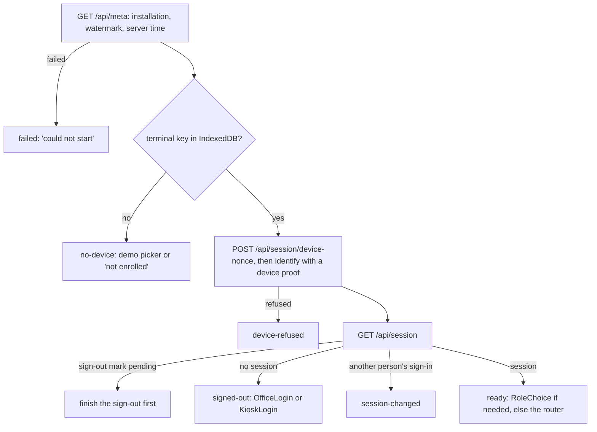
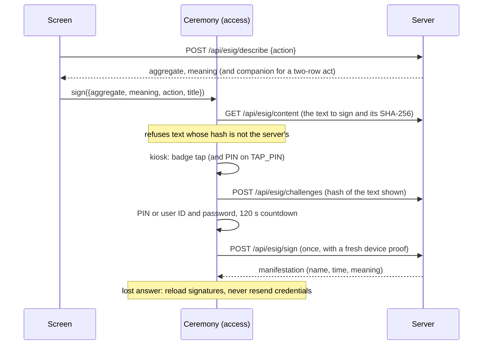

# tablets-web: the Tablets edition's screens

**Draft.** This page is still being written; facts on it were checked against the code on 14 October 2026.

This page explains `apps/tablets-web`, the browser application of the Tablets edition: how it starts, how it proves
which terminal it runs on, how a screen calls the server, how a refusal is shown, how a signature is taken, and then
each feature folder (its screens, the routes it calls, what the person does in pharma terms). Read it when you change
or debug a screen. If "batch record", "MBR" or "QP" are new to you, read the [pharma primer](../01-pharma-primer.md)
first; terms are in the [glossary](../02-glossary.md).

One rule runs through the whole app: **the server and the database decide, the screen only shows.** A screen never
computes a GMP value, a state, a deadline or whether an act is allowed. It sends what the person typed or chose and
shows the server's answer in the server's words. When this page says "the screen hides X", the server still refuses X
if someone sends it anyway.

## Where the code is

| What | Where |
|---|---|
| Entry: strict-CSP set-up, fonts, the fixture mode switch | [main.tsx](../../../apps/tablets-web/src/main.tsx) |
| The app: providers and the gate from start-up to sign-in to the router | [app/App.tsx](../../../apps/tablets-web/src/app/App.tsx#sym=Gate) |
| Start-up and sign-out state | [app/boot.tsx](../../../apps/tablets-web/src/app/boot.tsx#sym=BootProvider) |
| The fixed list of web features | [app/features.ts](../../../apps/tablets-web/src/app/features.ts#sym=WEB_FEATURES) |
| What a feature exports (routes, home tiles, Provider) | [app/feature.ts](../../../apps/tablets-web/src/app/feature.ts#sym=WebFeature) |
| The router | [app/router.tsx](../../../apps/tablets-web/src/app/router.tsx#sym=createAppRouter) |
| Shell: banner, watermark, density | [app/shell.tsx](../../../apps/tablets-web/src/app/shell.tsx#sym=Frame) |
| Ports (ceremony, badge tap, scale slot, session banner) | [app/ports.tsx](../../../apps/tablets-web/src/app/ports.tsx) |
| Office forms and acts | [app/define-form.tsx](../../../apps/tablets-web/src/app/define-form.tsx#sym=DefineForm), [app/acts.tsx](../../../apps/tablets-web/src/app/acts.tsx#sym=useCommand) |
| How a refusal is shown | [app/refusal.tsx](../../../apps/tablets-web/src/app/refusal.tsx#sym=RefusalMessage) |
| Which role is offered which office act (display only) | [app/roles.ts](../../../apps/tablets-web/src/app/roles.ts#sym=offered) |
| The display clock (the only clock the app reads) | [app/clock.ts](../../../apps/tablets-web/src/app/clock.ts#sym=anchorServerTime) |
| Sign-out screens and the sign-out mark | [app/sign-out.tsx](../../../apps/tablets-web/src/app/sign-out.tsx), [app/sign-out-mark.ts](../../../apps/tablets-web/src/app/sign-out-mark.ts) |
| API client, query hooks, signables, page binding, deadline | [src/api/](../../../apps/tablets-web/src/api/) |
| Terminal key and device proof | [src/device/](../../../apps/tablets-web/src/device/) |
| Feature folders (one per area) | [src/features/](../../../apps/tablets-web/src/features/) |
| Vite build and dev proxy | [vite.config.ts](../../../apps/tablets-web/vite.config.ts) |
| Component tests | [test/](../../../apps/tablets-web/test/) |
| Browser suite that drives these screens | [tools/e2e/specs/](../../../tools/e2e/specs/) ([tools](tools.md#tools-e2e-the-browser-suite)) |
| Shared components and state machines | [packages/ui-kit](../../../packages/ui-kit/) ([shared-kits](shared-kits.md#ui-kit)) |
| The routes this app calls | [packages/api-contract](../../../packages/api-contract/) ([api-contract](api-contract.md)) |
| The server that answers | [apps/tablets-server](../../../apps/tablets-server/) ([tablets-server](tablets-server.md)) |

## What it does

The web app is a single-page application (SPA): one HTML page, and React draws every screen in the browser. It is
built by Vite into `apps/tablets-web/dist`; the Tablets server serves that build from the same address as the API
(`EBMR_WEB_DIST`), so the page and the API share one origin. There are two installations, each a separate server with
its own database: **GMP** (the real plant) and **SANDBOX** (training and test runs, every screen marked "TEST, NOT
GMP"). The same build runs on both; it asks the server which one it is.

People use the app on two kinds of terminal:

- **Office PCs** (terminal class PERSONAL): QA, QC, planners, MBR authors. Sign-in with user ID and password.
- **Shop-floor kiosks** (SHARED, GRADE_A_B): operators in gloves at a booth. Sign-in with a badge and a PIN; every
  entry needs a fresh badge tap, because several people share one screen.

The screen layout follows the terminal: `data-density="office"` or `"floor"` on the root element (big touch targets
on the floor).

### Pharma context

- **Attributable.** Every record must say who did it. On a shared kiosk a session alone does not prove who stood at
  the screen, so each entry carries a fresh badge tap of the person signed in (invariant INV-40, control
  [DI-14](../../../compliance/controls/DI-14.yaml)).
- **The terminal is part of the record.** GMP records say where a value was entered. The browser cannot be trusted to
  say which terminal it is, so it proves it with a key the server registered ([DI-20](../../../compliance/controls/DI-20.yaml)).
- **Sandbox must never look like GMP** ([DI-05](../../../compliance/controls/DI-05.yaml)): test runs carry the TEST
  band, a watermark and TEST- batch numbers, so a printout or screenshot cannot pass as a real record.
- **A signature is a legal act** (21 CFR Part 11, EU GMP Annex 11): the person must see exactly what they sign, re-enter
  their secret, and the signature must be bound to that content ([DI-36](../../../compliance/controls/DI-36.yaml),
  [DI-37](../../../compliance/controls/DI-37.yaml), [DI-38](../../../compliance/controls/DI-38.yaml)).
- **Contemporaneous recording** ([DI-28](../../../compliance/controls/DI-28.yaml)): a value is recorded when it is
  entered, and the person must know whether it was saved. A lost answer is "NOT SAVED", never a silent success.

## The app shell

### Start-up

[runBoot](../../../apps/tablets-web/src/app/boot.tsx#sym=BootProvider) (inside `BootProvider`) runs these steps, and
[Gate](../../../apps/tablets-web/src/app/App.tsx#sym=Gate) shows a screen for each outcome (`BootPhase`):



- The meta answer sets `apiState.installation`. From then on every answer must carry the same installation in the
  `X-Ebmr-Installation` header; a different one stops the app (phase `mismatch`). This catches a dev proxy or a load
  balancer pointing at the wrong server.
- The server time from meta anchors the display clock ([clock.ts](../../../apps/tablets-web/src/app/clock.ts#sym=anchorServerTime)).
- Credentials and the CSRF token never enter TanStack Query caches; they live in `BootProvider` state and in the API
  client's memory.

### Features, routes and the router

Each folder under `src/features/` exports a [WebFeature](../../../apps/tablets-web/src/app/feature.ts#sym=WebFeature):
`routes(root)` (TanStack Router routes under the root), `homeTiles` (tiles on the home screen, per installation), and
an optional `Provider` (to supply a port). The list is fixed in
[WEB_FEATURES](../../../apps/tablets-web/src/app/features.ts#sym=WEB_FEATURES); a feature changes only its own
`index.tsx`, so parallel work never touches a shared generated file. [createAppRouter](../../../apps/tablets-web/src/app/router.tsx#sym=createAppRouter)
builds the route tree; an unknown address shows [NotFoundPage](../../../apps/tablets-web/src/app/not-found.tsx#sym=NotFoundPage),
which also offers the address without a trailing full stop or comma (links copied from sentences).

### Ports: how features use each other without importing each other

Some features need another feature's code: the step screen (floor) needs the signature ceremony and the badge tap
(access) and the scale capture slot (devices). The [dependency boundaries](../03-architecture.md#3-the-dependency-boundaries)
keep features apart, so they meet through **ports** in [app/ports.tsx](../../../apps/tablets-web/src/app/ports.tsx):

| Port | Hook | Supplied by |
|---|---|---|
| `SignatureCeremonyPort.sign(request)` | `useSignatureCeremony` | access ([ceremony.tsx](../../../apps/tablets-web/src/features/access/ceremony.tsx)) |
| `BadgeTapPort.requestTap(reason, request)`, `offerSwitch(refusal)` | `useBadgeTap` | access ([controller.tsx](../../../apps/tablets-web/src/features/access/controller.tsx)) |
| `ScaleCaptureSlot` | `useScaleCaptureSlot` | devices ([ScaleSlot.tsx](../../../apps/tablets-web/src/features/devices/ScaleSlot.tsx#sym=ScaleSlot)) |
| Session banner | `useSessionBanner` | access (`SessionBanner`) |

The defaults (`STUB_CEREMONY`, `STUB_BADGE_TAP`, `StubScaleCaptureSlot`) refuse politely with `NOT_IMPLEMENTED`. `App`
wraps the tree in every feature's `Provider`.

### The shell: installation, banner, watermark

[Frame](../../../apps/tablets-web/src/app/shell.tsx#sym=Frame) puts every screen, signed in or not, inside the ui-kit
`Layout`: on the sandbox the `WatermarkBand` and `WatermarkOverlay` with the server's watermark text, and the identity
banner (who, which role, which terminal and room, sign out). The word "GMP" or "Sandbox" comes from one place,
[installationLabel](../../../apps/tablets-web/src/app/installation.ts#sym=installationLabel): anything but a SANDBOX
answer is named GMP, so a screen never claims to be a sandbox it was not told it is.

> **Why this exists** (one source for the installation's name)
> - **Pharma reason:** a person must always know whether they work on real GMP records or in training; a screen that
>   says "Sandbox" on the GMP installation invites careless entries into real records.
> - **Control:** [DI-05](../../../compliance/controls/DI-05.yaml).
> - **Code:** [installationLabel](../../../apps/tablets-web/src/app/installation.ts#sym=installationLabel),
>   [Frame](../../../apps/tablets-web/src/app/shell.tsx#sym=Frame); the server sets the watermark text in `/api/meta`.
> - **Tests:** [shell.test.tsx](../../../apps/tablets-web/test/shell.test.tsx),
>   [session/sign-in-screens.test.tsx](../../../apps/tablets-web/test/session/sign-in-screens.test.tsx), browser
>   [smoke.spec.ts](../../../tools/e2e/specs/smoke/smoke.spec.ts) (`[DI-05]`).
> - **Lesson:** Phase 2 exit review F09, the kiosk sign-in said "Sandbox" on GMP.

### Reads are per person

What a screen offers (the actions, their reasons, the cockpit) is computed by the server for the viewer. When the
person or the role changes (a kiosk switch, a sign-out, a lock), [SessionScopedReads](../../../apps/tablets-web/src/app/session-reads.tsx#sym=SessionScopedReads)
drops every cached read, so one person never acts on what was computed for another ([DI-34](../../../compliance/controls/DI-34.yaml),
INV-03). Test: [app/session-reads.test.tsx](../../../apps/tablets-web/test/app/session-reads.test.tsx).

### Roles on screen

[roles.ts](../../../apps/tablets-web/src/app/roles.ts#sym=offered) maps the session's role to act groups (QA, QC,
PRODUCTION_HEAD, PLANNING, US_QCU, EU_QP, ...). It only decides what to **show**: an act not offered to a role is hidden
so each person sees their own work. Permissions and separation of duties are checked by the server and the database;
an act shown to a role that may not do it is refused in the server's words.

### The display clock

The app may not decide a GMP time. [clock.ts](../../../apps/tablets-web/src/app/clock.ts) is the only module that reads
a clock: it anchors the server's time from `/api/meta` and adds the browser's monotonic `performance.now()`, for
countdowns and "saved 12 s ago" only (`serverNowMs`, `secondsUntil`, `secondsSince`). The lint rule that bans
`Date.now()` in domain code is proven in [tools/boundaries](tools.md#tools-boundaries-dependency-rules-and-the-clock-ban).

### Sign-out

Signing out on a shared kiosk is a GMP matter: if the page shows the sign-in form while the old session is still alive
on the server, the next person could act as the previous one. So:

- The page blocks at once ([SigningOut](../../../apps/tablets-web/src/app/sign-out.tsx#sym=SigningOut)) and shows
  the sign-in form only when the server confirms no session is left (logout answered, or 401 `NO_SESSION`).
- If the server does not confirm within `SIGN_OUT_REQUEST_TIMEOUT_MS` (15 s), the page shows "Sign-out not confirmed"
  ([SignOutUnconfirmed](../../../apps/tablets-web/src/app/sign-out.tsx#sym=SignOutUnconfirmed)), retries every 10 s,
  and finally locks the session so it needs credentials again.
- The pending sign-out is marked in site storage and announced to the other tabs over a broadcast channel
  ([sign-out-mark.ts](../../../apps/tablets-web/src/app/sign-out-mark.ts#sym=startSignOut)). A reload finishes the
  sign-out before anything else; every other tab joins it. No cookie holds the mark: cookies ignore ports, so a page of
  another installation could forge or delete it (review F42).
- Unsaved designer drafts kept in the browser are removed when a sign-out starts (review F50).

> **Why this exists** (a sign-out the server did not confirm keeps the page blocked)
> - **Pharma reason:** on a shared terminal, the next person must never inherit the previous person's live session;
>   every act must be attributable to the one person who did it.
> - **Control:** [DI-38](../../../compliance/controls/DI-38.yaml), [DI-14](../../../compliance/controls/DI-14.yaml).
> - **Code:** [BootProvider](../../../apps/tablets-web/src/app/boot.tsx#sym=BootProvider) (`signOut`, `endServerSession`),
>   [sign-out-mark.ts](../../../apps/tablets-web/src/app/sign-out-mark.ts#sym=signOutPendingAtStartUp); the server
>   ends the session (`session.logout`) and the kernel locks idle sessions.
> - **Tests:** [app/sign-out-screen.test.tsx](../../../apps/tablets-web/test/app/sign-out-screen.test.tsx),
>   [access/session-control.test.tsx](../../../apps/tablets-web/test/access/session-control.test.tsx), browser
>   [security.spec.ts](../../../tools/e2e/specs/security/security.spec.ts) (`[DI-13][DI-38]` sign-out mark).
> - **Lessons:** [P2-F36, F10, F41, F42, F43: sessions and the browser](../08-defect-log.md#p2-f36-f10-f41-f42-f43-sessions-and-the-browser).

## The API layer

### How a screen calls the contract

The routes are defined once in [packages/api-contract](../../../packages/api-contract/src/routes.ts#sym=routes)
(method, path, body and response schemas, attribution rule). The browser uses the contract's typed client:

```ts
import { routes } from '@ebmr/api-contract';
import { api } from '../../api/client.ts';

const r = await api.call(routes.quality.raiseDeviation, { body: { ... } });
if (!r.ok) showRefusal(r.error);   // a CallError: REFUSAL, NETWORK, PROTOCOL or MISMATCH
else use(r.value);                  // parsed with the route's response schema
```

[api](../../../apps/tablets-web/src/api/client.ts#sym=api) wraps `createApiClient` with:

- same-origin `fetch` ([browserFetch](../../../apps/tablets-web/src/api/client.ts#sym=browserFetch)), `cache: no-store`;
- the session's CSRF token on every mutating call (kept in memory only);
- an `Idempotency-Key` per mutating command, so a resend after a lost answer is not a second act;
- responses parsed with the contract's schemas (a malformed answer is a `PROTOCOL` error, never shown as data);
- the installation check on every answer (see Start-up);
- two headers that bind the page to its own sign-in (next section).

Reads use [useApiQuery](../../../apps/tablets-web/src/api/hooks.ts#sym=useApiQuery), TanStack Query over the typed
client, for GET routes only; it throws on any other method. Commands, and anything carrying a credential, PIN or proof,
are called directly with `api.call` in event handlers and never enter a query cache. There are **no optimistic
updates**: after a command, the affected reads are invalidated and read again ([useRefresh](../../../apps/tablets-web/src/app/acts.tsx#sym=useRefresh)).

### The page is bound to its own sign-in

Cookies ignore ports, so a page on another port of the same computer can set this installation's session cookie, and
another tab's sign-in replaces it. [page-binding.ts](../../../apps/tablets-web/src/api/page-binding.ts#sym=bindPagePerson)
keeps the person this page's session started with (per tab, in `sessionStorage`), and every request names that person
(`x-ebmr-page-person`) and this terminal's key (`x-ebmr-terminal-key`, the SHA-256 of its public key,
[terminalKeyOf](../../../apps/tablets-web/src/api/page-binding.ts#sym=terminalKeyOf)). The server serves a session of
another person (`SESSION_CHANGED`) or another terminal (`SESSION_OTHER_TERMINAL`) as nobody, and the page shows "This
page's sign-in has changed" instead of acting as someone else. A `COOKIE_DUPLICATED` refusal (the server removed a
planted copy and ran nothing) is sent once more. Tests: [app/page-binding.test.tsx](../../../apps/tablets-web/test/app/page-binding.test.tsx),
browser [security.spec.ts](../../../tools/e2e/specs/security/security.spec.ts).

### Deadlines

[callWithDeadline](../../../apps/tablets-web/src/api/deadline.ts#sym=callWithDeadline) gives up a call (and aborts the
request) after `SEND_DEADLINE_MS` (30 s) for floor entries and signatures. The caller gets a `NETWORK` error, which
every screen reads as a lost answer: a floor entry becomes NOT SAVED (resend under the same idempotency key), a
signature is reconciled from the signatures read again, a sign-out is not confirmed. Without it a stalled connection
left the screen on "Saving..." forever (review F60). Test: [floor/send-deadline.test.tsx](../../../apps/tablets-web/test/floor/send-deadline.test.tsx).

### Text no record can hold

[unstorableBody](../../../apps/tablets-web/src/api/client.ts#sym=unstorableBody) refuses, before anything is sent, a
body with U+0000 or a lone UTF-16 surrogate (canonical JSON has no form for them, so no proof could hash them). The
server refuses the same ([DI-37](../../../compliance/controls/DI-37.yaml);
[defect log, P2-F30 to F33](../08-defect-log.md#p2-f30-to-f33-nul-characters-and-lone-surrogates-in-free-text)).

### Fixture mode and the contract examples

With `VITE_EBMR_FIXTURES=1` the app answers from the contract's examples
([examples.ts](../../../apps/tablets-web/src/api/examples.ts#sym=fixturesFromExamples),
[fixture-fetch.ts](../../../apps/tablets-web/src/api/fixture-fetch.ts#sym=createFixtureFetch)) instead of a server.
The component tests use the same transport. [api/contract-examples.test.tsx](../../../apps/tablets-web/test/api/contract-examples.test.tsx)
checks the examples still parse with the contract.

## The terminal key and device proofs

Every terminal holds a key pair. [keystore.ts](../../../apps/tablets-web/src/device/keystore.ts#sym=loadDeviceKey)
keeps a **non-extractable** WebCrypto ECDSA P-256 private key in IndexedDB of this origin (the GMP and sandbox
installations are different origins, so they keep different keys). Non-extractable means JavaScript can ask the
browser to sign with it but can never read it out. The server knows the terminal by the fingerprint of the public key;
nothing the browser says about itself is trusted.

A **device proof** ([signProof](../../../apps/tablets-web/src/device/proof.ts#sym=signProof)) signs
`nonce|METHOD|path|sha256(canonical JSON of the body)` ([proofMessage](../../../apps/tablets-web/src/device/proof.ts#sym=proofMessage)).
[deviceProof](../../../apps/tablets-web/src/api/client.ts#sym=deviceProof) first asks the server for a fresh nonce
(`session.deviceNonce`, bound to the public key), then signs. So a proof covers exactly one request and is single use:
a resend needs a new one. Sign-in, unlock, a badge tap and a signature all carry one. When no nonce is issued, the
result is a refusal `NO_DEVICE_PROOF` of kind NOT_SAVED ([notProven](../../../apps/tablets-web/src/api/client.ts#sym=notProven)),
shown like any other: it was once thrown and left the sign-in without a word (review F08).

On demo databases the device picker ([DemoPicker.tsx](../../../apps/tablets-web/src/features/session/DemoPicker.tsx#sym=DemoPicker))
imports a seeded DEMO-ONLY private key as non-extractable ([importDemoKey](../../../apps/tablets-web/src/device/keystore.ts#sym=importDemoKey));
the route `session.demoDevices` answers 404 off demo installations.

> **Why this exists** (the terminal proves itself; the server decides)
> - **Pharma reason:** a GMP record names the terminal and room where an entry was made, and a kiosk in one room must
>   not record a weighing from a scale in another. A browser could claim to be any terminal; a key the server
>   registered cannot be copied out of the browser.
> - **Control:** [DI-20](../../../compliance/controls/DI-20.yaml).
> - **Code:** browser [signProof](../../../apps/tablets-web/src/device/proof.ts#sym=signProof); server verification
>   in the tablets platform ([tablets-server, sessions and terminals](tablets-server.md#sessions-and-terminals)).
> - **Tests:** [access/no-device-proof.test.tsx](../../../apps/tablets-web/test/access/no-device-proof.test.tsx),
>   [api.test.ts](../../../apps/tablets-web/test/api.test.ts); browser
>   [devices.spec.ts](../../../tools/e2e/specs/devices/devices.spec.ts) (`[DI-20]`, a kiosk in another room).
> - **Error:** `NO_DEVICE_PROOF` (client), the server's device refusals.

## How refusals are shown

The server answers a refused request with a **refusal envelope**: a `code` (an `EBMR-...` code from the database, or a
platform code such as `NO_SESSION`), a `kind` (NOT_ALLOWED, LOCKED, AUTH_FAILED, NOT_SAVED, INVALID_INPUT,
SWITCH_USER, ...), and four plain-language parts: `whatHappened`, `why`, `whatYouCanDo`, `whoCanHelp`, plus the
`controls` it rests on and a `correlationId` for the logs. [RefusalMessage](../../../apps/tablets-web/src/app/refusal.tsx#sym=RefusalMessage)
shows it as a ui-kit `Banner` (error tone for LOCKED, AUTH_FAILED and NOT_SAVED, warning otherwise). Network and
protocol errors get a one-line banner.

The screen never rewrites the reason. The words come from the database function that refused (see
[Error codes](../reference/error-codes.md) and [Architecture, error codes](../03-architecture.md#17-error-codes)). To
debug one: take the correlation id, find the server log line, then the code and the function that raises it
([Testing, how to debug a failing guard](../06-testing-and-debugging.md#how-to-debug-a-failing-guard)).

## Office acts and forms

Most office screens (planning, master data, plant, quality, review, release, ...) use three helpers from
[app/acts.tsx](../../../apps/tablets-web/src/app/acts.tsx):

- [useCommand](../../../apps/tablets-web/src/app/acts.tsx#sym=useCommand): one plain POST; the reads named in `refresh`
  are read again afterwards, refused or not. If the route is marked `attribution: 'FRESH_ON_SHARED'` and the session is
  on a shared terminal, the command first asks for a badge tap over the exact request (INV-40); a cancelled tap sends
  nothing.
- [useSignedAct](../../../apps/tablets-web/src/app/acts.tsx#sym=useSignedAct): a signed act. It asks the server what is
  signed ([describeSignable](../../../apps/tablets-web/src/api/signables.ts#sym=describeSignable), route
  `esig.describe`), then runs the ceremony. The browser never builds an aggregate id or a meaning itself.
- [DefineForm](../../../apps/tablets-web/src/app/define-form.tsx#sym=DefineForm): a small form described by a field
  list (text, choice, yes/no, whole number, decimal as text, instant). The body is checked against the route's own
  contract schema before the button is enabled, so the form can send only what the contract allows; the server
  decides the rest. Decimals stay text, never a JavaScript `number` ([Architecture, decimals](../03-architecture.md#11-decimals)).

[ActResult](../../../apps/tablets-web/src/app/acts.tsx#sym=ActResult) shows the outcome: the refusal, "Signed.", "Saved."
or, for a lost signature answer, "check the record before you sign again".

## The e-signature ceremony

A signature is taken by the access feature's ceremony ([ceremony.tsx](../../../apps/tablets-web/src/features/access/ceremony.tsx#sym=CeremonyHost)),
which drives the ui-kit ceremony machine and its `SignatureDialog`
([shared-kits, ui-kit](shared-kits.md#ui-kit)). Any screen asks for one through the port:



What the screen guarantees, and what it leaves to the server:

- **What you see is what you sign.** The text comes from the server with its hash; the challenge carries the hash of
  the text the dialog showed. If the record changed meanwhile, the server refuses (`EBMR-ESIG-013`).
- **Secrets stay out of state.** PINs and passwords live in refs and `Vault` holders
  ([holders.ts](../../../apps/tablets-web/src/features/access/holders.ts#sym=Vault)) until the request is built, then
  are wiped; they never enter React state, query caches or storage.
- **Another person's badge** during a signing offers "Switch to <name>?"; once switched, the signing ends with nothing
  signed, because the request was the previous person's (INV-40).
- **A lost answer** never re-sends the credentials: the dialog reloads the record's signatures and reports SIGNED only
  if a matching one is found, otherwise NOT_CONFIRMED.
- **Two-row acts** (decision D-P4-5, the manufacturer and US release in one ceremony): both contents are loaded and
  checked, a challenge is opened for each, and the secret is sent once; the server writes both rows or neither.

Who may sign, the four-eyes rules and the signature meaning are all checked by the kernel's `esig.sign` and the
handler of the signable ([kernel, e-signatures](kernel.md), [tablets-server, ts-esig](tablets-server.md#ts-esig-signing-ceremony-and-signing-meanings)).

> **Why this exists** (the ceremony shows the server's text and binds the signature to it)
> - **Pharma reason:** under 21 CFR Part 11 and EU GMP Annex 11 a signature must show the signer's name, the time and
>   the meaning, and be linked to exactly the record signed. A dialog that shows other words than the signed content
>   makes the signature meaningless.
> - **Control:** [DI-36](../../../compliance/controls/DI-36.yaml), [DI-37](../../../compliance/controls/DI-37.yaml),
>   [DI-38](../../../compliance/controls/DI-38.yaml), invariant INV-40.
> - **Code:** [ceremony.tsx](../../../apps/tablets-web/src/features/access/ceremony.tsx#sym=CeremonyHost), [previewIntent](../../../apps/tablets-web/src/features/access/calls.ts#sym=previewIntent),
>   [describeSignable](../../../apps/tablets-web/src/api/signables.ts#sym=describeSignable); the server's `esig.content`,
>   `esig.createChallenge` and `esig.sign` routes.
> - **Tests:** [access/two-row-ceremony.test.tsx](../../../apps/tablets-web/test/access/two-row-ceremony.test.tsx),
>   [access/ceremony-person-change.test.tsx](../../../apps/tablets-web/test/access/ceremony-person-change.test.tsx),
>   [access/keyed-badge.test.tsx](../../../apps/tablets-web/test/access/keyed-badge.test.tsx); browser
>   [esig.spec.ts](../../../tools/e2e/specs/esig/esig.spec.ts) (`[DI-36][DI-38][INV-40]`).
> - **Lessons:** [P2-F02, F03](../08-defect-log.md#p2-f02-f03-the-dialog-named-a-different-thing-from-the-signed-content),
>   [P2-F39, F40, F56](../08-defect-log.md#p2-f39-f40-f56-ceremony-screens-signed-the-wrong-thing-or-told-the-wrong-thing).

## Strict CSP

The server sends a strict Content-Security-Policy with the SPA and every API answer
([CSP_DIRECTIVES](../../../apps/tablets-server/src/platform/http/security.ts#sym=CSP_DIRECTIVES)): scripts, styles,
fonts and connections only from the same origin, no inline script, no `eval`. This blocks a whole class of attacks
(injected script stealing a session or forging an entry). The web app is built to live with it:

- [main.tsx](../../../apps/tablets-web/src/main.tsx) imports `@ebmr/api-contract/strict-csp` **first**, which switches
  zod to "jitless" mode; otherwise zod builds parsers with `new Function`, which the CSP forbids.
- Vite's module-preload polyfill (an inline script) is off, and a plugin fails the build if browser code imports a
  Node built-in ([vite.config.ts](../../../apps/tablets-web/vite.config.ts)).
- react-aria would inject an inline `<style>`; [index.html](../../../apps/tablets-web/index.html) carries a meta tag
  that tells it the ui-kit's `tokens.css` already has the rule. One known inline style (react-aria's scroll lock on
  mobile WebKit) is admitted by its hash in `style-src`; recompute the hash when react-aria changes that text.
- Components use CSS modules, not `style` attributes from user data.

Test: browser [security.spec.ts](../../../tools/e2e/specs/security/security.spec.ts) `[DI-13] the SPA runs under the
strict CSP without a single violation`; [floor.spec.ts](../../../tools/e2e/specs/floor/floor.spec.ts) also checks the
floor screens for CSP violations. Server test: [platform/security.test.ts](../../../apps/tablets-server/test/platform/security.test.ts).

## The feature folders

Each section is one folder of `src/features/`. "Routes" lists contract route ids (namespace and name; the
[api-contract](api-contract.md) page and the `ns/*.ts` files give method and path). The code map files each folder
under its server module (for example `screens: apps/tablets-web/src/features/quality` under ts-quality), so the
[code map](../code-map.md) lists the screens beside the server code they call.

| Folder | Screens (paths) | Installation | Server module |
|---|---|---|---|
| [session](#session-sign-in-home-and-the-demo-picker) | `/`, `/demo/devices`, sign-in screens | both | [ts-session](tablets-server.md#ts-session-sessions-and-sign-in) |
| [access](#access-kiosk-access-and-the-signature-ceremony) | lock overlay, switch user, ceremony, `/esig/demo` | both | [ts-access](tablets-server.md#ts-access-kiosk-access-attribution-and-governance-read-doors), [ts-esig](tablets-server.md#ts-esig-signing-ceremony-and-signing-meanings) |
| [audit](#audit-the-audit-trail-viewer) | `/audit` | both | [ts-audit](tablets-server.md#ts-audit-audit-trail-reads) |
| [designer](#designer-the-mbr-designer) | `/mbr`, `/mbr/new`, `/mbr/versions/$versionId` | GMP | [ts-designer](tablets-server.md#ts-designer-mbr-designer) |
| [floor](#floor-test-runs-the-cockpit-and-the-step-screen) | `/packages`, `/test-packages`, `/runs`, `/runs/$runId`, `/runs/$runId/steps/$stepKey`, `/cockpit` | both | [ts-execution](tablets-server.md#ts-execution-execution-on-the-shop-floor-batches-entries-lots) |
| [devices](#devices-the-scale-slot-and-the-scales-page) | `/devices/scales`, the scale slot | both | [ts-devices](tablets-server.md#ts-devices-devices-and-scale-or-process-readings) |
| [planning](#planning-orders-batch-issue-and-packaging-orders) | `/planning`, `/planning/batches`, `/planning/packaging`, `/planning/packaging/$batchId` | GMP | [ts-planning](tablets-server.md#ts-planning-planning) |
| [master-data](#master-data-formulas-erp-masters-and-plant-definitions) | `/master-data`, `/master-data/formulas`, `/master-data/formulas/$formulaId`, `/master-data/erp`, `/master-data/plant` | GMP | [ts-master-data](tablets-server.md#ts-master-data-master-data-formulas-erp-masters) |
| [plant](#plant-cleaning-clearance-and-equipment-events) | `/plant` | GMP | [ts-plant](tablets-server.md#ts-plant-plant-screens-and-routes) |
| [quality](#quality-deviations-lots-specifications-samples-returns) | `/quality` and below | GMP | [ts-quality](tablets-server.md#ts-quality-quality-lots-deviations-lims-lite-specifications-samples) |
| [review](#review-batch-record-review-and-containers) | `/review`, `/review/$batchId`, `.../register`, `.../containers` | GMP | [ts-review](tablets-server.md#ts-review-batch-record-review), [ts-containers](tablets-server.md#ts-containers-output-container-acts) |
| [release](#release-the-release-cockpit) | `/release`, `/release/$lotId`, `/release/batches/$batchId`, `/release/suspended`, `/qp` | GMP | [ts-release](tablets-server.md#ts-release-release-cockpit-and-tablets-g-rel-items), [ts-qp-package](tablets-server.md#ts-qp-package-eu-qp-batch-package-and-certification-message-intake) |
| [notifications](#notifications-the-notification-centre) | `/notifications` | GMP | [ts-notifications](tablets-server.md#ts-notifications-notifications) |
| [records](#records-record-locking-and-amendment) | `/records`, `/records/$batchId` | GMP | [ts-records](tablets-server.md#ts-records-record-lock-and-bright-stock) |
| [pqr](#pqr-product-quality-review-extracts) | `/pqr`, `/pqr/$extractId` | GMP | [ts-pqr](tablets-server.md#ts-pqr-product-quality-review) |
| [archive](#archive-retention-true-copies-and-inspection) | `/archive`, `/archive/batches/$batchId`, `/archive/inspection` | GMP | [ts-archive](tablets-server.md#ts-archive-archive-evidence-export-and-inspection) |
| [india](#india-licences-allocation-register-and-labels) | `/india`, `/india/register`, `/india/batches/$batchId` | GMP | [ts-india](tablets-server.md#ts-india-india-features-licences-labels-expiry-rule) |

"Installation" is what the home tiles offer; the server decides which routes each installation answers.

### session: sign-in, home and the demo picker

**What the person does.** Signs in, changes a first or reset secret, chooses the role they work in (one role per
session), and lands on the home screen with the tiles of this installation.

**Screens.** [Login.tsx](../../../apps/tablets-web/src/features/session/Login.tsx): `OfficeLogin` (user ID and
password), `KioskLogin` (badge from a keyboard-wedge reader or the demo badge drawer, then the PIN on the ui-kit
`PinPad`), the secret change and `RoleChoice`. The shell shows them before any route. [Home.tsx](../../../apps/tablets-web/src/features/session/Home.tsx)
lists the tiles of every feature for this installation. [DemoPicker.tsx](../../../apps/tablets-web/src/features/session/DemoPicker.tsx)
at `/demo/devices` (demo databases only) picks a seeded terminal.

**Routes.** `session.login`, `session.changeSecret`, `session.chooseRole`, `session.demoDevices`; the start-up uses
`meta.get`, `session.deviceNonce`, `session.identify`, `session.get`.

**Notes.** Secrets are typed into native uncontrolled inputs (ui-kit `SecretInput`), cleared after sending, never in
React state. The kiosk takes only a reader burst that can be a badge UID, and the pad stops at `PIN_MAX_LENGTH`. The
sign-in method per terminal class and the lockout are the kernel's.

**Tests.** [session/](../../../apps/tablets-web/test/session/): `sign-in-screens`, `secret-inputs`, `badge-autofill`.
Browser: [smoke.spec.ts](../../../tools/e2e/specs/smoke/smoke.spec.ts).

### access: kiosk access and the signature ceremony

**What the person does.** At a kiosk: locks the screen when stepping away, unlocks with their own badge and PIN, or
lets the next person "Switch user". Everywhere: signs through the ceremony.

**Code.** [access/index.tsx](../../../apps/tablets-web/src/features/access/index.tsx#sym=Provider) supplies the
ceremony and badge-tap ports, the `SessionBanner` (who, Lock, Switch user, Sign out), the lock overlay and a session
poll every 15 s ([SESSION_POLL_MS](../../../apps/tablets-web/src/features/access/controller.tsx#sym=SESSION_POLL_MS)):
the kernel locks idle sessions and the overlay follows within 15 s. [controller.tsx](../../../apps/tablets-web/src/features/access/controller.tsx#sym=AccessRoot)
owns the kiosk-lock machine and announces session changes to the floor as the window event `ebmr:session-change`
(SWITCH, LOCK, UNLOCK, ENDED). [calls.ts](../../../apps/tablets-web/src/features/access/calls.ts) builds the attributed
calls; a badge tapped for an entry is kept 30 s so a "Switch to <name>?" offer needs only the PIN. The DEMO-ONLY page
[EsigDemo.tsx](../../../apps/tablets-web/src/features/access/EsigDemo.tsx#sym=EsigDemo) (`/esig/demo`) signs a kernel
stub entry through the real ceremony.

**Routes.** `access.lock`, `access.unlock`, `access.switchUser`, `esig.content`, `esig.createChallenge`, `esig.sign`,
`esig.signatures`, `session.get`.

> **Why this exists** (a fresh badge tap per entry on a shared kiosk)
> - **Pharma reason:** on a shared terminal the session does not show who is standing there now. Each entry needs the
>   person's own badge, so a value entered by one operator is never recorded under another who forgot to sign out.
> - **Control:** [DI-14](../../../compliance/controls/DI-14.yaml), [DI-38](../../../compliance/controls/DI-38.yaml), invariant INV-40.
> - **Code:** browser `requestTap` in [controller.tsx](../../../apps/tablets-web/src/features/access/controller.tsx#sym=useAccess)
>   (the proof covers method, path and body); the server refuses an entry without a valid attribution, and a tap by
>   another person with 409 `SWITCH_USER`.
> - **Tests:** [access/session-control.test.tsx](../../../apps/tablets-web/test/access/session-control.test.tsx),
>   [access/ports.test.tsx](../../../apps/tablets-web/test/access/ports.test.tsx); browser
>   [access.spec.ts](../../../tools/e2e/specs/access/access.spec.ts) (`[INV-40][DI-14]` a signing request without a tap
>   is refused by the server and records nothing).

### audit: the audit trail viewer

**What the person does.** Reads who did what, when, why and what changed, on both installations, and asks the server
to verify a chain. QA uses it in batch review and inspectors during an audit.

**Screens.** [AuditPage.tsx](../../../apps/tablets-web/src/features/audit/AuditPage.tsx) at `/audit`: the chains
(filter by key prefix such as `batch:`), one chain's entries grouped by command, "Verify chain" (the server recomputes
every hash), the entries of one correlation or one person. **Read-only**: there is no edit, disable or delete on the
screen, and no such route exists. Other screens link here with [auditLink](../../../apps/tablets-web/src/features/audit/links.ts#sym=auditLink).

**Routes.** `audit.chains`, `audit.events`, `audit.verifyChain`. Controls [DI-22](../../../compliance/controls/DI-22.yaml),
[DI-23](../../../compliance/controls/DI-23.yaml); the chain itself is the kernel's ([Architecture, the audit trail](../03-architecture.md#8-the-audit-trail)).

**Tests.** [audit/](../../../apps/tablets-web/test/audit/) (`chain-verify-verdict`, `audit-paging-held-back`: a list
across chains stops before entries an action still running may add, review P11). Browser [audit.spec.ts](../../../tools/e2e/specs/audit/audit.spec.ts).

### designer: the MBR designer

**What the person does.** The MBR author creates a master batch record (MBR: the approved recipe and instructions every
batch of a product follows) from a template, chooses the product and its approved formula, edits the procedure
(stages, steps, blocks, limits, hold times), fixes the server's findings, justifies changes, saves revisions with a
change note, simulates, sends the version to verification, and sends a write-once test package to the sandbox.

**Screens.** [Library.tsx](../../../apps/tablets-web/src/features/designer/Library.tsx) (`/mbr`),
[NewFromTemplate.tsx](../../../apps/tablets-web/src/features/designer/NewFromTemplate.tsx) (`/mbr/new`: approved discrete
batch sizes, PR-01; India always included, INV-28), [ChooseProduct.tsx](../../../apps/tablets-web/src/features/designer/ChooseProduct.tsx)
(the bill of materials computed by the database from the formula, INV-25; needs FORMULA.READ), and
[DesignerPage.tsx](../../../apps/tablets-web/src/features/designer/DesignerPage.tsx) (`/mbr/versions/$versionId`):
document view, findings panel, step editor, simulation panel.

**How editing works.** Edits are pure operations on a copy of the saved revision, with undo and redo
([model/ops.ts](../../../apps/tablets-web/src/features/designer/model/ops.ts)); the designer imports the pure part of
recipe-core (`@ebmr/recipe-core/pure`) to number and pre-check, but the server validates every change (`designer.validate`,
debounced) and saves only with a change note and the base revision the edits started from (409 when someone saved
meanwhile). Unsaved edits are kept as a local draft of the signed-in person ([model/draft.ts](../../../apps/tablets-web/src/features/designer/model/draft.ts#sym=saveDraft),
decision D7), removed at sign-out.

**Routes.** `designer.families`, `designer.version`, `designer.palette`, `designer.templates`, `designer.formulaChoice`,
`designer.createFamily`, `designer.validate`, `designer.saveContent`, `designer.justify`, `designer.simulate`,
`designer.startVerification`, `designer.testPackage`.

**Signatures.** None today. The contract has the signable `MBR_TRANSITION` (prepared, checked, approved), and the
server has its handler, but no screen sends it yet (see [Differences](#differences-between-the-code-and-the-docs-14-october-2026)).

**Controls.** [DI-04](../../../compliance/controls/DI-04.yaml) (verification before Effective),
[PR-01](../../../compliance/controls/PR-01.yaml), [PR-03](../../../compliance/controls/PR-03.yaml) (content
completeness), [PR-08](../../../compliance/controls/PR-08.yaml) (limit tiers).

**Tests.** [designer/](../../../apps/tablets-web/test/designer/) (editor, ops, limit bounds, justify revision,
simulation panel, new from template, roles, ...). Browser [designer.spec.ts](../../../tools/e2e/specs/designer/designer.spec.ts)
and the first-clickable journey [fcv.spec.ts](../../../tools/e2e/specs/journey/fcv.spec.ts).

### floor: test runs, the cockpit and the step screen

**What the person does.** On the sandbox, a batch issuer imports a test package and issues a TEST- batch; operators run
it at the kiosk. On GMP, operators execute real batches. At the kiosk the operator opens the cockpit ("What you can do
now"), opens a step, enters values (weights, counts, checks), raises exceptions, signs "performed", and a second person
verifies. A supervisor holds the batch or links a deviation; QA dispositions an exception.

**Screens** ([pages/](../../../apps/tablets-web/src/features/floor/pages/)):

| Screen | Path | What it shows |
|---|---|---|
| [Packages.tsx](../../../apps/tablets-web/src/features/floor/pages/Packages.tsx) | `/packages`, `/test-packages` | the exchange inbox; import (the server recomputes the hashes, needs a GMP stamp) |
| [IssueForm.tsx](../../../apps/tablets-web/src/features/floor/pages/IssueForm.tsx) | `/packages/$packageId/issue` | issue a TEST- batch: approved batch sizes only (PR-01), markets, header inputs |
| [Runs.tsx](../../../apps/tablets-web/src/features/floor/pages/Runs.tsx) | `/runs` | TEST- runs on the sandbox; GMP batches on GMP |
| [RunOverview.tsx](../../../apps/tablets-web/src/features/floor/pages/RunOverview.tsx) | `/runs/$runId` | stages and steps, stage summary and sign-off, exceptions, holds, timers, the timeline of every engine call, "Verify record" (the server replays the stored rows) |
| [StepScreen.tsx](../../../apps/tablets-web/src/features/floor/pages/StepScreen.tsx) | `/runs/$runId/steps/$stepKey` | the instruction as issued, the block renderer, exceptions, signatures, one primary action |
| [Cockpit.tsx](../../../apps/tablets-web/src/features/floor/pages/Cockpit.tsx) | `/cockpit` | the room's work queue; an item not available now stays visible, greyed, with the server's reason (DI-34) |

**Block renderers.** Each step shows one block (a building block of the recipe, such as G-07 weighing or TB-11
compression). [rendererFor](../../../apps/tablets-web/src/features/floor/renderers/registry.ts#sym=rendererFor) picks
a renderer by block version from [RENDERERS](../../../apps/tablets-web/src/features/floor/renderers/registry.ts#sym=RENDERERS):
G-03, G-04, G-07, G-08, G-09, G-10, G-17 (hold point), G-20, G-22 and the Tablets blocks TB-01 to TB-24
([tablets.tsx](../../../apps/tablets-web/src/features/floor/renderers/tablets.tsx)). A block without one uses the
schema-driven [Fallback.tsx](../../../apps/tablets-web/src/features/floor/renderers/Fallback.tsx). The blocks themselves
are explained in [tablets-server, ts-blocks](tablets-server.md#ts-blocks-tablets-block-versions-tb-01-to-tb-24) and
[recipe-core](recipe-core.md).

**How an entry is sent.** [usePendingCall](../../../apps/tablets-web/src/features/floor/usePendingCall.ts#sym=usePendingCall)
drives one entry through the ui-kit `pendingEntry` machine:

1. SUBMIT fixes the body and a new idempotency key.
2. On a kiosk, a fresh badge tap of the signed-in person (the proof covers exactly this request; single use, so a resend
   taps again). The attribution lives only in the local variable of that one send.
3. The send has a 30 s deadline. A lost answer leaves the entry **NOT SAVED**; the resend uses the same key and body,
   so the server records it at most once.
4. A session change (switch, lock, sign-out) discards what is pending; before any send the signed-in person is checked
   against the person who made the entry. An entry discarded after it was sent may be in the record: the notice says
   so and the screen reloads.

Signed floor acts ("Sign as performed", "Verify", hold-point decision, stage sign-off, QA disposition of an exception)
go through [useSignedAction](../../../apps/tablets-web/src/features/floor/useSignedAction.ts#sym=useSignedAction) as
`ENGINE_COMMAND` signables. Corrections ([CorrectEntryDialog.tsx](../../../apps/tablets-web/src/features/floor/dialogs/CorrectEntryDialog.tsx),
`CORRECT_ENTRY`, approval `CORRECTION_APPROVAL`) and voids ([VoidAttemptDialog.tsx](../../../apps/tablets-web/src/features/floor/dialogs/VoidAttemptDialog.tsx):
on GMP proposed as an act and approved by QA with `ACT_APPROVAL`) keep the original value in the record: there is no
delete anywhere on the floor and no route that deletes ([DI-24](../../../compliance/controls/DI-24.yaml)). Dialogs
mount their form only while open and empty it on a session change, so one person's words are never offered to the next.

**Routes.** `execution.*` (testPackages, importPackage, issueForm, issue, runs, run, step, command, timeline,
verifyReplay, workQueue, lot), `batches.*` (list, batch, step, command, proposeAct, timeline, verifyReplay,
additionSources, sscc, issueSscc), `devices.processReadings`.

> **Why this exists** (NOT SAVED and the idempotency key)
> - **Pharma reason:** a value must be recorded when it is entered, and the operator must know whether it was. If the
>   network drops the answer, a silent retry could record the value twice; a silent give-up could lose it.
> - **Control:** [DI-28](../../../compliance/controls/DI-28.yaml), invariant INV-40.
> - **Code:** [usePendingCall](../../../apps/tablets-web/src/features/floor/usePendingCall.ts#sym=usePendingCall),
>   [answersForEntry](../../../apps/tablets-web/src/features/floor/outcome.ts#sym=answersForEntry); the server's
>   idempotency store ([tablets-server, idempotency](tablets-server.md#idempotency)).
> - **Tests:** [floor/resend-not-settled.test.tsx](../../../apps/tablets-web/test/floor/resend-not-settled.test.tsx),
>   [floor/pending-call.test.tsx](../../../apps/tablets-web/test/floor/pending-call.test.tsx),
>   [floor/session-change-in-flight.test.tsx](../../../apps/tablets-web/test/floor/session-change-in-flight.test.tsx),
>   [floor/dialogs-start-empty.test.tsx](../../../apps/tablets-web/test/floor/dialogs-start-empty.test.tsx).

**Tests.** [floor/](../../../apps/tablets-web/test/floor/) (23 files). Browser [floor.spec.ts](../../../tools/e2e/specs/floor/floor.spec.ts)
(`[DI-05][INV-18][DI-34]` TEST markings and unavailable steps, `[PR-08]` an action-limit breach blocks the step),
[void.spec.ts](../../../tools/e2e/specs/floor-tablets/void.spec.ts) (`[DI-24]`), [fcv.spec.ts](../../../tools/e2e/specs/journey/fcv.spec.ts).

### devices: the scale slot and the scales page

**What the person does.** Weighs on the room's balance: watches the live weight, then presses "Capture tare",
"Capture gross" or "Check". On `/devices/scales` they check a balance with a check weight.

**Code.** [ScaleSlot.tsx](../../../apps/tablets-web/src/features/devices/ScaleSlot.tsx#sym=ScaleSlot) is the real scale
slot behind the port. A capture is only a **trigger**: the site gateway takes a stable weight, journals and uploads it,
and the server answers with the stored reading. The slot hands the reading's id to the step screen, and the entry
claims the reading by id. **The browser never sends a weight, a device or a time.** The live gauge
([LiveScaleGauge.tsx](../../../apps/tablets-web/src/features/devices/LiveScaleGauge.tsx#sym=LiveScaleGauge)) reads a
server-sent event stream ([live.ts](../../../apps/tablets-web/src/features/devices/live.ts#sym=useLiveReading)) and is
labelled "live, not recorded". With the scale offline the slot offers only the manual path, which needs a second
person. [ScalesPage.tsx](../../../apps/tablets-web/src/features/devices/ScalesPage.tsx#sym=ScalesPage) shows a stored
check reading in full: weight, scale, gateway, the raw line from the instrument, the scale's time and its trust, and
the server's recorded time.

**Routes.** `devices.scales`, `devices.capture`, `devices.live`. The device side is on the
[integrations](integrations.md) page.

**Controls.** [DI-20](../../../compliance/controls/DI-20.yaml), [DI-32](../../../compliance/controls/DI-32.yaml),
[DI-30](../../../compliance/controls/DI-30.yaml) (the manual path's second person).

**Tests.** [devices/](../../../apps/tablets-web/test/devices/) (`live`, `live-shared`, `slot`). Browser
[devices.spec.ts](../../../tools/e2e/specs/devices/devices.spec.ts).

### planning: orders, batch issue and packaging orders

**What the person does.** The planner sees open ERP production orders, each with the MBR version effective for its
product, strength and batch size (or the server's reason none matches), plans a batch from an order (the batch number
comes from the register, the control recipe is pinned) and issues it with a signature. For packaging, plans a packaging
order from a processing batch QA released for packing, then issues bulk containers to it.

**Screens.** [PlanningPage.tsx](../../../apps/tablets-web/src/features/planning/PlanningPage.tsx) (`/planning`),
[BatchesPage.tsx](../../../apps/tablets-web/src/features/planning/BatchesPage.tsx) (`/planning/batches`),
[PackagingOrdersPage.tsx](../../../apps/tablets-web/src/features/planning/PackagingOrdersPage.tsx) (`/planning/packaging`),
[BulkIssuePage.tsx](../../../apps/tablets-web/src/features/planning/BulkIssuePage.tsx) (`/planning/packaging/$batchId`).

**Routes.** `quality.erpOrders`, `execution.planBatch`, `batches.list`, `planning.orders`, `planning.packagingOrders`,
`planning.planPackagingOrder`, `planning.packagingBulk`, `batches.issueBulk` (FRESH_ON_SHARED), `plant.areas`,
`quality.lots`, `specifications.postFinishedLot`.

**Signature.** `GMP_BATCH_ISSUE`, meaning ISSUED, with the issuer's own reason. The database checks the order again
at issue; the bulk issue is all or nothing and needs the release for packing (lesson
[P3 exit HIGH-3](../08-defect-log.md#p3-exit-high-3-a-packaging-order-skipped-release-for-packing)).

**Tests.** [office/planning.test.tsx](../../../apps/tablets-web/test/office/planning.test.tsx),
[office/packaging.test.tsx](../../../apps/tablets-web/test/office/packaging.test.tsx). Browser
[order-to-issue.spec.ts](../../../tools/e2e/specs/planning/order-to-issue.spec.ts),
[packaging-order.spec.ts](../../../tools/e2e/specs/planning/packaging-order.spec.ts).

### master-data: formulas, ERP masters and plant definitions

**What the person does.** A formulation steward records a formula (what goes into one tablet) and its versions; a
second person approves a version. Anyone may see the ERP product and material masters (read only; they change in the
ERP). A master-data steward defines plant items: areas, equipment classes, equipment, tooling sets, metal detectors,
test pieces, utilities.

**Screens.** [FormulasPage.tsx](../../../apps/tablets-web/src/features/master-data/FormulasPage.tsx),
[FormulaPage.tsx](../../../apps/tablets-web/src/features/master-data/FormulaPage.tsx) (the composition only with
FORMULA.READ: the server sends no lines otherwise, and the screen says so;
[DI-13](../../../compliance/controls/DI-13.yaml)), [ErpPage.tsx](../../../apps/tablets-web/src/features/master-data/ErpPage.tsx),
[PlantMasterPage.tsx](../../../apps/tablets-web/src/features/master-data/PlantMasterPage.tsx).

**Routes.** `masterData.formulas`, `masterData.formula`, `masterData.createFormula`, `masterData.addFormulaVersion`,
`quality.erpProducts`, `quality.erpMaterials`, `plant.*` (areas, equipmentClasses, equipment, toolingSets, detectors,
testPieces, utilities and their `define...` routes).

**Signature.** `MASTER_DATA_APPROVE` (meaning FORMULA_APPROVED), by a person other than the author.

**Tests.** [office/master-data.test.tsx](../../../apps/tablets-web/test/office/master-data.test.tsx). Browser
[formula-flow.spec.ts](../../../tools/e2e/specs/master-data/formula-flow.spec.ts),
[composition.spec.ts](../../../tools/e2e/specs/master-data/composition.spec.ts) (`[DI-13]` an operator cannot open the
composition).

### plant: cleaning, clearance and equipment events

**What the person does.** Starts and completes a cleaning of a piece of equipment, records a line or room clearance
(nothing from the previous product left), records an equipment logbook event or a repair. A second person verifies each.

**Screen.** [PlantPage.tsx](../../../apps/tablets-web/src/features/plant/PlantPage.tsx) (`/plant`).

**Routes.** `plant.areas`, `plant.equipment`, `plant.startCleaning`, `plant.completeCleaning`, `plant.recordClearance`,
`plant.equipmentEvent`, `plant.pendingVerifications`, `batches.list`.

**Signature.** `PLANT_VERIFY`; the database refuses the person who recorded the act.

**Tests.** [office/plant.test.tsx](../../../apps/tablets-web/test/office/plant.test.tsx). Browser
[cleaning.spec.ts](../../../tools/e2e/specs/plant/cleaning.spec.ts).

### quality: deviations, lots, specifications, samples, returns

**What the person does.** QA raises and runs deviations (an unplanned departure from the approved process): link it to
a batch, lot or container, classify it, investigate, record the finding, assess the impact per market, conclude and
close. QC receives material lots into quarantine, records test results, approves them, raises an OOS (out of
specification) record for a failing result, and QA releases or rejects the lot. QC drafts specifications; QA marks a
pharmacopoeia edition effective. QC decides on extra testing of a batch. QA authorises reprocessing. Stores and QC
handle reserve samples and returned goods.

**Screens** ([quality/](../../../apps/tablets-web/src/features/quality/)): `DeviationsPage`, `DeviationPage` with
`DeviationDetail` (classification and reclassification, impact per subject and market, closure basis), `LotsPage`,
`LotPage` with `LotExtras` (release check, status events HOLD, UNHOLD, RETURN, RECALL, samples), `SpecificationsPage`,
`BatchQualityPage` (extra testing), `ReprocessingPage`, `ReturnsPage`, `ErpStatusPage` (what the ERP sent; new master
versions wait for QA's `ERP_MASTER_CONFIRMED`).

**Routes.** The `quality.*` routes (deviations, lots, results, extra testing, reprocessing, ERP status),
`specifications.*` and `samples.*`.

**Signatures.** `QUALITY_ACT` (impact assessment, conclusion, closure, result approval, retest, extra-testing
decision), `LOT_DECISION` (release or rejection; a status event is proposed first and the decision signed over it),
`LIMS_ACT` (specification approval, return assessment), `REPROCESSING_ACT`, `MASTER_DATA_APPROVE` (ERP master
confirmation). Where the person chooses (release or reject, extra tests or none) the screen asks `esig.describe`
once per choice, because the choice is part of what is signed.

**Tests.** [office/quality.test.tsx](../../../apps/tablets-web/test/office/quality.test.tsx),
[office/quality-records.test.tsx](../../../apps/tablets-web/test/office/quality-records.test.tsx). Browser
[deviation-flow.spec.ts](../../../tools/e2e/specs/quality/deviation-flow.spec.ts).

### review: batch record review and containers

**What the person does.** After execution, production approves the batch record, QA reviews the audit trail (a full
review, or a delta review of what changed since the last signed mark), works through the exception register (accept,
query production, or escalate to a deviation), and signs the QA review. On the containers page, the floor closes output
containers (weighed from two scale readings, or a typed net that a second person verifies), sorts or rejects them, and
QA releases them.

**Screens.** [ReviewQueuePage.tsx](../../../apps/tablets-web/src/features/review/ReviewQueuePage.tsx) (`/review`),
[BatchReviewPage.tsx](../../../apps/tablets-web/src/features/review/BatchReviewPage.tsx) (`/review/$batchId`, with
[AuditTrailPanel.tsx](../../../apps/tablets-web/src/features/review/AuditTrailPanel.tsx)),
[RegisterPage.tsx](../../../apps/tablets-web/src/features/review/RegisterPage.tsx) (`.../register`: N and P keys move
through the items; showing the register and opening an item are recorded by the server, because a critical item may be
dispositioned only after its detail was opened), [ContainersPage.tsx](../../../apps/tablets-web/src/features/review/ContainersPage.tsx)
(`.../containers`).

**Routes.** `review.queue`, `review.batch`, `review.auditTrail`, `review.register`, `review.openItem`, `review.respond`,
`review.recordAbortChecklist`, `review.recordTranslation`, `review.verifyTranslation`, `containers.*`, `devices.scales`.

**Signatures.** `REVIEW_ACT` (PRODUCTION_APPROVE, AUDIT_TRAIL_REVIEW, DELTA_REVIEW, DISPOSE_ITEM, QA_REVIEW with the
evidence epoch the reviewer saw, REOPEN), `CONTAINER_ACT` (VERIFY_CLOSE, RELEASE). A later change to the evidence
refuses the QA review: the reviewer must look again.

**Controls.** [DI-25](../../../compliance/controls/DI-25.yaml) (audit-trail review), [DI-26](../../../compliance/controls/DI-26.yaml)
(review by exception), [DI-30](../../../compliance/controls/DI-30.yaml) (typed net verified).

**Tests.** [review/](../../../apps/tablets-web/test/review/). Browser [review-flow.spec.ts](../../../tools/e2e/specs/review/review-flow.spec.ts).

### release: the release cockpit

**What the person does.** The authorised person (AP) releases or rejects a finished lot for the manufacturer and market
India against the release checklist G-REL; the US quality unit (QCU) disposes for the US; for the EU, the importer's
qualified person (QP) certifies, either by a signed message, a transcription verified by a second person, or in the
system. After release, the AP handles suspensions, recalls and the disposal of a rejected lot.

**Screens** ([release/](../../../apps/tablets-web/src/features/release/)): `ReleaseQueuePage` (`/release`),
`LotReleasePage` (`/release/$lotId`: G-REL items green, red or not applicable with the database's reason and evidence
links; the "since review" acknowledgements at the evidence epoch shown; the QA acts the release may wait for),
`MarketTabs` (US, EU, India) with `EuTab` and `QpPackage`, `BatchMarketsPage` (`/release/batches/$batchId`: add or
remove a market), `SuspendedPage` (`/release/suspended`), `AfterRelease` and `Disposal` (the "After release" tab),
`QpReaderPage` (`/qp`, the QP's own read-only view of the packages a live, time-boxed access names).

**Routes.** `release.*` (queue, lot, grel, acknowledge, markets, marketAdd, batchMarketAdd, importers, qpMessage,
afterRelease, suspended), `qpPackage.*`, `notifications.list`, `quality.deviations`, `review.batch`.

**Signatures.** `RELEASE_ACT` (manufacturer release or rejection, US disposition, two-row release, QP intake and
verification, AP acts after release, disposal and its witness), `LOT`, `BATCH_MARKET_ACT`, `QP_PACKAGE_ACT`
(`TRUE_COPY_VERIFIED`). READY is the database's G-REL answer, never set by the screen; an item that cannot be
determined is RED ([P4 slice 3](../08-defect-log.md#p4-slice-3-tablets-items-failed-open)).

**Tests.** [release/](../../../apps/tablets-web/test/release/). Browser [release-flow.spec.ts](../../../tools/e2e/specs/release/release-flow.spec.ts),
[release-green.spec.ts](../../../tools/e2e/specs/release/release-green.spec.ts). See also
[The life of a batch, section 11](../04-life-of-a-batch.md#11-g-rel-and-the-manufacturer-release).

### notifications: the notification centre

**What the person does.** Sees the notifications of the departments their role belongs to (for example "lot rejected"
to production and QA) and acknowledges one as themselves.

**Code.** [NotificationList.tsx](../../../apps/tablets-web/src/features/notifications/NotificationList.tsx) (`/notifications`;
the release cockpit embeds it per subject). Routes `notifications.list`, `notifications.acknowledge` (a fresh tap on a
shared terminal). Whether the person may acknowledge is the server's `mayAcknowledge`.

### records: record locking and amendment

**What the person does.** Sees which batch records are locked (after release a record is locked against change); the
head of production closes the bulk reconciliation of a processing record; QA opens an amendment of a locked record
under a linked deviation or change record, which suspends the release of every lot made from it; then the record is
closed and locked again.

**Screens.** [RecordLocksPage.tsx](../../../apps/tablets-web/src/features/records/RecordLocksPage.tsx) (`/records`),
[RecordLockPage.tsx](../../../apps/tablets-web/src/features/records/RecordLockPage.tsx) (`/records/$batchId`).
Routes `records.*` (locks, lock, bulk, closeBulk, appendAmendmentEntry, brightStockHolds, setBrightStockHold),
`quality.deviations`. Signature `RECORD_LOCK_ACT`. Test [records/records.test.tsx](../../../apps/tablets-web/test/records/records.test.tsx).

### pqr: product quality review extracts

**What the person does.** QA, the head of QC or the AP runs the yearly product quality review (PQR) extract for a
product and period; the screen shows its query version and SHA-256, whether a re-run reproduces it, the reconciliation
to the registers, every batch, the deviations and changes; the AP signs it off.

**Screens.** [PqrExtractsPage.tsx](../../../apps/tablets-web/src/features/pqr/PqrExtractsPage.tsx),
[PqrExtractPage.tsx](../../../apps/tablets-web/src/features/pqr/PqrExtractPage.tsx). Routes `pqr.extracts`, `pqr.extract`,
`pqr.run`. Signature `PQR_SIGN_OFF`. Test [pqr/pqr.test.tsx](../../../apps/tablets-web/test/pqr/pqr.test.tsx); browser
[pqr-flow.spec.ts](../../../tools/e2e/specs/pqr/pqr-flow.spec.ts).

### archive: retention, true copies and inspection

**What the person does.** QA sees each batch's retention (computed by the database; a deletion request is answered
and logged, never carried out), issues and reconciles contingency paper forms, makes the PDF/A-3 true copy and evidence
exports, and certifies them. An inspector uses the read-only inspection workspace, downloads exports through logged
reads and checks a file with the verifier (one altered byte fails it).

**Screens.** [ArchivePage.tsx](../../../apps/tablets-web/src/features/archive/ArchivePage.tsx),
[ArchiveBatchPage.tsx](../../../apps/tablets-web/src/features/archive/ArchiveBatchPage.tsx),
[InspectionPage.tsx](../../../apps/tablets-web/src/features/archive/InspectionPage.tsx). Routes `archive.*`. Signature
`ARCHIVE_ACT`. Control [DI-41](../../../compliance/controls/DI-41.yaml) (true copies). Browser
[archive-flow.spec.ts](../../../tools/e2e/specs/release/archive-flow.spec.ts).

### india: licences, allocation register and labels

**What the person does.** The regulatory signer records the site's manufacturing and loan licences and export
permissions; QA approves each; the batch-number allocation register is exported for an inspector
([IN-18](../../../compliance/controls/IN-18.yaml)); a batch's India-domestic label particulars and its Schedule H2
payload are computed by the server from the record (never typed).

**Screens.** [LicencesPage.tsx](../../../apps/tablets-web/src/features/india/LicencesPage.tsx) (`/india`),
[AllocationRegisterPage.tsx](../../../apps/tablets-web/src/features/india/AllocationRegisterPage.tsx) (`/india/register`),
[BatchLabelPage.tsx](../../../apps/tablets-web/src/features/india/BatchLabelPage.tsx) (`/india/batches/$batchId`).
Routes `india.*`. Signature `INDIA_ACT`. Test [office/india.test.tsx](../../../apps/tablets-web/test/office/india.test.tsx);
browser [india-flow.spec.ts](../../../tools/e2e/specs/india/india-flow.spec.ts).

## How to test this app

- **Component tests** (Vitest `dom` project, happy-dom, no server): `pnpm vitest run --project dom apps/tablets-web/test/<area>`.
  The API answers from fixtures, the ceremony and the badge tap are fakes (`fakeCeremony`, `fakeTap` in
  [floor/support.tsx](../../../apps/tablets-web/test/floor/support.tsx); office helpers in
  [office/support.tsx](../../../apps/tablets-web/test/office/support.tsx)). They check what the screen shows and what
  it sends ([Testing, component tests](../06-testing-and-debugging.md#component-tests-dom-project)).
- **Browser suite** (Playwright, the real stack): the specs in [tools/e2e/specs/](../../../tools/e2e/specs/) drive
  each screen, as listed per feature above ([Testing, browser suite](../06-testing-and-debugging.md#browser-suite-playwright),
  [tools, tools-e2e](tools.md#tools-e2e-the-browser-suite)). Office specs run at 1440x900, kiosk specs at 1280x800.
- **Build**: `pnpm build:web` (CI runs it; it fails on a Node built-in in browser code).
- **Run it by hand**: `pnpm dev` starts the demo stack with Vite dev servers (5173 for GMP, 5174 for the sandbox),
  which proxy `/api` to the installation's server and present its origin, so the exact-Origin check holds
  ([tools, tools-demo](tools.md#tools-demo-the-demo-stack)).
- A screen test proves that the screen does not offer or send something; the proof that the act is refused belongs in
  a server or database test. Name both with the control ID.

## Pitfalls

- **Do not decide on the screen.** Hiding a button is a convenience; the server must refuse the act. Never add a check
  only in the browser.
- **Never put a secret, a proof or an attribution in React state, a query cache, storage or a log.** Use the
  holders and pass them into one request.
- **No optimistic updates.** After a command, invalidate the affected reads and show the server's answer.
- **Decimals are text.** Never `Number(...)` a GMP value; `DefineForm` turns only whole numbers into numbers.
- **No clock but [clock.ts](../../../apps/tablets-web/src/app/clock.ts).** Never `Date.now()` for anything shown as a
  record time.
- **A proof is single use.** A resend must ask for a new tap or a new nonce; a stored proof is refused.
- **A session change empties forms.** A new dialog or form that holds typed words must mount its form only while open
  and listen to `ebmr:session-change` (see the floor dialogs).
- **Strict CSP.** No inline script or style, no `eval`, no library that compiles with `new Function`. Import
  `@ebmr/api-contract/strict-csp` first in any new entry.
- **Lost answers are not failures.** Treat a NETWORK error on a command as "not known"; reconcile (reload, same
  idempotency key) rather than resend blindly.

## Differences between the code and the docs (14 October 2026)

Found while writing this page; none changes behaviour.

- The contract and the server have the signable `MBR_TRANSITION`, and the designer's header says it uses the ceremony
  "only in A2"; no screen sends it yet (also noted in [The life of a batch, section 2](../04-life-of-a-batch.md#2-the-mbr-designed-validated-approved-made-effective)).
- The [code map](../code-map.md) module `tablets-web` lists only the shell's tests; the feature screens' tests are
  listed under the server modules (for example `test/office/quality*.test.tsx` under ts-quality). The notifications
  and archive screens have no component test folder of their own; `test/office/` holds the tests of several features.
- The header of [floor/index.tsx](../../../apps/tablets-web/src/features/floor/index.tsx) speaks of "sandbox test-run
  screens"; the same screens serve GMP batches (`/runs` lists GMP batches on GMP).
- The header of [devices/index.tsx](../../../apps/tablets-web/src/features/devices/index.tsx) and of
  `ScalesPage.tsx` say "sandbox"; the devices feature runs on both installations, as on the server.

## Related pages

- [Architecture, how a request travels](../03-architecture.md#6-how-a-request-travels): the deviations screen to the database.
- [The life of a batch](../04-life-of-a-batch.md): the screens in the order a batch uses them.
- [Testing and debugging](../06-testing-and-debugging.md).
- Module guides: [tablets-server](tablets-server.md), [api-contract](api-contract.md), [kernel](kernel.md),
  [shared-kits](shared-kits.md) (ui-kit), [integrations](integrations.md) (scales and the gateway), [tools](tools.md)
  (the browser suite, the demo).
- Generated: [code map](../code-map.md), [error codes](../reference/error-codes.md),
  [control map](../reference/control-map.md).
