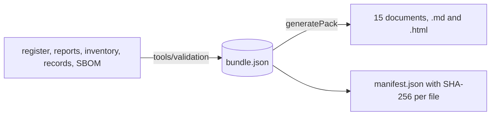

# validation-kit: the evidence bundle and the validation pack generators

**Draft.** This page is still being written; facts on it were checked against the code on 18 October 2026 (Phase 7
slice 7c).

This page explains `packages/validation-kit`: the evidence bundle the validation pack is made from, and the pure
generators that turn one bundle into the documents of the pack. Read it before you add a document to the pack or a
field to the bundle. The tool that builds the bundle from a run and a database is
[tools-validation](tools-validation.md). Pharma terms are in the [glossary](../02-glossary.md).

## Where the code is

| What | Where |
|---|---|
| The bundle schema, types, reader and hash (slice 7-0) | [bundle/](../../../packages/validation-kit/src/bundle/) |
| The example bundle the tests use | [fixtures/example-bundle.json](../../../packages/validation-kit/fixtures/example-bundle.json) |
| The document model, Markdown and HTML rendering | [pack/doc.ts](../../../packages/validation-kit/src/pack/doc.ts) |
| Verdicts, database tests, the risk rules | [pack/facts.ts](../../../packages/validation-kit/src/pack/facts.ts) |
| URS and risk assessment | [pack/requirements.ts](../../../packages/validation-kit/src/pack/requirements.ts) |
| Functional and design specifications | [pack/specs.ts](../../../packages/validation-kit/src/pack/specs.ts) |
| Trace matrix and critical-limit evidence | [pack/trace.ts](../../../packages/validation-kit/src/pack/trace.ts) |
| IQ, OQ, PQ template, periodic-review template | [pack/qualification.ts](../../../packages/validation-kit/src/pack/qualification.ts) |
| Validation summary, release notes, SBOM, known issues, SMF paragraph, AI inventory | [pack/release.ts](../../../packages/validation-kit/src/pack/release.ts) |
| The pack and its manifest | [pack/pack.ts](../../../packages/validation-kit/src/pack/pack.ts) |
| Tests | [test/](../../../packages/validation-kit/test/) |

## What it does

A regulated customer validates the system before GMP use: it needs requirements, a risk assessment, specifications,
test evidence and a trace between them ([DI-03](../../../compliance/controls/DI-03.yaml),
[IN-12](../../../compliance/controls/IN-12.yaml)). The pack is that evidence, generated, never written by hand:

- `generatePack(bundle, previous?)` reads the bundle (checked with `parseBundle`: EBMR-VAL-002, -007, -008), and the
  previous release's bundle for the release notes. It returns the files and the manifest.
- The generators are pure (D-P7-0-1): no database, no file system, no clock. The same bundle gives the same bytes; the
  `[meta] the validation pack is byte-identical for the same bundle` test proves it, also with the bundle's keys in
  another order.
- Every document is Markdown and self-contained HTML (inline style, no script, no external resource). PDF is printed
  from the HTML in a browser; that step belongs to slices 7e and 7f (D-P7-13).
- Each footer names the release, the commit, the schema release and the bundle's SHA-256.

## The documents

`PACK_ARTEFACTS` lists them in order:

| Id | What | Built from |
|---|---|---|
| `urs` | one user requirement per control (UR-&lt;id&gt;), its sources, type, editions, requirement rows; DRAFT and PENDING marked | `register` |
| `risk-assessment` | severity, probability, detectability, risk class and test rigour per requirement (ICH Q9(R1) manner) | `register`, `results` |
| `functional-spec` | modules, routes by namespace, permissions per role, blocks, rule keys, state charts (Mermaid) | `inventory` |
| `design-spec` | boundaries, migrations, triggers, permission matrix, SECURITY DEFINER functions, constraints, privileges, roles, settings, audited tables, meanings, messages | `inventory` |
| `trace-matrix` | clause, control, requirement, design element, test, result, run; both ways; critical limits with boundary tests | `register`, `trace`, `results`, `criticalLimits` |
| `iq` | the IQ checks (`IQ_CHECKS`) and the IQ record of a run | `inventory`, `records` |
| `oq` | the runs and every test with its controls and result | `runs`, `results`, `records` |
| `pq-template` | per MBR: verification steps, acceptance criteria, signatures (DI-04) | `release` |
| `periodic-review-template` | the items of a periodic review of the system | `release` |
| `validation-summary` | scope, runs, deviations, residuals, open expert decisions; the conclusion left to QA | everything |
| `release-notes` | the requirement-level delta against the previous bundle | two bundles |
| `sbom` | the CycloneDX file and its hash | `sbom` |
| `known-issues` | the residuals and open findings | `knownIssues`, `openFindings` |
| `smf-paragraph` | the computerised-systems paragraph of the customer's site master file (IN-12) | `release`, `inventory` |
| `ai-inventory` | each analytics method, its use and versions; refused when one changes GMP data (PR-60) | `analytics` |

### The risk rules

The rules are data in `RISK_RULES` and printed at the top of the risk assessment, so a customer can review them:

- **Severity** is high for a core-class control (decision 0008 section 2) or one that names a high-risk function of build
  outline 9.2 (`HIGH_RISK_FUNCTIONS`); medium for another ENFORCED control; low otherwise.
- **Probability** is low when the database enforces it (a core control with a database test, `isDatabaseTest`), medium
  when only application code does, high when nothing is listed or something is deferred.
- **Detectability** is high when every listed test passed, medium when some did not run, low when one failed.
- The **risk class** and the **test rigour** follow from the three.

> **Why this exists**
> - **Pharma reason:** an AI or statistical output must never change GMP data or status without a person's
>   e-signature; the inventory is the evidence.
> - **Control:** [PR-60](../../../compliance/controls/PR-60.yaml).
> - **Code:** [`aiInventory`](../../../packages/validation-kit/src/pack/release.ts#sym=aiInventory)
> - **Tests:** [pack.test.ts](../../../packages/validation-kit/test/pack.test.ts), tests named `[PR-60]`.
> - **Error:** `EBMR-VAL-009` (the pack is refused when a method says `changesGmpData: true`).

> **Why this exists**
> - **Pharma reason:** every critical limit needs evidence just inside, on and just outside it.
> - **Control:** [DI-06](../../../compliance/controls/DI-06.yaml) clause 2.
> - **Code:** [`criticalLimitEvidence`](../../../packages/validation-kit/src/pack/trace.ts#sym=criticalLimitEvidence)
>   over [critical-limits.yaml](../../../compliance/validation/critical-limits.yaml).
> - **Tests:** [pack.test.ts](../../../packages/validation-kit/test/pack.test.ts), `[DI-06] every critical limit shows
>   its boundary tests in the trace matrix`. A limit whose boundary test is missing or did not pass shows NO EVIDENCE.

## How to test it

`pnpm vitest run packages/validation-kit` (no database). The real bundle of a migrated database is generated in
[tools/validation/test](../../../tools/validation/test/validation.test.ts).

## Adding a document

1. Write a function `(bundle) => Doc` in `pack/` with the document model of `doc.ts` (headings, paragraphs, lists,
   tables, fields, code, signature blocks). Read only the bundle.
2. Add its id to `PACK_ARTEFACTS` and to `packDocuments`.
3. If it needs data the bundle does not have, add an optional field to the bundle (interfaces section 1: additive only)
   and fill it in `tools/validation`.

## Pitfalls

- Sort with `compareText`, never `localeCompare`: the bytes must not depend on a locale.
- Never print a time the bundle did not give: the footer and the documents use only the bundle's times.
- Regulations are paraphrased in every document, as in the code.

## Related pages

- [tools-validation](tools-validation.md): building the bundle, the IQ and OQ scripts.
- [shared-kits](shared-kits.md): the test kit's validation helpers.
- [06-testing-and-debugging](../06-testing-and-debugging.md#generating-the-validation-pack).
- [10-runbooks](../10-runbooks.md#validation-summary-and-system-description-phase-7-slice-7c).
